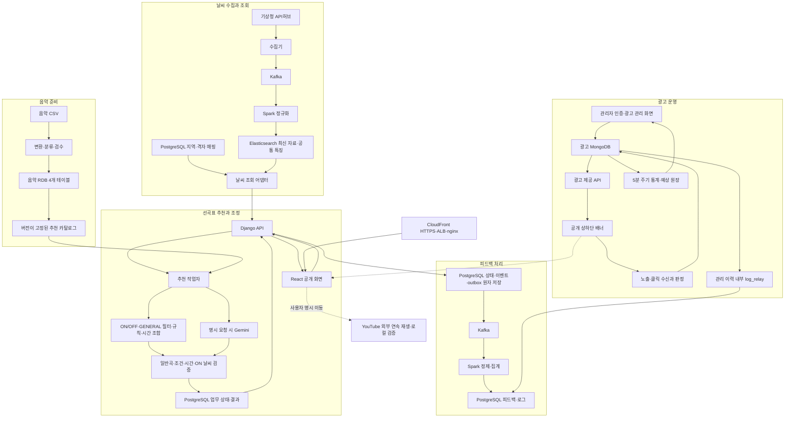
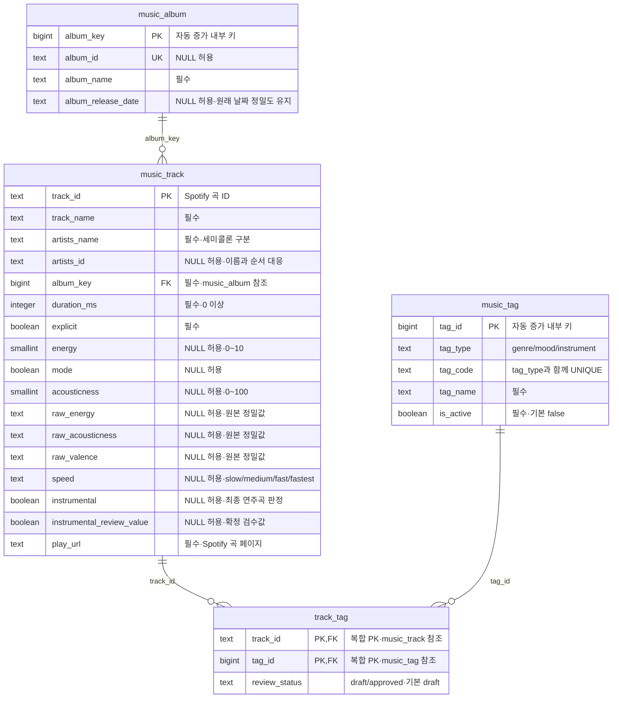
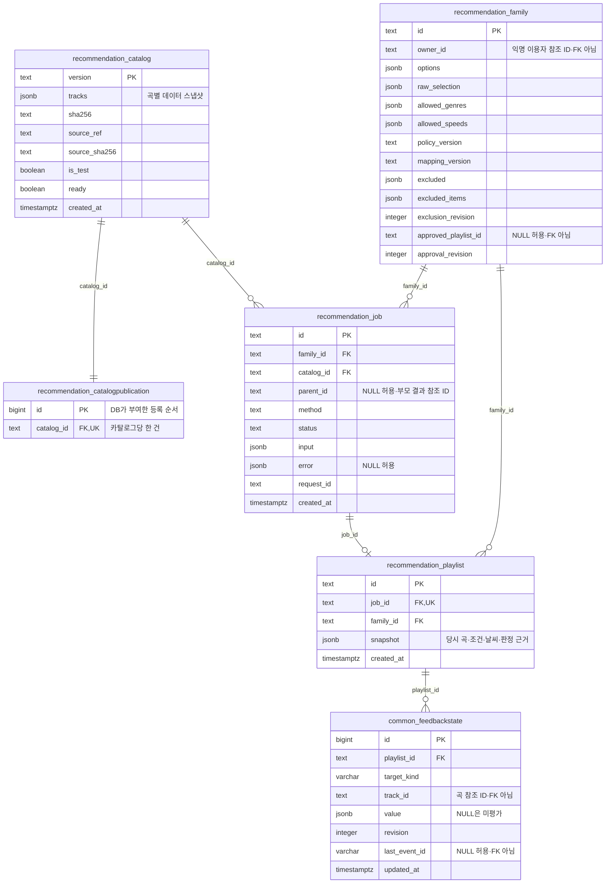
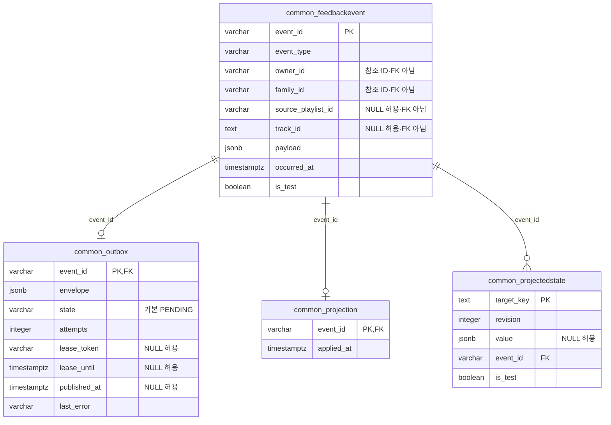
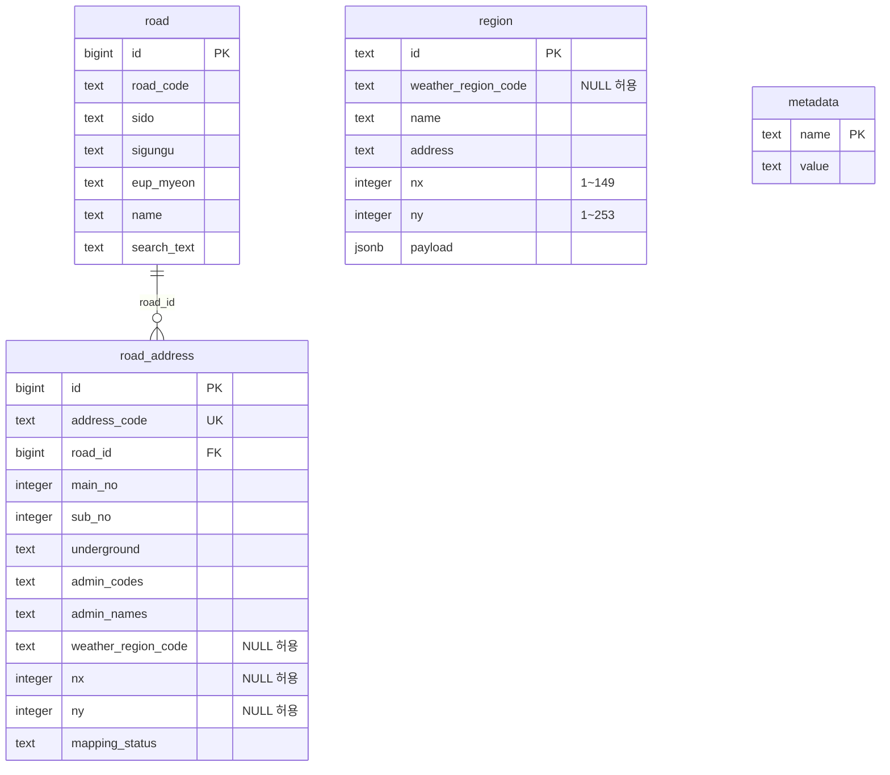
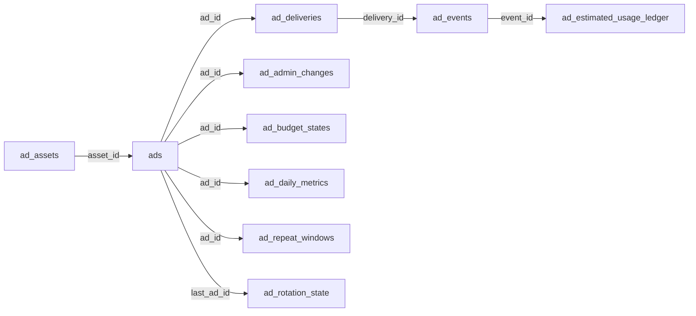
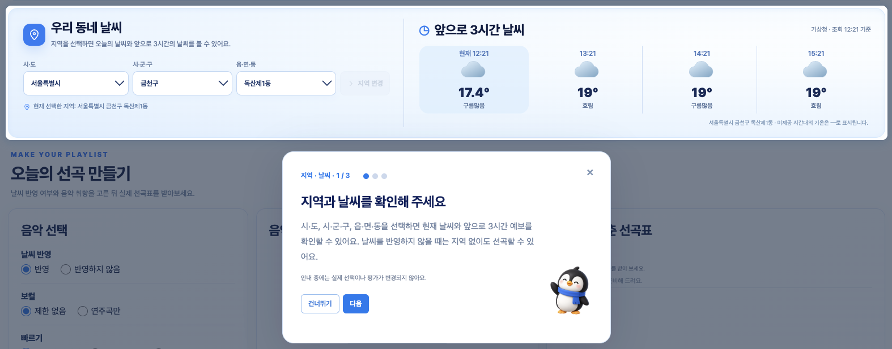
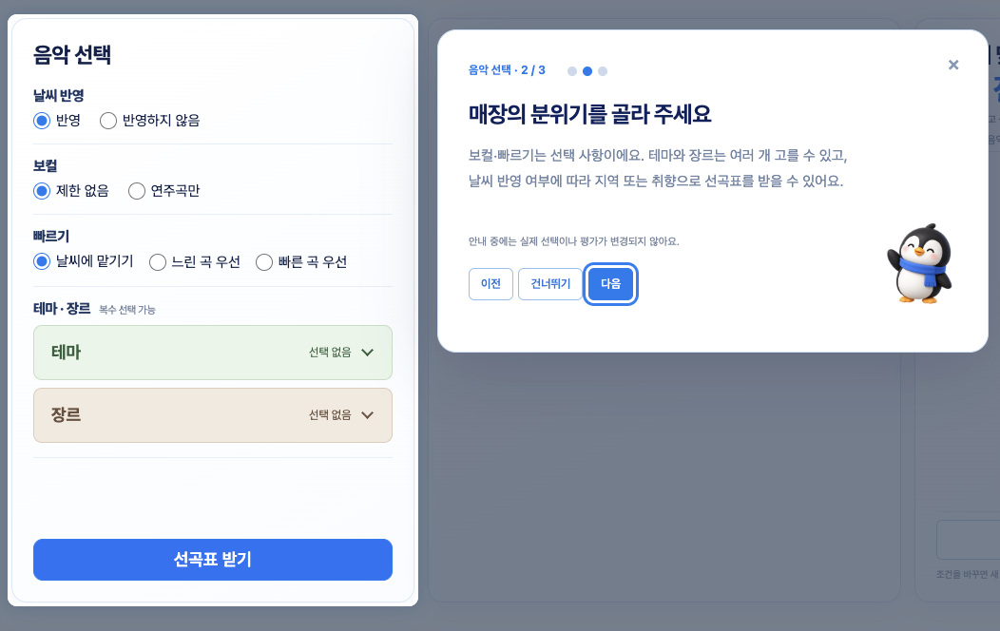
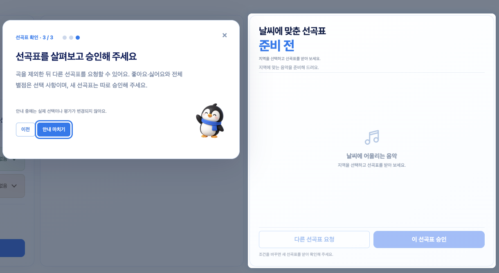
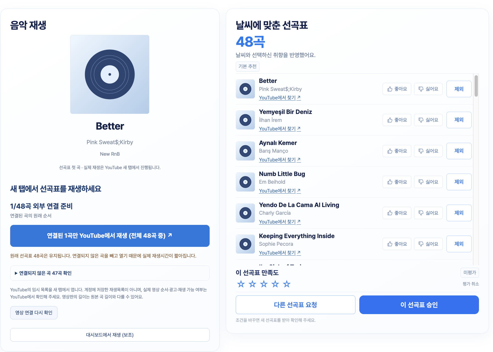

# muther. - "오늘의 날씨를 들어보세요."
### *날씨와 취향을 담은 3시간의 선곡표*


## 1. 팀원 소개

| 이름 | 역할 | 담당 업무 |
|---|---|---|
| 안길찬 | 팀장 | 프론트 및 백엔드·음악 추천 개발 |
| 김건우 | 팀원 | 프로젝트 총괄·백엔드·광고 개발 |
| 김민서 | 팀원 | 음악 데이터 분류·검수 |
| 오재석 | 팀원 | 날씨 데이터 수집·처리 |
| 이인건 | 팀원 | 인프라 구축·배포·운영 |

## 2. 프로젝트 개요

### 프로젝트명

- 뮤더 - 날씨 기반 플레이리스트 생성 서비스

### 프로젝트 기간
- 2026.10.15(목) - 2026.10.19(월)

### 프로젝트 소개

- 뮤더는 music과 weather의 합성어로, 지역별 날씨를 반영하여 플레이리스트를 생성하는 서비스를 제공한다.
- 카페·음식점 등 음악이 필요한 매장의 운영자를 타겟으로 하며, 음악을 직접 선정하는 번거로움을 줄이는 것을 목적으로 한다.
- 날씨 반영에서 그치는 것이 아닌 테마·분위기·장르 등의 요소를 선택해 개인의 취향을 반영할 수 있다.

**사업 목표·평가의 근거는 [BRD](./docs/BRD.md), 제품 기능과 수용 기준은 [PRD](./docs/PRD.md)를 참고한다.*

### 서비스 구현 범위


| 구분 | 범위 |
|---|---|
| 사용자 기능 | 비로그인 음악 추천과 날씨 반영 선택(ON/OFF), 일반곡 판정, 곡 제외, 선곡표 재설정·평가·승인, 사용 안내 |
| 관리 기능 | 음악·피드백 관리, 카페 광고 관리와 성과 측정·집계 |
| 운영 검증 | 서비스 운영과 장애 복구 검증 |
| 로컬 보조 검증 | YouTube 외부 연속 재생 연결과 보조 iframe. 영상 등록·검수는 음악 관리 권한이 있는 관리자만 로컬에서 수행 |


### 사용자 흐름

1. 날씨 반영 여부와 취향을 선택한다. ON은 지역·유효 날씨를 확인하고, OFF는 지역 없이도 추천한다.
2. 곡별 반응·별점을 선택적으로 남기고 사용할 결과를 별도로 승인한다. 재생 연결은 사용자가 직접 선택한다.
3. 선곡표를 확인한 뒤 원하지 않는 곡을 제외한다. 같은 조건의 다른 구성을 원하면 새로운 선곡표를 생성할 수 있다.


## 3. 기술 스택

| 영역 | 기술 | 역할 |
|---|---|---|
| 화면 | React · TypeScript · Vite | 공개 추천·로그인·음악/피드백·광고 관리 화면 |
| API | Python · Django · Django REST Framework | 입력·권한 검사, 작업 등록, 결과·관리 API |
| 온라인 업무·로그 DB | PostgreSQL · Django ORM · migrations | 계정·세션·작업·결과·평가·이벤트·피드백 원본/정제/집계 |
| 기본 추천 | Python 작업자 · OR-Tools CP-SAT · 정수 subset-sum | 필수 조건 검사와 시간 조합. 동일 점수 후보에는 subset-sum 경로 사용 |
| 명시 재설정 | Gemini 3.8 Flash (`gemini-3.8-flash`) · `google-genai` | 같은 조건·적격 후보에서 다른 선곡표 구성 |
| 이벤트 처리 | Kafka · Spark | 날씨·피드백 이벤트 전달, 정규화·정제·집계·재처리 |
| 음악 기준 저장 | PostgreSQL · 음악 속성 4개 테이블 · 불변 카탈로그 | ORM·migration 구현과 AWS 적재·발행 기록이 있으며 적재 체크포인트 등 운영 테이블은 별도 |
| 광고 업무 저장 | MongoDB 광고 전용 논리 DB · replica set 트랜잭션 | 광고·이미지·제공·판정·집계·예상 원장·관리 이력 |
| 날씨 저장·검색 | PostgreSQL · Elasticsearch | PostgreSQL 지역/격자 매핑, Elasticsearch 최신 자료·공통 특징 조회. 현행 날씨 경로는 MongoDB·원천 응답 파일 보관을 사용하지 않음 |
| 원본·배포 자료 | 로컬 파일 · S3 | 음악 원본은 로컬 보존, 운영 S3 보관은 명시 보류. S3 설치 artifact·체크포인트와 구분 |
| 외부 음악 연결 | YouTube 외부 링크 · IFrame Player | API 키 없는 외부 연속 재생 연결과 접이식 보조 플레이어. 로컬 검증과 AWS 적용 구분 |
| 문서·협업 | Markdown · Mermaid · GitHub | 설계 공유, 작업·리뷰·통합 관리 |
| 실행 환경 | 로컬 · AWS EC2/systemd · CloudFront · ALB · nginx | HTTPS 접속 페이지와 AWS 기본 추천 검증 기록 존재. 전체 기능 수용·장애 복구는 별도 |

공통 API와 별도 광고 API는 Django로 실행한다. 음악 원본의 운영 S3 보관은 사용자 결정으로 보류한 상태이며 로컬 원본·해시를 확인한다. 날씨 실행 경로는 PostgreSQL 지역 매핑과 Elasticsearch를 사용한다.

구현·배포 기록은 [통합 구현 기록](https://github.com/encore-ai-campus/mlo-01-p3-team1/blob/183ea87c7fb6f9878da51e51eb5c6408699374ee/docs/development/서비스_통합_구현_변경_라우팅.md)과 [AWS 배포 기록](https://github.com/encore-ai-campus/mlo-01-p3-team1/blob/183ea87c7fb6f9878da51e51eb5c6408699374ee/docs/development/INF_AWS_앱배포_변경_라우팅.md)을 참고한다. 문서와 코드의 확인 범위는 부록에서 구분한다.

### 시스템 구성도



## 4. WBS 및 요구사항 명세서

| 작업 묶음 | 주담당·협력 | 작업내용·주요 산출물 |
|---|---|---|
| 요구사항·UX·수용 기준 | PA · A/B/C/INF 협력 | 입력·화면·범위·검수 기준, 확인할 결정과 시연 계획 |
| 실행·배포 환경 | INF · A/B/C 협력 | DB·Kafka·Spark·검색 환경, 접속·기동·배포·복구 절차, CI·보호 검증 |
| 날씨 | A · C/INF 협력 | 지역/격자 매핑, 수집·정제·저장·조회 코드, 정상·누락·만료 샘플과 검증 |
| 공통 백엔드·피드백 | B · A/C/INF 협력 | 인증·소유·업무 상태·이벤트 저장, 피드백 파이프라인, 관리자 이력 API |
| 음악·추천 | C · B/PA/INF 협력 | CSV 정제·음악 카탈로그, 규칙 추천·Gemini 재설정·검증. 관리/검수 API는 B와 연결 |
| 공개 화면·안내 | C · A/B/PA 협력 | 지역·날씨·선곡표·평가·승인, 공통 로그인·음악/피드백 화면, 펭귄 안내·공개 배너 |
| 광고 | B · C/INF/PA 협력 | B는 관리 화면·API·저장·측정/집계, C는 공개 배너 배치·반응형·화면 연결 |
| 통합 검증·인계 | B 통합 조율 · 전원 | 각 담당의 코드·데이터·권한 검증, INF의 환경/복구 검증, PA의 평가·시연 취합 |

작업별 ID·선행 관계는 [구현 태스크](https://github.com/encore-ai-campus/mlo-01-p3-team1/blob/183ea87c7fb6f9878da51e51eb5c6408699374ee/docs/product/카페_음악_추천_서비스_3차_구현_태스크.md)를 참고하되, 제품 범위와 수용 기준은 수정된 BRD·PRD를 함께 확인한다.

## 5. 요구사항 명세서

| 영역 | 핵심 기준 |
|---|---|
| 날씨·취향 | 초기 날씨 선택은 ON이며 지역 미설정은 OFF로 처리한다. ON의 조회 장애를 임의로 OFF로 바꾸지 않는다. 테마·장르는 복수 선택하고 미선택·전체 선택을 같은 유효 조건으로 해석한다. |
| 기본 추천 | 판정 근거·버전이 있는 일반곡(GENERAL)만 사용하고 시즌·행사곡과 미판정 곡은 제외·보류한다. 중복 없이 목표 180분·허용 176~184분을 충족한다. |
| 날씨 갱신 | ON의 분류 변경에만 규칙 추천으로 새 결과를 만든다. 기존 조건·제외를 유지하며 이전 평가·승인을 복사하지 않고 오래된 응답의 덮어쓰기를 막는다. |
| 조정·평가·승인 | 제외 저장과 재설정 요청을 구분한다. 명시 재설정에만 Gemini를 사용하고 신규 곡·필수 조건을 검증한다. 평가는 선택 사항이며 자동 추천·제외·승인을 실행하지 않는다. 실패하면 기존 결과와 상태를 보존한다. |
| 관리자 | 공통 로그인 후 업무 권한에 맞는 메뉴로 진입하며 음악·피드백·광고 권한을 서버에서 검사한다. |
| 광고 | 통계와 예산 검증은 5분 주기다. 소진 확인 시각부터 신규 제공·기존 표시 자격을 차단하며, 확인 전의 유효 발생은 300초 이내 지연 보고를 인정한다. 실제 잔액은 차감하지 않는다. |

현행 입력·광고 기준은 [통합 정합성 기록](https://github.com/encore-ai-campus/mlo-01-p3-team1/blob/183ea87c7fb6f9878da51e51eb5c6408699374ee/docs/development/통합_정합성_수정_변경_라우팅.md)과 [광고 정책의 확정 절](https://github.com/encore-ai-campus/mlo-01-p3-team1/blob/183ea87c7fb6f9878da51e51eb5c6408699374ee/docs/development/ads/광고_미정_정책_결정_가이드.md)을 확인한다. 보존된 초기 계약·비교 초안을 현행 규정으로 그대로 적용하지 않는다.

## 6. ERD 및 데이터 저장 구조

### 전체 저장 구조

| 저장소 | 저장하는 데이터 | 주요 연결 기준 |
|---|---|---|
| PostgreSQL | 음악·검수·출처, 추천 조건·작업·선곡표, 익명 이용자·관리자, 피드백·이벤트, 지역·주소 매핑 | 곡 ID, 카탈로그 버전, 추천 계열·작업·선곡표 ID, 지역·격자 |
| MongoDB | 광고·이미지, 제공·측정 기록, 예상 사용량·예산 상태·일별 통계, 관리 이력 | 광고·이미지·제공·이벤트 ID |
| Elasticsearch | 격자별 최신 날씨와 추천에 사용하는 공통 특징 | 격자 좌표 `nx`, `ny` |
| 로컬 SQLite | YouTube 영상 매핑과 검수 이력 | 곡 ID와 영상 ID. 로컬 시험 전용 |

아래 구조는 BRD·PRD가 참조하는 구현 커밋 `183ea87` 기준이다. 관계형 데이터는 테이블명과 주요 컬럼·자료형·키를, MongoDB와 Elasticsearch는 문서 구조와 참조 ID를 표시했다. PK는 기본 키, FK는 DB 외래 키, UK는 고유 키다. JSON 내부 값과 일반 ID 참조를 DB 외래 키로 표시하지 않는다. 4차 사용자 계정·결제는 현재 구조에 포함하지 않는다.

### 음악·검수 ERD

음악 속성은 아래 4개 테이블에 저장한다. 자료형은 PostgreSQL 기준이며, 검수·출처·적재 상태는 별도 테이블에서 관리한다.



| 테이블 | 기본 키 | 역할 |
|---|---|---|
| music_album | album_key | 앨범 정보 |
| music_track | track_id | 곡·아티스트·음악 특성값과 앨범 참조 |
| music_tag | tag_id | 장르·분위기·악기 공통 사전 |
| track_tag | track_id + tag_id | 곡과 태그의 복수 연결·승인 상태 |

검수와 원본 추적에 사용하는 테이블은 다음과 같다.

| 테이블 | 키·연결 | 주요 컬럼과 자료형 |
|---|---|---|
| `common_review` | `track_id` PK·FK → `music_track` | `revision` integer, `status` varchar, `reason` text, `updated_at` timestamptz |
| `common_reviewchange` | `id` varchar PK, `actor_id` FK → 관리자 계정. `track_id`는 text 참조 ID | `revision` integer, `snapshot` jsonb, `occurred_at` timestamptz |
| `common_musicsource` | `sha256` varchar PK | `schema` varchar, `raw_path` text, `archive` jsonb, `created_at` timestamptz |
| `common_trackorigin` | `track_id` PK·FK → `music_track`, `source_id` FK → `common_musicsource.sha256` | 곡과 원본 파일의 연결 |
| `music_import_run` | `source_sha256` varchar PK. 원본 해시로 식별하며 FK는 아님 | `source_schema_version` varchar, `total_count`·`processed_count`·`error_count` integer, `last_track_id` text NULL, `completed` boolean, `updated_at` timestamptz |

곡 하나는 검수 상태·원본 연결을 각각 최대 하나씩 가진다. 검수 변경 이력은 당시 값을 `snapshot`에 남기며, 적재 진행 상태는 음악 속성 테이블과 분리한다.

참조: [음악 ORM](https://github.com/encore-ai-campus/mlo-01-p3-team1/blob/183ea87c7fb6f9878da51e51eb5c6408699374ee/backend/music/models.py), [공통 ORM](https://github.com/encore-ai-campus/mlo-01-p3-team1/blob/183ea87c7fb6f9878da51e51eb5c6408699374ee/backend/common/models.py), [음악 테이블 설계](https://github.com/encore-ai-campus/mlo-01-p3-team1/blob/183ea87c7fb6f9878da51e51eb5c6408699374ee/docs/handoff/music/테이블_구조_설계.md).

</details>

| SQLite 테이블 | 키·연결 | 컬럼과 자료형 |
|---|---|---|
| `track_revision` | `track_id` text PK | `revision` integer |
| `mapping` | 복합 PK(`track_id`, `video_id`), `track_id` FK → `track_revision` | `status` text(CANDIDATE/VERIFIED/BLOCKED), `source`·`note`·`reason` text, `identity_confirmed`·`playback_observed` integer, `duration_seconds` real NULL, `observed_at` text NULL, `updated_at` text |
| `review_audit` | `id` integer PK. `track_id`·`video_id`는 text 참조 ID | `action` text, `revision` integer, `created_at` text |

`mapping`에는 외부 재생 연결 검수용 `native_verified` integer, `native_duration_seconds` real NULL, `native_observed_at` text NULL, `native_source`·`native_reason` text도 있다. 영상 매핑의 곡 ID는 PostgreSQL 음악 테이블과 같은 식별자를 사용하지만 DB 간 외래 키는 없다. 운영용 영상 검수 저장소로 간주하지 않는다.

참조: [영상 매핑 저장 코드](https://github.com/encore-ai-campus/mlo-01-p3-team1/blob/183ea87c7fb6f9878da51e51eb5c6408699374ee/backend/recommendation/youtube_registry.py).

</details>

### 추천·피드백 ERD

`Family`는 같은 시작 조건으로 만든 추천 결과의 계열이다. 조건·제외·승인 상태를 유지하고, 각 추천 시도는 `Job`, 성공 결과는 `Playlist`에 저장한다. 아래 그림은 주요 업무 컬럼을 표시했다.



`common_feedbackstate`는 (`playlist_id`, `target_kind`, `track_id`) 조합이 고유하다. 선곡표의 곡 목록은 `snapshot` JSON에 저장하며 별도 선곡표–곡 연결 테이블은 없다. 카탈로그의 `tracks`도 JSON 스냅샷이므로 현재 음악 행을 외래 키로 연결한 것으로 해석하지 않는다.

피드백 변경 이벤트와 전달·반영 상태는 다음 구조로 관리한다.



`Outbox`는 업무 이벤트의 전송 대기 상태, `Projection`은 이벤트 반영 기록, `ProjectedState`는 반영 후 상태를 저장한다. 현재 평가값을 담는 `common_feedbackstate`와 변경 시점의 내용을 남기는 `common_feedbackevent`를 구분한다.

<details>
<summary>이용자·관리자와 처리 보조 테이블</summary>

| 테이블 | 키·주요 컬럼과 자료형 | 역할·제약 |
|---|---|---|
| `common_guest` | `id` varchar PK, `token_hash` varchar UK, `expires_at`·`created_at` timestamptz, `active` boolean | 비로그인 이용자 식별. `Family.owner_id` 등과 ID로 대조하며 FK는 없음 |
| `auth_user`·`auth_group`·`auth_permission` 및 연결 테이블 | 관리자 계정 ID, 그룹·권한 ID | Django 인증의 관리자·권한 구조. `manage_music`·`manage_ads`·`view_feedback`을 구분하며 4차 일반 사용자 계정과 분리 |
| `common_adminaction` | `id` bigint PK, `actor_id` FK → 관리자, `scope` text, `key`·`fingerprint` varchar, `response` jsonb, `status` smallint | (`actor_id`, `scope`, `key`) 고유. 같은 관리 요청의 중복 처리 방지 |
| `common_streamrecord` | `stream_key` text PK, `event_id` varchar, `envelope` jsonb, `received_at` timestamptz | Kafka의 topic·partition·offset별 수신 기록. `event_id`는 FK가 아님 |
| `common_eventsnapshot` | `id` varchar PK, `kind` varchar, `data` jsonb | 이벤트에 연결된 당시 자료 |
| `recommendation_ownerlock` | `owner_id` text PK | 같은 소유자의 처리 충돌 제어 |
| `recommendation_idempotency` | `id` bigint PK, `owner_id`·`scope`·`key` text, `body`·`response` jsonb, `status` smallint | (`owner_id`, `scope`, `key`) 고유. 같은 요청에 대한 응답 보관 |
| `recommendation_pendingevent` | `event_id` text PK, `event_type` text, `payload` jsonb, `occurred_at` timestamptz | 추천 측의 이벤트 인계 대기. 공통 Outbox와 연결 방식 구분 |
| `recommendation_demofeedback` | `id` bigint PK, `playlist_id` FK, `target_kind`·`track_id` text, `value` jsonb NULL, `revision` integer, `last_event_id` text NULL, `updated_at` timestamptz | 로컬 CSV 프리뷰용. 공통 피드백과 별도 테이블이며 (`playlist_id`, `target_kind`, `track_id`) 고유 |

`recommendation_job`에는 작업자 처리권 관리를 위한 `lease_token` text NULL, `lease_generation` integer, `lease_expires_at` timestamptz NULL과 외부 모델 호출 기록인 `provider_attempted` boolean, `provider_diagnostics` jsonb도 있다.

</details>

참조: [추천 ORM](https://github.com/encore-ai-campus/mlo-01-p3-team1/blob/183ea87c7fb6f9878da51e51eb5c6408699374ee/backend/recommendation/models.py), [공통 ORM](https://github.com/encore-ai-campus/mlo-01-p3-team1/blob/183ea87c7fb6f9878da51e51eb5c6408699374ee/backend/common/models.py), [인증·DB 설정](https://github.com/encore-ai-campus/mlo-01-p3-team1/blob/183ea87c7fb6f9878da51e51eb5c6408699374ee/backend/cafe/settings.py).

### 지역·날씨 저장 구조

지역·도로명주소와 기상 격자 매핑은 PostgreSQL의 `weather_mapping` 스키마에 저장한다.



`region.weather_region_code`와 `road_address(road_id, main_no, sub_no)`에 조회 인덱스가 있다. 지역과 도로명주소는 코드·격자로 연결하며 둘 사이의 FK는 없다. `metadata`는 매핑 자료의 메타데이터를 저장한다.

날씨 최신 상태는 `WEATHER_INDEX`로 지정한 Elasticsearch 인덱스에 저장한다. 문서 ID는 `nx_ny` 형식이며, 아래 필드는 `es_latest.py`의 실제 저장 구조를 따른다.

| 필드 | JSON 자료형 | 내용 |
|---|---|---|
| `_id` | string | 격자 식별자. 예: `60_127` |
| `schema_version`, `revision` | number(정수) | 문서 규격·갱신 버전 |
| `state_hash` | string | 저장된 날씨 행의 해시 |
| `rows` | array | 출처·발표시각·대상시각·항목별 정규화 날씨 |
| `view` | object | 관측·예보와 추천용 날씨 특징을 묶은 조회 자료 |
| `stored_at` | string(날짜·시각) | 저장 시각 |

지역 매핑의 격자로 날씨 문서를 조회한다. DB 간 FK는 없으며, Elasticsearch의 `_seq_no`·`_primary_term`으로 동시 갱신을 제어한다. 조회 시에는 날씨 유효기간을 다시 검사한다. 현재 경로에 사용하지 않는 과거 날씨 MongoDB·원문 파일 보관 구조는 포함하지 않았다.

참조: [지역·주소 DDL](https://github.com/encore-ai-campus/mlo-01-p3-team1/blob/183ea87c7fb6f9878da51e51eb5c6408699374ee/pipeline/weather/mapping_postgres.sql), [격자별 날씨 저장·조회](https://github.com/encore-ai-campus/mlo-01-p3-team1/blob/183ea87c7fb6f9878da51e51eb5c6408699374ee/pipeline/weather/es_latest.py).

### 광고 컬렉션 구조

광고는 MongoDB에 저장한다. 아래 화살표는 문서의 ID 참조이며 RDB의 외래 키가 아니다.



전 컬렉션의 `_id`는 string 식별자이며, 아래 표는 주요 필드다. `date`는 BSON 날짜, `object`는 중첩 문서다.

| 컬렉션 | 주요 필드와 자료형 | 역할·고유 조건 |
|---|---|---|
| `ads` | `asset_id`·`title`·`link_url`·`placement` string, `starts_at`·`ends_at` date, `priority`·`version` integer, `paused` bool, `stopped_at` date/null | 광고 내용·게시 기간·중단 상태. 예산·차단 관련 필드도 보유 |
| `ad_assets` | `image_bytes` binData, `mime_type`·`sha256` string, `byte_size`·`width`·`height` integer, `uploaded_by_account_id` string | 광고 이미지 원본·규격·등록자 |
| `ad_admin_changes` | `ad_id` string/null, `asset_id`·`actor_account_id`·`operation` string, `before_snapshot` object/null, `after_snapshot` object, `log_relay`·`log_record` object | 등록·수정·중단 이력과 로그 전달·저장 정보. 관리자·요청 키로 중복 관리 |
| `ad_deliveries` | `ad_id`·`placement` string, `owner_guest_id` string/null, `ad_snapshot` object, `issued_at`·`event_expires_at` date, `claims` object | 실제 제공한 광고와 측정 자격. (`owner_guest_id`, `placement`, `request_key_hash`, `is_test`)에 부분 고유 인덱스 적용 |
| `ad_events` | `event_id`·`delivery_id`·`ad_id`·`event_type` string, `occurred_at`·`received_at`·`processed_at` date, `result` string, `counted` bool | 노출·클릭 판정. `event_id` 고유, `_id`와 동일 |
| `ad_repeat_windows` | `owner_guest_id`·`ad_id`·`placement`·`event_type` string, `accepted_at` date, `revision` integer | 같은 이용자의 반복 측정 억제. 이용자·광고·위치·유형·시험 여부 조합 고유 |
| `ad_estimated_usage_ledger` | `event_id`·`delivery_id`·`ad_id`·`metric_date_kst` string, `unit_tokens`·`estimated_tokens` integer, `status` string | 인정된 이벤트의 예상 사용량. `event_id` 고유. 실제 결제·잔액 원장은 아님 |
| `ad_budget_states` | `ad_id`·`budget_version`·`metric_date_kst` string, `daily_budget_tokens`·`total_budget_tokens`·`daily_tokens`·`total_tokens` integer, `verified_at` date | 일일·누적 예산과 소진 검증 상태. (`ad_id`, `budget_version`, `metric_date_kst`, `is_test`) 고유 |
| `ad_daily_metrics` | `ad_id`·`placement`·`metric_date_kst`·`source` string, `impressions`·`clicks`·`estimated_tokens` integer, `as_of` date | 광고별 일별 노출·클릭·예상 사용량 집계. (`ad_id`, `placement`, `metric_date_kst`, `is_test`) 고유 |
| `ad_rotation_state` | `placement`·`last_ad_id` string, `revision` integer, `updated_at` date | 광고 위치별 순환 제공 상태. (`placement`, `is_test`) 고유 |

광고의 관리자·익명 이용자 ID는 공통 인증 정보와 연결하지만 MongoDB와 PostgreSQL 사이의 FK는 없다. 관리·측정 문서의 로그 전달 정보도 두 DB에 대한 원자적 동시 쓰기를 뜻하지 않는다.

참조: [관리 컬렉션 스키마](https://github.com/encore-ai-campus/mlo-01-p3-team1/blob/183ea87c7fb6f9878da51e51eb5c6408699374ee/ad-server/backend/domains/ads/schemas/management_manifest.json), [제공·측정 스키마](https://github.com/encore-ai-campus/mlo-01-p3-team1/blob/183ea87c7fb6f9878da51e51eb5c6408699374ee/ad-server/backend/domains/ads/schemas/public_manifest.json), [예산·통계 스키마](https://github.com/encore-ai-campus/mlo-01-p3-team1/blob/183ea87c7fb6f9878da51e51eb5c6408699374ee/ad-server/backend/domains/ads/schemas/policy_manifest.json).

## 7. 주요 프로시저

| 순서 | 주요 절차 | 작업내용 |
|---|---|---|
| 1 | 날씨 수집·정제·조회 | PostgreSQL 매핑으로 지역·격자를 연결하고 Kafka·Spark를 거쳐 Elasticsearch 최신 자료·공통 특징에 반영. 원천 응답 파일은 보관하지 않음 |
| 2 | 음악 정제·검수·발행 | CSV 변환·중복/오류 처리, 분류·검수·승인 후 버전이 고정된 추천 카탈로그 준비 |
| 3 | 기본 추천 | GENERAL 후보와 조건·카탈로그를 고정하고 날씨 ON/OFF별 점수·시간 조합 후 결과 저장. 지역 미설정은 OFF, ON은 유효 날씨 검증 |
| 4 | 날씨 분류 갱신 | ON의 분류 변경과 갱신 가능 상태를 확인해 같은 조건·제외로 규칙 추천. 같은 분류·OFF는 유지하고 실패·오래된 응답에서 기존 결과 보존 |
| 5 | 제외·재설정·승인 | 전체 제외 초안을 저장하고 명시 요청에만 같은 조건으로 재설정. 신규 곡·시간·필수 조건 검증 후 새 결과를 저장하고 별도 승인 |
| 6 | 피드백 기록·집계 | 평가·제외·취소·재설정·승인의 당시 조건과 결과 버전을 저장하고 이벤트를 정제·집계 |
| 7 | 광고 관리·제공 | 관리자 인증 후 등록·수정·중단·미리보기, 게시 자격과 위치에 따른 공개 제공 |
| 8 | 광고 측정·통계 | 유효 노출·클릭을 판정해 예상 원장에 기록하고 5분 주기로 통계·예산 검증. 소진 확인 이후 제공·표시 차단과 지연 보고 경계를 구분 |

### 기술별 입력·처리·출력(IN/OUT)

| 기술·구간 | 입력(IN) | 주요 처리 | 출력(OUT) |
|---|---|---|---|
| React | 사용자 선택·조작, API 응답 | 화면 상태·입력·반응형·안내 관리 | API 요청, 날씨·선곡표·관리 화면 |
| Django·DRF | 지역·취향·제외·평가·관리 요청 | 타입·소유·권한·버전 검사, 작업 등록·상태 저장 | 작업 ID·상태·결과·오류 응답 |
| 음악 RDB·카탈로그 | 정제 곡·앨범·태그·검수값 | 키·승인·GENERAL 판정·곡당 한 행 검증과 버전 고정 | 적격 음악 조회 자료·catalog_version |
| 추천 작업자 | 적격 일반곡·날씨 모드·취향·정책 | 모드별 필터·점수와 CP-SAT/정수 subset-sum 시간 조합 | 서버 검증을 거친 기본 선곡표 또는 실패 상태 |
| Gemini 어댑터 | 같은 적격 후보·시작 조건·저장된 제외 목록 | 명시 재설정 요청과 응답 해석 | 서버에서 신규 곡·시간·필수 조건을 검사할 재설정 후보 |
| Kafka | 날씨·업무 이벤트 | 영역별 전달·소비 | Spark 처리용 이벤트 |
| Spark | 날씨·피드백 이벤트 | 정규화·정제·집계·중복/역순 처리 | Elasticsearch 최신 자료·공통 특징, PostgreSQL 피드백 원본·정제·집계 |
| MongoDB | 광고·이미지·관리 변경·측정 자료 | 광고 영역 트랜잭션·판정·집계 | 광고 제공·통계 자료, PostgreSQL로 전달할 관리 로그 |
| Elasticsearch | 정규화 날씨·공통 특징 | 격자별 최신 상태 저장·조회·만료 검사 | 지역·대상시각별 날씨·상태·추천 입력 |
| PostgreSQL | 업무 상태·이벤트·당시 자료·정제/집계·로그 사본 | 원자 저장·중복 방지·조회·재처리 이력 관리 | 본인 결과·피드백·관리 조회·진단 자료 |
| 로컬 파일·S3 | 음악 원본, 설치 artifact·체크포인트 | 원본 근거·버전·해시 보관. 음악 원본의 운영 S3 보관은 보류 | 추적·재처리·복구용 자료 |

### 폴더 구조

BRD·PRD가 참조하는 구현 커밋 `183ea87`의 주요 폴더 구조다. 현재 `main`과 로컬 작업본은 문서 중심이며, 아래 서비스 코드는 해당 구현 커밋에서 확인할 수 있다.

```text
.
├─ README.md
├─ AGENTS.md
├─ CONTRIBUTING.md
├─ frontend/                   공개·관리자 화면
├─ backend/
│  ├─ cafe/                    Django 설정
│  ├─ common/                  인증·권한·피드백·공통 처리
│  ├─ music/                   음악 데이터·적재
│  ├─ recommendation/          추천·선곡표·YouTube 연결
│  └─ weather/                 날씨·지역 조회 API
├─ ad-server/                  광고 API·MongoDB·집계
├─ pipeline/
│  ├─ weather/                 날씨 수집·정제·발행
│  ├─ music/                   음악 데이터 처리
│  └─ feedback/                피드백 이벤트 처리
├─ music_playback/             일반곡 판정·선곡표 구성 보조
├─ aws-infra/                  AWS 인프라 설치·설정·모니터링
├─ deployment/aws/             앱 배포 설정
├─ config/                     입력 계약·환경 설정
├─ scripts/                    실행·관리 스크립트
├─ tests/                      테스트
├─ .github/workflows/          CI 워크플로
├─ analysis/                   분석·검증 자료
├─ prototype/                  YouTube 플레이어 시제품
└─ docs/
   ├─ BRD.md                   사업 요구사항
   ├─ PRD.md                   제품 요구사항
   ├─ product/                 기능·추천·계약·구현 태스크
   │  └─ archive/              이전 정책 이력
   ├─ contracts/               기계 판독 계약
   ├─ fixtures/                고정 예시·검증 자료
   ├─ handoff/                 음악·날씨·광고·인프라 인계
   ├─ development/             구현·변경 기록
   ├─ acceptance/              검증 결과와 증빙
   ├─ runbook/                 실행·운영·복구 절차
   └─ assets/                  화면 시안·안내 이미지 등 문서 자산
```

참조: [구현 트리](https://github.com/encore-ai-campus/mlo-01-p3-team1/tree/183ea87c7fb6f9878da51e51eb5c6408699374ee), [실행·운영 안내](https://github.com/encore-ai-campus/mlo-01-p3-team1/tree/183ea87c7fb6f9878da51e51eb5c6408699374ee/docs/runbook).

## 8. 수행결과(테스트/시연 페이지)

### 기록으로 확인한 범위

- 다음은 BRD·PRD와 구현·배포 기록에 남은 결과를 요약한 것이다. 이번 README 검수에서 서비스 시험을 새로 실행한 결과는 아니다.

| 영역 | 확인 기록 | 검증 범위 |
|---|---|---|
| 음악·기본 추천 | 정상 곡 89,740건 적재·사용자 확인에 따른 승인·카탈로그 발행, AWS 기본 추천 3개 조건 성공 | 최신 일반곡 정책과 배포 버전 일치, 전체 조건별 성공률·품질은 별도 확인 |
| 날씨·운영 | AWS 수집→Kafka→Spark→Elasticsearch와 실제 지역 조회·접속 기록 | 전 지역 가용성·운영 집계·부하·장애 전환·복구 전체를 확인한 결과는 아님 |
| Gemini | 실제 생성 요청의 503 응답과 기존 결과 보존 기록 | 실제 생성 성공·지연·품질·비용은 추가 검증 대상 |
| YouTube | 외부 링크·보조 iframe·공통 관리자 검수 연결과 일부 자연 전환의 로컬 기록 | 운영 배포·전곡 연결·3시간 완주와 구분. 영상 검수는 로컬 시험 모드의 음악 권한으로 제한 |
| 사용자 효과 | 준비 시간·부담·만족도·ON/OFF 비교 등의 평가 방법 제시 | BRD의 측정 제안과 실제 합의·수행한 평가를 구분 |

**89,741개는 최초 원본의 고유 ID 수이며, 89,740개는 필수 이름 누락 1곡을 격리한 정상 곡 수다. 과거 발행 수치를 최신 GENERAL 적격곡 수로 사용하지 않는다.*

참조: [BRD의 현재 확인 상태](./docs/BRD.md), [AWS 적재·발행·추천 기록](https://github.com/encore-ai-campus/mlo-01-p3-team1/blob/183ea87c7fb6f9878da51e51eb5c6408699374ee/docs/development/INF_AWS_앱배포_변경_라우팅.md), [통합 검증 기록](https://github.com/encore-ai-campus/mlo-01-p3-team1/blob/183ea87c7fb6f9878da51e51eb5c6408699374ee/docs/development/통합_정합성_수정_변경_라우팅.md).

### 테스트와 평가 기준

- [PRD](./docs/PRD.md)의 수용 기준으로 ON/OFF, 일반곡·시간·제외·중복, 날씨 분류 갱신, 재설정 실패 보존, 권한·평가·집계, 광고 소진·지연 보고 경계를 확인한다. 코드 시험·실제 API/DB·브라우저·운영 복구의 증빙은 구분한다.

- 로컬 CSV 프리뷰는 클릭부터 곡 목록 표시까지 **P95 2.5초 이하를 목표**로 한다. 목표를 실측 달성값으로 표현하지 않으며, 운영·Gemini·동시 요청·복구 성능은 해당 환경의 합의 기준과 결과를 확인한다. 일부 조합 계산 속도로 전체 요청 응답 시간을 대신하지 않는다.

### 서비스 접속·시연 화면










## 9. 한 줄 회고

| 담당 | 한 줄 회고 |
|---|---|
| 안길찬 | 작성 대기 |
| 김건우 | 작성 대기 |
| 김민서 | 작성 대기 |
| 오재석 | 작성 대기 |
| 이인건 | 작성 대기 |

## 10. PPT 링크

발표 자료 링크 등록 대기.

---

## develop 통합 기술 문서 (2026-10-19)

최신 사용자·운영 서비스와 프로젝트 소개는 이 README를 기준으로 합니다.
`develop` 브랜치에서 작성한 개발 이력·기술 경로·이전 계약 설명은
[develop README 원문 보존본](./README-develop-20261019.md)에 원래 링크 경로와 함께 보관했습니다.
구현·배포 시에는 이 보존본의 과거 상태 설명보다 각 최신 개발 문서 및 실제 운영 검증 결과를 우선합니다.
