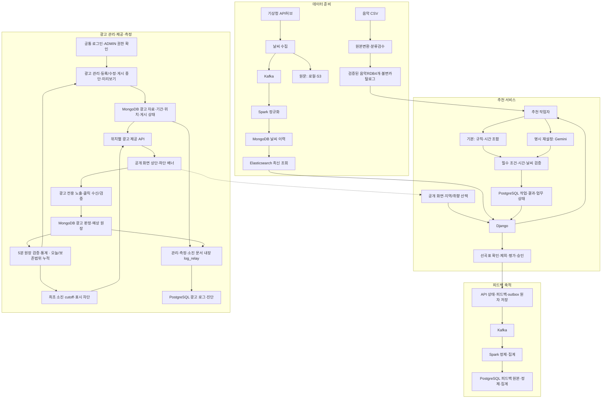

# 카페 날씨 기반 음악 서비스

지역의 날씨와 음악 취향을 반영해 카페 운영자에게 선곡표를 제공하는 서비스입니다.

- 수정일: 2026-10-15
- 현재 단계: 제품 계약·데이터 인계와 광고 관리·공개 API/MongoDB 원자 저장 구현. 광고5분 예산/통계 코드 연결. 공유 인증·상시 배치·로그 실연결과 후속 기능은 인계 대기입니다.

## 로컬 광고 제어 확인

사용자 요청으로 기존 광고 API를 직접 확인하는 [임시 관리 도구](./docs/development/ads/임시_광고_관리_도구.md)를 추가합니다. 별도 설정·테스트 DB의 `http://127.0.0.1:8001/dev/ads/`에서 광고 저장/중단·미리보기·예산/통계를 확인하는 범위입니다. 정식 React 관리자·공유 인증/로그·공개 배너/운영 연결의 완료와 구분하며 실행 방법과 실제 검증 상태는 도구 안내/수용 기록을 따릅니다.

## 2026-10-14 음악 담당 수령 문서 우선 적용

[음악 통합 계약](./docs/product/3차_음악_정책_통합_계약.md)을 적용합니다. 추천·표시18개 + 검수 보조1개·RDB4개·원본 변환·날씨50:45:5/전체75:25·장르/speed 필수 필터·사이클 고정·PTY6/7·시간176~184분을 기준으로 합니다. 새 자료의 미정은 유지하며 수동 전용16개·음악 S3 기준 저장·자동25% 단축과 동시에 적용하지 않습니다.

## 2026-10-14 저장소 결정과 광고 인계

2026-10-14 새 음악 문서 우선 지시로 음악 기준 저장은 **RDB 4개 테이블**과 추천·표시18개/검수 보조1개로 변경합니다. 음악 원본 CSV·백업/불변 내보내기는 로컬/S3 보관 가능하며 S3만을 음악 기준 DB로 사용하지 않습니다. 로그·피드백/공통 업무 상태는 PostgreSQL, 광고는 MongoDB, 날씨 MongoDB/Elasticsearch·원문 로컬/S3는 유지합니다. 3차 음원 파일·직접 재생은 추가하지 않습니다. [저장 경계와 발행 계약](./docs/product/3차_저장소_경계와_발행_계약.md)과 [ADS 인계](./docs/handoff/ads/README.md)를 적용하며 실제 설치·접속·운영 검증 완료와 구분합니다.


## 1. 프로젝트 소개

운영자가 동 단위 지역을 선택하면 현재 날씨와 예보를 확인하고 매장 분위기에 맞는 선곡표를 받을 수 있습니다. 보컬·빠르기·테마·장르는 선택 사항이며 기본 추천은 비로그인으로 이용합니다.

3차에는 규칙 기반 추천·Gemini 재설정·평가·관리자 기능·상하단 광고를 개발합니다. 4차에는 사용자 계정·선곡표 저장/이력·결제를 연결하며 외부 재생목록 연결은 선택 확장입니다.

## 2. 주요 기능

| 기능 | 제공 방향 |
|---|---|
| 지역·날씨 | 동 단위 지역, 현재 날씨와 앞 3시간 예보 표시. 수집/조회는 6시간 범위 |
| 기본 추천 | 검수된 음악과 날씨·취향을 사용한 규칙 추천 및 시간 조합 |
| 취향 선택 | 보컬·빠르기·테마/장르 복수 선택. 국가·언어 기능은 3차에서 제외 |
| 제외·재설정·승인 | 제외 초안 저장, Gemini 3.8 Flash(`gemini-3.8-flash`) 명시 재설정, 검증된 결과 버전 승인 |
| 음악 평가 | 곡별 좋아요/싫어요, 선곡표 전체 별점 1~5점과 평가 취소 |
| 사용 안내 | 같은 펭귄 원본을 사용하는 3단계 안내와 다시 보기 |
| 관리자 | 로그인·음악 등록/검수·제외 피드백 조회·광고 운영/통계 |
| 광고 | 상하단 배너·별도 측정. 익명 문맥/광고별 노출60초·클릭5분 제한, 지연5분·발생일KST, 광고 원본/delivery90일·집계/예상 원장/관리 변경 이력365일 |

표준선곡목표는180분/허용176~184분이며새음악규칙우선으로자동시간단축은미사용입니다. 메인에는 재생시간을 표시하지 않고 서버에서 검증합니다. 혼합최초speed·테마정렬·실제분류/환경 등 남은사항은 [확인·인계 목록](./docs/product/3차_사용자_확인과_담당자_인계_목록.md)에서 관리합니다.

화면 참고: [메인](./docs/assets/mockups/05-main-v8-compact-feedback-no-language.png) · [로그인](./docs/assets/mockups/06-login.png) · [광고 관리자](./docs/assets/mockups/07-admin-ads.png)

## 3. 기술 스택

다음은 문서 개발 기준입니다. 실제 설치 버전·접속·실행 결과는 환경 검증 후 확정합니다.

| 영역 | 기술/구성 |
|---|---|
| 프론트엔드 | React · TypeScript · Vite |
| API | Python · Django · Django REST Framework |
| 온라인 업무 DB | PostgreSQL · Django ORM · Django migrations |
| 규칙 추천 작업자 | Python · OR-Tools CP-SAT |
| 명시 재설정 | Gemini 3.8 Flash (`gemini-3.8-flash`) · Google Gen AI Python SDK (`google-genai`) |
| 이벤트 처리 | Kafka · Spark |
| 음악 메타데이터·카탈로그 | RDB4개·18개/검수보조·불변카탈로그·원본/백업은로컬/S3 |
| 로그·피드백 원본/정제/집계 | PostgreSQL |
| 광고 업무 데이터 | MongoDB · 광고 전용 논리 DB/트랜잭션 |
| 날씨 이력·최신 조회 | MongoDB · Elasticsearch |
| 날씨 원문 보관 | 로컬 파일 · S3 |
| 환경 | 로컬 클러스터 연결 검증 후 AWS 이전 |

음악은 보유 CSV와 18개 추천·표시 컬럼 기준으로 정제·검수하며 음악 RDB 제품/DDL·불변 발행 규격은 별도 인계 사항입니다. 기술 상세는 [공통 개발 계약](./docs/product/3차_공통_개발_계약과_검증_기준.md)을 따릅니다.

## 4. 시스템 구성도

아래는 구현할 구성이며 설치·운영 연결 완료를 나타내지 않습니다.



광고는 별도 도메인에서 관리해 공개 화면의 상하단 배너에 연결합니다. 광고 지표는 음악 피드백과 분리합니다. 미리보기·화면 밖·배경 탭·이미지 로딩 실패는 실제 노출로 집계하지 않으며, 광고 없음·지연·실패가 기본 추천을 막지 않도록 처리합니다. B는 광고 관리 화면·API·제공·측정/집계를, C는 공개 배너 배치·반응형·추천 조작과의 격리를 담당합니다. 상세 API·저장·예외 흐름은 [구현 설계도](./docs/product/카페_음악_서비스_구현_설계도.md)를 참조합니다.

## 5. 폴더 구조와 담당 분야

현재 저장소는 문서·계약·검증 자료·시안 중심입니다.

```text
.
├─ README.md                 프로젝트 안내
├─ AGENTS.md                 담당 경계·작업 기준
├─ CONTRIBUTING.md           GitHub 협업 방침
├─ ad-server/                광고 서버 코드와 환경 설정
│  ├─ backend/               Django/DRF·광고 로직·MongoDB 저장·테스트
│  └─ config/environments/ads/ 로컬 MongoDB replica set·Compose
└─ docs/
   ├─ product/               기능·설계·추천·태스크·공통 계약
   │  └─ archive/            이전 설계 이력
   ├─ contracts/             기계 판독 계약
   ├─ fixtures/              문서 단계의 고정 검증 자료
   ├─ handoff/
   │  ├─ ads/                광고 화면/API·MongoDB·로그/검증 인계
   │  ├─ infra/              인프라 인계
   │  ├─ music/              음악 규격 인계
   │  └─ weather/            날씨 수집·정제·저장 인계
   ├─ backend-routing/       광고 코드·API의 1:1 라우팅 문서
   ├─ development/ads/       광고 데이터·로직 구현 인계
   ├─ runbook/               실행·설정·복구 인계
   ├─ acceptance/            실제 검증 결과
   └─ assets/
      ├─ mockups/            화면 시안·생성 프롬프트
      └─ penguin/            확정 공통 펭귄 원본
```

광고의 실제 코드·환경은 [ad-server/](./ad-server/README.md)에 모았습니다. AGENTS·설계도의
`frontend/`, `backend/`, `pipeline/`, `config/`, `fixtures/`는 전체 팀의 통합 구조 예시이며,
이번 광고 폴더 재배치가 다른 도메인의 구현이나 배포 완료를 뜻하지 않습니다.

| 담당 | 분야 |
|---|---|
| A | 날씨 수집·지역 매핑·정규화·저장/조회 코드와 검증 |
| B | 공통 백엔드·피드백·광고 API/집계·광고 관리 화면·통합 조율 |
| C | 공개 프론트엔드·공통 로그인/음악/피드백 화면·공개 상하단 광고 배너 배치·추천·음악 데이터 |
| INF | 설치·접속·운영 환경·CI/보호·배포/복구 |
| PL | 기획·UX·분류/수용 기준·일정·검수/시연 취합 |

실제 이름과 일정은 미배정이며 상세 경계는 [AGENTS.md](./AGENTS.md)를 따릅니다.

## 6. 개발 시작 방법

광고 관리·공개 서버의 의존성·잠금 파일과 실행 명령은 [광고 backend 안내](./ad-server/backend/README.md)에
있습니다. 광고 API와 코드의 연결은 [라우팅 색인](./docs/backend-routing/README.md)을 따릅니다.
나머지 서비스·공유 인증/로그의 실제 연결은 담당자 인계와 검증이 필요합니다.

광고 선정·표시 상한·측정 판정과 공개 API·MongoDB 원자 저장은
[공개 선정·측정 인계](./docs/development/ads/공개_선정과_측정_로직_인계.md)에 연결했습니다.
`GET /api/ads`, `POST /api/ad-events`, `GET /api/ad-deliveries/{delivery_id}/image`를 구현했고
관리3·공개5·정책2 컬렉션을 사용합니다. 사용자 확정은 배달30분·표시/보고 분리·소재교체 후 옛 배달 차단·통계/예산 검증 모두5분입니다. 소진 확인 cutoff 이후 신규/재확인/이미지를 차단하고 이전 유효 발생만300초 내 초과 인정합니다. 자동 종료는 소진/게시 기간, 수동 paused는 별도 유지합니다. 실예산은 관리API 입력값이며 기본값·예약·최소잔여23/20은 없습니다.

`ADS_PUBLIC_POLICY_PROVIDER=domains.ads.runtime_policy.get_public_policy`를 명시 설정합니다. 상태 누락은 부적격,300초 초과 stale는503입니다. 공유 guest·서명·절대HTTPS 주소도 필수입니다. `apply_ads_policy_schema`는 dry-run 기본, `refresh_ads_policy`는1회/--watch300초 시작 간격, `relay_ads_budget_logs`는 기존 durable sink 연결입니다. 관리자 화면은 별도 담당자 작업이며 실제 watch·공유PostgreSQL·브라우저/AWS 연결은 미완료입니다.

1. [서비스 흐름](./docs/product/카페_음악_서비스_기능_및_사용자_흐름_정리.md)과 [공통 개발 계약](./docs/product/3차_공통_개발_계약과_검증_기준.md)으로 기능·API·상태 기준을 확인합니다.
2. [구현 태스크](./docs/product/카페_음악_추천_서비스_3차_구현_태스크.md)에서 담당 작업 ID와 직접 선행 조건을 확인합니다.
3. [인프라 인계 안내](./docs/handoff/infra/README.md)의 로컬 가이드 → AWS 계획 순서로 읽고 INF와 실제 버전·서비스 배치·접속을 검증합니다. AWS 계획의 공개 예시 값과 미조율 서비스 계약을 실제 설정으로 사용하지 않습니다.
4. A의 날씨 계약/고정 샘플을 공유해 B/C가 병행 개발하고 최소 추천 흐름부터 연결합니다.
5. 각 담당이 실행 명령·환경 변수 이름·검증/복구 결과를 기록하고 실제 자료 연결을 별도로 확인합니다.

실제 비밀키·비밀번호·개인정보는 저장소에 넣지 않습니다. 자료 수령·샘플 검증과 실제 운영 연결은 구분합니다.

## 7. 협업 방법과 상세 문서

광고는 [통합·추가 인계](./docs/handoff/ads/05_광고_간소화_통합과_추가_인계.md)를 기준으로 합니다. 3차는 카페 전용으로 MongoDB 이미지 Binary·관리3·공개5·정책2 컬렉션·관리/공개 API·5분 통계/예산 검증을 연결했습니다. 실제 공유 환경·상시 배치·공개 배너·AWS 운영 검증은 별도입니다. 업종 선택·태그·업종별 매칭은 [4차 확장 가이드](./docs/handoff/ads/06_4차_광고_업종매칭_확장_가이드.md)로 분리합니다.

브랜치 기본안은 `main`(검증된 기준/릴리스)·`develop`(통합)·작업별 브랜치입니다. develop에서 분기해 PR·리뷰로 통합하고 검증 후 main에 반영합니다. 2026-10-14 확인 기준으로 origin과 로컬/원격 main·develop은 구성되어 있으며 GitHub 기본 브랜치는 main입니다. `.github` 파일은 없고 실제 팀 계정/병합 권한·보호·CI·배포는 검증 대기입니다. 확인 상태와 상세 절차는 [CONTRIBUTING.md](./CONTRIBUTING.md#2-브랜치-구성과-작업-시작)를 따릅니다.

| 문서 | 확인할 내용 |
|---|---|
| [서비스 기능 및 사용자 흐름](./docs/product/카페_음악_서비스_기능_및_사용자_흐름_정리.md) | 기능·화면·3차/4차 범위 |
| [구현 설계도](./docs/product/카페_음악_서비스_구현_설계도.md) | API·저장·작업 처리·예외 |
| [추천 로직 가이드](./docs/product/카페_음악_추천_서비스_3차_컬럼_기반_추천_로직_가이드.md) | 음악18개·기본 규칙·시간·검증 |
| [Gemini 재설정 설계](./docs/product/카페_음악_서비스_3차_Gemini_API_추천_설계.md) | 외부 응답·후보 제한·실패/부모 보존 |
| [구현 태스크](./docs/product/카페_음악_추천_서비스_3차_구현_태스크.md) | 작업 ID·선행 관계·완료 조건 |
| [공통 개발 계약](./docs/product/3차_공통_개발_계약과_검증_기준.md) | 기술·입출력·상태·공통 검증 |
| [확인·인계 목록](./docs/product/3차_사용자_확인과_담당자_인계_목록.md) | 남은 결정·담당 자료·보완 사항 |
| [구현 결정과 원문 보관](./docs/product/3차_구현_결정과_익명문맥_원문보관_가이드.md) | 최신 결정·익명 소유·로컬/S3·인프라 수령 상태 |
| [광고 정책과 결정사항](./docs/product/3차_광고_운영_회의_결정사항_목록.md) | 광고 운영·측정·초기 정책과 남은 결정 |
| [ADS 인계](./docs/handoff/ads/README.md) | 관리/공개 연결·MongoDB 저장·PostgreSQL 로그·환경/검증 |
| [저장 경계와 발행 계약](./docs/product/3차_저장소_경계와_발행_계약.md) | 음악RDB4개·원본/백업S3·로그 PostgreSQL·광고 MongoDB |
| [음악 컬럼 정의](./docs/handoff/music/음악_분류_컬럼_정의.md) | 음악18개·변환·검수 특성·검수 입력 |
| [날씨 인계 자료](./docs/handoff/weather/01_날씨_수집과_지역매핑.md) | 수집/지역 매핑부터 정제·저장·분류로 연결 |
| [인프라 인계 안내](./docs/handoff/infra/README.md) · [AWS 구축 계획](./docs/handoff/infra/AWS_인프라_구축_계획서.md) | 로컬 개발에서 AWS 이전으로 연결·원문 수령 상태·서비스 조율 사항 |

안내 시안: [1 지역·날씨](./docs/assets/mockups/01-guide-region-weather-3step.png) · [2 음악 취향](./docs/assets/mockups/02-guide-music-3step.png) · [3 선곡표](./docs/assets/mockups/03-guide-playlist-3step.png). 공통 자산은 [확정 펭귄 PNG](./docs/assets/penguin/penguin-guide-first.png)를 재사용합니다.

이전 정책은 `docs/product/archive/`에 보관합니다. 시안·인계 자료의 시험 이력과 현행 계약은 구분하며 미확보 코드 링크는 실제 실행 경로로 간주하지 않습니다.
