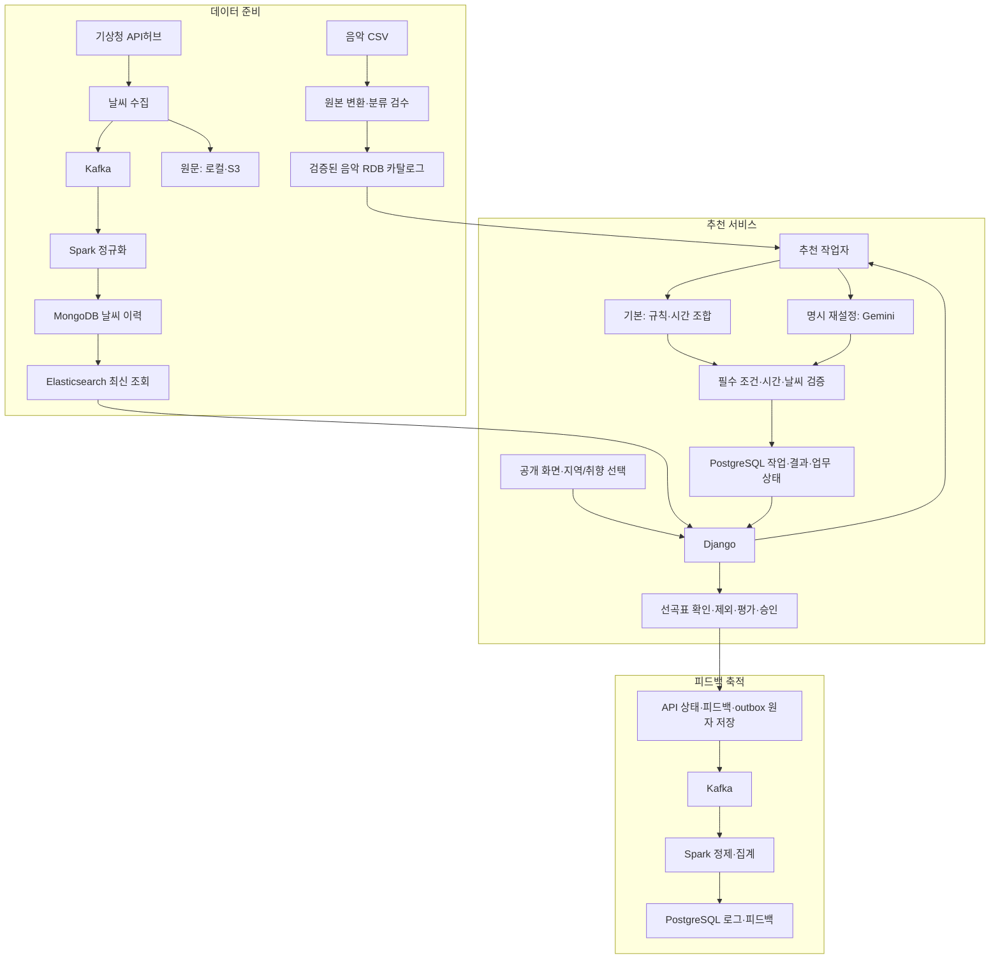

# 카페 날씨 기반 음악 서비스

지역의 날씨와 음악 취향을 반영해 카페 운영자에게 선곡표를 제공하는 서비스입니다.

- 수정일: 2026-10-16
- 현재 단계: develop에 광고·추천/음악·공개 화면·날씨 코드를 수령한 뒤 폴더/개발 경로를 정리했습니다. 공유 인증·실제 DB/날씨·운영 통합은 별도 검증 대기입니다.

## 통합 작업 시작점 — 2026-10-16

기준은 `develop@b4499c5`이며 광고(PR #5), 추천·음악·공개 화면(PR #6), 날씨(PR #7)가 반영돼 있습니다. INF의 `aws-infra/`는 아직 develop에 포함되지 않았습니다.

현재 실제 경로·분리된 실행 환경·이동 전후 매핑·검증은 [통합 폴더 변경 라우팅](./docs/development/통합_폴더_정리_변경_라우팅.md), 분야별 문서 진입은 [개발 문서 색인](./docs/development/README.md), 설정 위치는 [환경 설정 안내](./config/environments/README.md)를 먼저 확인합니다. 수령 원문은 보존하며 예전 코드 경로는 변경 라우팅의 매핑으로 찾아갑니다.

추천·음악의 기존 구현/검증 이력은 [C 실행 인계](./docs/runbook/C_구현과_연결_인계.md)와 [C 검증 기록](./docs/acceptance/C_로컬_검증_20261015.md), 광고는 [광고 실행 인계](./docs/runbook/광고_서버_개발_준비.md)를 따릅니다. 과거 실행 결과와 이번 경로 변경 검증을 구분합니다.

## 1. 프로젝트 소개

운영자가 동 단위 지역을 선택하면 현재 날씨와 예보를 확인하고 매장 분위기에 맞는 선곡표를 받을 수 있습니다. 보컬·빠르기·테마·장르는 선택 사항이며 기본 추천은 비로그인으로 이용합니다.

3차에는 규칙 기반 추천·Gemini 재설정·평가·관리자 기능·상하단 광고를 개발합니다. 4차에는 사용자 계정·선곡표 저장/이력·결제를 연결하며 외부 재생목록 연결은 선택 확장입니다.

## 2. 주요 기능

| 기능 | 제공 방향 |
|---|---|
| 지역·날씨 | 동 단위 지역, 현재 날씨와 앞 3시간 예보 표시. 수집/조회는 6시간 범위 |
| 기본 추천 | 검수된 음악과 날씨·취향을 사용한 규칙 추천 및 시간 조합 |
| 취향 선택 | 보컬·빠르기·테마/장르 복수 선택. 국가·언어 기능은 3차에서 제외 |
| 제외·재설정·승인 | 제외 초안 저장, Gemini 3.8 Flash(`gemini-3.8-flash`) 명시 재설정, 검증된 결과 버전 승인 |
| 음악 평가 | 곡별 좋아요/싫어요, 선곡표 전체 별점 1~5점과 평가 취소 |
| 사용 안내 | 같은 펭귄 원본을 사용하는 3단계 안내와 다시 보기 |
| 관리자 | 로그인·음악 등록/검수·제외 피드백 조회·광고 운영/통계 |
| 광고 | 상하단 배너·별도 측정. 익명 문맥/광고별 노출60초·클릭5분 제한, 지연5분·발생일KST, 광고 원본/delivery90일·집계/예상 원장/관리 변경 이력365일 |

표준 선곡 목표는 180분, 허용 범위는 176~184분이며 자동 단축은 사용하지 않습니다. 메인에는 재생시간을 표시하지 않고 서버에서 검증합니다. W 공식은 음악 통합 계약의 50:45:5와 0~100 척도를 적용하고, 취향 선택 시 전체75:25를 유지합니다. 혼합 최초 auto/fast·실제 검수·환경 등 미정은 임의 확정하지 않습니다.

화면 참고: [메인](./docs/assets/mockups/05-main-v8-compact-feedback-no-language.png) · [로그인](./docs/assets/mockups/06-login.png) · [광고 관리자](./docs/assets/mockups/07-admin-ads.png)

## 3. 기술 스택

다음은 문서 개발 기준입니다. 실제 설치 버전·접속·실행 결과는 환경 검증 후 확정합니다.

| 영역 | 기술/구성 |
|---|---|
| 프론트엔드 | React · TypeScript · Vite |
| API | Python · Django · Django REST Framework |
| 온라인 업무 DB | PostgreSQL · Django ORM/migrations (로컬 고정 검증은 명시적 SQLite 모드) |
| 규칙 추천 작업자 | Python · OR-Tools CP-SAT |
| 명시 재설정 | Gemini 3.8 Flash (`gemini-3.8-flash`) · Google Gen AI Python SDK (`google-genai`) |
| 이벤트 처리 | Kafka · Spark |
| 로그·피드백 | PostgreSQL · B 담당 실제 파이프라인 연결 대기 |
| 날씨 이력·최신 조회 | MongoDB · Elasticsearch |
| 날씨 원문 보관 | 로컬 파일 · S3 |
| 환경 | 로컬 클러스터 연결 검증 후 AWS 이전 |

음악은 저장소에 포함한 [spotify_dataset.csv](./docs/handoff/music/spotify_dataset.csv)와 추천·표시18개＋검수 보조1개를 사용합니다. 음악4개 테이블의 ORM 모델/초기 migration은 작성했으며 실제 음악 RDB 제품/접속/운영 DDL 확정과는 구분합니다. [음악 인계](./docs/handoff/music/README.md)와 C 실행 인계를 함께 확인합니다.

## 4. 시스템 구성도

아래는 구현할 구성이며 설치·운영 연결 완료를 나타내지 않습니다.



광고는 별도 도메인에서 관리해 공개 화면의 상하단 배너에 연결합니다. 광고 지표는 음악 피드백과 분리합니다. 상세 API·저장·예외 흐름은 [구현 설계도](./docs/product/카페_음악_서비스_구현_설계도.md)를 참조합니다.

## 5. 폴더 구조와 담당 분야

```text
frontend/
  src/features/             공개 추천·날씨·음악 선택·평가·광고 배너·안내·관리 화면
  src/shared/               공통 API 클라이언트·타입
  src/components/           공통 헤더·아이콘
  tests/                    개발 API 프록시 연결 검증
backend/
  cafe/                     추천/공통 API 호스트 설정·URL
  recommendation/           추천 API·작업자·결과/평가
  music/                    음악 모델·발행·migration
  weather/                  지역·도로명·날씨 조회 함수(HTTP 어댑터 연결 대기)
ad-server/
  backend/                  독립 광고 Django·MongoDB·광고 작업자·로컬 도구
  config/environments/ads/   광고 로컬 DB 환경
pipeline/
  music/                    음악 입력·정제
  weather/                  날씨 수집·정규화·저장/발행·Spark 패키징
config/environments/        실행 단위별 환경 위치 안내
tests/                     날씨 경로·Spark ZIP 회귀 검증
docs/
  development/              현행 코드 경로·변경 라우팅·문서 색인
  backend-routing/          기존 광고 파일별 인계 색인
  handoff/                  수령 원문(변경하지 않음)
  product/                  제품 기준·보관 이력
  runbook/ acceptance/       기존 실행·검증 이력
  contracts/ fixtures/      API 계약·고정 예시
  assets/                   목업·공통 펭귄 원본
```

광고와 추천은 현재 별도 Django 실행 단위입니다. 같은 가상환경에 의존성을 합치지 않습니다. Vite에서 광고 API는 기본 8000, 나머지 API는 기본 8001로 전달합니다. 공유 ADMIN/guest·지역 HTTP API·날씨 추천 입력 어댑터와 운영 배포는 이 폴더 정리로 완료되지 않습니다.

| 담당 | 분야 |
|---|---|
| A | 날씨 수집·지역 매핑·정규화·저장/조회 코드와 검증 |
| B | 공통 백엔드·피드백·광고 API/집계·광고 관리 화면·통합 조율 |
| C | 공개 프론트엔드·공통 로그인/음악/피드백 화면·추천·음악 데이터 |
| INF | 설치·접속·운영 환경·CI/보호·배포/복구 |
| PL | 기획·UX·분류/수용 기준·일정·검수/시연 취합 |

실제 이름과 일정은 미배정이며 상세 경계는 [AGENTS.md](./AGENTS.md)를 따릅니다.

## 6. 개발 시작 방법

1. [개발 문서 색인](./docs/development/README.md)에서 제품 기준 → 분야별 인계 → 현재 코드 경로 순서로 확인합니다.
2. [환경 설정 안내](./config/environments/README.md)에 따라 추천·광고·날씨 의존성과 설정을 분리합니다. 실제 비밀값은 추적하지 않습니다.
3. 추천 API는 기존 루트 가상환경에서 `python -m backend.manage runserver 127.0.0.1:8001`, 광고 API는 광고 가상환경/폴더에서 `python manage.py run_ads_dev --port 8000`을 사용합니다. 해당 실행 모드의 필수 설정과 공유 인증 대기를 먼저 확인합니다.
4. 프론트는 `frontend/`에서 `pnpm dev`로 실행합니다. 개발 프록시 목적지는 `.env.local`에서 지정할 수 있습니다. 광고 sandbox의 단독 8001 실행과 추천 API 8001을 동시에 사용하지 않습니다.
5. 날씨 명령은 저장소 루트에서 `python -m pipeline.weather.run_collector`, `python -m pipeline.weather.submit_spark`, `python -m pipeline.weather.publish_admin`입니다. 이 명령들은 실제 외부 호출/저장을 수행하므로 INF/A 설정과 준비가 필요하며 이번 정리에서 실행하지 않았습니다.

날씨 `.env` 인계 위치는 `pipeline/weather/.env`입니다. 파일 배치만으로 자동 로드되지는 않으며 실행 프로세스에 환경변수를 전달해야 합니다. 추천·광고 작업자/자료 준비와 실제 실행의 자세한 경계는 [통합 폴더 변경 라우팅](./docs/development/통합_폴더_정리_변경_라우팅.md)을 따릅니다.

## 7. 협업 방법과 상세 문서

브랜치 기본안은 `main`(검증된 기준/릴리스)·`develop`(통합)·작업별 브랜치입니다. develop에서 분기해 PR·리뷰로 통합하고 검증 후 main에 반영합니다. 원격 저장소와 main/develop은 존재합니다. 보호 설정·필수 CI의 실제 적용 여부는 별도 확인 대상이며 상세 절차는 [CONTRIBUTING.md](./CONTRIBUTING.md)를 따릅니다.

| 문서 | 확인할 내용 |
|---|---|
| [서비스 기능 및 사용자 흐름](./docs/product/카페_음악_서비스_기능_및_사용자_흐름_정리.md) | 기능·화면·3차/4차 범위 |
| [구현 설계도](./docs/product/카페_음악_서비스_구현_설계도.md) | API·저장·작업 처리·예외 |
| [음악 통합 계약](./docs/product/3차_음악_정책_통합_계약.md) | 현행 음악18개/검수 보조·필수 필터·규칙/Gemini·176~184분 |
| [Gemini 재설정 설계](./docs/product/카페_음악_서비스_3차_Gemini_API_추천_설계.md) | 외부 응답·후보 제한·실패/부모 보존 |
| [구현 태스크](./docs/product/카페_음악_추천_서비스_3차_구현_태스크.md) | 작업 ID·선행 관계·완료 조건 |
| [공통 개발 계약](./docs/product/3차_공통_개발_계약과_검증_기준.md) | 기술·입출력·상태·공통 검증 |
| [확인·인계 목록](./docs/product/3차_사용자_확인과_담당자_인계_목록.md) | 남은 결정·담당 자료·보완 사항 |
| [구현 결정과 원문 보관](./docs/product/3차_구현_결정과_익명문맥_원문보관_가이드.md) | 최신 결정·익명 소유·로컬/S3·인프라 수령 상태 |
| [광고 정책과 결정사항](./docs/product/3차_광고_운영_회의_결정사항_목록.md) | 광고 운영·측정·초기 정책과 남은 결정 |
| [음악 컬럼 정의](./docs/handoff/music/음악_분류_컬럼_정의.md) | 음악18개·원본 변환·검수 우선 입력 |
| [날씨 인계 자료](./docs/handoff/weather/01_날씨_수집과_지역매핑.md) | 수집/지역 매핑부터 정제·저장·분류로 연결 |
| [인프라 인계 안내](./docs/handoff/infra/README.md) · [AWS 구축 계획](./docs/handoff/infra/AWS_인프라_구축_계획서.md) | 로컬 개발에서 AWS 이전으로 연결·원문 수령 상태·서비스 조율 사항 |

안내 시안: [1 지역·날씨](./docs/assets/mockups/01-guide-region-weather-3step.png) · [2 음악 취향](./docs/assets/mockups/02-guide-music-3step.png) · [3 선곡표](./docs/assets/mockups/03-guide-playlist-3step.png). 공통 자산은 [확정 펭귄 PNG](./docs/assets/penguin/penguin-guide-first.png)를 재사용합니다.

이전 정책은 `docs/product/archive/`에 보관합니다. 시안·인계 자료의 시험 이력과 현행 계약은 구분하며 미확보 코드 링크는 실제 실행 경로로 간주하지 않습니다.
