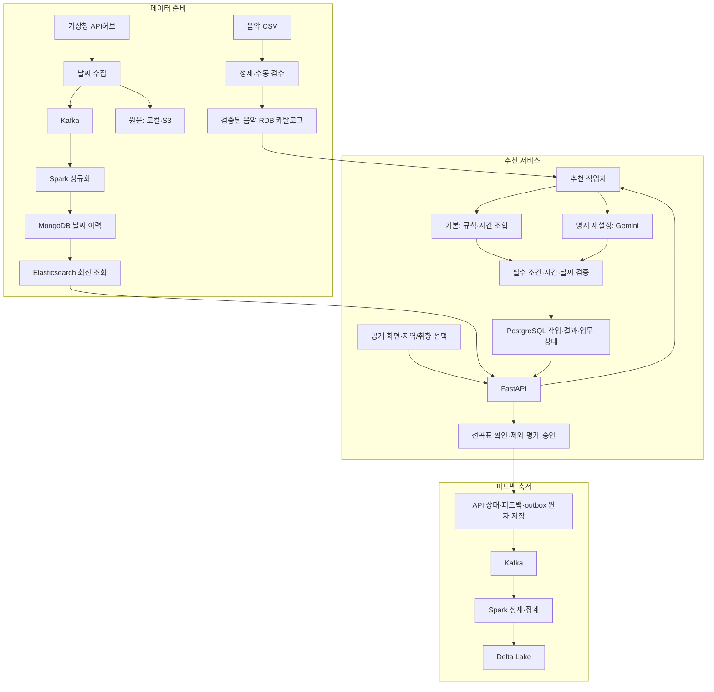

# 카페 날씨 기반 음악 서비스

지역의 날씨와 음악 취향을 반영해 카페 운영자에게 선곡표를 제공하는 서비스입니다.

- 수정일: 2026-10-14
- 현재 단계: 제품 설계·데이터 인계·개발 계약 정리. 애플리케이션 코드는 구현 전입니다.

## 1. 프로젝트 소개

운영자가 동 단위 지역을 선택하면 현재 날씨와 예보를 확인하고 매장 분위기에 맞는 선곡표를 받을 수 있습니다. 보컬·빠르기·테마·장르는 선택 사항이며 기본 추천은 비로그인으로 이용합니다.

3차에는 규칙 기반 추천·Gemini 재설정·평가·관리자 기능·상하단 광고를 개발합니다. 4차에는 사용자 계정·선곡표 저장/이력·결제를 연결하며 외부 재생목록 연결은 선택 확장입니다.

## 2. 주요 기능

| 기능 | 제공 방향 |
|---|---|
| 지역·날씨 | 동 단위 지역, 현재 날씨와 앞 3시간 예보 표시. 수집/조회는 6시간 범위 |
| 기본 추천 | 검수된 음악과 날씨·취향을 사용한 규칙 추천 및 시간 조합 |
| 취향 선택 | 보컬·빠르기·테마/장르 복수 선택. 국가·언어 기능은 3차에서 제외 |
| 제외·재설정·승인 | 제외 초안 저장, Gemini 3.8 Flash(`gemini-3.8-flash`) 명시 재설정, 검증된 결과 버전 승인 |
| 음악 평가 | 곡별 좋아요/싫어요, 선곡표 전체 별점 1~5점과 평가 취소 |
| 사용 안내 | 같은 펭귄 원본을 사용하는 3단계 안내와 다시 보기 |
| 관리자 | 로그인·음악 등록/검수·제외 피드백 조회·광고 운영/통계 |
| 광고 | 상하단 배너·별도 측정. 익명 문맥/광고별 노출60초·클릭5분 제한, 지연5분·발생일KST, 광고 원본/delivery90일·집계/예상 원장/관리 변경 이력365일 |

표준 선곡 목표는 180분이며 후보 부족이 확인되면 최대 25% 자동 단축 정책을 적용합니다. 메인에는 재생시간을 표시하지 않고 서버에서 검증합니다. 날씨 적합도 W·음악 입력 보강 등 남은 사항은 [확인·인계 목록](./docs/product/3차_사용자_확인과_담당자_인계_목록.md)에서 관리합니다.

화면 참고: [메인](./docs/assets/mockups/05-main-v8-compact-feedback-no-language.png) · [로그인](./docs/assets/mockups/06-login.png) · [광고 관리자](./docs/assets/mockups/07-admin-ads.png)

## 3. 기술 스택

다음은 문서 개발 기준입니다. 실제 설치 버전·접속·실행 결과는 환경 검증 후 확정합니다.

| 영역 | 기술/구성 |
|---|---|
| 프론트엔드 | React · TypeScript · Vite |
| API | Python · FastAPI · Pydantic |
| 온라인 업무 DB | PostgreSQL · SQLAlchemy · Alembic |
| 규칙 추천 작업자 | Python · OR-Tools CP-SAT |
| 명시 재설정 | Gemini 3.8 Flash (`gemini-3.8-flash`) · Google Gen AI Python SDK (`google-genai`) |
| 이벤트 처리 | Kafka · Spark |
| 피드백 장기 데이터 | Delta Lake |
| 날씨 이력·최신 조회 | MongoDB · Elasticsearch |
| 날씨 원문 보관 | 로컬 파일 · S3 |
| 환경 | 로컬 클러스터 연결 검증 후 AWS 이전 |

음악은 보유 CSV와 16개 관리 컬럼 기준으로 정제·검수하며 음악 RDB 제품/DDL은 별도 인계 사항입니다. 기술 상세는 [공통 개발 계약](./docs/product/3차_공통_개발_계약과_검증_기준.md)을 따릅니다.

## 4. 시스템 구성도

아래는 구현할 구성이며 설치·운영 연결 완료를 나타내지 않습니다.



광고는 별도 도메인에서 관리해 공개 화면의 상하단 배너에 연결합니다. 광고 지표는 음악 피드백과 분리합니다. 상세 API·저장·예외 흐름은 [구현 설계도](./docs/product/카페_음악_서비스_구현_설계도.md)를 참조합니다.

## 5. 폴더 구조와 담당 분야

현재 저장소는 문서·계약·검증 자료·시안 중심입니다.

```text
.
├─ README.md                 프로젝트 안내
├─ AGENTS.md                 담당 경계·작업 기준
├─ CONTRIBUTING.md           GitHub 협업 방침
└─ docs/
   ├─ product/               기능·설계·추천·태스크·공통 계약
   │  └─ archive/            이전 설계 이력
   ├─ contracts/             기계 판독 계약
   ├─ fixtures/              문서 단계의 고정 검증 자료
   ├─ handoff/
   │  ├─ infra/              인프라 인계
   │  ├─ music/              음악 규격 인계
   │  └─ weather/            날씨 수집·정제·저장 인계
   └─ assets/
      ├─ mockups/            화면 시안·생성 프롬프트
      └─ penguin/            확정 공통 펭귄 원본
```

구현 시 `frontend/`, `backend/`, `pipeline/`, `config/`, 실행 테스트용 `fixtures/`를 추가합니다. 협업 설정은 `.github/`, 실행/검증 기록은 `docs/runbook/`·`docs/acceptance/`에 구성할 예정입니다. 이 경로들은 현재 구현 완료된 폴더가 아닙니다.

| 담당 | 분야 |
|---|---|
| A | 날씨 수집·지역 매핑·정규화·저장/조회 코드와 검증 |
| B | 공통 백엔드·피드백·광고 API/집계·광고 관리 화면·통합 조율 |
| C | 공개 프론트엔드·공통 로그인/음악/피드백 화면·추천·음악 데이터 |
| INF | 설치·접속·운영 환경·CI/보호·배포/복구 |
| PL | 기획·UX·분류/수용 기준·일정·검수/시연 취합 |

실제 이름과 일정은 미배정이며 상세 경계는 [AGENTS.md](./AGENTS.md)를 따릅니다.

## 6. 개발 시작 방법

현재 실행 가능한 앱과 의존성/잠금 파일은 없습니다. 설치·실행 명령은 각 기능 구현 후 추가합니다.

1. [서비스 흐름](./docs/product/카페_음악_서비스_기능_및_사용자_흐름_정리.md)과 [공통 개발 계약](./docs/product/3차_공통_개발_계약과_검증_기준.md)으로 기능·API·상태 기준을 확인합니다.
2. [구현 태스크](./docs/product/카페_음악_추천_서비스_3차_구현_태스크.md)에서 담당 작업 ID와 직접 선행 조건을 확인합니다.
3. [인프라 인계 안내](./docs/handoff/infra/README.md)의 로컬 가이드 → AWS 계획 순서로 읽고 INF와 실제 버전·서비스 배치·접속을 검증합니다. AWS 계획의 공개 예시 값과 미조율 서비스 계약을 실제 설정으로 사용하지 않습니다.
4. A의 날씨 계약/고정 샘플을 공유해 B/C가 병행 개발하고 최소 추천 흐름부터 연결합니다.
5. 각 담당이 실행 명령·환경 변수 이름·검증/복구 결과를 기록하고 실제 자료 연결을 별도로 확인합니다.

실제 비밀키·비밀번호·개인정보는 저장소에 넣지 않습니다. 자료 수령·샘플 검증과 실제 운영 연결은 구분합니다.

## 7. 협업 방법과 상세 문서

브랜치 기본안은 `main`(검증된 기준/릴리스)·`develop`(통합)·작업별 브랜치입니다. develop에서 분기해 PR·리뷰로 통합하고 검증 후 main에 반영합니다. 현재 원격 저장소·main/develop·보호 설정·CI는 구성 전이며 상세 절차는 [CONTRIBUTING.md](./CONTRIBUTING.md)를 따릅니다.

| 문서 | 확인할 내용 |
|---|---|
| [서비스 기능 및 사용자 흐름](./docs/product/카페_음악_서비스_기능_및_사용자_흐름_정리.md) | 기능·화면·3차/4차 범위 |
| [구현 설계도](./docs/product/카페_음악_서비스_구현_설계도.md) | API·저장·작업 처리·예외 |
| [추천 로직 가이드](./docs/product/카페_음악_추천_서비스_3차_컬럼_기반_추천_로직_가이드.md) | 음악16개·기본 규칙·시간·검증 |
| [Gemini 재설정 설계](./docs/product/카페_음악_서비스_3차_Gemini_API_추천_설계.md) | 외부 응답·후보 제한·실패/부모 보존 |
| [구현 태스크](./docs/product/카페_음악_추천_서비스_3차_구현_태스크.md) | 작업 ID·선행 관계·완료 조건 |
| [공통 개발 계약](./docs/product/3차_공통_개발_계약과_검증_기준.md) | 기술·입출력·상태·공통 검증 |
| [확인·인계 목록](./docs/product/3차_사용자_확인과_담당자_인계_목록.md) | 남은 결정·담당 자료·보완 사항 |
| [구현 결정과 원문 보관](./docs/product/3차_구현_결정과_익명문맥_원문보관_가이드.md) | 최신 결정·익명 소유·로컬/S3·인프라 수령 상태 |
| [광고 정책과 결정사항](./docs/product/3차_광고_운영_회의_결정사항_목록.md) | 광고 운영·측정·초기 정책과 남은 결정 |
| [음악 컬럼 정의](./docs/handoff/music/음악_분류_컬럼_정의.md) | 음악16개·수동 특성·검수 입력 |
| [날씨 인계 자료](./docs/handoff/weather/01_날씨_수집과_지역매핑.md) | 수집/지역 매핑부터 정제·저장·분류로 연결 |
| [인프라 인계 안내](./docs/handoff/infra/README.md) · [AWS 구축 계획](./docs/handoff/infra/AWS_인프라_구축_계획서.md) | 로컬 개발에서 AWS 이전으로 연결·원문 수령 상태·서비스 조율 사항 |

안내 시안: [1 지역·날씨](./docs/assets/mockups/01-guide-region-weather-3step.png) · [2 음악 취향](./docs/assets/mockups/02-guide-music-3step.png) · [3 선곡표](./docs/assets/mockups/03-guide-playlist-3step.png). 공통 자산은 [확정 펭귄 PNG](./docs/assets/penguin/penguin-guide-first.png)를 재사용합니다.

이전 정책은 `docs/product/archive/`에 보관합니다. 시안·인계 자료의 시험 이력과 현행 계약은 구분하며 미확보 코드 링크는 실제 실행 경로로 간주하지 않습니다.
