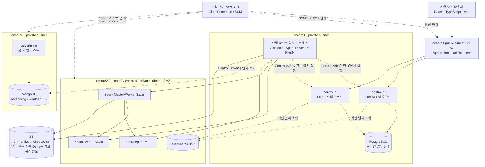
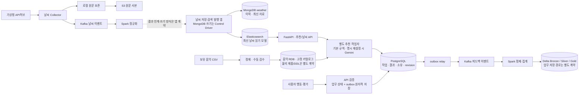

# 카페 날씨 기반 음악 서비스 — AWS 인프라와 데이터 파이프라인

- 수정일: 2026-10-16
- 코드 버전: [VERSION](VERSION) · 변경 이력: [CHANGELOG.md](CHANGELOG.md)
- 적용 기준: [공통 협업 지침](../AGENTS.md) · [AWS 작업 지침](AGENTS.md) · [제품 구현 설계도](../docs/product/카페_음악_서비스_구현_설계도.md)

이 디렉터리는 서울 리전의 **5계정·5VPC·14EC2·3물리 AZ**를 CloudFormation으로 구성하고, SSM을 통해 Ubuntu/systemd 기반 서비스를 설치·검증·운영하는 코드다. 서비스는 지역 날씨와 음악 카탈로그를 이용해 선곡표를 만들며, 사용자 피드백과 광고는 별도 업무 흐름으로 처리한다.

아래 아키텍처는 확정된 인프라 배치와 제품의 목표 데이터 흐름을 함께 설명한다. 기반 서비스 설치, 격리된 연결·재시작 시험, 실제 업무 앱 배포·파이프라인·HA 검증은 서로 다른 완료 기준이다. 현재 AWS 상태는 비공개 실행 영수증을 확인하며, 이 README를 전체 구축 완료 보고서로 사용하지 않는다.

## 1. 전체 아키텍처

### 계정과 EC2 배치

| 계정 / VPC | EC2 | 수 | 역할 |
|---|---|---:|---|
| encore1 | `control-a`, `control-b`, `postgresql` | 3 | 웹/API 앱 호스트 2대, Collector·Spark Driver·스케줄러 실행 위치, PostgreSQL 업무 저장소 |
| encore2 | `kafka-01`, `spark-01`, `es-01` | 3 | Kafka, Spark Master/Worker·ZooKeeper, Elasticsearch 각 클러스터의 첫 번째 노드 |
| encore3 | `kafka-02`, `spark-02`, `es-02` | 3 | 각 데이터 클러스터의 두 번째 노드 |
| encore4 | `kafka-03`, `spark-03`, `es-03` | 3 | 각 데이터 클러스터의 세 번째 노드 |
| encore5 | `advertising`, `mongodb` | 2 | 광고 앱 호스트와 MongoDB. MongoDB의 광고/날씨 DB·사용자는 분리 |
| 합계 | | **14** | Control·데이터·광고·DB 호스트를 분리 |

Kafka·Spark/ZooKeeper·Elasticsearch의 각 3노드는 서로 다른 물리 AZ에 배치하고, 두 Control도 서로 다른 AZ를 사용한다. 계정마다 달라질 수 있는 AZ 이름 대신 **AZ ID**로 같은 물리 위치를 맞춘다. Kafka는 KRaft를 사용하며, ZooKeeper는 Spark Master HA와 Control 리더 선출을 위한 구성이다.



그림의 업무 프로세스·데이터 화살표는 배치/접근 설계이며 앱 구현·배포 완료를 뜻하지 않는다. 웹/API는 두 Control이 ALB 트래픽을 받을 수 있지만 Collector·Driver·스케줄러는 하나의 active에서만 실행한다. 프론트엔드 빌드 산출물의 제공 방식, ASGI 프로그램/버전·worker 수, 추천 작업자·outbox 실행 개수와 광고 공개 경로는 앱 실행 계약에서 구체화한다. 광고 호스트는 현재 Control용 ALB target에 자동 포함되지 않는다.

### 네트워크 연결

- 각 VPC는 public/private subnet을 갖고, EC2는 public IP 없이 private subnet에 둔다. ALB만 encore1의 두 AZ public subnet에 배치한다.
- VPC별 zonal NAT Gateway 1개, 총 5개를 사용한다. 해당 NAT의 AZ 장애 시 그 VPC의 공유 외부 통신이 중단될 수 있는 구성이다.
- Peering은 **1–2, 1–3, 1–4, 1–5, 2–3, 2–4, 3–4의 7쌍**, 양방향 route는 14개다. 목적지별 보안그룹은 필요한 노드의 정확한 사설 `/32`와 서비스 포트로 제한한다.
- **encore2~4와 encore5 사이에는 직접 Peering이 없다.** encore1의 Peering을 중계 경로로 사용하지 않으며, Control에서 시작한 Spark 작업도 executor에서 네트워크 요청을 보내면 출발지는 Spark 노드다.
- 외부 웹 진입은 허용 CIDR로 제한한 ALB 기본 DNS의 임시 HTTP 80을 사용하고, 소유 도메인·서울 ACM 인증서 준비 후 HTTPS로 전환한다. 공개 샘플의 기본값은 HTTPS다.

확정 예산은 encore1~4 각 $45, encore5 $20, 합계 $200이다. 96시간은 비용 산정 기준이며 자동 삭제 예약이 아니다. T3 Standard·gp3·Ubuntu 직접 설치를 기준으로 하며 실행기가 지출 상한을 강제로 보장하지는 않는다. 상세 설계는 [AWS 인프라 구축 계획](<../docs/handoff/infra/AWS 인프라 구축 계획.md>)을 따른다.

## 2. 데이터 파이프라인

다음은 제품의 논리 데이터 흐름이다. 저장 경로·토픽·스키마·멱등 키·실행 위치·권한은 각 담당의 업무 코드와 실행 계약으로 연결한다. API 요청마다 Spark 작업을 실행하거나 원본/Delta 전체를 조회하는 구조가 아니다.



### 날씨: 수집 → 정규화 → 이력/검색 발행

A가 API허브 수집·지역/격자 매핑·시각/값/상태 정규화·저장/조회 코드를 담당한다. 자료별 공유 수집 기준은 실황 10분·초단기예보 1시간이며, 지역별 6시간 조회 자료 중 추천의 실제 재생 구간에 필요한 예보를 검증한다. 원문은 로컬에 보존한 뒤 S3 사본의 업로드 상태·해시·재시도를 관리한다.

MongoDB는 날씨 이력/최신 자료, Elasticsearch는 온라인 최신 읽기 모델을 맡는다. 0.3.18에서 채택한 날씨 MongoDB 접근은 **Control Driver → encore5 MongoDB**이며 전용 `weather` DB·`weather_app` 사용자·authSource·TLS를 사용한다. 광고 DB 자격 증명을 재사용하지 않는다. Spark executor의 MongoDB 직접 쓰기 경로는 제공하지 않는다.

Driver가 처리 결과를 받는 방식과 처리량/메모리 상한은 A의 업무 계약으로 정하며 무제한 `collect()`를 채택하지 않는다. ES용 Spark connector의 공식 호환성은 미확정이다. 인프라의 Driver-side HTTPS REST/Bulk 격리 probe는 업무 전송 방식·최신성·재처리나 exactly-once를 확정하는 근거가 아니다. [날씨 인계 문서](../docs/handoff/weather/01_날씨_수집과_지역매핑.md)와 [ES·날씨 MongoDB 실행 계약](../docs/handoff/infra/APPLICATION-CONTRACT.md)을 따른다.

### 음악과 추천: CSV → 검수 → 버전 고정 카탈로그

C가 음악 CSV/정제/검수 발행과 추천 작업자를 담당한다. 현행 음악 관리 16개 컬럼을 기준으로 입력·중복·보컬/테마 검수를 거친 뒤, 검증된 `catalog_version`만 추천용으로 발행한다. 음악 RDB의 물리 제품/DDL과 당시 곡 스냅샷의 일부 입력 규격은 별도 인계 대상이며 PostgreSQL 업무 DB나 Delta에 자동 통합하지 않는다.

기본 추천은 규칙 점수와 정수 시간 조합으로 생성한다. Gemini는 사용자가 다른 선곡표를 명시 요청할 때만 같은 적격 후보에서 재설정하며, 실패하면 부모 결과/초안을 유지한다. 작업자는 카탈로그·정책·선택지·날씨 묶음 버전을 고정하고 결과/승인/제외 상태를 온라인 업무 저장소에 기록한다. 추천 큐/lease·실제 작업자 배치·앱 연결은 제품 코드 범위다. [추천 로직 가이드](../docs/product/카페_음악_추천_서비스_3차_컬럼_기반_추천_로직_가이드.md)를 따른다.

### 피드백: 업무 트랜잭션 → outbox → Kafka → Delta

B가 피드백 API·공통 저장/outbox·원본/정제/집계·재처리를 담당하고 C가 화면과 당시 결과/곡 자료를 공급한다. 승인·제외·곡 반응·선곡표 만족도 등은 해당 결과 버전과 당시 조건을 보존하며, 취소는 원래 이벤트와 연결한다.

온라인 상태와 outbox를 같은 트랜잭션에 기록한 뒤 relay가 Kafka로 발행한다. Spark는 원본/정제/집계 계층을 Delta에 기록하고 중복·역순·재처리·checkpoint를 업무 키/버전 계약으로 제어한다. 음악의 Bronze/Gold는 검수 단계를 가리키며 피드백 Delta와 같은 물리 저장소를 뜻하지 않는다. Delta addon·S3A 시험 성공도 실제 피드백 파이프라인의 정합성 검증과는 구분한다.

### 광고: 별도 앱·API·측정 경로

B가 광고 API/관리 화면·delivery·노출/클릭·집계, C가 공개 배너 배치를 맡는다. encore5의 광고 호스트와 MongoDB 광고 DB/사용자는 날씨 경로와 분리한다. 광고 공개 포트·Control 경유 여부·route와 이미지 저장/제공 방식은 앱 계약에서 연결한다. 광고 측정은 음악 피드백과 별도이며 Kafka를 필수 경로로 가정하지 않는다.

## 3. 저장소·보안·HA의 역할

| 구성 | 저장/처리 대상 | 구분할 사항 |
|---|---|---|
| PostgreSQL | 온라인 인증/소유·추천 작업/결과·revision·outbox 등 업무 상태 | 앱 migration·테이블·실제 사용 범위는 B/C 계약 |
| 음악 RDB | 음악 16개 필드·검수/카탈로그 버전 | 물리 제품/DDL 인계 대기. 업무 DB와 동일 제품이라고 단정하지 않음 |
| MongoDB | 광고 DB와 별도 weather DB | DB·사용자·authSource·환경 파일 분리 |
| Elasticsearch | 최신 날씨 읽기 모델 | 안정 ID·최신성·mapping·오류/재시도·앱별 권한 계약 필요 |
| S3 | 설치 artifact·세대/query별 checkpoint, 별도 업무 원문 사본 | 기존 음악 원본 S3는 보존. 업무 원문/피드백 Delta의 버킷·prefix·보관 권한은 별도 계약 |
| Delta Lake | 피드백 원본·정제·집계 계층 | Spark와 별도 addon이며 기본 setup에 자동 포함하지 않음 |
| EC2 gp3/로컬 파일 | 서비스 데이터·업무 원문·호스트 설정 | mount·설치 세대·권한을 검증하고 일반 재시작에서 초기화하지 않음 |

**Spark Master HA와 Control/Driver HA는 별개다.** Control은 ZooKeeper의 전용 ACL·lease/epoch와 이전 owner를 사용하고, 승계 전에 이전 Control·Driver/Spark application·executor의 실제 종료를 확인한다. 불명확한 관측이나 lease 상실은 실행/승계를 차단한다. 동일 query/checkpoint의 동시 writer는 하나만 허용하며 웹 worker에서 Collector/Driver/스케줄러를 중복 실행하지 않는다.

별도 fencing 실행기와 canary·checkpoint probe는 인프라 검증 수단이다. 업무 앱의 foreground argv·start/stop·Driver 식별·query/checkpoint·종료 증거를 supervisor에 연결하고 실제 장애 승계를 확인하기 전에는 업무 HA 완료로 표시하지 않는다. [Control fencing](../docs/handoff/infra/CONTROL-FENCING.md)과 [connector·checkpoint·Delta 준비](../docs/handoff/infra/INTEGRATION-READINESS.md)를 따른다.

노드 간에는 Kafka SASL_SSL, ES HTTPS, PostgreSQL/MongoDB의 인증·TLS와 호스트 검증을 유지한다. CA 개인키는 관리자 PC에 두고 앱에 전달하지 않는다. 실제 비밀번호·토큰·runtime은 `.private/` 또는 권한 제한된 EC2 환경 파일에 두며 앱에는 서비스별 설정 참조만 인계한다.

## 4. 팀원 접속과 앱 배포

개인 PC에서 본인 encore 계정의 `student`로 로그인한 뒤 대상 계정의 `mlo-p3-team1-aws-dev-team-admin` 역할을 선택한다. `encore1-admin`~`encore5-admin`은 팀원 접속용이며 기존 `encore2`~`encore5` 프로필의 `ProjectInfraRole`은 인프라 실행기용으로 유지한다.

2026-10-15 추가한 팀원 역할은 지정된 5개 로그인만 신뢰하고 `AdministratorAccess`를 사용한다. 이 권한에는 리소스 삭제·IAM 변경이 포함하며 조직 정책 등의 제한은 계속 적용된다. 개인별 CLI 설정과 콘솔 역할 전환 링크는 Git 제외 경로에서 전달한다. AWS 관리자 권한은 DB/업무 앱 로그인 권한을 대신하지 않는다.

```bash
# 개인별 설정 파일을 선택하고 본인 계정으로 로그인한 뒤 실행하는 예
aws ssm start-session --profile encore3-admin --region ap-northeast-2 --target <INSTANCE_ID>
```

EC2가 running이고 SSM이 Online이어야 하며 private EC2의 inbound SSH 포트를 열지 않는다. AWS 접근에는 임시 로그인/역할 세션과 EC2 instance profile을 사용한다. 접속 준비와 개인별 설정 파일 선택은 [팀원 AWS 접속 안내](../docs/handoff/infra/TEAM-ACCESS.md)를 따른다.

Control 앱 경로는 `/opt/music-apps/control`, 광고 앱 경로는 `/opt/music-apps/advertising`이다. 웹은 사설 주소의 8000 포트와 `/health/`를 계약으로 사용한다. INF는 호스트·기반 서비스·접속/복구 환경, A/B/C는 업무 소스·의존성·migration·프로세스·데이터 흐름을 배포/검증한다. 상세 소유·DB 환경 파일·배포 규약은 [팀원 앱 인계](../docs/handoff/infra/TEAM-HANDOFF.md)를 따른다.

## 5. 코드 구조와 고정 버전

```text
저장소 루트/
├── .github/workflows/aws-infra-check.yml  # AWS 인증 없는 코드 검사
├── .gitignore
├── aws-infra/
│   ├── aws-project.sh                   # 실행 진입점
│   ├── bin/                            # 생성/삭제·설치·오프라인 계획/인계
│   ├── lib/                            # CloudFormation·설정·실행/승계 계약
│   ├── config/                         # 공개 예제와 Git 제외 실제 설정
│   ├── templates/                      # 가상 계정으로 생성한 공개 샘플
│   ├── installer/                      # Ubuntu/systemd 설치·검증·의존성 lock
│   ├── tests/                          # 오프라인 회귀·안전성 검사
│   └── .state/ .private/ .local/ .tools/ # 실행 기록·비밀·원본·도구, Git 제외
└── docs/handoff/infra/                  # 설계·접속·배포·앱/HA 실행 계약
```

코드 0.3.19의 설치 lock 기준은 Ubuntu 24.04 amd64, Java 21, Python 3.14.8, Kafka 4.1.2, Spark 4.1.3/Hadoop 3.4.2, ZooKeeper 3.9.4, Elasticsearch 8.19.23, PostgreSQL 16.15, MongoDB 8.0.34다. 작업 PC용 Python 기준은 3.12 이상이다. 이 목록은 최신 버전 추천이나 현재 모든 호스트의 설치 버전 확인 결과가 아니다.

정확한 artifact·서명/해시는 [core 버전](installer/core/versions.json), [DB 버전](installer/databases.versions.json), [원본/패치 이력](installer/source-manifest.json), [Kafka/S3A lock](installer/connectors.lock.json), [Delta lock](installer/delta.lock.json), [fencing lock](installer/control-fencing.lock.json), [게스트 AWS CLI lock](installer/aws-cli.lock.json)을 따른다. JAR·다운로드 도구·설치 payload 자체는 Git에 올리지 않는다.

## 6. 인프라 실행 방법

아래 명령은 **`aws-infra/` 디렉터리 기준**이다. 로컬 계획·AWS 읽기 조회·실제 변경 명령을 구분하며 이미 진행 중인 작업을 별도 요청 없이 다시 시작하지 않는다.

### 로컬 설정

저장소 루트에서 `cd aws-infra`로 이동해 이 문서의 실행 명령을 사용한다. 기존 Git 저장소를 사용하며 aws-infra 안에 별도 Git 저장소를 만들지 않는다.

Python 3.12 이상, AWS CLI v2, Git을 사용한다. 기존 `encore1`~`encore5` 프로필을 유지한다.
encore2~5는 encore1 source profile로 `ProjectInfraRole`을 AssumeRole한다.
장기 Access Key를 저장소나 `.env`에 넣지 않는다. [AWS 액세스 키 보호 지침](https://docs.aws.amazon.com/IAM/latest/UserGuide/securing_access-keys.html)을 따른다.

새 checkout에서만 샘플을 복사하고 실제 값을 입력한다. 기존 로컬 설정을 덮어쓰지 않는다.

```bash
cp -n config/project.example.json config/project.json
chmod 600 config/project.json
```

로컬 파일의 `example_only`를 `false`로 바꾸고 계정 ID와 encore1의 `operator_principal_arn`을 입력한다.
계정 ID는 앞의 0을 보존하는 12자리 **문자열**이다.
공개 샘플의 `example_only=true`는 AWS 접근을 차단하며 오프라인 렌더링/테스트용이다.
AMI·AZ ID·CIDR 검토·포트·ALB 인증서/접속 CIDR/헬스 경로를 환경에 맞게 확정한다.
AMI 조회는 [Canonical 공식 이미지 조회 방법](https://ubuntu.com/aws/docs/aws-how-to/instances/find-ubuntu-images/)을 따른다.

### 배포 전 오프라인 준비 검사

배포 전에는 저장소 루트에서 `cd aws-infra`로 이동한 뒤 다음 명령으로 로컬 준비를 확인한다. 실제 변경은 사용자가 명시한 실행 범위를 따른다.

```bash
./aws-project.sh --config config/project.json readiness
```

`readiness`는 AWS 로그인/조회·변경 세트·SSM·설치·삭제를 호출하지 않는다. 실제 설정을 변경하거나 설치 세대를 발급하지 않으며 `.state/readiness/latest.json`에 준비 근거만 기록한다. 입력 누락·설치 원본 해시·검증 도구 존재와 후속 앱/HA 통합을 구분한다. 미준비이면 종료 코드 1을 반환한다. 도구 존재는 lint/guard 통과나 AWS 권한 검증을 뜻하지 않는다.

웹 포트의 공개 키는 `service_ports.web`이다. 기존 `service_ports.gunicorn`도 같은 포트의 호환 별칭으로 읽으며 실제 로컬 설정을 자동 변환하지 않는다. 두 키가 다르면 차단한다. 별칭은 Gunicorn 사용 지시가 아니다. 예제/실제 설정 모두 무제한 CIDR을 차단한다.

### 배포 전 AWS 읽기 검증

```bash
./aws-project.sh --config config/project.json plan
./aws-project.sh --config config/project.json preflight
python3 bin/check-public.py
```

`preflight`는 계정 식별, bootstrap 템플릿/리소스/Outputs, 읽기 권한, AZ/AMI, EC2 사양·쿼터, VPC CIDR을 조회한다.
변경 세트·VPC·EC2·SSM 명령·ALB 생성이나 IAM 수정을 실행하지 않는다.
결과는 `.state/preflight/latest.json`에 저장하고 core 준비 여부와 ALB까지 포함한 준비 여부를 구분한다. 기본 명령은 전체 준비가 미완료면 실패 코드로 종료한다.
core 범위만 확인할 때는 `preflight --without-alb`를 명시한다.
읽기 검증은 실제 쓰기 권한이나 서비스 설치 성공의 증거가 아니다. 서비스 사전 검증은 향후 변경 세트 단계에서 수행한다.

검토한 LAN/VPN CIDR을 명시하면 공통 물리 AZ 3개와 Canonical AMI를 로컬 설정에 반영할 수 있다.
아래 CIDR은 예시이며 실제 접속망 목록으로 바꾼다.

```bash
./aws-project.sh --config config/project.json preflight --resolve-inputs --connected-cidr 192.168.0.0/24
```

### 실제 생성·삭제

아래 명령은 AWS 리소스를 변경한다. 실행 전 `plan`과 `preflight`를 확인한다.

```bash
./aws-project.sh --config config/project.json create --execute
./aws-project.sh --config config/project.json status
./aws-project.sh --config config/project.json destroy --confirm mlo-p3-team1-aws-dev
```

생성 순서는 network → storage → 7 peering/14 route → 14 EC2 → ALB다.
ALB 없이 core 범위만 배포할 때는 `create --execute --without-alb`로 지정한다.
기본 생성은 접속 CIDR·헬스 경로·포트가 미정이면 과금 리소스 생성 전에 중단한다. HTTPS 모드에서만 발급된 ACM 인증서가 추가로 필요하다.
`generation=null`이면 생성 시 새 설치 세대를 자동 지정한다. 실패 재개는 같은 세대를 유지하며 삭제 후 생성은 새 세대를 사용한다.

삭제는 ALB → 두 Control 종료 확인 → 나머지 EC2 → route/peering → 프로젝트 S3 버전·미완료 업로드 → network 순서다.
관리 IAM/bootstrap·Mac 프로필·음악 원본 S3·완료된 로컬 9VM은 유지한다.
AWS 신규 설치에서 기존 데이터 복구는 요구하지 않으며 Kafka offset/Spark checkpoint 초기화를 허용한다.

### 기반 서비스 setup과 ALB 후속 추가

인프라 생성 이후 다음 명령으로 기반 서비스를 설치·검증한다. 앱 소스는 선행 조건이 아니다.

```bash
./aws-project.sh --config config/project.json setup
./aws-project.sh --config config/project.json setup --execute
./aws-project.sh --config config/project.json verify --execute
```

`setup`은 단계 순서만 표시한다. `setup --execute`는 14개 노드 private package를 준비하고 SSM으로 빈 디스크 확인/초기화,
Kafka·Spark/ZooKeeper·ES·PostgreSQL·MongoDB와 Control/광고 호스트 디렉터리·TLS·DB 환경 파일을 준비한다.
전체 환경 lock, ZK/Master 단계 barrier, command receipt 재개를 적용한다. 결과가 불명확하거나 실패한 명령은 자동 재전송하지 않는다.
`verify --execute`는 새 영수증으로 기반 서비스의 health와 Kafka/Spark/ES/DB smoke를 수행한다.
Kafka/S3A connector lock, Spark→ES 앱 연동, 실제 앱 데이터 흐름과 Control fencing은 별도 범위다.
실제 AWS 설치·검증 결과는 설치 세대별 비공개 `.state/` 영수증에서 확인한다. 기반 서비스와 업무 앱/HA 통합 결과를 구분한다.

현재 로컬 설정은 **ALB 기본 DNS + 임시 HTTP 80**이다. 허용할 `/32` CIDR은 Git 제외 `config/project.json`에 확정해 반영했다. 실제 값은 공개 문서에 적지 않는다.
공개 샘플과 템플릿의 기본값은 HTTPS이며, 임시 HTTP는 로컬 `alb.protocol=HTTP`로 명시한다.
ALB 없이 먼저 코어만 만들려면 `create --execute --without-alb`를 사용한다.
이후 **alb 설정만** 확정한 뒤 다음 명령을 사용한다. 코어 설정·포트·설치 세대는 유지한다.

```bash
./aws-project.sh --config config/project.json add-alb --execute
```

`add-alb`는 후속 ALB 추가와 **alb 설정만 바꾸는 업데이트**에 사용한다. 도메인을 준비하면 서울 ACM 인증서를 발급하고
`alb.protocol=HTTPS`, `alb.certificate_arn`을 지정한 뒤 같은 명령으로 변경한다. ALB와 EC2/데이터의 정체성은 유지하며 접속 포트 변경 시 전용 SG ingress rule만 교체를 허용한다.
HTTP→HTTPS 전환 중 접속 변화/짧은 중단이 있을 수 있고 HTTPS에서는 인증서 도메인으로 접속해야 한다.
[AWS 공식 문서](https://docs.aws.amazon.com/elasticloadbalancing/latest/application/load-balancer-troubleshooting.html)에 따르면 ALB 기본 DNS에 ACM 공개 인증서를 발급할 수 없다.
ALB 생성과 팀원 앱의 target health 확인은 구분한다. 허용 CIDR은 확정했고 도메인/인증서는 후속 HTTPS 단계에서 준비한다. 도메인은 HTTP 단계의 선행 조건이 아니다.
PostgreSQL 5432, MongoDB 27017, 웹 8000과 `/health/`를 기본 규약으로 준비했다.

### 업무 연결 전 오프라인 계획과 인계

```bash
./aws-project.sh --config config/project.json integration-plan
./aws-project.sh --config config/project.json control-plan
python3 bin/application-plan.py --config config/project.json
```

위 명령은 AWS를 호출하거나 업무 앱을 시작하지 않는다. 의존성·실행 계약이 미완료이면 준비/차단 항목을 확인하고 담당자가 보완한다. Kafka/S3A bundle·Delta addon·fencing/날씨 DB 단계는 별도 명시 적용이며 기본 setup/verify에 자동 포함하지 않는다. 코드가 바뀌었다는 이유로 기존 설치 세대·성공 영수증·private package의 source identity를 자동 갱신하지 않는다.

실제 앱 계약의 argv·의존성 lock·서비스별 credential 참조를 정리한 뒤 새 비공개 경로에 인계 묶음을 만들 수 있다.

```bash
python3 bin/application-plan.py --config config/project.json --contract .state/application-contract.json
python3 bin/application-handoff.py --config config/project.json --contract .state/application-contract.json --output .state/preparation/application-handoff/manual-review-01
```

`application-handoff.py`는 로컬 lifecycle/입력 해시·설정·lock 참조를 사용한다. 미입력 상태에서는 담당별 목록과 템플릿을, 입력 완료 시에는 두 Control의 unit/supervisor patch 검토안을 만든다. 실제 앱 설치/실행·ALB health·업무 HA·S3 단일 writer 검증을 수행하지 않으며 canary 설치기로 업무 앱을 활성화하지 않는다. [실행 계약과 인계 묶음](../docs/handoff/infra/APPLICATION-CONTRACT.md)을 따른다.

## 7. 구현 범위와 검증 상태

| 범위 | 저장소에서 제공하는 것 | 실제 완료 판단 |
|---|---|---|
| IAM·VPC·NAT·ENI·Peering·EC2·S3·ALB | 템플릿·단계 실행·소유권/재개/삭제 검사 | 계정별 CloudFormation 결과와 실제 자원 조회 |
| Kafka·Spark/ZooKeeper·ES·PostgreSQL·MongoDB | 고정 버전 설치·TLS/인증·health/smoke 코드 | 현재 설치 세대의 SSM/서비스 영수증 |
| Kafka/S3A·Delta·ES/Mongo 연결 | 별도 lock·격리 probe·접근/인계 코드 | 해당 시험의 입증 범위와 실제 업무 연결을 구분 |
| Control 리더/물리 fencing·checkpoint 승계 | 별도 실행기·관측·canary·차단 조건 | 실제 이전 프로세스 종료와 업무 앱의 단일 writer/복구 |
| 웹·추천·날씨·음악·피드백·광고 | 호스트/접근 환경과 제품·앱 실행 계약 | A/B/C의 소스·migration·데이터 흐름·화면/API 통합 검증 |
| 전체 삭제 후 신규 생성 | 소유 자원 범위와 의존성 역순 삭제 코드 | 생성→설치→삭제→재생성의 전체 AWS 왕복 근거 |

EC2 running·SSM Online이나 격리 probe 성공만으로 업무 앱/파이프라인 완료를 선언하지 않는다. 최신 AWS 조회·bootstrap 보완·생성/설치·서비스/시험 결과는 `.state/`에, 비밀 payload는 `.private/`에 보관한다. 공개 문서의 과거 조회 시각이나 로컬 검증을 현재 실시간 상태로 옮기지 않는다. [상태 안내](../docs/handoff/infra/AWS-INFRA-STATUS.md)와 단계별 영수증을 함께 확인한다.

## 8. 코드 검증과 공개 범위

```bash
python3 bin/infra.py --config config/project.example.json render
python3 -m unittest discover -s tests -v
python3 bin/check-public.py
bash bin/check-local.sh
```

`check-local.sh`는 준비된 cfn-lint 1.57.2와 cfn-guard 3.2.1을 사용한다. 도구는 `.tools/`에 격리하며 자동 설치하지 않는다.
Python 검증 의존성은 `requirements-validation.txt`에 고정한다.
CI는 공개 파일 검사·오프라인 테스트·샘플 템플릿 일치 검사·cfn-lint만 실행하며 AWS 인증을 요구하지 않는다.
워크플로는 저장소 루트 `.github/workflows/aws-infra-check.yml`에 두고 `working-directory: aws-infra`로 실행한다.
공개 검사는 aws-infra와 공유 문서·루트 인프라 CI를 대상으로 한다. 저장소의 다른 기존 자료와 과거 Git 이력은 별도 검토 범위다.

코드 변경 시 테스트 통과 후 `VERSION`/`CHANGELOG.md`로 버전을 구분한다. Git commit/tag·push는 별도 명시 요청 때 수행한다.
실제 실행 영수증에는 코드 버전·Git revision(조회 가능할 때)·설정/템플릿 해시를 `.state/`에 기록한다.
비밀값을 Git에 넣어 배포 이력을 남기지 않는다. 공개 전 검사와 한계는 [SECURITY.md](SECURITY.md)를 따른다.


실제 계정 ID·허용 접속 CIDR·InstanceId·개인별 역할 링크·비밀번호·TLS 개인키·실행 원문은 공개 샘플이나 README에 적지 않는다. `config/project.json`, `.private/`, `.state/`, `.local/`, `.tools/`와 키·환경 파일·로그는 Git 제외 대상으로 유지한다. 기존 음악 원본 S3·프로젝트 외 데이터·완료된 로컬 VM은 이 실행기의 삭제 대상이 아니다.

README의 연결 문서가 함께 전달되도록 `aws-infra/` 변경과 관련 `docs/handoff/infra/` 변경을 같은 검토 범위에 포함한다. 브랜치·커밋·develop 병합은 [팀 GitHub 협업 방침](../CONTRIBUTING.md)을 따른다.

## 9. 상세 문서

| 문서 | 읽을 내용 |
|---|---|
| [인프라 문서 인덱스](../docs/handoff/infra/README.md) | 로컬 개발 환경과 AWS 이전 자료·최신 인계 연결 |
| [팀원 AWS 접속](../docs/handoff/infra/TEAM-ACCESS.md) | 개인 로그인·계정별 역할·SSM·CLI 설정 |
| [팀원 앱 배포 규약](../docs/handoff/infra/TEAM-HANDOFF.md) | 앱 경로·DB/TLS 환경·역할·실행/복구 책임 |
| [connector·checkpoint·Delta](../docs/handoff/infra/INTEGRATION-READINESS.md) | 의존성 고정·순차 재시작·시험/업무 검증 경계 |
| [Control fencing](../docs/handoff/infra/CONTROL-FENCING.md) | lease·관측·물리 중지·승계·별도 IAM/SSM 변경 |
| [ES·날씨 MongoDB·앱 실행 계약](../docs/handoff/infra/APPLICATION-CONTRACT.md) | Driver/executor 경로·전용 DB·ASGI/supervisor·비공개 인계 |
| [제품 구현 설계도](../docs/product/카페_음악_서비스_구현_설계도.md) | 온라인 API·음악/날씨/피드백·추천·광고 계약 |
| [보안 정책](SECURITY.md) | 공개 금지 자료·Git 제외·검사 범위와 한계 |
