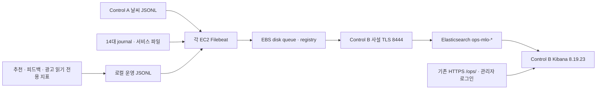

# 운영로그 수집과 Kibana

작성·수정일: 2026-10-16. 업무 데이터와 분리한 운영로그 복사 경로입니다. 원본 파일·journal·MongoDB 감사 기록을 삭제하거나 수정하지 않습니다.



## 코드와 실행

| 파일 | 역할 |
|---|---|
| `bootstrap.py`, `versions.json` | 공식 SHA-512 확인 후 Kibana 설치, ES 템플릿/역할/사용자, 사설 nginx, 선택적 공개 경로 |
| `agent.py`, `sanitize.js` | Filebeat 8.19.23, 역할별 journal/파일 입력, 원본 시각·오류 정규화, 전송 전 마스킹, 안정된 이벤트 ID |
| `metrics.py`, `app_metrics.py` | 분당 heartbeat/서비스 상태, DB 메타데이터, 날씨 요청→ES 발행 완료 지연, fsync 후 SQLite 커서·중복 캐시 반영 |
| `network.py` | 기존 노드 /32에서 Control SG의 TCP 8444로만 들어오는 추가 규칙 |
| `dashboard.py` | `ops-mlo-*` Data View와 `music-operations-v1` 대시보드의 멱등 생성 |
| `validate_forwarder.py` | 운영 ES와 분리한 실제 Filebeat 장애·회전·마스킹 검증 |

사용자 승인 후 세대별 private JSON과 기존 SSM/S3 artifact 도구로 배포합니다. 설치기가 임의로 AWS 계정·EC2·VPC를 만들지 않습니다. 이번 실행 영수증은 `.state/operations/observability/run-20261016/`, 비밀 payload와 로그인 인계는 `.private/observability/<generation>/`에 있습니다. 이 경로들은 Git 제외이며 공개 문서에 실제 비밀번호를 적지 않습니다.

실행 인터페이스:

```text
python3 bootstrap.py hub private.json
python3 agent.py private.json
python3 bootstrap.py public private.json   # 별도 외부 접근 승인 필요
python3 dashboard.py private.json
python3 validate_forwarder.py             # Control B, localhost 격리 시험
```

hub 입력은 기존 ES 호스트·관리자 비밀번호, 새 writer/viewer 비밀번호, 3개 고정 암호화 키, 공개 URL/host입니다. agent 입력은 node/role/hub_ip/writer_password이며 공통 공개 CA를 함께 전달합니다. dashboard 입력은 viewer_password만 필요합니다. public 입력에는 hub_ip/public_host만 넣습니다. 비밀값은 SSM 명령 인자·로그·Git에 넣지 않습니다.

앱 저장소의 `deployment/aws/control-nginx.conf.in`에는 `/etc/nginx/music-ops-public*.locations` 선택적 include를 추가합니다. 앱 재배포가 이 경로를 없애지 않게 하며, 운영로그 설치 전에는 빈 glob으로 동작합니다. `public_route`는 설정 백업·`nginx -t` 성공 후 reload하고 공통 앱을 재시작하지 않습니다.

## 수집 범위와 의미

| 데이터셋 | 원본/의미 |
|---|---|
| `weather` | Control A `weather/collector/requests.jsonl`, `logs/weather-process.jsonl`. API 수신·파싱·Kafka ACK·Spark ES 발행 성공/실패 |
| `pipeline_latency` | 동일 request_id의 요청 시작→Spark ES 발행 완료. 배치 완료 기준이며 개별 행 지연이 아님 |
| `service`, `kernel` | 실제 music-* 서비스 journal 및 kernel priority 0~3. Filebeat 자체 로그는 재귀 수집 대신 전송 통계로 관찰 |
| `kafka`, `elasticsearch`, `spark_executor` | Kafka 서버/컨트롤러/상태/인증 로그, ES 서버/폐기예정/slowlog JSON, Spark executor stdout/stderr |
| `mongodb` | `/var/lib/music-cluster/mongodb/mongod.log*`의 msg/severity와 원래 시각. command/인증 attr는 복사하지 않음 |
| `nginx_access`, `nginx_error` | 접근 로그는 클라이언트 식별자·query를 제외한 method/path/status, 오류는 마스킹한 제한 길이 메시지 |
| `recommendation` | 비시험 카탈로그의 종료 작업 메타데이터. 성공률 분모 SUCCEEDED+FAILED+EXPIRED, P95는 생성→결과 저장 시간(큐 대기 포함) |
| `feedback` | PostgreSQL outbox의 SENT 미완료 수, 수신/투영 건수 |
| `ads`, `ads_audit` | 광고 MongoDB log_record의 허용 메타데이터와 저장/누락/무결성 표본 수. 원본 snapshot·이미지·계정/게스트 자료는 제외 |
| `forwarder`, `service_health`, `exporter` | 전송기 ACK/실패/대기/RSS·heartbeat, unit 상태, 지표 수집 오류 |

기존 날씨 `weather-stream-current-v1-aws`는 앱의 정규화된 읽기 모델입니다. 기상청 HTTP 원문이나 운영로그 인덱스로 바꾸지 않습니다. 모든 운영 복사본은 `ops-mlo-<dataset>-YYYY.MM.DD`이며 샤드 1·복제본 1, 자동 삭제 정책은 없습니다.

추천 메타데이터는 최근 7일 최대 5,000개 종료 작업, 광고 복사본은 컬렉션별 최근 5,000개 log_record를 조회합니다. 장기 전수 감사 보관/초고속 변경 스트림을 대체하지 않습니다. 현재 실제 작업/광고 데이터가 이 한도 안에 있음을 확인했으며, 볼륨 증가 시 cursor/change stream으로 확장해야 합니다. 대형 Catalog.tracks, 선곡 snapshot, 광고 before/after·이미지를 읽지 않습니다. 광고 legacy log_relay는 원본에 보존하고 이번 자동 복사 대상에 포함하지 않습니다.

## 안전장치와 한계

- ES/노드 사설 통신은 기존 CA와 인증서 SAN을 검증합니다. TLS 검증을 끄지 않습니다. 새 EC2·VPC·peering·IAM 권한 확대는 없습니다.
- `ops_ingest`는 ops-mlo-* 쓰기/자동 설정과 cluster monitor만 가지며 업무 인덱스 읽기 권한이 없습니다. `ops_admin`은 Kibana 관리와 ops-mlo-* 읽기, Kibana 서버는 전용 서비스 토큰을 사용합니다.
- `/ops/`는 별도 관리자 로그인 필수입니다. 서비스의 전체 공개 허용이 운영로그의 무인증 공개를 뜻하지 않습니다. 2026-10-16 사용자 별도 승인 후 외부 HTTPS 경로를 연결했습니다.
- Filebeat registry/disk queue는 데이터 EBS에 두며 최대 512MB/대입니다. HTTP 재시도는 되지만 영구적인 mapping/인증 오류는 운영자가 확인해야 합니다. 큐 한도·원본 journal 보존 기간을 넘는 장기 장애에는 무손실을 보장하지 않습니다.
- 현재 수집 gateway와 Kibana는 Control B 한 대, gateway ES 대상은 SAN 검증을 고정한 ES01입니다. 이 장애점은 신규 서버 없이 구성한 현재 제약입니다. Kibana 자체 연결은 ES 3대를 사용합니다.
- journal의 기존 보존분과 파일을 backfill했습니다. 설치 전 이미 회전·삭제된 기록은 복원하지 못합니다. 비구조화 파일 backfill의 시각은 수집 시각일 수 있습니다. 시험 배포 때 Control B의 일부 접근 로그가 수집 시각 차이로 중복된 이력도 보존합니다.
- 운영 원본과 ES 로그를 자동 삭제하지 않습니다. 장기 운영 전 보관 일수/디스크 경보와 외부 알림은 별도 운영 정책으로 정해야 합니다. 이번 작업에서 알림 자동화를 생성하지 않았습니다.
- 현재 dashboard 사용과 무관한 Streams 관리 API는 제한된 계정에 403을 반환할 수 있습니다. 관리 권한을 확대하지 않습니다.

## 운영·복구

1. `/ops/app/dashboards#/view/music-operations-v1`에서 최근 3분 수신 서버 14, heartbeat 3분 이내, 전송 대기를 확인합니다. 추천 실패 통계에는 기존 배포 점검 기록도 포함됩니다.
2. Discover에서 `Music operations logs`를 선택하고 `event.dataset : "weather"`, `event.outcome : "failure"`, `host.name : "control-a"`, `ops.request_id : "..."`로 조회합니다.
3. 수집 중단은 `systemctl status music-filebeat`, `journalctl -u music-filebeat`, `http://127.0.0.1:5066/stats`로 확인합니다. 상태 디렉터리를 지우거나 input ID를 바꾸면 재수집을 유발하므로 복구 목적으로 초기화하지 않습니다.
4. gateway/ES를 복구하면 기존 queue/registry로 재개합니다. Kibana만 실패한 경우 수집은 계속되며 `music-kibana` journal과 자원 사용을 확인합니다.
5. 계정·도메인 교체는 private 입력과 `server.publicBaseUrl`·nginx Host/인증서를 함께 갱신합니다. 공개 도메인이 바뀌어도 원본/ES 인덱스를 초기화하지 않습니다.
6. 전체 AWS 철거 전 이번 별도 `*-ops-network` 스택의 8444 ingress를 먼저 제거해야 기존 Control SG 삭제를 막지 않습니다. 운영로그 설치는 기존 foundation destroy 절차에 자동 편입하지 않았습니다. 원본/로그 삭제 여부와 보관은 별도로 승인받습니다.

근거: [Elastic journald 입력](https://www.elastic.co/guide/en/beats/filebeat/8.19/filebeat-input-journald.html), [disk queue](https://www.elastic.co/guide/en/beats/filebeat/8.19/configuring-internal-queue.html), [Kibana 설정](https://www.elastic.co/guide/en/kibana/8.19/settings.html), [권장 보고서 권한 모델](https://www.elastic.co/guide/en/kibana/8.19/reporting-settings-kb.html).
