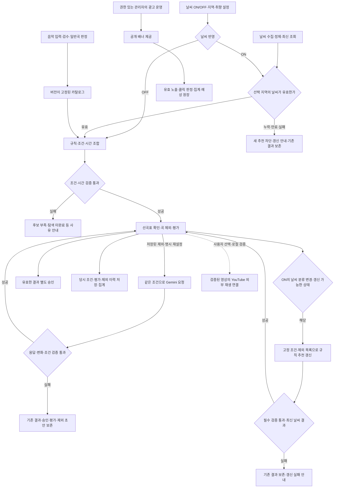

# BRD · 뮤더 — 날씨 기반 선곡표 추천 서비스

- version: `v0.2`
- document_state: `Draft`
- related_prd: [PRD.md](./PRD.md)
- team: `mlo-01-p3-team1`
- current_scope: 3차 추천·데이터·관리·광고 운영
- updated_at: `2026-10-19`
- project_period: `2026-10-15 ~ 2026-10-19`
- implementation_reviewed_at: `2026-10-19`

## 프로젝트 소개
- 뮤더는 music과 weather의 합성어로, 날씨와 취향에 맞는 약 3시간의 선곡표를 제공하는 서비스다. 현 단계인 '3차'는 비로그인 추천과 데이터·관리·광고 운영을 다루며, YouTube 연결은 로컬 시험 범위를 구분한다. 계정·저장 이력·결제는 후속 범위(4차)로 정한다.

- 이 문서는 업무와 인수 기준을 정한다. 구현 상태와 확인 결과는 8-1절의 기준일에 따른 기록이며, 문서 작성만으로 기능 완료나 인수를 확정하지 않는다.

## 1. 배경과 문제

### 1-1. 문서의 목적과 대상

- 이 문서는 날씨 기반 선곡표 추천 서비스 사업의 목표·업무 범위·책임·인수 기준을 합의하기 위해 작성한다. 기획·개발·인프라 담당자가 같은 기준으로 프로젝트를 판단한다.

- 핵심 사용자는 카페·음식점 등 음악이 필요한 매장의 운영자다. 광고는 3차에서 카페를 대상으로 운영한다. 추천 서비스의 사용자 범위와 광고 대상 범위를 구분한다.

### 1-2. 해결하려는 문제와 검증 가설

- 매장 운영자는 사용할 곡을 찾고, 목록을 구성하며, 마음에 들지 않는 곡을 조정해야 한다. 뮤더는 이 준비·조정 부담을 줄이고자 한다.

- 날씨와 취향을 함께 반영하면 매장 분위기에 어울리는 선곡을 도울 수 있다는 가설을 검증한다. 실제 운영자의 기존 선곡 방식·소요 시간·불편의 크기와 날씨 반영의 체감 가치는 아직 사용자 평가가 필요하다. 기존 서비스의 한계나 매출 증가를 확인된 사실로 전제하지 않는다.

### 1-3. 서비스 개요

| 구분 | 설명 |
|---|---|
| 입력 | 날씨 반영 ON/OFF, 지역, 선택적 보컬·빠르기·테마·장르 조건. 지역 미설정은 OFF로 처리한다. |
| 처리 | 준비된 음악 후보에 일반곡 판정·필수 조건을 적용하고, 날씨 모드와 취향에 따른 규칙 점수·시간 조합으로 선곡표를 만든다. ON에서 날씨 분류가 바뀌면 6-1절의 조건에 따라 규칙 추천으로 결과를 갱신한다. |
| 결과 | 곡 수·곡명·아티스트·목록·대표 이미지와 선곡 이유를 확인하고, ON에서는 사용한 날씨를 함께 확인한다. 시간은 서버에서 검증하며 메인 화면에는 표시하지 않는다. |
| 조정 | 추천받은 곡을 제외하거나 제외를 취소할 수 있다. 선택 조건을 유지한 채 다른 곡 구성으로 다시 추천받고, 곡·선곡표를 평가하거나 사용할 결과를 승인할 수 있다. |
| 음악 이용 | 선곡표 제공과 음원 재생은 별개다. YouTube는 검증된 영상의 외부 재생 연결과 보조 iframe을 로컬에서 확인하며, 음원 파일이나 계정 자동 저장을 제공하지 않는다. |

**첫 선곡표는 정해진 추천 규칙으로 만든다. 사용자가 다른 구성을 요청하면 Gemini가 처음 선택한 조건과 제외한 곡 목록을 반영해 다른 선곡표를 구성한다. 서버는 새 결과가 조건과 시간 기준을 충족하는지 검사하며, 실패하면 기존 선곡표와 상태를 유지한다.*

## 2. 이해관계자 및 업무 기대 결과

### 2-1. 서비스 이해관계자

| 이해관계자 | 주요 업무·필요 | 기대 결과 |
|---|---|---|
| 매장 운영자 | 조건 설정, 선곡표 확인·조정·평가·승인 | 곡을 하나씩 찾는 부담을 줄이고 매장에 사용할 선곡표를 결정한다. |
| 서비스 관리자 | 부여받은 권한에 따라 음악 등록·검수·발행, 피드백 조회, 광고 관리·통계 확인 | 추천 자료의 상태와 사용자 반응, 광고 운영 결과를 확인한다. 영상 검수의 운영 제한은 유지한다. |
| 광고주·광고 등록 요청 주체 | 게시할 소재·링크·기간·예산 등 운영 조건 협의 | 합의한 광고의 게시와 노출·클릭 결과를 확인할 수 있는 기반을 마련한다. 광고주 전용 직접 등록·결제 화면은 이번 범위가 아니다. |

광고주·요청 주체와의 협의는 이 BRD에서 제안하는 운영 방식이다. 실제 접수·협의·결과 전달 절차와 담당이 정해진 것으로 간주하지 않는다. 구현 범위는 관리자에 의한 광고 관리·측정이며 광고주 전용 화면은 포함하지 않는다.

### 2-2. 개발·운영 책임

| 담당 역할 | 책임 업무 | 기대 결과 |
|---|---|---|
| A — 날씨 | 지역 매핑, 날씨 수집·정제·조회와 유효성 확인 | 추천에 필요한 날씨를 제공하고 누락·만료 상태를 구분한다. |
| B — 백엔드·피드백·광고 | 인증·공통 저장, 피드백 처리, 광고 관리·측정·집계와 통합 조율 | 사용자·관리자 업무를 연결하고 피드백과 광고 지표를 정확하게 관리한다. |
| C — 화면·추천·음악 | 음악 정제·카탈로그, 추천·재설정, 사용자·관리 화면과 공개 배너 구현 | 사용자가 선곡표를 받고 조정·평가·승인하는 흐름을 이용할 수 있게 한다. |
| INF — 인프라 | 실행 환경·접속·배포·모니터링·백업·복구 | 서비스를 실행하고 장애 발생 시 복구할 수 있는 환경과 절차를 제공한다. |
| PA — 기획 | 요구사항·범위·일정·검수 기준 조율, 평가·시연 취합 | 팀이 같은 기준으로 개발하고 결과를 검토할 수 있도록 한다. |

**역할은 업무 책임 단위이며 실제 배정 명단은 별도로 관리한다. 담당자가 바뀌면 진행 상태·자료와 버전·접속 및 실행 절차·검증 결과·미해결 사항을 인계한다. 비밀번호·키는 문서 본문에 적지 않는다.*

### 2-3. 협업과 의사결정

- A는 날씨의 사실·유효성을, C는 이를 추천·화면에 반영하는 처리를 맡는다. B는 공통 저장·소유·이벤트 연결을 지원한다.
- C는 음악·피드백 관리 화면, B는 공통·관리 API를 맡는다. 광고 관리 화면·API·측정·집계는 B, 공개 배너 배치·반응형 연결은 C가 맡는다.
- INF는 실행·접속·배포·복구 환경을 준비하고, A/B/C는 각 기능이 그 환경에서 동작하는지 검증한다. 환경 준비를 기능 검증 완료로 보지 않는다.
- PA는 목표·범위·수용 기준과 미해결 질문을 취합하고, B는 통합 검증을 조율한다. 변경된 요구사항은 영향·담당·검증 조건을 기록한 뒤 인수 기준에 반영한다.

## 3. 업무 목표·측정 방법

### 3-1. 목표와 판정

아래 사용자 효과의 비교 과제·조정 횟수·ON/OFF 비교는 이 BRD의 측정 제안이다. 실제 평가 방법·목표값은 합의한 계획과 구분해 기록한다. 광고 집계의 기대값 대조는 기존 운영 검증 기준을 따른다.

| 업무 목표 | 확인 방법 | 목표값·판정 기준 |
|---|---|---|
| 선곡 준비·조정 부담 감소 | 같은 선곡 과제에서 기존 방식과 뮤더의 완료 시간·조정 횟수·주관적 부담을 비교한다. | 시간 절감·부담 감소 목표는 사용자 조사 후 평가 전에 합의한다. |
| 날씨·취향에 맞는 추천 제공 | 선곡표 별점과 별도의 날씨·매장 분위기·취향 적합성 평가를 확인한다. 날씨 반영의 체감 가치는 ON/OFF 비교 조건을 정해 평가한다. | 별점·적합성 목표와 비교 조건은 평가 전에 합의한다. 별점만으로 날씨 적합성을 입증하지 않는다. |
| 광고 운영·측정 기반 확보 | 정상·중복·운영 제외·지연 보고 사례에서 예상한 노출·클릭·사용량과 실제 집계·원장을 대조한다. | 같은 범위·기준시각의 기대값과 실제값이 일치해야 한다. 오류·대기·실제 0건을 구분한다. |

**기능이 동작하는지, 사용자 부담이 줄었는지, 사업성이 있는지는 각각 다른 판단이다. 승인 횟수·곡 제외 횟수를 만족도나 실제 청취로 간주하지 않는다. 목표값이 정해지기 전에는 결과를 기록하되 사업 목표를 달성했다고 판단하지 않는다.*

### 3-2. 평가 실행 계획 제안

아래는 평가를 구체화하기 위한 제안이다. 모집 기준·수행 순서·제외 및 미응답 처리와 행별 담당·시점이 이미 확정된 실행 계획이라는 뜻은 아니다.

| 검토할 항목 | 정할 내용 | 담당·확정 시점 제안 |
|---|---|---|
| 대상·표본 | 참여자의 매장 운영 경험·모집 기준·인원, 제외·미응답 처리 | PA 주관, 사용자 평가 시작 전 |
| 과제·비교 조건 | 같은 선곡 목적·조건·완료 시점, 기존 방식과 서비스 이용 순서, ON/OFF 비교 방식 | PA·C, 평가 시작 전 |
| 목표·판정 | 시간·부담·만족도·적합성 목표값, 합격·미달 판단과 예외 처리 | PA 취합, 평가 전에 합의 |
| 실행·증빙 | 평가 기간·기록 양식·환경·자료 버전·실패 건수, 결과 취합 담당 | PA 취합, A/B/C/INF 증빙 제공, 시험 시작 전 |
| 광고 검증 | 유효·중복·지연·소진 경계별 기대 집계와 원장, 비교 기준시각 | B 주관·C/INF 협력, 광고 인수시험 전 |

목표값·표본 수·평가 날짜와 위 제안의 실제 합의 여부를 확인해 기록한다. 확정 자료를 확인하지 못한 상태와 실제 미결정 상태를 구분하며, 이 표만으로 담당 배정이나 평가 완료를 판단하지 않는다.

## 4. 범위 내 항목

### 4-1. 주요 업무와 제공 범위

| 업무 | 이번 프로젝트에서 다룰 내용 | 제공·검증 범위 |
|---|---|---|
| 사용자 추천 | 비로그인 날씨 ON/OFF·지역·취향 설정, 기본 추천·결과 조회와 ON의 날씨 분류 변경에 따른 규칙 추천 갱신 | 3차 필수. ON의 유효 날씨·분류 변경 처리, OFF의 지역 없는 이용·날씨 독립성을 확인한다. |
| 선곡표 조정 | 곡 제외·취소, 같은 선택 조건으로 다른 선곡표 요청, 곡별 좋아요·싫어요, 선곡표 별점·승인 | 3차 필수. 저장·버전·실패 시 상태 보존까지 확인한다. |
| 사용 안내 | 지역·날씨, 음악 취향, 선곡표 확인의 3단계 안내와 다시 보기 | 3차 필수. 실제 선택·결과와 업무·광고 이벤트를 바꾸지 않는다. |
| 음악·피드백 운영 | 음악 입력·검수·일반곡 판정·카탈로그 발행, 당시 반응·별점·제외 이력의 저장·조회·집계 | 3차 필수. 관리 권한과 과거 자료 추적을 포함한다. |
| 광고 관리 | 관리자 등록·수정·중단·미리보기, 공개 상하단 배너, 노출·클릭·예상 사용량·통계 | 3차 필수. 실제 구매·잔액 차감·환불은 제외한다. |
| 운영·인프라 | 날씨 수집·조회, 데이터 저장·처리, AWS 실행·접속·배포와 복구 검증 | 3차 필수. 코드·설치·실행·복구 증빙을 구분한다. |
| 외부 음악 연결 | YouTube 외부 연속 재생 링크·보조 iframe, 영상 등록·검수 | 로컬 보조 검증. 공통 관리자 영상 검수도 로컬 시험 모드에서만 허용하며 운영 적용 완료를 요구하지 않는다. |

**3차 필수 기능은 화면뿐 아니라 실제 동작까지 확인한다. 정상적으로 처리되는 경우와 오류가 발생하는 경우를 모두 시험하며, 아직 완성하지 못한 기능도 필수 구현 범위에 포함된다.*

### 4-2. 대표 이용 시나리오

**매장 운영자**

1. 공개 화면에 들어와 필요하면 사용 안내를 확인한다. 날씨를 반영하려면 지역을 선택하고 현재 날씨·예보·갱신 상태를 확인한다.
2. 보컬·빠르기·테마·장르를 선택하거나 미선택 상태로 선곡표를 요청한다. 지역을 선택하지 않으면 날씨 없이 추천받는다.
3. 곡 목록과 선곡 이유를 확인하고 원하지 않는 곡을 제외한다. 같은 조건에서 다른 구성을 원하면 제외 저장을 마친 뒤 재설정을 요청한다.
4. 원하면 곡별 좋아요·싫어요와 선곡표 별점을 기록하고, 사용할 결과를 별도로 승인한다.
5. 로컬 YouTube 연결을 이용할 때는 연결 가능한 곡 수·미연결 상태를 확인하고 외부 재생을 선택한다. 선곡표 승인만으로 재생이나 외부 계정 저장이 실행되지는 않는다.

ON으로 이용 중 날씨 분류가 바뀌면 사용자 조건·제외 목록을 유지한 규칙 추천으로 새 결과를 만든다. 사용자가 조건을 편집하거나 제외 내용을 저장 중이거나 작업이 진행 중인 경우에는 갱신을 바로 실행하지 않는다. 성공한 새 결과는 별도로 평가·승인하며, 실패하면 기존 결과를 유지하고 변경 전 날씨로 만든 결과임을 알린다.

**서비스 관리자**

1. 공통 로그인 후 부여된 권한에 맞는 관리 메뉴에 들어간다.
2. 음악을 등록·검수하고 일반곡 판정과 준비 상태를 확인해 추천용 카탈로그를 발행한다. 문제가 있으면 보류 사유를 남기고 기존 정상 카탈로그를 유지한다.
3. 피드백에서는 당시 선택·곡·날씨와 제외·취소 관계를 조회한다. 관리자 조회로 사용자 초안을 변경하지 않는다.
4. 광고 운영에서는 소재·링크·위치·기간·우선순위·예산을 확인하고 등록·수정·중단·미리보기를 수행한다. 실제 집계와 연동 대기 상태를 구분한다.
5. 영상 등록·검수는 허용된 로컬 시험 모드에서 수행한다. 등록과 외부 재생 검증, iframe 삽입 검증을 각각 구분한다.

### 4-3. 업무·데이터 흐름

- 날씨는 지역·격자를 연결해 수집·정제하고 최신 자료로 조회한다. 음악은 원본을 변환·검수하고 일반곡 판정을 거쳐 버전이 고정된 카탈로그로 제공한다. 추천 결과와 사용자 반응에는 당시 조건·음악·날씨·버전을 남겨 재조회·평가·장애 분석에 사용한다.

- 광고는 별도의 관리·제공·측정 경로를 사용한다. 배너를 요청하거나 미리보기를 열었다는 사실만으로 노출·클릭이 인정되지는 않는다.

**지역 미설정은 OFF로 처리하며, 선택한 지역의 조회 장애를 임의 OFF 성공으로 바꾸지는 않는다. 위 그림은 업무 흐름이다. 상세 ERD·API·테이블 컬럼은 설계 문서에서 관리한다.*

## 5. 범위 제외 및 후속 항목

| 구분 | 항목 | 이번 프로젝트와의 경계 |
|---|---|---|
| 3차 제외 | 음원 파일 제공·자체 스트리밍 | YouTube 외부 연결·보조 iframe과 구분한다. |
| 3차 제외 | 외부 계정에 재생목록 자동 생성·저장 | 외부 임시 재생 링크를 만드는 것과 계정에 저장하는 것은 다르다. |
| 4차 계획 | USER 계정·로그인·본인 저장 선곡표·이력, 사용자 결제·유료 권한 | 기본 추천의 비로그인 이용을 유지하며 상품·요금·세부 일정은 별도 합의한다. |
| 4차 광고 확장 | 업종별 광고 매칭 | 3차 카페 전용 운영에 업종 선택·매칭을 추가하지 않는다. |
| 도입 미정 | 국가·언어 필터, 로컬 AI, 광고 구매·잔액 차감·환불 | 구현 여부와 적용 시기를 임의로 확정하지 않는다. |

## 6. 업무 규칙

### 6-1. 입력·기본 추천

- 기본 추천은 비로그인으로 이용한다. 날씨 ON은 지역·유효 날씨가 필요하고, OFF는 날씨 없이 이용한다. 지역 미설정은 OFF로 처리한다.
- 보컬·빠르기·테마·장르는 선택 사항이다. 미선택을 숨겨진 사용자 취향으로 취급하지 않으며, 테마·장르는 복수 선택을 지원한다.
- 테마·장르는 각 그룹에서 아무것도 선택하지 않은 상태와 전체 선택을 같은 유효 추천 조건으로 해석한다. 원래 선택 표시는 별도로 보존하며 전체 장르 선택을 모든 장르의 결과 포함 의무로 바꾸지 않는다.
- 기본 추천은 규칙 방식으로 제공한다. 일반곡으로 판정된 후보만 사용하고 시즌·행사곡은 제외하며, 판정이 불명확하거나 없는 곡은 보류한다.
- 총길이는 180분을 목표로 하며 176~184분을 허용한다. 곡 중복을 허용하지 않고, 시간 채우기를 위해 필수 조건을 임의로 완화하거나 자동 단축하지 않는다.
- 날씨 모드·지역·취향의 유효 추천 조건을 바꾸면 기존 결과는 변경 전 조건의 결과로 표시한다. 새 기본 추천은 새 제외 목록·미평가 상태로 시작하며 과거 기록을 보존한다.
- ON에서 날씨 분류가 바뀌면 같은 결과 계열의 시작 조건·허용 장르·빠르기·저장된 제외 목록을 유지한 규칙 추천으로 새 결과 버전을 만든다. 사용자 조건 편집·미저장 제외·진행 중 작업이 없는 상태에서 실행하며 Gemini를 호출하지 않는다.
- 같은 날씨 분류의 갱신이나 OFF에서는 날씨 갱신만으로 재선곡하지 않는다. 갱신 성공 시 이전 평가·승인을 복사하지 않고 오래된 응답의 덮어쓰기를 막는다. 실패 시 기존 결과·상태를 보존하고 변경 전 날씨의 결과임을 표시한다.

### 6-2. 조정·평가·승인

| 행동 | 업무 규칙 |
|---|---|
| 곡 제외·취소 | 다음 재설정에 사용할 제외 목록을 저장한다. 저장만으로 추천을 다시 계산하지 않는다. 저장 중·실패·충돌 상태에서는 재설정·승인을 막고 재저장을 안내한다. |
| 재설정 | 사용자의 명시 요청에만 Gemini를 호출하고 같은 시작 조건·허용 후보·저장된 제외 목록을 유지한다. 조건 변경은 새 기본 추천으로 처리한다. |
| 새 결과 인정 | 부모 전체 고유 곡 수의 20%를 내림한 수 이상, 최소 1곡의 신규 곡을 포함하고 다른 필수 검증도 통과해야 한다. 순서만 바뀐 결과는 성공으로 인정하지 않는다. |
| 실패 처리 | 후보 부족·탐색 미완료·외부 모델 장애·응답 검증 실패를 구분한다. 재설정 실패 시 기존 결과·승인·평가·제외 초안을 보존하며 규칙 성공으로 자동 대체하지 않는다. |
| 곡 반응·별점 | 좋아요·싫어요와 1~5점 별점은 입력·변경·취소할 수 있는 선택 사항이다. 미평가여도 이용할 수 있고, 평가로 자동 추천·곡 제외·승인을 실행하지 않는다. |
| 선곡표 승인 | 본인의 검증된 결과가 현재 선택·저장된 제외 목록과 일치할 때 사용자가 별도로 선택한다. 미저장·미반영·생성 중·만료 결과는 승인하지 않는다. |

**평가와 승인은 해당 결과 버전에 귀속한다. 새 결과에 이전 평가·승인을 자동 복사하지 않는다. 선곡표 승인은 실제 청취 완료나 프로젝트 인수 승인을 뜻하지 않는다.*

### 6-3. 권한·광고 운영

- 비로그인 이용자도 서버가 관리하는 익명 문맥으로 본인 결과를 구분한다. 본인 결과만 조정·평가·승인할 수 있으며 관리 업무는 권한 있는 관리자만 수행한다.
- 3차 광고는 카페 대상이다. 관리자는 제목·이미지·링크·위치·게시 기간·우선순위·일일 및 전체 예산과 게시 상태를 관리한다. 수동 중단을 일반 수정이나 로그아웃으로 해제하지 않는다.
- 공개 화면 상하단에 배너를 제공한다. 미리보기·화면 밖·배경 탭·이미지 로딩 실패 등을 실제 노출로 집계하지 않고 반복·중복·지연 조건을 검사한다.
- 광고 통계와 예산 검증은 5분 주기로 수행한다. 소진 확인 후 신규 제공과 기존 제공의 표시 자격을 차단한다. 확인 전 발생한 유효 이벤트는 허용된 지연 보고로 인정될 수 있어 예상 사용량이 예산을 초과할 수 있다.
- 광고 지표·예상 토큰 사용량은 음악 피드백·실제 결제와 구분한다. 광고 없음·실패가 기본 추천을 막지 않아야 한다.

## 7. 업무 제약과 운영 전제

| 구분 | 업무에 적용할 제약 |
|---|---|
| 음악 | 원본 확보·변환·검수·일반곡 판정·발행은 서로 다른 단계다. 적격 자료와 고정 카탈로그가 있어야 추천하며 미확인 값을 임의 생성하지 않는다. |
| 날씨 | ON은 필요한 관측·예보의 유효성을 검사한다. 누락·만료를 정상값으로 바꾸지 않는다. OFF는 날씨 조회에 의존하지 않는다. |
| 외부 API | 접근 권한·호출 한도·비용·가용성을 확인한다. 외부 모델 장애나 짧은 응답을 전체 음악 후보 부족으로 단정하지 않는다. |
| YouTube | 외부 제공·삽입 제한을 따른다. 영상 등록이 재생 검증 완료를 뜻하지 않으며 외부 재생과 iframe 검수를 구분한다. 운영 모드의 영상 검수는 비활성이고, 일부 곡의 재생·전환 관측을 전곡·3시간 완주로 확대하지 않는다. |
| 실행·접속 | 공개 화면·API·작업자·저장소가 연결되어야 한다. 로컬 시험 성공과 AWS 운영 성공은 별도다. 접속 페이지가 있어도 다른 접속 환경의 접근성과 전체 기능 성공을 보장하지 않는다. |
| 보관·이용 | 자료·음악·외부 플랫폼의 이용 조건과 보관 정책을 확인한다. 음악 원본의 운영 S3 보관은 명시 보류이며 설치 자료·백업·체크포인트와 구분한다. |
| 일정·자원 | 프로젝트 기간은 2026-10-15~2026-10-19이다. 팀원의 참여 시간과 기존 AWS 비용 계획을 따르며 전체 비용 한도·후속 일정·미정 운영 수치는 별도 합의한다. |

## 8. 위험·대응과 미해결 질문

### 8-1. 현재 확인 상태

기준일은 2026-10-19이다. 아래는 저장소의 구현·시험 기록을 확인한 범위이며, 이 문서 작성 과정에서 운영 시험을 새로 실행한 결과는 아니다.

| 영역 | 확인된 내용 | 남은 확인 |
|---|---|---|
| 음악·기본 추천 | 음악 적재·사용자 확인에 따른 승인·카탈로그 발행, AWS 기본 추천 일부 조건의 실행 기록이 있다. | 최신 일반곡 정책과 배포 버전 일치, 조건별 후보 충분성·성공률·추천 품질 |
| 날씨·운영 | AWS 날씨 수집·처리·조회와 서비스 접속 기록이 있다. | 전 지역 가용성·평가 집계·광고 측정의 종단 검증, 부하·장애 전환·복구 |
| Gemini | 실제 생성 호출은 503으로 끝났으며 기존 결과 보존을 확인한 기록이 있다. | 실제 생성 성공·지연·응답 품질·운영 비용 |
| YouTube | 외부 연속 재생·보조 iframe과 공통 관리자 검수 연결, 일부 재생·자연 전환의 로컬 기록이 있다. | 운영 저장소·배포 연결·전체 재생. 공통 관리자 인증 연결이 운영 영상 검수 허용을 뜻하지는 않는다. |
| 사업 효과·비용 | 평가 방법과 AWS 비용 계획이 있다. | 사용자 평가 결과·확정 목표값·전체 비용 한도와 실제 지출 확인 |

### 8-2. 위험과 결정 책임

아래 위험의 행별 담당 조합과 검증 시점은 기존 역할을 참고한 검토 계획 제안이다. 실제 배정·일정이 확정된 것으로 취급하지 않으며, 확인 결과와 합의 여부를 따로 기록한다.

| 위험·미해결 질문 | 영향 | 대응·결정 내용 | 담당 제안 | 결정·검증 시점 제안 | 상태 |
|---|---|---|---|---|---|
| 효과 목표·표본·평가 계획의 확정 여부 확인 필요 | 사업 목표 달성의 판정 근거를 확인하기 어렵다. | 실제 합의 자료를 확인하고 3-2절의 제안과 구분해 계획·판정 기준을 기록한다. | PA 주관·C 협력 | 사용자 평가 시작 전 | open |
| 일반곡 정책의 운영 반영·조건별 품질 미확인 | 후보 부족·부적합한 선곡이 생길 수 있다. | 발행·배포 버전과 조건별 결과를 대조하고 적합성을 평가한다. | C 주관·PA/A 협력 | 추천 인수시험 전 | open |
| 외부 모델의 장애·성공 응답 미확인 | 재설정 결과를 받지 못할 수 있다. | 성공·실패·상태 보존을 시험하고 미완료 사유를 기록한다. | C 주관·B/INF 협력 | 재설정 인수 판정 전 | open |
| 운영 집계·장애 복구의 종단 검증 부족 | 집계 오류·장애 대응 지연이 생길 수 있다. | 정상·중복·중단·재시작·복구와 부하를 실제 환경에서 시험한다. | B 통합·A/C/INF 담당 검증 | 운영 인수 판정 전 | open |
| 광고별 실예산값·운영 제어 검증 미완료 | 예상 사용량 초과·통계 불일치를 놓칠 수 있다. | 예산값을 정하고 소진·지연 보고·집계를 대조한다. 초과 가능성을 확인한다. | B 주관·PA/C/INF 협력 | 광고 운영 시험 전 | open |
| YouTube 운영 적용·전체 재생 미완료 | 로컬 확인을 운영 가능 상태로 오인할 수 있다. | 로컬 범위·미연결 곡·플랫폼 제한을 기록하고 운영 확장은 별도로 판단한다. | C 주관·B/INF 협력 | 로컬 보조 검증 인계 전 | open |
| 전체 비용·후속 일정·자료 이용 및 일부 보관 조건 미정 | 비용 초과·후속 지연·자료 관리 혼선이 생길 수 있다. | 확정된 기간·비용 계획·광고 보관 기준을 유지하고 남은 조건과 운영 지속 여부를 합의한다. | PA 취합·INF/B/C 확인 | 운영 지속·후속 인계 결정 전 | open |
| 운영 환경의 응답·복구 목표와 시험 조건 확인 필요 | 로컬 목표나 일부 측정값을 운영 성능 달성으로 오인할 수 있다. | 기존 로컬 P95 2.5초 목표를 유지하고 운영·Gemini·동시 요청·복구 기준의 합의 여부와 실측을 별도로 확인한다. | B/C/INF 제안·PA 취합 | 품질 시험 시작 전 | open |

## 9. 완료·인수 기준

### 9-1. 필수 확인

1. 비로그인으로 날씨 ON/OFF·취향 설정부터 추천·곡 제외·재설정·평가·승인까지 이용할 수 있다. ON은 지역·유효 날씨를 확인하고 OFF는 지역 없이도 추천한다.
2. 선곡표가 일반곡 판정·날씨 모드·취향·제외 곡·중복·시간 기준을 충족한다. 재설정은 신규 곡 기준을 만족해야 하며, 실패 시 기존 상태가 보존된다.
   ON의 날씨 분류 변경은 같은 조건·제외 목록을 유지한 규칙 추천 갱신으로 처리하고, 같은 분류·OFF에서는 날씨만으로 재선곡하지 않는다. 갱신 실패·오래된 응답에도 기존 결과를 보존한다.
3. 권한 있는 관리자만 음악 등록·검수·발행·피드백 조회를 수행하고, 다른 사용자의 결과에 대한 무단 접근이 차단된다.
4. 광고 관리·배너 제공·유효 노출·클릭 집계·예상 원장이 규칙과 일치하며 실제 결제가 발생하지 않는다.
5. 합의한 성능·복구 목표와 이용 환경·보관·보안·데이터 일관성 기준을 실제 시험으로 충족한다.
6. 3절의 측정 제안과 실제 합의한 평가 계획을 구분하고, 합의한 계획에 따른 수행 여부·결과·목표 달성·미달·미확인과 원인을 기록한다. 평가 미실시나 목표 미확인을 성공으로 처리하지 않는다.
7. 실행·운영 절차, 결과와 증빙, 미해결 사항을 다음 담당자가 재확인할 수 있게 인계한다.

YouTube는 합의한 로컬 보조 범위에서 링크·iframe·권한 있는 관리자의 검수를 확인한다. 운영 비활성·미연결 곡·재생 제한과 미검증 항목을 명시하며 운영 배포나 전곡 완주를 완료 조건으로 바꾸지 않는다.

### 9-2. 제출할 증빙과 판정

| 증빙 | 포함할 내용 | 취합·제공 담당 제안 |
|---|---|---|
| 기능·정책 시험 | 조건·자료/정책/배포 버전, 입력·기대값·실제값, 정상·예외·권한·실패 사례 | A/B/C 담당 검증, B 통합 취합 |
| 품질·운영 시험 | 환경·자료 규모·동시 요청·응답 시간·복구 시간·집계 대조·보관 경계·실패 건수 | INF·B/C 및 A의 날씨 증빙 |
| 사업 효과 평가 | 대상·표본·과제·비교 조건·목표값·실제 결과·미응답·미달 사유 | PA 취합 |
| 인계·미해결 목록 | 실행·복구 절차, 알려진 제한, 미완료 항목의 영향·담당·기한·재검증 조건 | 전원 제공, PA·B 취합 |

각 항목은 통과·실패·미확인으로 판정한다.

## 10. 비즈니스 요구사항과 수익 방향

### 10-1. 업무가 필요한 이유

| ID | 비즈니스 요구사항 | 업무·판단 연결 |
|---|---|---|
| BR-01 | 매장 운영자의 선곡 준비·조정 부담을 줄이고 매장에 사용할 결과를 결정하도록 돕는다. | 조건 설정·추천·제외·재설정·승인을 제공하고 준비 시간·부담·적합성을 평가한다. |
| BR-02 | 추천에 쓸 자료의 신뢰성을 확보하고, 부적합한 결과의 원인을 확인할 수 있어야 한다. | 음악 등록·검수·일반곡 판정·발행과 당시 조건·음악·날씨·버전 추적을 연결한다. |
| BR-03 | 사용자 반응을 기록해 품질 평가와 운영 개선에 활용할 수 있어야 한다. | 선택적 반응·별점·제외 이력을 보존·조회·집계한다. 반응 기록만으로 자동 개인화나 품질 개선 완료를 주장하지 않는다. |
| BR-04 | 카페 광고의 게시·제어·성과 측정 기반을 확보한다. | 관리·배너·집계·예상 원장을 검증하고 운영 지표를 제공한다. |
| BR-05 | 담당자가 바뀌거나 처리 중단이 발생해도 서비스를 이해하고 이어서 운영할 수 있어야 한다. | 책임·절차·버전·검증·미해결 사항과 복구 방법을 인계한다. |

### 10-2. 수익 방향과 검증 경계

3차의 사업 검증은 광고를 게시·제어하고 노출·클릭·예상 사용량을 정확하게 확인할 수 있는지에 둔다. 광고 지표가 있다는 사실만으로 광고주의 지불 의사·실제 매출·수익성이 검증된 것은 아니다.

광고 수익화는 후속 가설로 관리한다. 실제 사업성 판단에는 광고주 수요·지불 의사·운영 비용·요금 조건의 확인을 제안한다. PA가 조사안을 취합하는 방식도 이 BRD의 제안이며, 실제 조사 시행·담당·대상·시점이 확정된 것으로 취급하지 않는다.

4차의 사용자 결제·유료 권한은 후속 계획이다. 상품·요금·혜택·결제 제공자는 미정이며, 유료화만을 이유로 기본 추천의 비로그인 이용을 제거하지 않는다. 광고 구매·잔액 차감·환불은 도입 미정 항목으로 유지한다.

## 11. 비기능 요구사항

| 구분 | 요구사항 | 확인·판정 |
|---|---|---|
| 권한·보안 | 서버에서 본인 소유·관리 권한을 검사하고 비밀번호·API 키·세션 토큰을 소스·업무 로그에 평문으로 남기지 않는다. | 타인·미인증·무권한·세션 회수 사례의 접근 차단과 비밀정보 노출 여부를 확인한다. |
| 일관성·중복 방지 | 상태와 관련 이벤트를 함께 저장하고 재전송·재처리가 결과·집계를 중복 반영하지 않아야 한다. | 부분 실패·응답 유실·중복·역순·취소 후 상태와 집계를 기대값과 대조한다. |
| 추적 | 당시 음악·날씨·선택 조건·검수·정책·카탈로그 버전을 확인할 수 있어야 한다. | 원본이나 현재 값이 바뀌어도 과거 결과와 행동 근거가 보존되는지 확인한다. |
| 안정성·복구 | 광고·Gemini 장애로 기본 추천이나 기존 정상 결과가 훼손되지 않아야 한다. 수집·처리 중단 후 상태·집계를 복구해야 한다. | 재시작·재처리·장애 복구 후 정합성을 확인하고 합의한 복구 시간 목표를 충족한다. |
| 성능 | 로컬 CSV 프리뷰는 [선곡표 받기] 클릭부터 곡 목록 표시까지 P95 2.5초 이하를 목표로 한다. 운영 환경과 Gemini는 별도로 합의한 자료 규모·동시 요청·시험 조건의 목표를 충족해야 한다. | P50·P95·성공/실패 건수와 측정 구간을 기록한다. 기존 로컬 목표는 달성값이 아니며 일부 후보 생성 단계의 속도를 전체 운영 응답 시간으로 간주하지 않는다. |
| 이용 환경 | PC·모바일·키보드로 핵심 흐름을 이용하고 안내·광고가 주요 조작을 방해하지 않아야 한다. | 시험할 브라우저·화면 크기를 먼저 합의하고 입력·조정·평가·승인을 확인한다. |
| 보관 | 광고 원본·제공 기록은 90일, 일별 집계·예상 원장·관리 변경 이력은 365일 보관한다. 다른 자료의 기간은 별도 합의하고 필요한 참조를 보존한다. | 기간 경계·정리·미처리 자료·취소 연결을 확인한다. 음악·날씨·세션에 광고 기간을 일괄 적용하지 않는다. |

기존 로컬 P95 2.5초 목표와 운영 환경의 응답·복구 기준을 구분한다. 운영·Gemini 목표값, 동시 요청·자료 규모·시험 환경과 광고 외 자료의 보관 기간은 실제 합의 자료를 확인한다. B/C/INF의 제안과 PA의 시험 전 취합은 이 BRD의 검토 계획이며 별도 배정이 확정된 것으로 간주하지 않는다. 확인되지 않은 수치를 임의로 채우거나 측정만 했다는 이유로 충족 처리하지 않는다.

이 절은 사업·운영에 필요한 품질 기준이다. 상세 시험 항목·API·오류·저장 계약은 PRD와 설계 문서에서 구체화하되, 9절의 인수 판단에는 합의한 목표와 실제 증빙을 함께 제출한다.

## 12. 약어·용어

| 용어 | 뜻 |
|---|---|
| 뮤더 | music과 weather의 합성어. 날씨와 취향에 맞는 선곡표를 제공하는 서비스명 |
| BRD / PRD | 사업 목표·범위·책임·인수를 정하는 문서 / 제품 기능·품질·세부 검증 기준을 정하는 문서 |
| 선곡표 | 추천한 곡과 순서로 구성한 목록. 음원 파일 제공이나 실제 청취 완료를 뜻하지 않는다. |
| 카탈로그 | 검증한 음악 자료를 특정 버전으로 고정해 추천에 사용하는 조회 자료 |
| 일반곡 판정 | 특정 시즌·행사 전용이 아닌 일반 추천 후보로 사용할 수 있는지의 판정. 자동 판정과 청취 검수 완료는 다르다. |
| 날씨 ON / OFF | 유효 날씨를 추천에 반영하는 모드 / 날씨 없이 추천하는 모드 |
| 익명 문맥·소유 | 로그인 없이도 서버가 본인 결과와 행동을 구분하는 단위. 계정 기반 영구 저장·다른 기기 이력과 다르다. |
| 재설정 | 같은 조건·저장된 제외 목록으로 Gemini에 다른 구성을 명시 요청하는 행위 |
| 선곡표 승인 | 검증된 현재 결과 버전을 사용자가 선택하는 행위. 재생·결제·프로젝트 인수와 별개다. |
| 광고 제공 기록 | 특정 광고·소재·위치를 한 번 제공한 단위인 delivery. 제공 요청 자체가 유효 노출은 아니다. |
| 예상 사용량·토큰 | 유효 노출·클릭으로 계산한 광고 예상 사용량 단위. 실제 결제·잔액·매출이 아니다. |
| Gemini | 같은 조건의 선곡표 재설정을 지원하는 외부 생성형 AI 서비스. 기본 규칙 추천과 구분한다. |
| iframe | 외부 플레이어를 서비스 화면 안에 삽입하는 방식. 외부 링크로 이동하는 재생과 별도로 제한·검수한다. |
| 로컬 시험 모드 | 시험용 자료·환경을 사용하는 LOCAL_DEMO. 운영 환경과 구분한다. |
| 종단 검증 | 화면·API·처리·저장·조회가 실제 연결된 경로를 따라 기대 결과가 나오는지 확인하는 시험 |
