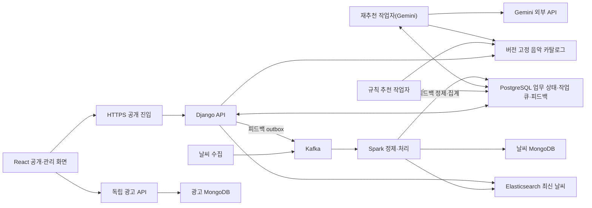

# PRD · 뮤더 — 날씨 기반 선곡표 추천 서비스

- version: `v0.2`
- document_state: `Draft`
- brd_reference: [BRD.md](./BRD.md)

- team: `mlo-01-p3-team1`
- current_scope: 3차 추천·데이터·관리·광고 운영, YouTube 로컬 보조 검증
- updated_at: `2026-10-26`

## 1. 제품 정의

뮤더는 카페·음식점 등 매장 운영자가 날씨 반영 여부와 음악 취향을 정해 약 3시간의 선곡표를 받고 조정하는 서비스다. 곡을 하나씩 찾아 목록을 구성하는 수고를 줄이는 것을 목표로 한다.

## 2. 사용자 필요

### 2-1. 매장 운영자의 선곡·이용

| ID | 사용자 필요 |
|---|---|
| UN-STORE-001 | 매장 운영자는 적은 시간과 수고로 매장 분위기·취향에 맞는 선곡표를 준비할 수 있어야 한다. |
| UN-STORE-002 | 매장 운영자는 회원가입이나 로그인 없이 적은 정보 입력으로 선곡을 시작할 수 있어야 한다. |
| UN-STORE-003 | 매장 운영자는 날씨 반영 여부를 직접 선택하고 지역을 정하지 않아도 날씨 없이 추천받을 수 있어야 한다. |
| UN-STORE-004 | 매장 운영자는 날씨의 갱신 상태와 선곡표에 적용된 조건을 확인할 수 있어야 한다. |
| UN-STORE-005 | 매장 운영자는 곡 목록과 선곡 이유를 확인해 매장에 사용할 결과인지 판단할 수 있어야 한다. |
| UN-STORE-006 | 매장 운영자는 곡을 자주 다시 찾지 않도록 약 3시간 분량의 선곡표를 준비할 수 있어야 한다. |
| UN-STORE-007 | 매장 운영자는 일반적인 매장용 선곡표에서 시즌·행사 전용곡이 제외된 결과를 받을 수 있어야 한다. |
| UN-STORE-008 | 매장 운영자는 원하지 않는 곡의 제외·취소와 날씨 반영 여부·지역·음악 취향 변경으로 선곡표를 조정할 수 있어야 한다. |
| UN-STORE-009 | 매장 운영자는 같은 선택 조건을 유지하면서 다른 곡 구성의 선곡표를 추천받을 수 있어야 한다. |
| UN-STORE-010 | 매장 운영자는 추천·저장에 실패해도 기존 선곡표와 조정 내용을 잃지 않고 실패 원인을 확인해 다시 시도할 수 있어야 한다. |
| UN-STORE-011 | 매장 운영자는 평가 여부를 선택하고 곡별 반응·선곡표 만족도를 입력·변경·취소할 수 있어야 한다. |
| UN-STORE-012 | 매장 운영자는 평가나 재생과 별개로 사용할 선곡표를 직접 선택·승인할 수 있어야 한다. |
| UN-STORE-013 | 처음 이용하는 매장 운영자는 추천·조정 방법을 익히고 필요할 때 안내를 다시 확인할 수 있어야 한다. |
| UN-STORE-014 | 매장 운영자는 PC·모바일·키보드로 주요 기능을 이용하고 안내·광고의 방해 없이 선곡표를 조작할 수 있어야 한다. |
| UN-STORE-015 | 매장 운영자의 선곡표·평가·제외 내역은 권한 없는 타인의 접근·변경으로부터 보호받아야 한다. |
| UN-STORE-016 | 로컬 YouTube 연결을 시험하는 이용자는 연결 가능한 곡과 미연결 곡을 구분하고 외부 재생 연결을 직접 선택할 수 있어야 한다. |

### 2-2. 음악·피드백·서비스 운영

| ID | 사용자 필요 |
|---|---|
| UN-OPS-001 | 음악 관리자는 추천에 쓸 음악을 등록하고 분류·검수 상태와 보류 사유를 확인할 수 있어야 한다. |
| UN-OPS-002 | 음악 관리자는 추천에 사용할 수 있는 곡과 보류할 곡을 구분하고 준비된 자료를 기존 정상 자료와 과거 결과를 훼손하지 않도록 반영할 수 있어야 한다. |
| UN-OPS-003 | 피드백 관리자는 곡별 반응·선곡표 평가와 제외·취소 당시의 곡·조건·날씨를 사용자 초안을 바꾸지 않고 확인할 수 있어야 한다. |
| UN-OPS-004 | 서비스 관리자는 부여받은 업무 권한에 따라 필요한 관리 기능과 데이터 준비·처리 상태·오류를 확인할 수 있어야 한다. |
| UN-OPS-005 | 운영 담당자는 장애 원인·복구 방법과 인계 자료를 확인해 처리 중단이나 담당자 변경 후에도 운영을 이어갈 수 있어야 한다. |

### 2-3. 광고 운영·성과 확인

| ID | 사용자 필요 |
|---|---|
| UN-ADS-001 | 광고 관리자는 광고 내용·위치·기간·게시 상태와 PC·모바일의 게시 모습을 확인하고 게시·중단을 관리할 수 있어야 한다. |
| UN-ADS-002 | 광고 관리자는 광고별 예산과 예상 사용량·초과 여부를 확인하고 예산 조건에 따른 게시 상태를 파악할 수 있어야 한다. |
| UN-ADS-003 | 광고 관리자는 유효 노출·클릭과 집계 기준시각을 확인하고 실제 0건·집계 지연·연동 대기를 구분할 수 있어야 한다. |
| UN-ADS-004 | 광고주·광고 등록 요청 주체는 광고 관리자를 통해 합의한 광고의 게시 여부와 노출·클릭 결과를 확인할 수 있어야 한다. |

광고주의 확인은 광고 관리자를 통한 정보 제공 범위로 다룬다.

## 3. 기능 요구사항

- 상태의 `active`는 현행 적용 요구사항을 뜻한다. 
- `local_demo`는 개발·시험용 환경에서 기능을 시연하고 검증하는 범위를 뜻한다.

### 3-1. 선곡표 추천·이용

| ID | 우선순위 | 요구사항 | 상태 |
|---|---|---|---|
| FR-WEATHER-001 | Must | 로그인 없이 동 단위 지역을 검색·선택·변경하고 선택한 지역의 현재 날씨·앞 3시간 예보·갱신 시각·누락·만료 상태를 확인하도록 한다. | active |
| FR-PREFERENCE-001 | Must | 날씨 ON/OFF의 초기 선택값은 ON으로 두고 지역 미설정은 OFF로 처리하며 ON에는 지역·유효 날씨를 요구하고 보컬·빠르기·테마·장르는 선택 입력으로 제공한다. | active |
| FR-PREFERENCE-002 | Must | 테마·장르는 복수 선택을 지원하고 각 그룹의 미선택·전체 선택은 같은 유효 조건으로 해석하되 원래 선택 상태를 보존한다. | active |
| FR-RECOMMEND-001 | Must | 추천 자격을 갖춘 일반곡에 ON은 유효 날씨·취향 규칙을, OFF는 날씨와 무관한 취향 규칙을 적용해 목표 180분·허용 176~184분의 선곡표를 중복 없이 만든다. | active |
| FR-RESULT-001 | Must | 메인에 곡 수·곡명·아티스트·목록·첫 곡 대표 이미지·선곡 이유를 표시하고 ON에서는 사용한 날씨를 함께 표시하되 재생 시간은 숨기고 이미지 누락·오류에는 공통 기본 이미지를 사용한다. | active |
| FR-CONDITION-001 | Must | 날씨 반영 ON/OFF·지역·음악 취향의 유효 조건을 바꾸면 기존 선곡표가 변경 전 조건으로 만들어졌음을 표시하고, [선곡표 받기]를 누르면 변경한 조건으로 규칙 기반 기본 추천을 새로 실행한다. | active |
| FR-CYCLE-001 | Must | 조건 변경 후 새 사이클은 빈 제외 목록·미평가로 시작하며 이전 사이클 자료는 보존한다. | active |
| FR-WEATHER-REFRESH-001 | Must | ON의 날씨 분류가 바뀌면 사용자 조건 변경·미저장 제외·진행 중 작업이 없는 상태에서 같은 사이클의 시작 조건·허용 장르 및 빠르기·제외 목록을 유지한 규칙 추천으로 새 결과 버전을 만들고 같은 분류나 OFF에서는 날씨 갱신만으로 재선곡하지 않는다. | active |
| FR-WEATHER-REFRESH-002 | Must | 날씨 갱신 성공 시 이전 평가·승인을 복사하지 않고 오래된 비동기 응답의 덮어쓰기를 차단하며 실패 시 기존 결과·상태를 보존하고 변경 전 날씨로 만든 결과임을 표시한다. | active |
| FR-EXCLUSION-001 | Must | 곡 제외·취소를 초안으로 저장하고 저장만으로 추천을 실행하지 않는다. | active |
| FR-REGENERATE-001 | Must | 같은 사용자 조건의 명시 요청에만 날씨 모드·시작 조건·허용 후보 범위·저장된 제외 목록을 유지해 재추천을 실행한다. | active |
| FR-REGEN-VALIDATE-001 | Must | 재추천 결과는 부모 전체 고유 곡 수의 20%를 내림한 수 이상의 신규 곡을 포함하되 최소 1곡을 요구하고 시간 등 모든 필수 조건을 통과해야 성공으로 인정한다. | active |
| FR-APPROVE-001 | Must | 현재 선택·저장된 제외 목록과 일치하고 필수 검증을 통과한 본인 결과만 별도 승인하며 새 결과에 이전 승인을 자동 복사하지 않는다. | active |
| FR-PLAYLIST-RATING-001 | Must | 곡별 좋아요·싫어요의 전환·해제와 선곡표 별점 1~5점의 입력·변경·취소를 해당 결과 버전에 선택적으로 기록하며 미평가 상태에서도 추천·재추천·승인을 허용한다. | active |
| FR-GUIDE-001 | Must | 실제 추천·평가·제외·광고 이벤트와 분리된 펭귄 3단계 안내와 건너뛰기·종료·다시 보기를 제공한다. | active |
| FR-YOUTUBE-LINK-001 | Must | 로컬에서 연결 가능·미연결 상태와 곡별 검색·검증 영상 링크를 제공한다. 현재 조건·제외가 반영된 결과에서 전곡의 외부 재생 검증이 끝나면 전체 임시 연속 재생 링크를, 일부만 검증됐으면 연결된 곡 수·미연결 곡·재생시간 감소를 알리는 부분 재생 링크를 제공한다. 링크는 사용자가 직접 선택하며 검증된 영상이 없으면 제공하지 않는다. | local_demo |
| FR-YOUTUBE-ISOLATION-001 | Must | 외부 재생과 보조 iframe을 별도로 검증하고 영상 확보 여부로 추천 후보·점수·시간 조건을 줄이거나 링크 이용으로 추천·평가·승인·광고 이벤트를 만들지 않는다. | local_demo |

### 3-2. 데이터·공통 운영

검수된 음악을 확보하고 피드백의 당시 맥락을 확인해 추천 운영을 뒷받침한다(UN-OPS-001·UN-OPS-002·UN-OPS-003).

| ID | 우선순위 | 요구사항 | 상태 |
|---|---|---|---|
| FR-WEATHER-DATA-001 | Must | 지역을 기상 격자에 연결해 날씨를 수집·정제·저장하고 6시간 범위로 조회한다. | active |
| FR-AUTH-001 | Must | 서버가 ADMIN 역할과 업무별 관리 권한을 확인하고 광고 권한이 있으면 광고 관리로, 음악 권한만 있으면 허용된 음악 관리 메뉴로 이동시킨다. | active |
| FR-OWNERSHIP-001 | Must | 서버가 로그인 없는 이용자를 익명 문맥으로 구분하고 본인 결과만 조작하도록 제한한다. | active |
| FR-MUSIC-IMPORT-001 | Must | 음악 CSV를 현행 규격으로 정제·등록하고 중복 곡과 행별 오류를 구분한다. | active |
| FR-MUSIC-REVIEW-001 | Must | 분류·보컬의 근거와 검수 상태를 관리해 승인·보류하고 적격 음악을 버전이 고정된 카탈로그로 발행한다. | active |
| FR-MUSIC-ELIGIBILITY-001 | Must | 유효한 판정 근거·버전이 있는 일반곡(GENERAL)만 발행·기본 추천·재추천 후보에 포함하고 시즌·행사곡은 제외하며 애매한 곡·미판정은 보류한다. | active |
| FR-MUSIC-PUBLISH-001 | Must | 적격 일반곡이 없거나 새 카탈로그 발행에 실패하면 기존 정상 버전을 유지하고 과거 결과를 수정하지 않으며 미판정 카탈로그의 신규 이용은 차단한다. | active |
| FR-YOUTUBE-REVIEW-001 | Must | 공통 관리자의 영상 URL·CSV 등록 및 외부 재생·iframe 독립 검수는 LOCAL_DEMO의 음악 관리 권한에만 허용하고 운영 모드와 광고 권한만 있는 계정에서는 차단한다. | local_demo |
| FR-FEEDBACK-001 | Must | 평가·제외·취소·재추천·승인의 당시 조건과 결과 버전을 중복 없이 기록·정제·집계하며 평가로 추천·재추천·제외·승인·점수 변경을 자동 실행하지 않는다. | active |
| FR-FEEDBACK-ADMIN-001 | Must | 권한이 있는 관리자가 사용자 초안을 변경하지 않고 제외·취소 이력과 당시 곡·조건·날씨를 검색·조회할 수 있도록 한다. | active |
| FR-OPS-001 | Must | 허용된 담당자가 음악 준비·날씨 수집 및 조회·추천 작업·피드백 처리·광고의 상태와 오류를 확인하도록 한다. | active |
| FR-OPS-VIEW-001 | Should | 필수 개별 조회와 별도로 운영 조회·로그를 모아 보는 통합 편의 화면을 선택 기능으로 제공한다. | active |

**피드백의 필수 관리자 화면은 제외 이력 조회이며, 평가 통합 화면은 FR-OPS-VIEW-001의 선택 범위에서 구체화한다.*

**음악 원본의 운영 S3 보관과 저장 경계는 4-3절을 따른다.*

### 3-3. 광고 운영

관리자가 광고를 게시·중단하고 예산·운영 결과를 확인해 광고 요청 주체에게 전달하도록 한다(UN-ADS-001·UN-ADS-002·UN-ADS-003·UN-ADS-004).

| ID | 우선순위 | 요구사항 | 상태 |
|---|---|---|---|
| FR-ADS-MANAGE-001 | Must | 관리자가 광고 내용·위치·기간·우선순위·게시·예약을 관리하도록 하며 게시 중단은 정상 활성 화면에 3초 이내 반영하고 일반 수정·로그아웃으로 수동 중단을 해제하지 않는다. | active |
| FR-ADS-PREVIEW-001 | Must | PC·모바일 광고 미리보기를 제공하고 미리보기의 노출·클릭은 운영 통계에서 제외한다. | active |
| FR-ADS-DELIVERY-001 | Must | 위치·일정·게시 상태·소재·예산 자격과 우선순위·동률 순환 규칙에 따라 상하단 카페 광고를 제공한다. | active |
| FR-ADS-MEASURE-001 | Must | 유효 노출과 실제 클릭을 광고 제공 건별로 각각 1회 인정하고 반복·재전송 제한을 적용한다. | active |
| FR-ADS-STATS-001 | Must | 통계를 5분 주기로 집계해 오늘 요약과 광고별 누적값·집계 기준시각을 표시하고 연동 대기와 실제 0건을 구분한다. | active |
| FR-ADS-BUDGET-001 | Must | 유효 광고 이벤트의 예상 토큰 사용량을 원장에 중복 없이 기록하고 5분 주기 검증에서 일일·전체 예산 중 하나의 소진을 확인하면 신규 제공과 기존 광고의 표시 자격을 차단하며 실제 잔액을 차감하지 않는다. | active |
| FR-ADS-BUDGET-002 | Must | 소진 확인 전의 유효 발생은 예산을 초과하더라도 발생 후 300초 이내 지연 보고로 인정하고 확인 시각 이후 발생은 제외한다. | active |

- 3차 제외 범위는 [BRD 5절](./BRD.md#5-범위-제외-및-후속-항목)을 따르며 YouTube 로컬 연결을 자체 스트리밍이나 외부 계정 자동 저장으로 확대하지 않는다.
- 세부 계약과 적용 버전은 13절의 참고 문서를 따르며, 제안값·구현 초기값과 출처 간 차이는 13-2절에서 구분한다.

## 4. 데이터 규칙

추천·운영에 필요한 데이터의 의미와 처리 기준을 정한다. 상세 컬럼·API·물리 테이블은 13절의 정의서와 계약을 참조하며, 데이터 규칙의 검증은 AC-12~AC-15·AC-21~AC-22·AC-32~AC-34·AC-37~AC-38·AC-42로 연결한다.

### 4-1. 데이터별 입력·식별 기준

| 데이터 | 주요 식별·기록 항목 | 입력·처리 기준 |
|---|---|---|
| 음악 | track_id, duration_ms, 곡·아티스트·앨범, 분류·보컬, 원본·검수·카탈로그 버전 | 보유 CSV를 정규화하고 중복·행별 오류를 구분하며, 추천·표시 18개 필드와 검수 보조값을 구분한다. |
| 날씨 | 지역·격자, 자료 출처, 발표·대상·수신 시각, PTY·SKY, 값·단위·품질 상태 | 관측과 예보를 구분하고 원본·정규값을 함께 보존하며, 지역 매핑과 용도별 유효성을 확인한다. |
| 추천 결과 | 결과·부모·사이클, 곡 순서, 선택 조건, 모드, 날씨·정책·카탈로그 버전 | 생성 당시 조건과 음악을 고정하고 곡 길이는 정수 ms로 합산하며, 화면 비표시와 서버 검증을 구분한다. |
| 피드백 | event_id, 대상 결과·곡, 평가·제외·취소, revision, 당시 조건·날씨 | 본인 결과의 실제 행동을 기록하고 변경·취소 관계와 당시 맥락을 유지한다. |
| 광고 | 광고·소재·제공 기록·이벤트 ID, 정책·단가·예산 버전, 발생·수신·집계 시각 | 제공·미리보기와 유효 노출·클릭을 구분하고 당시 판정으로 예상 원장·통계를 대조한다. |
| 영상 연결 | 곡·영상 ID, 등록 출처, 외부 재생·iframe 검수 상태 | 음악 적격성과 영상 연결 상태를 분리하며, 외부 재생과 iframe 검수값을 서로 대신 사용하지 않는다. |

### 4-2. 정제·품질·버전 규칙

| 항목 | 적용 규칙 |
|---|---|
| 결측·실제 값 | NULL·미확인과 실제 0·False를 구분하고, 필수값 누락·코드 오류·범위 오류를 임의의 정상값으로 대체하지 않는다. |
| 음악 정밀도 | 표시용 정수와 점수 계산용 원본 정밀도를 구분하며, 표시값에서 원본을 역산하거나 곡명만으로 분류·보컬을 확정하지 않는다. |
| 추천 자격 | 음악의 검수와 일반곡 판정을 구분하고, 발행·기본 추천·재추천에 FR-MUSIC-ELIGIBILITY-001의 공통 자격을 적용한다. |
| 선택 조건 | 원래 입력과 정규화한 조건을 함께 보존하고, 미선택·전체 선택의 해석은 FR-PREFERENCE-002를 따른다. |
| 날씨 | 발표·대상·수신 시각을 각각 보존하고, ON/OFF별 사용·누락·만료 처리는 NFR-FRESHNESS-001을 따른다. |
| 시간·단위 | 온라인 API·이벤트 시각은 UTC로 직렬화하고 KST로 입력·표시하며, 날씨 원문의 +09:00은 같은 순간으로 변환하고 단위와 출처를 유지한다. |
| 중복·역순·취소 | NFR-IDEMPOTENCY-001에 따라 재전송을 중복 반영하지 않고 revision과 취소 관계로 최신 유효 상태를 판단하며, 과거 원본을 현재 값으로 덮어쓰지 않는다. |
| 발행·이력 | 새 카탈로그와 결과는 새 버전으로 기록하고, 발행 실패·이전 자료의 처리는 FR-MUSIC-PUBLISH-001을 따른다. |
| 시험 자료 | 합성·미검수 프리뷰·모의 응답과 실제 운영 자료를 구분하고, 시험 이벤트를 운영 피드백·광고 집계에 섞지 않는다. |

### 4-3. 저장·보관 경계

| 영역 | 기준 저장·조회 경계 |
|---|---|
| 음악 | 음악 RDB의 곡·앨범·태그·연결 4개 기본 테이블과 버전이 고정된 카탈로그를 구분한다. |
| 공통 업무 상태 | PostgreSQL에서 익명 소유·세션·작업·결과·제외·평가·승인·outbox를 관리한다. |
| 피드백 | PostgreSQL에 원본·정제·집계를 구분해 저장하며, 과거 Delta 저장 제안을 현행 필수 구조로 적용하지 않는다. |
| 날씨 | MongoDB 이력·Elasticsearch 최신 조회와 원문 보관을 구분하고, 광고 DB·권한과 분리한다. |
| 광고 | 광고·소재·측정·예상 원장·집계·광고 로그는 광고 MongoDB에서 관리하며, 공통 PostgreSQL 로그와 분리한다. |
| 로컬 영상 | 로컬 영상 레지스트리를 음악 원본·추천 결과와 분리하고, 운영 저장소 적용 완료로 취급하지 않는다. |

## 5. 인프라 구성·운영 조건

구성요소 간 연결과 제품 운영에 필요한 조건을 나타내었다.

### 5-1. 구성과 연결

재추천은 외부 생성형 AI인 Gemini API와 연동한다. 사용자가 같은 조건에서 재추천을 명시적으로 요청할 때만 호출하며, 기본 추천·조건 변경 후 새 추천·날씨 분류 갱신은 규칙 기반으로 처리한다.

| 구성요소 | 제품에서 맡는 역할 | 확인할 운영 경계 |
|---|---|---|
| 공개·관리 화면 | 추천·조정·평가·관리와 배너 표시 | PC·모바일·키보드, API·인증 연결, 광고 지연·오류 격리 |
| 공통 API·업무 DB | 소유·권한 검사, 작업 등록·상태 조회, 결과·피드백 저장 | 동일 DB·세션·정책 연결, 상태·이벤트 원자성, 비밀 설정 관리 |
| 추천 작업자 | 기본 추천과 명시 요청에 따른 재추천을 별도 작업으로 처리 | 중복 점유·오래된 완료 차단, 호출 한도, 대기·실행 상태, 재시작·회수 |
| 날씨·피드백 처리 | 수집·이벤트 전달·정제·저장·최신 조회 | 처리 위치·접속 권한, 역순·중복·부분 오류, 체크포인트·재처리 |
| 광고 실행 환경 | 광고 관리·제공·측정·집계·예산 제어 | 공통 인증 연동, MongoDB 원자 저장, 독립 의존성·오류 처리 |
| 배포·운영 환경 | 실행·접속·모니터링·백업·복구 | 로컬/AWS의 적용 버전·배치·실행 기록, 복구 절차와 실제 증빙 |

**현재 실행 코드는 Django이며 일부 수령 문서의 FastAPI 설명과 구분한다.* 

**추천 API·작업자의 분산 실행 방식은 [추천 분산 처리 인프라 인계](./runbook/추천_분산처리_인프라_인계.md)를 따른다.*

### 5-2. 운영·복구 조건

- API의 작업 접수와 추천 생성 완료를 구분하고, 사용자가 대기·실행·성공·실패 상태와 다음 행동을 확인할 수 있어야 한다.
- 작업자 중단·재시작 후 동일 결과를 중복 저장하지 않아야 하며, 결과가 불확실한 Gemini 호출을 자동 반복하지 않아야 한다.
- DB·날씨·카탈로그·인증 준비 실패를 임의의 로컬 값으로 우회해 정상 운영으로 표시하지 않아야 한다.
- 광고·재추천의 장애 격리는 NFR-RELIABILITY-001, 재처리·복구는 NFR-RECOVERY-001을 따른다.
- 실행 환경별 코드·의존성·설정 참조와 로그·백업·복구 절차를 인계하고, 실제 비밀번호·키는 문서·업무 로그에 넣지 않아야 한다.
- 로컬 시험·모의 응답·AWS 일부 경로의 성공을 전체 운영·이중화·부하 시험의 완료로 확대하지 않아야 한다.

**설치·네트워크·프로세스별 실행 명령은 인프라 문서에서 관리한다. 서비스별 실제 배치·허용 부하·복구 시간과 검증 상태는 11절의 작업 기록으로 연결한다.*

## 6. 비기능 요구사항

### 6-1. 보안·데이터 신뢰성

| ID | 요구사항 |
|---|---|
| NFR-ACCESS-001 | 서버는 사용자 소유와 관리자 권한을 검사해 허용되지 않은 접근을 차단한다. |
| NFR-SECRET-001 | 비밀번호·API 키·세션 토큰을 소스나 업무 로그에 평문으로 남기지 않는다. |
| NFR-CONSISTENCY-001 | 업무 상태와 관련 이벤트는 함께 저장해 부분 실패로 서로 다른 상태가 남지 않도록 한다. |
| NFR-IDEMPOTENCY-001 | 동일 요청·이벤트의 재전송과 재처리가 결과나 집계를 중복 반영하지 않도록 한다. |
| NFR-TRACE-001 | 추천·평가·제외 기록에서 당시 음악·날씨·선택 조건과 적용 버전을 추적할 수 있어야 한다. |
| NFR-RETENTION-001 | 광고 원본·delivery는 90일, 일별 집계·예상 원장·관리 변경 이력은 365일 보관하고 필요한 참조를 보존하며, 다른 자료의 기간은 별도 합의한다. |

### 6-2. 안정성·복구

| ID | 요구사항 |
|---|---|
| NFR-RELIABILITY-001 | 광고·재추천 장애가 기본 추천으로 전파되거나 기존 정상 결과를 훼손하지 않도록 한다. |
| NFR-FRESHNESS-001 | ON은 현재 날씨 분류의 유효성과 실제 선곡 길이까지 필요한 예보 구간을 각각 확인하고 OFF는 날씨 조회·누락·만료에 의존하지 않으며 미준비 음악은 두 모드 모두 정상 자료로 사용하지 않는다. |
| NFR-RECOVERY-001 | 수집·처리 중단 후 재시작·재처리로 업무 상태와 집계를 복구하고 사전 합의한 복구 시간 목표를 충족해야 한다. |

### 6-3. 사용성·성능

| ID | 요구사항 |
|---|---|
| NFR-USABILITY-001 | PC·모바일·키보드 환경에서 핵심 흐름을 이용할 수 있고 안내·광고가 주요 조작을 방해하지 않아야 한다. |
| NFR-PERFORMANCE-001 | MET-07의 측정 조건에서 사전 합의한 응답 시간 목표를 충족해야 한다. |

**성능·동시 요청·복구 시간과 광고 외 자료의 보관 기간은 미정이며, 담당·확정 시점은 7절, 미확정 상태의 판정은 9절을 따른다.*

## 7. 성공 지표·검증 방법

### 7-1. 사용자 효과 지표

| ID | 지표 | 검증 방법 |
|---|---|---|
| MET-01 | 선곡 준비·조정 부담 | 같은 참여자가 동일 과제를 기존 방식과 서비스로 수행한 시간과 체감 부담을 비교한다. |
| MET-02 | 선곡표 만족도 | 취소·미평가를 제외한 최신 별점의 평균·분포·평가 수를 확인한다. |
| MET-03 | 날씨·매장 분위기 적합성 | 별점과 별도의 사용자 조사에서 날씨·매장 분위기·취향 적합성을 평가하고 같은 선곡 목적의 ON/OFF 비교로 날씨 반영의 체감 가치를 확인한다. |
| MET-04 | 재추천의 조정 효과 | 같은 조건에서 재추천 전후의 만족도와 원하는 결과를 얻기까지의 시간·수고를 비교한다. |

### 7-2. 품질·운영 지표

| ID | 지표 | 검증 방법 |
|---|---|---|
| MET-05 | 선곡표 생성 성공률 | 사전에 정한 모드별 유효 입력에서 검증된 결과를 만든 비율을 ON/OFF·기본 추천/재추천별로 측정하고 실패 원인을 구분한다. |
| MET-06 | 추천 조건 준수 | 생성 결과의 일반곡 자격·검수·보컬·확정 장르 및 빠르기·제외·중복·시간 조건을 검사하고 ON은 날씨 조건, OFF는 날씨 독립성을 확인한다. |
| MET-07 | 응답 시간 | 합의한 자료 규모·동시 요청·환경에서 ON/OFF·기본 추천/재추천별 전체 요청의 P50·P95와 성공·실패 수를 기록하고 로컬 일부 단계의 속도와 구분한다. |
| MET-08 | 광고 집계·예상 사용량 정확성 | 같은 집계 범위와 기준시각에서 기대한 노출·클릭·예상 토큰 사용량을 실제 집계·원장과 대조하고 중복·운영 제외 사례를 확인한다. |

- MET-03은 현재 제품의 효과를 확인하는 사용자 조사이며, 12절의 전용 평가 기능·후속 버전 간 품질 비교와 구분한다.
- 시간·만족도·성공률·성능의 목표값과 평가 대상·규모·기간은 아래 담당자가 평가 전에 합의한다.
- 미완료·실패·미응답 건수를 함께 보고하고, 목표 미정 상태에서는 달성 여부를 판정하지 않는다.
- 승인·제외·재추천 횟수를 만족도나 실제 청취로 간주하지 않으며, 광고 지표를 실제 매출과 구분한다.

| 확정 항목 | 담당·확정 시점 |
|---|---|
| 사용자 평가의 모집 기준·인원·목표값·기간·미응답 처리 | PA가 사용자 조사 후 평가 시작 전에 취합·확정한다. |
| 같은 과제의 기존 방식·서비스 이용 순서와 ON/OFF 비교 조건 | PA·C가 평가 시작 전에 정한다. |
| 생성 성공률의 입력 집합·자료 버전·시행 수 | C 주관·A/B 협력으로 시험 전에 정한다. |
| 성능·동시 요청·복구 목표와 시험 환경, 광고 외 보관 기간 | B/C/INF가 제안하고 PA가 관련 시험 전에 합의를 취합한다. |
| 광고별 실예산과 정상·중복·지연·소진 경계의 기대 집계 | B 주관·C/INF 협력으로 광고 인수시험 전에 확정한다. |

## 8. 실패·예외 처리

### 8-1. 입력·데이터 문제

| 상황 | 안내·처리 |
|---|---|
| 지역·취향 입력 오류 | 잘못된 항목의 수정을 안내하고 임의 지역이나 조건으로 추천하지 않는다. |
| 날씨 수집 실패 | ON은 보유 날씨가 유효하고 필요한 예보 구간을 충족하면 기준시각·수집 실패를 표시하고 추천을 허용하며 OFF는 날씨 실패로 추천을 막지 않는다. |
| ON의 추천용 날씨 누락·만료 | 새 추천을 보류하고 갱신을 안내하며 기존 결과를 보존하되 임의로 OFF로 바꾸지 않고, 추천에 필요 없는 뒤쪽 조회 구간의 누락은 별도로 표시한다. |
| 음악 자료·정책 미준비 | 준비가 필요한 항목을 안내하고 미확인 값이나 임의 정책으로 추천 성공을 처리하지 않는다. |
| 일반곡 판정 누락·발행 실패 | 신규 추천 자격을 우회하지 않고 재검수·새 버전 발행을 안내하며 기존 카탈로그와 과거 결과를 덮어쓰지 않는다. |

### 8-2. 추천·조정·저장 문제

| 상황 | 안내·처리 |
|---|---|
| 후보 부족·탐색 미완료 | 전체 후보 부족과 탐색 한도 도달을 구분해 안내하고 시간·필수 조건을 자동 완화하지 않는다. |
| 조건 변경 후 재추천 요청 | 재추천을 거부하고 변경한 조건으로 새 기본 추천을 요청하도록 안내한다. |
| ON의 날씨 분류 갱신 실패·응답 역전 | 기존 결과를 보존해 변경 전 날씨의 결과로 표시하고 최신 날씨 기준 재시도를 안내하며 오래된 완료 응답으로 덮어쓰지 않는다. |
| 재추천 처리 실패 | 외부 AI 이용 불가·시간 초과·응답 오류의 원인과 재시도 방법을 안내한다. |
| 신규 곡 기준 미달 | 필요한 신규 곡 수를 채우지 못했음을 안내한다. |
| 제외 저장 실패·버전 충돌 | 편집 의도를 보존하고 최신 초안 확인·재저장을 안내하며 저장 완료 전 재추천과 승인을 차단한다. |
| 평가 저장 실패·버전 충돌 | 마지막 저장값과 미저장 입력을 구분해 최신값 확인·재저장을 안내하고 추천·재추천·승인 등 다른 기능의 이용은 유지한다. |
| 미반영 결과 승인·결과 만료 | 승인을 거부하고 현재 조건에 맞는 새 결과 요청 또는 변경 취소를 안내한다. |

### 8-3. 인증·광고·안내 문제

| 상황 | 안내·처리 |
|---|---|
| 관리 인증 실패·권한 부족·타인 결과 접근 | 허용되지 않은 조회·변경을 차단하고 공개 기본 추천은 유지한다. |
| 광고 없음·이미지 오류·통계 연동 지연 | 추천을 계속 이용하도록 하고 광고 오류·연동 대기를 실제 노출이나 0건 통계로 처리하지 않는다. |
| 안내 이미지·기록 저장 실패 | 텍스트 안내나 종료·다시 보기를 제공하고 기존 선택·결과와 실제 이벤트를 보존한다. |
| 로컬 YouTube 미연결·재생 제한 | 곡별 검색·미연결·외부 또는 iframe 제한을 구분하고 원래 추천 결과는 유지한다. 일부만 연결됐으면 연결된 곡만 원래 순서로 여는 부분 재생 링크와 재생시간 감소를 안내한다. 검증된 영상이 없거나 조건 변경·제외 미반영 상태이면 연속 재생 링크를 제공하지 않는다. |

## 9. 기능·운영 수용 기준

### 9-1. 기능 수용 기준

| ID | 검증 상황 | 통과 기준 |
|---|---|---|
| AC-01 | ON 기본 추천·날씨 조회 | 비로그인·유효 날씨에서 6시간 조회와 FR-WEATHER-001·FR-RECOMMEND-001의 기준을 충족한다. |
| AC-02 | 결과 표시·이미지 누락·오류 | 표시 항목·시간 비표시·이미지 대체가 FR-RESULT-001과 일치한다. |
| AC-03 | 조건 변경 후 새 추천 | 변경 전 결과를 표시하고 FR-CONDITION-001·FR-CYCLE-001에 따라 새 기본 추천을 생성한다. |
| AC-04 | 곡 제외·취소 저장 | 제외 초안이 저장되고 저장만으로 추천이 실행되지 않는다. |
| AC-05 | 같은 조건의 명시적 재추천 | 저장 후 명시 요청은 FR-REGENERATE-001을 따르고 생성 중 변경·중복 요청·승인을 차단한다. |
| AC-06 | 정상·신규 곡 미달·순서만 변경·목록 밖·시간 위반 응답 | FR-REGEN-VALIDATE-001을 통과한 응답만 채택하고 실패 시 8절의 상태 보존·자동 대체 금지를 지킨다. |
| AC-07 | 정상·미저장·미반영·생성 중·만료 결과 승인 | 현재 선택·저장된 제외·최신 요청과 일치하는 본인 유효 결과만 사용자가 명시적으로 승인할 수 있다. |
| AC-08 | 평가 입력·변경·취소·새 결과 | 평가가 해당 결과 버전에 반영되고 새 결과는 미평가로 시작한다. |
| AC-09 | 미평가·평가 저장 실패·평가 후 다른 기능 이용 | 평가의 선택성·자동 동작 금지·저장 실패 처리가 FR-FEEDBACK-001·FR-PLAYLIST-RATING-001과 8절을 충족한다. |
| AC-10 | PC·모바일·키보드 이용 | 합의한 환경에서 추천·조정·평가·승인을 완료할 수 있다. |
| AC-11 | 3단계 안내·건너뛰기·종료·다시 보기 | 안내 동작이 주요 조작을 막거나 실제 업무·광고 이벤트를 만들지 않는다. |
| AC-12 | 음악 입력·검수·일반곡 판정 | CSV 중복·오류·미확인과 판정 상태를 구분하고 적격 일반곡만 ON/OFF의 기본 추천·재추천에 사용한다. |
| AC-13 | 카탈로그 발행·실패·적격 곡 0건 | 새 버전은 고정해 발행하고 실패·적격 곡 0건이면 기존 카탈로그와 과거 결과를 보존한다. |
| AC-14 | 평가 변경·취소 후 집계 | 최신 유효 평가의 집계가 기대값과 일치한다. |
| AC-15 | 관리자 제외·취소 이력 조회 | 권한 있는 관리자가 당시 자료·취소 관계를 조회해도 사용자 초안이 바뀌지 않는다. |
| AC-16 | 광고 등록·예약·수정 | 광고 저장값과 게시 상태가 설정·기간 조건에 일치한다. |
| AC-17 | 광고 중단·수정·로그아웃 | 중단 성공 커밋 후 3초 이내 숨기고 일반 수정·로그아웃 뒤에도 수동 중단을 유지한다. |
| AC-18 | PC·모바일 광고 미리보기 | 미리보기의 노출·클릭을 운영 집계에서 제외한다. |
| AC-19 | 위치·일정·상태·소재·예산·우선순위·동률 선정 | 제공 광고가 FR-ADS-DELIVERY-001의 자격·우선순위·동률 순환 기준과 일치한다. |
| AC-20 | 5분 주기 예산 소진 검증 | 최초 소진 확인 시각부터 신규 제공·기존 표시 자격을 차단하고 실제 잔액을 차감하지 않는다. |
| AC-21 | 노출·조기 클릭·중복·반복·지연·운영 제외·단가 변경 | MET-08의 집계·예상 원장이 기대값과 일치하고 과거 단가를 소급 변경하지 않는다. |
| AC-22 | 오늘·누적 통계 표시 | 5분 주기 통계에 집계 기준시각을 표시하고 연동 대기·집계 지연·실제 0건을 구분한다. |
| AC-23 | 지역 미설정·선택 지역의 OFF·날씨 장애 | 지역 미설정은 OFF로 처리하고 OFF의 후보·점수·성공 여부는 날씨 유무에 영향받지 않는다. |
| AC-24 | 테마·장르의 미선택·전체 선택 | 각 그룹의 미선택과 전체 선택을 같은 유효 조건으로 해석한다. |
| AC-25 | ON의 같은 분류·분류 변경 및 OFF 날씨 갱신 | 같은 분류·OFF는 날씨 갱신만으로 재선곡하지 않고 ON 분류 변경은 고정 조건·제외를 유지한 새 미평가 결과를 만든다. |
| AC-26 | 날씨 갱신 실패·응답 역전 | FR-WEATHER-REFRESH-002에 따라 기존 상태·변경 전 날씨 표시를 유지하고 오래된 응답의 덮어쓰기를 차단한다. |
| AC-27 | 소진 확인 직전·동시·직후 발생과 300초 보고 경계 | 확인 전 유효 발생은 예산 초과분도 발생 후 300초 이내 보고로 인정하고 확인 시각 이후 발생은 제외한다. |
| AC-28 | 로컬 영상의 외부/iframe 검수·전곡/일부/0곡 연결 | 링크·순서·곡 수·시간 감소 안내와 조건·제외 불일치 차단이 FR-YOUTUBE-LINK-001을 충족한다. |
| AC-29 | 영상 연결과 기존 결과·이벤트 비교 | 영상 연결이 기존 추천 결과와 추천·평가·승인·광고 이벤트를 변경하지 않는다. |
| AC-30 | 영상 검수 권한·운영 모드·외부/iframe 판정 | FR-YOUTUBE-REVIEW-001의 로컬 권한 제한과 외부 재생·iframe 독립 검수를 충족한다. |
| AC-31 | 일부 곡의 재생 성공 기록 | 일부 재생 성공을 전곡·3시간 검증 완료로 기록하지 않는다. |
| AC-32 | 데이터 입력·단위·결측·정밀도·관측/예보·시각 | 데이터 식별·정제·시각·저장 경계가 4절과 일치하고 미확인 값과 정상값을 구분한다. |
| AC-33 | 데이터 버전·중복·수정/취소·재처리·과거 재조회 | 같은 입력의 재처리 결과와 버전별 과거 값이 기대값과 일치한다. |
| AC-34 | 운영 자료·시험 자료 구분 | 시험 자료·이벤트를 운영 자료와 구분하고 운영 피드백·광고 집계에 섞지 않는다. |

### 9-2. 운영·품질 수용 기준

| ID | 검증 상황 | 통과 기준 |
|---|---|---|
| AC-35 | 타인·미인증·권한 없음·세션 회수·관리자 진입 | 서버가 허용되지 않은 조회·변경을 차단하고 로그인 후 업무 권한에 맞는 메뉴로 진입시킨다. |
| AC-36 | 소스·설정 예시·업무 로그의 비밀정보 점검 | 실제 비밀번호·API 키·세션 토큰이 검출되지 않는다. |
| AC-37 | 저장 중단·응답 유실·중복·역순 이벤트 | 상태·이벤트가 부분 반영되지 않고 재처리 결과·집계가 기대값과 일치한다. |
| AC-38 | 원본 정보 변경 후 과거 기록 재조회 | 과거 기록이 현재 값으로 바뀌지 않는다. |
| AC-39 | ON/OFF·기본 추천·재추천 부하 시험 | MET-07의 전체 요청 실측값이 합의한 목표를 충족하고 측정 조건·미달·실패 증빙을 남긴다. |
| AC-40 | 날씨·자료 미준비 및 광고·재추천 장애 | AC-23~AC-26의 모드별 날씨 판정을 지키고 오류를 표시하며 광고·재추천 장애를 기본 추천에서 격리한다. |
| AC-41 | 수집·처리 중단 후 재시작·복구 | 상태 보존·복구 결과와 소요 시간이 5·6·8절의 기준을 충족한다. |
| AC-42 | 보관 기간 경계·참조가 남은 자료 정리 | 보관·정리 대상이 NFR-RETENTION-001에 일치하고 이력·취소·미처리 자료의 참조가 끊기지 않는다. |

## 10. 업무 담당·검토 책임

[BRD 2절](./BRD.md#2-이해관계자-및-업무-기대-결과)과 기존 작업 분장을 기준으로 개발·운영 책임을 정리한다. 아래 A/B/C/INF/PA는 업무 역할이며 서비스 이용 계정의 관리자 권한과 구분한다. 실제 담당자 이름·대리자·검토자 배정은 별도 명단과 대조해 기록한다.

| 역할 | 주된 책임 | 협력·검증·인계 |
|---|---|---|
| A — 날씨 | 지역 매핑, 날씨 수집·정제·조회·유효성 | C에 날씨 규격·샘플을 인계하고 INF와 실제 연결·중단·복구를 검증한다. |
| B — 공통 백엔드·피드백·광고 | 인증·소유·공통 저장, 피드백, 관리 API, 광고 관리 화면·측정·집계, 통합 조율 | C의 화면·당시 자료와 연결하고 업무 상태·집계·권한·재처리를 검증한다. |
| C — 화면·추천·음악 | 음악 정제·카탈로그, 기본 추천·재추천, 공개·음악·피드백 관리 화면, 공개 배너 | B의 관리 API·피드백·광고와 연결하고 조건·시간·버전·화면·이벤트 격리를 검증한다. |
| INF — 인프라 | 실행·접속·배포·모니터링·백업·복구 환경 | A/B/C의 실행 계약을 연결하고 환경·배치·자원·접속·복구 근거를 인계한다. |
| PA — 기획 | 요구·범위·UX·수용 기준·일정 조율, 사용자 평가·시연 취합 | 개발·인프라 검증과 사용자 효과 평가를 구분하고 미확인 항목·수용 결과를 취합한다. |

기능별 주담당·협력은 11절의 작업 묶음과 상세 태스크를 따른다. 음악·피드백 관리 화면은 C, 대응 관리 API는 B가 맡으며 광고 관리 화면은 B, 공개 배너 배치는 C가 맡는다.

기술 검증은 해당 개발·인프라 담당자가 수행하고 B가 통합을 조율한다. PA의 기획·사용자 관점 확인과 기술 검증을 구분하며, 작업별 실제 검토자와 판정 근거를 기록한다.

## 11. WBS·실행 계획

### 11-1. 작업 분해와 요구사항 연결

기존 [3차 실행 작업 목록](./product/카페_음악_추천_서비스_3차_구현_태스크.md#5-실행용-작업-목록--3차)을 요약한다. WBS 번호는 작업 묶음의 식별자이며 순차 완료를 강제하지 않는다. 기존 태스크 ID·직접 선행 관계와 P0/P1은 유지한다.

| WBS | 작업 묶음·기존 태스크 | 주담당·협력 | 주요 산출물 | 연결 요구·수용 기준 |
|---|---|---|---|---|
| WBS-01 | 공통 규격·인프라: D-01~D-06, I-01~I-05 | PA 요구 조율, B 공통 API, INF 실행 환경, A/C 협력 | 입력·소유·권한 계약, 실행·저장·접속·복구 환경, 검사·운영 절차 | FR-AUTH-001·FR-OWNERSHIP-001, 5·6절, AC-35~AC-42 |
| WBS-02 | 음악 입력·검수: M-01~M-06, A-01~A-06 | C 음악·발행, B 관리 API, PA 검수 조율, INF 연결 | 정제 CSV·오류 목록, 검수·일반곡 판정, 버전 고정 카탈로그 | FR-MUSIC-IMPORT-001·FR-MUSIC-REVIEW-001·FR-MUSIC-ELIGIBILITY-001·FR-MUSIC-PUBLISH-001, AC-12~AC-13·AC-32~AC-34 |
| WBS-03 | 날씨: W-01~W-07 | A 수집·조회, C 패널, B/INF 협력 | 지역·격자, 수집·정제·저장·조회, 모드별 유효성·패널 검증 | FR-WEATHER-001·FR-WEATHER-DATA-001·NFR-FRESHNESS-001, AC-01~AC-02·AC-23~AC-24·AC-32~AC-34·AC-40~AC-41 |
| WBS-04 | 추천·공개 화면·안내: R-01~R-05, U-01~U-05 | PA 정책 조율, C 추천·화면, B 피드백 연결, A/INF 협력 | 기본·재추천·날씨 갱신, 제외·평가·승인, 안내·반응형 화면·로컬 영상 연결 검증 | 3-1절, AC-01~AC-11·AC-23~AC-26·AC-28~AC-31 |
| WBS-05 | 피드백: F-01~F-08 | B 처리·관리 API, C 화면·당시 음악, A 날씨, INF 환경 | 이벤트·당시 맥락, 원본·정제·집계, 관리자 제외 이력, 재처리 결과 | FR-FEEDBACK-001·FR-FEEDBACK-ADMIN-001, AC-14~AC-15·AC-32~AC-34·AC-37~AC-38 |
| WBS-06 | 광고: AD-01~AD-06 | B 관리·측정·집계, C 공개 배너, PA/INF 협력 | 광고 관리·미리보기·배너, 예상 원장·통계·예산 제어, 통합 검증 | 3-3절, AC-16~AC-22·AC-27 |
| WBS-07 | 통합 검증·운영·인계: Q-01~Q-08 | B 통합, 각 개발자 기능 검증, INF 부하·복구, PA 시연·인계 | 기능·품질 증빙, 운영 조회·오류, 재현 가능한 시연·복구·후속 인계 | MET-05~MET-08, 9절 전체; Q-07은 Should 편의 화면으로 별도 판정 |
| WBS-08 | 사용자 효과 평가: 독립 작업 ID 연결 확인 필요 | PA 취합·C 협력안, 실제 배정 확인 필요 | 합의한 평가 계획, 비교 과제·응답·결과·미달 사유 | MET-01~MET-04; 기능 시연과 별도로 평가 |

### 11-2. 선행 관계·일정·진행 기록

- R-03은 검수·정제·날씨·업무 저장의 준비 결과에 연결되고, R-04는 R-02·R-03 이후, U-01은 R-05·D-04·W-06 이후에 연결한다.
- U-02는 U-01·F-07, U-05는 U-04·AD-04·U-02·AD-05를 직접 선행으로 둔다.
- 광고는 AD-01 → AD-02 → AD-03/AD-04 → AD-05 → AD-06으로 연결하며, 통합 검증의 전체 직접 선행은 상세 태스크 표를 따른다.
- 날씨·음악·피드백·광고의 독립 작업은 병행할 수 있으며, 3차 완료에 4차 구현을 선행 조건으로 추가하지 않는다.

| 작업별 관리 항목 | 기록 기준 |
|---|---|
| 담당·검토자 | 실제 개인명·업무 역할·협력자·검토자를 기록한다. |
| 일정 | 계획 시작·종료와 실제 시작·종료, 예상 작업량을 구분한다. |
| 상태 | 예정·진행·검토·완료·막힘과 확인 기준일을 기록한다. |
| 결과·판정 | 관련 FR/NFR·AC, 산출물·코드/문서 버전, 기대값·실제값·증빙·검토 결과를 연결한다. |
| 차단·변경 | 선행 미완료·자료/권한 부족·실패 영향과 해결 담당·재검증 조건을 기록한다. |

## 12. 후속 버전

| 구분 | 내용 |
|---|---|
| 4차 필수 계획 | USER 계정·로그인·프로필, 본인 저장 선곡표·이력, 사용자 결제·유료 권한을 구현한다. |
| 4차 광고 확장 | 업종별 광고 매칭을 다루며, 업종 입력·태그·매칭·순환의 세부 정책은 착수 전에 정한다. |
| 선택 검토 | 외부 플랫폼 계정의 재생목록 자동 생성·저장, 현재 익명 결과의 계정 편입, 날씨 적합성 전용 평가 기능·후속 버전 간 품질 비교를 별도 확장으로 검토한다. |
| 도입 미정 | 국가·언어 필터, 로컬 AI, 광고 구매·차감·환불은 구현 여부와 적용 시기를 정하지 않았다. |

4차 계정·이력·결제에서도 기본 추천은 비로그인으로 유지하며, 상품·요금·결제 제공자·세부 일정은 별도 합의한다. 후속 작업은 [4차 실행 작업](./product/카페_음악_추천_서비스_3차_구현_태스크.md#6-4차-실행-작업--필수와-선택-확장-구분)과 [광고 업종 매칭 확장 가이드](./handoff/ads/06_4차_광고_업종매칭_확장_가이드.md)를 따른다.

## 13. 참고 문서·적용 기준

### 13-1. 참고 문서

확인일은 2026-10-22이며, 아래 버전·날짜는 문서 또는 계약에 표시된 기준이다. 로컬 변경본과 고정 GitHub 커밋의 내용을 구분하고, 실제 배포 버전·운영 상태는 별도 증빙으로 확인한다.

| 문서 | 참고 목적 | 버전·적용 범위 |
|---|---|---|
| [BRD](./BRD.md) | 문제·사업 범위·역할·인수 방향 | v0.2, 2026-10-19 갱신본 |
| [서비스 흐름](./product/카페_음악_서비스_기능_및_사용자_흐름_정리.md)·[구현 설계도](./product/카페_음악_서비스_구현_설계도.md) | 화면·API·권한·처리 연결 | 2026-10-19 추가 결정과 이전 본문을 구분 |
| [공통 개발 계약](./product/3차_공통_개발_계약과_검증_기준.md)·[현행 HTTP 입력 계약](../config/contracts/basic-request.phase3-20261016.3.schema.json) | 입력·응답·시각·버전·멱등·오류 | 공통 문서 .1과 실제 HTTP phase3-20261016.3을 구분 |
| [음악 컬럼·변환 규칙](./handoff/music/음악_분류_컬럼_정의_및_변환_규칙.md) | 음악 필드·출처·단위·NULL·원본 변환 | 2026-10-16, 추천·표시 18개와 검수 보조값 |
| [추천 로직 가이드](./product/카페_음악_추천_서비스_3차_컬럼_기반_추천_로직_가이드.md) | ON/OFF 후보·점수·시간·갱신·수용 대기값 | WEATHER_CHOICE_20261016_V2, 2026-10-19 갱신 |
| [날씨 데이터 규격·정제](./handoff/weather/02_날씨_데이터규격과_정제.md) | 항목·단위·품질 상태·관측/예보 시각 | 2026-10-13 수령 기준; 온라인 시각 변환은 공통 계약 적용 |
| [저장소 경계·발행 계약](./product/3차_저장소_경계와_발행_계약.md) | 음악·업무·피드백·날씨·광고 저장과 발행 | 2026-10-16; 음악 원본 운영 S3는 4-3절의 명시 보류 적용 |
| [광고 정책 결정 기록](./development/ads/광고_미정_정책_결정_가이드.md) | 제공·측정·통계·예산·지연 보고 | phase3-ads-20261015.1의 확정 절; 보존 초안 전체를 적용하지 않음 |
| [인프라 인계](./handoff/infra/README.md)·[AWS 구축 계획서](./handoff/infra/AWS_인프라_구축_계획서.md) | 로컬/AWS 구성·접속·설치·복구의 수령 기준 | 설계·인계 원문과 실제 실행 증빙을 구분 |
| [추천 분산 처리 인프라 인계](./runbook/추천_분산처리_인프라_인계.md) | Django API·작업 큐·워커·재시작·관측 | 2026-10-19; 워커·자원 예시와 운영 부하 검증을 구분 |
| [3차·4차 구현 태스크](./product/카페_음악_추천_서비스_3차_구현_태스크.md) | 상세 WBS·주담당·직접 선행·완료 기록 | 3차는 5절, 후속은 6절; 과거 정책 문구는 현행 계약과 대조 |
| [협업 지침](../AGENTS.md) | 업무 분장·담당 경계·수령 원문 보존 | 개인 배정 명단과 실제 검토·인계 기록은 별도 확인 |
| [고정 계약 예시](./fixtures/3차_공통_계약_예시.json) | 계산·경계 검산의 기초 자료 | 현행 입력·정책과 대조한 예시만 사용하며 실제 실행 증빙과 구분 |

