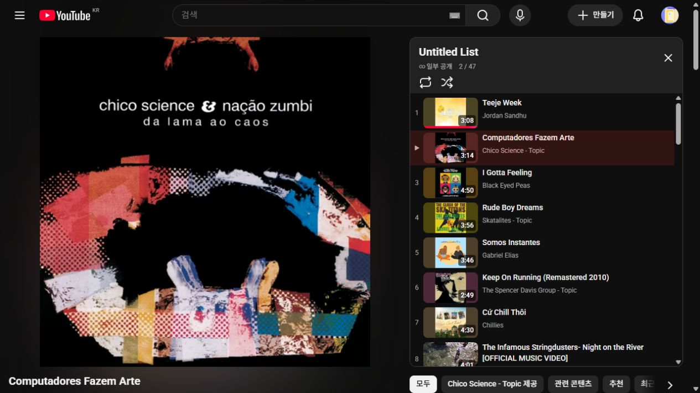
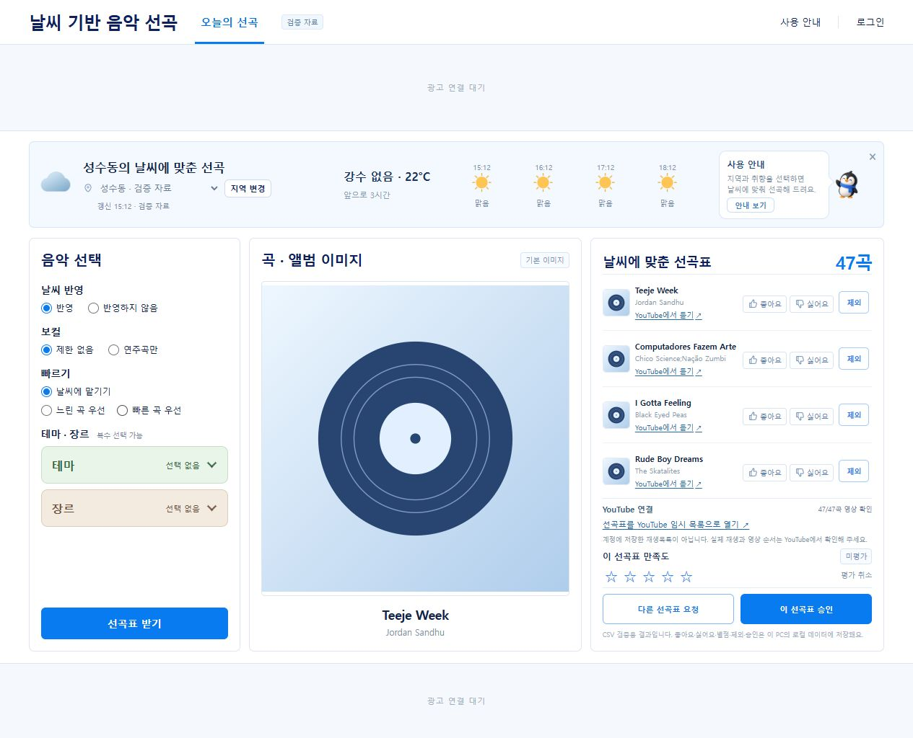

# YouTube 47곡 매핑 검증 기록

- 작성일: 2026-10-16
- 수정일: 2026-10-16
- 기준: `feature/ad-logic` / `f22f974` 이후 로컬 작업
- 담당: 공개 음악 연결 C / 검증 취합 PL, root 통합
- 범위: 기존 대시보드에서 생성한 실제 47곡의 공식 영상 후보 조사·공개 HTTP 메타데이터·YouTube 네이티브 목록 포함 확인
- 상태: **이번 확인 범위 완료 — 승인된 1곡 교체를 포함한 47곡의 매핑·네이티브 목록 전순서·기존 대시보드 전체 연결·첫 곡→둘째 곡 자연 전환·제외/취소 잠금 검증을 통과했습니다. 전체177분 경과 재생·물리 음성 출력·사용자 Chrome/Premium 환경은 미검증입니다.**

## 1. 원본 결과와 이전 기록 보존

기준 목록은 [실제 대시보드 결과](./assets/dashboard-general-result-20261016.json)의 47곡입니다. 파일 SHA-256은 `233880987fe3436650368ada98a25a2c00a905a70659e7d2d1e135124326e280`이고, 원본 CSV SHA-256은 `b202fa49909b2d5cef71a04b1d21243cfeb36414535f2ca9272aa646721177bd`입니다. 당시 결과는 **10,652,228ms = 177분32.228초**, 전곡 `GENERAL`, 성수동 고정 맑음 시험 조건입니다.

[최초 대시보드 연결 검증](./기존_대시보드_YouTube_연결_검증_20261016.md)의 **영상 확인 0/47·전체 연결 보류**는 당시 관측으로 보존합니다. 이번 연구 자료를 그 당시 결과에 덮어쓰거나 기존 0/47 관측을 잘못된 기록으로 바꾸지 않습니다. 원본의 `preview_only=true`·`validation_passed=false`도 운영 검수 완료로 바꾸지 않습니다.

새 매핑 자료는 [별도 연구 폴더](../../analysis/youtube_mapping_20261016/)에 저장했습니다. 연구 자료의 `CANDIDATE`와 플레이어의 메타데이터 `OK`는 서로 다른 상태입니다. 공개 메타데이터를 읽었다는 사실만으로 매핑을 확정하지 않았으며, 후속 원곡 메타데이터·한국 가용성·실제 네이티브 목록 ID/순서를 대조한 뒤 **별도 최종 매핑47개를 `VERIFIED`**로 발행했습니다. 이 상태의 범위는 `METADATA_IDENTITY_AND_KR_AVAILABILITY_AND_NATIVE_QUEUE_ORDER`이며 파형·ISRC/핑거프린트·전곡 청취 검수가 아닙니다. 과거 연구 후보는 `CANDIDATE`로 보존합니다.

## 2. 확인 단계와 실제 결과

| 단계 | 실제 관측 | 판정 범위 |
|---|---|---|
|공식 후보 조사|원본 47곡에 대한 아티스트·곡·앨범·명시 버전과 영상 ID 조사|검색 후보 확보이며 실제 재생 확인 전|
|최초 47개 ID의 네이티브 목록|43개 고유 영상만 표시, 원본 위치 6·10·36·45는 자동 생략|47개 URL 입력만으로 전곡 목록이 만들어지지 않음을 확인|
|최초 47개 공개 HTTP 메타데이터|43개 `OK`, 4개 `UNPLAYABLE`; 43개는 허용국가 목록에 `KR` 포함|목록 생략과 공개 메타데이터 상태가 일치. 전곡 재생을 실행한 결과는 아님|
|6·10·45번의 공식 대안 배포 음원|3개 모두 HTTP `OK`·`KR` 포함, 별도 네이티브 목록 3/3 표시|이 3곡의 다른 공식 배포 ID로 목록 포함 문제 해소|
|36번 원음원|공개 메타데이터 `UNPLAYABLE`·`KR` 미포함, 최초 목록에서 생략|원본 스튜디오 음원의 한국 가용성 문제 미해결|
|교체 승인 전 합산|최초 가용 43개 + 가용 대안 3개 = **46/47**|원본 36번은 미해결이며 전곡 성공으로 처리하지 않음|
|사용자 승인 이후|원본36번을 같은 날씨·장르의 All on Me / Devin Dawson으로 교체 승인|47곡 확정·원본 길이 합계177분12.974초. 동점 track_id 정렬에서 교체곡은 최종47번째|
|최종 47개 네이티브 목록|47개 고유 영상·index1~47·최종 매핑과 영상 ID 전순서 일치|공식 대안3개와 승인 교체1개를 포함해 전체 목록 수용 확인|
|기존 대시보드 새 결과|작업 `SUCCEEDED`, 영상 확인47/47·전체 링크 활성, 전곡 GENERAL·W100|목록 축소 없이 최종47개 ID와 같은 순서로 외부 이동 URL 생성|
|실제 자연 전환|다음 버튼 없이 Teeje Week 종료→Computadores Fazem Arte·index2·2/47·재생 중|실제 최종47곡 큐에서 첫→둘째 전환 확인. 나머지45곡의 경과 재생을 뜻하지 않음|
|실제 제외/취소|첫 곡 제외 시 전체 링크0개, 제외 취소 시1개로 복원|미반영 제외에서 전체 링크 잠금, 현재 제외 없는 정상47곡 상태로 복원|

최초 네이티브 증거는 2026-10-16 14:58:35 KST, 최초 HTTP 수집 완료는 14:59:11 KST입니다. 대안 HTTP는 15:00:57 KST, 대안 네이티브 목록은 15:04:32 KST, 최종47곡 목록은 15:09:51 KST에 관측했습니다. 자연 전환은15:17:53 KST, 제외/취소는15:18:22 KST입니다. 각 JSON의 UTC `observed_at`/`checked_at`을 정본으로 보존합니다. 가용성은 이때의 관측이며 이후에도 항상 유지된다고 보장하지 않습니다.

## 3. 네 곡의 누락과 대안

아래 번호는 **원본 대시보드의 1~47번 위치**입니다. 네이티브 최초 목록은 누락 이후 번호를 다시 매기므로 화면의 36번째 항목을 원본 36번과 혼동하지 않습니다.

|원본 위치·곡|최초 영상 ID·관측|대안·후속 상태|
|---|---|---|
|6. Keep On Running - Remastered 2010 / The Spencer Davis Group|`pH53DfX50-8`·`UNPLAYABLE`·`KR` 미포함·목록 누락|`oU2q27LnONw`·같은 Remastered 2010 공식 음원. HTTP 168초·`OK`·`KR` 포함, 네이티브 목록 표시 2:49|
|10. Coração De Rua - Ao Vivo / Henrique & Juliano|`DhIfi18Mvcs`·`UNPLAYABLE`·허용국가 정보 미제공·목록 누락|`IIigySjacSg`·같은 2021 라이브·Manifesto Musical Vol.1의 공식 배포 음원. HTTP 173초·`OK`·`KR` 포함, 네이티브 표시 2:54|
|36. I'll Shut up Now (feat. Willie Nelson) / The Dirt Drifters;Willie Nelson|`6K5rjXI9MLo`·`UNPLAYABLE`·`KR` 미포함·목록 누락|원곡 스튜디오 버전 유지 기준으로 미해결. 한국에서 사용할 공식 원음원 대안은 아직 확보하지 못함|
|45. If You Leave - From "Pretty In Pink" / Orchestral Manoeuvres In The Dark|`n3jO84dtg9M`·`UNPLAYABLE`·`KR` 미포함·목록 누락|`4zbk24eMzQ0`·원본과 같은 If You Leave 싱글·2009-01-01 발매 공식 음원. HTTP 269초·`OK`·`KR` 포함, 네이티브 표시 4:29|

6·10·45번은 곡을 다른 노래로 교체한 사례가 아니라 **같은 곡·명시 버전에 대한 공식 배포 영상 ID 대안**입니다. 이 세 곡의 후보 설명·앨범·제공자 근거는 HTTP 증거 및 조사 JSON에 보존했습니다. 10번 최초 영상은 허용국가 정보가 없으므로 메타데이터만으로 구체적인 차단 국가·원인을 확정하지 않습니다.

36번의 공식 Topic 원앨범 탐색에서도 한국 목록에 원곡이 나타나지 않았다는 root 브라우저 관측이 추가되었습니다. 저장된 HTTP의 `Video unavailable`·`KR` 미포함·네이티브 누락과 함께 판단하며, 이 기록이 곧 전 세계 삭제나 모든 계정의 영구 차단을 입증하는 것은 아닙니다.

36번에 대해 동일 날씨·장르의 다른 곡으로 교체 / 별도 라이브 버전 허용 / 원곡 유지 후 보류를 질의한 뒤, **사용자가 같은 날씨·장르의 1곡 교체를 승인했습니다.** 승인에 따라 아래 All on Me를 원곡 대신 선택했습니다. 다른 노래로 교체한 사실을 보존하고 기존 원곡 영상의 다른 버전으로 표시하지 않습니다. 최종 ON 동점 정렬은 track_id 순이므로 **교체곡은 최종47번째**이며 원본36번 자리에 고정하지 않았습니다. 나머지46곡의 원본 스냅샷과 상대 순서는 보존했습니다.

### 승인된 원본36번 교체·최종47번째 곡

|항목|선택·검증 근거|
|---|---|
|교체곡|All on Me / Devin Dawson / Cozy Country|
|track_id|`0WIeJxgsLtiUGqoSxB9Bht`|
|원본 길이|224,626ms|
|일반 추천·날씨|`GENERAL`·`CLEAR`(맑음)·W=100|
|장르·빠르기|`FOLK_COUNTRY`·`medium`, 교체 전 곡과 같은 그룹|
|영상 후보|`3_K5hKcw1nw`, Devin Dawson - Topic·공식 Atlantic/Warner Records Nashville 자동 제공 음원|
|공개 HTTP|225초·`OK`·허용국가 목록 `KR` 포함, 원본과 +0.374초 차이|
|실제 적용|최종 네이티브47번째 영상·기존 대시보드47번째 곡으로 일치. 이 교체곡 자체의 끝까지 청취는 미실행|

[교체 후보와 조건 검산](../../analysis/youtube_mapping_20261016/replacement-candidate.json)에 원본 후보 풀 행·시즌 판정·원곡/교체곡·길이와 공식 영상 근거를 보존했습니다. 이 조사 파일의 `PENDING_USER_DECISION`·`applied=false`는 **승인 이전 조사 시점**의 상태입니다. 사용자 승인 사실은 이 후속 기록 및 최종 매핑·선택 파일에 연결했으며 과거 조사 자료를 소급 변경하지 않았습니다.

빠르기·날씨 점수·장르·메타데이터 일치는 규칙에 따른 선택 근거입니다. 이 교체 승인이나 공식 영상 매핑을 곡별 청취 평가 완료·운영 Gold 발행으로 해석하지 않습니다. 원본 CSV와 기존 전체86,485곡 시험 카탈로그는 보존했습니다. `seed_csv_preview --playback-selection`으로 명시47곡만 담은 별도 로컬 시험 카탈로그를 실제 적재했으며 운영 반영이 아닙니다. 새 결과도 `preview_only=true`·`validation_passed=false`를 유지합니다.

## 4. 재생시간과 동일 버전 검증

원본 추천 시간은 원본 `duration_ms`의 합계로 계산합니다. YouTube 공개 HTTP의 정수 `length_seconds`, 네이티브 목록에 표시된 분:초, 광고를 포함한 실제 경과시간은 각각 구분합니다. 예를 들어 6번은 HTTP 168초지만 목록에는 2:49로 표시됐고, 10번도 HTTP 173초와 목록 2:54가 달랐습니다. 이를 원본 길이로 임의 보정하거나 하나의 측정값으로 덮어쓰지 않습니다.

교체 승인 전에 36번을 단순히 빼는 경우의 원본 46곡 합계는 **10,408,348ms = 173분28.348초**로 176분 하한보다 짧았습니다. 당시 가용 대안을 포함한 46개 HTTP 길이 합계는 **10,423초 = 173분43초**였으며 광고·로딩·버퍼링은 포함하지 않습니다. 이 과거 46곡만으로 3시간 결과가 완성됐다고 처리하지 않았습니다.

승인된 All on Me로 원본36번을 교체한 새 47곡의 원본 합계는 `10,652,228 - 243,880 + 224,626` = **10,632,974ms = 177분12.974초**로 176~184분 범위 안입니다. 최종 영상의 공개 정수초 합계는 **10,648초 = 177분28초**이며 원본보다15.026초 깁니다. 정확180분은 아니며, 두 합계 모두 YouTube 광고·로딩·버퍼링을 포함한 실제 경과시간이 아닙니다. 최종 선택 manifest·매핑·네이티브 순서·새 대시보드 결과의47곡/합계를 대조했습니다.

HTTP 길이와 원본 길이에 다음 차이가 있어 실제 음원 편집·시작/끝 구간을 추가로 대조해야 합니다. 이는 검수 대상 기록이며, 차이만으로 임의 합격/탈락 임계값을 새로 정하지 않습니다.

|원본 위치|원본 길이|현재 HTTP 길이|차이(HTTP − 원본)|
|---|---:|---:|---:|
|1. Teeje Week|190.203초|187초|−3.203초|
|8. Night on the River|213.226초|240초|+26.774초|
|38. Tordilho Negro|309.775초|304초|−5.775초|

원본 제목의 Live/Ao Vivo·Remaster·Radio Edit·Remix·Funky Flag Version을 보존합니다. 공식 채널이라는 이유만으로 다른 공연·커버·긴 MV·확장판을 원본과 같은 녹음으로 확정하지 않습니다. 특히 8번은 공식 MV의 추가 길이가 있어 동일 편집 버전 확인이 남아 있습니다.

## 5. 광고와 연속 재생의 확인 범위

앞선 별도 2곡 진단에서는 Better → Numb Little Bug가 다음 버튼 없이 전환됐으며 중간 광고와 정상 건너뛰기를 관측했습니다. 그 기록은 [최초 대시보드 연결 검증](./기존_대시보드_YouTube_연결_검증_20261016.md)의 별도 시험으로 유지합니다. 해당 2곡의 자동 전환을 이번 실제 47곡의 전곡 자연 전환 증거로 사용하지 않습니다.

최종47곡 네이티브 큐에서 Teeje Week(`qNq3Qx7oQHE`)의 재생을 시작하고1:25/3:07 진행을 관측했습니다. **다음 버튼을 클릭하지 않은 상태에서 첫 곡이 종료되고**, `KZg_m0z4NLI`·Computadores Fazem Arte·`index=2`·`2 / 47`로 전환됐습니다. 둘째 곡의 `일시중지(k)` 버튼과0:02/3:13은 전환 후 재생 중 상태를 보여줍니다. [자연 전환 원문 관측](../../analysis/youtube_mapping_20261016/natural-transition-observed.json)을 보존했습니다.

이번에는 최종47개 목록 수용·전순서·첫→둘째 실제 자연 전환까지 확인했습니다. **47곡의 처음부터 끝까지 재생, 모든 곡 사이 자동 전환, 전체177분 또는 광고를 포함한3시간 경과, 물리 음성 출력·사용자 PC의 Chrome/Premium 계정은 미검증입니다.** Codex IAB의 재생 UI 관측을 물리 소리 청취로 바꾸어 기록하지 않습니다. 네이티브 임시 목록은 계정 저장 재생목록·OAuth 연동으로 표현하지 않습니다.

이전 iframe 삽입 오류150과 이번 네이티브 목록의 생략·가용성 문제도 구분합니다. iframe 오류 이력만으로 네이티브 시청 불가를 판단하지 않았고, 이번 누락은 별도 네이티브/HTTP 근거로 확인했습니다.

## 6. 기존 대시보드 적용·제외/취소 검증

기존 [사용자 대시보드](http://127.0.0.1:5174/)·Django 로컬 API8011·추천 작업자를 사용했습니다. 명시47곡 선택 파일과 최종 매핑을 적재한 새 시험 카탈로그 버전은 다음과 같습니다.

`spotify-preview-b202fa49909b-general-c2478b153aa8-yt-39c5056603a0-selection-9b64e386131c`

로컬 DB에는 기존86,485곡 카탈로그와 이47곡 카탈로그 **총2개를 보존**했습니다. 기존 전체 목록을47곡으로 덮어쓰지 않았습니다. 새 선택 파일은 schema_version·source_dataset_sha256·track_ids·selection_version의 명시4키 계약이며, 해당 옵션은 승인된 이번 로컬 시연 목록에 한정됩니다.

기존 화면에서 새 요청의 작업 상태 `SUCCEEDED`와 결과47곡·영상 확인47/47·전체 YouTube 링크 활성화를 실제 확인했습니다. [새 안전 공개 결과](./assets/dashboard-youtube-47-result-20261016.json)는47개 `GENERAL`·W100, 총10,632,974ms, 전곡 매핑 스냅샷을 보존합니다. 새 결과도 `is_test=true`·`preview_only=true`·`validation_passed=false`입니다. 작업 성공은 CSV 프리뷰 계산/저장 성공이며 운영 검수·Gold 준비 완료가 아닙니다.

전체 링크의47개 영상 ID가 최종 매핑·선택 파일·네이티브47개 목록 순서와 일치했습니다. 교체곡 All on Me는 점수 동점 시 track_id 정렬에 따라 마지막47번째입니다. 원본36번을 제외한46개 원곡 스냅샷과 상대 순서가 유지됐습니다.

Teeje Week를 [제외]하면 영상 확인47/47 정보는 유지하되 “제외 설정이 아직 이 선곡표에 반영되지 않았어요. 새 선곡표를 먼저 받아 주세요.” 안내가 나오고 전체 재생목록 링크는 **0개**가 됐습니다. 제외 취소 뒤 전체 링크 **1개**와 같은47개 ID 순서가 복원됐습니다. [제외/취소 관측](../../analysis/youtube_mapping_20261016/dashboard-exclusion-gate-observed.json)에 남겼으며 현재 제외 없는 정상47곡 상태로 복원했습니다. 미반영 제외곡을 숨긴 축소 목록으로 자동 이동시키지 않습니다.

최종 산출물에 대한 [독립 대조 검증](../../analysis/youtube_mapping_20261016/independent-verification.json)은 **35/35 PASS**입니다. 원본46행 보존·교체1행·고유47ID·명시 버전/메타데이터·한국 가용성·네이티브 index1~47과 전순서·SHA/합계·시험 상태를 저장 증거끼리 읽기 전용으로 대조했습니다. 이 검증 자체는 브라우저를 재실행하거나 소리를 청취한 시험이 아닙니다.

최종 통합 실행에서 백엔드 테스트 **61건 PASS**, Python 라우팅 **20개 파일·162개 심벌·누락0**을 확인했습니다. 실제 브라우저 관측과 이 자동 검증을 별도 근거로 기록하며, 이 수용 문서 작성 중 테스트 실행이나 DB 변경을 반복하지 않았습니다.

## 7. 증거와 연결 문서

|자료|확인할 내용|
|---|---|
|[최초 47개 ID의 네이티브 관측](../../analysis/youtube_mapping_20261016/native-initial-47-observed.json)|실제 43개 고유 영상·목록 순서·표시 길이, 중복 DOM 링크는 고유 ID로 구분|
|[최초 47곡 공개 HTTP](../../analysis/youtube_mapping_20261016/http-metadata.json)|47개 응답의 제목·채널·길이·가용 상태·허용국가·원본과 길이 차이|
|[대안 3곡 공개 HTTP](../../analysis/youtube_mapping_20261016/http-alternatives.json)|6·10·45번 대안의 공식 설명·길이·`OK`·`KR`|
|[대안 3곡 네이티브 관측](../../analysis/youtube_mapping_20261016/native-alternatives-observed.json)|3/3 목록 포함과 순서·표시 길이|
|[정렬된 후보](../../analysis/youtube_mapping_20261016/ordered-candidates.json)|원본 47곡과 초기 영상 ID 순서 연결|
|[1~16번 조사](../../analysis/youtube_mapping_20261016/part1.json)·[대안 조사](../../analysis/youtube_mapping_20261016/part1-alternatives.json)|공식 출처·원본 버전 대조|
|[17~32번 조사](../../analysis/youtube_mapping_20261016/part2.json)·[40번 추가 조사](../../analysis/youtube_mapping_20261016/track40-research.json)|원본 앨범/버전 및 미색인 Topic 추가 확인|
|[33~47번 조사](../../analysis/youtube_mapping_20261016/part3.json)·[45번 대안 조사](../../analysis/youtube_mapping_20261016/track45-alternatives.json)|원본 보존·공식 대안 ID와 근거, 최종 검수 전 후보|
|[36번 교체 후보·조건 검산](../../analysis/youtube_mapping_20261016/replacement-candidate.json)|승인 전 조사 이력·GENERAL/날씨/장르·공식 스튜디오 음원·원본 길이 검산. 후속 승인과 적용 상태는 이 기록에서 분리|
|[최종 VERIFIED47 매핑](../../analysis/youtube_mapping_20261016/mapping-47-verified-v1.json)|제한된 검증 범위·원본/영상 메타데이터·차이·승인 교체·최종 순서|
|[명시47곡 선택](../../analysis/youtube_mapping_20261016/playback-selection-v1.json)|원본 SHA·47개 track_id·선택 버전, 새 로컬 시험 카탈로그 범위|
|[최종 네이티브47곡 관측](../../analysis/youtube_mapping_20261016/native-final-47-observed.json)|47개 고유 영상·index1~47·최종 전순서, All on Me는47번째|
|[독립 검증35건](../../analysis/youtube_mapping_20261016/independent-verification.json)|저장 증거/SHA/순서/원본 보존/길이/범위35건 PASS·청취 미검증 한계|
|[새 대시보드47곡 결과](./assets/dashboard-youtube-47-result-20261016.json)|새 카탈로그·47개 결과/매핑·GENERAL·W100·합계·프리뷰 상태|
|[첫→둘째 자연 전환 관측](../../analysis/youtube_mapping_20261016/natural-transition-observed.json)|다음 수동 클릭 없음·두 번째 영상/목록 위치·재생 상태·전곡 완주 미관측|
|[대시보드 제외/취소 관측](../../analysis/youtube_mapping_20261016/dashboard-exclusion-gate-observed.json)|제외 시 전체 링크0개·취소 시1개·47ID 순서 복원|

HTTP 수집은 공개 watch 페이지·oEmbed만 사용했으며 인증·쿠키·토큰·음원 다운로드·브라우저 재생은 수행하지 않았다고 각 증거의 `request_policy`에 명시돼 있습니다. 실제 브라우저 관측은 root가 별도로 수행했습니다. 연구 후보 파일의 길이 `null`은 조사 당시 미관측 상태이고, 후속 HTTP 길이를 이 과거 후보에 소급 덮어쓰지 않았습니다.

주 사용자 진입과 변경 파일의 연결은 [기존 대시보드 변경 라우팅](../development/기존_대시보드_YouTube_연결_라우팅.md), 실행·매핑 검수 절차는 [YouTube 로컬 연결 가이드](../development/music/YouTube_로컬_재생_기획과_구현_가이드.md)를 따릅니다. 이 문서는 새 관측 기록이며 두 문서·원본 수용 기록·데이터·공유 DB를 수정하지 않습니다.

## 8. 완료 범위와 남은 검증

이번에는 승인된1곡 교체, 최종47개 매핑과 한국 가용성, 명시47곡 로컬 시험 카탈로그, 기존 대시보드47/47와 전곡 외부 연결, 네이티브47개 전순서, 첫→둘째 자연 전환, 제외/취소 잠금과 복원까지 완료했습니다. 최초0/47·43/47·46/47 관측과 불가 영상4개의 근거는 이력으로 보존했습니다.

아래 범위는 아직 수행하지 않았습니다.

1. 47곡 전체177분의 실제 경과 재생·모든 곡 사이 자연 전환·광고/로딩/버퍼링을 포함한 장시간 재생 확인.
2. 물리 음성 출력과 사용자 PC의 실제 Chrome 프로필·Premium 계정 환경 확인.
3. 전곡 청취·파형/ISRC/핑거프린트 및 길이 차이가 있는 영상의 정확한 편집 동일성 검수. 현재 VERIFIED를 이 범위의 합격으로 확대하지 않음.
4. 실제 운영 날씨·공유 DB·AWS·운영 Gold 카탈로그 연결. 현재 시험용 고정 맑음과 로컬 프리뷰 결과를 유지함.

Git 커밋·푸시·PR·병합·배포와 외부 계정 변경은 이번 기록 작성에 포함하지 않습니다.
