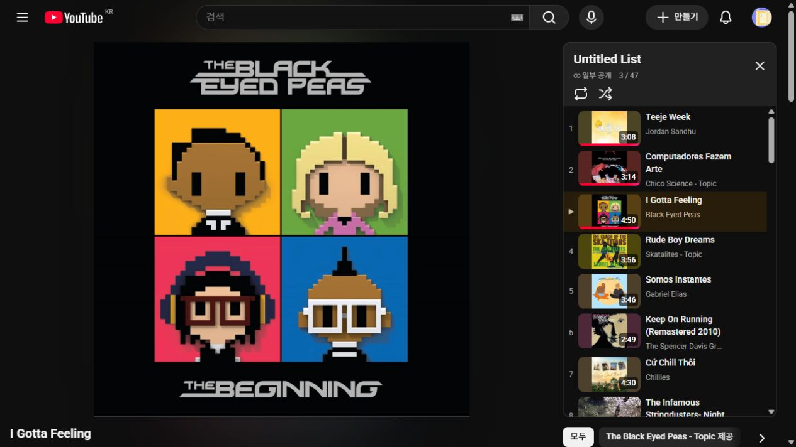

# API 키 없는 영상 등록·검수와 외부 연속 재생 검증

- 작성일/수정일: 2026-10-16
- 기준: `feature/ad-logic` / `f22f974` 이후 로컬 변경
- 최신 사용자 선택: YouTube 외부 재생 기본, 기존 대시보드 iframe 보조
- 실행: React/Vite5174 → Django8011·별도 로컬 연결 레지스트리. 실제 AWS·공유 ADMIN 연결과 구분

## 구현 결과

기존 PublicPage를 유지하며 중앙에 외부 연속 재생 링크와 준비 수를 표시했습니다. iframe은 접이식 보조입니다. URL 등록·CSV 등록·미연결/검수 대기/완료/차단 목록·곡 검색·대안 영상·독립 native/iframe 검수와 철회를 추가했습니다. Google 프로젝트/API 키·LLM 없이 동작합니다. 비밀 접근 코드는 로컬 운영자 도구에만 사용하며 Google 비밀번호가 아닙니다.

원본18개·RDB4테이블·카탈로그/추천 스냅샷·점수·전체 GENERAL86,485곡·176~184분 성공 기준은 변경하지 않았습니다. 모든 곡을47개로 제한하거나 플랫폼 미연결 곡을 음악 후보에서 제거하지 않습니다. 부분 재생은 원래 추천 결과를 짧은 성공 결과로 덮어쓰지 않습니다.

## 실제 재검수의 분모

| 자료 | 실제 범위 |
|---|---|
| 과거 승인 교체 고정47곡 | All on Me 포함, 원본10,632,974ms. [원 매핑](../../analysis/youtube_mapping_20261016/mapping-47-verified-v1.json) |
| 이번 새 일반 추천47곡 | I'll Shut up Now 포함, 원본10,652,228ms. 외부 준비46/47·미연결1을 UI에 표시. 위 고정47곡과 다름 |
| iframe 기존47 전수 점검 | 실제 PLAYING13·오류150 34. 성공13 중 Night on the River 길이 차이·Tordilho Negro 라이브 버전 대기로 최종 iframe VERIFIED11/BLOCKED34/CANDIDATE2 |
| 추가 대안12개 | 실제 iframe 모두150, 재생 성공/외부 재생 불가로 자동 승격·판정하지 않음 |
| native 기존47 | 엄격한 과거 메타데이터/한국 제공·목록 포함 검수46개 승계 + Night 공식 영상판 수동 확인1개. iframe과 별개 |

Night on the River는 공식 Silver Sky 곡의 MV240.261초로 원본213.226초보다27.035초 깁니다. 기본 허용차를 넘으므로 native-only 명시 예외 체크·메모와 감사 action으로 확인했습니다. 원본 합계는 그대로이고 iframe은 대기입니다. 이 확인을 파형/전곡 청취로 표현하지 않습니다.

[47개 iframe 실관측](./assets/keyless-47-iframe-recheck-20261016.json)·[대안 실관측](./assets/keyless-alternative-iframe-recheck-20261016.json)·[초기 레지스트리 반영](./assets/keyless-registry-applied-20261016.json)을 보존했습니다. 이후 URL/CSV 새 후보 등록과 외부 재확인은 별도 추가 기록입니다.

## 실제 대시보드와 YouTube 관측

1. 전체 일반 후보에서 생성한47곡의 외부 준비46/47·미연결1을 표시했습니다. 원곡/점수/승인/제외를 바꾸지 않았습니다.
2. 로컬 코드로 관리 패널을 열고 Teeje Week의 대안 URL을 등록했습니다. CANDIDATE/native 미확인으로 추가되며 등록만으로 재생 확인 상태가 되지 않았습니다.
3. 실제 UTF-8 BOM CSV 파일로 I Gotta Feeling의 대안1행을 불러와 등록 완료 안내를 확인했습니다. 파일 읽기와 서버 등록을 모두 수행했습니다. 원자 rollback·revision/권한·CSV 오류는 아래 자동 시험에서 검증했습니다.
4. Teeje Week를 실제 외부 YouTube에서2:40/3:07까지 재생한 뒤, 원곡 표기와 길이187초를 운영자 화면에서 재확인해 저장했습니다. 삽입 차단 상태는 유지됐습니다.
5. 검수한 고정47개의 [외부 대기열](./assets/keyless-approved47-native-queue-20261016.json)을 열어 YouTube가47개 ID를 원 순서대로 수용한 것을 확인했습니다. 계정에 재생목록을 저장하지 않았습니다.
6. Next 클릭 없이 **Teeje Week → Computadores Fazem Arte → I Gotta Feeling**의 실제 자연 전환을 관측했습니다. 두 번째 곡0:02/3:13과 세 번째 index3을 확인했습니다. [실관측 기록](./assets/keyless-native47-natural-transition-20261016.json).
7. 대시보드 보조 iframe을 펼치면 미검수/차단된 앞4곡을 기록하고5번째 Somos Instantes의 PLAYING 상태가 표시됐습니다. 기본 외부 링크를 누르면 보조 iframe이 닫혔습니다. [URL/CSV·기본/보조 동작 기록](./assets/keyless-dashboard-flow-20261016.json)·[기본 재생 카드 화면](./assets/keyless-dashboard-native-primary-20261016.png).

위 관측은 일부 실제 재생·자동 전환이며177분 전체 경과·47곡 완주·물리 스피커·사용자의 별도 Chrome/Premium 상태 검증은 아닙니다. 임시 대기열 경로가 공식 영구 API 계약이거나 계정 자동 저장이라고 안내하지 않습니다. 같은 Chrome 프로필에서 실제 음악·광고·순서·쿠키 상태를 확인해야 합니다.

## 자동 검증과 남은 범위

- 백엔드136건 PASS: 소유/CSRF/로컬 권한, 검수 독립 상태·철회, 원자 CSV·엄격 따옴표, 과거 결과 범위, duration 예외·감사, 순서/중복/부분 큐, snapshot 보존·원격 검색 금지
- 프런트49건 PASS·최종 TypeScript/Vite build PASS: URL/CSV, native DTO·순서·준비 수, iframe 큐/이전 응답·소멸 이벤트·차단/재시도 등
- AST39파일·406심벌·누락0, 검사 exit0/ok=true. 관련 문서 내부 링크 누락0·git diff --check 통과. [전용 라우팅](../development/YouTube_키없는_등록과_검수_변경_라우팅.md)과 [색인](../music-playback-routing/README.md)을 따릅니다. 모의 시험을 실제 외부 재생 관측으로 대체하지 않았습니다.

주소는 [기존 대시보드](http://127.0.0.1:5174/)입니다. [운영 가이드](../development/music/YouTube_로컬_재생_기획과_구현_가이드.md)의 초기화·로컬 코드 파일·검수 절차를 참고합니다. 운영자 코드는 Git 제외 파일에만 있고 이 문서에는 포함하지 않았습니다. 새 곡을 모두 자동 검색하는 기능·계정 재생목록 쓰기·공유 ADMIN/AWS·음원 파일 배포·커밋/푸시/PR/배포는 수행하지 않았습니다.
