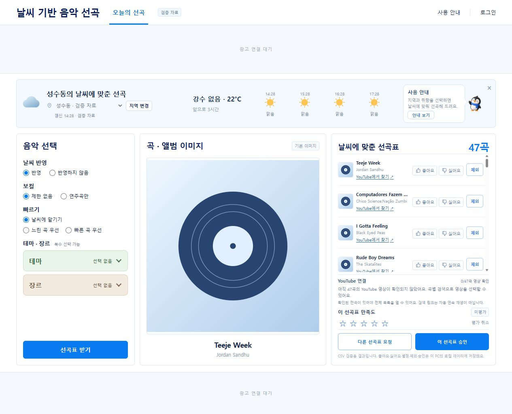

# 기존 사용자 대시보드 YouTube 연결 검증

- 작성일: 2026-10-16
- 수정일: 2026-10-16
- 기준: `feature/ad-logic` / `f22f974`
- 범위: 기존 React 화면과 Django 로컬 CSV 추천의 시즌 필터·YouTube 외부 이동 연결
- 결과: 자동 검증 및 실제 기존 화면 확인 통과. 실제 결과의 전곡 영상 매핑/3시간 실재생은 미완료입니다.

## 기존 화면과 실제 데이터

기존 `frontend/src/features/recommendation/PublicPage.tsx`에서 지역/날씨·음악 선택·대표 이미지·선곡표·곡 반응·제외·별점·재설정·승인을 유지하고 곡별 YouTube 링크와 결과 전체 연결 상태를 추가했습니다. 별도 iframe 페이지로 사용자를 이동시키지 않습니다.

시험 주소는 [기존 대시보드](http://127.0.0.1:5174/)이며 Django API `127.0.0.1:8011`과 추천 worker를 사용했습니다. `.env` 수정 없이 실행별 `C_LOCAL_DEMO=1`·`VITE_C_DEMO=1`을 사용했습니다. 새 `local-demo.sqlite3`에 기존 migration을 적용했으며 공유 PostgreSQL·광고 MongoDB·운영 환경은 변경하지 않았습니다. 날씨는 성수동 고정 맑음 시험 자료입니다.

원본 CSV SHA-256은 `b202fa49909b2d5cef71a04b1d21243cfeb36414535f2ca9272aa646721177bd`입니다. `general/manifest.json`과 판정표 SHA `c2478b153aa8bee652fb9d7505dfa78621be37a9bd660094f01384f544788760`을 검증하고 `spotify-preview-b202fa49909b-general-c2478b153aa8` 테스트 카탈로그에 GENERAL86,485곡을 적재했습니다. source errors1, 시즌/검토 등 skipped3,255이며 과거 분석 유효곡 분모59,210과 구분합니다. 청취 검수·운영 READY를 뜻하지 않습니다.

실제 기존 API/worker 결과는 **47곡·10,652,228ms(177분32.228초)**, 전곡 GENERAL이며 176~184분 범위 안입니다. 영상 확정은0/47로 표시하고 전체 연결을 보류했습니다. 이47곡은 기존 분석 CSV의 정확180분 예시를 그대로 넣은 목록이 아니라 실제 요청에서 생성된 결과입니다.

검산 가능한 [실제 결과 내보내기](./assets/dashboard-general-result-20261016.json)에 카탈로그/원본 버전·선택 조건·47곡의ID/곡명/길이/점수·행사 상태를 보존했습니다. 사용자 쿠키·계정·로컬 소유 식별자는 포함하지 않았습니다.

기존 worker는 미검수 CSV 프리뷰에 `preview_only=true`·`validation_passed=false`를 기록합니다. 이번 결과에도 이 상태를 유지했으며 기간/행사 판정과 화면 연결 통과를 운영 검수 완료로 승격하지 않았습니다.

## 실제 브라우저 확인

| 확인 | 관측 결과 |
|---|---|
|기존 진입·선곡|지역 선택 후 기존 [선곡표 받기]로47곡 결과 생성. 기존3열과 날씨/선택 화면 유지|
|곡별 링크|47개 곡명·아티스트 검색 URL, `target=_blank`·`noopener noreferrer`. 첫 곡 Teeje Week 링크 클릭 후 대시보드 결과/평가 유지|
|검색 목적지|동일 생성 URL을 IAB 별도 탭에서 열어 Teeje Week/Jordan Sandhu 검색어와 해당 곡 결과 확인. 링크 클릭이 실제 Chrome 새탭을 여는 동작 자체는 연결된 Chrome이 없어 확인하지 않음|
|좋아요·별점|첫 곡 좋아요 aria-pressed=true와4점 저장 확인. 테스트 후 좋아요 해제·평가 취소|
|제외|첫 곡 제외 저장 뒤 곡 링크 비활성·현재 결과 미반영 안내·전체 연결 보류. 제외 취소로 복원|
|조건 변경|빠르기를 바꾸면 새 선곡표가 필요하다는 전체 연결 보류 안내. 날씨에 맡기기로 복원|
|전체 미매핑|0/47곡 영상 확인·47곡 미확정 안내, 축소한 부분 재생목록을 생성하지 않음|

브라우저는 Codex IAB이며 사용자의 실제 Chrome/Premium 계정·음성 출력은 검증하지 않았습니다. 새탭의 팝업/외부 열기와 로그인이 실제 Chrome에서 같은지는 추가 확인 범위입니다. 클릭만으로 재생 시작/청취 완료를 기록하지 않습니다.

## YouTube 네이티브2곡 진단

검색/페이지에서 확인한 두 영상으로 `https://www.youtube.com/watch_videos?video_ids=Q3LbwKDc9CI,Mi5rkJUoqn0`을 IAB에서 열었습니다. YouTube는 첫 영상의 `watch?v=Q3LbwKDc9CI&list=TL...` 임시 목록으로 이동했고, 목록의1/2·2개 제목/순서를 확인했습니다.

Better (feat. Kirby)의 [재생]을 눌러 일시중지 버튼과1:16/2:56·1:59/2:56 진행을 관측했습니다. **다음 버튼을 누르지 않은 상태에서** `watch?v=Mi5rkJUoqn0&list=TL...&index=2`·Numb Little Bug로 자동 전환됐습니다. 중간에 광고가 나왔고 정상 [건너뛰기]를 누른 뒤 두 번째 곡0:00/2:49·재생 중 상태를 관측했습니다.

이는 네이티브 임시 목록2곡의 순차 전환 시험입니다. 계정에 재생목록을 저장하거나 OAuth를 연결하지 않았으며, 실제 대시보드47곡의 원곡 매핑·전곡 순서/시간·3시간 재생 증거로 사용하지 않습니다. 이전 iframe 오류150 기록도 유지하며 네이티브 시청 불가로 해석하지 않습니다. 테스트 후 재생 탭을 종료합니다.

## 자동 검증과 한계

- 백엔드 `backend.music`·`backend.recommendation` 전체57건 통과. 판정/manifest 변조·빈 목록·누락·매핑 근거·기존 기능 회귀 포함, 별도 메모리 시험 DB 사용.
- 프런트 Vitest11건 통과(신규9＋기존2), `pnpm build` 통과. 검증ID/미확정·URL 인코딩·전곡 순서/중복·부분 누락·상태 보류·제외행·기존 이벤트 격리 포함.
- `pnpm install --frozen-lockfile`로 기존 lock을 유지하여 실행 의존성을 설치했습니다.
- Python 라우팅20개·심벌156개·누락0, 이번 화면 라우팅/수용 기록/개발 색인/통합 라우팅/가이드5문서의 내부 링크 누락0, `git diff --check` 통과입니다.

아직 실제 결과에 검증 영상이 없습니다. `--youtube-mappings`로 검수 근거가 있는 불변 매핑을 새 테스트 카탈로그/결과에 공급하면 곡별 직접 링크와 전곡 임시 목록이 활성화됩니다. 일반 시청 가능 여부만으로 원곡/버전 매칭을 자동 확정하지 않습니다. 실제 Chrome·소리·전곡 원곡 길이와 광고 포함 경과시간·장시간 재생 검증은 후속입니다.

구현·파일별 연결과 후속 담당은 [기존 대시보드 라우팅](../development/기존_대시보드_YouTube_연결_라우팅.md), 실행 명령과 정책은 [연결 가이드](../development/music/YouTube_로컬_재생_기획과_구현_가이드.md)를 따릅니다. Git 커밋·푸시·PR·병합·배포·외부 계정 변경은 실행하지 않았습니다.

기존 대시보드/API/worker는 사용자 확인용으로 실행해 두었고, 최초 iframe 보조 서버8003은 종료했습니다. 페이지 새로고침 후에는 기존 흐름에서 지역을 선택하고 새 선곡표를 요청할 수 있습니다.
