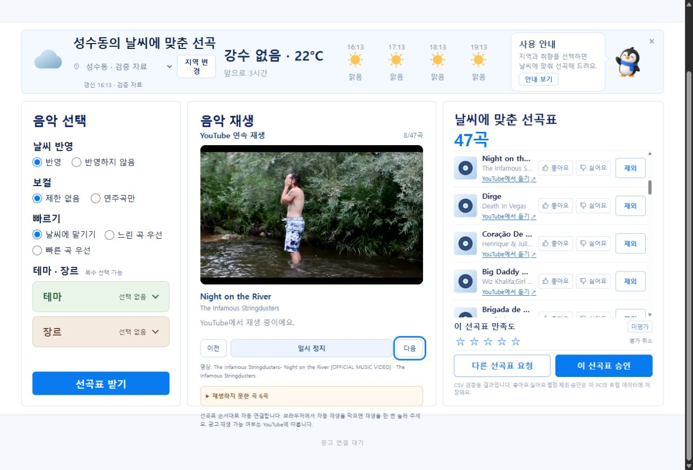

# 기존 대시보드 중앙 YouTube iframe 연결 검증

- 작성일/수정일: 2026-10-16
- 기준: `feature/ad-logic` / `f22f974` 이후 로컬 변경
- 최신 사용자 결정: 중앙 곡/앨범 이미지 영역에서 iframe 삽입 재생·자동 다음 곡을 제공하고 LLM을 필수로 사용하지 않습니다. 이전 native 외부 이동 주진입 결정을 대체합니다.
- 상태: 중앙 UI·기존 매핑 재생·자동 진행·실패 표시·자동 검색 연결 코드 검증 완료. 새 곡의 공식 검색 실호출은 사용자 API 키 미등록으로 미실행입니다. 사용자는 이후 API 등록을 피하는 운영 방안의 구체화를 요청했습니다.

## 구현과 저장 경계

기존 PublicPage의 중앙 Cover를 결과 생성 후 YoutubePlayer로 바꿨습니다. 결과가 없으면 기본 이미지를 유지합니다. 좌측 조건·우측 선곡표/평가·제외·승인은 유지하고 전곡 매핑 없음을 이유로 중앙 플레이어 전체를 잠그던 외부 목록 영역은 제거했습니다. 곡별 외부 열기는 보조 링크로 남습니다.

현재 곡의 서버 결과 스냅샷으로 `POST /api/playlists/{playlist_id}/youtube-playback`을 호출합니다. 소유 확인·CSRF·엄격 입력·현재 제외 반영 여부·목록에 있는 track_id를 확인한 뒤 영상 후보를 반환합니다. 클라이언트의 임의 URL/검색문구/API 키/비밀번호는 받지 않습니다. 기존 카탈로그·결과·피드백/승인/outbox를 재생 조회가 변경하지 않습니다.

기존 영상 ID 우선 → 별도 후보 캐시 → 키가 설정됐을 때 공식 search.list/videos.list 순입니다. 자동 검색은 원곡 제목·아티스트·버전·길이·국내 제공·삽입 가능 상태로 후보를 거르며 CANDIDATE로 유지합니다. LLM/Gemini 호출이 없고 기본 추천은 전체 GENERAL86,485곡을 유지합니다. 고정47곡 재생 시험 카탈로그를 일반 후보로 다시 제한하지 않았습니다.

PLAYING 이후 ENDED 이벤트에 다음 곡으로 진행합니다. 100/101/150은 같은 원곡의 다른 후보를 시도하고 소진하면 이유를 남긴 뒤 다음 곡으로 진행합니다. 실제 삽입 실패 이후 대안 검색도 연결되지 않으면 해당 곡의 실패를 기록하되, 처음부터 영상 ID가 없는 곡의 검색 연결 미준비는 그 위치에서 보류합니다. 153/플레이어 환경 오류·자동 재생 차단은 곡 미존재로 판정하지 않습니다. 원본 선곡표를 짧은 성공 결과로 덮어쓰지 않고 빠진 곡만큼 실제 재생시간이 줄어듦을 표시합니다.

조건 편집·제외 저장/미반영·새 결과 생성·사용 안내 중에는 재생을 보류합니다. 오래된 검색 응답·폐기된 iframe 이벤트는 새 결과에 적용하지 않습니다. 스크립트/iframe 준비 제한 시간과 재확인을 구분하며, 준비 지연만으로 자동 재생 차단을 단정하지 않습니다.

## 실제 관측

이번 root IAB 시험은 **전체 일반 카탈로그에서 기본 조건으로 새로 생성한47곡**입니다. 이전 승인 교체곡이 포함된 고정47곡177분12.974초 시험과 다릅니다. 이번 결과는10,652,228ms(177분32.228초), 기존 메타데이터 매핑46개, is_test/preview_only=true·validation_passed=false입니다. [큐 스냅샷](./assets/central-iframe-result-20261016.json)은 동시 사용자의 다른 조건 요청과 구분해 기본 옵션·5/8번째 곡을 대조했습니다.

|단계|실제 화면 관측|
|---|---|
|중앙 iframe 자동 준비|기존 PublicPage 중앙에 YouTube 플레이어 생성·현재 곡/순번/재생 제어 표시|
|1~4번째|삽입 재생 실패 후 사유를 남기고 다음 곡으로 진행|
|5번째 Somos Instantes|PLAYING 상태·일시 정지 버튼, iframe 내부0:41/3:45 진행 표시 관측|
|후속 자동 진행|Next 버튼 클릭 없이6번째 Keep On Running·7번째 Cứ Chill Thôi의 삽입 실패를 기록하고8번째 Night on the River의 PLAYING 상태 확인|
|실패 표시|재생하지 못한 곡6곡과 사유, 실제 시간 감소 안내. 전체47곡 완주라고 표시하지 않음|
|삽입 설정|실측420×262px·enablejsapi·localhost origin·autoplay 허용·strict-origin-when-cross-origin Referer 정책|

[5번째 재생 관측](./assets/central-iframe-playing-20261016.json)·[자동 진행 관측](./assets/central-iframe-natural-transition-20261016.json)을 보존했습니다. 이 기록은 PLAYING UI와 진행 관측이며 물리 스피커 청취·사용자 Chrome/Premium·모든47곡 자연 전환/완주를 검증하지 않았습니다.

사용자가 별도로 요청한57곡 조건의 Between Mind & Heart에는 기존 매핑이 없어 API_KEY_MISSING 안내가 표시됐습니다. 이는 이번47곡 iframe 시험과 구분합니다. 현재 키가 없음을 사용자와 확인했으며 키 값은 수집하지 않았습니다. 새 곡의 공식 자동 검색·실제 적중률·등록 후 대안 검색은 아직 확인하지 않았습니다.

## 키·계정과 등록 없는 사용

영상 ID를 알고 있는 iframe 재생에는 API 키나 LLM이 필요하지 않습니다. 사용자 Google ID/비밀번호를 우리 서버의 POST로 받아 iframe 로그인에 사용하지 않습니다. 같은 Chrome 프로필의 YouTube 로그인은 브라우저가 관리하며, 삽입 환경의 쿠키 상태에 따라 Premium 인식이 달라질 수 있습니다. Premium/OAuth는 영상 검색용 키를 대체하거나 소유자의 삽입 제한을 해제하지 않습니다.

사용자는 API 키 발급·설정 안내를 요청한 뒤 등록 없는 방안을 우선 검토해 달라고 요청했습니다. [발급·서버 설정](../development/music/YouTube_API_키_발급과_서버_설정.md)은 선택 가능한 공식 검색 경로로 보존합니다. 등록 없는 안정적인 운영 제안은 **음악 등록/검수 때 영상 URL을 한 번 확보 → track_id별 대안 ID/삽입 상태를 별도 보존 → 추천 후 중앙 iframe이 저장 매핑으로 자동 진행**하는 방식입니다. 신규 URL의 운영자 입력/일괄 가져오기 화면은 이번 구현에 추가하지 않았으며 후속 설계입니다. 매핑 부족을 이유로 전체 일반 추천 풀을47곡으로 줄이지 않습니다.

키 없는 비공식 검색 수집 도구는 기술적으로 존재하지만 공식 iframe의 검색 목록 기능은2020년에 종료됐습니다. 비공식 수집을 키가 필요 없는 공식 검색 API로 안내하거나 서비스의 안정적인 무제한 검색으로 보장하지 않습니다. [IFrame 공식 규격](https://developers.google.com/youtube/iframe_api_reference)·[YouTube 약관](https://www.youtube.com/static?template=terms)을 확인했습니다. 이번에는 비공식 크롤러 설치·계정 쿠키 추출·음원 다운로드를 수행하지 않았습니다.

## 자동 검증·인계

- 백엔드101건 PASS. 기존77건에 resolver18건·API 소유/CSRF/입력/원본 보존6건을 포함합니다. 네트워크/LLM은 모의로 차단하고 메모리 시험 DB를 사용했습니다.
- 프런트32건 PASS·최종 TypeScript/Vite 빌드 PASS. 실제 ENDED/차단 대안/미설정 보류/이전 응답·iframe 이벤트/초기화·지연 구분을 검증했습니다. 모의 이벤트 시험을 물리 음향/전곡 완주로 확대하지 않습니다.
- Python 라우팅31파일·306심벌·누락0, 검사기 exit0/summary.ok=true. [AST 색인](../music-playback-routing/README.md).
- API8011은 새 코드로 재시작했고 Vite5174·추천 작업자는 유지했습니다. 같은 PC의 Chrome 접속 주소는 **http://127.0.0.1:5174/** 입니다.

상세 파일·공급/소비·캐시/한도는 [중앙 플레이어 라우팅](../development/음악_iframe_플레이어_변경_라우팅.md)·[자동 검색 라우팅](../development/YouTube_자동검색_변경_라우팅.md)·[통합 가이드](../development/music/YouTube_로컬_재생_기획과_구현_가이드.md)를 따릅니다. 기본 LocMem 캐시와 보호 한도는 프로세스 범위이며 운영 공통 할당량 보장은 별도입니다. 공유 DB·AWS·음원 파일 제공·계정 저장·커밋/푸시/PR/배포는 수행하지 않았습니다.
