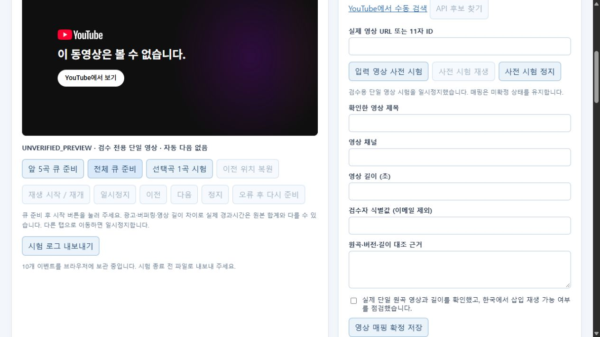

# 일반 추천 후보와 YouTube 로컬 재생 검증

- 작성일: 2026-10-16
- 수정일: 2026-10-16
- 담당: 문서 정본·데이터 필터·YouTube 재생 분담 작업, 통합 검증 Codex
- 기준 브랜치/커밋: `feature/ad-logic` / `f22f974`
- 범위: 로컬 분석 데이터와 별도 재생 도구. 실제 음악 전체 연속 재생·Chrome 계정·Premium·운영 연결 완료와 구분합니다.

## 1. 문서 정본과 실제 구현 경계

Git 미해결 파일과 충돌 마커는 발견되지 않았습니다. 통합 문서의 의미 충돌을 최신 ON/OFF 후보 가이드 기준으로 정리했습니다. 목표 FastAPI와 현재 Django 구현, 현재 날씨 프로필의 유효성과 별도 예보 커버리지, 시즌·행사 판정과 기존 점수를 구분합니다.

정리한 위치와 문서별 변경 근거는 [정본 변경 라우팅](../development/음악_재생_정본_변경_라우팅.md)을 따릅니다. 수령 원문과 기존 다른 작업의 변경은 보존했습니다. 이번 작업에서 Git 커밋·브랜치 병합·푸시·AWS 배포·운영 DB 변경은 실행하지 않았습니다.

## 2. 실제 데이터 검증

원본 SHA256은 `b202fa49909b2d5cef71a04b1d21243cfeb36414535f2ca9272aa646721177bd`입니다. 원본 114,000행·고유89,741곡에 메타데이터 검사를 적용했습니다. 현재 규칙의 분류는 GENERAL86,485 / SEASONAL_EVENT1,450 / REVIEW_REQUIRED1,805 / UNSCREENED1곡입니다. GENERAL은 실제 청취 확정이나 운영 READY가 아닙니다.

기존 V2 분석 유효61,931곡 중 일반 추천 통과곡은59,210곡이며, 이들의 날씨 합집합도59,210곡·미매칭0입니다. 날씨 점수·원본 열·기존 배정은 변경하지 않았습니다.

| 날씨 | 일반 전체 후보 | 새 3시간 예시 곡 수 | 원본 길이 합 |
|---|---:|---:|---:|
| 맑음 | 34,883 | 47 | 10,800,000ms |
| 구름낌 | 35,170 | 45 | 10,800,000ms |
| 흐림 | 12,944 | 46 | 10,800,000ms |
| 비 | 8,248 | 43 | 10,800,000ms |
| 눈 | 8,535 | 68 | 10,800,000ms |

비·눈 교집합4,264곡과 보조 예시58곡도 생성했지만 혼합 최초 speed의 시연 초기값은 운영 확정과 구분합니다. 검수 대기·제외곡을 시간 보충용으로 복귀시키거나 자동 단축하지 않았습니다.

다음 검증을 통합 담당이 재실행해 PASS를 확인했습니다.

```powershell
python -X utf8 -m music_playback verify --source "C:/Users/이해나/Downloads/spotify_dataset (1).csv" --analysis-dir analysis/weather_music_20261016
python -X utf8 -m unittest discover -s tests -p "test_music*.py" -v
```

[전수 검증 JSON](../../analysis/weather_music_20261016/general/verification.json)은 일반6풀104,044행의 기존 모든 열 문자열·정확 점수·판정·정렬·합집합/교집합·새 예시·입출력 해시를 대조한 PASS입니다. 단위 검증15건도 통과했습니다. [데이터 요약](../../analysis/weather_music_20261016/general/summary.json)과 [재현·검수 안내](../../analysis/weather_music_20261016/general/README.md)를 함께 확인합니다.

## 3. HTTP와 큐 자동 검증

다음 명령을 통합 담당이 재실행했습니다.

```powershell
python -X utf8 -m unittest discover -s prototype/youtube-player/tests -v
node --test prototype/youtube-player/tests/queue.test.mjs
Get-Content -LiteralPath prototype/youtube-player/web/app.js -Raw -Encoding UTF8 | node --input-type=module --check
```

- Python HTTP·매핑9건 PASS: 같은 출처·nonce·Host, 정적 경로 제한, GENERAL/VERIFIED/양의 길이, 원자 저장과 버전 충돌, 키 없는 수동 경로, 모의 검색 필터·캐시.
- Node 큐·미확정 사전 시험14건 PASS: 종료 중복·버튼 경합·늦은 이벤트, 정지·마지막·유한 실패,153 보류, 자동 재생 차단, 큐 불변·복원·미확정 영상의 일반 큐 진입 차단.
- 모듈 구문 검사 PASS. 데이터15건과 합계38건이며 모의 큐 전환을 실제 곡의 자연 연속 재생으로 보고하지 않습니다.

`routing-doc-auditor`의 최종 결과는 Python16개·심벌139개·누락0·exit0입니다. 정본·가이드·수용 기록·짝 문서의 로컬 링크와 충돌 마커도 검사했습니다.

## 4. 실제 브라우저 관찰

샌드박스에서 실행한8002 서버는 별도 프로세스와 내장 브라우저의 요청이 시간 초과됐습니다. 해당 시험 서버는 종료했습니다. 승인된 PC 로컬 실행으로 `127.0.0.1:8003` 서버를 시작한 뒤 Codex 내장 브라우저에서 접속했습니다. 외부 주소로 서버를 공개하지 않았습니다.

실제 화면에서 맑음47곡과 구름낌45곡·원본180분을 확인했습니다. 매핑 확정0곡일 때 시작은 비활성화되고 전체 큐 준비는 미확인 곡 차단 안내를 표시했습니다. 사전 시험은 GENERAL 선택곡에 한정해 `UNVERIFIED_PREVIEW`로 진행되며 일반 큐에 편입되지 않았습니다.

| 시험 영상 | 실제 관찰 | 저장·판정 |
|---|---|---|
| Better 공식 Topic `Q3LbwKDc9CI` | watch 페이지 원곡/공식 아티스트·2:56 재생 표시 확인, 로컬 삽입은 오류150 | VERIFIED 저장 안 함 |
| Better 공식 Audio `Q0qrHmYgzn8` | 로컬 삽입 오류150 | VERIFIED 저장 안 함 |
| Aynalı Kemer `00fwNAZnass` | 로컬 삽입 오류150 | VERIFIED 저장 안 함 |
| Numb Little Bug `Mi5rkJUoqn0` | 로컬 삽입 오류150 | VERIFIED 저장 안 함 |
| 공식 IFrame API 예제 `M7lc1UVf-VE` | 같은 로컬 출처에서 공식 플레이어·썸네일·CUED 확인 | 환경 진단만 수행. 원곡 매핑으로 저장하지 않음 |

이 결과는 네 영상의 해당 환경에서의 삽입 실패와 공식 예제 준비 성공입니다. 모든 음악의 이용 가능성을 일반화하지 않습니다. 실패 영상을 확정하거나 잘못된 예제 영상을 원곡 대신 저장하지 않았습니다.

[브라우저에서 내보낸 JSONL](./assets/youtube-local-events-20261016.jsonl)은10개 이벤트 중 실제 오류150 네 건을 포함합니다. 다운로드 기능을 실행해 파일 생성을 확인한 후 이 폴더에 복사했습니다. 계정 이메일·쿠키·API 키는 기록하지 않았습니다.

실제 관찰한3곡의 [차단 매핑 JSON](./assets/youtube-blocked-mappings-20261016.json)을 화면의 파일 가져오기로 등록해 POST 저장도 확인했습니다. Better의 두 영상 중 현재 sidecar에는 공식 Audio 한 건을 사용하고 두 건 모두의 실패는 JSONL에 보존합니다. 상태는 BLOCKED_EMBED, 영상 길이는 미확인 null이며 VERIFIED 곡은0개로 유지됐습니다. 이 로컬 매핑 파일은 Git 제외 대상이고 원본이나 일반 추천 CSV를 변경하지 않습니다.



## 5. 완료와 남은 확인

문서 정본 정리, 시즌 필터·새 후보/3시간 데이터, 영상 매핑·사전 시험·일반 큐 제어 구현과38건 자동 검증은 완료했습니다. 실제 음악5곡의 자연 연속 재생과 전체3시간 재생은 **미완료**입니다. 삽입 가능한 원곡 영상을 확정하고 다시 시험해야 합니다. Chrome의 실제 프로필·Premium 적용·스피커 소리·운영 READY/실시간 날씨·FastAPI 이식·AWS는 별도 확인 범위입니다.

기본 재실행 명령은 다음과 같습니다. 이번 확인 당시 실행 주소는 [로컬 재생 도구](http://127.0.0.1:8003/)입니다. 서버가 종료됐으면 사용 가능한 포트로 다시 실행합니다.

```powershell
python -X utf8 prototype/youtube-player/server.py --data-dir analysis/weather_music_20261016/general --port 8003
```

계정 연결이나 API 키 없이도 수동 검색→입력 영상 사전 시험→원곡·길이 대조→확정 저장 경로를 사용할 수 있습니다. 검색 API는 서버 환경의 `YOUTUBE_DATA_API_KEY`를 선택적으로 사용하며 이번 검증에서는 실제 검색 API 호출·OAuth 쓰기를 하지 않았습니다.
