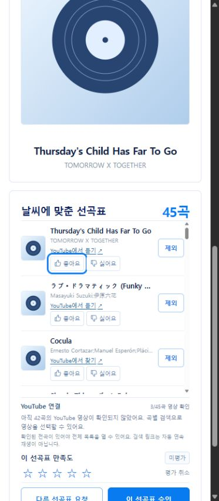

# 일반 추천 후보와 고정 재생 시험 분리 검증

- 작성일/수정일: 2026-10-16
- 기준: `feature/ad-logic` / `f22f974` 이후 로컬 변경
- 관련 작업: R-02/R-03·U-01/U-05·Q-01의 로컬 후보 선택·오류 처리 회귀
- 사용자 요청: 일반 추천에47곡 시험 목록이 적용되는 문제를 수정하고 별도 Chrome 접속 주소를 제공합니다.
- 상태: 기존 선택값의 일반 추천 복구·실제 후보 부족 안내·자동 검증 완료. 공유 운영·음악 청취 검수·새 결과의 전곡 YouTube 매핑 완료와 구분합니다.

## 원인과 수정

기존 신규 추천과 작업자 사전 로딩은 용도 구분 없이 가장 최근 `ready` 카탈로그를 골랐습니다. 이 때문에 전체 GENERAL86,485곡이 보존돼 있어도 후속47곡 고정 재생 시험 카탈로그만 검색했습니다. 사용자 선택 장르에서3곡·757,825ms만 남아176분을 구성할 수 없었고, 프리뷰 탐색은 이를 `SEARCH_INCOMPLETE`라는 일반 문구로 처리했습니다.

`service.current_catalog()`를 신규 추천·작업자 사전 로딩이 함께 사용합니다. LOCAL_DEMO에서는 `source_ref=local-preview:youtube-playback-selection:…`인 고정 시험 카탈로그를 일반 기본값에서 제외합니다. 일반 카탈로그가 없으면 명확한 `POLICY_NOT_READY`503을 반환하며 고정 목록으로 대체하지 않습니다. 운영 모드의 기존 선택 범위, 기존 결과 조회, 재설정의 부모 카탈로그 고정은 유지했습니다. API에 임의 카탈로그 선택 입력을 추가하지 않았습니다.

프리뷰의 전체 적격 후보에서 재생시간·선택 장르·서로 다른 대표곡·신규 곡 최소 조건을 대조합니다. 증명된 부족은 `CANDIDATE_SHORTAGE`422, 신규 곡 부족은 `NO_MEANINGFUL_CHANGE`422, UNKNOWN·제한 창/시간 내 미완료는 `SEARCH_INCOMPLETE`503으로 구분합니다. OFF100% 단계의 탐색 미완료를80% 확장의 근거로 사용하지 않습니다. 자동 시간 단축·필터 완화·부모 결과 덮어쓰기는 추가하지 않았습니다.

오류 `details`에는 candidate_count/total_ms/min_duration_ms/target_duration_ms/max_duration_ms·장르별 후보와 누락 장르·대표 배정 가능 여부·부모/신규 수·reason/탐색 근거를 보존합니다. 작업자는 카탈로그 수·공통 적격 수/시간·날씨 탈락·최종 후보 수/시간을 구분합니다. 프런트는 작업 오류 코드를 유지하고 추천 실패에는 [연결 다시 확인] 대신 [선택 조건 확인]을 제공합니다. 현재 선택·이전 결과는 유지하며 새 추천을 자동 실행하지 않습니다.

## 실제 데이터·브라우저 검증

일반 seed에는 기존 최종47곡 매핑 파일만 추가하고 `--playback-selection`을 생략했습니다. 새 일반 버전은 `spotify-preview-b202fa49909b-general-c2478b153aa8-yt-39c5056603a0`이며86,485곡·CLEAR 적격34,883곡·기존 매핑47개를 포함합니다. 로컬 DB에는 이전 일반86,485곡·고정47곡·새 일반86,485곡의 총3개 카탈로그가 보존돼 있습니다.

사용자가 실패했던 ON/CLEAR·보컬 제한 없음·빠르기 auto·테마 BRIGHT/DREAMY/EMOTIONAL/PEACEFUL·장르 CLASSICAL/J-POP/K-POP/NEWAGE/OPERA 조건을 기존 대시보드에서 그대로 다시 요청했습니다.

|관측|수정 후 실제 결과|
|---|---|
|카탈로그/공통 적격/날씨 탈락/최종 후보|86,485 / 6,818 / 3,562 / 3,256곡|
|작업 상태/결과 곡 수|SUCCEEDED /45곡·중복 ID 없음|
|결과 원본 합계|10,560,186ms =176분00.186초·허용176~184분|
|선택 장르 포함 수|CLASSICAL1·J-POP32·K-POP10·NEWAGE2·OPERA1. 복수 그룹의 겹침은 유지|
|탐색|FEASIBLE_GREEDY_PREVIEW·400곡 창. 정확180분 최적해라고 표시하지 않음|
|YouTube|3/45곡 확인·42곡 미확정 안내·전체 임시 목록 보류|
|시험 상태|is_test=true·preview_only=true·validation_passed=false 유지|

새 조건을47곡으로 제한하지 않으며 영상 확인 여부를 추천 적격 필터로 사용하지 않습니다. 미확인42곡을 생략한 짧은 외부 목록을 만들거나 다른 곡의 매핑을 재사용하지 않습니다. 새 결과의 전곡 연속 재생에는 해당42곡의 별도 영상 검수가 필요합니다.

[수정 전후 대조](./assets/catalog-isolation-repair-audit-20261016.json)에서 실패 요청과 새 결과 옵션이 동일함을 확인했습니다. 이전47곡의 공개 내보내기13개 필드·47개 행/순서·총시간은 저장된 기존 결과와 동일합니다. 기존47곡의 [당시 재생 기록](./YouTube_47곡_매핑_검증_20261016.md)은 변경하지 않았습니다. 새45곡 결과는 [안전 내보내기](./assets/general-pool-repair-result-20261016.json)로 보존합니다.

별도 임시 탭에서는 ON/CLEAR·연주곡만·OPERA를 요청했습니다. 전체 카탈로그에서도 적격4곡·577,894ms(9분37초)이므로 `CANDIDATE_SHORTAGE`와 “조건에 맞는 후보는4곡…최소176분보다 짧아요” 안내가 실제 표시됐습니다. [부족 결과와 DOM 관측](./assets/general-pool-shortage-result-20261016.json)에 저장했습니다. [선택 조건 확인]이 보이고 [연결 다시 확인]은 없었습니다. 임시 탭이 후속 확인 전에 없어져 이 버튼 클릭 이후의 실제 초점 이동은 브라우저에서 확인하지 않았으며 코드·프런트 렌더 검증 범위로 구분합니다.

## 자동 검증·계약 대조

- 백엔드 전체: `.\.venv\Scripts\python.exe -X utf8 -m backend.manage test backend.music backend.recommendation.tests --verbosity 1` —77건 PASS, 메모리 시험DB.
- 프런트: `pnpm test`15건 PASS, `pnpm build` PASS.
- 카탈로그 선택/운영 분리·과거 결과/부모 고정5건, 시간/장르/신규 부족과 UNKNOWN/OFF 단계 구분11건을 위 전체 검증에 포함합니다.
- Python AST:25개 파일·224개 심벌·누락0, 검사기 exit0/summary.ok=true. [짝 문서 색인](../music-playback-routing/README.md).
- 변경 안내·수용·짝 문서16개의 내부 링크218개 누락0, `git diff --check` 통과. 마무리 시5174 대시보드와8011 추천 옵션 API의 실제 HTTP200 응답을 확인했습니다.
- 공통 [JSON 계약](../contracts/3차_공통_API_이벤트.schema.json)의 ErrorResponse는 code/message/선택 details 객체를 허용합니다. [고정 예시](../fixtures/3차_공통_계약_예시.json)의 STANDARD 부족·자동 단축 없음도 유지하므로 해당 파일의 입력/이벤트 계약은 변경하지 않았습니다. 이번 진단 필드의 실제 값은 위 별도 수용 JSON에 보존합니다.

## 접속·인계

같은 PC의 Chrome 주소창에 **http://127.0.0.1:5174/** 를 입력합니다. 로컬 Django API8011·추천 작업자·Vite5174를 실행 상태로 유지했습니다. API와 작업자는 수정 코드로 재시작했습니다. 다른 PC/AWS 공개 주소가 아니며 `.env`·공유 DB·외부 계정은 변경하지 않았습니다.

새 기본 추천은 위 전체 카탈로그에서 생성합니다. 고정47곡 데이터/기존 결과/YouTube 목록은 별도 시험 이력으로 보존하고 기본 추천을47곡으로 다시 좁히지 않습니다. 재현 명령과 수정 위치는 [연결 가이드](../development/music/YouTube_로컬_재생_기획과_구현_가이드.md)·[화면/백엔드 라우팅](../development/기존_대시보드_YouTube_연결_라우팅.md)을 따릅니다. 커밋·푸시·PR·배포는 수행하지 않았습니다.
