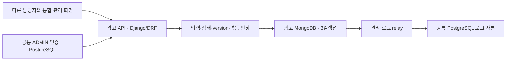
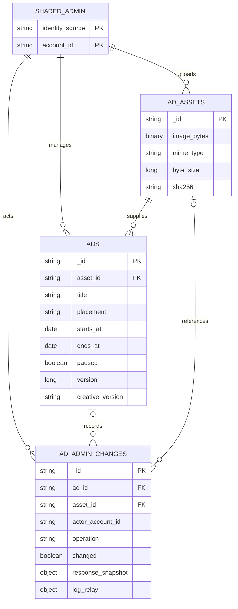

# 광고 데이터와 로직 설계 — 개발 준비안

- 작성일: 2026-10-15
- 수정일: 2026-10-15
- 범위: 3차 카페 광고의 서버 로직·MongoDB 데이터 구조·관리 화면 연결 계약
- 개발 브랜치: `feature/ad-logic` — 단일 광고 개발 브랜치
- 사용자 역할 정정: 관리자 페이지는 다른 담당자가 제작합니다. 이 작업은 광고 관련 로직 설계와 백엔드 개발 준비를 담당합니다.
- 상태: 첫 관리 API·MongoDB 저장·감사/멱등·로그 relay 코드를 구현했습니다. 공유 인증/로그 sink 실연결과 공개 배너·측정·운영 완료는 아닙니다.
- 수업 반영: 사용자가 알려 주신 수업 주제는 광고 서버 구축입니다. 실제 교안·실습 코드는 받지 않았으며, 광고 저장 → 관리 API → 공개 제공 → 측정 → 토큰 집계의 흐름을 이해하고 구현할 수 있도록 구성했습니다.

이 문서는 광고 서버가 저장하고 판정해야 할 내용을 정리합니다. 관리자 화면 담당자는 아래 API 계약을 사용하여 음악·피드백·광고 메뉴를 하나의 화면에서 연결할 수 있습니다. 광고 데이터 모델에 음악·피드백의 테이블을 합치지 않습니다.

## 1. 적용 기준과 첫 개발 범위

[ADS 안내](../../handoff/ads/README.md)의 읽는 순서와 [최신 통합 인계](../../handoff/ads/05_광고_간소화_통합과_추가_인계.md)를 적용합니다. [간소화 원문](../../handoff/ads/04_광고_관리_간소화_인수인계서.md)은 필드·멱등·감사 구조를 참고하되, 원문의 업종 태그 부분은 4차 참고입니다.

| 단계 | 광고 서버가 준비할 결과 | 저장 범위 |
|---|---|---|
| 첫 관리 | 이미지 검사·저장, 광고 등록/수정/중단·목록·서버 상태, 감사·멱등·로그 전달 | `ads`, `ad_assets`, `ad_admin_changes` |
| 후속 공개·측정 | 위치별 광고 선정·순환·delivery, 중단 반영, 노출/클릭 최초 판정·중복 방지 | 후속 단계에서 필요한 구조만 추가 |
| 후속 통계·예산 | 예상 토큰 원장, 주기 집계, 예산 소진 시 신규 제공 제어 | 측정과 동시성 검증 후 결정 |

3차에는 광고 대상이 카페로 고정됩니다. `targeting_mode`, `target_tag_codes`, `tag_catalog_version`, `targeting_policy_version`과 사용자 업종 입력을 요청·저장에 추가하지 않습니다. 알 수 없는 입력 필드는 무시하지 않고 거부합니다. 별도 태그 사전 API도 만들지 않습니다.

관리 화면 제작은 별도 담당자의 작업입니다. 기존 기획 문서의 B 담당 광고 관리 화면 배정은 사용자 정정과 다르며, 이 준비안의 작업 범위는 광고 서버로 한정합니다. 기존 태스크 ID·직접 선행 관계·팀 문서는 여기서 변경하지 않습니다.

## 2. 서버와 저장소의 연결



- 계정·활성 ADMIN·권한·세션·guest의 원본은 공통 환경에 있습니다. 광고 DB에는 서버가 검증한 `identity_source`와 외부 계정 ID만 참조합니다.
- 사용자 컬렉션, 비밀번호/해시, 이메일·프로필, 쿠키·세션 원문 토큰을 광고 DB에 복제하지 않습니다. 외부 ID를 MongoDB ObjectId로 강제 변환하지 않습니다.
- MongoDB는 별도 어댑터로 연결합니다. Django ORM의 모델·migration을 광고 MongoDB 테이블 생성 도구로 사용하지 않습니다.
- 광고 변경과 감사/멱등 기록은 같은 MongoDB replica set 트랜잭션에 저장합니다. 공통 인증 조회와 PostgreSQL 로그 전달은 이 트랜잭션 밖입니다.
- 광고 전용 논리 DB·권한·정리 범위는 날씨 MongoDB와 구분합니다. AWS 프라이빗 서브넷의 실제 주소·포트·서비스 배치·인증 라우팅은 INF 인계가 필요합니다.

## 3. 첫 단계 컬렉션 ERD

MongoDB에서는 아래 관계를 서비스 코드가 검사합니다. 그림의 FK는 관계를 설명하는 논리 참조이며 DB 간 자동 외래키를 뜻하지 않습니다.



`SHARED_ADMIN`은 공유 환경 경계를 설명하기 위한 표시입니다. 광고 DB에 실제 컬렉션을 생성하지 않습니다. 광고 한 건의 위치는 `top` 또는 `bottom` 하나이며, 같은 이미지를 양쪽에 게시하면 두 광고가 하나의 asset을 참조합니다. 일정·중단·지표·후속 예산은 광고별로 다릅니다.

### 3.1. 공통 데이터 표준

| 항목 | 저장·입출력 규칙 |
|---|---|
| 업무 ID | 서버 생성 불투명 문자열을 MongoDB `_id`로 사용; API에서는 `ad_id`, `asset_id`, `log_id`로 대응 |
| 이름·문자 | UTF-8, `snake_case` |
| 시각 | 저장은 UTC BSON Date, API는 UTC ISO 8601 `Z`, 관리 입력·표시는 KST |
| 기간 | `starts_at < ends_at`, 시작 포함·종료 미포함 |
| 정수 | BSON int/long; API는 bool·숫자 문자열·소수의 강제 변환을 금지 |
| 공통 필드 | 모든 문서에 `schema_version`, `is_test`, `created_at`; `ads`에는 `updated_at` |
| 환경 | `is_test`는 서버 설정으로 결정; 테스트 namespace/DB를 운영과 구분 |
| 버전 | 광고 데이터 `schema_version`, 편집 `version`, 표시 `creative_version`, 광고 단가 정책 버전을 서로 구분 |

광고 데이터 버전은 수령 인계의 `phase3-ads-data-20261014.3`을 참고하고, 현행 3차 필드는 ADS05의 카페 전용 결정에 따라 태그를 제외합니다. 공통 API 계약 버전은 기존 문서/fixture와 이벤트 schema의 값이 달라 보류되어 있으므로 이 준비안에서 자동 통합하지 않습니다.

### 3.2. `ads` — 광고 현재 설정

| 필드 | 타입·필수 여부 | 규칙 |
|---|---|---|
| `_id` | string · 필수 | API의 `ad_id` |
| `title` | string · 필수 | 제목; 길이 제한은 PL 인계 후 고정 |
| `link_url` | string · 필수 | 호스트가 있는 절대 HTTPS URL |
| `asset_id` | string · 필수 | 검사·저장된 `ad_assets._id` 참조 |
| `creative_version` | string · 필수 | 표시 소재 버전; 수정 전 자료 재현에 사용 |
| `placement` | string · 필수 | `top` / `bottom` |
| `starts_at`, `ends_at` | Date · 필수 | UTC, 시작 < 종료 |
| `priority` | integer · 필수 | 큰 값 우선; 허용 범위는 PL 인계 필요 |
| `version` | integer · 필수 | 양수; 새 광고의 시작값은 1로 제안 |
| `paused` | boolean · 필수 | 서버가 관리; 일반 수정으로 해제하지 않음 |
| `stopped_at` | Date 또는 null · 필수 | 중단 성공 커밋 시각; 초기 null |
| `created_by_account_id`, `updated_by_account_id` | string · 필수 | 현재 요청에서 검증한 공유 관리자 ID |
| `identity_source` | string · 필수 | 공유 ID의 원본 환경 |
| `schema_version`, `is_test`, `created_at`, `updated_at` | 공통 타입 · 필수 | 서버 설정·시각 |

`status`는 저장하지 않고 조회 시 계산합니다. `paused`가 true이면 `STOPPED`, 그렇지 않으면 현재 시각에 따라 `RESERVED` / `ACTIVE` / `ENDED`입니다. 후속 예산 미연결 상태를 현재 `status`에 임의로 섞지 않습니다. 첫 단계에 가짜 사용량·예산 카운터를 채우지 않습니다.

`creative_version` 갱신 방식은 구현 제안입니다. 제목·이미지·링크 등 표시 내용이 바뀌면 새 표시 버전을 생성하고, 변경 전 내용을 감사 snapshot으로 남기는 방향으로 준비합니다. 실제 표시 버전 갱신 조건과 열린 delivery 처리는 AD-M06/15 인계 후 고정합니다.

### 3.3. `ad_assets` — 이미지 원본

| 필드 | 타입·필수 여부 | 규칙 |
|---|---|---|
| `_id` | string · 필수 | API의 `asset_id` |
| `image_bytes` | BSON Binary · 필수 | 업로드 이미지 원본 바이트 |
| `mime_type` | string · 필수 | 실제 디코딩 결과의 PNG/JPEG/WebP MIME |
| `byte_size` | integer · 필수 | 실제 바이트 길이, 1~2,000,000 |
| `width`, `height` | integer · 필수 | 디코딩한 양수 픽셀 정보 |
| `sha256` | string · 필수 | 원본 SHA-256 hex; 동일 파일 진단용 |
| `uploaded_by_account_id`, `identity_source` | string · 필수 | 서버에서 검증한 업로드 관리자 |
| `schema_version`, `is_test`, `created_at` | 공통 타입 · 필수 | 서버 설정·시각 |

정적 WebP/JPEG/PNG만 허용합니다. 확장자·클라이언트 MIME만 믿지 않고 디코딩·애니메이션 여부·실제 크기와 BSON 전체 문서 크기를 검사합니다. 2,000,000bytes는 허용하고 1byte 초과는 거부합니다. 권장 해상도와 다르다는 이유만으로 유효 이미지를 거부하지 않습니다.

이미지 교체는 새 asset을 만들며 기존 바이트를 덮어쓰지 않습니다. SHA-256을 광고 병합 키나 관리 요청의 멱등키 대신 사용하지 않습니다. 목록 JSON에 원본 바이트를 넣지 않고 인증된 미리보기/게시 자격 검사의 별도 이미지 조회 경계로 제공합니다. 실제 URL·캐시·미사용 이미지 정리 기간은 후속 인계입니다.

### 3.4. `ad_admin_changes` — 감사와 성공 멱등 응답

| 필드 | 타입·필수 여부 | 규칙 |
|---|---|---|
| `_id` | string · 필수 | `log_id` |
| `operation` | string · 필수 | `UPLOAD_ASSET` / `CREATE` / `UPDATE` / `STOP` |
| `ad_id` | string 또는 null · 필수 | 업로드는 null, 광고 변경은 필수 ID |
| `asset_id` | string · 필수 | 업로드 ID 또는 변경 당시 광고의 소재 |
| `identity_source`, `actor_account_id` | string · 필수 | 검증된 관리자 |
| `resource_scope` | string · 필수 | 생성 `ads:create`, 업로드 `assets:upload`, 수정/중단 해당 ad_id |
| `idempotency_key_hash`, `request_hash` | string · 필수 | 멱등키 hash와 허용 입력의 정규 본문 hash |
| `changed` | boolean · 필수 | 실제 업무 변경 여부 |
| `version_before`, `version_after` | integer 또는 null · 필수 | 광고 변경 전/후 version; 업로드는 null, 새 광고 이전은 null |
| `before_snapshot` / `after_snapshot` | object 또는 null / object · 필수 | 신규 작업의 이전 값은 null; 당시 허용 설정/메타데이터만 보존 |
| `reason` | string 또는 null · 저장 필수 | 서버 작업 사유/기존 허용 입력; 새 필수 화면 입력으로 만들지 않음 |
| `response_snapshot` | object · 필수 | 최초 성공 HTTP 상태와 응답 본문 |
| `completed_at`, `occurred_at` | Date · 필수 | 완료/업무 변경 시각 |
| `retention_due_at` | Date 또는 null · 저장 필수 | 양쪽 보관 의무가 끝나는 정리 후보 시각; 미정이면 null |
| `log_relay` | object · 필수 | 아래 PostgreSQL 로그 전달 보조 상태 |
| `schema_version`, `is_test`, `created_at` | 공통 타입 · 필수 | 서버 설정·시각 |

등록/수정/중단 snapshot에는 title·asset·creative_version·URL·위치·기간·priority·paused·stopped_at·version을 보존합니다. 업로드 snapshot에는 asset ID·MIME·크기·픽셀·해시를 보존합니다. 이 내용은 이후 광고가 수정되어도 덮어쓰지 않습니다.

이미 중단된 광고를 같은 상태로 저장하는 등 무변경 요청은 `changed=false`로 성공 응답을 보존하되 version·updated_at·실제 변경 건수를 증가시키지 않습니다. 동일 멱등 요청 재전송은 새 감사 문서를 만들지 않습니다. 업로드/광고 생성은 각각 새 asset/광고를 한 번만 만듭니다.

### 3.5. 최소 인덱스

| 컬렉션 | 인덱스 | 목적 |
|---|---|---|
| 모든 컬렉션 | `_id` unique | 업무 ID 중복 방지 |
| `ads` | `(placement, paused, priority, starts_at, ends_at)` | 후보 조회; 실제 정렬 방향·성능은 실행계획으로 검증 |
| `ads` | `(updated_at, _id)` | 안정적인 관리 목록 정렬 |
| `ad_admin_changes` | `(ad_id, occurred_at)` | 광고별 감사 조회 |
| `ad_admin_changes` | unique `(identity_source, actor_account_id, operation, resource_scope, idempotency_key_hash)` | 관리 요청 중복 방지 |
| `ad_admin_changes` | `(log_relay.status, log_relay.next_retry_at)` | 미전달 로그 재시도 조회 제안 |

asset의 sha256 비유일 인덱스는 진단 조회가 필요할 때만 추가합니다. TTL 자동 삭제는 첫 단계에 적용하지 않습니다. 감사·멱등 결과·미발행 로그·공유 asset 참조를 먼저 검사해야 하며, unique 인덱스만으로 모든 업무 조건이 해결되지는 않습니다.

## 4. 관리 로직과 원자 저장

### 4.1. 상태와 동시 수정

```text
if paused:                 status = STOPPED
elif now < starts_at:      status = RESERVED
elif now < ends_at:        status = ACTIVE
else:                      status = ENDED
```

수정과 중단은 요청 본문의 `version`을 필수로 받습니다. MongoDB 조건 갱신은 `_id`와 기대 version을 함께 검사하며, 오래된 version은 `VERSION_CONFLICT` / 409입니다. 순서만 맞춘 read-then-write로 동시 수정 문제를 해결하지 않습니다. 일반 PUT은 `paused`와 `stopped_at`을 서버의 기존 값으로 유지합니다. 재개 방식은 미정입니다.

### 4.2. 등록·수정·중단·업로드 공통 처리

1. 공통 환경에서 현재 활성 ADMIN·광고 권한과 Origin/CSRF를 확인합니다. 인증 서비스 장애는 관리 변경을 차단합니다.
2. 허용 입력·strict 타입·기간·URL·이미지·필수 멱등키를 검사합니다. 클라이언트가 owner/role/계정 ID·version 결과·운영 환경을 정하게 하지 않습니다.
3. 같은 멱등 범위의 최초 성공 기록을 확인합니다. 같은 정규 본문은 원래 HTTP 상태/응답, 다른 본문은 `IDEMPOTENCY_CONFLICT` / 409입니다. 저장된 성공 응답은 version 재검사보다 먼저 반환합니다.
4. 새 수정/중단이면 현재 version과 대상 asset을 검사합니다. 새 ID·시각·hash·성공 응답·로그 payload는 재시도 중 일관되게 사용합니다.
5. 같은 MongoDB 트랜잭션으로 `ads` 또는 `ad_assets`의 업무 변경과 `ad_admin_changes`의 감사·멱등 원응답·`log_relay`를 커밋합니다.
6. 커밋 성공 후 응답합니다. 실패에는 부분 저장이나 성공 응답이 없으며, 응답 유실·커밋 결과 불명확 시 새 ID를 만들어 다시 등록하지 않습니다. 동일 멱등키/commit 결과를 조회해 해결합니다.

저장 성공 이후 PostgreSQL 로그가 지연되더라도 커밋된 업무 결과는 유지합니다. MongoDB 트랜잭션 내부에서 외부 인증 호출·PostgreSQL 쓰기·파일/네트워크 전송을 실행하지 않습니다. standalone mongod는 이 다중 문서 원자 저장의 완료 환경으로 보지 않습니다.

### 4.3. `log_relay`와 PostgreSQL 사본

ADS05의 기술 보완 기준을 적용하며 별도 outbox 컬렉션을 첫 단계에 추가하지 않습니다.

| 보조 필드 | 의미 |
|---|---|
| `log_event_id` | log_id에서 안정적으로 정한 string; 같은 업무 로그의 재전송 ID |
| `payload`, `payload_hash` | 당시 작업/관리자/광고/asset·changed/version·request_id·is_test; 불변 |
| `status` | `PENDING` / `SENT` |
| `attempt_count` | 전달 시도 횟수, 정수 |
| `next_retry_at`, `last_error` | 다음 재시도 시각/오류, 필요 없는 때 null |
| `sent_at` | PostgreSQL 저장 확인 시각 또는 null |

relay는 PostgreSQL의 `UNIQUE(log_event_id)`에 같은 payload인지 확인하고 저장한 다음 MongoDB 보조 상태를 SENT로 바꿉니다. PostgreSQL 저장 후 SENT 전 종료되면 같은 ID로 재전송합니다. 같은 ID의 다른 payload는 경보이며 덮어쓰지 않습니다. 장애에는 PENDING을 유지하고 재시작 후 전달합니다.

처리 중 claim/lease·백오프는 동시성 검증 후 고정할 구현 선택입니다. relay 상태 변경으로 감사 snapshot/최초 멱등 응답을 바꾸거나 광고 지표·예상 토큰을 재산출하지 않습니다. PENDING 자료는 감사 기간이 지나도 먼저 삭제하지 않습니다.

## 5. 관리자 화면 담당자에게 제공할 API 계약

아래 경로는 [ADS01](../../handoff/ads/01_광고_화면_API와_측정_계약.md)과 설계도 7-2의 기존 계약입니다.
첫 관리 단계의 코드를 구현했고 실제 파일 연결은 [라우팅 색인](../../backend-routing/README.md)에 있습니다.
공유 ADMIN 검증 어댑터가 미설정이면 관리 API는 503으로 차단됩니다.

| 메서드·경로 | 입력/반환 핵심 | 첫 단계 연결 |
|---|---|---|
| `POST /api/admin/ad-assets` | 이미지 → asset_id·실제 검사 메타데이터 | 업로드·이미지 선택 |
| `POST /api/admin/ads` | title·asset_id·link_url·placement·starts_at·ends_at·priority → ad_id·version·status | 등록 저장 |
| `GET /api/admin/ads` | placement/status → 현재 광고 목록·version·서버 계산 상태 | 목록/필터 |
| `PUT /api/admin/ads/{id}` | 전체 편집값과 version → 변경 결과 | 수정 저장·중단 유지 |
| `POST /api/admin/ads/{id}/stop` | version → stopped_at·version·STOPPED | 중단 |
| `POST /api/admin/ads/preview` | 편집 소재 검증 → PC/모바일 미리보기 자료 | 운영 delivery·측정 없음 |
| `GET /api/admin/ads/summary` | 현재 게시/예약 수·측정 연동 상태 | 미연결 측정은 연동 대기 |

업로드·등록·수정·중단에 `Idempotency-Key`를 적용합니다. 인증 없음/만료 401, 권한 부족 403, 없는 자료 404, version/멱등 충돌 409, strict 형태 검증 오류 422, DB/외부 인증 연결 장애 503을 기존 공통 오류 본문에 연결합니다. 기존 공통 예외 코드/순서도 함께 적용하며 DRF 기본 오류를 별도 형태로 노출하지 않습니다.

관리 목록은 updated_at/_id 내림차순, 기본20/최대100과 필터에 묶인 서명 커서로 구현했습니다.
summary는 실제 상태별 광고 수와 null/PENDING 측정 값을 반환합니다. 이는 화면 연결용 개발 응답이며,
미정 통계/갱신 정책을 확정하는 변경은 아닙니다. OpenAPI와 API 테스트 fixture가 코드의 필드명 기준입니다.
`GET /api/admin/ad-assets/{asset_id}`는 관리 미리보기용 인증 이미지 조회입니다. 공개 URL·캐시 계약은 미정입니다.

공통 `/api/auth/login`, `/api/auth/me`, `/api/auth/logout`는 공통 환경의 기존 경계를 사용합니다. 광고 권한으로 음악 검수·피드백 원본까지 열지 않으며, 통합 메뉴와 역할별 접근은 각 API에서 검증합니다. 로그아웃은 광고 중단이 아닙니다.

## 6. 후속 공개·측정·토큰 설계

### 6.1. 공개 제공

`GET /api/ads`는 위치·기간·paused·사용 가능한 이미지·예산 자격을 검사합니다. 가장 높은 priority의 후보를 ad_id 코드 포인트 순서로 위치별 round-robin하며 top/bottom 커서를 구분합니다. 새 delivery 발급과 커서 갱신은 같은 트랜잭션입니다. 재확인·미리보기·멱등 재전송은 커서를 진행하지 않습니다.

제공과 중단이 경합하면 광고 version 조건 쓰기/충돌 검사를 포함해야 하며, snapshot 읽기만으로 중단 이후 새 제공 차단을 보장하지 않습니다. 기존 delivery 재확인은 primary의 현재 상태를 읽고 `valid_until <= min(evaluated_at + 3초, ends_at)`을 반환합니다. 공개 화면 담당자는 1초 재확인과 통신 실패/기한 만료 숨김으로 중단 커밋부터 정상 활성 화면 3초 이내 숨김을 검증합니다.

공통 guest는 최초 상단 조회에서 광고가 없어도 발급/재사용합니다. 하단·측정은 이 문맥을 이어받으며 로그인·지역 선택·추천 요청을 조건으로 하지 않습니다. 쿠키 저장 불가에도 표시/클릭 이동은 유지하고 측정은 `MEASUREMENT_UNAVAILABLE`로 운영 집계에서 제외합니다.

### 6.2. 최초 측정 판정

`POST /api/ad-events`의 허용 입력은 delivery_id·event_id·event_type·occurred_at과 확정될 불투명 delivery 검증 자료입니다. 광고/소재/위치/owner/인정 여부/토큰/is_test는 서버 문맥에서 결정합니다.

처리 순서는 동일 event_id/본문의 저장 응답 → 문맥·delivery·발생/수신·당시 유효성 → delivery/type 최초 소비 → 반복 창 → 원자 저장입니다. 노출/클릭마다 delivery별 한 번만 소비하며, 억제된 delivery도 반복 창 종료 후 새 event_id로 다시 인정하지 않습니다.

| 판정 항목 | 적용 기준 |
|---|---|
| 노출 | 이미지 로딩 완료·활성 탭·면적 50% 이상·연속 1초; 조건 중단 시 타이머 초기화 |
| 새 delivery 반복 | `(owner_guest_id, ad_id, placement, event_type)` 기준 노출 60초·클릭 300초 |
| 반복 기준 시각 | 서버 최초 인정 `accepted_at`; 억제/중복은 창을 연장하지 않음 |
| 지연 | 미래 occurred_at 제외; `0 <= received_at-occurred_at <= 300초` |
| 중단/종료 전 보고 | 당시 유효하고 5분 이내 수신하면 검사; 이후 발생은 제외 |
| 집계일 | 검증된 occurred_at을 Asia/Seoul로 변환한 날짜 |
| 주요 결과 | COUNTED, DELIVERY_DUPLICATE, REPEAT_SUPPRESSED, LATE_EVENT, DELIVERY_INVALID, MEASUREMENT_UNAVAILABLE |

측정 원본·delivery/type 최초 claim·반복 창·최초 응답·인정 시 예상 토큰 항목을 같은 광고 MongoDB 트랜잭션에 저장합니다. 후속 컬렉션 이름과 개수는 측정 단계에서 결정하며 첫 세 컬렉션만으로 측정 동시성이 구현되었다고 설명하지 않습니다.

### 6.3. 주기 통계와 예산

| 인정 이벤트 | 예상 사용량 |
|---|---:|
| top 유효 노출 | 8토큰 |
| bottom 유효 노출 | 5토큰 |
| 인정 클릭 | 추가 15토큰 |

정상 노출 후 클릭은 top 23/bottom 20, 노출 조건 전 클릭은 15토큰입니다. 클릭을 노출로 자동 추가하지 않습니다. 중복·억제·미리보기/테스트는 운영 비용을 만들지 않으며 실제 잔액 차감·구매·환불은 수행하지 않습니다.

최초 예상 원장에는 event/delivery·광고/소재/위치·종류·발생/처리·정책 버전·적용 단가·사용량·판정·정정 원본 참조를 보존합니다. 배치는 확정 항목의 합계를 갱신하고 범위 재계산/교체 또는 처리 추적으로 재실행 중복을 막습니다. 지연 이벤트는 원래 KST 발생일을 정정합니다. 현재 단가로 과거 기록을 재산출하지 않습니다.

관리자 통계는 주기 집계입니다. 예산 소진 시 신규 제공 중단은 별도 제공 판정이며, 배치 화면이라는 이유로 예산 상한을 없애지 않습니다. 예산값·일일 경계·집계 주기·허용 판정 지연/초과가 확정되기 전에는 명시한 fixture 정책으로 검증합니다. 실제 상한 보장이나 무제한 예산을 주장하지 않습니다.

## 7. 보관·인계·검증

광고 관리 변경 이력은 occurred_at부터 365일입니다. 감사와 성공 응답을 겸하는 문서는 감사/멱등의 양쪽 보관 의무와 pending 보호가 끝난 뒤 정리합니다. 무변경 요청 결과·멱등키 재사용 기간·이미지/백업 보관은 미정입니다. 후속 측정 원본은 received_at부터 90일, delivery는 마지막 실제 사용/신규 수신 기준 90일, 집계·예상 원장은 각 계약 기산점부터 365일입니다. 광고 보관 기간을 공통 계정/음악/날씨에 적용하지 않습니다.

| 미정/필요 인계 | 영향 | 담당 |
|---|---|---|
| 제목 길이·priority 범위·일정 입력 세부 | 최종 입력 validator | PL·광고 로직 담당 |
| 공통 ADMIN 검증·현재 권한/회수·CSRF·광고 프로세스 라우팅 | 실제 관리 API 연결 | 공통 인증 담당·INF |
| MongoDB/드라이버 버전·replica set·권한·접속·복구 | 다중 문서 원자성/환경 검증 | INF·광고 로직 담당 |
| 이미지 URL·캐시·미사용 정리·백업 | 미리보기·공개 이미지 실연결 | INF·화면 담당·광고 로직 담당 |
| creative_version 조건·delivery 자체 수명·열린 소재 변경 | 공개 표시/당시 유효성 | PL·공개 화면 담당·광고 로직 담당 |
| 예산값/경계·재개·지연/초과·집계 주기 | 신규 제공 제어·주기 통계 | PL·광고 로직 담당 |
| 로그 claim/lease·보관/멱등키 만료·공통 계약 버전 차이 | relay·정리·응답 표준 | 공통 백엔드·INF·광고 로직 담당 |

개발 검증은 먼저 예약/게시/종료/중단 경계, 중단 후 PUT 유지, version 동시 충돌, 같은 멱등키/동일·다른 본문, 정적 이미지 2MB 경계/위장 형식, MongoDB 커밋 실패/응답 유실, PostgreSQL 저장 후 SENT 전 종료를 확인합니다. 태그 필드 포함 요청은 거부하고, 미연결 통계와 실제 0을 구분합니다. 구체 사례는 [ADS03 V01~V35](../../handoff/ads/03_광고_인프라와_검증_인계.md)를 사용합니다.

## 8. 확인한 문서와 이 산출물의 한계

- ADS README 지정 순서의 간소화 원문04, 최신05, 광고 운영 정책, ADS01/02/03을 대조했습니다.
- 제품 기준의 서비스 흐름5-6/7-11, 설계도7-2/9, 추천 가이드의 광고·음악 경계, 태스크의 AD-01~06 관련 구간을 확인했습니다.
- 공통 개발 계약의 API 형식/오류/순서·광고3.6/3.7과 저장 계약의 광고/로그/공통 상태 경계를 적용했습니다.
- 이 파일은 기존 기획을 적용한 광고 구현 인계입니다. 단위/API·실제 MongoDB 검증은 검증 문서에 기록했습니다.
- 실제 수업 교안, 공유 ADMIN/PostgreSQL sink·브라우저 측정·AWS/복구는 검증하지 않았습니다.

서버 개발 기반의 구현/검증은 [실행 안내](../../runbook/광고_서버_개발_준비.md)와
[확인 결과](../../acceptance/광고_개발_준비_검증.md)를 따릅니다. 실행 요청·응답은 DEBUG `/api/schema`의
OpenAPI와 API 테스트가 기준입니다. 세 컬렉션의 BSON validator·인덱스는
[management_manifest.json](../../../backend/domains/ads/schemas/management_manifest.json)에 있습니다.
