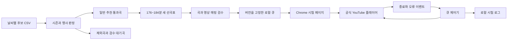

# YouTube 연결 기획과 구현 가이드 — 기존 사용자 대시보드

- 작성일: 2026-10-16
- 수정일: 2026-10-16
- 담당: C 공개 화면·추천/음악·재생 연결, B 결과 소유/영상 레지스트리, PL 원곡·영상 검수, INF 로컬 실행/후속 운영 환경
- 최신 사용자 결정: **YouTube 외부 재생을 기본으로 사용하고 대시보드 iframe은 접이식 보조로 유지합니다.** 이전 중앙 iframe 주진입 결정을 대체합니다. 키 없이 URL/CSV로 영상 후보를 등록하고 외부 재생용 확인과 iframe 삽입 가능 검수를 따로 보존합니다.
- 상태: 키 없는 등록·경로별 검수/분리 레지스트리와 외부 기본 연결을 구현했습니다. 백엔드136건·프런트49건/빌드 PASS와 일부 실제 화면·재생을 확인했습니다. 고정47곡의 iframe 재검사는13 PLAYING·34 오류150이며 외부 확인과 구분합니다. 전곡 완주·물리 소리·Chrome 계정/Premium은 미검증이고 상세 범위는7절에 남깁니다.

## 현재 일반 추천과 보관된47곡 시험의 구분

사용자는 고정47곡 재생 시험 목록이 일반 추천의 기본 입력이 되어 다른 장르 요청에 후보 부족을 일으키는 문제를 수정하도록 승인했습니다. **신규 일반 요청은 전체GENERAL 카탈로그를 사용하고, 고정47곡 카탈로그는 보관된 재생 시험 자료로 분리합니다.** 전체 적격 풀→요청 필수 필터/점수→176~184분 조합→실제 결과의 영상 매핑 확인 순서이며, YouTube 매핑47곡을 추천 후보 상한으로 사용하지 않습니다.

일반 로컬 적재는 저장소 루트에서 아래처럼 실행합니다. **`--playback-selection`을 넣지 않습니다.** 기존47개 검증 매핑은 일치하는 곡에만 붙이고 나머지GENERAL도 유지합니다. 원본·판정 해시가 다르거나 매핑 근거가 잘못되면 우회하지 않습니다. 준비·API/작업자/프런트 기동/종료는8절을 따릅니다.

```powershell
$env:C_LOCAL_DEMO = '1'
& '.\.venv\Scripts\python.exe' -m backend.manage seed_csv_preview 'C:\Users\이해나\Downloads\spotify_dataset (1).csv' --general-dir '.\analysis\weather_music_20261016\general' --youtube-mappings '.\analysis\youtube_mapping_20261016\mapping-47-verified-v1.json'
```

새 일반 시험 카탈로그는 `spotify-preview-b202fa49909b-general-c2478b153aa8-yt-39c5056603a0`이며 GENERAL86,485곡·맑음 적격34,883곡·카탈로그 내 검증 매핑47개를 포함하도록 적재했습니다. 이47개는 당시 카탈로그에 포함한 메타데이터 매핑 수이며 새 결과 전체가47곡/47매핑이라는 뜻이 아닙니다. 현행 공개 연결은 별도 레지스트리의 경로별 확인값을 읽고 스냅샷의 VERIFIED 이름만으로 우회하지 않습니다. 외부 준비 n/m·누락을 표시하고 일부만 준비되면 명시 부분 재생으로 구분합니다. 매핑 수가 추천 후보 수나 전체 재생 성공을 뜻하지 않습니다.

로컬 신규 기본 요청과 작업자 사전 로딩은 같은 `service.current_catalog()`를 사용합니다. `source_ref`가 `local-preview:youtube-playback-selection:`으로 시작하는 고정 재생 카탈로그는 이 선택에서 제외합니다. 일반 카탈로그가 없으면 `POLICY_NOT_READY`/503으로 준비를 안내하며47곡으로 대체하지 않습니다. 기존 작업·결과·같은 계열의 부모 카탈로그는 고정해 과거 결과/평가/제외/승인을 바꾸지 않습니다. API·작업자를 재시작해 같은 기준으로 연결하고 새 조건은 [선곡표 받기]의 독립 요청으로 생성합니다.

후보 부족과 탐색 미완료는 [일반 추천 분리 수용 기록](../../acceptance/일반_추천_후보와_재생시험_분리_검증_20261016.md)으로 이어서 확인합니다. 전체 카탈로그에 곡이 많아도 필수 날씨/장르/속도·제외·장르별 서로 다른 대표곡·176~184분을 통과한 조합이 충분하다고 미리 단정하지 않습니다. 실제 결과·오류와 매핑 수는 해당 요청에 귀속합니다.

### 앞 단계47곡의 검증 이력과 재적재

47곡의 [최종 매핑](../../../analysis/youtube_mapping_20261016/mapping-47-verified-v1.json)과 [명시 선택](../../../analysis/youtube_mapping_20261016/playback-selection-v1.json)은 당시 고정 재생 시험을 보존한 자료입니다. 한국에서 차단된 The Dirt Drifters 원음원1곡을 사용자 승인으로 All on Me / Devin Dawson으로 교체했고, GENERAL·맑음 W100·FOLK_COUNTRY·medium 및 원본 합계177분12.974초를 확인했습니다. 실제47개 영상 ID·순서와 기존 대시보드 전체 버튼이 일치했고 Teeje Week→Computadores Fazem Arte의 자연 전환도 확인했습니다. [당시47곡 수용 기록](../../acceptance/YouTube_47곡_매핑_검증_20261016.md)은 덮어쓰지 않습니다.

명시 선택 카탈로그 자체를 보관/검산 목적으로 다시 적재하는 명령은 다음과 같습니다. 이 명령이 성공해도 현재 일반 [선곡표 받기]의 기본 후보가47곡으로 바뀌지 않습니다. 이전47곡은 본인 소유의 저장 결과/스냅샷으로 확인하며 새로운 일반 요청 결과를 이 목록으로 고정하지 않습니다.

```powershell
$env:C_LOCAL_DEMO = '1'
& '.\.venv\Scripts\python.exe' -m backend.manage seed_csv_preview 'C:\Users\이해나\Downloads\spotify_dataset (1).csv' --general-dir '.\analysis\weather_music_20261016\general' --youtube-mappings '.\analysis\youtube_mapping_20261016\mapping-47-verified-v1.json' --playback-selection '.\analysis\youtube_mapping_20261016\playback-selection-v1.json'
```

당시 YouTube 정수초 합계177분28초와 원본177분12.974초는 다르며 광고·버퍼링을 포함하지 않습니다. 공식 MV/발행본의 길이 차이는 매핑에 보존하고 청취/파형/동일 편집 검수로 표시하지 않습니다. 앞 단계0/47·별도2곡 진단도 각각 당시 관측이며 현재 일반 추천의 전곡 재생 완료 근거가 아닙니다. 로그인/Premium은 실제 여는 브라우저의 YouTube 계정을 따르고 서버에서 새로 연결하지 않습니다.

## 1. 현재 사용자 진입점

사용자는 기존 React 공개 대시보드에서 지역·날씨 반영 ON/OFF·보컬·빠르기·테마/장르를 선택하고 [선곡표 받기]로 결과를 확인합니다. 중앙은 **준비수·누락을 확인한 뒤 YouTube에서 외부 목록을 여는 기본 동작**을 제공합니다. [대시보드에서 재생 (보조)]를 펼칠 때만 iframe을 마운트합니다. 좌우 선택/곡 목록·좋아요/싫어요·제외/취소·별점·재설정·승인은 유지하며 결과가 없을 때 가짜 곡/영상을 넣지 않습니다.

현재 화면은 [PublicPage.tsx](../../../frontend/src/features/recommendation/PublicPage.tsx)이며 기존 API 클라이언트·소유/CSRF 경계를 사용합니다. [대시보드5174](http://127.0.0.1:5174/)·Django 로컬 데모8011/작업자가 현재 실행 경로입니다. 독립 도구8002/8003이나 새 추천 화면을 주진입점으로 사용하지 않습니다. 원래 결과와 레지스트리의 검수 상태를 구분합니다.

~~~mermaid
flowchart LR
    A[기존 사용자 대시보드] --> B[불변 추천 결과와 원래 곡 순서]
    B --> C[키 없는 레지스트리의 외부 확인값]
    C --> D[준비 n/m과 누락 안내]
    D --> E[사용자 클릭으로 YouTube 전체 또는 명시 부분 목록]
    B --> F[접이식 보조 iframe]
    F --> G[별도로 iframe 검수된 대안과 종료 다음 곡]
    B --> H[운영자 URL과 CSV 등록 및 경로별 검수]
    B --> I[기존 반응과 제외와 평가와 승인]
~~~

## 2. 외부 기본 재생과 보조 iframe을 구분합니다

| 기능 | 사용자가 얻는 동작 | 완료로 판단하지 않는 것 |
|---|---|---|
| 기본 [YouTube에서 연속 재생 ↗] | 본인 결과 전곡의 native 확인 영상ID를 원래 상대 순서대로 새 탭에서 열기 | 링크 생성·목록 포함을 전곡 실제 재생/완주·물리 음향 확인으로 표시하지 않음 |
| [연결된 n곡만 YouTube에서 재생 (전체 m곡 중) ↗] | 누락곡과 짧아질 수 있음을 확인한 뒤 준비된 곡만 명시적으로 열기 | 부분 목록을 전체3시간 성공이나 원본 추천의 새 결과로 표시하지 않음 |
| [대시보드에서 재생 (보조)] | 펼칠 때 iframe 검수 대안만 재생 시도. 실제 PLAYING 뒤 종료 사건에만 다음 곡 | native 승인·CUED·자동재생 요청만으로 삽입 성공을 확정하지 않음 |
| 곡별 검색/영상 직접 열기 | 당시 곡명·아티스트로 검색하거나 확인한 영상 페이지 열기 | 클릭만으로 원곡 일치·PLAYING·다음 곡 자동 이동을 확정하지 않음 |
| [영상 연결 관리] | LOCAL_DEMO 운영자의 URL/CSV 후보 등록·외부/iframe 검수와 개별 차단 | 후보 등록·한 경로 승인으로 다른 경로도 통과시키지 않음 |

기본 외부 목록은 GET /api/playlists/{id}/youtube-queue가 본인 결과/원본 곡 범위 안에서 레지스트리의 native 승인 ID를 묶어 제공합니다. 준비수·누락 목록·전체/부분 여부를 확인하고 사용자의 anchor 클릭으로 엽니다. 전곡 준비 전에도 명시한 부분 재생은 가능하며, 원래 결과의 곡/순서/원본 시간과 누락은 그대로 보존합니다. 응답은 playlist_id, tracks[{track_id,video_id,source}], missing[{track_id,track_name,reason}], total_count, ready_count, is_complete, url, queue_kind=TEMPORARY_NATIVE_QUEUE, account_saved=false입니다. 서비스 playlist_id를 YouTube list 값으로 재사용하지 않습니다.

외부 목적지는 https://www.youtube.com/watch_videos?video_ids=... 임시 목록입니다. YouTube가 만드는 TL... 값을 계정에 저장한 영구 목록이나 공식 영구 링크 보장으로 설명하지 않습니다. 계정 내 저장/OAuth는 별도 선택 확장이며 키 없는 등록/재생의 선행 조건이 아닙니다. YouTube 로그인/Premium은 실제 외부 브라우저 문맥을 따르고 API 키·서버 계정 로그인으로 대체하지 않습니다.

보조 iframe은 기본으로 닫혀 있고 외부 CTA 클릭/새 결과 때 닫습니다. native 승인만으로 삽입 가능을 확정하지 않으며 iframe150으로 native 이용 불가도 판정하지 않습니다. 두 경로의 원곡·길이 근거와 승인/철회 이력을 구분합니다. Spotify track_id를 영상ID로 쓰지 않습니다.

## 3. 기존 추천·제외·평가·승인과의 경계

외부 연결·보조 iframe은 화면에 표시한 불변 결과의 곡ID·곡명·아티스트·순서를 사용합니다. 생성하지 않은 편집값으로 이전 결과를 새 조건의 결과처럼 바꾸지 않습니다. 재생·종료·실패·링크 클릭은 추천·Gemini·제외 저장·반응·별점·승인 이벤트와 분리하고 청취 평가로 환산하지 않습니다.

미저장 선택/제외·저장 실패/진행 중·생성 중·현재 제외 미반영·사용 안내에는 새 외부 열기를 보류하고 보조 iframe을 멈추며 진행 요청을 취소합니다. 상태 해제만으로 iframe을 자동 재개하지 않습니다. 새 결과ID/곡 순서는 큐를 초기화하되 같은 결과의 평가/승인·영상 revision 갱신만으로 재생을 처음부터 다시 틀지 않습니다. 승인 여부를 새 재생 필수 조건으로 추가하지 않습니다.

실패곡을 원본에서 조용히 삭제하거나 다른 곡으로 바꾸지 않습니다. 영상 대안은 같은 원곡/버전이며, 누락/실패는 목록에 남깁니다. 원본176~184분·preview/검증 상태를 유지하고 부분 재생이나 영상판 길이 차이가 있는 실제 재생을 원본 전체3시간 성공으로 표시하지 않습니다. 별도 추천 재구성은 기존 필터·시간 검증을 다시 통과해야 합니다.

YouTube 실패 안내는 추천·피드백·제외·승인 오류를 덮어쓰지 않습니다. 외부 탭은 사용자의 명시 클릭으로 열고 보조 iframe은 화면에 보이는 공식 플레이어를 사용합니다. 숨김 재생·곡마다 새 탭·자동 외부 리다이렉트로 제한을 우회하지 않습니다.

## 4. 시즌 필터와 실제 입력

일반 추천에는 `occasion_status=GENERAL`만 사용합니다. 명확한 SEASONAL_EVENT는 제외, REVIEW_REQUIRED/UNSCREENED는 보류합니다. 검수/규칙 근거와 원본18개·원본 점수·날씨 풀을 보존하고 별도 정책/판정 버전으로 새 목록을 만듭니다. [정본 라우팅](../음악_재생_정본_변경_라우팅.md)·[시즌 필터 라우팅](../음악_시즌필터_변경_라우팅.md)을 함께 확인합니다.

실행한 [general/summary](../../../analysis/weather_music_20261016/general/summary.json)·[manifest](../../../analysis/weather_music_20261016/general/manifest.json)·[verification](../../../analysis/weather_music_20261016/general/verification.json)의 분석 유효61,931곡 중 GENERAL은59,210곡, 시즌·행사1,248곡, 검수 대기1,473곡입니다. GENERAL은1차 메타데이터 검사 통과이며 청취 검수·운영 READY를 뜻하지 않습니다.

| 날씨 | 필터 후 일반 ON 분석 예시 | 곡 수 | 원본 길이 합 |
|---|---|---:|---:|
| 맑음 | [CLEAR](../../../analysis/weather_music_20261016/general/examples/CLEAR_180min.csv) |47|10,800,000ms|
| 구름낌 | [CLOUDY](../../../analysis/weather_music_20261016/general/examples/CLOUDY_180min.csv) |45|10,800,000ms|
| 흐림 | [OVERCAST](../../../analysis/weather_music_20261016/general/examples/OVERCAST_180min.csv) |46|10,800,000ms|
| 비 | [RAIN](../../../analysis/weather_music_20261016/general/examples/RAIN_180min.csv) |43|10,800,000ms|
| 눈 | [SNOW](../../../analysis/weather_music_20261016/general/examples/SNOW_180min.csv) |68|10,800,000ms|

이 표는 고정 날씨 ON 분석 예시이며 대시보드의 임의 지역·사용자 조건에 항상 이 목록을 그대로 넣는 규칙이 아닙니다. 앞 연결 단계의 실제 API/worker 결과는47곡·10,652,228ms(177분32.228초)였고, 당시 승인 교체 후 고정 재생 결과는47곡·10,632,974ms(177분12.974초)였습니다. 둘 다176~184분 안이며 정확180분 분석 예시를 그대로 복사한 목록이 아닙니다. 현재 일반 화면에는 전체 적격 풀과 해당 요청 조건으로 새로 계산한 결과를 사용하고, 과거47곡의 수/순서/영상 확인 수를 복사하지 않습니다. 원본 길이와 YouTube 버전 길이·광고/버퍼링 경과시간도 구분합니다.

최신 점수/시간은 [ON/OFF 후보 가이드](../../product/카페_음악_추천_서비스_3차_컬럼_기반_추천_로직_가이드.md)·[음악 통합](../../product/3차_음악_정책_통합_계약.md)·[공통 계약](../../product/3차_공통_개발_계약과_검증_기준.md)이 정본입니다. 현재 backend는 Django이며 FastAPI는 목표 문서 계약입니다. 이번 연결을 위해 대시보드나 백엔드를 새 프레임워크로 대체하지 않습니다.

## 5. 키 없는 영상 등록·검수·재사용

기본 YOUTUBE_PLAYBACK_MODE=KEYLESS는 LLM/YouTube Data API를 호출하지 않습니다. **외부 기본 재생은 레지스트리의 native 승인, 보조 iframe은 별도 iframe VERIFIED를 사용합니다.** 신규 등록은 둘 다 미확정이고 과거 결과의 VERIFIED 이름만으로 우회하지 않습니다. OPTIONAL_SEARCH는 명시 설정으로만 보존하는 선택 경로이며 이번 기본 경로가 아닙니다.

| 단계 | 운영자/사용자의 행동 | 서버와 화면의 결과 |
|---|---|---|
|1|기존 대시보드에서 추천 받기|전체GENERAL 후보로 원래 곡/순서·176~184분 결과 생성. 영상 상태로 후보 축소 없음|
|2|중앙 아래 [영상 연결 관리] 열기·실행코드 입력|LOCAL_DEMO/결과가 있을 때 로컬 운영자 도구 사용. 공개 재생 소유 문맥과 별개|
|3|현재 결과/미연결·대기·완료·차단에서 검색·곡 선택|원곡 정보·곡별 revision·영상 대안과 두 경로 확인값 조회|
|4|YouTube URL 또는 CSV 등록|후보 저장, native/iframe 두 확인 모두 자동 확정하지 않음|
|5|[외부 재생 확인]→[YouTube에서 열어 확인]|운영자가 외부 재생·원곡/버전을 직접 확인하고 체크/전체초/메모로 보고. 외부 탭 자동 관측으로 표시하지 않음|
|6|보조 iframe 단일 미리보기에서 별도 검수|실제 PLAYING·양의 getDuration 뒤 사람의 원곡 체크. 외부 확인만으로 iframe 확정하지 않음|
|7|경로별 검수/차단 저장|원곡/재생 보고·길이·현재 revision 검사. native 승인/철회와 iframe VERIFIED/BLOCKED는 독립|
|8|기존 결과에서 연결 재확인·명시 재생|현재 검수값 조회. 새 추천/승인/평가나 자동 전체 재시작으로 가장하지 않음|

실행코드는 password 입력으로 받고 메모리에서만 사용합니다. 잠금·패널 닫기·결과 교체 시 폐기하고 URL·브라우저 저장소·공유 문서/로그에 남기지 않습니다. 관리 미리보기는 메인 iframe과 동시 재생하지 않습니다. 검수 성공 후 미리보기를 멈추고 목록/revision을 갱신하며409에는 입력을 보존하고 최신 목록 확인 후 재적용을 안내합니다.

### 별도 레지스트리와 검수 의미

영상은 Git제외 .local-preview-logs/youtube-mappings.sqlite3, 실행코드는 .local-preview-logs/youtube-review-access.json에 둡니다. 음악18개/RDB4개·카탈로그/불변 결과·피드백/outbox와 별도이며 원본 play_url·커버·점수·후보를 덮어쓰지 않습니다. LOCAL_DEMO 밖 운영 모드는503이며 공유 ADMIN·다중 서버/운영 연결 완료가 아닙니다.

init_youtube_review --seed-legacy는 코드 파일을 만들되 코드 값은 출력하지 않고 과거 매핑을 iframe CANDIDATE/LEGACY_REVIEW_PENDING으로 가져옵니다. --seed-native-reviewed는 원본 신원·메서드/근거·버전/시각·길이를 대조한 과거 native 목록 검수 자료만 복원하며 출처는 LEGACY_NATIVE_METADATA_REVIEW입니다. 과거47곡 목록 포함·원곡/길이 확인을 현재47곡 전부 PLAYING·완주나 iframe 검수로 승격하지 않고 운영자가 철회한 native 판정을 재실행으로 되살리지 않습니다.

native_verified/native_duration_seconds/native_observed_at/native_source/native_reason은 iframe 판정과 별도입니다. 새 외부 확인은 OPERATOR_NATIVE_REPORTED_PLAYING, native 철회는 OPERATOR_NATIVE_BLOCK로 구분하고 재승인 시 철회 이유를 해제합니다. 기존 데이터 보존을 위한 컬럼 추가로 음악 RDB 테이블 수를 늘리지 않습니다.

명시 검수에는 identity_confirmed=true, playback_observed=true, 양의 duration_seconds와 현재 곡별 revision이 필요합니다. 원본 초 d에 대해 기본 길이차는 min(60,max(12,0.12*d)) 이내입니다. native 영상판 길이 차이를 별도로 인정하는 선택 입력은 duration_difference_confirmed=true와 메모가 있고 절대차60초 이내일 때만 사용하며 VERIFY_NATIVE_DURATION_DIFFERENCE_ACK를 남깁니다. iframe 기본 허용차를 완화하거나 원본 추천 시간을 덮어쓰지 않습니다. 길이가 비슷해도 원곡/아티스트/버전 확인을 대신하지 않습니다.

서버는 운영자 브라우저의 재생 관측 보고와 사람 확인을 저장합니다. 물리 소리·파형 동일성·전곡 청취/날씨 Gold·Premium을 증명하지 않습니다. 공개 재생 오류는 운영자 검수 상태를 자동 변경하지 않으며 /block은 iframe, /native-block은 native 대안만 바꿉니다. 상태 필터의 VERIFIED 집계는 둘 중 하나의 적격일 수 있으므로 개별 경로 확인값을 함께 봅니다.

### URL·CSV와 곡별 revision

허용 YouTube URL에서 실제11자리 영상ID를 검사하고 원곡은 서버 등록 정보와 대조합니다. 임의 외부 URL 프록시·영상ID 생성은 하지 않습니다. CSV 헤더는 track_id,video_url,expected_revision,note이며 note는 선택입니다. UTF-8 BOM·표준 인용/쉼표를 허용하고 최대500행·1MiB입니다. 양식의 현재 곡ID/revision에 URL을 채우며 미등록은 revision0입니다.

같은 곡의 서로 다른 영상 대안은 최대10개까지 한 CSV에 넣을 수 있고 같은 곡의 expected_revision은 모두 같아야 합니다. 같은(track_id,video_id) 중복은 CSV_DUPLICATE_MAPPING, 같은 곡의 revision 불일치는 CSV_REVISION_CONFLICT입니다. 미존재곡·잘못된 URL·stale revision 등 어느 한 행 오류도 **전체 검증 뒤 원자 저장** 원칙에 따라 전체 거절합니다. 같은 곡의 배치 revision 증가는 한 번이며 실패 입력을 유지합니다. 비고의 수식 같은 문자열은 실행하지 않습니다.

### API 공급·소비와 구현 위치

| 경로/파일 | 현행 역할 |
|---|---|
|GET /api/playlists/{id}/youtube-queue|본인 결과/원본 범위의 native 승인 영상, 준비/누락·전체/부분 임시 URL. 공개 재생 경계|
|POST /api/playlists/{id}/youtube-playback|본인 결과/곡·CSRF 검사 뒤 iframe VERIFIED 대안 조회. snapshot native 이름으로 우회 없음|
|GET /api/youtube-review/status·tracks|공개 상태 안내, 운영자 검색/페이지·대안/곡별 revision. playlist_id는 본인 소유 추가 검사|
|같은 prefix의 mappings·import POST|운영자 URL/CSV 후보 등록·현재 revision·원자성 검사|
|같은 prefix의 verify·block POST|iframe PLAYING/원곡/길이 검수 또는 iframe 대안 차단|
|같은 prefix의 native-verify·native-block POST|외부 PLAYING 수동 보고/원곡/길이 검수 또는 native 철회. iframe 판정 유지|
|backend/recommendation/youtube_registry.py·youtube_review_api.py|별도 SQLite·곡별 revision/원자 저장·LOCAL_DEMO 운영자 경계|
|backend/recommendation/youtube_playback.py|기본 KEYLESS 레지스트리 조회와 미연결/기술 장애 구분|
|YoutubeNativePlayback.tsx·PublicPage.tsx|외부 기본 CTA·준비/누락·조건 gate·접이식 보조 iframe/검수 관리|
|YoutubeReviewPanel.tsx·YoutubeReviewPreview.tsx·youtubeReview.ts|URL/CSV/대안·외부 수동 보고와 iframe 미리보기·충돌 처리|
|YoutubePlayer.tsx·youtubePlayerController.ts·youtubeIframeApi.ts|보조 iframe 큐·실제 종료 다음 곡·미연결/오류/수명주기|

상태 안내 외 검수 read/write에는 X-Youtube-Review-Code와 기존 CSRF 경계를 적용합니다. 전역 검색은 운영자 전용이며 결과 범위 조회는 소유도 확인합니다. 실행코드가 공유 ADMIN 인증을 대신한 운영 권한이라고 설명하지 않습니다.

iframe READY 후보의 source=MAPPING_REGISTRY, match_status=VERIFIED이며 제목/아티스트는 당시 원곡 자료입니다. Data API 영상 메타데이터라고 주장하지 않습니다. mapping_revision은 곡별 버전이며 MAPPING_REQUIRED/UNMAPPED·PENDING·BLOCKED는 개별 누락 후 다음 곡, SEARCH_UNAVAILABLE/REGISTRY_NOT_CONFIGURED·REGISTRY_UNAVAILABLE는 기술 장애로 보류합니다. 영상 미연결은 음악 후보 부족이 아닙니다.

[이전 선택 검색 라우팅](../YouTube_자동검색_변경_라우팅.md)·[키 설정 안내](./YouTube_API_키_발급과_서버_설정.md)는 기본 사용의 선행 조건이 아닙니다. 기존 Google 계정 로그인/Premium과 API 키·OAuth는 서로 다른 경계입니다.

## 6. 보조 iframe의 오류·자동재생·보안

보조 iframe은 펼칠 때만 생성하고 공식 호스트·검사한 ID·실제 origin을 사용합니다. Referer/client 식별을 제거·위조하거나 광고 차단·무음 강제·오디오 추출·숨김 재생으로 제한을 우회하지 않습니다. 외부 새 탭은 사용자 클릭으로 열고 noopener noreferrer를 적용합니다. 재생 진단은 피드백/광고 이벤트와 분리하고 코드·쿠키·이메일을 기록하지 않습니다.

|사건/오류|보조 iframe의 처리|
|---|---|
|실제 onAutoplayBlocked|현곡 유지·사용자 재생 클릭 대기. 다음 곡 누락으로 처리하지 않음|
|15초 loading·현재0초|광고/버퍼링 가능성을 포함한 일반 준비 지연만 안내. 차단/실패 단정 없음|
|iframe 준비20초 초과|준비 오류/재확인. 폐기된 인스턴스의 늦은 사건 무시|
|실제 PLAYING 뒤 ENDED|현재 큐/영상일 때 다음 곡으로 한 번 진행|
|2/100/101/150|같은 원곡의 검수된 대안·실패ID 제외 재조회1회, 서로 다른 최대5영상 소진 시 누락 기록 후 다음|
|MAPPING_REQUIRED|해당 곡의 미연결/대기/차단 사유를 남기고 다음 곡. 원래 결과 유지|
|SEARCH_UNAVAILABLE|레지스트리 미설정/장애는 현곡 보류. 전곡 미연결/추천 부족으로 전용하지 않음|
|153·5 등 환경 오류|현곡/환경 확인 대기. 전곡을 곡별 불가로 건너뛰지 않음|

[공식 IFrame 오류](https://developers.google.com/youtube/iframe_api_reference#onError)의101/150은 삽입 제한,153은 Referer/API client 식별 문제입니다. native 확인과 iframe 검수를 교차 승인하지 않습니다. 보조 자동재생 요청·CUED·PLAYING·완주도 구분하며 실제 영상 가용성/광고/버퍼링·영상판 길이가 원본 시간과 다를 수 있음을 표시합니다.

## 7. 검증과 완료 기준

### 키 없는 분리 검수의 현재 확인 범위

기본 외부/보조 iframe·URL/CSV·곡별 revision·검수 권한·분리 저장의 통합 검증은 백엔드136건·프런트49건/최신 빌드 PASS이며 AST39파일404심벌의 문서 누락0을 확인했습니다. 이 자동 검증 수를 실제47곡 전부 재생한 수로 환산하지 않습니다. [키 없는 등록과 검수 수용 기록](../../acceptance/YouTube_키없는_등록과_검수_검증_20261016.md)에 실제 실행/미확인 범위를 기록합니다.

고정 승인47곡(All on Me 포함, 원본10,632,974ms)의 iframe 전수 재검사는13 PLAYING·34 error150입니다. PLAYING13개 중 Night on the River의 길이 차이와 Tordilho Negro 라이브판 확인이 보류되어 저장 상태는 **iframe11 VERIFIED·34 BLOCKED·2 CANDIDATE**입니다. 추가12대안도 모두 실제150이었으며 자동 승격하지 않았습니다. PLAYING·등록 상태·청취 완료는 서로 다른 값입니다. [47곡 재검사](../../acceptance/assets/keyless-47-iframe-recheck-20261016.json)·[대안 재검사](../../acceptance/assets/keyless-alternative-iframe-recheck-20261016.json)를 구분합니다.

native는 과거 자료46개와 Night on the River 공식 MV의 운영자 외부 PLAYING 보고를 구분해 총47승인입니다. MV240.261초/원본213.226초·차27.035초는 native 전용 길이 차이 확인/메모 예외를 명시했고 iframe 보류를 바꾸지 않았습니다. 고정47의 [외부 큐 근거](../../acceptance/assets/keyless-approved47-native-queue-20261016.json)와 실제 YouTube DOM의47곡 목록 수용을 확인했습니다. Next를 누르지 않고 Teeje Week→Computadores Fazem Arte→I Gotta Feeling의1→2→3 자연 전환과 재생 중 UI를 [관측 JSON](../../acceptance/assets/keyless-native47-natural-transition-20261016.json)·[화면](../../acceptance/assets/keyless-native47-playing-20261016.png)으로 확인했습니다. 이 근거는 모든47곡의 현재 PLAYING/177분 완주나 물리 음향·Premium 확인이 아닙니다.

전체GENERAL에서 새로 계산한 기본47곡은 원래 I'll Shut Up Now를 포함한 다른 결과입니다. 외부 준비46/47·미연결1을 실제 화면에 표시하며 고정 승인47의 All on Me로 강제 대체하지 않습니다. 원본 결과·전체86,485후보·당시 시간·preview_only/validation_passed는 그대로 보존합니다. 실제 URL 후보 등록 뒤 native 자동 승격이 없는 것도 확인했습니다. CSV 파일 조작의 관측은 수용 기록의 실제 확인 항목만 따릅니다.

### 이전 중앙 iframe 단계의 검증 이력

통합 백엔드101건·프런트32건/최신 빌드는 PASS이며 중앙 코드/API·모의 사건 회귀와 실제 일부 재생/자동 진행을 확인했습니다. [실제47곡 결과](../../acceptance/assets/central-iframe-result-20261016.json)는 전체GENERAL86,485곡에서 `ON/any/auto`·테마/장르 미선택으로 생성한47곡·10,652,228ms(177분32.228초)입니다. 이 결과의 기존 메타데이터 매핑은46개이고 승인 교체곡을 넣은 과거 고정47곡과 다릅니다. `preview_only=true`·`validation_passed=false`를 보존합니다.

IAB 중앙420×262 iframe에서 앞4곡의 삽입 제한/대안 검색 불가를 기록한 뒤5번 Somos Instantes의 PLAYING·0:41/3:45 진행을 확인했습니다. [재생 근거](../../acceptance/assets/central-iframe-playing-20261016.json)·[화면](../../acceptance/assets/central-iframe-playing-20261016.jpg)에 남겼습니다. Next를 누르지 않은 상태에서6번 Keep On Running/7번 Cứ Chill Thôi의 삽입 실패 뒤8번 Night on the River의 PLAYING·빠진6곡을 [후속 관측](../../acceptance/assets/central-iframe-natural-transition-20261016.json)으로 확인했습니다. 실제 실패곡/원래47곡 목록은 보존합니다.

`playedTrackIds`는 재생 시작을 관측한 곡이며 완주 수가 아닙니다. 이번 증거는 중앙 일부 실제 재생/자동 진행까지이며 전곡177분 경과·물리 음향·Chrome 프로필/Premium은 미확인입니다. 실제 Data API 검색은 키가 없어 미실행입니다. 같은 시간대 사용자가 별도로 생성한57곡 연주곡 결과의 Between Mind & Heart에서 표시한 `API_KEY_MISSING`을 위47곡 시험과 합치지 않습니다.

자동재생은 시도와 실제 PLAYING을 나누고 차단이면 사용자 재생 클릭 후 확인합니다. 준비 지연·153·차단/대안·조건 편집 gate의 모의 시험을 모두 실제 브라우저로 재현했다고 확대하지 않습니다. [이번 중앙 수용 기록](../../acceptance/대시보드_중앙_YouTube_iframe_검증_20261016.md)과 과거 기록을 분리합니다. 이 단락은 URL/CSV 등록 도구 도입 전 단계의 관측입니다. 최신 사용자 승인으로5절의 키 없는 등록/경로별 검수 도구를 별도 구현하며 당시 API_KEY_MISSING·검색 경로를 현행 KEYLESS의 필수 조건이나 미연결 사유로 복사하지 않습니다.

### 일반 추천 분리 시점의 이력과 유지하는 후보 부족 기준

현재 일반 추천의 논리 범위는 전체 적격 C_ON/C_OFF입니다.200곡은 시작 창이며, 과거47곡 영상 확인 목록을 후보 상한이나 날씨/장르 목록으로 재사용하지 않습니다. ON의 부분 장르는 필수 필터와 각 장르의 서로 다른 대표곡 조건, 테마는 취향 가점으로 구분합니다. YouTube 영상 미매핑도 후보 부족의 사유로 추가하지 않습니다.

로컬 CSV 프리뷰 `choose_preview()`는 전체 후보의 수·총원본ms·선택장르별 수·누락장르·서로 다른 대표곡 배정 가능 여부·부모 대비 신규곡 필요 수와 탐색 창 상태를 오류 근거에 보존합니다. 사용자에게는 실제 후보 수/총시간·부족 장르·실행 가능한 다음 조치를 짧게 안내하고 기술 지표 전체를 화면에 나열하지 않습니다.

|상태|판정·화면 조치|
|---|---|
|`CANDIDATE_SHORTAGE`|전체 적격 총시간이176분 미만, 선택장르 없음/서로 다른 대표 배정 불가, OFF 선택장르 시간 비율의 필요조건 불충족 또는 전체 범위 INFEASIBLE 등 증명된 부족만 사용|
|`SEARCH_INCOMPLETE`|제한 창 실패·solver UNKNOWN/시간 초과·전체 풀 미해결. 전체 후보 부족이라고 단정하거나 OFF100% 불가 증명 없이80% 보완을 열지 않음|
|`NO_MEANINGFUL_CHANGE`|부모 대비 필요한 신규곡 수 미달. 부모 결과/제외 초안·평가/승인을 유지|
|연결 장애|추천 조건 오류와 구분해 기존 연결 다시 확인/재시도 동작 유지|

위3종 추천 조건 오류의 [선택 조건 확인]은 기존 음악 선택 영역에 초점을 옮기는 동작입니다. 기존 선택을 보존하고 필수 장르/보컬·ON을 자동 해제하지 않습니다. 별도 실제 부족 시험의 `ON/auto/instrumental_only/OPERA` 요청은 최종4곡·577,894ms로 “후보4곡·총9분37초·최소176분 미달” 및 [선택 조건 확인]을 표시했고 연결 재시도 버튼은 없었습니다. [부족 회귀 근거](../../acceptance/assets/general-pool-shortage-result-20261016.json)를 보존합니다. 이 별도 탭의 버튼 클릭 후 초점 이동은 미확인이므로 메시지/버튼 관측과 구분합니다.

진단의 `checked_full_candidate_pool=true`는 전체 입력 지표 확인이며 시간/품질 최적성이나 UNKNOWN의 불가능 증명이 아닙니다. 현재 CSV 프리뷰의 `FEASIBLE_GREEDY_PREVIEW`/`FEASIBLE_PREVIEW`는 제한된 가능 조합 시험이고 `preview_only=true`·`validation_passed=false`를 유지합니다. 운영 정본의 시간/품질 우선순위·Gold 검수와 동일하다고 주장하지 않습니다. 실제 함수/사유 필드와 공급 경로는 [기존 대시보드 라우팅](../기존_대시보드_YouTube_연결_라우팅.md)을 따릅니다.

일반 풀 복원 시점에는 통합 백엔드77건·프런트15건/빌드 PASS를 확인했습니다. 전체GENERAL·새 요청·카탈로그 분리·결과별 영상 확인 수·실제 브라우저 검증은 [당시 수용 기록](../../acceptance/일반_추천_후보와_재생시험_분리_검증_20261016.md)에 연결합니다. 이 수치를 이번 새 플레이어/검색 통합의 최종 시험 수로 사용하지 않습니다. 아래57건/0매핑·47곡도 앞 연결 시점의 이력입니다.

실제 사용자 조건 `ON/any/auto`, 테마 `BRIGHT·DREAMY·EMOTIONAL·PEACEFUL`, 장르 `CLASSICAL·J-POP·K-POP·NEWAGE·OPERA`를 바꾸지 않고 새 요청을 실행했습니다. 전체86,485곡에서 공통 적격6,818곡·날씨 탈락3,562곡·최종 후보3,256곡을 확인했고, 창400의 프리뷰 조합으로 **45곡·176분00.186초** 결과를 만들었습니다. 당시 해당 결과의 영상 확인은 **3/45·미확정42곡**이었고 당시 전체 임시 목록은 보류했습니다. 현행 레지스트리의 경로별 승인/명시 부분 열기 기준과 구분합니다. 과거47곡처럼 전곡 매핑됐다고 표시하지 않습니다.

[새 결과 근거](../../acceptance/assets/general-pool-repair-result-20261016.json)와 [분리 감사](../../acceptance/assets/catalog-isolation-repair-audit-20261016.json)에 같은 옵션·실제 결과/진단·카탈로그3개 보존·이전47곡 필드/행/순서/총ms 동일 대조를 남겼습니다. `FEASIBLE_GREEDY_PREVIEW`·`preview_only=true`·`validation_passed=false`는 가능 조합 시험 범위이며, 이176분 결과를180분에 가장 가까운 최적 결과나 운영 검수 완료로 설명하지 않습니다.

|검증|현행 합격 기준|
|---|---|
|기존 화면/일반 후보|외부 기본·접이식 iframe, 기존 반응/제외/평가/승인 및 전체GENERAL/원본176~184분 보존|
|외부 기본 목록|본인 원본 범위·native 승인·상대 순서, 준비 n/m·누락·전체/명시 부분 CTA. 계정 저장/완주 주장 없음|
|독립 검수|새 등록 둘 다 미확정, native와 iframe 승인/차단 독립, legacy native 근거가 iframe을 통과시키지 않음|
|운영자 경계|LOCAL_DEMO/코드·CSRF·owner·운영503, 코드 메모리 폐기와 비노출|
|CSV/revision|UTF8BOM/인용·500행/1MiB/10대안·곡별 revision·409·전체 검증/원자 저장/실패 입력 보존|
|보조 iframe|명시 펼침 때 마운트, 실제 PLAYING/ENDED 한 번 진행·오류/미연결·기술 장애/자동재생 차단 구분|
|결과/이벤트 격리|영상 상태/오류가 원래 곡/점수/시간·평가/제외/승인을 변경하지 않음|
|실제 재생 범위|현재 결과/경로/분모·PLAYING/전환·실패를 기록, 전곡 경과/물리 소리/Premium 미확인을 유지|

### 앞 연결 단계의 검증 이력

앞 연결 단계에서는 backend57건·프런트 Vitest11건(신규9＋기존2)·프런트 빌드 PASS를 확인했습니다. 당시 실제 관측은 [기존 대시보드 수용 기록](../../acceptance/기존_대시보드_YouTube_연결_검증_20261016.md), 코드/매핑·실행은 [기존 대시보드 연결 라우팅](../기존_대시보드_YouTube_연결_라우팅.md)에 연결합니다. root는 당시 기존5174 화면에서 고정 맑음의47곡 결과·47개 곡별 검색 링크·영상확인0/47·전체 임시 목록 보류를 관측했습니다. 당시 test Catalog에는 GENERAL86,485곡을 적재했으며 source error1/시즌 제외·검토 등 skipped3,255곡입니다. 이 수는 앞 절의 날씨 분석 유효59,210곡 분모와 다르고 전곡의 요청 적격/운영 Gold를 뜻하지 않습니다.

root는 별도로 네이티브2곡 임시 목록의 Better→Numb Little Bug 자동 전환을 관측했습니다. 첫 곡1:59/2:56의 시간 진행 뒤 [다음]을 누르지 않고 두 번째 곡으로 넘어갔으며, 중간 광고의 정상 건너뛰기 후0:00/2:49·재생 중 UI를 확인했습니다. 이 관측은 실제 추천47곡의 전곡 매핑·3시간 재생이나 광고 없는 무중단 재생을 입증하지 않습니다.

기존 대시보드에서는 실제47곡·177분32.228초 결과, 생성한 곡명 검색URL을 별도 IAB 탭에서 열어 해당 곡 결과, 좋아요·4점 저장/취소, 제외 후 전체 목록 보류, 조건 변경 보류를 확인하고 시험 상태를 복원했습니다. 실제 Chrome의 새탭 열기/프로필은 확인하지 않았습니다. [대시보드 관측 화면](../../acceptance/assets/dashboard-youtube-links-20261016.jpg)을 연결합니다. 현재 날씨는 로컬 고정 자료이며 운영 날씨·공유DB·Chrome Premium/물리적 음향 출력·전체 장시간 재생은 별도입니다. 실제 승인 버튼 클릭까지 확인한 것으로 확대하지 않습니다.

[화이트리스트 결과 JSON](../../acceptance/assets/dashboard-general-result-20261016.json)은47곡/당시 조건/원본 길이/점수/GENERAL의 근거입니다. 결과의 `preview_only=true`·`validation_passed=false`를 그대로 보존했습니다. 미검수 CSV의 일반 추천 필터·시간 범위·UI/외부 이동 검증과 운영 카탈로그 검수·추천 검증 완료를 구분합니다.

이전 시즌 CSV 검증15건과 iframe 보조 도구 자동검증23건은 아래 부록의 각 범위이며 새 대시보드 이동/전체 네이티브 재생의 시험으로 재사용하지 않습니다.

## 8. 기존 대시보드 재실행 — 현재 사용하는 명령

현재5174 대시보드·8011 API·추천 작업자는 사용자 확인용으로 실행 중입니다. 아래는 종료 후 다시 켤 때의 명령입니다. 이미 실행 중인 프로세스와 같은 포트를 중복 실행하지 않습니다. 기존 `.venv`·수령 CSV와 `general/manifest.json`·판정표를 준비한 상태를 기준으로 하며, 판정 산출물이 없으면 [시즌 필터 라우팅](../음악_시즌필터_변경_라우팅.md)의 build/verify를 먼저 수행합니다.

준비 터미널에서 로컬 시험DB migration과 실제 CSV 시험 카탈로그를 준비합니다. `C_LOCAL_DEMO=1`은 settings에서 `local-demo.sqlite3`를 사용하며 공유 PostgreSQL/광고 MongoDB를 변경하지 않습니다. 수령 CSV는 읽기만 하고 `.env`는 수정하지 않습니다.

```powershell
Set-Location -LiteralPath 'C:\MLO01-01\Chapter3,4 mission'
$env:C_LOCAL_DEMO = '1'
& '.\.venv\Scripts\python.exe' -m backend.manage migrate --noinput
$env:YOUTUBE_PLAYBACK_MODE = 'KEYLESS'
& '.\.venv\Scripts\python.exe' -m backend.manage seed_csv_preview 'C:\Users\이해나\Downloads\spotify_dataset (1).csv' --general-dir '.\analysis\weather_music_20261016\general' --youtube-mappings '.\analysis\youtube_mapping_20261016\mapping-47-verified-v1.json'
& '.\.venv\Scripts\python.exe' -m backend.manage init_youtube_review --seed-legacy --seed-native-reviewed
```

현재 GENERAL manifest는 위 다운로드 원본의 SHA-256 `b202fa49909b2d5cef71a04b1d21243cfeb36414535f2ca9272aa646721177bd`에 귀속됩니다. 저장소 수령 CSV의 현재 바이트 해시는 `335e5ee0a07a3f30b20ca9860c87562c98082a032e0ecd90e8ca0a86d965fe58`로 달라 이 manifest와 바꿔 넣지 않습니다. 다른 PC에서는 같은 원본 바이트의 경로를 명시하며 해시 차이를 우회하지 않습니다. 원문과 수령 파일은 변경하지 않습니다.

터미널1 — 기존 Django 추천 API:

```powershell
Set-Location -LiteralPath 'C:\MLO01-01\Chapter3,4 mission'
$env:C_LOCAL_DEMO = '1'
$env:YOUTUBE_PLAYBACK_MODE = 'KEYLESS'
& '.\.venv\Scripts\python.exe' -m backend.manage runserver 127.0.0.1:8011 --noreload
```

터미널2 — 기존 추천 작업자:

```powershell
Set-Location -LiteralPath 'C:\MLO01-01\Chapter3,4 mission'
$env:C_LOCAL_DEMO = '1'
& '.\.venv\Scripts\python.exe' -m backend.manage run_recommendations
```

터미널3 — 기존 공개 프런트엔드:

```powershell
Set-Location -LiteralPath 'C:\MLO01-01\Chapter3,4 mission\frontend'
pnpm install --frozen-lockfile
$env:VITE_C_DEMO = '1'
$env:VITE_RECOMMENDATION_API_TARGET = 'http://127.0.0.1:8011'
pnpm dev --port 5174 --strictPort
```

브라우저에서 [기존 대시보드](http://127.0.0.1:5174/)를 열고 지역/조건 선택 → [선곡표 받기] → 준비/누락 수 확인 → 외부 전체 또는 명시 부분 재생을 선택합니다. 일반 적재에 --playback-selection을 추가하지 않습니다. 키 등록 없이 사용하며 [영상 연결 관리]에 로컬 파일의 실행코드를 직접 입력해 URL/CSV 후보 등록과 경로별 검수를 합니다. 코드 값은 화면/로그/공유 자료에 복사하지 않습니다. iframe은 [대시보드에서 재생 (보조)]를 펼친 경우에만 사용합니다.

종료는 위 세 프로세스의 터미널에서 각각 `Ctrl+C`입니다. 시험DB·카탈로그·원문·영상 레지스트리/접근코드 파일을 삭제하거나 초기화하지 않습니다. 다시 실행할 때 같은 명령을 사용하고 로컬 시험을 운영 날씨·공유DB·배포 완료로 표시하지 않습니다.

## 9. 이전 독립 iframe 보조 도구와 현재 중앙 플레이어의 구분

`prototype/youtube-player/`는 영상 매핑·삽입 가능성·큐 동작을 확인했던 독립 개발 보조 도구로 보존합니다. 이전8003 프로세스는 종료했으며 이번 주 경로는5174 PublicPage의 외부 기본 재생과 접이식 보조 iframe입니다. 두 도구의 nonce/큐·검색/상태 계약을 섞지 않습니다. 독립 loopback·로컬 POST/nonce·단일 preview/VERIFIED 큐는 아래 부록과 [이전 구현 라우팅](../YouTube_재생_변경_라우팅.md), 새 중앙 큐는 [현재 iframe 라우팅](../음악_iframe_플레이어_변경_라우팅.md)을 따릅니다.

이전 IAB8003 관측의 음악4영상 오류150, 공식API 샘플 CUED, 미매핑45곡 전체 큐 차단은 iframe 보조 도구의 결과입니다. 현재 대시보드에서 YouTube를 직접 연 결과와 섞지 않습니다. Chrome/Premium/소리·5곡 자연 연속·3시간 실제 재생은 그때 완료하지 않았습니다.

<details>
<summary>이전 iframe 검수 도구의 기획·구현·CSV 비교·오류 관측 이력</summary>

아래는 독립 보조 도구의 당시 계약/관측입니다. 현재 외부 기본/보조 iframe·등록 검수·실행은 위1~8절을 우선하며 아래의 전곡 VERIFIED 전용 큐를 현행 분리 레지스트리 경로에 그대로 적용하지 않습니다. 과거 오류/샘플 CUED를 새 중앙 플레이어나 네이티브 경로의 실제 성공/실패로 복사하지 않습니다.

## 이전 iframe 검수 도구 기획·구현과 관측 이력

- 작성일: 2026-10-16
- 수정일: 2026-10-16
- 대상: 공개 화면·추천 담당 C, 공통 백엔드 담당 B, 기획 PL, 인프라 INF
- 상태: 기획 계약과 로컬 구현 연결 가이드입니다. 별도 시즌 필터·일반ON 목록 산출 및 격리 플레이어 코드를 작성했으며, 실제 Chrome 계정·음향·연속 스트리밍 시험은 별도 확인입니다.

오늘의 목표는 **날씨별 선곡표를 Chrome의 공식 YouTube 플레이어에서 실제 소리로 재생하고, 곡 종료 후 다음 곡으로 진행하는 로컬 시험**입니다. 사용자 결정에 따라 명확한 시즌·행사곡은 일반 추천에서 제외하고, 애매한 곡은 검수 대기 목록으로 분리합니다. 먼저 필터 통과곡 5곡으로 연결과 오류 처리를 확인한 뒤, 선택한 한 날씨의 176~184분 전체 목록을 재구성해 시험합니다. 검색 자동화·기존 서비스 통합·실시간 날씨 연결·AWS 이전은 그 다음 순서로 진행합니다.

### 1. 현재 준비 상태와 적용 기준

[분석 산출물 안내](../../../analysis/weather_music_20261016/README.md)의 기존180분 예시는 필터 전 비교 자료로 보존합니다. 아래 첫 표는 **시즌·행사 필터 적용 전** 결과입니다. 원본 CSV·기존 pools/examples·점수는 덮어쓰지 않았고, 현재 시험 입력은 그 다음 표의 별도 `general/examples/` 산출물입니다.

| 날씨 | 입력 CSV | 곡 수 | Spotify 원본 길이 합 |
|---|---|---:|---:|
| 맑음 | [CLEAR](../../../analysis/weather_music_20261016/examples/CLEAR_180min.csv) | 49 | 10,800,000ms |
| 구름낌 | [CLOUDY](../../../analysis/weather_music_20261016/examples/CLOUDY_180min.csv) | 46 | 10,800,000ms |
| 흐림 | [OVERCAST](../../../analysis/weather_music_20261016/examples/OVERCAST_180min.csv) | 45 | 10,800,000ms |
| 비 | [RAIN](../../../analysis/weather_music_20261016/examples/RAIN_180min.csv) | 44 | 10,800,000ms |
| 눈 | [SNOW](../../../analysis/weather_music_20261016/examples/SNOW_180min.csv) | 67 | 10,800,000ms |

필터 전 전체251행·고유 Spotify `track_id`237개입니다. 각 파일은 목록 내 ID 중복이 없고 `position`이1부터 연속입니다. 기존237곡 수를 필터 후 매핑 대상 수로 재사용하지 않습니다.

2026-10-16 실제 시즌 필터 실행으로 별도 [summary](../../../analysis/weather_music_20261016/general/summary.json)·[manifest](../../../analysis/weather_music_20261016/general/manifest.json)와 아래 새 목록을 만들었습니다. 날씨 분석 유효61,931곡 중 GENERAL59,210곡을 사용하고, SEASONAL_EVENT1,248곡·REVIEW_REQUIRED1,473곡을 분리했습니다. 이 분모의 GENERAL은1차 메타데이터 검사 통과이며 전곡 청취 검수 완료가 아닙니다. 원본 전체89,741곡의 상태 집계와 이 유효 분모를 구분합니다.

| 날씨 | 현재 일반 추천 시험 CSV | 곡 수 | 원본 길이 합 |
|---|---|---:|---:|
| 맑음 | [CLEAR](../../../analysis/weather_music_20261016/general/examples/CLEAR_180min.csv) | 47 | 10,800,000ms |
| 구름낌 | [CLOUDY](../../../analysis/weather_music_20261016/general/examples/CLOUDY_180min.csv) | 45 | 10,800,000ms |
| 흐림 | [OVERCAST](../../../analysis/weather_music_20261016/general/examples/OVERCAST_180min.csv) | 46 | 10,800,000ms |
| 비 | [RAIN](../../../analysis/weather_music_20261016/general/examples/RAIN_180min.csv) | 43 | 10,800,000ms |
| 눈 | [SNOW](../../../analysis/weather_music_20261016/general/examples/SNOW_180min.csv) | 68 | 10,800,000ms |

일반 후보의 다섯 날씨 합집합은59,210곡이고0매칭은0곡입니다. 원래 날씨 배정·점수를 변경하지 않았습니다. 비·눈 교집합 예시58곡도 별도 생성했지만 혼합 speed의 시연 초기값을 사용한 자료로, 운영 수용 완료를 뜻하지 않습니다. 구현/15건 단위검증은 [시즌 필터 라우팅](../음악_시즌필터_변경_라우팅.md)을 따릅니다. 저장된 일반6풀104,044행과 예시를 다시 읽은 [verification](../../../analysis/weather_music_20261016/general/verification.json)은 PASS이며 원본/입력 해시·원래 열/점수·패턴·정렬·합집합/교집합·시간을 검증했습니다. 이 결과의 범위는 오프라인 CSV 검증입니다.

현재 영상 매핑과 Chrome 로그인·Premium 적용·음향 출력·전체 재생은 별도 확인이 필요합니다. root의 IAB 실관측에서는 화면과 큐 차단을 확인했고 실제 음악 영상4개는 삽입 오류150이 발생했습니다. 공식 API 샘플은 CUED 준비 상태만 확인했으며 실제 음악 연속 재생은 완료하지 못했습니다. 시즌 필터와180분 CSV 생성이 YouTube 재생 성공을 뜻하지 않습니다.

이 CSV는 `WEATHER_SCORE_PROPOSAL_20261016_V2`, `ANALYSIS_ONLY_NOT_READY`, `INITIAL_PLANNING_NOT_FITTED`인 **기획 분석 자료**입니다. 현행 서비스의 승인·검수·READY 카탈로그나 회귀 학습 완료 자료로 취급하지 않습니다.

[음악 통합 계약](../../product/3차_음악_정책_통합_계약.md)과 최신 ON/OFF 후보 가이드를 정본으로 사용합니다. 음악18개·검수 보조1개·RDB4개를 유지하고, ON은5날씨×2패턴 E/A≥20·W≥75 뒤 활성 선호75:25, OFF는 날씨 독립 P_OFF를 적용합니다. 기존 예시/이번 로컬 후보는 ON V2 분석 산출물이며 READY·운영 성공을 뜻하지 않습니다. 기존 `play_url`과 원본 점수/후보 풀은 유지하고 시즌 판정·YouTube 매핑은 별도 자료로 관리합니다. 현재 수령 Django 코드와 목표 FastAPI 계약의 차이는 [정본 변경 라우팅](../음악_재생_정본_변경_라우팅.md)에 기록합니다.

현행 3차의 직접 재생 미포함과 [구현 태스크](../../product/카페_음악_추천_서비스_3차_구현_태스크.md)의 외부 연결 확장 X-01/X-02는 유지합니다. 아래 로컬 시험의 성공을 해당 태스크나 정식 매장 운영 연결 완료로 처리하지 않습니다.

### 2. 재생 연결 방식

**같은 Chrome 프로필에서 로컬 시험 페이지를 열고, 그 페이지에 YouTube IFrame Player API로 플레이어를 삽입합니다.** 이 API는 우리 페이지의 삽입 플레이어를 제어합니다. 이미 열려 있는 일반 YouTube 탭을 원격 제어하는 API가 아닙니다. ([공식 IFrame API](https://developers.google.com/youtube/iframe_api_reference))

사용자는 기존 Chrome 프로필의 YouTube 로그인 상태를 직접 확인한 뒤 시험 페이지에서 [재생 시작]을 누릅니다. 알려진 공개 영상 ID를 삽입 재생하는 첫 단계에는 Data API 키나 Google OAuth를 추가하지 않습니다. 서비스 로그인과 YouTube 로그인은 별개로 유지합니다.

Premium 혜택은 해당 계정·브라우저 환경에서 실제 적용되는지 확인합니다. 계정 이메일 입력이나 OAuth 연결만으로 광고 제거·자동 재생을 보장하지 않습니다. ([YouTube Premium 이용 안내](https://support.google.com/youtube/answer/6308116?co=GENIE.Platform%3DDesktop&hl=en))



큐 이동은 **앱의 단일 영상 제어기 한 곳**에서 맡습니다. 첫 곡은 `cueVideoById`, 시작 버튼은 `playVideo`, 다음 곡은 `loadVideoById`로 연결하는 설계를 사용합니다. YouTube의 `loadPlaylist` 자동 이동과 앱의 종료 이벤트 이동을 동시에 켜지 않습니다.

### 3. 필요한 구현 순서

아래 순서는 이 시험의 작업 순서이며 기존 팀 태스크 ID·직접 선행 관계를 변경하지 않습니다. 실제 담당자 이름과 작업 시간은 미배정입니다.

| 순서 | 구현·확인할 내용 | 산출물과 다음 단계 진입 조건 | 담당 연결 |
|---|---|---|---|
| 0 | Chrome 프로필·YouTube 로그인·스피커 확인, 입력 날씨 하나 선택, 사용 가능한 로컬 포트 확인 | 일반 YouTube 영상의 실제 소리 확인, 시험 CSV와 해시 기록 | PL·C, 포트는 INF 협조 |
| 1 | CSV 어댑터·입력 검증과 시즌·행사 판정 자료 구현 | 원본 manifest, 일반 통과·확정 제외·검수 대기·미판정 구분과 근거 | C·PL |
| 2 | 일반 추천 필터 통과곡 중 원래 순서의 앞 5곡을 수동 검색·대조 | 5곡의 `VERIFIED` 영상 매핑, 미확인 곡 보류. 이 단계는 부분 재생 시험 | PL·C |
| 3 | 전용 로컬 HTTP 서버와 보이는 삽입 플레이어 구현 | 1곡을 시작 버튼으로 재생하고 실제 소리·상태 확인 | C |
| 4 | 큐 제어·일시정지·다음/이전·종료·오류·재시작 구현 | 5곡 시험과 8절의 짧은 시험 항목 통과 | C |
| 5 | 같은 날씨 후보군에서 필터 후 176~184분 새 목록 구성, 전곡 매핑·재생 검증 | 새 선곡표·시즌 정책/판정 버전, 전체 매핑 현황, 세 가지 시간과 전체 실행 기록 | PL·C |
| 6 | 반복 검색이 병목일 때 검색 API 보조 도입 | 키 보관·할당량·중복 검색 방지·검수 흐름 확인 | B·C·INF |
| 7 | 현재 서비스/공개 화면·실시간 날씨·AWS 연결 설계 확정 후 이식 | 계약·권한·배포 환경과 전체 수용 시험을 별도 충족 | A·B·C·INF·PL |

단계 0~5가 오늘의 재생 검증 범위입니다. 5곡 시험은 전체 시간 재구성 전에 진행할 수 있지만 3시간 선곡표로 표시하지 않습니다. 시간이 부족하면 부분 시험과 전체 목록의 미완료 항목을 각각 기록합니다. 전체 다섯 날씨 확대 시 영상 매핑·시즌 판정은 `track_id` 기준으로 재사용하되, 보충곡의 신규 판정과 날씨별 선곡표·큐 버전은 따로 유지합니다.

### 4. 로컬 구현 구조

아래는 초기 제안 구조입니다. 현재 시즌 필터는 `music_playback/`에서 실행해 `analysis/weather_music_20261016/general/`에 별도 출력합니다. 플레이어 구현의 실제 경로·명령·API는 담당 구현 기록을 확인하고 아래 제안과 차이를 구분합니다. 문서 예시 경로만으로 실제 재생 성공을 판단하지 않습니다.

```text
prototype/youtube-player/
  server.py                 # loopback HTTP·큐 조회·로컬 매핑 검수 API
  web/
    index.html              # 플레이어·버튼·곡 목록·오류 안내
    app.js                  # 큐 제어기와 IFrame 이벤트 처리
    styles.css
  data/
    manifest.json           # 입력 CSV 출처와 해시
    occasion_policy.json    # 일반 추천 필터와 판정 규칙 버전
    occasion_decisions.json # 곡별 시즌·행사 판정과 근거
    occasion_review.csv     # 검수 대기 목록의 파생 내보내기
    general_playlist.json   # 필터 후 재구성한 선곡표, 영상 큐와 구분
    mapping.json            # Spotify 곡과 YouTube 영상 연결
    queue.json              # 해당 실행의 순서와 버전
  logs/
    events.jsonl            # 브라우저에서 내보낸 시험 로그의 수동 보관
```

서버는 `127.0.0.1`의 사용 가능한 설정 포트에만 바인딩하고 정적 제공 범위는 `web/`로 제한합니다. 저장소 전체·다운로드 폴더·키·로그를 정적 디렉터리로 노출하지 않습니다. 광고 sandbox의 8001 포트, 기존 `.env`, 운영 URLconf, MongoDB, ADMIN/guest 인증은 이 시험과 분리합니다.

현재 별도 구현은 [server.py](../../../prototype/youtube-player/server.py), `web/index.html`·`app.js`·`queue.mjs`·`styles.css`입니다. 기본 입력은 `analysis/weather_music_20261016/general/`, 매핑 저장은 `prototype/youtube-player/data/mapping.json`이며 위 초기 제안의 파일명을 모두 생성한 것은 아닙니다. manifest·큐는 검증한 CSV와 매핑에서 파생합니다. 기존 서비스에 추가한 공통 API가 아닙니다.

저장소 루트에서 다음 명령으로 실행합니다. 8002가 사용 중이면 `--port`에 사용 가능한 다른 로컬 포트를 지정합니다.

```powershell
python prototype/youtube-player/server.py --port 8002
```

같은 Chrome 프로필에서 `http://127.0.0.1:8002/`를 열고 날씨와 일반곡을 선택합니다. 이번 root의 IAB 부분 검증은 별도 기동한 [로컬 시험 페이지](http://127.0.0.1:8003/)에서 수행했습니다. 기본 명령의8002와 이번 검증 포트8003을 구분하고 실제 실행한 포트를 사용합니다. `--data-dir`·`--mapping-file`로 별도 입력/매핑 경로를 지정할 수 있습니다. 서버 기본 바인딩은 loopback이며 기존 `.env`·광고/추천 서버·계정·DB를 변경하지 않습니다.

| 실제 로컬 API | 용도 |
|---|---|
| GET /api/config | 실행별 로컬 nonce·검색 사용 가능 여부 |
| GET /api/playlists | 다섯 날씨 목록과 원본/재생 가능 수 |
| GET /api/playlists/{weather} | 입력/매핑/큐 버전과 곡별 상태. 현재 지원은 다섯 날씨 |
| GET /api/youtube/search?track_id=... | 선택된 곡의 서버 검색 보조. 키가 준비된 경우만 사용 |
| POST /api/mappings/import | 수동 영상 검수·매핑 가져오기. 기존 읽기 전용 제안에 추가한 로컬 쓰기 |

로컬 쓰기는 정확한 same-origin·실행별 `X-Local-Nonce`·크기/자료형·허용곡 검증을 거칩니다. 요청에는 현재 조회의 `expected_mapping_version`과 `mappings` 배열을 보내고, 버전이 달라지면409로 보류해 새로 조회합니다. VERIFIED에는 실제11자 영상ID·양의 길이·제목·채널·검수 근거/담당자·시간대가 있는 확인시각이 필요합니다. 서버는 원곡 메타데이터를 CSV에서 복사하고 제공된 원곡값이 다르면 거절합니다. nonce나 키는 공유 문서에 복사하지 않습니다.

초기에는 일반 통과곡을 수동 검색해 영상ID와 버전을 확인하고 매핑 검수 후 [재생 시작]을 누릅니다. 검수용 단일 영상 미리보기는 사용자의 명시 재생으로 원곡·길이를 확인하는 절차이며, 미확정 영상을 일반 연속 큐로 자동 승격하거나 다음 곡으로 자동 이동시키지 않습니다. 일반 큐의 GENERAL+VERIFIED 진입 조건은 유지합니다. 실제 코드·시험·남은 브라우저 항목은 [재생 구현 라우팅](../YouTube_재생_변경_라우팅.md)을 확인합니다.

`file://`로 HTML을 열지 않고 로컬 HTTP 주소로 접속합니다. 플레이어 `origin`은 실제 페이지의 scheme·host·port와 일치시키고 Referer를 제거하는 설정을 피합니다. 오류153은 클라이언트 식별 정보 문제를 포함합니다. ([플레이어 매개변수](https://developers.google.com/youtube/player_parameters), [IFrame 오류 정의](https://developers.google.com/youtube/iframe_api_reference#Events))

플레이어는 화면에 보이게 두고 최소 200×200px, 권장 480×270px 이상으로 구성합니다. 기본 조작부를 가리거나 음성만 추출하는 방식을 사용하지 않습니다. ([플레이어 표시 요건](https://developers.google.com/youtube/iframe_api_reference#Requirements), [필수 기능 정책](https://developers.google.com/youtube/terms/required-minimum-functionality))

### 5. 입력과 매핑 저장 규격

#### 입력 CSV와 manifest

CSV는 `utf-8-sig`와 CSV 파서로 읽습니다. 쉼표·따옴표가 들어간 곡명을 단순 문자열 분리로 처리하지 않습니다. `track_id`·곡명·아티스트·앨범명·양의 `duration_ms`, 유일 ID, 연속 `position`을 검증하고 원본을 덮어쓰지 않습니다. `artists` 원문은 보존하고 검색용 아티스트 목록은 별도로 파생합니다.

manifest에는 `schema_version=YOUTUBE_LOCAL_PLAYBACK_DEMO_V1`, 원본/후보 CSV 상대 경로·SHA256·날씨·행 수·원본 길이 합·분석 정책 버전·분석 상태·생성 시각을 저장합니다. 필터 산출물에는 별도 `occasion_policy_version`·`occasion_decision_version`·판정 자료 해시·일반 추천 통과/확정 제외/검수 대기/미판정의 고유 곡 수를 기록합니다. 이 스키마 버전은 로컬 시험용 제안이며 공통 제품 API 버전이 아닙니다. 시각은 UTC ISO8601로 저장하고 화면에서 KST로 표시합니다. 현재 시즌 산출물 manifest는 `GENERAL_CANDIDATES_MANIFEST_V1`이며 `occasion_decisions.csv`의SHA-256을 판정 스냅샷 참조로 사용합니다. 재생 어댑터는 원본/점수/시즌 정책 버전과 이 해시를 연결하고, 존재하지 않는 검수 완료나 별도 판정 버전값을 임의 생성하지 않습니다.

시험 큐에는 별도 `demo_session_id`, `queue_version`, `mapping_version`, 원본 CSV 해시와 적용한 시즌 정책·판정 버전 및 선곡표 해시를 붙입니다. 운영 서비스의 `result_id`·family·승인 상태를 만들어 붙이지 않습니다. 실제 추천 결과를 연결하는 후속 단계에서 서버가 발급한 불변 결과 ID와 스냅샷을 사용합니다.

#### 시즌과 행사 판정

일반 추천 모드는 `GENERAL`이며 명확한 시즌·행사곡을 감점하는 대신 **후보에서 제외**합니다. 애매한 곡은 검수 대기 목록에 분리하고 판정 전에는 일반 추천과 영상 매핑 대상으로 사용하지 않습니다. 행사 모드·허용 기간은 후속 정책이며, 눈 날씨나 12월이라는 이유로 자동 허용하지 않습니다.

| `occasion_status` | 판정 기준 | 일반 추천 처리 |
|---|---|---|
| GENERAL | 1차 규칙 검사에서 행사 단서 없음 또는 검수로 일반곡 확인 | 다른 필수 조건도 통과하면 사용 |
| SEASONAL_EVENT | 승인된 행사곡 목록과 곡명·아티스트·버전 일치 또는 검수로 시즌·행사 전용성 확정 | 모든 날씨의 일반 추천에서 제외 |
| REVIEW_REQUIRED | 앨범명만 행사 표현, 근거 충돌, 원곡/버전 불명확 등 | 검수 대기 목록에 분리·일반 추천 보류 |
| UNSCREENED | 판정 자료 누락·아직 검사하지 않은 곡 | 1차 검사 전 사용 보류 |

GENERAL의 자동 검사 통과와 사람이 확인한 일반곡은 `decision_source`로 구분합니다. 단서가 없다는 판정은 시즌성이 없다는 청취 검증을 뜻하지 않습니다. 모든 미검수곡을 대기시키는 대신 전곡에 1차 검사를 수행하고, 의심 근거가 있는 곡을 검수 대상으로 좁힙니다. 일반 추천 통과 조건은 `existing_eligible AND occasion_status == GENERAL`이며 누락·허용값 외 판정은 미판정으로 보류합니다.

판정 자료는 `track_id`, `occasion_status`, `occasion_codes`, `decision_source`, `evidence`, `rule_id`, `decided_at`, `reviewed_by`, 정책·판정 버전을 보존합니다. `occasion_codes`에는 CHRISTMAS 등 실제 근거가 있는 분류만 넣고 미판정에 일반곡 확정값을 생성하지 않습니다. `evidence`에는 원본 곡명·아티스트·앨범·버전, 매칭한 필드/표현과 결정 사유를 기록합니다.

기존18개 컬럼과 `music_tag`의 genre/mood/instrument에 행사 분류를 끼워 넣지 않습니다. 위 로컬 판정 자료로 시작하고 영속 DB/태그 확장은 서비스 통합 시 별도 설계합니다. 영상 매핑의 `match_status=VERIFIED`와 시즌 판정도 서로 독립입니다. ([음악 테이블 계약](../../handoff/music/테이블_구조_설계.md))

판정 순서는 다음과 같습니다.

1. 곡명·아티스트·앨범명을 Unicode 정규화·대소문자 통일한 검색용 값으로 만들고 원문을 보존합니다. 단어 경계와 언어별 규칙을 적용하며 인명 속 일부 문자열을 행사 표현으로 매칭하지 않습니다.
2. 승인된 행사곡 목록과 원곡·아티스트·버전을 대조합니다. `Christmas`, `Xmas`, `캐럴`, `성탄` 등 직접적인 곡명 표현은 확정 검토의 우선 대상입니다. 승인된 규칙/목록 또는 검수 근거가 있어야 SEASONAL_EVENT로 확정하며, 행사 표현은 검출됐지만 확정 근거가 부족하면 REVIEW_REQUIRED로 보류합니다.
3. 크리스마스 편집 앨범에 실렸다는 근거만 있으면 REVIEW_REQUIRED로 둡니다. `Snow`, `Winter`, `Holiday`, 발매 월, 날씨가 눈이라는 사실만으로 행사곡을 확정하거나 일괄 제외하지 않습니다. 제목만 같은 다른 곡·아티스트도 합치지 않습니다.
4. PL이 청취·원곡 자료로 검수해 GENERAL 또는 SEASONAL_EVENT로 전환하고 이력을 보존합니다. LLM 보조 분류는 후속 확장으로, 근거와 검토 제안을 제공하며 자기 confidence를 검증된 확률이나 자동 승인으로 사용하지 않습니다. 이 판정을 위해 기존 Gemini 재설정을 자동 호출하지 않습니다.

규칙 재실행은 기존 사람 검수 판정을 자동으로 덮어쓰지 않습니다. 새 근거·정책과 충돌하면 원래 판정 이력을 보존한 새 버전에서 REVIEW_REQUIRED로 보류합니다. `occasion_review.csv`는 판정 자료에서 파생한 대기 목록이며, 검수 결과를 판정 자료에 반영한 뒤 다시 생성합니다.

적용 순서는 **기존 적격·제외·필수 필터 → 시즌·행사 적격 필터 → 해당 기획식의 날씨 점수·정렬 → 원본 길이176~184분 조합 → YouTube 매핑·큐 생성**입니다. 원래 곡의 날씨 점수와 합격 날씨는 보존합니다. 모든 유효곡이 최소 한 날씨에 매칭되는 분석 기준과 현재 일반 추천에 노출할 수 있는지는 별도로 집계합니다.

전체 목록은 같은 날씨의 [전체 후보군](../../../analysis/weather_music_20261016/pools/)에서 일반 추천 통과곡을 확보해 새 버전으로 재구성합니다. ON V2의 적격·점수·정렬 기준을 유지하고 이전50:45:5 공식이나 OFF의 P를 섞지 않습니다. 기존180분 예시에서 몇 곡만 삭제한 짧은 목록을 완성된 3시간 결과로 저장하지 않습니다. 후보 부족 시 시즌곡·검수 대기곡을 자동 복귀시키거나 시간을 줄이지 않으며, 제한 탐색 실패와 확인된 전체 후보 부족을 구분합니다.

필터·검수 변경은 새 판정/선곡표/큐 버전에 적용하고 과거 결과와 실행 중 큐를 덮어쓰지 않습니다. 기존 예시 CSV와 원본은 보존합니다. 정책 적용 후 기본 추천과 후속 Gemini 재설정의 입력 후보·최종 결과에 같은 적격 검사를 적용하도록 이식합니다.

#### 곡과 영상 매핑

연결키는 Spotify `track_id`입니다. `youtube_video_id`로 원본 ID나 현행18개 컬럼을 덮어쓰지 않습니다. 곡 하나의 검수된 매핑은 여러 날씨 큐에서 참조할 수 있습니다.

| 필드 | 정의와 입력 규칙 |
|---|---|
| `track_id` | 원본 Spotify ID 문자열 |
| `source_track_name` / `source_artists` / `source_album_name` | 대조에 사용한 원본 메타데이터 |
| `source_duration_ms` | 원본 길이, 양의 정수 |
| `youtube_video_id` | 실제 확인한 영상 ID, 미확인은 null |
| `youtube_title` / `youtube_channel` | 확인한 영상 제목·채널, 원곡 메타데이터와 구분 |
| `platform_duration_seconds` | 확인한 영상 길이, 미확인은 null·확인 후 양수 |
| `match_status` | UNRESOLVED / CANDIDATE / VERIFIED / REJECTED / UNAVAILABLE / BLOCKED_EMBED |
| `match_method` / `verification_note` | 수동 또는 API 검색, 버전·길이·아티스트를 대조한 근거 |
| `checked_at` / `verified_by` | 마지막 확인 시각, 시험 검수자 식별값 |
| `mapping_version` | 검수 변경을 구별할 버전 |

`VERIFIED`는 이번 영상 매핑 검수 상태입니다. 서비스 음악의 READY·청취 검수·추천 승인 상태를 의미하지 않습니다. 아래는 **미매핑 입력 예시**이며 재생 가능한 영상 예시가 아닙니다.

```json
{
  "track_id": "001APMDOl3qtx1526T11n1",
  "source_track_name": "Better",
  "source_artists": "Pink Sweat$;Kirby",
  "source_album_name": "New RnB",
  "source_duration_ms": 176320,
  "youtube_video_id": null,
  "youtube_title": null,
  "youtube_channel": null,
  "platform_duration_seconds": null,
  "match_status": "UNRESOLVED",
  "match_method": null,
  "verification_note": null,
  "checked_at": null,
  "verified_by": null,
  "mapping_version": "demo-mapping-v1"
}
```

초기 매핑은 `곡명 + 아티스트 + 앨범`으로 검색한 뒤 실제 음원 버전을 확인합니다. 공식 아티스트·레이블·Topic 등 출처, 제목·아티스트·길이를 함께 대조하고 라이브·커버·리믹스·다른 동명곡은 원곡과 구별합니다. 제목 유사도나 첫 검색 결과만으로 자동 확정하지 않습니다. 길이 차이가 있으면 사유를 기록하며 허용 오차는 실제 자료 검토 후 정합니다.

종료 시점이 있는 해당 원곡 버전의 단일 영상만 VERIFIED로 둡니다. 진행 중인 실시간 방송·예약 프리미어·여러 곡 모음은 제외합니다. 원본 자체가 라이브 공연 녹음인 경우와 실시간 방송은 구분합니다.

임베드 가능 여부와 국내 재생 여부를 확인합니다. 다른 `track_id`들이 같은 영상에 연결되면 중복 오매핑 여부를 검수합니다. LLM을 보조로 사용하더라도 영상 ID를 생성하게 하지 않고 실제 검색 결과 안에서 후보 설명·대조만 맡깁니다.

#### 큐와 누락 처리

큐 항목은 `source_position`·`track_id`·`youtube_video_id`·`mapping_version`·시즌 판정 참조·원본/플랫폼 길이를 보존합니다. CSV의 1부터 시작하는 순번과 내부 0부터 시작하는 인덱스를 구분합니다. 5곡 시험은 통과곡의 원래 상대 순서를 유지하고, 전체 시험은 재구성한 선곡표 순서를 사용합니다. 플레이어가 임의로 점수 재정렬하지 않습니다.

실행 전 시즌 판정 GENERAL과 `VERIFIED` 영상 ID·양의 확인 길이를 갖춘 항목만 재생 대상으로 고정합니다. 원본·필터 통과·시즌 제외·검수 대기·미판정 수와 영상 매핑 보류/불가 수를 구분해 표시합니다. 영상 매핑 상태만으로 행사곡·대기곡을 복귀시키거나 미매핑 항목을 조용히 누락시키지 않습니다. 전체 시험의 진입 조건은 필터 후176~184분으로 재구성한 새 선곡표의 전곡 매핑 완료입니다.

실행 중 이용 불가가 발견되면 기록 후 다음 항목을 시도할 수 있습니다. 같은 원곡의 대체 영상은 검수 후 새 매핑·큐 버전에 반영합니다. 다른 곡으로 보충하려면 추천 적격성·시간을 검증한 새 선곡표가 필요하며 플레이어가 임의 대체하지 않습니다.

### 6. 플레이어와 큐 제어

#### 화면과 상태

화면에는 시험 날씨·큐 버전, 현재 곡과 원본 순번, 다음 곡, 전체/재생 가능/실패 수, [재생 시작]·[일시정지]·[이전]·[다음]·[정지]·[시험 로그 내보내기], 오류와 재시도 안내를 표시합니다. 시험 날씨 선택을 실제 지역 날씨 조회 결과로 표시하지 않습니다.

| 앱 상태 | 진입과 처리 |
|---|---|
| IDLE | 입력과 매핑 검증 전 |
| CUED | 첫 곡 또는 복원할 곡 준비, 시작 클릭 대기 |
| LOADING | 새 곡 로드 중, 중복 이동 차단 |
| PLAYING | 기대 영상의 재생 확인 |
| PAUSED / BUFFERING | 현재 순번 유지 |
| WAITING_FOR_USER | 자동 재생 차단, 같은 곡의 시작 클릭 대기 |
| STOPPED | 사용자 정지, 자동 이동 금지 |
| ERROR_HOLD | 환경·불명확한 오류, 현재 상태를 보존하고 확인 대기 |
| FINISHED | 마지막 항목 처리 완료, 자동 반복 없음 |

Chrome의 소리 있는 자동 재생은 사용자 상호작용 등에 영향을 받습니다. 첫 시작은 클릭으로 받고 이후 전환에서도 차단을 처리합니다. 차단을 다음 곡 실패로 세거나 순번을 넘기지 않습니다. ([Chrome 자동 재생 정책](https://developer.chrome.com/blog/autoplay), [onAutoplayBlocked](https://developers.google.com/youtube/iframe_api_reference#onAutoplayBlocked))

#### 한 번만 이동하는 전환 규칙

1. 자연 종료·[다음]·확정된 항목 오류는 공통 `advanceOnce` 경로를 사용합니다. [이전]도 같은 전환 잠금과 명령 직렬화를 적용합니다.
2. 비동기 작업 전에 현재 시도를 소비 처리하고 `transition_pending`을 설정합니다. 전환 중 다음/이전 버튼을 잠그고 한 명령만 실행합니다. 새 로드마다 `attempt_id`를 증가시킵니다.
3. `queue_version`·인덱스·기대 영상 ID·앱 상태를 함께 확인합니다. LOADING 중 이전 곡의 종료 이벤트로 새 곡을 넘기지 않습니다. 새 곡의 PLAYING 확인 전에는 자연 종료 승인을 보류합니다.
4. 원시 IFrame 콜백에는 우리 `attempt_id`나 원인 영상 ID가 없습니다. 로컬 토큰만으로 지연 콜백의 출처를 증명할 수 없습니다. `getPlayerState()`와 `getVideoUrl()`의 현재 ID를 기대값과 대조하고, 출처가 모호하면 자동 이동을 멈춥니다. ([IFrame 이벤트·상태 조회](https://developers.google.com/youtube/iframe_api_reference#Events))
5. 현재 구현은 재생 시도마다 기존 플레이어 객체를 destroy하고 새 객체 하나를 만듭니다. 이벤트 target과 생성 시도 ID를 대조해 이전 객체의 이벤트를 차단하고 영상ID/상태도 확인합니다. 같은 곡의 중복 ENDED, 종료와 버튼 클릭의 경합, 이전 곡의 지연 오류를 시험합니다. 전환 잠금은 새 곡 준비·실패 처리에 따라 해제하며 예외 발생 시에도 무한 잠금이 남지 않게 합니다.
6. 마지막 항목 뒤에는 FINISHED로 종료합니다. 모두 재생 불가인 경우 각 항목을 정해진 횟수만 시도하고 종료하며 순환 재시도하지 않습니다. 재시도 상한·대기 시간은 설정값으로 분리합니다.

상태 이벤트의 ENDED(0)·PLAYING(1)·PAUSED(2)·BUFFERING(3)·CUED(5)와 `onError`의 오류 코드는 별도 분기합니다. 일시정지·버퍼링은 이동 사유가 아닙니다. `stopVideo()`로도 종료 상태가 나올 수 있으므로 사용자 정지 플래그를 먼저 설정하고 자동 이동을 억제합니다. ([상태와 정지 동작](https://developers.google.com/youtube/iframe_api_reference))

#### 오류별 앱 처리안

오류 의미는 공식 API 정의를 따르고, 아래 이동·보류 방식은 이번 앱의 구현 기준으로 사용합니다. ([YouTube 오류 코드](https://developers.google.com/youtube/iframe_api_reference#onError))

| 이벤트·코드 | 의미 | 앱 처리 |
|---|---|---|
| onAutoplayBlocked | 자동 재생 차단 | WAITING_FOR_USER, 순번 보존·같은 곡 다시 시작 |
| 오류2 | 잘못된 ID·매개변수 | 해당 항목 실패 기록, 검증된 현재 시도에 한해 한 번 이동 |
| 오류100 | 삭제·비공개 등 영상 이용 불가 | UNAVAILABLE 기록 후 한 번 이동 |
| 오류101 / 150 | 삽입 재생 불허 | BLOCKED_EMBED 기록 후 한 번 이동 |
| 오류153 | Referer 등 클라이언트 식별 문제 | 전체 큐 보류, origin·HTTP·헤더 확인. 전곡 건너뛰기 금지 |
| 오류5 | HTML5 플레이어 재생 문제 | ERROR_HOLD, 사용자 재시도·환경 확인 |
| 알 수 없는 오류·로드 지연 | 원인 미확정 | ERROR_HOLD, 진단·수동 재시도. 무한 재시도 금지 |

다음/이전·실패 건너뛰기는 곡 제외 저장·추천 재설정·평가·승인이 아닙니다. Gemini 호출이나 광고 노출/클릭·공통 피드백 이벤트를 발생시키지 않습니다. 별도 로컬 재생 진단 로그를 사용합니다.

새로고침 복원에는 큐 버전·인덱스·영상 ID와 확인된 재생 위치를 보관할 수 있습니다. 현재 입력과 버전이 다르면 자동 적용하지 않고, 복원 후에도 사용자 시작 클릭을 받습니다. 서버에 계정 토큰이나 YouTube 쿠키를 복사하지 않습니다.

### 7. 3시간 확인과 실제 실행 기록

세 가지 시간을 구분합니다. **원본 합계가 180분이어도 YouTube의 같은 버전 영상 합계와 실제 경과시간은 다를 수 있습니다.**

| 시간 | 계산·의미 |
|---|---|
| 추천 원본 길이 | `sum(source_duration_ms) / 60000`. 기존 추천 검증과 비교하는 값 |
| YouTube 영상 길이 | 검수한 `sum(platform_duration_seconds) / 60`. 누락이 있으면 미확정으로 표시 |
| 실제 경과시간 | 실제 시작~종료 시간. 광고·버퍼링·일시정지·전환 공백 등을 포함 |

영상 길이는 Data API 메타데이터 또는 로드 후 플레이어 값으로 확인합니다. 로드 전 `getDuration()`의 0을 실제 길이로 저장하지 않습니다. 다음 곡 전환을 Spotify 길이 타이머로 예약하지 않고 플레이어 종료를 기준으로 합니다. ([영상 메타데이터](https://developers.google.com/youtube/v3/docs/videos#contentDetails), [플레이어 길이 조회](https://developers.google.com/youtube/iframe_api_reference#getDuration))

오늘은 길이 차이를 측정하고 보고합니다. YouTube 길이에 맞추려고 곡을 자르거나 재생 속도를 변경하지 않습니다. 후속 서비스가 플랫폼 기준176~184분을 요구하면 별도 큐 구성·검증 정책으로 확정해야 하며 기존 Spotify 정수 ms 시간 계약을 조용히 대체하지 않습니다. 곡 사이 전환 공백이 전혀 없는 재생도 보장하지 않습니다.

로그는 JSONL로 `recorded_at`, `demo_session_id`, `queue_version`, `attempt_id`, `source_position`, `track_id`, 영상 ID, 시즌 정책·판정 버전, 이벤트·플레이어 상태·오류 코드·이동 사유를 기록합니다. 실제 시작/종료·정지·버퍼링·차단·건너뛰기와 길이 출처를 구분합니다. 쿠키·API 키·계정 이메일은 기록하지 않습니다.

첫 구현은 브라우저에서 이벤트를 메모리에 누적하고 실행별 브라우저 저장소에 보존한 뒤 [시험 로그 내보내기]로 JSONL을 다운로드합니다. 내려받은 파일은 실행별로 `logs/`에 수동 보관하고 시험 기록에 첨부합니다. 브라우저 저장소 쓰기·내보내기 파일 생성 실패는 표시하고 메모리 데이터를 유지합니다. 실제 다운로드 파일의 저장 여부는 사용자가 확인하며 새로고침 전과 시험 종료 후 내보내기를 확인합니다. 읽기 전용 큐 서버가 브라우저 이벤트를 자동으로 파일에 쓰는 것으로 구현하지 않습니다. 서버 자동 수집이 필요해지면 기록 전용 POST API·필드/크기 검증·저장 실패 처리를 별도 설계합니다.

### 8. 검증 항목과 완료 판정

시즌 필터15건과 별개로 플레이어 Python9건·Node14건 및 app.js 모듈 구문 검증을 통과했습니다. 코드 분기·모의 검색/콜백·해시/CSV·HTTP 검산과 실제 브라우저 관측은 [재생 구현 기록](../YouTube_재생_변경_라우팅.md)에 구분합니다.

| 실제 확인 범위 | 결과와 한계 |
|---|---|
| 자동 검증 | 데이터15건＋플레이어23건 PASS. 외부 공급자는 모의 검색/콜백이며 실제 스트리밍 통과가 아님 |
| 실데이터 HTTP | general 다섯 날씨 HTTP200·곡 수/원본180분·GENERAL·미매핑 playable0 확인 |
| IAB 로컬 화면·진입 제한 |8003에서45곡/원본180분·미매핑45곡·전체 큐 시작 차단 확인. GENERAL+VERIFIED gate 유지 |
| IAB 실제 음악 삽입 시험 | 실제 음악 영상4개에서 onError150 발생·FAIL. 검수된 재생 가능 매핑을 확보하지 못함 |
| 공식 API 샘플 | CUED 준비 상태만 확인·부분 검증. 음악 곡 매핑·소리·PLAYING/연속 재생 증거로 사용하지 않음 |
| 실제 Chrome 계정·Premium·출력 장치 | NOT_RUN. IAB 관측으로 별도 Chrome 프로필/혜택을 추정하지 않음 |
|5곡 자연 연속·전체3시간 실행 | NOT_RUN. 음악 삽입 제한150과 미매핑 상태를 해결한 뒤 재시험 필요 |

아래는 남은 통합 수용 기준입니다. 일부 화면·실제 오류가 확인되었으므로 전 항목을 일괄 NOT_RUN 또는 전체 PASS로 표시하지 않습니다.

| 시험 | 합격 기준 |
|---|---|
| 입력 보존 | CSV 해시·순번·ID·곡 수·원본 길이 합이 일치 |
| 명확한 시즌·행사곡 | SEASONAL_EVENT가 모든 일반 추천 후보·최종 목록·재설정 결과에 0곡 |
| 애매한 곡과 누락 | 앨범명만 행사 표현인 곡은 검수 대기, UNSCREENED도 일반 큐에 포함되지 않음 |
| 일반 표현과 오탐 | Snow/Winter/Holiday만으로 확정 제외하지 않음. 인명 부분문자열·동명 이곡 오매칭 방지 |
| 검수 전환·버전 | 근거에 따라 GENERAL/SEASONAL_EVENT 전환, 새 결과에 반영·과거 결과/원본 보존 |
| 필터 후 전체 시간 | 재구성 원본 합176~184분, 중복 없음. 대기·제외곡 자동 복귀/자동 단축 없음 |
| 5곡 첫 재생 | 사용자가 시작 클릭, 기대 영상의 PLAYING과 실제 스피커 소리 확인 |
| 자연 연속 재생 | 최소 4곡에서 3회 이상 자연 종료→다음 곡 진행, 중복 이동 0 |
| 일시정지·버퍼링 | 순번 변화 없음, 재개 시 같은 곡 |
| 자동 재생 차단 | 같은 곡에서 클릭 재개, 누락·실패 건너뛰기 없음 |
| 중복·지연 이벤트 | 중복 종료·종료+다음·이전 곡의 지연 콜백에서 두 칸 이동 없음 |
| 항목 오류 | 2/100/101/150의 확정된 항목만 기록하고 한 번 이동 |
| 환경 오류 | 153은 전체 보류, 5·미확정 오류는 무한 시도 없이 확인 대기 |
| 정지·마지막·전곡 실패 | 정지 후 자동 이동 없음, 마지막/전곡 실패 시 유한 종료·자동 반복 없음 |
| 새로고침 | 버전 검사와 시작 클릭을 거쳐 복원, 임의 자동 재생 없음 |
| 로그 보존 | 이벤트 JSONL 내보내기·실행 식별 가능, 저장 실패 안내와 메모리 데이터 보존 |
| 한 날씨 전체 목록 | 새 일반 추천 선곡표의 전곡 매핑·순서 확인, 전체 실행의 시작/종료·실패 수·세 가지 시간 기록 |

테스트용 콜백 주입은 제어기 분기 검증입니다. 해당 영상의 실제 이용 제한·브라우저 차단을 재현한 시험과 구분해 기록합니다. 짧은 시험은 종료 직전 탐색으로 전환 동작을 확인할 수 있으나, 별도로 최소 한 번은 정상 길이의 자연 종료도 확인하고 전체 목록 실행은 별도 관찰합니다.

완료 보고에는 아래 양식을 사용합니다. 미완료·실패는 숨기지 않고 남깁니다.

```text
시험 일시 / 담당 / Chrome 버전 / 로컬 origin:
입력 날씨 / CSV SHA256 / queue_version / mapping_version:
occasion_policy_version / occasion_decision_version / 판정·새 선곡표 해시:
원본 고유 곡 수 / GENERAL / SEASONAL_EVENT / REVIEW_REQUIRED / UNSCREENED 수:
새 선곡표 곡 수 / VERIFIED 수 / 영상 매핑 보류 수 / 실제 재생 성공·실패 수:
원본 길이 합 / YouTube 길이 합 / 실제 시작·종료·경과시간:
5곡 시험: NOT_RUN | PASS | FAIL / 근거 로그:
전체 목록 시험: NOT_RUN | PASS | FAIL / 근거 로그:
차단·광고·버퍼링·건너뛰기·중복 이동 관찰:
남은 원인 / 다음 조치 / 담당:
```

**짧은 재생 검증 완료**는 일반 추천 통과곡 5곡 연결과 제어기 시험의 통과입니다. **한 날씨 전체 재생 검증 완료**는 필터 후176~184분 새 선곡표의 전곡 매핑과 전체 실행 기록까지 갖춘 상태입니다. 생략·차단·실패가 있으면 부분 성공으로 보고하고 새 3시간 목록을 모두 재생했다고 표시하지 않습니다.

### 9. 검색 자동화와 서비스 통합 순서

#### 검색 보조 API

수동 검증 흐름을 만든 뒤 공개 영상 검색을 보조합니다. 서버에 Data API 키를 보관하고 브라우저·Git·로그에 키를 노출하지 않습니다. 제안 경로 `GET /api/youtube/search`는 검증된 곡 ID만 받아 원본 메타데이터로 검색하며 임의 외부 URL을 프록시하지 않습니다.

`search.list`는 `type=video`, `videoEmbeddable=true`, `videoSyndicated=true`, `regionCode=KR` 등으로 후보를 좁힙니다. `videos.list`로 길이·삽입 허용·지역 제한을 확인하고 최종 재생 가능성은 실제 플레이어에서 다시 확인합니다. 첫 결과 자동 승인은 하지 않습니다. ([검색 API](https://developers.google.com/youtube/v3/docs/search/list), [영상 조회](https://developers.google.com/youtube/v3/docs/videos/list))

2026-10-16 확인 기준 기본 검색 할당은 `search.list` 100회/일이며 실제 프로젝트 할당은 Google Cloud에서 확인합니다. 페이지 이동·재검색도 호출을 사용합니다. 검색 범위는 선택 목록과 아직 매핑하지 않은 곡부터 확대합니다. ([현재 Data API 할당 설명](https://developers.google.com/youtube/v3/getting-started))

검색용 키와 개인 계정의 재생목록 쓰기 권한은 별개입니다. 계정 내 재생목록 생성·곡 추가가 필요해지면 OAuth 범위·동의·토큰 보관을 별도 설계합니다. 오늘의 로컬 큐 재생 때문에 해당 권한부터 요구하지 않습니다. ([재생목록 API 구현 안내](https://developers.google.com/youtube/v3/guides/implementation/playlists))

#### 현재 서비스와 실시간 날씨 연결

로컬 시험 후 C는 플레이어·큐 UI, B는 매핑 조회·추천 결과 연결 API, INF는 실제 origin·HTTPS·키·배포 환경을 연결합니다. A는 날씨 사실과 유효 구간을 제공하고 PL은 검수·수용 기준을 조율합니다. 음악 기준 저장은 현행 RDB이며 별도 매핑의 영속 저장 위치·권한·갱신은 이식 전에 정합니다. ([저장 계약](../../product/3차_저장소_경계와_발행_계약.md), [음악 인계](../../handoff/music/README.md))

실시간 날씨 분류 변경 시 새 목록을 준비하는 방향을 반영하되, **현재 곡 완주 후 다음 곡부터 새 큐를 적용하는 방식은 구현 제안**입니다. 정식 적용 전 사용자 흐름·결과 버전·사이클 계약과 함께 확정합니다. 빠른 연속 변경은 최신 날씨 버전의 `pending_queue`만 유지하고 오래된 응답이 새 큐를 덮지 않게 합니다. 새 목록 실패 시 기존 목록과 실패 안내를 보존하며 기존 목록을 새 날씨 결과로 표시하지 않습니다.

운영 연결 시에는 유효한 PTY/SKY·대상 시각과 현행 날씨 판정, 같은 사이클의 장르/speed 허용 집합, 시즌·행사 적격, 중복·시간 검증을 추천 서버에서 수행합니다. 시즌 정책·판정 스냅샷도 고정하고 정책 변경은 새 사이클에 적용합니다. 플레이어는 검증된 결과를 재생하며 직접 필터를 완화하거나 점수를 다시 계산하지 않습니다. 공통 소유·revision·피드백·광고 계약은 해당 통합 작업에서 함께 검증합니다.

### 10. 구현 착수 시 인계할 자료

- C: 입력 manifest·CSV 어댑터, 시즌 필터·판정 버전 고정·176~184분 새 선곡표, 버전 고정 큐, 보이는 공식 플레이어, 전환 제어기·로컬 진단 로그·시험 결과.
- PL·C: 명확한 시즌·행사곡 목록과 판정 근거, 애매한 곡의 검수 대기/처리 이력, 곡별 영상 매핑·보류/불가 목록, 원곡/영상 길이 차이와 실제 청취 결과.
- B·INF: 후속 검색 키·할당량·조회 API·저장/갱신·실제 배포 origin의 연결안. 키 없는 첫 재생의 선행 차단 조건으로 삼지 않습니다.
- A: 실제 날씨를 연결할 때 필요한 지역·PTY/SKY·발표/대상 시각·유효 구간. 로컬 재생 시험을 위해 날씨 수집을 다시 구현하지 않습니다.

첫 착수 지점은 **선택한 날씨 자료의 시즌·행사 판정을 수행하고 일반 추천 통과곡 5곡을 검증 가능한 영상 ID와 연결하는 단계**입니다. 이후 한 곡의 실제 소리와 제어기의 연속 전환을 확인하고, 같은 날씨 후보에서176~184분으로 재구성한 새 전체 목록을 시험합니다.


</details>
