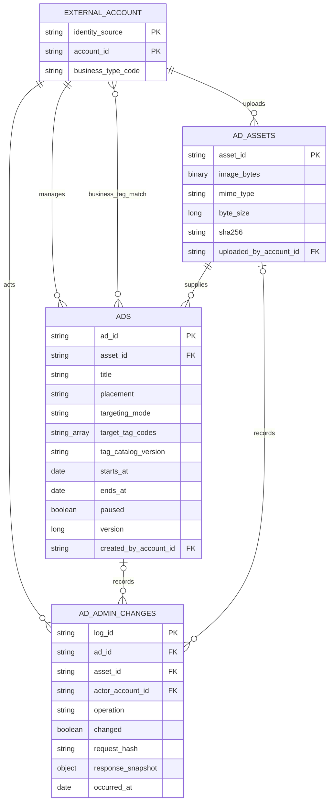

# 3차 광고 관리 간소화 인수인계서

- 작성일: 2026-10-14
- 수정일: 2026-10-14
- 인수인계 버전: `phase3-ads-handoff-20261014.3`
- 광고 데이터 계약 버전: `phase3-ads-data-20261014.3`
- 추가 결정: 매장 유형은 카페·술집·학원/독서실·기타매장입니다. 첫 단계는 관리자 태그 설정, 다음 단계는 사용자 업종과 공개 광고 매칭입니다.
- 담당: B 광고 관리 API·화면·통합, C 공통 로그인·공개 배너, INF 실행·접속, PL 운영 정책
- 전달 형태: 기존 기획 문서와 분리한 Markdown 파일입니다. 저장소 문서 반영과 GitHub 업로드는 별도입니다.
- 상태: 설계·개발 인수인계 기준입니다. 서버·DB·화면 구현 완료를 의미하지 않습니다.

광고 관리 기능은 `ads`, `ad_assets`, `ad_admin_changes` 세 컬렉션으로 먼저 구현합니다. 광고에는 대상 매장 업종을 태그로 설정하며, 사용자 업종은 공유 환경에서 참조해 다음 공개 연결 단계에 매칭합니다. 관리자 인증은 다른 환경의 공통 사용자 데이터를 참조하고, 광고 정보와 이미지 원본은 광고 전용 MongoDB에 저장합니다. 측정·토큰 산출은 다음 단계에서 연결하며, 관리자 사용량 화면은 주기 집계를 사용합니다.

이 문서는 이전 광고 MongoDB 확장 ERD의 첫 구현 범위를 대체합니다. 다음 단계의 상세 컬렉션을 지금 모두 생성하지 않습니다. 적용 광고 단가·중복 규정은 `phase3-ads-20261014.1`, 공통 API 형식은 `phase3-20261014.1`을 유지합니다.

## 1. 구현 단계와 완료 범위

| 단계 | 구현할 결과 | 완료 판정 |
|---|---|---|
| 지금: 광고 관리 | 공통 ADMIN 연결, 이미지 업로드·조회, 대상 업종 태그 설정, 광고 등록·수정·예약/게시/종료 판정·중단, 목록·필터·미리보기 | 저장·태그 검증·권한·동시 수정·재전송·재시작 후 유지가 검증된 관리 기능 |
| 다음: 공개 제공·측정 | C의 사용자 업종 수집/공유 연결과 공개 배너, 업종 태그 매칭·위치별 선정/동률 순환·delivery, 중단3초 반영, 노출·클릭 인정·중복 방지 | 실제 사용자 업종 문맥·브라우저·공유 guest·API를 연결한 제공/측정 검증 |
| 다음: 토큰·통계·예산 | 인정 이벤트의 예상 토큰 기록, 주기 집계·오늘/누적 표시, 예산 제공 제어 | 재집계 정확성·지연 도착·예산 판정·복구 검증 |

세 컬렉션은 첫 관리 단계의 구조입니다. 이것만으로 AD-04·AD-05·AD-06 전체 또는 3차 광고 기능 전체를 완료 처리하지 않습니다. 기존 태스크 ID와 직접 선행 조건을 유지하고, 다음 단계 기능도 3차 필수 범위에 남깁니다.

## 2. 확정된 환경과 공유 사용자 계약

- 광고는 별도 AWS 프라이빗 서브넷에 배치할 독립 API와 광고 전용 MongoDB를 사용합니다.
- MongoDB에는 광고 정보와 이미지 원본을 모두 저장합니다. 서브넷·서버 주소·포트·배치·백업은 INF 인계로 확인합니다.
- 사용자·관리자·계정·권한·세션·guest의 원본은 공통 환경에 둡니다. 광고 DB에는 서버가 검증한 외부 ID만 참조합니다.
- 비밀번호/해시·이메일·프로필·로그인 세션·guest 접근 토큰을 광고 DB에 복제하지 않습니다.
- 관리자 API는 매 요청의 현재 활성 ADMIN·광고 권한을 검사합니다. 브라우저가 보낸 account/owner/role이나 임의 identity 헤더를 권한 근거로 사용하지 않습니다.
- 외부 인증 실패·만료·권한 회수 시 관리 요청을 허용하지 않습니다. 정확한 서버 간 검증 방식·쿠키/Origin/CSRF·장애 응답은 공통 담당과 연결합니다.

`account_id`는 외부 원문 문자열을 유지하고 `identity_source`와 함께 참조합니다. 아래 ERD의 외부 계정은 공유 환경 경계이며 실제 `users` 컬렉션을 생성하지 않습니다. MongoDB FK 또는 사용자 원본 DB와의 교차 트랜잭션을 가정하지 않습니다.

### 2.1. 공유 매장 업종과 태그 목록

사용자가 정한 네 가지 유형을 관리자 광고 태그 선택지로 사용합니다. `학원/독서실`은 하나의 분류이며 `기타매장`은 명시적으로 선택한 유효 업종입니다. 업종 미입력/조회 실패를 기타매장으로 바꾸지 않습니다.

| 사용자 확정 표시명 | 광고 연결용 표준 코드 제안 |
|---|---|
| 카페 | `CAFE` |
| 술집 | `BAR` |
| 학원/독서실 | `ACADEMY_STUDY_ROOM` |
| 기타매장 | `OTHER_STORE` |

표시명과 단계 구분은 사용자 결정입니다. 영문 코드는 광고 연결 모델의 제안이며 공통 사용자 환경의 실제 필드명·저장 코드가 확인됐다는 의미는 아닙니다. 실제 원본 코드가 다르면 검증된 매핑 어댑터를 사용하고 원본 데이터를 임의 수정하지 않습니다. 초기 태그 사전은 서버 설정으로 관리하여 별도 태그/업종 컬렉션을 추가하지 않습니다. 사전 버전 제안은 `phase3-business-types-20261014.1`입니다.

공유 환경으로부터 받은 업종은 연결 모델의 nullable `business_type_code`와 사전 버전으로 정규화합니다. 로그인 사용자라면 현재 인증된 본인의 공유 매장 정보를 조회하며, 임의 account_id로 다른 사람의 업종을 조회하지 않습니다. 공유 원본에 유형 입력이 없다면 공통 사용자 담당/C가 수집·저장 경로를 마련하고 B가 읽기 계약을 연결합니다. 비로그인 명시 선택값을 지원할 때도 네 분류와 버전을 검증한 광고용 문맥으로 구분합니다.

광고 DB에 사용자 프로필·매장 유형 원본·사용자별 광고 매칭 목록을 복제하지 않습니다. 기본 음악 추천의 필수 입력을 추가하는 변경으로 확대하지 않으며 업종 없음에도 공개 기능을 이용할 수 있습니다. 공통 사용자 업종의 입력 위치·실제 필드/코드·단일/복수 매장 처리와 전달 방식은 담당자 인계 사항입니다.

## 3. 첫 단계 ERD

그림은 핵심 필드만 표시하며 전체 저장 필드는4절을 따릅니다. FK는 서비스가 확인하는 논리 참조이며 MongoDB 자동 외래키 강제를 뜻하지 않습니다. `business_type_code`는 공유 원본의 실제 컬럼명이 아니라 정규화된 읽기 문맥입니다. `business_tag_match`는 다음 단계의 계산 관계이며 사용자별 매칭 테이블을 저장하지 않습니다.

광고 한 건은 top 또는 bottom 한 위치입니다. 같은 이미지를 양쪽에 사용하면 두 광고를 만들고 일정·중단·예산·지표를 각각 관리합니다. 업로드 결과 로그는 아직 광고가 없으므로 `ad_id=null`, `asset_id` 필수입니다. 광고 생성·수정·중단 로그는 `ad_id` 필수이고 당시 asset 참조를 남깁니다.

## 4. 데이터 표준

| 항목 | 계약 |
|---|---|
| 이름·문자 | UTF-8·snake_case |
| 내부 ID | 서버 생성 불투명 문자열; 업무 ID를 MongoDB `_id`로 저장 |
| 외부 ID | 원문 string과 identity_source; 외부 ObjectId 강제 변환 금지 |
| 시간 | 저장은 UTC BSON Date, API는 UTC ISO 8601 Z, 화면 입력·표시는 KST |
| 기간 | starts_at < ends_at, 시작 포함·종료 미포함 |
| 정수 | version·priority·byte_size·토큰은 strict integer; bool/문자열/소수 강제 변환 금지 |
| 이미지 | 정적 WebP/JPEG/PNG, 최대2,000,000bytes, 실제 형식·디코딩 검사 |
| 요청 추적 | 공통 X-Request-ID·오류 request_id, 비밀 토큰 저장 금지 |
| 운영/테스트 | 서버가 결정한 is_test와 DB namespace 분리; 요청 body로 운영 전환 금지 |

모든 문서에 `schema_version`, `is_test`, `created_at`을 두고 현재 광고 상태에는 `updated_at`을 둡니다. `schema_version`은 이 문서의 광고 데이터 계약 버전으로 저장합니다. 광고 정책 version, 수정 version, 데이터 schema_version은 구분합니다.

### 4.1. ads

| 필드 | 타입·규칙 |
|---|---|
| `_id` (ad_id) | string·필수 |
| `title`, `link_url` | string·필수; 링크는 호스트가 있는 절대 HTTPS URL |
| `asset_id`, `creative_version` | string·필수; 검증된 이미지 참조와 표시 내용 버전 |
| `placement` | top/bottom·필수 |
| `targeting_mode` | ALL/TAGGED·필수; 전체 대상과 업종 태그 대상 구분 |
| `target_tag_codes` | string 배열·필수; ALL은빈배열, TAGGED는유효업종코드1개이상 |
| `tag_catalog_version` | TAGGED이면string필수, ALL이면null; 적용 태그 목록의 버전 |
| `targeting_policy_version` | string·필수; 매칭 규칙 버전 제안 `phase3-ads-targeting-20261014.1` |
| `starts_at`, `ends_at` | Date·필수 |
| `priority`, `version` | integer·필수; 수정 version은 양수 |
| `paused`, `stopped_at` | boolean·필수 / Date·nullable |
| `created_by_account_id`, `updated_by_account_id`, `identity_source` | 검증된 외부 관리자 참조 |

상태는 별도 테이블 없이 조회 시 계산합니다. paused이면 STOPPED, 그 밖에는 현재 시각에 따라 RESERVED/ACTIVE/ENDED입니다. 스케줄러가 늦더라도 종료 광고를 ACTIVE로 취급하지 않습니다. 단순 수정·저장은 paused를 해제하지 않으며 재개 방식은 미정으로 유지합니다. 예산·누적 카운터를 첫 단계에 가짜 초기값으로 채우지 않습니다.

### 4.2. ad_assets

| 필드 | 타입·규칙 |
|---|---|
| `_id` (asset_id), `image_bytes` | string / Binary·필수; 원본 이미지 보존 |
| `mime_type`, `byte_size`, `width`, `height` | 실제 디코딩 결과와 양수 byte/pixel 정보 |
| `sha256` | 원본 바이트 SHA-256 hex; 자동 광고 병합/멱등키 대체에 사용하지 않음 |
| `uploaded_by_account_id`, `identity_source` | 검증된 업로드 관리자 참조 |

이미지별 단일 Binary 문서를 저장하고 BSON 전체 문서 크기도 검사합니다. 이미지 교체는 새 asset을 만들며 기존 바이트를 덮어쓰지 않습니다. 목록 JSON에는 원본 바이트를 포함하지 않고 별도 조회 경계로 제공합니다. 업로드만 된 이미지는 자동 공개하지 않습니다. 파일명은 식별키로 사용하지 않습니다.

### 4.3. ad_admin_changes

이 컬렉션에 관리 변경 이력과 성공 요청의 멱등 응답을 함께 보존하여 별도 revision·멱등 요청 컬렉션을 만들지 않습니다.

| 필드 | 타입·규칙 |
|---|---|
| `_id` (log_id), `operation` | string / UPLOAD_ASSET·CREATE·UPDATE·STOP |
| `ad_id`, `asset_id` | 작업별 nullable 참조; 위 ERD의 조건 적용 |
| `identity_source`, `actor_account_id` | 공통 환경에서 검증한 관리자 |
| `resource_scope`, `idempotency_key_hash`, `request_hash` | 대상·멱등 키 hash·정규 본문 hash |
| `changed`, `version_before`, `version_after` | 실제 변경 여부·이전/이후 광고 version; 업로드 version은null |
| `before_snapshot`, `after_snapshot`, `reason` | 당시 광고 설정 또는 업로드 메타데이터·변경 이유; 이미지 바이트/비밀값 제외 |
| `response_snapshot`, `completed_at`, `occurred_at` | 최초 성공 HTTP 상태/본문·완료/변경 시각 |
| `retention_due_at` | 감사와 멱등 자료의 보관 의무가 모두 끝나는 문서 정리 시각; 요청 결과 보관은 인계 정책 적용 |

실제 변경은 `changed=true`입니다. 이미 중단된 광고를 같은 상태로 저장하는 등 무변경 요청은 version과 변경 건수를 증가시키지 않으며, `changed=false` 요청 결과로 재전송 응답만 보존합니다. 등록/수정/중단의 before/after snapshot에는 title·asset·creative_version·URL·위치·기간·우선순위·paused·stopped_at·version에 더해 targeting_mode·target_tag_codes·tag_catalog_version·targeting_policy_version을 남깁니다. 업로드 결과에는 asset의 MIME·크기·해시·ID를 남깁니다.

`resource_scope`는 생성 시 `ads:create`, 업로드 시 `assets:upload`, 기존 광고 수정/중단 시 해당 ad_id로 고정합니다. 생성 전에 매번 새로운 결과 ID를 멱등 범위로 쓰지 않습니다. `reason`은 서버의 작업 사유와 기존 허용 입력으로 기록하며 새로운 필수 화면 입력을 추가하지 않습니다.

### 4.4. 최소 인덱스

| 컬렉션 | 인덱스·제약 |
|---|---|
| ads | `_id` UNIQUE; `(placement,paused,priority,starts_at,ends_at)` 후보 조회; `(updated_at,_id)` 목록 |
| ad_assets | `_id` UNIQUE; sha256 비유일 진단 인덱스는 필요 시 추가 |
| ad_admin_changes | `_id` UNIQUE; `(ad_id,occurred_at)` 감사 조회; UNIQUE `(identity_source,actor_account_id,operation,resource_scope,idempotency_key_hash)` |

관리 등록·수정·중단·업로드는 Idempotency-Key를 사용합니다. hash는 허용 본문의 정규 JSON, 업로드는 원본 바이트 hash와 허용 메타데이터로 계산합니다. 동일 파일을 다른 광고에 재사용하는 것과 동일 요청을 재전송하는 것을 구분합니다.

### 4.5. 업종 태그 저장과 공개 매칭 기준

첫 단계의 관리자 입력은 `전체 대상` 또는 `업종 태그 대상`입니다. 업종 태그 대상은 네 가지 선택지 중 하나 이상을 복수 선택합니다. 태그 코드는 중복 제거·정규 정렬해 저장하며 자유 문자열을 업종 코드로 인정하지 않습니다.

- ALL은 target_tag_codes=[]와 tag_catalog_version=null입니다.
- TAGGED는 등록된 코드1개 이상과 현재 사전 버전이 필요합니다. 태그를 모두 지운 채 저장하면 오류이며 자동으로 전체 대상이 되지 않습니다.
- 모드 누락·형태/빈 TAGGED 입력은422, 미등록 코드는공통 OPTION_INVALID/400, 사전 버전 불일치는OPTIONS_CHANGED/409로 처리하는 개발 기준입니다. 버전이 다른 코드를 추측해 바꾸거나 전체 대상으로 저장하지 않습니다.
- 태그 변경도 version 비교·멱등 처리·변경 이력을 적용합니다. 기존 로그의 당시 태그는 새 코드/명칭으로 덮어쓰지 않습니다.

다음 단계의 공개 매칭은 아래 개발 기준으로 연결합니다. 매장 업종에서 관심 가능 광고를 선별하는 규칙이며 클릭 이력 학습이나 개인별 점수를 추가하지 않습니다.

1. 현재 위치·일정·중단·예산 제공 조건을 충족한 광고를 먼저 검사합니다.
2. 사용자 정규 업종과 광고의 사전 버전이 같거나 검증된 호환 매핑이 있을 때만, business_type_code가 TAGGED 광고의 target_tag_codes 중 하나와 같은지 OR 매칭합니다. 지원하지 않는 버전의 TAGGED 후보는 제외하고 ALL fallback을 적용합니다. 카페/술집 두 태그는 두 유형 모두를 동시에 운영해야 한다는 뜻이 아닙니다.
3. 일치하는 업종 광고가 있으면 그 후보 안에서 기존 priority와 동률 순환을 적용합니다. 일치 광고가 없으면 ALL 광고만 후보로 사용합니다. 업종 광고와 일반 광고의 세부 우선순위는 이 개발 기준을 기획자와 대조합니다.
4. 업종 미입력·미등록/변환 불가·공유 조회 실패이면 ALL만 사용합니다. ALL도 없으면 ad=null입니다. 다른 업종 광고를 임의로 선택하지 않습니다.
5. 공개 응답에는 사용자 account/guest ID·프로필·원본 업종을 담지 않습니다. 캐시를 사용한다면 위치뿐 아니라 정규 업종/태그 사전·매칭 정책 버전도 구분합니다. 태그 수정 성공 시 후보 캐시를 즉시 무효화하고 신규 제공 직전에 최신 대상 태그를 다시 확인합니다. 기존 delivery의 수정 후 처리 규칙은 공개 연결 단계의 계약으로 대조합니다.

예시: CAFE 사용자에게 CAFE/ACADEMY_STUDY_ROOM 태그 광고는 일치하고 BAR 전용 광고는 제외합니다. OTHER_STORE 광고는 기타매장 사용자에게만 일치하며 전체 대상 광고를 뜻하지 않습니다. 네 표시명 이외의 영문 값은 연결 코드 예시로 이해합니다.

## 5. API와 관리자 화면 인계

| 경계 | 지금 구현할 내용 |
|---|---|
| 공통 `/api/auth/login`, `/me`, `/logout` | 공통 서비스 연결; 광고 DB에 로그인·계정 마스터 재구현 없음 |
| POST `/api/admin/ad-assets` | 이미지 검사·저장·재전송 시 원래 asset 응답 |
| GET `/api/admin/ad-target-tags` (추가 제안) | 네 업종의 code/label·사전 버전 읽기; 서버 설정을 사용하며 별도 컬렉션 없음 |
| POST `/api/admin/ads` | 한 위치·대상모드/태그 광고 등록·snapshot/로그·성공 응답 |
| GET `/api/admin/ads` | 위치/상태/대상태그 목록과 서버 계산 상태 |
| PUT `/api/admin/ads/{id}` | version 조건 수정·이미지/대상태그 변경·paused 유지 |
| POST `/api/admin/ads/{id}/stop` | 멱등 중단·변경 이력 |
| POST `/api/admin/ads/preview` | PC/모바일 미리보기; 운영 delivery/측정 생성 없음 |
| GET `/api/admin/ads/summary` | 게시 중/예약 수는 실제 계산; 측정 수치는 다음 단계 연결 상태를 표시 |
| 이미지 조회 경계 | 인증된 미리보기·게시 자격을 구분하여 Binary 제공; 실제 URL은 C/INF와 연결 |

화면은 목록·위치/상태/업종태그 필터·등록/수정 폼·전체/태그 대상 선택·네 업종(카페, 술집, 학원/독서실, 기타매장)의 복수 태그·이미지 업로드·기간/우선순위·저장/중단·PC/모바일 미리보기를 제공합니다. 미리보기에서 모의 업종별 일치/불일치를 확인할 수 있으나 실제 사용자 조회·운영 delivery·노출/토큰을 만들지 않습니다. 게시 중/예약 수는 실제 데이터로 표시합니다. 아직 연결하지 않은 오늘 노출·클릭·토큰은 **연동 대기**로 표시하며0이나 가상 통계를 운영 실측값처럼 보여주지 않습니다. 관리자 로그아웃은 광고 중단이 아닙니다.

공개 `/api/ads`, `/api/ad-events`의 운영 연결, 사용자 업종 태그 매칭·같은 우선순위 순환, delivery/공유 guest 결합과 실제 화면3초 중단 검증은 다음 단계로 인계합니다. 기존 저장소 API 경로는 유지하고 태그 목록 읽기 경계는 이번 요구의 추가 제안으로 구분합니다. 이번 사용자 결정으로 업종 태그 광고를 포함하며 재개 버튼·모바일 필수 이미지는 기존 범위를 유지합니다.

## 6. 저장과 동시성

1. 현재 공통 ADMIN·광고 권한·Origin/CSRF를 확인합니다.
2. 입력·이미지·대상모드/업종코드·사전버전·일정·URL·멱등키를 검사합니다. 동일 성공 요청이면 원래 응답을 반환하고 다른 본문이면409입니다.
3. 새 수정 요청은 기존 version을 비교합니다. 오래된 화면의 수정은409로 알리고 최신 값을 다시 읽게 합니다.
4. ads 또는 asset의 변경과 ad_admin_changes 성공 결과를 같은 트랜잭션으로 커밋합니다. 응답 유실 후 재전송에도 광고/파일이 추가 생성되지 않아야 합니다.
5. 실패 시 일부만 저장하지 않습니다. 외부 인증 통신은 MongoDB 트랜잭션 밖에서 처리합니다.

세 컬렉션으로 줄여도 DB 상태와 변경 이력의 정확성은 유지합니다. 여러 문서 트랜잭션을 지원하는 MongoDB replica set 등 배포 구성을 INF와 확인합니다. 단독 standalone 설치를 원자 저장 검증 완료로 취급하지 않습니다.

## 7. 다음 단계의 토큰 산출과 주기 집계

| 항목 | 유지할 계약 |
|---|---|
| 단가 | top 인정 노출8, bottom5, 인정 클릭 추가15토큰 |
| 예시 | top 노출+클릭23, bottom20, 노출 전 클릭15 |
| 노출 인정 | 이미지 로딩 완료·활성 탭·면적50% 이상·연속1초 |
| 중복 | delivery별 노출/클릭 각각1회, 같은 guest/ad/위치의 새 인정은 노출60초·클릭300초 |
| 지연 | 발생 후300초까지 검사, 통계일은 검증된 발생일KST |
| 첫 산출 | 실제 잔액 차감 없이 ESTIMATE 예상 사용량 |

태그 매칭 여부로 노출/클릭 단가를 바꾸지 않습니다. 다음 delivery에는 판정 근거로 적용 광고 대상태그·사전/매칭 정책 버전·최소한의 당시 업종 코드만 필요한 범위에서 보존합니다. 이는 사용자 프로필 원본 복제와 구분하며 세부 필드/보관은 공유 사용자 계약과 대조합니다. 사용자 업종·광고 태그가 바뀌어도 과거 매칭·토큰을 현재 값으로 재계산하지 않습니다.

실시간 대시보드를 만들지 않습니다. 이벤트 발생 시 필요한 최초 판정·중복 방지·당시 단가/정책·발생/수신/인정 시각은 정확하게 기록하고, 관리자 오늘/누적 수치는 인정된 기록을 바탕으로 정해진 주기에 집계합니다. 주기 집계와 수집 정확성을 구분합니다. 현재 단가를 과거 기록에 다시 적용하지 않습니다.

후속 측정 단계의 최초 예상 토큰 항목은 인정 판정과 함께 원자적으로 저장합니다. 배치는 이미 확정한 항목의 합계를 갱신하며, 다시 산출하거나 중복 항목을 생성하지 않습니다.

물리 구조는 다음 단계에서 `ad_deliveries`, `ad_events`, `ad_token_ledger` 등 필요한 기록을 추가 검토합니다. 미리 일별 집계·정책·예산 상태·반복 guard를 모두 독립 컬렉션으로 만들지는 않습니다. 이 최소 확장 후보만으로 모든 동시성·순환을 해결했다고 가정하지 않으며 실제 규모와 검증 결과로 보조 저장 구조를 정합니다.

배치는 원본 event/원장 ID와 집계 범위·기준시각을 고정해 재실행 시 같은 금액을 다시 더하지 않도록 합니다. 정한 범위를 다시 계산해 교체하거나 처리 완료 원본을 정확히 추적하고, 5분 지연 도착의 발생일 집계를 정정합니다. 화면에는 집계 기준시각을 표시합니다. 전체 누적값은365일 자료 정리 때문에 감소하지 않도록 누적 보존·백업/복구 방식을 다음 단계에서 정합니다.

공유 guest는 서버 검증 문맥을 사용하며, delivery 발급 때의 guest 결합을 다른 문맥으로 바꾸지 않습니다. 문맥 없음/만료/불일치에는 운영 산출을 하지 않고 표시·링크 이동의 가용성을 유지합니다. 테스트·미리보기는 운영 통계/토큰에서 제외합니다.

### 예산 제공 제어

기존의 광고별 일일·전체 예산과 **소진 시 신규 제공 중단** 규정은 유지합니다. 관리자 표시를 주기 집계로 바꾸는 것이 예산 규정의 자동 변경은 아닙니다. 배치 결과로만 예산을 판단하면 판정까지 추가 제공이 발생할 수 있습니다.

PL·B가 예산값·일일 경계·집계 주기·허용 판정 지연/초과를 정해야 합니다. 엄격한 즉시 중단이 필요하면 제공 경로에서 최신 사용량 검사가 필요하고, 지연을 허용하는 예산 제어는 명시한 허용 기준으로 검증합니다. 이 결정 전에는 fixture 예산으로만 시험하며 실시간 상한 보장·무제한 예산을 주장하지 않습니다. 실제 차감·구매·환불은 후속 별도 범위입니다.

## 8. 보관과 오류 기준

- 실제 광고 관리 변경 이력은 변경 발생시각부터365일입니다. 무변경 요청 결과와 멱등키 재사용/보관 기간은 별도 인계값으로 둡니다.
- 한 문서가 감사와 요청 결과를 겸하면 양쪽 보관 의무가 끝난 뒤 삭제합니다. 응답만 먼저 만료할 때는 감사 근거를 남기고 응답 필드만 정리하며, 멱등키 재사용/유일 인덱스 처리는 합의한 기간에 맞춰 함께 정합니다.
- 이미지·미사용 asset·백업의 정리 기간은 미정입니다. 공유하는 광고와 과거 이력에 필요한 참조를 확인하고 정리합니다.
- 외부 계정 회수·guest 만료가 광고 감사 기록을 연쇄 삭제하지 않습니다. 개인정보 삭제 통지와 외부 ID 조정은 공통 환경과 합의합니다.
- 다음 단계 원본 이벤트/delivery는90일, 집계/예상 원장은365일입니다. 원장에 당시 근거를 자체 보존하고, TTL만으로 참조 보호를 대신하지 않습니다.
- 인증 없음/만료401, 권한 부족403, 형식 오류422, 멱등/수정 충돌409의 공통 형식을 사용합니다. 인증 서비스 장애를 권한 부족과 혼동하지 않습니다.

## 9. 첫 단계 검수와 인수인계

| 검수 항목 | 기대 결과 |
|---|---|
| 공통 ADMIN 정상/만료/권한 제거 | 허용된 관리자만 조회/변경; 광고 DB 사용자 복제 없음 |
| 이미지2,000,000/2,000,001bytes·가짜 확장자 | 실제 형식 검사 후 전자 허용·후자/무효 형식 거부 |
| 동일 키로 업로드·등록 재전송 | 최초 asset/ad 응답, 추가 파일·광고 없음 |
| 동일 키의 다른 본문 |409, 기존 저장 보존 |
| ALL·TAGGED 저장 / TAGGED 빈배열 | 전체대상·유효업종태그 저장 / 422, 자동 ALL 전환 없음 |
| 네 업종 복수 선택·중복코드 / 미등록코드·사전불일치 | 정규 집합으로저장 / 오류, 기존태그 보존 |
| 태그만 수정·동시 변경·재전송 | version/감사snapshot/멱등 응답일치, 당시태그 이력 보존 |
| 카페·술집·학원/독서실·기타매장 모의 미리보기 | 각업종의일치/불일치 확인, 실제사용자/운영측정 없음 |
| 예약·게시·종료·중단 | 서버 시간과 paused로 일관된 상태 |
| 중단 후 단순 수정·로그아웃 | 중단 유지; 로그아웃으로 게시 상태 변경 없음 |
| 두 관리자가 오래된 version으로 동시 수정 | 한 변경만 성공, 다른 요청409 |
| DB 실패·재시작·응답 유실 | 상태/이력 부분 저장 없음, 저장 데이터 유지·한번반영 |
| PC/모바일 미리보기 | 원본 이미지 확인, 운영 노출·토큰 생성 없음 |
| 측정 미연결 화면 | 연동 대기 표시, 가상0/실시간 사용량 표시 없음 |

다음 공개 매칭 단계에서는 복수 OR·비일치 제외·ALL fallback·업종없음/외부조회실패·OTHER_STORE와미입력구분·사전버전변경·업종별캐시격리·공개ID비노출을 추가 검수합니다. 사용자 업종 수집/공유 조회와 공개 광고 선정은 첫 단계 관리 태그 설정 완료만으로 검증 완료 처리하지 않습니다.

인계 결과에는 API 요청/응답 예시, 실행 설정 이름, 실제 검수 입력·기대/결과, 오류·미해결, 이미지 조회/인증 연결 방법을 남깁니다. DB URI·비밀번호·사용자 토큰은 문서에 기재하지 않습니다.

| 담당 | 다음에 받을 내용 |
|---|---|
| INF | 프라이빗 배치·MongoDB 연결/트랜잭션 지원·자원/버전·라우팅·백업/복구 |
| 공통 사용자·인증/B | 업종 실제필드·코드/매핑·입력/조회경로·단일/복수매장 문맥, 검증 endpoint/전달 방식·외부 ID·현재 권한/회수·쿠키/Origin·장애/삭제 통지 |
| C | 공통 로그인/업종선택·공통 스타일·이미지 제공 URL·다음 단계 업종매칭 공개 배너/측정 |
| PL·B | 네업종 표시명·코드/사전버전·매칭우선/fallback 검토, 예산값·일일 경계·주기 집계/판정 지연·재개·이미지/요청 결과 보관 |

관련 태스크는 I-03·I-05의 공통 연결과 AD-02·AD-03 관리 경로부터 진행합니다. AD-01 정책과 각 직접 선행 결과를 확인하며 AD-04·AD-05·AD-06 완료는 후속 연결·검증 뒤 기록합니다.

## 10. 기준 자료

기준 자료는 저장소 커밋 `712820c`의 광고 운영 규정6절·공통 개발 계약·구현 설계도7/9절·실행 태스크입니다. 이번 사용자 결정은 이 별도 인수인계서에 적용했으며, 메인 기획 문서와의 병합은 수행하지 않습니다.

이전 원본의 광고 타기팅 제외·매장 타입 기본 입력 제외 문구와 이번 업종 태그 요구의 차이는 기획자에게 인계합니다. 최신 사용자 결정에 따라 이 문서는 광고용 업종 태그를 포함하고 기본 음악 추천의 필수 입력은 유지합니다. 저장소 원본은 직접 수정하거나 GitHub에 업로드하지 않습니다.

- [광고 운영 규정](https://github.com/encore-ai-campus/mlo-01-p3-team1/blob/712820c5c78282ba03b613700d52c5ea8a0a2981/docs/product/3%EC%B0%A8_%EA%B4%91%EA%B3%A0_%EC%9A%B4%EC%98%81_%ED%9A%8C%EC%9D%98_%EA%B2%B0%EC%A0%95%EC%82%AC%ED%95%AD_%EB%AA%A9%EB%A1%9D.md)
- [공통 개발 계약](https://github.com/encore-ai-campus/mlo-01-p3-team1/blob/712820c5c78282ba03b613700d52c5ea8a0a2981/docs/product/3%EC%B0%A8_%EA%B3%B5%ED%86%B5_%EA%B0%9C%EB%B0%9C_%EA%B3%84%EC%95%BD%EA%B3%BC_%EA%B2%80%EC%A6%9D_%EA%B8%B0%EC%A4%80.md)
- [MongoDB 원자성·트랜잭션](https://www.mongodb.com/docs/manual/core/write-operations-atomicity/)
