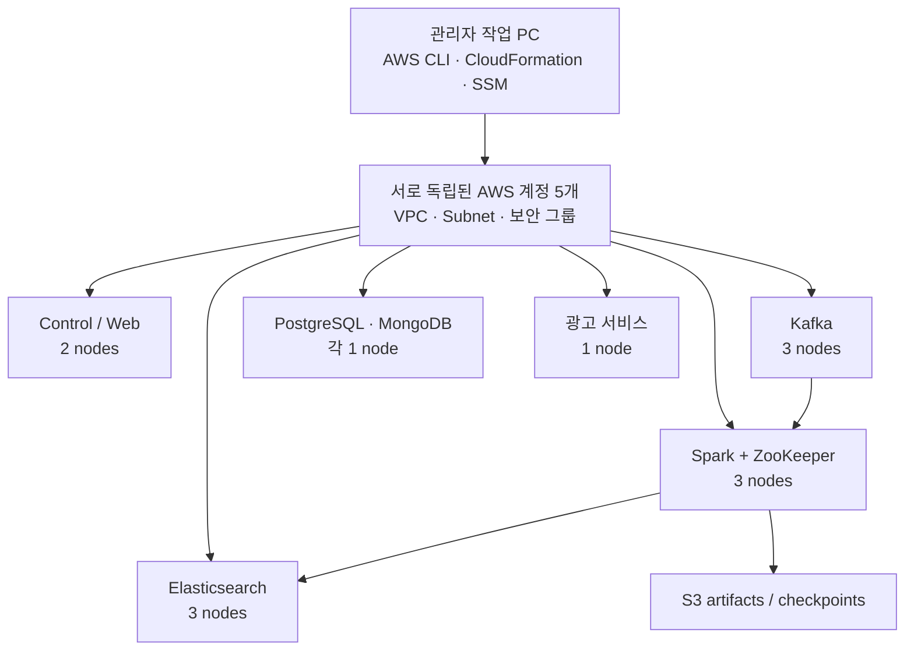

# AWS 멀티계정 인프라 자동화 구축 계획서 (Public)

> **공개용 설계 문서** · 작성 기준: 2026-10-14 · 프로젝트 코드 기준: `0.3.18` · 수정일: 2026-10-15
> 이 문서는 프로젝트의 **설계와 자동화 접근 방식**을 공유하기 위한 문서입니다. 실제 계정별 네트워크 주소, 노드별 IP 매핑, 권한 정책의 신뢰 대상, 인증서 식별자, 비밀값 및 운영 상태 파일은 포함하지 않습니다. 아래 명령 예시는 **운영 승인이나 배포 완료를 의미하지 않습니다.**

## 1. 프로젝트 목표 및 진행 상태

독립된 AWS 계정 5개에 분산된 개발·테스트 인프라를 **AWS CLI, CloudFormation, AWS Systems Manager(SSM)**로 생성·검증·삭제·재생성할 수 있는 관리 체계를 구축한다.

주요 목표는 다음과 같다.

- **재현 가능한 인프라**: 동일한 버전의 템플릿과 설정을 이용해 테스트 환경을 반복 구성한다.
- **비용 통제**: 테스트가 끝나면 필요 없는 워크로드 리소스를 정리하고 잔여 과금 항목을 확인한다.
- **운영 자동화**: EC2 생성과 클러스터 설치·상태 확인을 단계별로 자동화한다.
- **변경 이력 관리**: 공개 가능한 템플릿·스크립트는 Git으로 관리하고, 실제 계정 설정은 Git 제외 config, 실행 상태는 `.state/`, 비밀 payload는 `.private/`에서 관리한다.

**구현 단계:** 0.3.11까지는 지침 정합성·오프라인 준비·검증 이벤트 조회·중단 변경 세트 재개·encore1 ALB 계정 속성 읽기를 구현했다. 공개 문서의 과거 AWS 읽기 확인을 현재 배포 완료로 해석하지 않는다. 최신 조회·bootstrap 보완·생성 시도의 계정별 결과는 `.state/`에 보관하고 기반 설치·앱/HA 통합·삭제/재생성은 별도 단계로 검증한다. 이 문서는 운영 완료 보고서가 아니다.

0.3.12~0.3.14는 별도 Control fencing/관측 실행기·고정 AWS CLI 설치 지원과 정상 종료 대기180초를 제공한다. 별도 IAM/SSM·canary 설치/활성화·물리 중지·S3 승계/복구의 실제 결과는 비공개 영수증을 따른다. 업무 앱 HA와 감독 밖 writer 차단을 이 구현만으로 완료 처리하지 않는다.

0.3.15~0.3.16은 기존 classpath를 보존하는 Delta4.3.1/Spark4.1.3 고정9개 JAR addon·명시 설치기·격리 S3 시험을 제공한다. 서비스 사용자의 공개 JAR 접근과 비공개 runtime 권한을 분리하고 실제5대 설치/트랜잭션 결과는 `.state`에서 확인한다. 앱별 Delta 세션·단일 Driver 계약은 별도 인계한다.

## 2. 설계 범위

| 구분 | 설계 내용 |
|---|---|
| 리전 | AWS 서울 리전 (`ap-northeast-2`) |
| 계정 및 네트워크 | 독립 AWS 계정 5개, 계정별 VPC 1개 |
| 가용 영역 | 3개 물리 AZ에 분산; 계정 간 AZ 이름 대신 AZ ID로 매핑 |
| 서버 | EC2 총 14대 (계획 수량) |
| EC2 / 스토리지 | T3 Standard, Linux On-Demand, 암호화 gp3 EBS |
| OS / 설치 방식 | Ubuntu 24.04 amd64, 직접 설치 및 `systemd` 운영 |
| 네트워크 | 계정별 NAT Gateway, S3 Gateway Endpoint, 필요한 VPC Peering |
| 진입점 | ALB 기본 DNS의 임시 HTTP, 접속 IP 제한; 추후 소유 도메인/ACM HTTPS |
| 데이터 저장 | PostgreSQL, MongoDB는 각각 EC2에 설치 |
| 스트리밍 | Kafka → Spark Structured Streaming → Elasticsearch, 조회·시각화 계층 연계 |
| 애플리케이션 | Control/웹, 데이터 수집·처리, 광고 서비스 구성 |
| 관리 방식 | 관리자 작업 PC → AWS CLI/STS AssumeRole → 계정별 CloudFormation; 서버 관리는 SSM |
| 체크포인트 | S3에 세대·쿼리 단위로 분리하며 단일 writer 원칙 적용 |

Docker Compose·Kubernetes 및 PostgreSQL의 RDS 전환은 현재 설계 범위에 포함하지 않는다. **전체 삭제 후 재생성**과 **일시 재시작·실패 재시도·개별 노드 교체**는 별개의 절차로 구분한다.

## 3. 논리 아키텍처 및 네트워크 분리

실제 계정과 노드의 일대일 대응, CIDR, 고정 IP, Peering 연결 대상은 공개하지 않는다. 다음은 시스템의 **논리적 구성**을 나타낸다.



실제 구축 계획에는 필요한 VPC 간 **직접 Peering 7쌍**과 양방향 라우팅이 포함된다. VPC Peering은 전이적 라우팅을 제공하지 않으므로 필요한 통신 관계를 개별적으로 검증한다. 내부 CIDR 및 각 Peering 연결 대상은 비공개 배포 설정에서 관리한다.

- 각 VPC에 3개 AZ의 public/private subnet을 설계한다.
- 애플리케이션 EC2는 private subnet에 배치하고 공인 IP를 직접 부여하지 않는다.
- 운영자 접근은 SSM을 우선 사용하고 외부 패키지 다운로드 경로는 NAT로 관리한다.
- NAT는 VPC당 1개로 비용을 절감하되 해당 AZ 장애 시 외부 연결 중단 위험을 수용한다.
- 클러스터 통신은 필요한 서비스 간 최소 보안 그룹 규칙으로 제한한다.

> **주소 표기 원칙:** 공개 문서에 실제 CIDR과 노드별 사설 IP를 기재하지 않는다. 템플릿 예시는 `<VPC_CIDR>`, `<PRIVATE_SUBNET_CIDR>`, `<NODE_PRIVATE_IP>`와 같은 자리표시자를 사용한다.

## 4. EC2 및 스토리지 용량 계획

아래 수치는 인프라 규모와 비용 산정에 사용한 **계획 사양**이다. 계정별 배치·고정 IP·AZ 슬롯 대응표는 제외했다.

| 서버 역할 | 대수 | 인스턴스 타입 | 메모리(대당) | Root EBS(대당) | Data EBS(대당) |
|---|---:|---|---:|---:|---:|
| Control / Web | 2 | `t3.large` | 8 GiB | 32 GiB | 20 GiB |
| PostgreSQL | 1 | `t3.small` | 2 GiB | 32 GiB | 20 GiB |
| Kafka Broker | 3 | `t3.medium` | 4 GiB | 32 GiB | 60 GiB |
| Spark / ZooKeeper | 3 | `t3.large` | 8 GiB | 32 GiB | 30 GiB |
| Elasticsearch | 3 | `t3.large` | 8 GiB | 32 GiB | 60 GiB |
| 광고 서비스 | 1 | `t3.small` | 2 GiB | 32 GiB | 16 GiB |
| MongoDB | 1 | `t3.medium` | 4 GiB | 32 GiB | 30 GiB |
| **합계** | **14** | | | **448 GiB** | **556 GiB** |

총 EBS 계획 용량은 **1,004 GiB**이며 모든 root/data 볼륨에 암호화 gp3를 사용한다.

운영 튜닝의 초기 가정은 Kafka JVM heap 1 GiB, Elasticsearch heap 4 GiB, Spark Worker 1 core/4 GiB다. 실제 성능·비용은 벤치마크 결과에 따라 다시 조정한다. T3 Standard는 CPU credit 소진 시 기본 성능으로 제한될 수 있다.

고정 사설 IP가 필요한 노드는 별도 ENI와 함께 관리한다. 실제 ENI/인스턴스 식별자는 배포 후 조회하며, 노드 교체 과정에서 중복 ENI 부착이나 인증서 SAN 불일치를 점검한다.

## 5. 네트워크·데이터·외부 접근

### 5.1 네트워크 연결

- 사설 연결: 필요한 AWS 계정 쌍 간 VPC Peering 및 왕복 Route Table 규칙을 구성한다.
- 서버 관리: SSM Session Manager 및 Run Command를 사용한다.
- 패키지 반입: private subnet의 서버에서 NAT를 통해 필요한 소프트웨어를 다운로드한다.
- 스토리지 접근: S3 Gateway Endpoint와 IAM 권한을 조합한다.
- 통신 제한: Kafka·ZooKeeper·Spark·Elasticsearch·DB·웹 계층은 서비스별 필수 포트만 허용한다.

구체적인 CIDR, 서버 주소, inbound 대상, 내부 RPC 포트 범위 및 보안 그룹 ID는 실제 환경 설정에 보관한다.

### 5.2 S3와 데이터 수명주기

계정별 설치 아티팩트용 S3 버킷과 스트리밍 체크포인트용 S3 버킷을 분리한다. 버킷은 공개 접근 차단, 암호화, 버전 관리 및 HTTPS 통신을 전제로 설계한다.

체크포인트는 `<environment>/<generation>/<query>/`와 같이 분리된 경로를 사용한다. **완전 초기화**는 새로운 generation으로 시작하고, **같은 실행 세대의 복구**는 기존 generation을 유지한다. 실제 Spark S3A 쓰기 및 단일 writer 동작은 아직 통합 검증 대상이다.

Kafka offset, Spark checkpoint, 피드백 중복 제거, JDBC 정합성은 서로 다른 책임으로 구분해 검증한다. 전체 테스트 환경을 삭제할 때는 이전 스트리밍 데이터 복구를 필수 요구사항으로 두지 않되, 운영 중 재시도 시 데이터가 임의로 초기화되지 않도록 한다.

### 5.3 외부 진입점

ALB를 2개 AZ의 public subnet에 배치한다. 우선 ALB 기본 DNS에서 HTTP로 접속하며 허용 클라이언트 CIDR을 제한한다. 이후 소유 도메인과 서울 ACM 인증서를 준비하면 같은 ALB를 HTTPS로 변경한다. 공개 HTTPS와 클러스터 내부 TLS 인증서는 별도로 관리한다.

[AWS 공식 문서](https://docs.aws.amazon.com/elasticloadbalancing/latest/application/load-balancer-troubleshooting.html)에 따라 AWS 소유 ALB 기본 DNS에는 ACM 공개 인증서를 발급할 수 없다. HTTPS 전환 후에는 인증서에 포함된 소유 도메인으로 접속한다.

허용 클라이언트 `/32` CIDR은 로컬 설정에 확정해 반영했고 공개 문서에는 실제 값을 싣지 않는다. health check `/health/`와 웹 백엔드 8000을 기본 규약으로 준비했다. 도메인/인증서는 HTTPS 단계에서 비공개 설정에 반영한다. **ALB target health**와 **Control 리더 승계**는 별도 항목으로 테스트한다.

## 6. 멀티계정 IAM 및 인증 설계

관리자는 자신의 AWS 로그인 기반 자격 증명과 **STS AssumeRole**을 사용해 다른 계정의 인프라를 관리한다. 팀원 계정의 장기 Access Key를 관리 PC나 Git 저장소에 모으지 않는 것이 설계 원칙이다.

| 논리적 권한 주체 | 책임 |
|---|---|
| 관리자 인증 주체 | MFA 기반 로그인 및 대상 계정의 허용된 역할 수임 |
| CloudFormation 실행 역할 | 해당 프로젝트 리소스 생성·수정·삭제 |
| EC2 실행 역할 | SSM 및 필요한 비공개 설치 아티팩트·체크포인트 접근 |
| 계정 간 Peering 승인 역할 | 승인 대상·권한 범위를 제한한 Peering 처리 |

- IAM은 최소 권한을 원칙으로 하며 필요할 때만 제한된 `iam:PassRole`을 허용한다.
- CloudFormation 실행 권한과 인스턴스 내부 런타임 권한을 분리한다.
- 실제 AWS 계정 ID, Role ARN, Trust Policy의 구체적인 Principal 및 권한 경계 정책은 공개 문서에 싣지 않는다.
- IAM 부트스트랩 리소스는 테스트 인프라를 삭제해도 별도 관리 대상으로 유지한다.

**검증 상태:** 2026-10-14 18:05 KST에 5계정 IAM bootstrap UPDATE_COMPLETE, 예상 리소스 속성·완료 상태·Outputs 및 읽기 접근을 확인했다. 전체 쓰기 권한과 모든 API 경로, 직접 IAM drift 여부의 실증은 별도 검증 대상이다.

## 지침과 앱 호스트 적용 범위

루트 AGENTS는 제품·팀 공통 계약, aws-infra/AGENTS는 AWS 설치·운영 자동화 기준이다. 제품 React/TypeScript/Vite·FastAPI 기준과 담당 배정을 유지한다. Control 양쪽 웹 호스트와 encore5 광고 호스트를 준비하되 업무 앱 소스·배포·migration·흐름은 팀원 책임이다. 과거 수령 원문의 Django/Gunicorn은 프레임워크 변경이나 업무 앱 설치 승인으로 해석하지 않는다.

ASGI 서버/버전·worker 수·systemd 실행 계약, 날씨 MongoDB writer/직접 연결·DB 권한, 앱 경로/작업자 배치와 Control fencing/connector/실제 S3 단일 writer는 [TEAM-HANDOFF](TEAM-HANDOFF.md)5절에 남긴다. 이 미정 사항으로 확정 14노드·7 Peering을 자동 변경하거나 앱 소스를 인프라 선행 조건으로 요구하지 않는다.

## 7. 설치 버전 및 고가용성(HA) 계획

아래 버전은 **2026-10-14 문서 기준 설치 코드의 목표 버전**이며, 실제 AWS 배포 완료를 뜻하지 않는다. 최종 설치 값은 저장소의 `installer/core/versions.json` 및 소스 체크섬 목록을 기준으로 확인한다.

| 구성 요소 | 계획 버전 또는 기준 |
|---|---|
| Ubuntu | 24.04 amd64 |
| Java | 21 |
| Python | 3.14.8 |
| Kafka | 4.1.2 |
| Spark / Hadoop | 4.1.3 / 3.4.2 |
| ZooKeeper | 3.9.4 |
| Elasticsearch | 8.19.23 |
| PostgreSQL / MongoDB | 16.15 / 8.0.34, client 버전과 패키지 SHA 고정 |
| 업무 앱 | 팀원이 소스·배포·연동을 담당 |

Kafka/Spark/ZooKeeper/Elasticsearch의 기존 Linux 설치, TLS 및 상태 확인 코드를 AWS 환경으로 이식하는 작업을 진행했다. Control 계층은 아직 환경 준비 단계이며 제품 기준 FastAPI 웹·Collector·Driver·스케줄러의 통합은 후속 작업이다. Spark와 Elasticsearch의 연동 방식도 실증이 필요하다.

Control HA에서는 ZooKeeper를 통한 리더 선출과 **단일 active Collector/Driver/스케줄러** 구성을 목표로 한다. 승계 시 기존 프로세스의 종료를 확인하는 fencing이 필요하며, 리더 선출 성공만으로 이중 실행 방지가 보장되지는 않는다. Spark Master HA와 Control/Driver HA는 분리해 검증한다.

## 8. 비용 산정과 리소스 수명주기

**96시간은 비용 추정을 위한 가정**이다. 96시간 연속 가동이나 자동 삭제 일정이 설정되어 있다는 의미는 아니다.

- 계획 규모: EC2 14대, NAT Gateway 5개, EBS 약 1,004 GiB 및 ALB 1개.
- 문서 작성 당시의 **96시간 기본 비용 추정은 약 USD 150.71**, 프로젝트 예산 목표는 **USD 200**이다.
- 이 값은 특정 시점의 계산 결과로, 실제 청구액이나 향후 가격을 보장하지 않는다.
- NAT 처리량, ALB LCU, S3 저장·요청, AZ 간/인터넷 데이터 전송, 추가 공인 IPv4, 로그, 세금 등은 추정에 별도로 반영해야 한다.
- EBS·NAT Gateway·ALB 등은 EC2가 중지되어도 비용이 발생할 수 있다.

**비용 최적화 원칙:** 개발 초반에는 필요에 따라 EC2를 중지해 작업 상태를 유지하고, 재현 가능한 설치·배포 자동화가 완성되면 테스트 종료 시 워크로드를 삭제하고 남은 과금 리소스를 점검한다. 단순 예산 검사로는 AWS 과금이 자동 차단되지 않는다.

## 9. 자동화 실행 흐름

작업 PC의 실행 스크립트는 CloudFormation API를 사용해 인프라를 생성한다. 소프트웨어 설치 단계에서는 아티팩트를 S3에 올린 뒤 SSM으로 대상 인스턴스에서 실행한다. 리소스 생성, SSM 온라인 확인, 실제 애플리케이션 정상 동작은 서로 다른 완료 기준이다.

다음은 **오프라인 준비와 AWS 읽기·사전 검사** 예시다. `readiness`로 로컬 준비를 확인한다. 실제 변경은 사용자가 명시한 실행 범위를 따르며, `preflight`는 별도의 AWS 읽기 검증이다. 과거 명령을 자동 재실행하지 않는다. `config/project.json`은 Git에서 제외하는 실제 환경 파일이며, 저장소에는 가상 값이 들어 있는 샘플만 공개한다.

```bash
cd aws-infra
./aws-project.sh --config config/project.json readiness
./aws-project.sh --config config/project.json plan
./aws-project.sh --config config/project.json preflight

# ALB를 제외한 코어 범위만 사전 검사할 경우
./aws-project.sh --config config/project.json preflight --without-alb
```

아래는 **변경 작업의 인터페이스를 보여주는 예시**이며 자동 실행하지 않는다. 생성·삭제에는 별도 승인과 대상 계정 확인이 필요하다.

```bash
# 명시적으로 승인한 뒤에만 인프라 생성
./aws-project.sh --config config/project.json create --execute

# 현재 프로젝트 리소스 조회
./aws-project.sh --config config/project.json status

# 삭제 확인 토큰은 공개 문서에 기재하지 않음
# ./aws-project.sh --config config/project.json destroy --confirm "$PROJECT_CONFIRMATION_TOKEN"
```

인프라 생성 이후 `setup --execute`는 14개 노드의 기반 서비스·DB·앱 호스트 디렉터리/TLS/DB 환경을 SSM으로 준비한다. `verify --execute`는 새로운 health/smoke 검사를 수행한다. 코드와 오프라인 검증을 준비했으며 실제 AWS 설치는 아직 실행하지 않았다. 업무 앱 소스는 기반 서비스 생성/설치의 선행 조건이 아니며 팀원이 배포한다.

ALB 후속 추가 또는 HTTP→HTTPS 변경은 **alb 설정만** 갱신한 후 `add-alb --execute`로 수행한다. 코어 설정·포트·설치 세대는 바꾸지 않는다. `create` 재실행으로 배포 범위가 자동 확대되지는 않는다. Control fencing 및 connector/checkpoint 통합은 별도 구현·검증 대상이다.

## 10. 구축·검증 절차

| 단계 | 수행 작업 | 완료 판단 |
|---|---|---|
| 1. 배포 준비 | 인프라/ALB 입력, 설치 버전, 권한 등 확정; 앱 소스는 팀원 담당 | 범위별 preflight 통과 |
| 2. 변경 사전 검토 | CloudFormation Change Set 및 교체·삭제 영향 확인 | 예상 리소스와 변경 범위가 일치 |
| 3. 인프라 생성 | Network → Storage → Peering/Route → EC2 → ALB | 스택 상태·리소스 목록·SSM 연결 확인 |
| 4. 기반 설치/앱 배포 | 인프라: DB·클러스터·앱 호스트/TLS/systemd 환경; 팀원: 업무 앱·migration·실행 | 기반 서비스와 업무 앱을 별도 검증; 앱 소스는 인프라 선행 조건 아님 |
| 5. 데이터 흐름 | Kafka 생산·소비, Spark 작업, Elasticsearch·DB·웹 연동 | 실제 입력부터 조회까지 성공 |
| 6. 장애/정합성 | HA, fencing, checkpoint, 중복 처리 및 재시도 | 이중 실행과 데이터 중복 여부 확인 |
| 7. 삭제/재생성 | 의존성 역순 정리, 잔여 점검, 새로운 세대 설치 | 잔여 리소스 확인 및 재구축 성공 |
| 8. 보고 | 적용 버전·검증 결과·이슈 기록 | 최종 인프라 구성 보고서 작성 |

CloudFormation Stack 완료가 Kafka/Spark/Elasticsearch의 정상 동작을 의미하지는 않으며, **서버·클러스터·데이터 파이프라인** 단계마다 별도로 검증한다.

## 11. 삭제·재생성 및 데이터 보호

삭제 자동화는 대상 프로젝트 소유권과 태그, 리소스 연결 관계를 먼저 확인하고 의존성 역순으로 수행하도록 설계한다.

1. 외부 트래픽 진입점 정리 및 active 서비스 종료 확인
2. 워크로드 EC2/EBS 정리
3. Peering 및 라우팅 정리
4. 프로젝트 전용 S3 데이터 정리(버전·삭제 마커·미완료 업로드 포함)
5. 네트워크 스택 정리
6. VPC, NAT, 공인 IPv4, ENI, EBS, S3 등 잔여 과금 리소스 확인

**보호 범위:** 프로젝트 외 AWS 데이터, 원본 음악 저장소, 기존 로컬 개발 VM 및 계정별 IAM 부트스트랩은 삭제 대상에서 제외한다. `Retain` 등으로 남겨둔 리소스도 소유권과 허용 목록을 재확인한 후 별도 처리한다.

삭제 API 응답이 불명확한 경우 즉시 같은 요청을 반복하지 않고, 먼저 AWS의 현재 상태와 저장된 실행 기록을 확인한 뒤 재개한다. 데이터 보존·삭제 정책은 워크로드 전체 초기화와 장애 복구를 명확히 구분한다.

## 12. Git 및 공개 저장소 운영 정책

| 공개 Git 저장소에서 추적 | Git 외부에서 관리 |
|---|---|
| 공개용 문서, 샘플 CloudFormation 템플릿, 예제 설정, 설치·검증 스크립트, 테스트, VERSION/CHANGELOG | 실제 `config/project.json`, `.state/`, `.private/`, `.local/`, `.tools/`, `.aws/`, `.env` 계열, 인증서/개인 키, 비밀값 및 실행 결과 |

- **공통 템플릿은 Git으로**, 실제 계정별 파라미터와 배포 상태는 외부 비공개 저장소 또는 로컬 보호 영역에서 관리한다.
- 코드 변경은 브랜치/PR로 검토하며, 인프라 변경 전 CloudFormation Change Set을 확인한다.
- 실행 기록에는 코드 버전·소스 및 템플릿 해시 등을 연결해 재현 가능성을 높인다. 원문 실행 기록과 계정 식별자는 공개하지 않는다.
- 공개 전에는 `git ls-files`, `git diff --cached`, `.gitignore` 적용 여부 및 비밀 탐지 검사를 수행한다.
- 저장소의 `python3 bin/check-public.py`는 보조 검증 도구이며, 검사 통과가 비밀정보 부재를 보장하지는 않는다.
- **이미 Commit한 비밀값은 `.gitignore`를 추가해도 Git 이력에서 자동 제거되지 않는다.** 유출된 자격 증명은 즉시 폐기·교체하고 저장소 이력을 별도로 점검해야 한다.

예시 `.gitignore` 항목:

```gitignore
/config/project.json
/.state/
/.private/
/.local/
/.tools/
/.aws/
.env
.env.*
!.env.example
*.pem
*.key
```

이 예시는 보편적인 최소 규칙이며 실제 저장소의 상대 경로·하위 파일·추적 상태를 추가 점검해야 한다.

## 13. 진행 현황과 향후 작업

| 영역 | 설계/구현과 과거 확인 기준 |
|---|---|
| 설계 범위 | 5계정·5VPC·14EC2·3AZ 및 비용 산정 기준 정의 |
| IAM 부트스트랩 | 과거 읽기 기준 5계정 UPDATE_COMPLETE. 최신 코드의 이벤트 읽기 보완은 계정별 소유자/관리자가 적용·재검증 |
| 코어/ALB 입력 검증 | 18:05 KST 코어 및 ALB 포함 준비 통과; 미정 입력/검출 이슈 0건 |
| 자동화 코드 | 정적 검사와 공개 후보 검사를 수행한 기록이 있으나, GitHub 배포/CI 실행과는 별개 |
| 외부 진입점 | ALB 기본 DNS/HTTP 80, 허용 /32 로컬 반영; 도메인/ACM은 후속 HTTPS 단계 |
| 기반 서비스 및 앱/HA | PG/Mongo 포함 setup/verify 코드 준비; 팀원 앱 배포·fencing·커넥터/checkpoint 통합 실증 필요 |
| 실제 워크로드 | 과거 18:05 조회 VPC·프로젝트 EC2·SSM 노드·ALB 0개. 최신 생성 상태는 비공개 영수증에서 확인 |
| 최종 검증 | 생성 → 설치 → 데이터 흐름 → 장애 복구 → 삭제 → 재생성 실증 예정 |

공개 문서의 과거 AWS 읽기 기준은 2026-10-14 18:05 KST, 당시 코드 0.3.0이다. 0.3.1은 저장소 이관, 0.3.2는 FastAPI 앱 호스트/지침·포트 별칭·readiness, 0.3.3~0.3.5는 검증 이벤트 읽기와 중단 변경 세트의 안전한 재개, 0.3.6은 encore1 ALB 생성용 계정 속성 읽기, 0.3.7은 SSM 전체 명령 상태 관찰, 0.3.8은 정확한 인스턴스 종류와 AWS guest 예약 RAM, 0.3.9는 ZooKeeper 선행 검증의 TLS 경로, 0.3.10은 MongoDB 저장소 공개 키의 apt 읽기 권한과 재시도 복구 보완이다. 이전 정적 검증은 테스트 95개, CF 36개 lint 발견 0건, guard 24 PASS/12 SKIP/0 FAIL이다. 최신 정적 검증 결과는 [AWS-INFRA-STATUS](AWS-INFRA-STATUS.md)를 따르고 이후 AWS 조회·bootstrap 보완·생성 시도의 원문 실행 기록은 `.state/`에 둔다.

공개 문서는 내부 운영자의 최신 상태 화면을 대체하지 않는다. 실제 배포 상태·검증 결과는 CloudFormation, SSM 및 비공개 실행 기록으로 확인한다.

## 14. 저장소 내 참고 자료

공유 설계/인계 문서는 docs/handoff/infra, 실행 코드와 로컬 상태는 aws-infra에 둔다. 명령은 저장소 루트에서 aws-infra로 이동한 뒤 실행한다.

- [실행기 사용 방법](../../../aws-infra/README.md)
- [보안 및 공개 검사 정책](../../../aws-infra/SECURITY.md)
- [가상 값 기반 프로젝트 설정 예제](../../../aws-infra/config/project.example.json)
- [설치 버전 기준](../../../aws-infra/installer/core/versions.json)
- [변경 이력](../../../aws-infra/CHANGELOG.md)

---

### 공개 범위에 대한 안내

이 문서는 클라우드 아키텍처, 멀티계정 인프라 자동화, 테스트 비용 관리와 복구 설계의 **기술적 접근 방식**을 공유한다. 상세 계정 식별자, 네트워크 주소·노드 연결 정보, IAM 신뢰 대상, 자격 증명, 실제 배포 결과와 운영 전용 명령 인수는 별도 접근 통제 하에 관리한다.

후속 Kafka/S3A lock·checkpoint·Control fencing 준비 코드는 [후속 통합 준비](INTEGRATION-READINESS.md)를 따른다. 구현/로컬 검증과 실제 S3/HA 성공을 구분하며 확정 구성과 업무 앱 담당을 유지한다.

0.3.12의 Control live 실행기·별도 IAM/SSM 검토안·disabled canary 설치 준비는 [Control fencing 적용 전 검토](CONTROL-FENCING.md)를 따른다. 기본 생성/설치 범위를 확대하지 않으며 물리 중지·S3 단일 writer 승계는 별도 수용 대상이다.

0.3.17은 ES HTTPS REST/Bulk 격리 검증과 날씨 MongoDB/ASGI/단일 active 앱 실행 인계를 구분한다. 직접 경로와 ingress·미채택 제안·오프라인 검사는 [앱 실행 계약](APPLICATION-CONTRACT.md)을 따른다. 실제 실행은 비공개 영수증으로 확인하며 업무 앱이나 네트워크/DB를 자동 변경하지 않는다.

0.3.18의 Control 날씨 MongoDB 접근/전용 권한·비공개 환경 분리는 [앱 실행 계약](APPLICATION-CONTRACT.md)을 따른다. 실제 변경/검증은 비공개 영수증에서 확인하며 업무 앱/Driver HA는 별도다.
