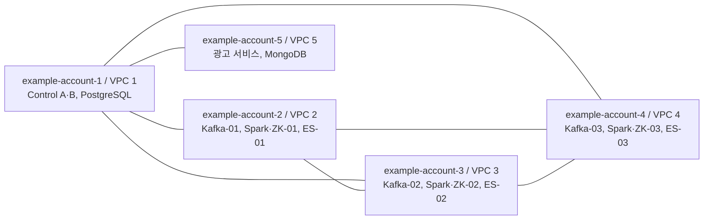

# AWS 인프라 구축 계획서

> **공개용 예시 문서:** AWS 프로필명·IAM 역할명·프로젝트 및 환경 식별자·모든 IP/CIDR은 예시 값으로 대체했다. 실제 배포에는 Git에서 제외한 로컬 설정을 사용한다.
> IP/CIDR 예시는 [RFC 1918](https://www.rfc-editor.org/rfc/rfc1918)에 정의된 사설 주소 범위에서 가상으로 정한 값이며 실제 운영 주소가 아니다. 설계 규모·구축 절차·진행 상태는 원문의 내용을 유지했다.

작성일: 2026-10-14 / Asia/Seoul  
기준 코드 버전: `0.2.0`  
문서 단계: 확정 설계 및 배포 전 준비 계획  
최근 AWS 읽기 검증: 2026-10-14 16:09 KST

## 1. 목적과 현재 결론

작업 PC에서 AWS CLI·CloudFormation·SSM을 사용하여 인프라 전체 생성, 신규 설치, 검증, 삭제와 재생성을 반복한다.
최종 목표는 필요한 시점에 생성하고 작업 종료 후 삭제하여 운영 비용과 설치 이력을 관리하는 것이다.
**96시간은 비용 산정 기준이다. 연속 96시간 유지 의무나 자동 삭제 예약은 설정하지 않는다.**

현재 5개 계정의 IAM bootstrap 업데이트와 코어 인프라 입력 검증은 완료했다.
VPC·EC2·SSM 노드·ALB는 생성하지 않았다. ALB 입력과 일부 설치·앱·HA 구현이 남아 있어 전체 구축 준비는 아직 미완료다.
이 문서는 실제 배포 완료 보고서나 실행 승인이 아니다. 실제 생성은 사용자의 후속 배포 요청에 따라 진행한다.

실제 계정 ID·인증서 ARN·비밀값은 이 공개 문서에 기록하지 않고 Git 제외 `config/project.json`과 로컬 상태에서 관리한다.

## 2. 확정된 구축 범위

| 항목 | 확정 내용 |
|---|---|
| 리전 | 서울 `ap-northeast-2` |
| 계정 / VPC / EC2 | 독립 AWS 계정 5개 / 계정별 VPC 1개 / EC2 총 14대 |
| 물리 AZ | `apne2-az1`, `apne2-az2`, `apne2-az3`의 3개; 계정별 AZ 이름 대신 AZ ID로 위치 정렬 |
| 운영 사양 | 1안 절약형 T3 Standard, Linux On-Demand, 암호화 gp3 EBS |
| 설치 방식 | Ubuntu 24.04 amd64에 직접 설치, systemd 운영 |
| 인프라 관리 | Mac 실행기 → AWS CLI → 계정별 CloudFormation 실행 역할 |
| 서버 설치·관리 | EC2 instance profile과 SSM, 노드별 설치 패키지 |
| NAT | VPC별 zonal NAT Gateway 1개, 총 5개 |
| 사설 연결 | VPC Peering 7쌍, 양방향 route 총 14개 스택 |
| 외부 진입점 | example-account-1의 두 AZ public subnet에 HTTPS ALB 1개 계획 |
| 데이터베이스 | PostgreSQL·MongoDB 각각 독립 EC2, 광고 서비스도 별도 EC2 |
| Control | 2대, 웹은 양쪽 실행, Collector·Driver·스케줄러는 하나의 active |
| Spark checkpoint | S3 Standard, 환경·설치 세대·query별 prefix, 단일 writer |
| AWS 신규 설치 | 기존 데이터 복구 필수 아님; Kafka offset·Spark checkpoint 초기화 허용 |
| 보호 대상 | 기존 로컬 9VM, 프로젝트 외 데이터, 음악 원본 S3 |

Docker Compose·Kubernetes를 도입하거나 PostgreSQL을 RDS로 전환하는 계획은 포함하지 않는다.
전체 삭제 후 재생성과 일반 재시도·재시작·개별 노드 교체는 구분한다. 재시도나 Control 승계로 데이터가 자동 초기화되지 않도록 한다.

## 3. 계정·VPC·AZ 배치

AZ 슬롯은 `a=apne2-az1`, `b=apne2-az2`, `c=apne2-az3`이다.
조회 당시 5개 계정에서 해당 AZ와 선택한 T3 사양의 제공 여부를 확인했다. 배포 직전에 다시 검증한다.

| 프로필(예시) | VPC CIDR(예시) | EC2 역할 | 노드 AZ 슬롯 | NAT 슬롯 |
|---|---|---|---|---|
| example-account-1 | `10.10.0.0/16` | Control A/B, PostgreSQL | a / b / a | a |
| example-account-2 | `10.11.0.0/16` | Kafka-01, Spark/ZooKeeper-01, ES-01 | a | a |
| example-account-3 | `10.12.0.0/16` | Kafka-02, Spark/ZooKeeper-02, ES-02 | b | b |
| example-account-4 | `10.13.0.0/16` | Kafka-03, Spark/ZooKeeper-03, ES-03 | c | c |
| example-account-5 | `10.14.0.0/16` | 광고 서비스, MongoDB | c | c |



선으로 표시한 7쌍에 직접 Peering과 양방향 route를 만든다.
example-account-5에서 example-account-2~4로 직접 연결하는 요구는 현재 범위에 포함하지 않는다.
필요한 서비스 통신 경로는 해당 연결과 노드별 security group 규칙으로 검증한다.

## 4. EC2·디스크·주소 계획

모든 노드는 2 vCPU이며 T3 Standard를 명시한다. CPU credit 소진 시 기본 성능으로 제한되는 절약형 구성이다.
아래 용량은 각 노드의 root/data EBS 크기이며, 두 볼륨 모두 암호화 gp3를 사용한다.

| 계정 | 노드 | 사양 | RAM GiB | Root GiB | Data GiB | AZ | 예시 고정 사설 IP |
|---|---|---|---:|---:|---:|---|---|
| example-account-1 | control-a | t3.large | 8 | 32 | 20 | a | `10.10.16.10` |
| example-account-1 | control-b | t3.large | 8 | 32 | 20 | b | `10.10.17.11` |
| example-account-1 | postgresql | t3.small | 2 | 32 | 20 | a | `10.10.16.20` |
| example-account-2 | kafka-01 | t3.medium | 4 | 32 | 60 | a | `10.11.16.10` |
| example-account-2 | spark-01 | t3.large | 8 | 32 | 30 | a | `10.11.16.20` |
| example-account-2 | es-01 | t3.large | 8 | 32 | 60 | a | `10.11.16.30` |
| example-account-3 | kafka-02 | t3.medium | 4 | 32 | 60 | b | `10.12.17.10` |
| example-account-3 | spark-02 | t3.large | 8 | 32 | 30 | b | `10.12.17.20` |
| example-account-3 | es-02 | t3.large | 8 | 32 | 60 | b | `10.12.17.30` |
| example-account-4 | kafka-03 | t3.medium | 4 | 32 | 60 | c | `10.13.18.10` |
| example-account-4 | spark-03 | t3.large | 8 | 32 | 30 | c | `10.13.18.20` |
| example-account-4 | es-03 | t3.large | 8 | 32 | 60 | c | `10.13.18.30` |
| example-account-5 | advertising | t3.small | 2 | 32 | 16 | c | `10.14.18.10` |
| example-account-5 | mongodb | t3.medium | 4 | 32 | 30 | c | `10.14.18.20` |

합계는 EC2 14대, root 448 GiB, data 556 GiB, EBS 총 1,004 GiB다.
Kafka heap은 1 GiB, ES heap은 4 GiB, Spark worker는 1 core/4 GiB이며 Spark 노드의 나머지 4 GiB를 시스템·Master·ZooKeeper 등에 예약한다.
AWS preflight의 최소 가용 data disk 기준은 8 GiB다.

별도 ENI에 고정 사설 IP를 설정하고 EC2가 해당 ENI를 사용한다.
실제 InstanceId·ENI ID·IP·AZ는 AWS inventory로 확인한다. 기존 primary ENI 해제 전에 같은 ENI로 새 EC2를 생성하지 않는다.
IP가 바뀌면 서비스 설정과 인증서 SAN을 갱신한다.

## 5. 네트워크·스토리지·접근 계획

### 5.1 네트워크

각 VPC에 AZ a/b/c별 public/private subnet 쌍을 만든다.
VPC의 두 번째 octet을 X라고 할 때 public은 `10.X.0.0/24`·`10.X.1.0/24`·`10.X.2.0/24`,
private은 `10.X.16.0/24`·`10.X.17.0/24`·`10.X.18.0/24`다.
예를 들어 example-account-1의 private subnet은 `10.10.16.0/24`, `10.10.17.0/24`, `10.10.18.0/24`다.

EC2는 private subnet에 두고 public IP를 부여하지 않는다. 관리 경로는 SSM을 사용한다.
외부 패키지 다운로드와 SSM 통신은 NAT를 사용하고, 각 VPC에 S3 gateway endpoint를 둔다.
VPC별 NAT 하나를 여러 AZ가 공유하므로 NAT AZ 장애 시 외부 통신 중단을 수용한다.
AZ 간 통신과 NAT 처리 비용은 운영 중 확인한다.

클러스터 ingress는 필요한 노드의 사설 IP 또는 security group으로 제한한다.
Kafka 9092/9093, ZooKeeper 2281/2888/3888, Spark 7077/7078·8080·고정 RPC 범위,
Elasticsearch 9200/9300 규칙은 기존 core 설정을 기준으로 한다.
PostgreSQL·MongoDB·Gunicorn 포트와 앱 통신 경로는 배포 전 후속 설정 대상이다.

### 5.2 S3와 데이터 초기화

계정별 설치 artifact bucket 5개와 example-account-1의 checkpoint bucket 1개를 생성하는 계획이다.
공개 접근 차단, 암호화, versioning, HTTPS 접근 강제를 템플릿에 적용했다.
런타임은 EC2 역할과 교차 계정 bucket policy로 접근하며 AWS 키를 앱에 넣지 않는다.

checkpoint의 앱 사용 경로는 `aws/example-dev/<generation>/<query>/`로 분리한다.
새 전체 생성은 새 generation을 사용하고 재개는 같은 generation을 유지한다.
실제 Spark S3A/checkpoint 쓰기와 단일 writer 검증은 후속 단계다.
피드백 중복 제거·offset·집계·JDBC 정합성은 앱 로직으로 검증한다.

### 5.3 ALB

example-account-1의 AZ a/b public subnet에 ALB를 배치하고 HTTPS 443으로 두 Control의 Gunicorn에 전달한다.
웹 프로세스는 두 Control에서 실행한다. 내부 클러스터 TLS와 공개 HTTPS 인증서는 별도로 관리한다.
현재 인증서, 도메인, 허용 client CIDR, health path와 target port가 미정이다.
ALB target health와 Control leader/fencing 검증은 각각 수행한다.

## 6. IAM·인증 운영

Mac의 프로필명은 `example-account-1`~`example-account-5`로 예시를 표시한다.
example-account-1은 로그인 세션을 사용하고 example-account-2~5는 example-account-1을 source profile로 각 계정의 `ExampleInfraRole`을 AssumeRole한다.
계정 소유자가 적용한 bootstrap 관리 기반을 반복 생성·삭제 사이에 유지한다.

| 역할 | 책임과 범위 |
|---|---|
| Mac 운영 역할 / ExampleInfraRole | 프로젝트 CloudFormation 실행, 읽기 조회, SSM 명령, 프로젝트 S3 정리 |
| CloudFormation 실행 역할 | 프로젝트 네트워크·스토리지·EC2·ALB 리소스 관리, 필요한 runtime 역할에 한정한 PassRole |
| EC2 runtime 역할 | SSM 및 노드별 private artifact, 필요한 checkpoint 접근 |
| Peering accepter 역할 | 요청 계정의 CF 역할만 신뢰; permissions boundary와 현재 VPC inline policy로 수락 범위 제한 |

network stack이 생성한 VpcId를 peering 정책에 연결한다.
관리자는 trust/boundary를 관리하고 CF 역할은 해당 peering inline policy에 한정해 접근한다.
Control fencing 방식에 필요한 runtime 권한은 실제 구현 시 대상과 조건을 구체화해야 한다.

최근 검증에서 5개 bootstrap 모두 `UPDATE_COMPLETE`였고 적용 템플릿의 속성, 리소스 완료 상태, Outputs가 기대값과 일치했다.
Outputs 개수는 example-account-1~4 각각 5개, example-account-5 4개다.
검증 범위는 CloudFormation 배포 정보와 실제 읽기 접근이다. 직접 IAM drift 검사와 모든 생성 API 권한의 실증은 수행하지 않았다.

## 7. 설치 버전·Control HA 계획

기준 버전은 `installer/core/versions.json`과 원본 SHA manifest를 따른다.
아래는 코드에 고정된 설치 기준이며 AWS에 설치됐다는 의미는 아니다.

| 구성 요소 | 기준 |
|---|---|
| Ubuntu | 24.04 amd64, 검증한 Canonical AMI를 로컬 설정에 고정 |
| Java | 21, Ubuntu 서명 보안 업데이트 사용·설치된 패키지 버전 기록 |
| Python | 3.14.8 |
| Kafka | 4.1.2 |
| Spark / Hadoop | 4.1.3 / 3.4.2 |
| ZooKeeper | 3.9.4 |
| Elasticsearch | 8.19.23 |
| PostgreSQL / MongoDB / 앱 패키지 | 후속 버전·설치 구성 확정 필요 |

Kafka/Spark/ZooKeeper/ES는 기존 Ubuntu 설치·TLS·health 코드를 AWS에 맞춰 이식했다.
Control 설치 코드는 현재 환경 준비 수준이며 Django·Collector·Driver·스케줄러 통합은 후속 구현이다.
Spark 4용 ES connector는 버전 manifest에서 미해결로 표시돼 있다. 실제 Spark→ES 연동 방식을 구현·검증해야 한다.

Control HA는 ZooKeeper의 별도 경로·ACL로 리더를 선출하고 Collector/Driver/스케줄러를 하나의 active에서 실행하는 방향이다.
이전 Control 프로세스·Driver·Spark application의 종료를 확인한 후 승계하는 fencing을 구현한다.
리더 선출만으로 이중 실행 방지가 완료됐다고 판단하지 않는다. Spark Master HA와 Control/Driver HA를 따로 검증한다.

## 8. 96시간 운영 예산

확정 목표는 example-account-1~4 각 $45, example-account-5 $20, 총 $200다.
아래는 2026-10-14 KST 가격 스냅샷을 사용한 96시간 기본 비용 추정이며 배포 직전 가격을 재확인한다.
14 EC2·5 NAT·EBS와 계획한 ALB 및 최소 public IPv4 비용을 포함한다.

| 계정 | EC2 | EBS | NAT + NAT IPv4 | ALB + 최소 IPv4 | 기본 합계 | 목표 예산 | 변동비 전 여유 |
|---|---:|---:|---:|---:|---:|---:|---:|
| example-account-1 | $22.46 | $1.87 | $6.14 | $3.12 | $33.60 | $45.00 | $11.40 |
| example-account-2 | $24.96 | $2.95 | $6.14 | $0.00 | $34.05 | $45.00 | $10.95 |
| example-account-3 | $24.96 | $2.95 | $6.14 | $0.00 | $34.05 | $45.00 | $10.95 |
| example-account-4 | $24.96 | $2.95 | $6.14 | $0.00 | $34.05 | $45.00 | $10.95 |
| example-account-5 | $7.49 | $1.32 | $6.14 | $0.00 | $14.95 | $20.00 | $5.05 |
| 합계 | | | | | **$150.71** | **$200.00** | **$49.29** |

합계는 원금액을 모두 더한 뒤 반올림하여 표시 행의 합과 $0.01 차이가 있다.
NAT 처리량, ALB LCU, S3 저장·요청, AZ 간/인터넷 데이터 전송, 추가 IPv4·로그, 세금은 별도다.
EBS는 730시간 월 기준 비례 계산을 사용했다. 할인·Free Tier 적용은 기본 추정에 반영하지 않았다.
예산 입력 검사는 실제 과금 차단이나 자동 종료를 제공하지 않는다. 운영 종료 시 명시적으로 destroy하고 잔여를 확인한다.

## 9. 실행 위치와 명령 범위

**실행기는 작업 PC의 `aws-infra/`에서 시작한다. 현재 실제 디렉터리 이름은 하이픈을 사용하는 `aws-infra`다.**
Mac 실행기가 CloudFormation API를 호출하고, 설치 단계에서는 노드별 패키지를 S3에 올린 뒤 SSM으로 EC2에서 실행한다.
코드·로컬 설정·실행 상태는 PC에, 인프라와 서비스 프로세스는 AWS에 존재한다.

저장소 상위 디렉터리에서 이동한 뒤 아래의 읽기 명령을 사용한다.

```bash
cd aws-infra
./aws-project.sh --config config/project.json plan
./aws-project.sh --config config/project.json preflight
```

`--config`는 하위 명령 앞에 둔다. 기본 preflight는 ALB 포함 준비가 미완료면 실패 코드로 종료한다.
코어 범위만 확인하려면 다음과 같이 명시한다.

```bash
./aws-project.sh --config config/project.json preflight --without-alb
```

아래는 향후 배포 요청 후 사용할 실제 변경 명령이며 이번 문서 작성에서는 실행하지 않는다.

```bash
# 전체 인프라 생성: ALB 포함 입력 준비 후 실행
./aws-project.sh --config config/project.json create --execute

# 현재 프로젝트 인프라 조회
./aws-project.sh --config config/project.json status

# 프로젝트 워크로드 삭제
./aws-project.sh --config config/project.json destroy --confirm example-project-dev
```

`create`는 인프라 생성과 14 EC2의 inventory/SSM Online 확인까지 수행한다.
현재 최상위 실행기에 전체 앱 설치·검증을 완료하는 통합 install/verify 명령은 없다.
`bin/install.py`의 prepare/send/status는 core의 개별 단계 실행기로 사용하며 전체 설치·HA 통합은 후속 구현 대상이다.

선택적으로 `create --execute --without-alb`로 코어만 먼저 생성할 수 있다.
현재 실행기는 활성 설치의 입력과 ALB 포함 범위를 고정하므로, 이후 설정을 바꿔 같은 create를 재실행하는 확장은 차단된다.
기존 코어에 ALB·앱 포트를 추가하려면 network/ALB의 단계별 변경과 상태 정합성을 검토하거나 통합 확장 기능을 구현해야 한다.
단순히 `--without-alb`를 빼서 재실행하면 자동 확장된다고 가정하지 않는다.

## 10. 구축·설치·검증 순서

| 단계 | 진행 내용 | 완료 판단 |
|---|---|---|
| 1. 배포 준비 | ALB·DB/앱 포트·연동 설정·설치 버전·fencing 권한 확정 | 선택한 배포 범위의 preflight 및 소스 확인 통과 |
| 2. 서비스 사전 검증 | 계정별 CF 변경 세트 생성, describe-events 조회, 교체·삭제·validation finding 검토 | 차단 오류 없음, 예상 범위와 일치 |
| 3. 인프라 생성 | network 5 → storage 5 → peering 7/route 14 → EC2 14 → ALB | 스택 완료, 실제 ID/주소/AZ/태그 일치, SSM Online |
| 4. 신규 설치 | 명시적 새 세대/빈 디스크 초기화, core·DB·광고·Control 앱 설치, TLS/systemd 적용 | 단계별 성공과 health 확인 |
| 5. 서비스 검증 | quorum/membership/TLS, Kafka 생산·소비, Spark 작업, ES 읽기·쓰기, DB/광고/웹 데이터 흐름 | 실제 기능과 데이터 흐름 성공 |
| 6. HA·정합성 | Spark Master HA, Control fencing/승계, 단일 writer, S3 checkpoint와 재시도/중복 검증 | 중복 프로세스·동시 writer 없이 승계·처리 확인 |
| 7. 삭제·재생성 | 의존성 역순 삭제·S3 정리·잔여 확인 → 새 generation 생성·재설치 | 과금 리소스 잔여 0, 신규 설치 정상 |
| 8. 최종 보고 | 실제 구성·버전·검증·운영 절차 취합 | 최종 인프라 구성 보고서 작성 |

워크로드 생성용 변경 세트를 새로 만들거나 실행하지 않았다. 계정별 쓰기 권한과 CloudFormation 서비스 사전 검증은 향후 배포 단계에서 확인한다.
CloudFormation 완료, EC2 running, SSM Online과 실제 애플리케이션 성공을 구분한다.

## 11. 삭제·재생성 정책

삭제 순서는 ALB → Control 두 대 종료·실제 종료 확인 → 나머지 EC2/EBS → route → peering → 프로젝트 S3 → network다.
프로젝트 S3는 owner와 Project/Environment 태그 및 bucket allowlist를 확인하고 버전·delete marker·미완료 multipart upload를 정리한다.
S3의 Retain 속성으로 남은 bucket도 실행기가 소유권을 재확인한 후 명시적으로 삭제하는 방식이다.

삭제 후 VPC·NAT·EIP·ENI·EC2/EBS·peering·ALB/TG·프로젝트 bucket·워크로드 스택의 잔여를 조회한다.
bootstrap IAM·Mac 프로필과 원본 음악 S3·로컬 9VM은 유지한다.
전체 재생성은 새 generation으로 시작하며 기존 Kafka offset/checkpoint 복구를 요구하지 않는다.
요청 결과가 불명확한 생성·실행·삭제를 자동 재전송하지 않고 저장한 상태와 AWS 상태를 확인한 뒤 재개한다.

## 12. Git 공개·이력 관리

| Git 추적 | 로컬 보관 및 Git 제외 |
|---|---|
| bin/lib/installer, 공개 샘플 설정, 샘플 템플릿, 테스트, 문서, VERSION/CHANGELOG, CI | 실제 `config/project.json`, `.state/`, `.private/`, `.local/`, `.tools/`, `.aws/`, `.env` 계열, 키/인증서·payload |

실행 영수증은 코드 버전, 소스 SHA, 조회 가능한 Git revision, 설정/템플릿 해시를 기록한다.
현재 폴더에서 git init·commit·push는 수행하지 않았다. CI 파일은 준비돼 있지만 GitHub에서 실제 실행하지 않았다.
실제 계정별 템플릿은 `.state/`에 생성하고 공개 `templates/`는 가상 계정 예제로 유지한다.
공개 전 `python3 bin/check-public.py`를 실행한다. 검사 범위와 한계는 [SECURITY.md](SECURITY.md)에 따른다.
실행마다 문서를 추가하지 않고 운영 상태는 로컬에 저장한다. 이 계획서와 최종 구성 보고서는 별도로 관리한다.

## 13. 완료·미완료 상태

| 구분 | 2026-10-14 기준 상태 |
|---|---|
| 확정 계획 | 5계정·5VPC·14EC2·3AZ, T3 Standard, 96시간 비용 기준, $200 예산 |
| 실제 AWS 완료 | 5계정 IAM bootstrap `UPDATE_COMPLETE`, CF 배포 속성·리소스·Outputs 및 읽기 접근 확인 |
| 코어 입력 검증 | AMI·AZ·사양·쿼터·현재 확인 가능한 CIDR 검증 통과 |
| 정적 검증 | 테스트 68개 통과, CF 템플릿 36개 lint 발견 0건, guard 23 PASS/13 SKIP/0 FAIL |
| Git 공개 준비 | 실제 설정/기록 분리, 제외 규칙 Git 엔진 확인, 당시 공개 후보 91개 파일 비밀 패턴 발견 0건 |
| ALB 포함 준비 | 인증서·접속 CIDR·health path·Gunicorn port 미정으로 미완료 |
| 설치/앱/HA | DB·광고·Django 통합, Control fencing, 실제 connector/checkpoint 및 단일 명령 통합 작업 필요 |
| 실제 워크로드 배포 | 미실행; 최근 조회 VPC·프로젝트 EC2·SSM 노드·ALB 모두 0개 |
| 전체 완료 검증 | 생성·설치·데이터 흐름·HA·삭제 후 재생성 실증 대기 |

다음 단계는 미정 설정과 설치·HA 구현을 구체화한 뒤 배포 범위를 확정하는 것이다.
현재 코어 입력 검증 통과를 전체 자동화 또는 실제 서비스 완료로 해석하지 않는다.

## 14. 관련 파일

- [실행기 README](README.md)
- [보안 관리](SECURITY.md)
- [공개 샘플 설정](config/project.example.json)
- [설치 버전 기준](installer/core/versions.json)
- [코드 변경 이력](CHANGELOG.md)

계정별 실제 설정과 최근 읽기 검증 결과는 각각 Git 제외 `config/project.json`, `.state/preflight/latest.json`에서 확인한다.
