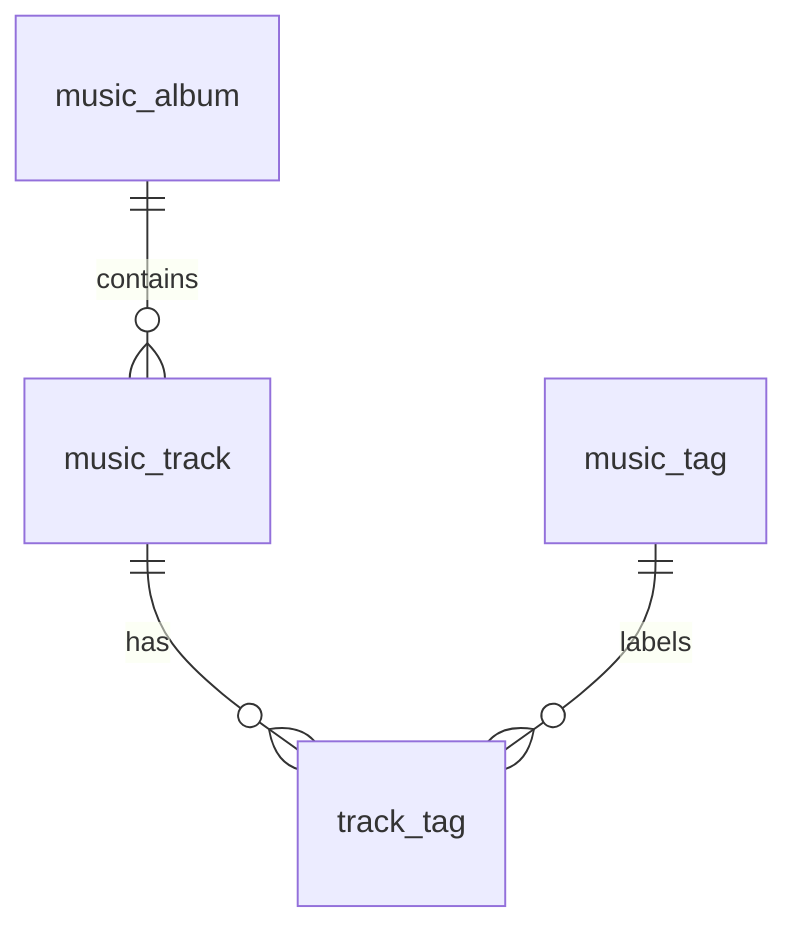

# 음악 테이블 구조 설계

- 수정일: 2026-10-16
- 기준: 추천·표시용 음악 정보 18개 + 검수 관리 보조 컬럼 instrumental_review_value 1개
- 구성: music_track, music_album, music_tag, track_tag — 총 4개 테이블
- 관련 문서: [컬럼 정의](./음악_분류_컬럼_정의_및_변환_규칙.md), [변환 규칙](./음악_분류_컬럼_정의_및_변환_규칙.md), [테마·장르 정의](./테마_장르_정의.md), [선곡 규칙](./플레이리스트_생성_규칙.md), [공통 규칙서](../../product/3차_음악_정책_통합_계약.md)

## 1. 테이블 분리 기준

곡의 기본 정보와 수치값은 한 곳에서 관리하고, 앨범 정보는 중복을 줄이기 위해 분리한다. 추가·제외가 잦은 장르·분위기·악기는 공통 태그 사전과 곡별 연결로 관리한다.

| 테이블 | 역할 | PK |
| --- | --- | --- |
| music_track | 곡 정보·아티스트 문자열·음악 특성값 | track_id |
| music_album | 앨범 ID·이름·발매일 | album_key |
| music_tag | 장르·분위기·악기 사전 | tag_id |
| track_tag | 곡과 태그의 복수 연결 | track_id + tag_id |

- 아티스트 ID·이름은 기존 세미콜론(;) 형식을 유지한다. 별도 아티스트 테이블은 만들지 않는다.
- genre·mood·main_inst는 DB에서 각각의 태그 연결로 저장하고, 기존 18개 컬럼 형식으로 조회할 때 문자열로 묶는다.
- 장르 대분류와 테마별 장르 매핑은 정책 사전으로 관리한다. 추가 SQL 테이블은 만들지 않는다.
- PK는 행을 구별하는 기본 키, FK는 다른 테이블의 행을 가리키는 외래 키이다. 복합 PK는 여러 컬럼을 묶어 중복을 막는다.
- 이 구성은 앨범과 복수 분류를 분리한 실용적인 구조이다. 아티스트 문자열까지 모두 별도 관계로 분리한 구조는 아니다.
- 날씨·회원·피드백·플레이리스트 이력은 음악 테이블의 범위에서 제외한다.

## 2. music_track — 곡

| 컬럼명 | 자료형 | 키·조건 | NULL 허용 | 설명 |
| --- | --- | --- | --- | --- |
| track_id | str | PK | N | Spotify 곡 ID |
| track_name | str | — | N | 곡명 |
| artists_name | str | 복수 값은 ; 구분 | N | 참여 아티스트 이름, 원본·API 순서 유지 |
| album_key | int | FK → music_album.album_key | N | 내부 앨범 키 |
| duration_ms | int | 0 이상 | N | 밀리초 저장, 화면에서만 분:초 변환 |
| explicit | bool | — | N | 노골적 표현 여부 |
| play_url | str | — | N | Spotify 곡 페이지 URL. 직접 스트리밍 주소가 아님 |
| artists_id | str | 복수 값은 ; 구분 | Y | 참여 아티스트 ID. 이름과 같은 순서 |
| energy | int | 0~10 | Y | 원본 × 10 후 소수점 이하 절삭 |
| mode | bool | True / False | Y | 장조 / 단조, 미확인은 NULL |
| acousticness | int | 0~100 | Y | 원본 × 100 후 소수점 이하 절삭 |
| speed | str | slow / medium / fast / fastest | Y | tempo·time_signature 변환 결과 |
| instrumental | bool | True / False | Y | 검수 우선 최종 연주곡 여부 |
| instrumental_review_value | bool | True / False | Y | 확정 검수 결과. NULL이면 확정 검수 없음 |

- artists_id는 FK가 아닌 문자열이다. 아티스트 참조 테이블이 없으므로 ID·이름의 대응은 적재 단계에서 검사한다.
- 같은 위치의 아티스트 ID와 이름을 한 쌍으로 관리한다. ID가 모두 없으면 NULL, 일부만 없으면 빈 위치를 보존한다. 예: 이름 A;B;C, ID idA;;idC.
- 아티스트 ID의 빈 위치를 제거하면 이름과 순서가 어긋날 수 있으므로 장르·분위기의 빈 토큰 제거 규칙을 그대로 적용하지 않는다.
- duration_ms=0인 행의 저장과 추천 후보 사용은 구분한다. 추천에서는 선곡 규칙에 따라 양의 재생시간만 사용한다.
- genre·mood·main_inst는 이 테이블에 중복 저장하지 않는다.
- instrumental_review_value=True는 검수에서 보컬 없음, False는 보컬 있음이 확인된 값이다. NULL은 미검수·검토 중 등 확정 결과가 없는 상태이다.
- 재처리 전에 DB의 검수값을 track_id로 읽는다. 검수값이 True·False이면 이를 최종 instrumental로 사용하고, NULL일 때만 원본 instrumentalness의 자동 판정을 사용한다. 일반 갱신에서 새 원본 수치가 없으면 기존 최종값을 보존하며, 신규 곡의 미확인은 NULL로 둔다.
- 일반 적재에서 검수 컬럼이 없거나 NULL로 들어와도 기존 검수값을 지우지 않는다. 검수값 변경·해제는 명시적인 검수 작업에서만 수행한다.
- 원본 tempo·time_signature·instrumentalness는 원본 자료에 보존한다. 변환은 원본을 입력으로 수행하고 결과를 서비스 컬럼에 저장한다. 이미 변환된 값을 원본처럼 다시 변환하지 않는다.

## 3. music_album — 앨범

| 컬럼명 | 자료형 | 키·조건 | NULL 허용 | 설명 |
| --- | --- | --- | --- | --- |
| album_key | int | PK, 내부 생성 | N | Spotify ID가 없어도 사용할 수 있는 내부 키 |
| album_name | str | — | N | 앨범명 |
| album_id | str | 값이 있는 행끼리 UNIQUE | Y | 실제 Spotify 앨범 ID |
| album_release_date | str | YYYY / YYYY-MM / YYYY-MM-DD | Y | 확보한 발매일 문자열 유지 |

- 초기 데이터에 album_id가 없으면 내부 album_key를 부여한다. 내부 키를 Spotify album_id 컬럼에 넣지 않는다.
- 실제 album_id가 같은 곡은 같은 앨범 행을 참조한다.
- 이름만 같은 앨범을 자동 병합하지 않는다. ID가 없는 초기 앨범은 임시 행을 허용하고, 동일성이 확인된 후 곡의 FK를 정리한다.
- 하나의 앨범에 여러 곡을 연결할 수 있다.

## 4. music_tag — 공통 분류 사전

| 컬럼명 | 자료형 | 키·조건 | NULL 허용 | 설명 |
| --- | --- | --- | --- | --- |
| tag_id | int | PK, 내부 생성 | N | 곡에서 참조하는 고정 태그 키 |
| tag_type | str | genre / mood / instrument | N | 태그 종류 |
| tag_code | str | tag_type과 함께 UNIQUE | N | 종류별 표준 코드 |
| tag_name | str | — | N | 화면·문서 표시 이름 |
| is_active | bool | 기본 False | N | 선택·추천에서 사용할 수 있는 태그 여부 |

### 태그 구분 예시

아래 코드는 분류 형식을 설명하는 예시이며 실제 곡 데이터가 아니다.

| tag_type | tag_code | tag_name |
| --- | --- | --- |
| genre | jazz | 재즈 |
| genre | j-rock | J-ROCK |
| mood | CALM | 잔잔한 |
| mood | DREAMY | 몽환적인 |
| instrument | piano | 피아노 |

- UNIQUE(tag_type, tag_code)로 같은 종류·같은 코드의 중복 등록을 막는다.
- 원본 track_genre의 라벨은 genre 태그로 보존한다. 원본에는 스타일 외 태그도 섞여 있으므로 모든 라벨을 서비스 대분류로 취급하지 않는다.
- 현재 장르·테마 목록과 매핑은 테마·장르 정의 문서를 기준으로 등록한다. 선택·추천에 사용할 것으로 확정된 사전 항목은 is_active=True로 등록한다. mood를 장르만으로 자동 확정하지 않는다.
- ambient는 태그·원본 연결을 보존하되 is_active=False로 둔다. 검토 중인 분류도 활성화 전에는 선택·추천에 사용하지 않는다.
- 이름 변경은 tag_name만 수정한다. 코드의 의미가 달라지는 경우 새 태그를 만든다.
- 태그를 서비스에서 제외할 때는 is_active=False로 전환한다. 기존 곡 연결을 자동 삭제하지 않는다.

## 5. track_tag — 곡과 태그 연결

| 컬럼명 | 자료형 | 키·조건 | NULL 허용 | 설명 |
| --- | --- | --- | --- | --- |
| track_id | str | PK 구성, FK → music_track.track_id | N | 곡 |
| tag_id | int | PK 구성, FK → music_tag.tag_id | N | 연결할 분류 |
| review_status | str | draft / approved | N | 해당 곡과 태그 연결의 확인 상태 |

- 복합 PK는 (track_id, tag_id)이다. 같은 곡에 같은 태그를 중복 연결하지 않는다.
- 장르·분위기·악기를 각각 하나 이상 연결할 수 있다.
- review_status는 곡별 연결 상태이고, is_active는 태그 전체의 사용 상태이다.
- 원본 장르를 확인하여 적재한 연결은 approved로 등록할 수 있다. 곡별 mood·주 악기는 검토가 끝난 연결만 approved로 둔다.
- 미확인 값은 연결 행을 만들지 않거나 draft로 보관한다. NULL이라는 태그를 만들지 않는다.
- 특정 곡에서만 분류를 제거할 때는 해당 연결 행을 삭제한다. 다른 곡과 태그 사전에는 영향을 주지 않는다.
- 추천·선택용 분류는 is_active=True이고 review_status=approved인 연결만 사용한다.
- 연결된 태그를 물리적으로 삭제하는 작업은 FK로 제한한다. 서비스 제외는 비활성화를 사용한다.

## 6. PK·FK 관계

| 관계 | 연결 컬럼 | 의미 |
| --- | --- | --- |
| 앨범 1 : 곡 N | music_track.album_key → music_album.album_key | 여러 곡이 같은 앨범 정보 참조 |
| 곡 N : 태그 M | track_tag의 두 FK | 한 곡에 여러 태그, 한 태그에 여러 곡 연결 |

아티스트와 장르 대분류 정책에는 별도 FK를 만들지 않는다. FK로 검사할 수 없는 문자열·정책 코드의 일치는 적재·조회 단계에서 확인한다.

## 7. 기존 18개 컬럼의 저장 위치

| 서비스 컬럼 | 저장 위치 |
| --- | --- |
| track_id | music_track.track_id |
| track_name | music_track.track_name |
| artists_id | music_track.artists_id |
| artists_name | music_track.artists_name |
| album_id | music_album.album_id |
| album_name | music_album.album_name |
| album_release_date | music_album.album_release_date |
| duration_ms | music_track.duration_ms |
| explicit | music_track.explicit |
| genre | track_tag + music_tag, tag_type=genre의 tag_code |
| energy | music_track.energy |
| mode | music_track.mode |
| acousticness | music_track.acousticness |
| mood | track_tag + music_tag, tag_type=mood의 tag_name |
| speed | music_track.speed |
| main_inst | track_tag + music_tag, tag_type=instrument의 tag_code |
| instrumental | music_track.instrumental |
| play_url | music_track.play_url |

album_key·tag_id·tag_type·is_active·review_status·instrumental_review_value는 관계·분류·검수 관리용 컬럼이다. 추천·표시용 18개 컬럼의 출력과 구분한다. instrumental_review_value는 music_track에 저장하며 기본 추천 입력에는 최종 instrumental만 전달한다.

## 8. 장르·테마 정책과 추천용 조회

### 8-1. 세부 라벨과 대분류

곡의 genre 태그에는 jazz·j-rock 같은 세부 라벨을 저장한다. 화면에서 선택하는 대분류는 JAZZ·ROCK·J-POP 같은 정책 코드로 구분한다.

- 세부 라벨 → 대분류의 연결은 테마·장르 정의 3-1절을 기준으로 한 정책 사전에서 읽는다.
- DB의 곡·태그 연결은 tag_id로, 사용자 장르 선택·사이클 허용 범위 비교는 대분류 코드로 처리한다. 세부 tag_code와 대분류 코드를 직접 비교하지 않는다.
- j-rock은 ROCK과 J-POP에 함께 연결할 수 있다. 곡이나 추천 점수를 두 번 생성하지 않는다.
- 테마별 후보 장르는 같은 문서 4-1절의 확정 매핑을 읽는다. 이것을 곡별 mood 연결로 자동 복사하지 않는다.
- 정책 사전은 SQL 테이블 대신 설정으로 관리한다. 승인된 대분류·테마 코드인지 검사하고 변경 버전을 구분한다.
- 표의 표시 이름과 정책 코드는 구분한다. 이름만 바뀌어도 연결 키가 바뀌지 않도록 한다.

### 8-2. 곡당 한 행으로 전달

music_recommendation_view라는 조회 뷰를 제안한다. 별도 저장 테이블은 아니다.

- 기본 출력은 기존 18개 컬럼과 순서를 유지한다.
- 태그를 먼저 곡별·종류별로 집계한 뒤 music_track·music_album과 연결한다.
- genre·mood·main_inst는 기존 세미콜론 형식으로 출력하며 미연결은 NULL로 둔다.
- 추천용 출력은 활성·승인된 연결을 사용한다. 비활성·검토 중인 원본 연결은 DB에 보존하고 원본 확인용 조회에서 별도로 읽는다.
- 장르 선택 비교에 필요한 대분류 코드 집합은 정책 사전으로 계산한 genre_group_codes로 전달한다. 사용자 선택과 사이클 허용 범위도 같은 대분류 코드를 사용한다. 원본 genre를 대분류 이름으로 덮어쓰지 않는다.
- 재생시간과 점수는 중복 없는 track_id 기준으로 계산한다.
- 사이클의 고정 장르·speed 집합은 별도 선곡 운영 정보에서 관리한다. 음악 테이블은 곡 자체의 정보를 저장한다.

## 9. 적재·갱신 규칙

1. 필수 메타데이터를 확인하고 같은 track_id의 원본 행을 한 곡으로 모은다. 정보가 충돌하면 임의로 평균내거나 마지막 값으로 덮어쓰지 않는다.
2. 앨범 행을 등록한 뒤 곡에 album_key를 연결한다.
3. 아티스트 ID·이름은 같은 순서로 저장한다. 초기 ID 미확인은 NULL로 둔다.
4. 원본에서 변환한 수치값은 같은 결과 행에 누적한다. 최종 검수값의 보존 처리는 자동 변환과 구분한다.
5. 장르·분위기·악기를 태그와 연결 행으로 저장한다. 같은 태그·같은 곡 연결은 한 번만 만든다.
6. 신규 API 응답에 없는 음향값·검수값은 기존 값을 NULL로 덮어쓰지 않는다.
7. DB에서 읽은 instrumental_review_value를 보존한 채 최종 instrumental을 계산한다. 일반 재적재·API 갱신은 검수 컬럼을 초기화하지 않는다. 검수 저장에서는 검수값과 최종값을 함께 갱신한다.
8. 관계형 DB는 FK·UNIQUE로 검사하고, Spark·파일 저장은 적재 단계에서 같은 관계를 검증한다.

DB 제품·문자열 길이·내부 키 생성 방식은 구현 환경에서 결정한다. PK·FK의 대응 자료형은 동일하게 사용한다.

---

프로젝트 수령본 안내: 다운로드 원문을 기준으로 본문을 보존하고 문서 연결 경로만 정정했습니다. CSV 출처/해시와 서비스 연결 계약은 [음악 인계 안내](./README.md)를 확인합니다. 이 문서의 ‘같은 폴더 CSV’는 인계 원본 묶음의 위치이며 프로젝트 내 CSV 복사·적재 완료를 뜻하지 않습니다.

## 2026-10-16 점수 특성·불변 카탈로그 보완

music_track의 표시용 energy(0~10)·acousticness(0~100)와 18개 출력 계약은 유지합니다. ON 점수에는 원본 정밀도의 energy/acousticness/valence(각 0~1) 및 mode가 필요합니다. 원본 참조/해시 또는 발행 카탈로그의 별도 score_feature 레코드로 track_id·source_schema_version·catalog_version·score_policy_version과 함께 불변 보존합니다. 표시용 정수에서 값을 역산하지 않습니다. OFF는 필요한 0~10 energy·승인 장르·mode·speed의 유효성만 평가하고 ON 전용 valence/acousticness를 요구하지 않습니다. 저장 위치·키·마이그레이션 DDL은 B와 조율해 D-03/M-01에서 확정하며 현재 네 기본 테이블이 원본 세 소수를 이미 제공한다고 간주하지 않습니다. 결과 스냅샷은 당시 점수 특성 또는 안정적 불변 참조를 포함합니다.
