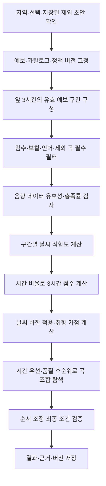

<!-- 2026-10-13 보관: Gemini 전환 이전 설계. 현행 3차 구현 기준이 아닙니다. -->

> **보관 스냅샷:** 기본 규칙은 현행으로 복원됐습니다. 이 원문은 이전 스키마/정책 문구를 포함하는 이력이며 현행 규칙 가이드와 Gemini 보조 재설정을 함께 참조합니다.

# 날씨 기반 음악 추천 — 로직 설계 흐름과 검증 계획

- 작성일: 2026-10-13
- 수정일: 2026-10-13
- 목적: 날씨에서 음악 추천 결과를 구하는 흐름, 수식의 의미, 초기값의 근거 수준, 데이터 확보에 따른 검증 방법을 정리합니다.
- 상태: 사용자 결정의 중심 거리 방식·75:25 비중을 반영한 정책 v3 보조 문서입니다. 코드 구현·사용자 평가·운영 검증 완료를 의미하지 않습니다.
- 범위: 3차 규칙 기반 추천입니다. 새 평가 UI나 외부 실험을 이번 문서 작성으로 구현·운영하지 않습니다.

## 2026-10-13 구현 결정 반영

초기에는 같은 네트워크의 로컬 클러스터에서 Kafka·Spark를 연결하고 최종 AWS로 이전합니다. 프레임워크는 팀 회의 후 결정합니다. 날씨 파이프라인은 새로 구현하며 3차 음악은 보유 CSV를 사용하고, 상세 음악 규격은 추가 문서로 받습니다. 원문은 로컬과 S3에 함께 보관합니다. 작은 후보군부터 상한까지 확장하는 탐색을 사용하고 실제 크기/시간은 미정입니다.

날씨 패널은 유지하고 별도 강수 카드·X·닫기 기록·재노출 방지는 제거합니다. 6시간 공유 수집/조회와 앞 3시간·실제 초과분 추천 검증은 유지하며, 펭귄 안내의 X/Esc는 별개입니다. 소나기·빗방울은 비, 눈날림은 눈+구름 많음 적합도 결합을 사용합니다. 결합 비율/혼합 코드·만료 숫자는 미정입니다. 관리자 초기화 발급·초기 권한 배정, 회수 시 비활성화/세션 무효화, 익명 쿠키 소유 검사, 로컬·S3 원문 보관의 상세 계약은 아래 연결 가이드를 따릅니다. 광고 규정은 별도 회의 결과 대기입니다. 문서 반영은 실행/설치/배포 완료가 아닙니다.
상세 계약: [3차 구현 결정과 익명 문맥·원문 보관 가이드](.././3차_구현_결정과_익명문맥_원문보관_가이드.md).

## 1. 설계를 시작할 때 구분할 것

현재 서비스는 음악 특성과 검수 자료를 이용해 날씨 적합도와 사용자 선호를 계산하고, 시간 조건을 만족하는 곡 조합을 찾습니다. Docker·LLM·로컬 AI 모델은 3차에 사용하지 않습니다.

설계에는 서로 다른 세 종류의 기준이 들어갑니다.

| 구분 | 예시 | 취급 방법 |
|---|---|---|
| 사용자 확정 정책 | 176~184분, 비선호 언어 제외, 검수된 무보컬 제한, 제외 곡 유지 | 구현과 검증에서 유지합니다. 후보 부족 때문에 자동 완화하지 않습니다. |
| 계산 방식 | 목표 구간까지의 거리, 가중평균, 정수 시간 조합 | 수식·예외·입출력이 의도대로 구현되는지 확인합니다. |
| 미검증 초기값·효과 | 날씨 목표 중심/허용 거리, 결정한 75:25의 효과, 적합도 하한 | 설정과 근거 수준을 표시하고 데이터를 확보해 비교·조정합니다. |

수식이 정확히 계산된다는 사실과 사용자가 음악을 적합하다고 느낀다는 사실은 다릅니다. 초기 구현 목표는 설명 가능한 규칙을 적용하고 유효한 선곡표를 생성하는 것입니다. 사용자 적합성이 검증됐다는 주장은 평가 근거를 확보한 뒤에 합니다.

## 2. 전체 추천 흐름



날씨가 부족하거나 유효한 조합을 찾지 못한 경우는 별도 실패 상태로 처리합니다. 점수가 높은 곡을 단순히 순서대로 추가하다가 3시간을 넘기는 방식으로 성공 결과를 만들지 않습니다.

## 3. 단계별로 로직 구하기

### 3.1. 입력과 계산 기준을 고정합니다

필수 입력은 동 단위 지역입니다. 보컬·빠르기·테마/장르·언어는 선택 입력입니다. 작업의 기준 시각, 예보 묶음, 승인된 불변 음악 카탈로그, 추천 정책 버전을 기록합니다.

재생성은 선택 전체와 저장된 제외 초안을 유지하면서 새 결과 버전을 만듭니다. 서버가 최신 exclusion_revision과 일치하는 제외 초안을 작업 입력에 고정합니다. 저장 중·실패·미저장 변경이 있으면 재생성/승인을 차단합니다.

이 기록은 나중에 같은 입력을 재현하고 정책 변경 효과를 비교하기 위한 근거입니다. 정책을 수정한 뒤 이전 결과의 점수나 당시 조건을 덮어쓰지 않습니다.

### 3.2. 날씨를 시간 구간으로 변환합니다

요청 시점부터 180분까지 실제 예보 구간을 구성합니다. 현재 날씨 아이콘 하나로 전체 3시간을 대표하지 않습니다.

- PTY를 이용해 비·눈·혼합 등 강수 형태를 유지합니다.
- 강수가 없는 구간은 유효한 SKY로 하늘 상태를 해석합니다.
- POP는 강수확률이며 실제 비 발생 판정으로 바꾸지 않습니다.
- KIM 보완값으로 기본 SKY를 덮지 않습니다.
- 누락·만료·알 수 없는 코드를 맑음이나 강수 없음으로 채우지 않습니다.
- 필수 예보가 앞 3시간에 누락되면 새 생성을 차단합니다. 뒤쪽 조회 구간만 누락된 상태는 구분합니다.

기온·체감온도·계절 등에 임의 보정을 추가하는 것은 이 문서의 기본 계산에 포함하지 않습니다. 기존 날씨 표시 규칙과 새 음악 점수 정책은 구분합니다.

### 3.3. 점수보다 먼저 필수 후보 조건을 적용합니다

1. 공개 가능한 검수 카탈로그와 필수 메타데이터를 확인합니다.
2. 양수 정수 duration_ms와 곡 ID 무결성을 확인합니다.
3. 사용자가 제외한 곡을 제거합니다.
4. 연주곡만 선택한 경우 검수된 무보컬 곡만 남깁니다.
5. 비선호 언어가 하나라도 포함된 다국어 곡을 제거합니다.
6. 비선호 언어가 지정된 요청에서는 언어 미확인·불완전 곡도 제거합니다. 검수된 무보컬의 NOT_APPLICABLE 예외는 기존 기준을 따릅니다.

비선호 언어·무보컬·제외 곡은 가감점이 아닙니다. 높은 날씨 점수나 시간 부족으로 금지 조건을 상쇄하지 않습니다.

### 3.4. 음악 특성을 확인합니다

기존 가이드는 energy, danceability, acousticness 세 음향값을 사용합니다. 각 값은 0~1 유효 범위를 확인하고 실제 0과 NULL을 구분합니다. 수동 청취 energy 0~10을 기존 음향 energy에 덮어쓰지 않습니다.

| 특성 | 기존 초기 가중치 |
|---|---:|
| energy | 0.50 |
| danceability | 0.25 |
| acousticness | 0.25 |

기존 초기 후보 기준은 energy 필수, 가중치 합 기준 데이터 충족률 0.75 이상입니다. energy와 다른 한 특성이 유효하면 0.75, energy만 있으면 0.50으로 후보에서 제외합니다.

누락값을 0으로 넣어 조용한 음악이라고 판단하지 않습니다. 충족 기준을 통과한 곡은 유효 특성의 가중치로 점수를 재정규화합니다.

### 3.5. 날씨별 목표 중심과 허용 거리를 설정합니다

v3는 겹치는 범위에 같은 만점을 주는 대신 목표 중심과의 거리로 수치 구분을 강화합니다. 다음은 새 초기값이며 사용자 취향의 정답이나 검증된 인과관계가 아닙니다.

| 날씨 | energy 목표 중심 | danceability 목표 중심 | acousticness 목표 중심 |
|---|---:|---:|---:|
| 맑음 | 0.55 | 0.55 | 0.35 |
| 구름 많음·흐림 | 0.40 | 0.375 | 0.55 |
| 비 | 0.30 | 0.30 | 0.75 |
| 눈 | 0.25 | 0.275 | 0.80 |

세 특성의 허용 거리 delta_j는 각각 0.30이며 양수여야 합니다. 대화의 **비 energy 0.00~0.40**은 범위 방식 비교 아이디어였고, 현행 v3는 비 중심 0.30을 사용합니다.

중심에서만 해당 특성이 만점입니다. 과거 범위를 별도 필터로 사용하지 않으며 ‘비에는 재즈만’ 같은 장르 고정 조건으로도 해석하지 않습니다.

### 3.6. 구간별 날씨 적합도를 계산합니다

곡의 특성값 x와 해당 날씨·특성의 목표 중심 c_j 사이 거리를 계산합니다.

```text
distance = abs(x - c_j)
fit = max(0, 1 - distance / delta_j)
delta_j = 0.30  # 각 특성의 초기 허용 거리, 양수
```

중심이면 fit=1이고 distance가 delta_j 이상이면 0입니다. 중간의 곡은 날씨별 점수가 같을 수 있으며 모든 곡의 구분을 보장하지 않습니다.

energy=0.30인 곡은 비 적합도 1, 맑음 적합도 약 0.1667입니다. 이것은 한 특성의 점수이며 최종 날씨 점수와 다릅니다.

```text
W_segment = sum(weight_j * fit_j) / sum(weight_j)
# 유효한 특성 j만 분자·분모에 포함합니다.
```

기존 음향 비중은 0.50/0.25/0.25입니다. 이전 대화에서 제시한 0.50/0.20/0.30은 임시 변형안이며 기존 문서값과 구분합니다.

비·눈 혼합을 비 적합도와 눈 적합도 각 0.5로 계산하는 방법도 기존 초기 비교안입니다. 실제 비·눈의 양이나 비율을 의미하지 않습니다.

### 3.7. 3시간 전체의 날씨 점수를 구합니다

```text
r_k = 예보 구간 k와 앞 180분의 겹치는 길이 / 180분
W = sum(r_k * W_segment_k)
```

흐림 1시간·비 2시간이면 W=흐림 적합도/3 + 비 적합도*2/3입니다. 예보 구간에 중복이나 빈 구간이 없어야 합니다.

이 방식은 전체 3시간의 평균 적합도입니다. 비가 시작되는 시각에 특정 곡이 재생되도록 배치하는 시간별 최적화는 별도 설계입니다.

v3에서도 W>=0.55인 곡만 남깁니다. 새 수식에 따른 후보 감소·조합 성공률을 다시 측정합니다. 하한은 후보를 제거하고 비중은 후보 순위를 바꾸므로 구분합니다. 요청 중 자동 완화하지 않습니다.

### 3.8. 사용자 선호와 결합합니다

빠르기 T, 테마 M, 장르 G, 선호 언어 L은 일치하면 1, 아니면 0입니다. 각 a는 해당 선호가 활성화되면 1, 미선택이면 0입니다.

```text
S = 100 * (0.75*W + 0.0625*a_t*T + 0.0625*a_m*M
                 + 0.0625*a_g*G + 0.0625*a_l*L)
        / (0.75 + 0.0625*(a_t + a_m + a_g + a_l))
```

테마 안에서 OR, 장르 안에서 OR로 처리하며 두 그룹이 각각 맞으면 별도 가점을 줍니다. 여러 칩에 일치했다고 같은 그룹의 보너스를 반복 합산하지 않습니다. 선택한 그룹이 미확인·미일치인 곡은 보너스 0으로 처리합니다.

사용자 결정의 ‘날씨 75%·태그 25%’는 네 그룹 모두 활성화한 경우입니다. 각 선호 그룹은 6.25%이며 미선택 항목 재정규화 후 날씨 비중은 다음과 같습니다.

| 활성 선호 그룹 수 | 날씨의 실제 비중 |
|---:|---:|
| 0 | 100% |
| 1 | 약 92.31% |
| 2 | 약 85.71% |
| 3 | 80% |
| 4 | 75% |

빠르기 90/120 BPM 경계와 위 비중도 초기값입니다. 비선호 언어는 선호 언어 점수 계산 전에 제거합니다.

### 3.9. 시간 우선으로 곡 조합을 찾습니다

```text
x_i in {0, 1}  # 곡 i의 선택 여부
total_ms = sum(duration_ms_i * x_i)
10_560_000 <= total_ms <= 11_040_000
target_ms = 10_800_000
```

0/1 정수 조합 문제로 표현하고, CP-SAT 같은 도구를 구현 후보로 검토합니다. 도구 채택·설치 완료를 뜻하지 않습니다.

비교 순서는 정확히 180분 → 180분 초과~184분 → 176분~180분 미만입니다. 같은 구간에서는 목표 거리, 같은 총시간에서는 품질을 비교합니다.

```text
playlist_quality = sum(S_i * duration_ms_i * x_i) / total_ms
```

재생시간 가중평균을 사용해 짧은 곡을 많이 넣는 조합이 단순 점수 합에서 유리해지는 문제를 피합니다. 시간은 반올림하지 않은 정수 ms로 판정합니다. 180분을 넘는 결과는 실제 총시간까지 예보 유효성을 확인합니다.

후보군은 점수 상위와 다양한 특성의 후보를 포함하고 필요하면 확장합니다. 제한 후보군의 최적을 전체 카탈로그 최적으로 표시하지 않으며, UNKNOWN은 INFEASIBLE과 구분합니다. 상위 시간 구간 탐색이 미완료라면 시간 우선순위의 최적성도 미확인으로 기록합니다.

### 3.10. 순서와 최종 결과를 검증합니다

기존 순서 기준은 연속 아티스트, 급격한 BPM·음량 변화의 완화입니다. ‘낮은 energy → 중간 상승 → 후반 하강’은 대화의 추가 아이디어이며 기존 필수 기준으로 채택하지 않습니다.

곡 ID 중복·총시간·보컬·언어·제외 곡·예보 유효성을 최종 검증합니다. 정책/카탈로그/예보 버전, 곡별 근거, 탐색 범위와 상태를 저장합니다. 승인 시에도 현재 제외 초안과 결과의 일치를 확인합니다. 메인 화면에 시간을 표시하지 않아도 시간 계산·저장·승인 검증은 유지합니다.

## 4. 무엇이 수학적 근거이고 무엇이 가정인가

| 요소 | 수식 또는 방식의 의미 | 추가 검증이 필요한 판단 |
|---|---|---|
| 목표 중심 거리 | 중심에서 벗어난 정도를 계산합니다. | 날씨별 목표 중심을 왜 그렇게 정했는가 |
| 선형 감점 | 거리에 비례해 점수를 낮춥니다. | 허용 거리 0.30과 선형 형태가 적절한가 |
| 음향 가중평균 | 여러 특성의 기여를 결합합니다. | energy를 두 배 중요하게 볼 이유가 있는가 |
| 시간 가중평균 | 오래 지속되는 날씨를 더 반영합니다. | 평균 적합도로 충분한가, 시간별 배치가 필요한가 |
| 선호 가중합 | 날씨와 취향 사이의 우선도를 표현합니다. | 결정한 0.75/0.0625가 실제 취향 반영에 어떤 효과를 주는가 |
| 정수 조합 | 시간과 필수 조건을 만족하는 곡 집합을 찾습니다. | 실제 후보 규모·탐색 시간으로 가능한가 |

수학적 방식은 계산 구조를 설명하지만 ‘비에는 낮은 energy가 더 적합하다’를 입증하지 않습니다. 이 주장은 경험적 평가가 필요한 정책 가설입니다.

## 5. 초기값을 측정 가능한 가설로 바꾸기

다음처럼 비교 대상·평가 상황·측정 방법을 적으면 평가자가 아직 없어도 측정 가능한 설계 가설이 됩니다. 다만 검증 완료는 아닙니다.

> 중심 거리 방식이 기존 범위 방식보다 비·맑음 결과의 음향 특성을 구분하면서, 날씨/매장 적합성 평가와 시간 조합 성공률을 허용 범위 이상 낮추지 않을 것이다.

| 비교 정책 | 설정 | 확인할 질문 |
|---|---|---|
| A | 구 v2 범위 방식, 비중만 75:25로 통일 | 기존 계산 기준선은 어떤 결과를 만드는가 |
| B | 현행 v3 중심 거리, 75:25 | 수식 변경이 수치 구분·청취·후보·시간 조합에 어떤 영향을 주는가 |
| C | 날씨 점수와 날씨 적합도 하한을 함께 사용하지 않는 실험 기준선 | 날씨 점수 로직을 추가하는 효과가 있는가 |

A/B는 날씨 적합도 계산만 바꾸고 카탈로그·예보·취향·다른 가중치·탐색 조건을 맞춥니다. C는 실험 전용이며 확정된 공개 추천의 유효 날씨 확인과 필수 필터를 해제하는 운영 정책이 아닙니다. C의 취향 점수 산정 방식도 사전에 명시하고, 취향이 모두 미선택이면 고정 seed의 무작위 동점 선택 등 기준을 기록합니다.

수식·하한·비중을 동시에 바꾸면 효과의 원인을 구분하기 어렵습니다. 75:25로 비중을 통일해 수식의 효과부터 비교하고, 이후 중심·허용 거리·하한을 한 변수씩 비교합니다.

### 5.1. 수치 구분의 계산 예시

3시간 같은 날씨·취향 미선택 조건의 가상 곡입니다. 하한 미달 점수도 진단을 위해 표기하지만 후보에는 포함하지 않습니다.

| energy/danceability/acousticness | 비 점수 | 맑음 점수 | 비−맑음 | v3 후보 상태 |
|---|---:|---:|---:|---|
| 0.35 / 0.30 / 0.80 | 87.50 | 20.83 | +66.67 | 비만 통과 |
| 0.60 / 0.60 / 0.30 | 0.00 | 83.33 | −83.33 | 맑음만 통과 |
| 0.45 / 0.40 / 0.55 | 50.00 | 54.17 | −4.17 | 둘 다 하한 미달 |

첫 곡의 구 범위 방식 차이는 25점이었고 v3에서는 약 66.67점입니다. 양쪽 비중을 75:25로 통일해 네 선호를 활성화하면 하한 적용 전 진단용 최종 차이는 18.75점에서 50점이 됩니다. 실제 v3 맑음 후보에서는 제외되므로 승인 가능한 두 후보의 최종 점수 비교가 아닙니다.

같은 입력에서 날씨만 바꿔 공통 track_id 수 / 두 목록 중 적은 곡 수를 기록합니다. 목록이 비었으면 비교 불가입니다. 결과의 음향 평균·태그 반영률·후보 수·조합 성공률도 기록해 수치 구분과 운영 가능성을 함께 확인합니다. 수치 차이만으로 청취 만족도 향상을 단정하지 않습니다.

## 6. 데이터가 부족할 때의 검증 단계

### 6.1. 평가자 없이도 할 수 있는 검증

고정 음악·날씨 자료로 계산, 필터, 시간 경계와 실패 상태를 검증합니다. 실제 카탈로그를 확보했다면 정책별 후보 수·데이터 누락·조합 성공률·처리시간도 비교합니다.

이 단계의 결론은 ‘규칙대로 동작한다’ 또는 ‘이 자료에서 조합이 가능하다’입니다. 높은 내부 날씨 점수를 사용자 만족도로 바꾸어 설명하지 않습니다. 우리가 정의한 W의 상승만으로 적합성을 입증하면 같은 기준으로 점수를 만들고 성공을 평가하는 문제가 생깁니다.

### 6.2. 소수 내부 평가로 질문과 극단적 문제를 확인합니다

10명은 가설을 세우기 위한 최소 인원이 아닙니다. 확보 가능한 팀원으로 예비 청취를 진행해 질문 이해, 지나치게 처지는 결과, 큰 음량 변화 등을 확인할 수 있습니다. 목표 사용자와 다른 팀원 평가를 카페 운영자 전체로 일반화하지 않습니다.

같은 평가자가 A/B를 듣도록 하고 정책 이름은 숨기며 순서를 무작위 배정합니다. 음량·장비·청취 구간·곡 수를 맞춥니다. 짧은 샘플의 곡 적합성 평가와 선곡표 전체 흐름 평가는 구분합니다.

| 평가 항목 | 질문 예시 | 기록 |
|---|---|---|
| 날씨 적합성 | 제시된 비 오는 상황에 어울리나요? | 1~5점, 1 전혀 어울리지 않음 / 3 보통 / 5 매우 어울림 |
| 매장 적합성 | 대화·업무를 방해하지 않는 카페 배경음악인가요? | 1~5점, 척도 설명을 사전에 고정 |
| 개인 선호 | 개인적으로 마음에 드는 음악인가요? | 1~5점 |
| 직접 비교 | 어느 선곡표가 상황에 더 적합한가요? | A / 동등 / B |

평가 상황은 비의 정도·매장 활동·시간대 등을 명시하되 한 번에 바꾸지 않습니다. 곡의 익숙함·장르 취향도 기록해 해석을 보조합니다. 질문은 예비 평가에서 다듬고 최종 비교 전에 고정합니다.

### 6.3. 목표 사용자 자료가 쌓이면 가설을 평가합니다

내부 평가에서 설정을 조정한 자료와 최종 확인 자료를 분리합니다. 점수 변동성과 원하는 개선 폭을 이용해 필요한 표본을 계획합니다. 작은 표본을 근거로 모집단의 최적 범위를 확정하지 않습니다.

```text
d_p = 평가자 p의 B 평균 점수 - A 평균 점수
평균 개선 = sum(d_p) / 평가자 수
```

표본이 적을 때는 평가자별 점수·차이·직접 비교 결과를 함께 보여줍니다. 추론 통계를 적용할 근거가 있으면 평균 차이의 95% 신뢰구간을 보고하고 사용한 방법을 기록합니다. 반복 평가가 있으면 평가자별 요약이나 반복 측정을 고려한 분석을 사용합니다.

10명이 곡 20개를 평가했다고 평가자 200명으로 계산하지 않습니다. 같은 사람이 평가한 곡과 같은 곡을 평가한 사람의 의존성을 고려해야 합니다. 신뢰구간은 평가 기준의 타당성이나 표본 대표성을 보장하지 않으며, 95%를 유지하는 것 자체가 목표가 아닙니다.

### 6.4. 실제 행동은 간접 신호로 사용합니다

기존 3차의 승인·제외·제외 취소·재생성은 정책/카탈로그/예보 버전과 당시 조건·곡 스냅샷에 연결합니다. 개인 취향·익숙함·보컬 등의 이유가 섞이므로 제외율을 날씨 부적합률이라고 부르지 않습니다.

행동 데이터는 문제 구간을 찾는 데 사용합니다. 날씨 정책의 효과를 판단하려면 비교 가능한 실험이나 명시적 평가가 필요합니다. 사용자 평가 UI나 자동 정책 학습은 이 문서만으로 3차 필수 기능에 추가하지 않습니다.

## 7. 정량 보고와 채택 판단

### 7.1. 최소 보고 지표

| 지표 | 정의·보고 방식 | 해석 주의 |
|---|---|---|
| 청취 점수 차이 | 날씨/매장/개인 선호의 A 대비 B 차이 | 세 항목을 하나로 섞지 않습니다. |
| 비교 선택 비율 | A·동등·B 선택 건수/전체 유효 비교 | 동등 응답과 분모를 함께 적습니다. |
| 후보 규모 | 각 필터 단계의 고유 곡 수·총길이 | 총길이가 충분해도 유효 조합은 없을 수 있습니다. |
| 시간 조합 성공률 | 유효 176~184분 결과를 찾은 사례/사전 정의한 유효 입력 사례 | 날씨·취향·언어 제한별로 나누어 봅니다. |
| 필수 조건 위반 | 비선호·보컬·제외·중복·시간·예보 위반 건수 | 관측 0건은 모든 입력의 무오류 증명이 아닙니다. |
| 탐색 미확정률 | UNKNOWN 등 미확정 사례/탐색 실행 사례 | 확인된 구성 불가와 구분합니다. |
| 처리시간 | 중앙값·P95, 실행 환경·후보 수·탐색 예산 | 예비 표본이면 개별 시간과 표본 수를 함께 적습니다. |
| 결과 집중도 | 반복 결과에서 상위 곡의 등장 비율 | 다양성이 곧 적합성이라는 뜻은 아닙니다. |

### 7.2. 채택 기준은 결과를 보기 전에 정합니다

예를 들어 날씨 적합성 +0.3점, 매장 적합성 손실 0.2점 이내, 조합 성공률 하락 2%p 이내 등을 비교 목표로 둘 수 있습니다. **이 수치는 대화의 설명용 예시이며 채택된 프로젝트 기준이 아닙니다.** 기대 개선·허용 손실·응답시간은 사용자 요구와 예비 자료를 보고 합의합니다.

성능 수치만 맞았다고 청취 가설을 채택하지 않습니다. 청취 개선이 있어도 필수 조건 위반을 허용하지 않습니다. 차이가 불확실하면 보류·자료 부족으로 기록하고 동일성이나 우월성을 단정하지 않습니다.

### 7.3. 평가 기록 양식

```text
가설 및 변경 변수:
비교 정책/버전과 기준선:
예보·카탈로그·선택 조건/실험 seed:
평가 대상·평가자 수·곡/선곡표 수:
청취 조건·순서 배정·척도:
주평가 지표와 허용 손실:
점수 차이·개별 결과·신뢰구간/분석 방법:
필터 단계별 후보 수·조합 성공/미확정·처리시간:
실행하지 못한 평가와 이유:
결론: 초기 가정 / 내부 예비 평가 / 사용자 비교 근거 / 보류:
다음 검증과 정책 개정 조건:
```

아직 평가 자료가 없다면 결과 칸은 미실행으로 남깁니다. 계획된 표본이나 가상 결과를 실제 측정값으로 넣지 않습니다.

## 8. 권장 진행 순서와 현재 결론

1. 기존 정책과 초기값으로 계산 계약을 고정합니다.
2. 고정 자료로 필수 필터·점수·시간·실패 상태를 검증합니다.
3. 중심 거리 방식과 기존 범위 방식을 같은 비중·자료로 비교해 후보·조합·결과 차이를 기록합니다.
4. 소수 내부 청취로 평가 질문과 극단적인 품질 문제를 확인합니다.
5. 목표 사용자 자료가 확보되면 별도 확인 자료로 청취 가설을 평가합니다.
6. 기술·청취 근거를 구분해 채택 또는 보류하고 새 정책 버전으로 기록합니다.

현재는 수치 구분을 강화하는 중심 거리 방식과 75:25 비중을 설계에 적용했습니다. 실제 코드·카탈로그의 조합 성공과 사용자 적합성은 검증 전입니다. 평가자 확보가 어려우면 기능·운영 검증과 내부 예비 평가부터 진행하고 사용자 적합성은 미검증 상태로 유지합니다.

## 9. 기준 문서와 외부 참고

제품 정책·API·저장·선행 작업은 아래 기존 문서가 기준입니다. 이 보조 문서는 기존 기준을 변경하지 않습니다.

- [서비스 기능 및 사용자 흐름](.././카페_음악_서비스_기능_및_사용자_흐름_정리.md)
- [구현 설계도](.././카페_음악_서비스_구현_설계도.md): 추천/버전 처리와 검증 계획
- [컬럼 기반 추천 로직 가이드](.././카페_음악_추천_서비스_3차_컬럼_기반_추천_로직_가이드.md): 5~10절, 12~13절
- [3차·4차 구현 태스크](.././카페_음악_추천_서비스_3차_구현_태스크.md): R-01~R-05, Q 계열
- [음악 분류 컬럼 정의](../../handoff/music/음악_분류_컬럼_정의.md)
- [날씨 데이터규격과 정제](../../handoff/weather/02_날씨_데이터규격과_정제.md)
- [날씨분류와 계절기준](../../handoff/weather/05_날씨분류와_계절기준.md)

특성을 이용한 추천의 일반적 접근은 [Google 콘텐츠 기반 추천 설명](https://developers.google.com/machine-learning/recommendation/content-based/basics)을 참고합니다. 정수 조합 도구는 [OR-Tools 배낭 문제](https://developers.google.com/optimization/pack/knapsack)와 [CP-SAT](https://developers.google.com/optimization/cp/cp_solver)을 참고합니다. 이 자료가 프로젝트의 날씨 목표 중심·허용 거리·가중치를 검증해 주는 것은 아닙니다.

대응 평가의 분석 방법은 [NIST 대응 비교](https://www.itl.nist.gov/div898/handbook/prc/section3/prc311.htm)와 [평균 차이의 신뢰구간](https://www.itl.nist.gov/div898/handbook/prc/section3/prc312.htm)을 참고합니다. 추천 평가 지표의 한계는 [Google Research의 평가 연구](https://research.google/pubs/offline-retrieval-evaluation-without-evaluation-metrics/)를 참고합니다. 외부 근거는 방법의 참고이며 실제 프로젝트 평가 결과와 구분합니다.
