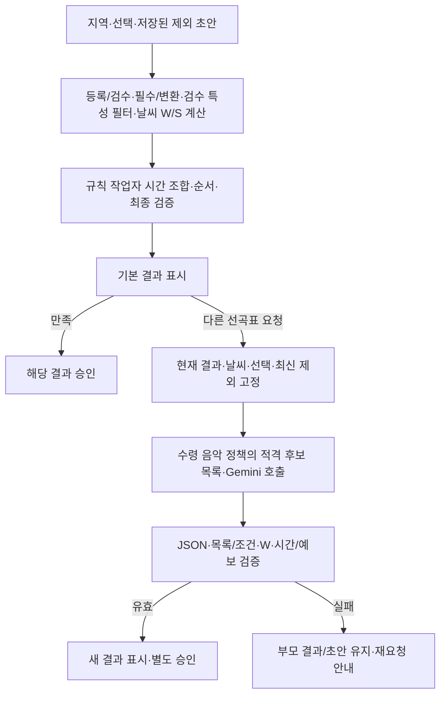

# 카페 음악 서비스 — 규칙 기본 추천과 Gemini 보조 재설정

- 작성일: 2026-10-13
- 수정일: 2026-10-14
- 상태: 사용자 설계 변경 반영. 실제 API 호출·저장소 구축·배포는 미실행입니다.
- 확정 방향: 기본 추천은 음악18개에 맞춘 자체 규칙으로 생성하고, 결과가 마음에 들지 않을 때만 Gemini로 재설정합니다. **카탈로그의 필수 조건·변환·검수 특성·확정 날씨 정책을 통과한 후보에서만** 선택합니다.
- 재설정 모델: 2026-10-14 사용자 결정으로 **Gemini 3.8 Flash**, API 모델 ID **`gemini-3.8-flash`**를 사용합니다. SDK는 google-genai Python이며 실제 프로젝트/키·호출 한도/예산은 별도 확인합니다. 모델 규격은 [Google 공식 문서](https://ai.google.dev/gemini-api/docs/models/gemini-3.8-flash)를 따릅니다.
- 인프라 자료 부분 수령: [로컬 개발 인프라 가이드](../handoff/infra/local%20infra%20guide.md)의 노드 배치·IP·팀원 SSH 접속 구조를 받았습니다. 서비스 프로세스 배치·호환 버전·저장소/접속/복구 계약, 음악 RDB 제품/DDL·불변 발행 규격·CSV 대응은 추가 자료 대기입니다. S3 객체 형식/manifest는 인계로 고정하며 기존 30+1컬럼을 현행 스키마로 확정하지 않습니다.

## 2026-10-14 음악 담당 수령 문서 우선 적용

[음악 통합 계약](./3차_음악_정책_통합_계약.md)을 적용합니다. 추천·표시18개 + 검수 보조1개·RDB4개·원본 변환·날씨50:45:5/전체75:25·장르/speed 필수 필터·사이클 고정·PTY6/7·시간176~184분을 기준으로 합니다. 새 자료의 미정은 유지하며 수동 전용16개·음악 S3 기준 저장·자동25% 단축과 동시에 적용하지 않습니다.

## 2026-10-14 저장소 결정과 광고 인계

2026-10-14 새 음악 문서 우선 지시로 음악 기준 저장은 **RDB 4개 테이블**과 추천·표시18개/검수 보조1개로 변경합니다. 음악 원본 CSV·백업/불변 내보내기는 로컬/S3 보관 가능하며 S3만을 음악 기준 DB로 사용하지 않습니다. 로그·피드백/공통 업무 상태는 PostgreSQL, 광고는 MongoDB, 날씨 MongoDB/Elasticsearch·원문 로컬/S3는 유지합니다. 3차 음원 파일·직접 재생은 추가하지 않습니다. [저장 경계와 발행 계약](./3차_저장소_경계와_발행_계약.md)과 [ADS 인계](../handoff/ads/README.md)를 적용하며 실제 설치·접속·운영 검증 완료와 구분합니다.


## 2026-10-14 공통 구현 기준 정리

문서만 읽어도 같은 입력 해석·화면 상태·검증·오류·저장 결과를 만들도록 [공통 개발 계약](./3차_공통_개발_계약과_검증_기준.md)을 적용합니다. 프레임워크/SDK·공통 형식/동점·상태 처리의 개발 기준을 정리했으며 실제 설치·코드·운영 검증 완료는 아닙니다. 자료/운영 판단이 필요한 부분만 [사용자 확인·담당자 인계 목록](./3차_사용자_확인과_담당자_인계_목록.md)에 남깁니다. 음악 W 공식·CSV 변환·18개/검수 보조·RDB4개·스냅샷 연결은 수령 문서와 최신 통합 계약으로 채택했습니다. 실제 분류/검수·혼합 최초 speed·테마 세부 정렬·환경과 남은 광고 규정만 인계 목록에 남깁니다. 새 음악 문서 우선 지시로 시간176~184분/자동 단축 미사용을 적용하고 광고 동률 순환·중단3초는 유지합니다.

## 최신 확정·보류 — 2026-10-13

국가·언어기능은3차제외·OPTION_NOT_SUPPORTED/400을유지합니다. 음악18개/검수보조·CSV변환·RDB4개·W공식·당시스냅샷은새자료/통합계약으로채택했습니다. 실제분류/검수·혼합최초speed·테마세부정렬·환경/한도만인계대기입니다.

energy/acousticness/mode의 범위 거리 적합도로 W_k=.50E+.45A+.05M을 계산하고 앞180분 비중으로 W를 구합니다. W/P/S는0~100, 활성 취향이 있으면 S=.75W+.25P, 없으면 S=W입니다. energy/acousticness와 genre/speed 미확인은 후보 보류, mode/선택 mood 미확인은0점·원본NULL 보존입니다. 날씨 범위 밖만으로 제외하거나 W 하한을 추가하지 않습니다. 모델생성점수로대체하지않습니다.

## 1. 두 경로의 역할

| 항목 | 기본 추천 | Gemini 재설정 |
|---|---|---|
| 실행 | 최초 [선곡표 받기]·독립 새 추천 | 결과 확인 후 사용자의 [다른 선곡표 요청] |
| 곡 선택 | 음악18개 변환·검수 특성의 확정 규칙 점수·정수 시간 조합·후보군 확장 | 같은 적격 후보 안에서 곡/순서/이유 제안 |
| 적격 기준 | 등록/검수·무보컬·제외·변환·검수 특성 상태·확정된 날씨 정책 | 모두 동일하게 사전/사후 적용 |
| 점수 | 날씨75%·취향25%(활성 빠르기·테마·장르의 평균), 모두 미선택이면 날씨100% | 서버가 동일 W/S를 계산·기록. 모델 생성 점수는 사용하지 않음 |
| 시간 | STANDARD180분·176~184분·정확히→초과→부족 | 같은범위검증·자동단축없음·모델에전역최적성을주장하지않음 |
| 실패 | 규칙 작업의 후보/탐색 상태 안내 | 기존 결과/초안 보존, 제한 재요청/오류 안내 |

모델을 서버 점수 순으로만 다시 정렬하거나 CP-SAT로 몰래 수정해 Gemini 결과인 것처럼 표시하지 않습니다. 조건을 통과한 Gemini 구성은 기존 점수 최적보다 품질 점수가 낮을 수 있으며 사용자가 새 결과를 확인해 승인합니다.

국가·언어 기능 제외·음악18개 기준·음악 RDB 제품/DDL·불변 발행 규격 대기·날씨/피드백/광고·익명 소유·펭귄 안내와 강수 카드 제거 결정은 유지합니다. 규칙 문서는 [현행 기본 추천 가이드](./카페_음악_추천_서비스_3차_컬럼_기반_추천_로직_가이드.md)로 복원하고 [보관 원문](./archive/규칙_기반_추천_설계_보관.md)은 이력으로 남깁니다.

## 2. 전체 흐름과 화면/API 연결



POST /api/recommendation-jobs는 기본 규칙 생성, POST /api/playlists/{id}/regenerations는 사용자가 실행하는 Gemini 재설정으로 연결합니다. 작업/결과의 generation_method는 서버가 RULE_BASED 또는 GEMINI_RECONFIGURE로 기록합니다. 기존 멱등 키·owner·family/parent·exclusion_revision 검사를 유지합니다.

새 화면 버튼·자유 입력·자동 호출은 추가하지 않습니다. 현재 부모가 Gemini 결과여도 다음 명시 재설정은 같은 계열의 최신 제외와 선택으로 새 적격 목록을 계산합니다. [제외] 저장만으로 API를 호출하지 않습니다. 부모 곡 전체를 자동 제외하지 않습니다. **Gemini 성공 결과에는 부모 곡 수의 20%를 내림한 수만큼 신규 곡이 있어야 합니다(최소 1곡).** 같은 곡의 순서만 변경하거나 기존 곡 일부만 남긴 결과는 성공으로 인정하지 않습니다.

브라우저는 자체 백엔드만 호출하고 Gemini 키는 서버에서 관리합니다. 기본 추천은 Gemini 키·한도·장애와 무관하게 실행됩니다. Gemini 실패를 자동 규칙 재생성 성공으로 대체하지 않습니다.

## 3. 요청에 넣을 정보

### 3.1. 날씨와 사용자 선택

- 지역과 요청 기준 시각, 실제 추천 구간의 예보·발표/대상 시각·확보 상태
- 선택적 보컬·빠르기·테마/장르
- 현재 부모 선곡표의 ID/순서/조건과 서버에 저장된 최신 제외 초안의 track_id·exclusion_revision
- STANDARD목표180분/허용176~184분·중복금지·부모전체N 기준max(1,N//5) 신규곡·사이클장르/speed와정책/매핑버전

PTY0은 SKY1/3/4의 맑음/구름많음/흐림, PTY1~7은 원래 강수 코드를 우선합니다. PTY4/5는 비 점수, PTY6은 비·눈 점수, PTY7은 눈 점수입니다. 눈+구름 합산은 현행에서 제외합니다. 원래 현상/값/시각을 보존하며 최초 혼합 예보 auto/fast의 speed 기준만 미정입니다. 서버W/P/S·규칙/매핑버전을제공하며모델임의점수/결측보충은금지합니다.

### 3.2. 등록 음악 목록

음악 ID·곡명·아티스트·정수 duration_ms·가용 장르/테마·보컬 검수 상태·기타 실제 확보 특성을 전달합니다. 국가·언어 값/선호/확인 상태는 전달하지 않습니다. CSV 변환energy0~10·mood/speed/genre/instrumental은 실제 입력/검수값과 척도를 전달하며 음향energy0~1로 바꾸지 않습니다. 확정된 수령 날씨 정책을 통과한 후보만 제공합니다.

서버는등록READY·현재제외·사이클장르/speed·energy/acousticness필수·최종보컬·유효예보/시간을검사합니다. 연주곡만은 검수 우선 최종 instrumental=True를 허용합니다. instrumental_review_value=True/False를 먼저 적용하고 미검수는 원본 자동 판정 True도 허용합니다. 확정 False/NULL은 제외하며 자동 판정과 청취 확정 근거를 구분합니다. 검수우선/자동True에도카탈로그발행검증은필수입니다.

전체 RDB 불변 카탈로그를 매 요청에 전송하지 않습니다. 전달 가능한 음악 수·필드·토큰 예산·목록 선정/조회 방식은 확정 모델 gemini-3.8-flash의 규격과 실제 프로젝트 한도·RDB 불변 카탈로그 자료에 맞춰 정합니다. Gemini 입력 제한은 기본 규칙 solver의 후보군 확장과 별개이며 하한/필수 조건을 풀지 않습니다. 추천은 제공한 목록의 범위 안에서 평가합니다.

## 4. Gemini 응답 계약

등록 track_id의 순서 있는 배열과 전체/곡별 이유를 GeminiProposal JSON으로 받습니다. 개발 SDK는 공식 google-genai Python이며 모델 ID는 gemini-3.8-flash로 확정했습니다. 실제 프로젝트 한도/호출 예산은 확인 대기입니다. 제공자 지원 JSON Schema 범위를 검증해 어댑터에 적용하고 서버에서는 공통 계약의 전체 형태/업무 조건을 검사합니다. 각 track_id당 이유1개, 중복/누락/목록 밖 이유는 거절합니다.

```json
{
  "track_ids": ["registered-track-001", "registered-track-002"],
  "summary": "비 예보와 선택한 취향을 고려한 추천 설명",
  "track_reasons": [
    {"track_id": "registered-track-001", "reason": "제공된 곡 특성과 선택에 근거한 짧은 설명"},
    {"track_id": "registered-track-002", "reason": "제공된 곡 특성과 선택에 근거한 짧은 설명"}
  ]
}
```

위는 형식 예시로 3시간 결과가 아닙니다. 곡명·커버·길이는 응답에서 믿고 쓰지 않고 서버 RDB 불변 카탈로그의 고정 조회 자료로 채웁니다. 이유는 생성 설명이며 객관적 검수 근거나 확정 점수가 아닙니다. 허위 수치나 입력에 없는 날씨/음악 사실을 확정적으로 표시하지 않습니다.

Structured Outputs는 JSON 구조를 정하는 도구이며 등록 ID·시간·제외/보컬 준수를 보장하지 않습니다. 응답이 올바른 JSON이어도 업무 조건 검증이 필요합니다.

## 5. 서버 결과 검증과 3시간 조건

1. JSON 스키마, 비어 있지 않은 순서 목록, 이유와 ID 대응을 검사합니다.
2. 모든 ID가 작업에 고정한 제공 목록/S3 공개 카탈로그에 있는지 확인합니다.
3. ID 중복·제외·무보컬/변환·검수 특성/검수와 요청 예보로 계산한 확정 날씨 정책를 확인합니다.
4. RDB 불변 카탈로그의 실제 정수 duration_ms를 합산합니다. 모델이 말한 총시간을 사용하지 않습니다.
5. 부모 고유 곡 수 N에 대해 required_new_count=max(1, N // 5)를 계산하고 부모에 없는 신규 track_id 수가 이 값 이상인지 확인합니다. 미달이면 NO_MEANINGFUL_CHANGE입니다.
6. STANDARD176~184분과실제종료까지의예보유효성을검사합니다. 5.2절에따라자동단축/필터확대는현행미사용이며176분미만은성공하지않습니다.
7. 결과 생성과 조건/곡/시간 정책 스냅샷을 저장하고 승인 시 현재 제외 초안과 적용 시간 정책의 일치를 다시 확인합니다.

```text
total_ms = sum(catalog.duration_ms for returned registered track_ids)
# STANDARD 예시입니다. 확인된 후보 부족의 SHORTENED는 공통 계약3.5절의 목표/경계값을 사용합니다.
10_560_000 <= total_ms <= 11_040_000
```

목표 180분은 유지합니다. 기본 규칙의 정확히→초과→부족 우선순위는 유지합니다. Gemini 경로에서는 요청의 목표/비교 기준으로 사용하지만, Gemini 단일 응답이 해당 순서의 전역 최적이라고 주장하지 않습니다. 성공은 유효 조건 충족이며 최적성 입증과 구분합니다. Gemini 결과는 범위/필수 조건 검증과 최적성 입증을 구분하며 규칙 경로의 시간 정책을 삭제하지 않습니다.

범위 밖/등록 밖/금지 곡 결과는 성공·승인 가능으로 내보내지 않습니다. 서버가 불량 곡을 삭제한 뒤 남은 목록을 새 정상 결과처럼 표시하지 않습니다. 제한된 재요청이 실패하면 명확히 실패 상태를 반환하고 기존 결과는 보존합니다. Gemini 응답을 자체 solver로 몰래 보정하지 않습니다. 명시 재설정 실패는 실패로 남기고 이전 정상 결과를 유지합니다.

### 5.1. 곡 변화의 성공 판정과 피드백

```text
parent_ids = set(부모 결과의 track_id)
result_ids = set(응답의 track_id)
added_ids = result_ids - parent_ids
removed_ids = parent_ids - result_ids
# 부모 전체 고유 곡 수의 20% 내림: 정수 나눗셈으로 계산
required_new_count = max(1, len(parent_ids) // 5)
meaningful_change = len(added_ids) >= required_new_count
```

부모에 없던 고유 track_id의 수가 부모 곡 수20% 내림 기준 이상이면 변화 기준을 통과합니다. 기존 곡 제거는 필수 조건이 아니므로 추가만으로도 인정하며 등록/검수·무보컬·제외·중복·시간/날씨/예보는 별도로 통과해야 합니다. 분모는 재설정 직전 부모 결과의 전체 고유 곡 수이며, 제외된 곡도 부모에 포함되었다면 분모에 남깁니다. 결과를 단축해도 분모를 줄이지 않습니다. 정수 나눗셈 N // 5는 floor(N * 0.20)과 같으며 부동소수점 오차를 피합니다. 1~4곡의 부모도 변화 없는 결과를 인정하지 않으므로 최소 1곡이 필요하고, 빈 부모는 유효한 재설정 요청이 아닙니다. 49곡은 9곡(실제 약 18.37%), 50곡은 10곡, 53곡은 10곡(약 18.87%)입니다. 사용자 결정에 따른 내림이므로 실제 비율은 20%보다 조금 낮을 수 있습니다. 동일 ID 집합의 순서 변경, 곡명/커버/이유만 변경, 기존 곡의 일부만 반환한 축소 목록은 변화 기준 미달입니다. 곡의 녹음 동일성은 추가 음악 계약이 없으므로 안정적인 track_id 기준으로 비교합니다.

변화 없거나 신규 곡 추가 기준 미달이면 일반 성공으로 저장/승인하지 않고 NO_MEANINGFUL_CHANGE와 설명을 반환합니다. 변화 없음 예: ‘기존 선곡표와 다른 곡을 찾지 못했어요. 현재 선곡표는 유지됩니다.’ 일부 변경했지만 기준 미달 예: ‘필요한 신규 곡 수를 채우지 못했어요. 현재 선곡표는 유지됩니다.’ 응답/진단에는 parent_track_count·required_new_count·actual_new_count를 기록합니다. 기존 결과·초안·승인 기록·대표 이미지는 보존합니다. 사용자에게 피드백은 항상 표시하며, 내부 재요청을 한다면 정해진 전체 예산 안에서만 진행합니다.

서버가 신규 적격 곡이 전혀 없음을 확인하면 불필요한 호출을 줄이고 동일한 변화 없음 안내를 반환할 수 있습니다. 그렇다고 기존 곡 전체를 자동 제외하거나 보컬/날씨 기준을 풀지 않습니다. 별도 가상의 재설정 성공·승인·제외 이벤트는 만들지 않고 요청 시도/종료 상태를 기록합니다.

### 5.2. 후보 부족과 시간 정책

수령 음악 규칙4-3절 우선으로 STANDARD180분/176~184분만 제공하며 자동 SHORTENED를 사용하지 않습니다. 기존25%/135분 단계는보관이력입니다. 전체적격 후보로범위구성이불가능하면CANDIDATE_SHORTAGE와부모보존, 제한풀/UNKNOWN/모델짧은응답은별도오류입니다. 시간때문에보컬/사이클장르·speed/제외/중복/예보를완화하지않습니다. 정책버전phase3-duration-20261014.2를고정합니다.

## 6. 비동기 작업·오류·비용 관리

기존 내구성 작업 큐·lease·heartbeat·멱등성은 외부 API 작업에도 사용합니다. 외부 호출 동안 긴 DB 잠금을 유지하지 않습니다. 같은 사용자 멱등 요청은 이미 등록한 작업/결과를 반환하지만, 응답 유실로 외부 호출이 재실행될 수 있으므로 시도 기록·비용과 서비스 결과 중복 방지를 구분합니다.

| 상황 | 처리 방향 |
|---|---|
| 인증/설정 오류 | 운영 오류로 기록. 같은 잘못된 설정을 무한 재시도하지 않음 |
| 호출 한도·일시 오류·타임아웃 | SDK 재시도와 앱 재시도를 합친 전체 시도/시간 예산 안에서 처리 |
| 빈 응답·차단/거절·중단 | 유효 선곡표가 없는 상태로 표시. 서버 조건을 완화하지 않음 |
| JSON 구조 오류·목록 밖 ID | 응답 무효. 예산 내 수정 요청 또는 실패 |
| 시간/필수 조건 위반 | 검증 실패 이유로 제한 재요청. 실패 시 기존 결과 보존 |
| 신규 곡 없음·20% 내림 신규 곡 추가 기준 미달 | NO_MEANINGFUL_CHANGE와 변화 없음/신규 곡 수 부족 안내·부모 보존. 순서 변경만으로 성공 처리하지 않음 |
| 확인된 후보 부족 | 176~184분구성불가이면CANDIDATE_SHORTAGE·자동단축/필터확대없음 |

실제 상태 코드와 거절 표시는 채택 API/SDK에 대응시킵니다. 모델·호출량·입출력 토큰·재시도 횟수·응답 지연을 기록합니다. 모델 ID는 사용자 결정의 gemini-3.8-flash를 사용하며 가격·실제 무료 한도/호출 예산은 적용 시 확인합니다. 실제 API 호출/과금은 이번 문서 작성에서 하지 않습니다.

## 7. 저장과 재현 근거

3차에 추가한 곡별 LIKE/DISLIKE/null과 선곡표 전체 정수1~5/null 평가는 실제 source_playlist_id에 귀속합니다. Gemini 새 결과는 미평가로 시작하고 부모 평가는 보존하며 변화 없음/실패에는 부모 평가도 유지합니다. 평가 저장/수정/취소 자체는 Gemini 호출이나 자동 제외·승인을 실행하지 않습니다. 이번 추가에서는 평가를 프롬프트·필터·점수에 자동 반영하지 않습니다. 수집 계약은 [구현 설계도](./카페_음악_서비스_구현_설계도.md) 6-9절을 따르며 입력 반영은 별도 결정입니다.

기존 owner/family/result/exclusion_revision·당시 날씨/선택/곡 스냅샷을 유지하고 provider=Gemini, 모델 식별자, 프롬프트/스키마 버전, 입력 음악 목록의 버전/해시, 호출 시도/시각, 응답과 검증 결과를 기록합니다. 토큰·응답 원문 보관량/기간은 운영 규정으로 정하며 비밀키를 로그에 넣지 않습니다.

policy_version은 기본/재설정의 공통 규칙/적격 점수 버전이며 provider/model과 prompt/schema_version은 별도입니다. 기본 결과는 모델/프롬프트 필드가 해당 없음이고 Gemini 결과는 실제 호출 근거를 기록합니다. 같은 입력의 재호출 결과가 항상 같다고 보장하지 않습니다. 과거 이력에는 당시 생성 결과를 보존하고 현재 모델로 다시 추천한 내용을 대신 넣지 않습니다.

## 8. 음악 RDB와3차 국가·언어 기능 제외

국가·언어를입력/관리/검수/카탈로그/프롬프트/피드백에추가하지않습니다. 수령추천·표시18개+검수보조1개와별도운영자료를사용합니다.

음악18개+검수보조1개는RDB4개로관리합니다. energy/acousticness/mode/speed는원본변환, mood/main_inst는청취, 보컬은검수우선입니다. 실제RDB제품/DDL·연결/발행은별도인계이며30+1/옛3개테이블을복원하지않습니다.

날씨 Kafka/Spark·로컬/S3·조회 저장소와 피드백 파이프라인은 이번 결정만으로 삭제하지 않습니다. 수령한 로컬 가이드는 Hyper-V Ubuntu VM과 최종 AWS EC2 Linux 방향을 설명합니다. [인프라 수령 상태](./3차_구현_결정과_익명문맥_원문보관_가이드.md)에 따라 보완 자료와 실제 연결을 확인하며 최종 AWS 상세 구성·S3 발행 규격은 D-03에서 확정합니다.

## 9. 변경되는 태스크와 검증

| 태스크 | 변경 방향 |
|---|---|
| R-01 | 음악18개 수령 날씨 정책/시간/탐색 + Gemini 입력/응답·토큰/재시도 계약 |
| R-02 | 규칙 W/S 계산·기본 조합 + Gemini 보조 어댑터/시도 기록 |
| R-03 | 공통 필수/확정된 변환·검수 특성/날씨 정책·등록 목록 고정·Gemini 재검증 |
| R-04 | 기본 정수 탐색/순서·Gemini 응답/시간·재요청·작업 복구 |
| R-05 | 기존 소유·멱등 작업/결과·제외 초안·승인 + 모델/프롬프트 근거 저장 |
| M/A | CSV→음악 RDB 불변 카탈로그 계약·국가·언어 기능 제외·실제 검수·조회 준비. 세부 구조 추가 문서 대기 |
| D/I | 외부 API 접속/키 설정·네트워크·S3/실행 환경 추가 문서 대응 |
| U/Q | 호출 대기·제공자 오류·무효 결과·등록 목록 제한·필수 조건·재생성/피드백 통합 |

완료 기준은 음악18개의 원본 변환 척도/새 날씨 기대값·경계/시간 탐색 사례와, Gemini의 목록 밖 ID/중복/미검수 보컬/시간 위반 차단·국가/언어 입력 거부/상속 차단, 정상 JSON 매핑, 거절·한도·타임아웃·재시도, 저장/소유/초안/스냅샷 일치입니다. 고정 응답으로 서비스 계약을 검사하고 실제 API 응답 품질·처리시간·사용량은 별도로 기록합니다.

## 10. 공식 참고

- [Gemini Structured Outputs](https://ai.google.dev/gemini-api/docs/structured-output): JSON Schema 기반 구조화 응답. 업무 의미 검증은 별도입니다.
- [Gemini API 키](https://ai.google.dev/gemini-api/docs/api-key): 서버에서 키 관리.
- [Gemini 호출 한도](https://ai.google.dev/gemini-api/docs/rate-limits): 프로젝트/모델/등급별 실제 한도 확인.
- [Gemini 오류 처리](https://ai.google.dev/gemini-api/docs/troubleshooting): 채택 SDK의 재시도/오류 처리 확인.

확정 모델 gemini-3.8-flash와 사용할 google-genai SDK 버전의 지원 기능·실제 계정 한도는 적용 시 확인합니다. 외부 공식 자료는 호출 방식의 근거이며 서비스 추천 품질 검증 결과가 아닙니다.

## 11. 동일 사이클 재설정

family_id의최초허용장르/speed·시작선택·정책/매핑/option버전을유지합니다. 선택생략/동일명시만허용하고 조건변경은CYCLE_CONDITIONS_CHANGED/409·새기본요청입니다. 날씨갱신은같은집합으로W만재계산하고기존결과는불변입니다. 최초혼합기준미정과이미고정된집합의혼합W계산을구분합니다. 상세는[음악통합계약5절](./3차_음악_정책_통합_계약.md#5-장르테마와-사이클-필터)을적용합니다.
