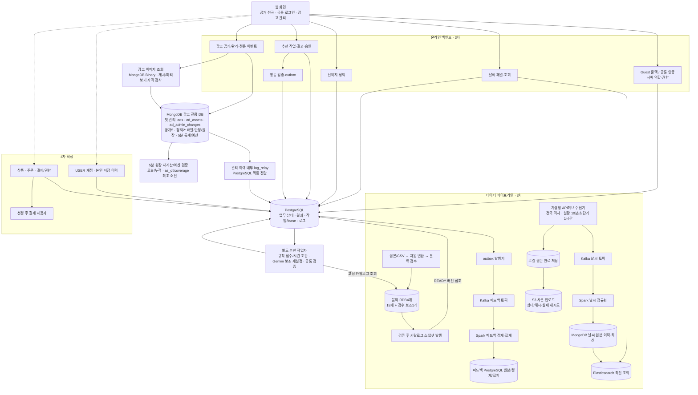
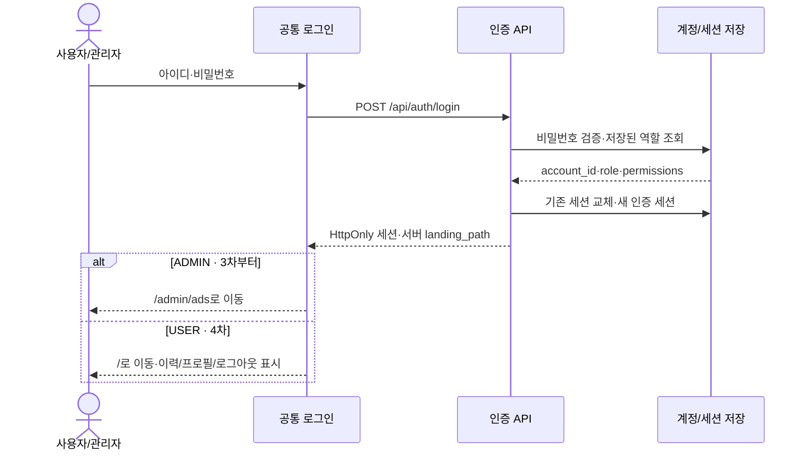
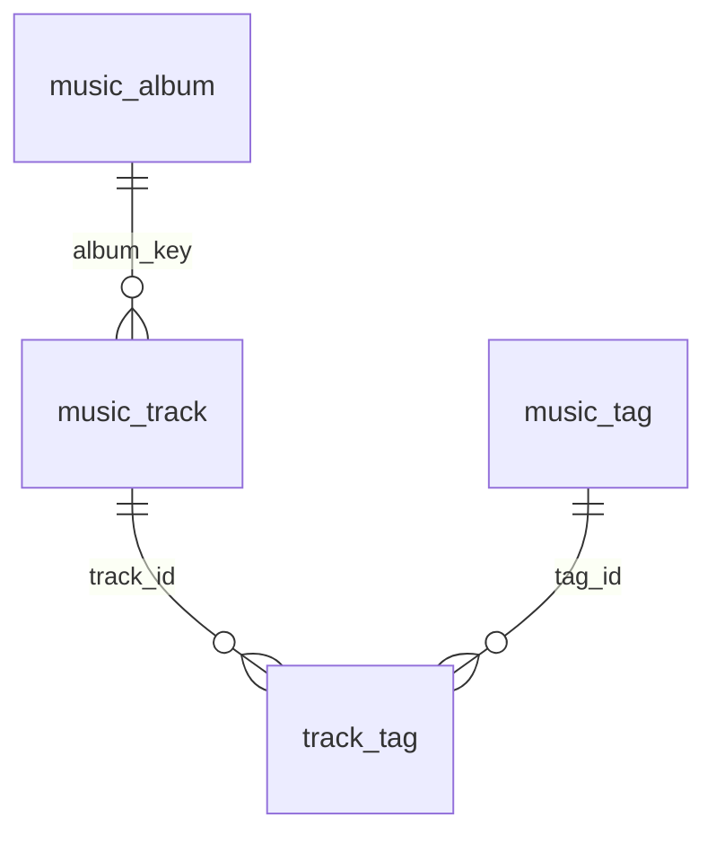
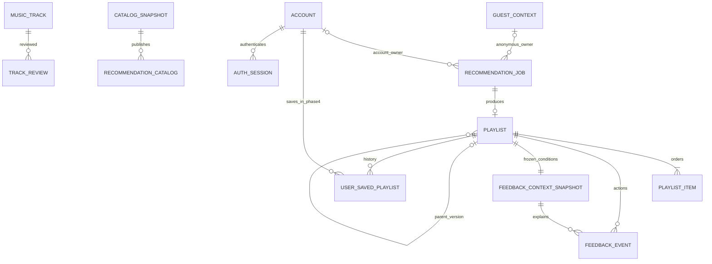
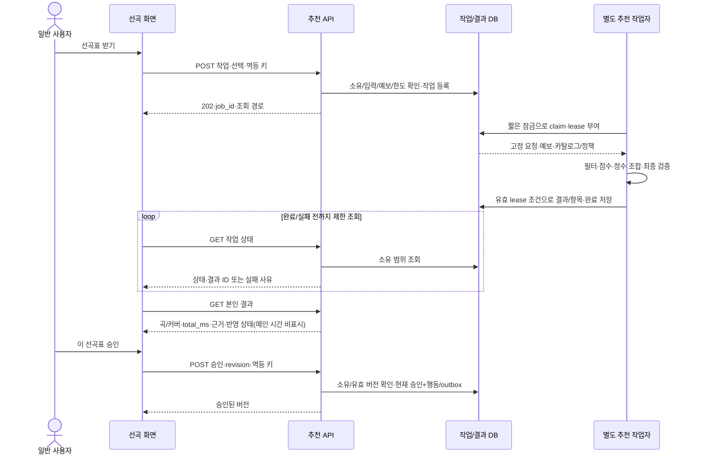
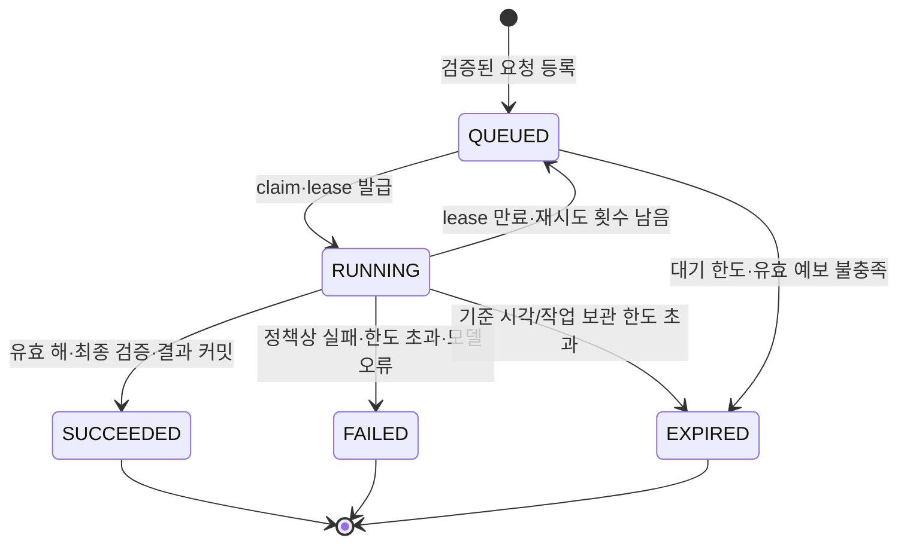
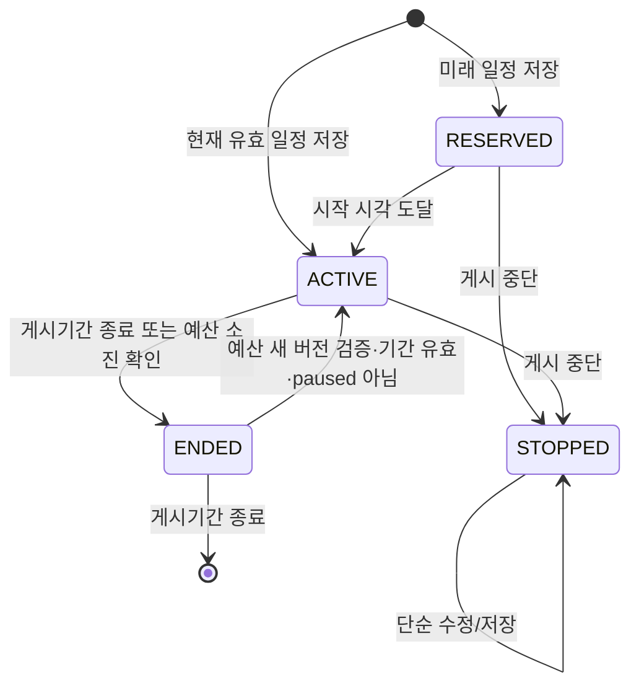
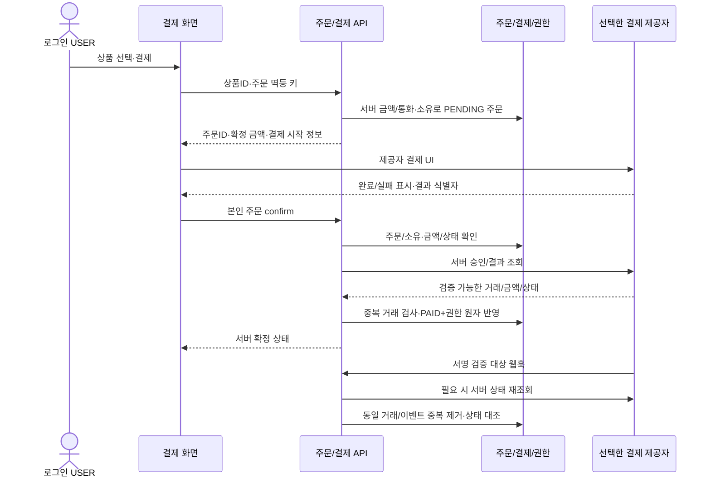

# 카페 날씨 기반 음악 서비스 — 3차·4차 구현 설계도

- 작성일: 2026-10-07
- 수정일: 2026-10-15
- 상태: 서비스의 구현 계약입니다. 전체 애플리케이션·업무 DB·계정·결제·운영 완료를 뜻하지 않습니다. 광고의 코드/검증 상태는 광고 개발·수용 문서에서 구분하며 운영 watch 상주·공유 PostgreSQL·AWS·브라우저 통합은 미실행입니다. 로컬 인프라 가이드 수령과 실제 클러스터 연결 검증도 구분합니다.
- 요구 기준: [서비스 기능/사용자 흐름](./카페_음악_서비스_기능_및_사용자_흐름_정리.md), [구현 태스크](./카페_음악_추천_서비스_3차_구현_태스크.md), [추천 로직 가이드](./카페_음악_추천_서비스_3차_컬럼_기반_추천_로직_가이드.md).
- 데이터 기준: 수령 음악 문서 우선의추천·표시18개+검수 보조1개·RDB4개·CSV변환·날씨50:45:5·75:25·사이클 필터입니다. 실제 분류/검수·RDB제품/물리DDL·접속/발행은 별도 검증입니다. 국가/언어·음원 직접재생은3차에서 제외합니다.
- 설계 원칙: 큰 기능 → 화면 → API → 저장/처리 → 예외/검증 → 구현 순서로 연결합니다.

## 2026-10-15 임시 광고 제어 확인 도구

최신 사용자 요청으로 기존 광고 API를 연결하는 [로컬 임시 도구](../development/ads/임시_광고_관리_도구.md)를 추가합니다. 별도 sandbox 설정·URLconf와 loopback의 `/dev/ads/`·테스트 DB만 사용하며 일반 서비스 라우팅/공유 인증·정식 React 관리자 구조는 변경하지 않습니다. 아래의 기존 관리자 화면 제외에 대한 이번 로컬 검증 예외이며 I-05/AD-03·공개 배너/운영 통합 완료를 뜻하지 않습니다. 코드/실행 검증은 광고 수용 기록에 별도로 남기고 기존 태스크 ID·선행·P0/P1을 유지합니다.

## 2026-10-15 광고 공개 수명·5분 통계/예산 확정

사용자 결정으로 delivery는 발급 후30분과 게시 종료 중 이른 시각까지 표시하며 발생 후300초의 보고 허용과 분리합니다. 제목/asset/link 변경은 이전 소재의 새 표시와 변경 이후 발생을 막되 변경 이전 유효 발생의 지연 보고·저장된 재전송 응답은 보존합니다. 캠페인 자동 종료는 예산 소진 확인과 게시기간 종료이며 수동 paused는 별도입니다.30분 배달 만료는 캠페인 종료가 아닙니다.

관리 통계와 예산 검증은 각각5분 주기입니다. 검증 시 일일 또는 전체 예상 사용량이 한도 이상이면 최초 소진 확인 시각을 고정하고 신규/재확인/이미지를 막습니다. 확인 이전 유효 발생은300초 내 지연/초과도 인정하며 그 시각부터는 제외합니다. 요청마다 합산하거나 상단23/하단20토큰을 예약하지 않습니다. 상세 입력·시간·runtime provider·명령/검증은 [공통 개발 계약3.8절](./3차_공통_개발_계약과_검증_기준.md), 관리3+공개5+정책2 컬렉션/원자성은 [저장 계약3.1절](./3차_저장소_경계와_발행_계약.md)을 따릅니다. 이번 구현은 광고 백엔드·배치·저장·로그이며 관리자 화면을 변경하지 않습니다. 운영 watch 상주·공유 PostgreSQL·AWS·브라우저 통합은 별도 검증입니다.

## 2026-10-14 광고 관리 간소화 적용

사용자가 제공한 [간소화 원문](../handoff/ads/04_광고_관리_간소화_인수인계서.md)과 [통합·추가 인계](../handoff/ads/05_광고_간소화_통합과_추가_인계.md)를 현행 광고 기준으로 적용합니다. 첫 관리 단계는 ads/ad_assets/ad_admin_changes 세 컬렉션·MongoDB 이미지 Binary·관리 감사/멱등 응답 통합입니다. 3차는 카페 전용이며 관리자/사용자 업종 선택·태그 입력·업종별 매칭은 제공하지 않습니다. 해당 확장은4차로 분리합니다. 첫 관리 이후의 공개 제공/측정·토큰/주기 통계/예산은2026-10-15 확정 계약을 적용하며 전체3차 필수 범위와 기존 태스크 ID/직접 선행은 유지합니다. 초기 세 컬렉션의 단계 구분을 보존하고 현행 추가 구조는 공통 개발 계약3.8절과 ADS 인계의 명시 범위에 한정합니다.

3차는 카페 광고만 운영하고 위치·일정·paused·소재·예산 자격을 충족한 후보에서 높은 priority·위치별 동률 순환을 적용합니다. 업종/태그가 제공·측정의 전제가 아니며 최초 guest 발급·추천 미요청 집계·단가8/5/클릭추가15·중복/지연/보관은 유지합니다. 미연결 지표는 연동 대기, 실제 통계는 주기 집계하며 예산 제공 제어와 구분합니다. 첫 관리 로그는 ad_admin_changes 내부 log_relay로 전달합니다. 업종별 입력/태그/매칭/순환은4차 인계에서 정하고3차 API/DB/화면/검증의 선행 조건으로 넣지 않습니다.

## 2026-10-14 음악 담당 수령 문서 우선 적용

[음악 통합 계약](./3차_음악_정책_통합_계약.md)을 적용합니다. 추천·표시18개 + 검수 보조1개·RDB4개·원본 변환·날씨50:45:5/전체75:25·장르/speed 필수 필터·사이클 고정·PTY6/7·시간176~184분을 기준으로 합니다. 새 자료의 미정은 유지하며 수동 전용16개·음악 S3 기준 저장·자동25% 단축과 동시에 적용하지 않습니다.

## 2026-10-14 저장소 결정과 광고 인계

2026-10-14 새 음악 문서 우선 지시로 음악 기준 저장은 **RDB 4개 테이블**과 추천·표시18개/검수 보조1개로 변경합니다. 음악 원본 CSV·백업/불변 내보내기는 로컬/S3 보관 가능하며 S3만을 음악 기준 DB로 사용하지 않습니다. 로그·피드백/공통 업무 상태는 PostgreSQL, 광고는 MongoDB, 날씨 MongoDB/Elasticsearch·원문 로컬/S3는 유지합니다. 3차 음원 파일·직접 재생은 추가하지 않습니다. [저장 경계와 발행 계약](./3차_저장소_경계와_발행_계약.md)과 [ADS 인계](../handoff/ads/README.md)를 적용하며 실제 설치·접속·운영 검증 완료와 구분합니다.


## 2026-10-14 Gemini 재설정 모델 확정

사용자 결정으로 선곡표 재설정의 API 모델은 **Gemini 3.8 Flash(`gemini-3.8-flash`)**를 사용합니다. 기본 추천은 규칙 방식이며 해당 모델은 명시 재설정에만 호출합니다. 실제 프로젝트/키·호출 한도/예산 확인은 별도입니다.

## 2026-10-14 공통 구현 기준 정리

문서만 읽어도 같은 입력 해석·화면 상태·검증·오류·저장 결과를 만들도록 [공통 개발 계약](./3차_공통_개발_계약과_검증_기준.md)을 적용합니다. 프레임워크/SDK·공통 형식/동점·상태 처리의 개발 기준을 정리했으며 실제 설치·코드·운영 검증 완료는 아닙니다. 자료/운영 판단이 필요한 부분만 [사용자 확인·담당자 인계 목록](./3차_사용자_확인과_담당자_인계_목록.md)에 남깁니다. 음악 W 공식·CSV 변환·18개/검수 보조·RDB4개·스냅샷 연결은 수령 문서와 최신 통합 계약으로 채택했습니다. 실제 분류/검수·혼합 최초 speed·테마 세부 정렬·환경과 남은 광고 규정만 인계 목록에 남깁니다. 새 음악 문서 우선 지시로 시간176~184분/자동 단축 미사용을 적용하고 광고 동률 순환·중단3초는 유지합니다.

## 최신 결정 — 규칙 기본 추천과 Gemini 보조 재설정

### 3차 국가·언어 제외와75:25·신규 곡 기준 — 2026-10-13 확정

3차에는 국가·언어 설정/검수/필터/가점/관리 입력/피드백 필드를 제공하지 않습니다. 음악18개와 검수 보조1개를 사용하고 mode/acousticness·CSV 변환·보컬 최종값·mood/genre/speed를 현행 기능에 연결합니다. 기본/재설정 요청은 국가·언어 관련 필드를 허용하지 않으며 이전 언어 선택을 상속하거나 숨겨 적용하지 않습니다. 별도 후속 단계 채택은 미정입니다.

W/P/S는0~100입니다. 활성 빠르기T·테마M·장르G 일치 점수의 평균 P로 S=0.75*W+0.25*P, 모두 미선택이면 S=W입니다. 날씨 내부는energy50%/acousticness45%/mode5%이며 새 날씨 범위·거리 감점·NULL 규칙을 적용합니다. 장르·speed 필수 필터를 먼저 적용하므로 선택된 두 그룹은 통과 곡에 공통100점입니다. mood 미확인은0/활성 분모 유지, genre/speed 미확인은 후보 보류입니다. 18개·검수 보조값·불변 당시 스냅샷과 사이클 범위를 함께 보존합니다.

새 결과는 부모 전체 고유 곡 수N의20% 내림값 이상인 신규 곡을 포함하면 인정합니다: required_new_count=max(1,N//5), actual_new_count=len(result_ids-parent_ids). 기존 곡 제거는 필수 조건이 아니며 추가만으로도 통과할 수 있습니다. 부모 분모는 제외 후에도 유지하고 순서/설명 변경·기준 미달은 실패 안내와 부모 보존입니다. 등록/검수·무보컬·제외·중복·확정 날씨/시간·예보 검증은 별도로 모두 통과해야 합니다.


### 곡별 반응·선곡표 만족도 — 2026-10-13 추가

3차 공개 추천에 곡별 [좋아요]/[싫어요]와 선곡표 전체의 별점 1~5점 만족도 평가를 추가합니다. 곡 반응은 LIKE/DISLIKE/미평가(null)의 세 상태이며 같은 버튼 재클릭은 해제, 반대 버튼은 전환합니다. 별점은 곡 목록 바깥의 [이 선곡표 만족도] 영역에 정수 1~5점으로 선택하고 [평가 취소]로 해제합니다. 둘 다 선택 입력·초기 미평가이며 비로그인 본인 결과에서 이용합니다. 곡 반응과 별점은 실제 결과 버전에 귀속하고 새 결과로 복사하지 않습니다. 곡 제외·승인과 별개이며 자동 추천/제외/승인·점수 변경·Gemini 호출을 유발하지 않습니다. 저장/취소·당시 조건/곡·revision·outbox·집계·검증은 구현 설계도 6-9절을 따릅니다. 실제 UI/API 구현 완료를 뜻하지 않습니다.


### 재설정 변화·시간 기준 — 2026-10-14 음악 문서 우선 적용

- Gemini 재설정은 부모 선곡표 곡 수의 20%를 내림한 수만큼 부모에 없던 `track_id`가 포함되어야 새 성공 결과로 인정합니다. 기준 곡 수는 재설정 직전 부모 결과의 고유 곡 수이며 제외 후의 작은 목록으로 분모를 줄이지 않습니다. `added_ids = result_ids - parent_ids`, `required_new_count = max(1, len(parent_ids) // 5)`, 성공 조건은 `len(added_ids) >= required_new_count`입니다. 소수점은 버리므로 49곡은 9곡, 50곡은 10곡, 53곡은 10곡이 필요합니다. 1~4곡은 내림값이 0이어도 기존 변화 없음 불인정 원칙에 따라 최소 1곡이 필요합니다. 동일 곡의 순서/설명 변경이나 기존 곡 일부만 남긴 결과는 인정하지 않습니다. 다른 필수 검증도 모두 통과해야 합니다.
- 변화가 없으면 `NO_MEANINGFUL_CHANGE`와 “기존 선곡표와 다른 곡을 찾지 못했어요. 현재 선곡표는 유지됩니다.”를 안내합니다. 일부 변경했어도 신규 곡 추가 기준 미달이면 같은 상태 코드와 “필요한 신규 곡 수를 채우지 못했어요. 현재 선곡표는 유지됩니다.”를 안내하며 parent_track_count·required_new_count·actual_new_count를 기록합니다. 부모 결과·승인 상태·제외 초안을 보존하고 새 성공 결과나 승인/곡 제외 이벤트를 만들지 않습니다. 실제 재설정 시도와 변화 없음 진단은 별도로 기록합니다.
- 새 음악 문서4-3절을 우선해 현행 성공 범위는176~184분입니다. 후보 부족에서도 자동 단축/필수 범위 확대를 하지 않으며 구성 불가이면 CANDIDATE_SHORTAGE와 부모 보존입니다. 별도 시간 단축 정책은 재확정 전까지 미사용입니다.
- 시간 정책은 phase3-duration-20261014.2/STANDARD_ONLY·목표180분/허용176~184분을 작업·결과·승인·피드백에 동일 적용합니다. 기존25%/135분 단계는 보관 이력이며 현행 검증값으로 사용하지 않습니다.
- 후보 부족은 적격 후보 수·총 재생시간·필터 사유와 탐색 범위를 근거로 판단합니다. 모델의 짧은 응답, 제한 후보 풀의 실패, solver `UNKNOWN`/시간 초과만으로 전체 후보 부족을 단정하지 않습니다. 현행176~184분 성공률과 후보 부족/탐색 미완료를 구분해 집계합니다.


기본 추천은 수령 음악 문서의18개와 검수 보조 instrumental_review_value를 사용한 규칙·정수 시간 조합입니다. Gemini 3.8 Flash는 명시 재설정에만 같은 적격 RDB 목록에서 선택합니다. CSV 변환 energy/acousticness/mode/speed·청취 mood/main_inst, 검수 우선 보컬·장르 대분류·사이클 고정을 적용합니다. 수동 전용16개·음악 S3 기준 저장·옛 음향3개/0.55 하한·자동 시간 단축은 현행에서 제외합니다. 상세는 최신 음악 통합 계약을 따릅니다.

[현행 Gemini API 추천 설계](./카페_음악_서비스_3차_Gemini_API_추천_설계.md). 규칙 가이드는 현행으로 복원하고 보관본은 이력으로 유지합니다. Gemini 재설정 실패 시 부모 결과/초안을 유지하고 자동 규칙 재생성으로 바꾸지 않습니다. 실제 API 호출·과금·DB 변경·배포는 이번 문서 작업에서 하지 않습니다.

## 2026-10-13 구현 결정 반영

초기에는 같은 네트워크의 로컬 클러스터에서 Kafka·Spark를 연결하고 최종 AWS로 이전합니다. 문서 개발 기준은 React·TypeScript·Vite와 Django이며, 정확한 버전·설치/접속은 D-03의 환경 검증으로 고정합니다. 날씨 파이프라인은 새로 구현하며 3차 음악은 보유 CSV를 사용하고, 상세 음악 규격은 추가 문서로 받습니다. 원문은 로컬과 S3에 함께 보관합니다. 작은 후보군부터 상한까지 확장하는 탐색을 사용하고 실제 크기/시간은 미정입니다.

날씨 패널은 유지하고 별도 강수 카드·X·닫기 기록·재노출 방지는 제거합니다. 6시간 공유 수집/조회와 앞 3시간·실제 초과분 추천 검증은 유지하며, 펭귄 안내의 X/Esc는 별개입니다. 새 음악 규칙의 PTY4/5는 비 점수, PTY6은 비·눈 점수, PTY7은 눈 점수이며 원래 현상을 보존합니다. 최초 혼합 예보의 speed 기준은 별도 미정입니다. Gemini에는 원래 현상과 같은 적격 판정 근거를 제공합니다. 관리자 초기화 발급·초기 권한 배정, 회수 시 비활성화/세션 무효화, 익명 쿠키 소유 검사, 로컬·S3 원문 보관의 상세 계약은 아래 연결 가이드를 따릅니다. 광고 수명·소재·5분 통계/예산은2026-10-15 계약을 따르고 남은 실금액/파일 정리/조회·과금 규정만 별도 인계입니다. 문서 반영은 실행/설치/배포 완료가 아닙니다.
상세 계약: [3차 구현 결정과 익명 문맥·원문 보관 가이드](./3차_구현_결정과_익명문맥_원문보관_가이드.md).

## 1. 구현할 제품과 단계 경계

### 1-1. 큰 기능과 세부 책임

| 큰 기능 | 사용자/관리자가 하는 일 | 구현 책임 | 단계 |
|---|---|---|---|
| 지역·날씨 | 동 선택/변경·3시간 예보 확인 | 자료별 전국 격자 공유 수집·지역별 6시간 조회 구성·유효/누락 판정 | 3차 |
| 최소 선택 | 보컬·빠르기·복수 테마/장르 상태 설정 | 선택 코드 가용성·입력 검증·필수/선호 분리 | 3차 |
| 3시간 선곡 | 요청·곡 제외·재생성·승인 | 후보 필터·Gemini 요청/응답·정수 시간 조합·버전/소유 | 3차 |
| 지역 날씨 패널 | 현재/앞3시간·갱신/누락 표시 | 지역별 예보 조회·필수 항목/구간 유효성 | 3차 |
| 펭귄 사용자 안내 | 3단계 확인·지역 단계 날씨/강수 설명·이전/건너뛰기/종료·사용 안내 다시 보기 | 공통 PNG·설정/강조·브라우저 기록·예시/실제 클릭/이벤트 격리 | 3차 |
| 로그인·관리 접근 | 공통 로그인·관리 작업 | 서버 역할·세션·ADMIN 광고 관리 이동·음악 권한 | 3차 |
| 광고 운영 | 한 위치 등록/수정·저장/중단·미리보기·지표 | 광고 모듈·공개 배너·일정/선정·전용 측정 | 3차 |
| 음악·피드백 운영 | 자료 등록·테마/보컬 검수·준비/오류·관리자 제외 이력 조회 | 원본/정제/Gold·검수 버전·행동 outbox/Kafka·당시 태그/곡 스냅샷·복구 | 3차. 제외 이력의 최소 조회 화면/API는 P0 |
| 사용자 계정·이력 | USER 로그인·프로필/로그아웃·선곡표 저장/조회 | 본인 계정 소유·공통 역할 이동·보관/삭제 | 4차 확정 |
| 결제·권한 | 주문·결제·본인 결제 이력·취소/환불 | 상품/금액·서버 확인·중복 방지·권한 상태 | 4차 확정 |

**3차·4차 모두 기본 추천은 비로그인으로 제공합니다.** 4차의 선곡 이력·결제에만 USER 로그인을 요구합니다. 관리자 인증은 3차부터 관리 API를 보호합니다.

지역만 필수이며 매장명·상세 주소·매장 타입·취향 설문은 요구하지 않습니다. 3차에는 로컬 AI 모델을 사용하지 않으며 Gemini는 선곡표 재설정에만 사용합니다. 직접 음악 재생·외부 플레이리스트·개인화·Web Push·익명 결과의 계정 편입은 별도 선택 확장입니다.

### 1-2. 확정 요구와 설계 제안

| 구분 | 내용 |
|---|---|
| 사용자 확정 | 동일 펭귄 한 장을 재사용하는 3단계 안내(1번에 날씨·강수 통합), 3열 메인·첫 곡 커버/기본 이미지·메인 시간 비표시, 180분·176~184분·초과 우선, 지역 날씨, 국가·언어 기능 제외, 테마/장르 한 영역 복수 선택, 공통 로그인 역할 이동, 3차 관리/광고, 4차 USER/결제·기본 공개 유지 |
| 이번 구체화 | 테마 데이터 구조·OR 선호·UNKNOWN/N/A 처리·Gemini 어댑터·작업자·스냅샷·API/저장·광고 상태 |
| 기술 개발 기준 | React/TypeScript/Vite·Django·온라인 PostgreSQL/Django ORM/migrations·OR-Tools CP-SAT 작업자·google-genai 어댑터. 공통 계약의 문서 기준이며 설치/운영 검증은 별도 |
| 결정이 필요한 값 | 실제 라벨/검수 자료·날씨 만료·실행 한도·보관·광고 실금액/파일 정리·계정 발급·결제 상품/요금/제공자 |

공통 기술/상태와 수령 음악 정책은 개발 기준입니다. 혼합 최초speed·테마 세부정렬·실제 RDB/원본/발행/접속·운영 수치는 인계 목록에 남깁니다. 성능 때문에 필수 조건을 자동 변경하지 않습니다.

### 1-3. 팀 구성과 구현 책임

개발 A/B/C 3명 + 인프라 INF 1명 + 기획 PL 1명, 총 5명 기준입니다. 실제 이름·일정은 미배정이며 자세한 작업 ID/폴더 경계는 [AGENTS.md](../../AGENTS.md) 3~6절을 따릅니다.

| 역할 | 구현/검토 범위 |
|---|---|
| A | pipeline/weather·날씨 수집/지역 매핑/정규화/저장/조회/유효성 코드·입출력/샘플 인계 |
| B | 공통 API/인증/DB/outbox·광고 API/관리 화면·등록/검수/피드백 API·pipeline/feedback·통합 조율 |
| C | 공개/로그인/음악/관리자 제외 이력/4차 사용자 화면·공통 PNG/안내·공개 배너 연결·추천 API/정책·pipeline/music·CSV/검수/발행/당시 곡 공급 |
| INF | 실행/저장/모니터링·CI/보호·요청된 배포/복구 환경 |
| PL | 요구/UX/문구·분류/수용 기준·우선순위·검수/이미지 선택 기록·문서/시연 취합 |

기획 수용과 기술 검증을 구분합니다. A는 날씨, B는 피드백/공통/광고, C는 음악/추천/공개 화면 코드를 맡고 INF는 설치/운영 환경을 제공합니다. A의 제한된 참여 시간을 고려해 지역/격자·시간/값/상태·유효 구간 계약과 정상/비/눈/누락/만료 샘플을 먼저 고정합니다. B/C는 샘플로 병행 개발하고 실제 수집/저장/조회/복구를 별도로 검증합니다. B가 광고 관리 화면, C가 공개 배너 배치와 나머지 사용자 화면을 맡으며 PL이 가용 시간/우선순위를 조율합니다. 기존 작업 ID·직접 선행 관계·제품 기능/3차·4차 범위는 유지합니다.

## 2. 전체 구조 — 온라인 기능과 데이터 파이프라인

### 2-1. 공통 개발 구성

초기에는 **하나의 백엔드 안에 도메인별 모듈을 두고**, 무거운 추천 조합과 데이터 처리만 별도 프로세스로 실행하는 구성을 공통 개발 기준으로 사용합니다. 광고는 전용 API·저장·오류 경로를 갖고, 이후 필요하면 독립 서버로 분리합니다.

| 영역 | 개발 기준 기술·실행 단위 | 목적 |
|---|---|---|
| 웹 | React + TypeScript + Vite | 공개 선곡·공통 로그인·광고 관리·4차 이력/결제 화면 |
| 온라인 API | Python Django·DRF·도메인별 앱 | 인증/소유·입력·날씨 조회·작업/결과·광고 API |
| 온라인 업무·로그 DB | PostgreSQL + Django ORM/migrations | 역할/소유·작업 큐·버전·outbox·로그/피드백·4차 결제 |
| 광고 DB | MongoDB 광고 전용 논리 DB·replica set 트랜잭션 | 관리3·공개5·정책2 컬렉션: Binary·감사/멱등·배달/판정/예상 원장·반복/순환·5분 통계/예산·내부 log_relay. 저장 계약3.1절 |
| 추천 작업자 | 별도 Python 규칙 작업자 + OR-Tools CP-SAT + google-genai 재설정 어댑터 | 기본 점수/조합·선택 재설정·공통 검증·lease/재시도 |
| 음악 처리 | CSV원본→변환→음악RDB4개→불변카탈로그 | 18개+검수보조·FK/UNIQUE·곡당한행·실제DB/DDL·발행검증 |
| 날씨 | 기상청 API허브 수집기·Kafka·Spark·MongoDB·원문 파일 저장·Elasticsearch | 실황 10분·초단기예보 1시간 등 자료별 기준으로 전국 격자를 공유 수집·정규화하고 이력/원문을 보존하며 최신 예보를 조회 |
| 피드백 | outbox·Kafka·Spark·PostgreSQL | 당시 행동 원본·정제·집계·재처리 |
| 광고 이미지 | 광고 MongoDB `ad_assets.image_bytes` Binary, 별도 어댑터 | 이미지 MIME/크기·BSON 전체 크기 검사·미리보기/공개 제공 경계 |
| 4차 결제 | 제공자와 분리된 payment adapter | 상품/주문·서버 검증·웹훅·환불/조정 |

컨테이너 실행을 전제로 하지 않습니다. Python·Node·JDK·Kafka·Spark·PostgreSQL 로그와 날씨 MongoDB·원문 파일 저장·Elasticsearch의 호환 버전·Windows/WSL 등 실행 위치·명령은 D-03/I 계열의 환경 확인 후 고정합니다. 원문은 로컬과 S3에 함께 보관하며 접속·재시도·보관 기간은 구현 설정으로 구체화합니다. 초기 로컬 네트워크 클러스터에서 Kafka·Spark를 연결하고 최종 AWS로 이전합니다. 웹/API 프레임워크는 공통 개발 계약의 기준을 사용합니다. 새로운 Redis·Celery·외부 광고 SDK를 3차 필수 구성으로 추가하지 않습니다.

2026-10-14 [로컬 개발 인프라 가이드](../handoff/infra/local%20infra%20guide.md)를 수령했습니다. PC 3대·Hyper-V Ubuntu VM 9대의 Kafka/Spark/Elasticsearch 배치·내부 IP·팀원 SSH 접속 구조는 자료 수령 상태입니다. 위의 실행 위치 대기는 웹/API·수집기·추천 작업자·outbox 등 서비스 프로세스에 해당하며 버전·전체 저장소·서비스 통신·복구 계약은 [인프라 수령 상태](./3차_구현_결정과_익명문맥_원문보관_가이드.md)에 따라 보완합니다.

Django HTTP 요청 프로세스에서 무거운 조합·외부 호출·재시작 복구를 끝내지 않고 별도 작업자와 내구성 DB 큐를 사용합니다. 큐 claim·상태/outbox의 원자 저장은 Django ORM의 transaction.atomic과 select_for_update(skip_locked=True)로 연결합니다.

### 2-2. 아키텍처 도식



API는 매 요청에 Spark 작업을 실행하거나 원본·카탈로그 전체를 스캔하지 않습니다. Gold를 승인된 **조회용 불변 카탈로그 버전**으로 발행하고 추천 작업은 해당 버전을 고정해 조회합니다. 날씨는 Elasticsearch의 최신 읽기 모델에서 조회하며 지역/격자·발표·대상 시각과 항목별 유효성을 서비스에서 다시 확인합니다. PostgreSQL에는 날씨 묶음 참조 등 업무 상태를 둡니다. 새 날씨 경로는 인계 설계이며 실제 운영 접속/복구 검증 전입니다.

광고 API 지연/실패는 웹의 해당 배너 영역에만 반영합니다. 광고 업무 MongoDB와 공통 PostgreSQL의 풀/타임아웃·인덱스를 분리하며 인증/guest는 공통 서비스를 사용합니다. 광고 로그는 MongoDB outbox에서 PostgreSQL로 멱등 발행합니다. 모듈/DB 분리는 물리 서버 수준의 완전한 장애 격리를 보장하지 않습니다.

### 2-3. 데이터 발행과 재현성

1. 음악 원문/CSV를 Bronze에 보존하고 필수 정보·단위·중복을 정제합니다.
2. 수동 검수 자료와 연결해 Gold를 만듭니다. 필수값이 없는 CSV는 staging에서 보완합니다.
3. catalog_version별 S3 불변 객체/manifest를 발행하고 전체 읽기·해시·건수·필수값·검수 버전을 검사합니다. 작업자는 검증된 버전의 서버 조회 캐시를 준비합니다.
4. 객체 검증이 끝난 버전만 PostgreSQL 업무 포인터에서 READY로 바꾸고 현재 버전을 짧은 DB 트랜잭션으로 교체합니다. S3 업로드와 DB 변경은 별개이며 실패 시 이전 정상 버전을 유지합니다.
5. 추천 작업에 catalog_version·policy_version·option_version·forecast_bundle_id·requested_at을 저장합니다.
6. 결과/항목에 이 버전과 선택·점수·근거를 보존합니다. 재생성은 새 버전으로 연결합니다.

음악의 Bronze/Gold 명칭은 원본 보존·검수 완료 단계를 구분하며, 음악을 Delta 물리 테이블에 저장해야 한다는 뜻이 아닙니다. 음악18개와 공개 카탈로그는 음악 RDB 불변 카탈로그 계약을 따르고 원본·정제·검수의 실제 저장 구조는 M-01/D-03에서 확정합니다. 피드백의 원본·정제·집계는 PostgreSQL에 저장합니다.

카탈로그 발행 실패는 현재 정상 버전을 없애지 않습니다. 스냅샷 보관 기간은 결과 재현/이력 정책과 함께 결정합니다.

## 3. 화면·경로·접근 설계

### 3-1. 웹 페이지

| 경로 | 페이지·세부 기능 | 접근 | 단계 |
|---|---|---|---|
| / | 오늘의 선곡: 지역/날씨·최소 선택·첫 곡 대표/결과·곡 제외·재생성/승인·상하단·날씨 패널·3단계 펭귄 안내/다시 보기 | 공개·결과는 본인 문맥 | 3차, 4차 공개 유지 |
| /login | 일반 로그인: 아이디·비밀번호·표시·로그인·실패 안내 | 공개 | ADMIN 3차, USER 4차 |
| /admin/ads | 광고 관리: 4개 요약·필터/목록·편집/저장/중단·PC/모바일 미리보기 | ADMIN + 광고 권한 | 3차 |
| /admin/music | 음악 등록/검수/준비 현황. 개별 API/간단 화면 우선 | ADMIN + 음악/검수 권한 | 3차 |
| /admin/feedback/exclusions | 곡 제외 피드백 이력: 검색/필터·페이지 목록·상세·당시 선택 태그/곡 정보·제외/취소 연결 | ADMIN + 피드백 조회 권한. 읽기 전용 | 3차 P0 |
| /history | 본인 저장 선곡표·상세·삭제 | USER 인증 | 4차 |
| /profile | 기본 계정 정보·허용된 설정·로그아웃 | USER 인증 | 4차 |
| /payments | 상품/주문·진행·본인 결제 이력 | USER 인증 | 4차 |

페이지를 숨기는 것과 서버 권한 검사는 별개입니다. 초기 ADMIN 계정에는 광고 관리 진입 권한을 부여하고 음악/검수·피드백 조회 권한은 필요에 따라 추가합니다. 이 권한이 모든 광고 관리자에게 자동 허용된다고 가정하지 않습니다. ADMIN 로그인 후 광고 관리로 이동하는 기존 흐름을 유지하고, 피드백 조회 권한이 있는 계정에게 관리 메뉴의 ‘곡 제외 이력’을 제공합니다. 일반 사용자의 ‘이번 제외 곡’ 목록은 본인 현재 초안 조정이며 이 관리자 누적 이력 화면과 별개입니다.

### 3-2. 선곡 화면 구성

```text
헤더
  3차/4차 비로그인: 오늘의 선곡 · 사용 안내 · 로그인
  4차 USER 로그인: 오늘의 선곡 · 선곡 이력 · 사용 안내 · 프로필 · 로그아웃

상단 광고 — 메뉴 아래, 날씨 위
지역/날씨 — 동·현재 상태·향후3시간·지역 아래 갱신·지역 변경
오른쪽 위 — 펭귄 안내 위젯/[안내 보기]/위젯 X

왼쪽 음악 선택                 중앙 곡·앨범 이미지              오른쪽 선곡표
  보컬·빠르기                  현재 결과 첫 곡 커버              곡 수·날씨 근거·선택 반영/부족
  테마·장르 한 칩 영역         커버 없음/오류 시 공통 기본 이미지  썸네일·곡명·연주자·좋아요/싫어요·제외
  선택 영역 아래 여백         첫 곡명·연주자                  이번 제외 곡 n개/보기·접기
  패널 하단: 선곡표 받기                                         목록 바깥: 선곡표 만족도 별점1~5/평가 취소
                                                               최하단: 다른 선곡표 요청/이 선곡표 승인

하단 광고 — 본문 다음 일반 흐름

```

테마/장르 칩은 복수 선택 표시를 제공하고 같은 줄/영역에서 자연스럽게 줄바꿈합니다. 장르와 테마의 구분은 데이터의 type에 저장합니다. 화면에 별도 긴 설문이나 구현 설명을 넣지 않습니다.

국가·언어 설정은3차 화면에 제공하지 않습니다. 숨겨진 언어 기본값·선호/비선호·필터를 적용하지 않으며 음악 취향은 보컬·빠르기·테마/장르로 구성합니다.

화면 비율은 [확정 최신 3열 선곡 페이지 시안](../assets/mockups/05-main-v8-compact-feedback-no-language.png)의 음악 선택·중앙 곡/앨범 이미지·선곡표를 기준으로 합니다. 메인을 먼저 표시하고 전체 가이드는 위젯 [안내 보기] 또는 헤더 [사용 안내]로 시작합니다. 위젯 X와 안내 X/Esc는 별개이며 날씨 패널은 닫지 않습니다. 모바일에서는 세로 배치·줄바꿈으로 읽을 수 있는 텍스트와 조작 가능한 버튼 크기를 유지하고 날씨 패널/안내 위젯가 선택/결과/승인 버튼을 가리지 않게 합니다. 최신 메인은 국가·언어 설정 없이 작은 곡 반응 버튼과 선곡표 별점을 제공합니다. 초기 선택은 보컬 제한 없음·빠르기 날씨에 맡기기·테마/장르 미선택이며 가이드의 선택값은 안내용 예시입니다.

현재 선곡표의 확정 순서에서 첫 곡을 중앙 대표로 사용하고 `album_id`로 선택적 앨범 표시 자산의 `cover_image_url`을 연결합니다. 오른쪽 목록에는 각 곡의 작은 커버를 표시합니다. 커버 URL이 없거나 로딩에 실패하면 중앙과 썸네일에 같은 공통 기본 이미지 한 자산을 사용합니다. 결과가 없으면 곡명·곡 수·대표를 만들어 채우지 않습니다. 제외/취소·설정 편집·생성 중/실패에는 기존 결과의 순서·대표를 유지하며 미반영 상태를 표시하고, 재생성 성공 뒤에만 새 첫 곡으로 바꿉니다. 이미지 확보를 후보 필터·점수로 사용하거나 실시간 외부 커버 API를 새 의존성으로 추가하지 않습니다.

메인에는 총시간·곡별 재생시간을 표시하지 않습니다. `duration_ms`·`total_ms`는 API·저장·피드백 당시 기록에 유지하고 정수 합계·180분 목표/176~184분·정확히 목표 → 초과 → 부족·초과 구간 예보·승인 검증은 기존 규칙대로 처리합니다.

설정 변경 시 기존 결과는 이전 조건의 결과로 남고 다시 생성해야 합니다. 생성 중 중복 제출을 막고 새 결과는 별도 승인합니다. 버튼 [이 선곡표 승인]은 결과 버전 지정이며 Gold 검수·재생 시작·계정 저장·결제 동작과 구분합니다.

### 3-3. 로그인·계정 역할



클라이언트가 role=ADMIN을 보내도 승격하지 않습니다. landing_path는 서버의 허용 경로이며 외부 URL/임의 경로를 그대로 사용하지 않습니다. 3차에는 USER 로그인/가입을 활성화하지 않고 4차에 공통 화면·API에 확장합니다.

기본안은 서버 저장형 세션입니다. 비밀번호는 검증된 라이브러리의 해시로 보관하고 3차 관리자는 초기화 명령으로 발급하고 권한을 초기 배정합니다. 회수는 비활성화와 기존 세션 무효화이며 이력 연결은 보존합니다. 해시는 공통 계약의 Argon2id/argon2-cffi 기준으로 구현하고 실제 세션 만료/복구 절차는 I-05의 운영 자료로 정하며 USER 발급은 AC-01의 4차입니다. 실서비스 HTTPS 쿠키에는 Secure·HttpOnly·SameSite 정책을 적용하며 변경 API에는 CSRF/Origin 검사를 구성합니다. 쿠키 동작 기준은 [MDN HTTP cookies](https://developer.mozilla.org/en-US/docs/Web/HTTP/Guides/Cookies)를 참고합니다.

### 3-4. 익명 문맥과 로그인 상태

- guest_sid는 서버 생성 불투명 식별자이며 실제 사람·매장 ID가 아닙니다. 사용자에게 직접 입력받지 않습니다.
- 로그인 auth_sid와 익명 결과 소유 문맥을 구분합니다. 공개 날씨/광고 조회는 계정이 필요 없습니다.
- 결과·작업 ID를 아는 것만으로 접근하지 못하게 서버의 소유 검사를 적용합니다.
- localStorage에는 저장 지역·최근 결과 표시 ID 등 편의 자료만 둡니다. 비밀번호·로그인 토큰을 저장하지 않습니다.
- localStorage만 차단된 경우 세션 쿠키/메모리의 현재 작업으로 이용합니다. 모든 영속 저장이 불가능한 경우에는 짧은 수명의 서버 발급 guest 접근 토큰을 메모리에만 두는 대안을 D-02에서 검토합니다. 토큰을 URL/로그에 남기지 않습니다.
- 새 문맥에서는 이전 결과 복원을 보장하지 않지만 지역을 다시 선택해 기본 추천을 요청할 수 있습니다.
- 4차 로그인 상태에서 생성한 결과는 server account_id로 소유를 연결합니다. 로그아웃 뒤 계정 결과는 익명으로 공개하지 않습니다.
- 로그인만으로 과거 익명 결과를 전부 계정에 합치지 않습니다. AC-03을 선택하면 현재 guest 제어·유효 보관 범위를 검사해 명시적으로 편입합니다.

### 3-5. 동일 펭귄의 3단계 사용자 안내 — 3차

**구성:** 공개 추천 화면 위의 GuideOverlay + GuideBubble + PenguinMascot + guideSteps + guideStorage입니다. 3차 비로그인 사용자에게 제공하고 4차에도 기본 기능의 같은 안내를 유지합니다. 별도 페이지·로그인·새 음악 컬럼·안내 전용 서버 API/테이블은 필요하지 않습니다.

| 단계 | 강조 대상 | 안내 내용 |
|---|---|---|
| 1. 지역 선택·날씨 확인 | 지역 선택/변경·날씨 패널 | 시·도 → 시·군·구 → 동, 비로그인 이용·기본 3시간 선곡·향후 날씨 패널·원본 결과 유지 |
| 2. 음악 취향 | 음악 선택 영역 | 보컬·빠르기, 같은 영역의 테마/장르 복수 선택, 선호 반영 상태·곡별 반응·전체 별점 |
| 3. 선곡표 확인·승인 | 곡 수/목록·제외/재추천/승인 버튼 | 곡 수·조건 확인, 곡 제외, 조건 유지 재추천, 시간 검증된 결과 버전 승인 |

#### 공통 PNG와 단계 설정

공통 캐릭터는 사용자가 확정한 [penguin-guide-first.png](../assets/penguin/penguin-guide-first.png)이며 프로젝트 자산 폴더에 있습니다. 이 원본을 `frontend/features/onboarding/assets/penguin-guide.png`로 복사/연결하는 기본안이며 프론트엔드 경로는 아직 생성·배치되지 않았습니다. 세 단계는 같은 asset만 참조하고 다른 캐릭터나 가로세로 변형을 하지 않습니다. 말풍선과 글자는 웹 UI로 구현합니다.

- guideSteps는 안내 ID·guideVersion·공통 mascot 경로와 단계별 id/order/title/body/target/placement를 관리하는 프론트엔드 설정입니다.
- target은 안정적인 화면 식별자를 사용합니다. 예시: `data-guide="region"`, `"music-options"`, `"playlist"`. 1번은 날씨 패널을 함께 설명하며 `"weather-alert"` 대상은 제거합니다. CSS 모양이나 화면 좌표만으로 대상을 찾지 않습니다.
- 문구·진행 번호/점·이전·건너뛰기·말풍선 X·안내 마치기는 웹 UI입니다. 전체 시안 PNG를 클릭용 웹 화면으로 사용하지 않습니다.
- 펭귄은 원본 비율을 유지한 크기/위치로 표시합니다. 등장/가벼운 움직임은 같은 PNG에 적용하고 움직임 축소 설정에서는 정적 표시합니다.
- 3차에는 관리자용 가이드 편집 페이지를 추가하지 않습니다. C가 설정과 자산을 관리하며 문구·대상 변경 시 서비스 명세·태스크·검증 사례를 함께 확인합니다.

#### 안내 상태와 브라우저 기록

| 항목 | 설계 기본안 |
|---|---|
| 진입 | 공개 /에서 메인 먼저 표시. [안내 보기]/[사용 안내]로 1번 시작. 미완료 버전에 안내 위젯 표시 기본안, 위젯 X는 위젯만 숨김 |
| 페이지 내 상태 | closed/open·currentStep·시작 전 초점·예시 사용 여부. 추천/승인 상태와 별도 |
| 이동 | 진행 번호/점은 1/3~3/3. 배경/말풍선 클릭 및 키보드 다음 동작은 한 번에 한 단계. 이전은 2~3번 |
| 종료 | 3번 클릭/[안내 마치기]는 completed, 1~2번 [건너뛰기]/안내 X/Esc는 skipped. 위젯 X와 안내 X/Esc는 별도 |
| 최소 보관 | 브라우저 localStorage 기본안. 예시 키 `cafe:onboarding:cafe-weather-basic:v2`, 값은 guideId·guideVersion·status(completed/skipped) |
| 버전 | 4→3단계로 guideVersion을 올리고 과거 단계 인덱스를 재사용하지 않음. 추천 policy_version과 별도이며 버전 변경도 전체 안내 자동 시작은 요구하지 않음 |
| 저장 실패 | 현재 페이지 메모리 상태로 처리하고 정상 이용/종료/다시 보기 유지. 새 접속/다른 기기 복원은 보장하지 않음 |

현재 버전 완료/건너뛰기 기록이 없으면 안내 위젯을 보여주는 기본안이며 전체 안내는 접속만으로 자동 실행하지 않습니다. 안내 다시 보기는 저장된 지역/선택/결과를 초기화하거나 계정/서버에 기록을 편입하지 않습니다. 로그인 여부·익명 guest_sid와 안내 완료 기록을 동일한 개념으로 사용하지 않습니다.

#### 클릭·예시·측정 격리

- 안내 활성 중 실제 화면의 클릭/키보드 실행은 차단합니다. 강조 영역은 설명 대상으로 보이지만 실제 지역 변경·선택·곡 평가·별점·제외·재추천·승인·광고 이동을 수행하지 않습니다.
- 배경/말풍선 클릭은 다음 단계 처리만 합니다. 이전/건너뛰기/안내 X/마치기는 자기 동작만 처리하고 상위 클릭에 전달돼 두 단계 이동하거나 종료 뒤 실제 버튼을 누르는 일이 없게 합니다.
- 지역 미설정에는 [예시 지역], 결과 미생성에는 [예시 선곡표], 유효 날씨 자료 없음에는 [예시 날씨 패널]을 명확히 표시합니다. 실제 지역/작업/결과 ID를 새로 만들거나 바꾸지 않습니다.
- 예시 선곡표의 곡 평가·별점·제외/승인은 설명용입니다. 추천 API·playlist_approval·feedback/outbox·광고 클릭 API에 연결하지 않습니다.
- 날씨 예시는 실제 패널의 지역/예보를 바꾸지 않고 종료 후 원래 상태를 표시합니다.
- 가려지거나 정상 이용이 불가능한 배너는 안내 중 실제 노출로 집계하지 않습니다. 종료 후 AD-01/AD-05의 가시성/노출 계약을 재평가하며 안내 시간·예시 클릭을 지표에 더하지 않습니다.
- 안내는 지역/옵션/선곡표/승인/날씨 조회 상태를 변경하지 않습니다. 종료 후 서버 완료·날씨 만료/갱신 같은 실제 상태 변화는 기존 계약대로 반영합니다.

#### 반응형·접근성·실패 복구

1. 실제 대상의 위치를 기준으로 강조 영역과 말풍선을 배치하고 화면 밖이면 스크롤합니다. 스크롤/리사이즈/광고 로딩에 따른 배치 변경에도 추적합니다.
2. 모바일은 읽을 수 있는 크기의 말풍선과 펭귄을 재배치하고 설명 대상·종료 버튼을 가리지 않습니다. guideSteps의 논리적 단계는 유지합니다.
3. 안내 UI에 초점을 옮겨 키보드로 이전/다음/종료할 수 있게 합니다. 현재 단계·설명을 읽을 수 있게 제공하고 닫힐 때 유효한 시작 전 요소 또는 [사용 안내]로 초점을 복원합니다.
4. 대상 미렌더링/미준비에는 명시된 예시를 사용합니다. 예시도 표시 불가하면 텍스트 안내나 안전한 종료로 복구하고 정상 추천 이용을 막지 않습니다.
5. 펭귄 로딩 실패 시 텍스트 말풍선과 이동/종료를 유지합니다. 런타임에 대체 캐릭터를 새로 생성하지 않습니다.

3단계 배치 참고 시안: [1 지역·날씨/강수](../assets/mockups/01-guide-region-weather-3step.png), [2 음악 취향](../assets/mockups/02-guide-music-3step.png), [3 선곡표 확인·승인](../assets/mockups/03-guide-playlist-3step.png). 화면 전체 이미지는 배치 참고 자료이며 실행 가능한 UI가 아닙니다. 실제 웹은 공통 `penguin-guide-first.png`를 별도 자산으로 사용합니다.

현재 3단계 시안은 배치 참고 자료이며 공통 투명 PNG 원본은 `docs/assets/penguin/`에 확보됐습니다. 추가 투표나 재생성 없이 이 원본을 사용합니다. 프론트엔드 자산 배치·화면별 크기/투명 경계 확인·안내 UI 구현·실제 브라우저 검증은 아직 별도 작업입니다. U-03(확정 원본 연결·안내 계약/표시 확인) → U-04(UI/상태) → U-05(연결/예외/측정 검증)로 진행합니다. C가 구현하고 B는 실제 행동/광고 이벤트 격리, A는 날씨 예시/조회 계약, PL은 문구/수용을 확인합니다.

## 4. 선택·음악 데이터 계약

### 4-1. 음악18개·CSV 입력 계약

[음악 분류 컬럼 정의](../handoff/music/음악_분류_컬럼_정의.md)의18개를 현행 관리 기준으로 사용합니다. track_id/이름·artists_id/이름·album_id/이름/발매일·duration_ms·explicit·genre·energy·mood·speed·main_inst·instrumental·play_url입니다. 국가를제외하며 이전30+1컬럼/3개테이블은채택하지않습니다. 음악 RDB 제품/DDL·불변 발행 규격은미정이지만 필드/척도/NULL/복수의 의미는이문서를따릅니다.

원본에서 energy×10/acousticness×100 절삭·mode0/1·tempo/time_signature→speed 변환을 수행합니다. mood/main_inst는 청취, genre는원본 라벨/승인매핑, instrumental은검수 우선 최종값입니다. 필수ID/앨범 날짜의 NULL허용·내부album_key·play_url생성을 수령컬럼에 맞춥니다. explicit원본 bool을보존하고 누락을False로 채우지 않습니다.

### 4-2. 검수·프롬프트·결과 근거

음악RDB4개 조회를18개·검수보조·활성/approved태그·genre_group_codes로 구성하고 READY 불변 카탈로그를 고정합니다. 모델에는 최종보컬/사이클/날씨/시간을 통과한 실제ID와당시값만 전달합니다.

결과에는 생성 방식·음악/정책/선택/날씨 버전과 당시 조건/검증 기록을 연결합니다. RULE_BASED의 모델/프롬프트는null이고 GEMINI_RECONFIGURE에는 실제 모델·프롬프트/응답 스키마·입력 목록 해시·호출 기록을 추가합니다. API 설명을 검수 사실로 대체하지 않습니다. 당시 곡/조건 스냅샷과 공통 소유/제외 계약은 유지합니다.

### 4-3. 선택지 가용성

GET /api/recommendation-options는 type·code·label·enabled·비활성 이유·option_version을 반환합니다. 실제 장르/테마 데이터가 미준비인 선택을 활성화하지 않습니다.

전곡 mood/main_inst 청취 완료를 기본 추천의 필수 착수조건으로 두지 않습니다. 연주곡만은 최종True(AUTO포함)로 제한하고 테마미확인은0입니다. 카탈로그 발행 검증과 실제 조합 가능성은 별도로 확인합니다.

### 4-4. 수령 음악4개 테이블과 추천 조회



수령 [테이블 구조](../handoff/music/테이블_구조_설계.md)의 열/NULL·복합PK·앨범내부키·태그활성/approved 연결을 적용합니다. music_recommendation_view는곡별태그집계 후18개+genre_group_codes를 한행으로반환하는조회뷰이며 별도곡복제/저장테이블이아닙니다. 검수이력/불변catalog·작업/결과·사이클집합/스냅샷은별도운영저장입니다.

## 5. 온라인 DB 설계

### 5-1. 저장 영역과 주요 필드

아래는 음악18개와 별도 운영 저장을 구분한 **논리 계약**입니다. 실제 음악 RDB 제품/DDL·불변 발행 규격·구축 완료를 뜻하지 않습니다.

| 영역·테이블 | 주요 필드 | 키/제약·역할 |
|---|---|---|
| 음악RDB4개 | music_track/music_album/music_tag/track_tag·18개+instrumental_review_value | PK/FK/UNIQUE·태그 활성/approved·검수 우선/곡당한행. 물리DDL/제품은별도 |
| track_review | review_id·track_id·review_version·보컬/테마·근거·상태 | UNIQUE(track_id,review_version), 승인/초안 구분 |
| recommendation_policy | policy_version·상태·변환·검수 특성/날씨 목표·선호 비중·필수 조건·시간/탐색; 재설정 모델/프롬프트/스키마·호출 예산 참조 | PK(policy_version), DRAFT/ACTIVE/RETIRED. 버전별 불변 설정이며 미확정 정책을 ACTIVE로 사용하지 않음 |
| catalog_snapshot | version·state·row_count·review/policy 기준 | LOADING/READY/REJECTED, 현재 포인터 원자적 교체 |
| recommendation_catalog (S3 객체/서버 캐시) | catalog_version·track_id·추천/표시 필드·검수/테마·manifest/key/version/hash | 논리 고유키(version,track_id). 기준 원본은 S3이며 API/작업자는 준비 완료된 버전의 조회 캐시 사용 |
| region | region_id·공식 지역 코드·시도/시군구/동·대표 nx,ny·매핑 버전 | 이름이 아닌 안정된 지역 ID. 같은 격자는 공유하고 상세 주소를 필수 입력으로 추가하지 않음 |
| weather read model (MongoDB/Elasticsearch) | 원본/이력/최신·격자·출처·발표/대상/수신·항목/값/단위/상태·정규화 버전 | PostgreSQL 제안 테이블이 아닌 날씨 저장/검색 계약. 최신 누락을 과거 정상값으로 채우지 않음 |
| weather_bundle (서비스 스냅샷) | bundle_id·region/격자·조회 평가 시각·예보 구간/항목·출처 버전 | 추천/날씨 조회에 사용한 불변 근거. 실제 확보 구간·NULL≠강수 없음 |
| weather_raw_copy | raw_id/hash·local_path/status·s3_bucket/key/status·attempt/next_retry/error | 동일 원문 두 사본·내구성 업로드 재시도. 원문 업무 메타데이터이며 PostgreSQL 채택 위치는 D-03에서 구체화 |
| guest_context | guest_id·접근 토큰 검증 자료·created/last_seen/expires | 불투명 소유 범위·보관 정책 |
| account/auth_session | account_id·login_id·password_hash·is_active·role/권한, 세션 해시·만료/무효화 | USER 활성은 4차. 저장 역할·발급/회수·서버 인증 |
| recommendation_job | job_id·owner·request/key/hash·버전/시각·state·lease/attempt | 소유별 멱등 키 UNIQUE·내구성 큐 |
| playlist | playlist_id·family_id·parent_id·job_id·owner·조건/버전·total_ms·generation_method·진단 | UNIQUE(job_id). 조건/항목 불변, 동일 family 안의 부모 |
| playlist_item | playlist_id·position·track_id·duration/score·일치 상태 | PK(playlist_id,position), UNIQUE(playlist_id,track_id) |
| playlist_exclusion_draft | family_id·owner·excluded_track_ids·revision·updated_at | UNIQUE(family_id), 현재 제외 집합 전체·수정 버전. 본인 추천 계열만 접근 |
| exclusion_edit_request | owner·family_id·idempotency_key·request_hash·응답 | UNIQUE(owner,family_id,idempotency_key), 저장 응답 유실 시 동일 요청 재전송과 이벤트 중복 방지 |
| playlist_approval | family_id·owner·approved_playlist_id·revision | 해당 계열의 현재 승인 버전·낙관적 충돌 처리 |
| feedback_context_snapshot | context_id·owner·family_id·source_playlist_id·선택 코드/당시 명칭·날씨/버전·created_at | UNIQUE(source_playlist_id), 실제 결과 생성 조건의 불변 스냅샷. 관리자 이력의 보관 정책에 맞춰 유지 |
| track_reaction | owner·source_playlist_id·track_id·reaction·revision·context/곡 참조 | UNIQUE(owner,source_playlist_id,track_id), LIKE/DISLIKE/null. 제외와 별개; 6-9 참조 |
| playlist_rating | owner·source_playlist_id·rating·revision·context 참조 | UNIQUE(owner,source_playlist_id), 정수1~5/null. 결과 전체 만족도; 6-9 참조 |
| feedback_event/outbox | event_id·owner/family/playlist·event_type/revision·context_id·track_snapshot·related_exclusion_event_id·payload·발행 상태 | 상태 변경과 원자적 기록·동일 ID 재발행. 제외/취소 필수 항목은 6-8 참조 |
| feedback_exclusion_history | 제외/취소 event_id·곡 정보·당시 선택/날씨·원래 제외 연결·계열/곡별 최신 기록 상태 | 관리자 조회용 뷰 또는 정제 테이블 제안. 최초는 온라인 DB 뷰, event_id별 한 행. 현재 초안/추천 입력을 대신하지 않음 |
| ingest_audit | stream·partition·offset 범위·Bronze 적재/시각 | Kafka 만료 전 원본 대조·누락 경보 |
| 광고 MongoDB 첫 관리 컬렉션 | 카페 광고 ads/ad_assets/ad_admin_changes·이미지 Binary·감사/멱등·내부 log_relay | 세 컬렉션부터 구현. 업종/태그 필드 없이 간소화 데이터 계약·replica set 트랜잭션 적용 |
| 광고 MongoDB 공개/정책 구조 | 공개5: ad_rotation_state/ad_deliveries/ad_events/ad_repeat_windows/ad_estimated_usage_ledger; 정책2: ad_budget_states/ad_daily_metrics | 배달/최초 판정/반복 창/예상 원장 원자 저장·5분 재계산/소진 검증·내부 log_relay. 저장 계약3.1절의10컬렉션 범위만 적용 |
| PostgreSQL 광고 로그 | log_event_id·source_event_id/change_id·당시 판정/시각·진단 | MongoDB outbox의 멱등 사본. 광고 지표/원장 재계산 없음 |
| user_saved_playlist | account_id·playlist_id·saved_at | 4차 USER 본인 결과 저장·UNIQUE(account,playlist) |
| product/order | 상품 버전/금액/통화, account/order 상태/스냅샷 | 4차. 서버 상품 금액·계정 소유 |
| payment/payment_event/entitlement | order/provider 거래ID·상태/금액, event·권한/기간 | 4차. 거래/이벤트 UNIQUE·원자적 지급/회수 |

owner_guest_id와 owner_account_id는 결과/작업에서 **정확히 하나만** 설정하는 기본안입니다. 인증 계정은 서버에서 선택하며 요청 body의 account_id로 덮어쓰지 않습니다. AC-03 편입을 선택할 경우 기존 소유 기록/변경 감사와 계정 이력 연결을 일관되게 처리합니다.

추천 결과의 조건·곡 목록은 수정하지 않고 새 버전을 만듭니다. 승인 상태만 별도 행에서 바꿉니다. 동시에 열린 두 탭의 승인 변경은 본문의 approval_revision으로 오래된 요청을 거부하고 현재 상태를 다시 조회합니다. If-Match를 별도 승인 프로토콜로 혼용하지 않습니다.

### 5-2. 핵심 관계도



두 owner 연결의XOR는업무PostgreSQL 제약/API로 검사합니다. 음악4개 내부FK는수령테이블 설계를 따르며 업무DB/음악DB가 다르면ER의카탈로그 연결은논리관계입니다. 아티스트문자열은별도테이블/FK 없이순서대응을 검사합니다. 음악앨범은album_key FK로분리하고 이름만으로병합하지 않습니다.

### 5-3. 인덱스·시간·저장 규칙

- PostgreSQL 시각은 UTC timestamptz, MongoDB 시각은 UTC BSON Date로 저장합니다. API는 UTC Z, 표시·광고 발생일 집계는 Asia/Seoul입니다. 부분 앨범 날짜 문자열은 원본 그대로 둡니다.
- 추천 큐는 state/available_at/created_at, 소유 조회는 owner/family, 이력은 account/saved_at 인덱스를 둡니다.
- 피드백은 event_id UNIQUE, context의 source_playlist_id UNIQUE, (owner,family_id,track_id,exclusion_revision) 상태 조회와 (occurred_at,event_id) 이력 페이지 조회를 지원합니다. 선택 태그와 곡 태그의 검색은 별도 경로로 정의하고 JSON/배열 인덱스·페이지 크기는 F-07/D-03에서 조회 규모로 검증합니다.
- 광고 공개 조회는 placement/paused/start/end/priority·소재/예산 자격, 이벤트는 delivery/type와 event_id UNIQUE를 둡니다. 예산 상태는 광고/예산 버전/발생일·집계는 광고/위치/발생일별 고유키와 CAS·validator로 검증합니다.
- action·결제·업로드·작업 등록에 request/event ID와 payload hash를 함께 확인합니다. 같은 키에 다른 내용이면 409를 반환합니다.
- DB 트랜잭션은 짧게 유지하고 Gemini 호출·Kafka 발행·파일 전송·결제 외부 호출 중 DB 행 잠금을 오래 유지하지 않습니다.
- 광고 이미지는 asset_id 기반 MongoDB Binary로 저장하고 요청 파일명을 경로로 사용하지 않습니다. 정적WebP/JPEG/PNG·최대2,000,000bytes와 실제 형식/디코딩을 검사하며 광고 규정6-5절을 따릅니다.
- 로그인 비밀·결제 비밀·guest 접근 토큰은 로그/예시 데이터에 넣지 않습니다. 저장/삭제/보관·백업 정책은 D-03/AC-01/PAY-01에서 결정합니다.

## 6. 추천 요청·계산·버전 처리

### 6-1. 표준 요청

POST /api/recommendation-jobs의 입력 예시입니다. 코드/지역/곡 ID는 설명용입니다. 생성 기준 시각·소유 계정·정책/카탈로그 버전은 서버가 결정합니다.

```json
{
  "region_id": "region-seongsu",
  "option_version": "options-v2",
  "vocal_option": "any",
  "tempo_preference": "slow",
  "selected_theme_codes": ["CALM", "DREAMY"],
  "selected_genre_codes": ["JAZZ", "CLASSICAL"],
  "excluded_track_ids": []
}
```

빈 집합/기본값으로 지역만 지정한 요청도 허용합니다. vocal_option은 any/instrumental_only, tempo_preference는 auto/slow/fast입니다. 활성 테마/장르 코드만 허용하며 국가·언어 관련 필드는 OPTION_NOT_SUPPORTED/400으로 거부합니다. 이전 결과에 남은 언어 값을 상속/적용하지 않습니다. duration·점수·role·account_id를 요청받아 신뢰하지 않습니다.


배열은 중복 제거·정규 순서로 변환해 request_hash를 계산합니다. Idempotency-Key는 같은 작업 재시도에서 유지하고 독립 새 요청에는 새 키를 사용합니다. 다른 payload로 같은 키를 사용하면 409입니다. 옵션 정의가 바뀌었으면 갱신 안내를 반환하고 조용히 다른 선택으로 치환하지 않습니다.

위 API는 독립 새 추천을 만드는 요청입니다. 공개 화면의 최초/독립 생성에서는 excluded_track_ids를 생략하거나 빈 배열로만 보내고 서버가 새 계열의 빈 제외 집합을 고정합니다. 기존 계열의 제외 변경은 6-6의 GET/PUT으로 저장하고 재생성은 exclusion_revision으로 참조합니다. 추천 작업자에 전달하는 제외 목록은 이 두 흐름에서 서버가 확정한 스냅샷입니다.

### 6-2. 비동기 요청 흐름



202 응답 예시:

```json
{
  "job_id": "job-example",
  "status": "QUEUED",
  "poll_url": "/api/recommendation-jobs/job-example"
}
```

조회 응답의 성공 결과는 playlist_id·actual total_ms·track_count·조건/근거·그룹별 반영 상태와 순서가 있는 items의 album_id·cover_image_url(NULL 가능)·duration_ms를 제공합니다. 메인은 시간값을 표시하지 않아도 API·저장·날씨/승인 검증에 유지합니다. 첫 항목 커버를 중앙 대표로 사용하며 커버 없음/로딩 실패는 프론트엔드 공통 기본 이미지로 처리하고 추천 실패나 새 요청을 만들지 않습니다. 광고 응답을 기다리거나 광고 클릭을 해야 추천 작업이 실행되는 구조로 만들지 않습니다.

### 6-3. 음악18개·공통 필터·75:25

energy/acousticness/mode의 범위 거리 적합도로 W_k=.50E+.45A+.05M을 계산하고 앞180분 비중으로 W를 구합니다. W/P/S는0~100, 활성 취향이 있으면 S=.75W+.25P, 없으면 S=W입니다. energy/acousticness와 genre/speed 미확인은 후보 보류, mode/선택 mood 미확인은0점·원본NULL 보존입니다. 날씨 범위 밖만으로 제외하거나 W 하한을 추가하지 않습니다. 연주곡만은 검수 우선 최종 instrumental=True를 허용합니다. instrumental_review_value=True/False를 먼저 적용하고 미검수는 원본 자동 판정 True도 허용합니다. 확정 False/NULL은 제외하며 자동 판정과 청취 확정 근거를 구분합니다. 사이클 허용 장르/speed·등록READY·제외·중복·176~184분을두경로에같이검사합니다. 국가·언어기능은없습니다.

취향은 빠르기T(speed)·테마M(승인mood매핑)·장르G(genre매핑) 세 그룹입니다. n=a_t+a_m+a_g, n>0이면 P=(a_t*T+a_m*M+a_g*G)/n, S=0.75*W+0.25*P입니다. n=0이면 S=W입니다. 선택된 그룹이 미확인/미일치면0으로 평균에 남기고 미선택만 제외합니다. 같은 요청의 모든 곡에 같은 활성 그룹을 적용합니다. 기본과Gemini 모두 동일한 필수/확정 날씨/시간 조건을 검증합니다.

### 6-4. 기본 시간 탐색과 Gemini 재설정

기본 추천은 정수 duration_ms로 정확히180분→180분초과~184분→176분~180분미만을 탐색합니다. 같은 구간은 목표 거리, 같은 총시간은 재생시간 가중 품질을 비교합니다. 제한 후보군을 필요 시 상한까지 확장하고 solver UNKNOWN/후보군 한정 최적성을 구분합니다. Gemini 키/장애/한도는 기본 추천을 막지 않습니다.

POST /api/recommendation-jobs는 RULE_BASED 기본 생성입니다. 결과에서 [다른 선곡표 요청]을 실행하는 POST /api/playlists/{id}/regenerations는 GEMINI_RECONFIGURE입니다. 서버가 부모·날씨/선택·최신 exclusion_revision·같은 적격 목록을 고정하고 JSON의 ID/순서/이유를 받습니다. 부모 곡 전체 자동 제외·자유 입력·새 버튼은 추가하지 않습니다.

Gemini 결과는같은RDB 카탈로그·사이클 집합·변환/보컬·등록ID/중복/제외·176~184분·실제종료 예보·부모전체N 기준max(1,N//5) 신규곡을 검증합니다. 자동단축/solver보정은없습니다. 기준미달은NO_MEANINGFUL_CHANGE와부모/평가/제외/승인보존이며 새성공결과를저장하지않습니다.

generation_method와 rule policy_version을 두 경로 모두 기록하고, Gemini 결과에는 모델/프롬프트/스키마·입력 목록·시도/토큰을 추가합니다. 새 결과는 별도 승인하며 멱등성·소유·스냅샷/피드백 계약은 유지합니다. 상세는 [Gemini 보조 재설정 설계](./카페_음악_서비스_3차_Gemini_API_추천_설계.md)를 따릅니다.

### 6-5. 작업 큐·lease·장애 복구

PostgreSQL 작업 큐를 초기안으로 사용합니다. 작업자는 QUEUED 행을 짧은 트랜잭션의 **FOR UPDATE SKIP LOCKED**로 하나 가져와 RUNNING으로 바꾸고 lease_generation·lease_token·lease_expires_at을 부여합니다. 다른 작업자가 잠긴 행을 기다리지 않고 다음 작업을 가져오는 구조입니다. 잠금 구문은 [PostgreSQL SELECT](https://www.postgresql.org/docs/current/sql-select.html)를 참고합니다.



- 계산은 DB 트랜잭션 밖에서 실행하며 별도 주기로 heartbeat를 갱신합니다.
- 결과 저장은 job_id·RUNNING·현재 lease_token/generation 조건을 만족할 때만 허용합니다. 만료된 작업자의 늦은 성공이 새 작업 결과를 덮지 않습니다.
- 작업자 종료 뒤 lease가 만료되면 같은 작업을 제한 재시도합니다. 동일 job_id 결과 UNIQUE로 중복 결과를 막습니다.
- 입력 오류/금지 조건·검색 한도와 일시 인프라 실패를 구분합니다. 모든 실패를 자동 무한 재시도하지 않습니다.
- 요청 시각을 조용히 작업 시작 시각으로 바꾸지 않습니다. 오래 대기한 작업·만료 예보는 EXPIRED로 안내하고 새 요청을 받습니다.
- API가 202 응답을 보내기 전 작업 등록을 커밋합니다. DB 등록이 실패했는데 접수 완료라고 안내하지 않습니다.
- claim/heartbeat/완료·outbox 각각의 장애 사례를 Q-03/Q-08에서 검증합니다.

공통 계약의 **개발 초기값**입니다: 폴링 2초, lease 30초/heartbeat 10초, 인프라 재시도 최대 3회, 요청 대기/전체 유효 시간과 API timeout/재요청 예산은 별도 설정. 실제 한도는 D-03/R-01에서 측정 후 고정합니다. 서비스 완료 기준의 실측 성능 수치로 사용하지 않습니다.

### 6-6. 재생성·곡 제외·승인

**확정 흐름:** [제외/제외 취소] → 화면 즉시 반영 → 서버에 제외 초안 저장 → [다른 선곡표 요청] → 저장된 목록으로 새 결과 → 별도 승인입니다. 제외 저장과 추천 계산은 서로 다른 동작입니다.

#### 화면과 제외 초안

- 프론트엔드는 결과의 불변 조건 스냅샷, 마지막 서버 저장 초안, 현재 편집값을 구분합니다. [제외]는 곡명·연주자를 읽을 수 있는 회색으로 바꾸고 ‘제외됨’·파란 테두리 [제외 취소]를 표시합니다. 행을 즉시 숨기거나 자동 계산하지 않고 취소하면 원래 행과 [제외]로 돌아갑니다.
- 곡 목록 아래·주요 버튼 위에는 ‘이번 제외 곡 n개 [보기 ▾]’를 접힌 상태로 표시합니다. 펼친 목록에는 곡명·연주자·[제외 취소]와 [접기 ▴]를 두고, 새 결과에 없는 이전 제외 곡도 표시합니다. 제외 0개에는 숨깁니다. 행/목록은 같은 상태를 사용하며 접기/펼치기는 저장·음악 이벤트를 실행하지 않습니다.
- ‘제외한 곡은 다음 선곡표에 반영돼요.’를 표시합니다. 조건이 다르면 ‘변경 사항 미반영’, 기존 곡 수·목록·대표 이미지에는 ‘변경 전 결과’를 표시하며 비표시 total_ms는 원본 결과 값으로 보존하고 새 조건의 시간으로 단순 차감하지 않습니다.
- 저장 중에는 ‘제외 설정 저장 중’, 실패에는 오류 문구와 [다시 저장]을 표시합니다. 사용자의 편집값은 보존하되 미저장/저장 중/충돌 상태에서는 재생성과 승인을 차단합니다. 한 화면의 연속 편집은 요청을 순서대로 처리하고 오래된 응답이 최신 편집값을 덮지 않게 합니다. 재생성 진행 중에는 제외/취소·중복 재생성·승인을 비활성화합니다.

첫 결과 저장과 함께 해당 family의 제외 초안을 작업 입력의 excluded_track_ids, revision=0으로 생성합니다. 공개 화면의 독립 새 추천은 빈 집합으로 시작하며 기존 family의 초안을 지우지 않습니다. 초기화·GET 조회·결과 생성 자체는 제외/취소 행동을 만들지 않습니다. 초안은 익명 소유·추천 계열·보관 기간 범위의 운영 상태이고 4차 계정 이력이나 영구 비선호가 아닙니다. 다른 문맥/계열의 목록을 자동 합치지 않습니다. 같은 유효 문맥에서는 GET으로 복원하며 초안/멱등 기록의 보관·정리는 D-02/D-03의 해당 계열 정책을 따릅니다.

각 성공 결과 저장 시 6-8의 feedback_context_snapshot도 결과와 같은 트랜잭션으로 생성합니다. 한 결과당 하나의 당시 조건/표시 명칭을 고정하며, 현재 화면의 미반영 선택을 원본 생성 조건으로 바꾸지 않습니다. 이 스냅샷 생성 자체는 제외 행동이 아닙니다.

#### 제외 전체 목록 저장 API

GET /api/playlist-families/{family_id}/exclusions는 본인 계열의 현재 excluded_track_ids·revision과 목록용 곡 표시 자료를 반환합니다. 이전 결과에서 제외한 곡도 조회할 수 있게 합니다. PUT은 추가/삭제 명령의 누적 합산이 아니라 **현재 전체 집합의 교체**입니다. 빈 배열은 이번 제외를 모두 취소하는 의도입니다.

```text
PUT /api/playlist-families/{family_id}/exclusions
Idempotency-Key: <이번 편집 요청의 고유 키>
```

```json
{
  "source_playlist_id": "playlist-v1",
  "expected_revision": 0,
  "excluded_track_ids": ["track-a"]
}
```

- source_playlist_id는 행동이 발생한 실제 결과이며 서버가 본인 소유·동일 family인지 검사합니다. 새로 추가하는 곡은 해당 결과에 실제 포함된 곡이어야 하며, 이전 결과의 제외는 현재 초안에 들어 있는 곡을 유지/제거할 수 있게 합니다. 현재 결과에 없다는 이유로 이전 제외를 버리거나 취소를 거부하지 않습니다. 곡 ID와 제외 집합을 검증하고 중복 제거·정규 순서로 요청 hash를 계산합니다. owner/role·변경 차이·event_id·새 revision은 서버가 결정합니다.
- 멱등 키는 owner/family 범위로 저장합니다. 같은 키·같은 정규 요청의 재전송은 저장된 성공 응답을 반환하고 상태/행동을 다시 만들지 않습니다. 같은 키·다른 내용은 IDEMPOTENCY_CONFLICT입니다. 성공 응답 유실 시에는 다른 키로 재시도하지 않고 원래 키/내용을 유지합니다.
- 멱등 재전송 확인 후 expected_revision을 검사합니다. 오래된 버전은 EXCLUSION_REVISION_CONFLICT와 현재 목록/버전을 반환하고 저장·이벤트를 수행하지 않습니다. 화면은 편집 의도를 보존하고 최신 목록을 확인한 뒤 새 요청으로 다시 저장하며 오래된 전체 목록을 무조건 덮어쓰지 않습니다.
- 정상 변경은 초안 잠금/버전 조건 검사 → 저장 전후의 added/removed 집합 계산 → 전체 목록 저장/revision 증가 → 트랙별 제외/취소 이벤트와 outbox·멱등 응답 기록을 한 DB 트랜잭션으로 확정합니다. 목록이 같으면 revision을 올리거나 제외/취소 이벤트를 만들지 않습니다. 반환값은 현재 family_id·excluded_track_ids·revision이며 PUT은 추천 작업을 등록하지 않습니다.

GET/PUT 응답의 revision은 다음 제외 저장의 expected_revision, 재생성/승인의 exclusion_revision에 전달합니다. 현재 승인 포인터의 approval revision과는 별도 값입니다.

#### 저장된 제외로 재생성·승인

POST /api/playlists/{playlist_id}/regenerations는본인 부모와최신서버초안을검사합니다. 선택생략은부모상속, 동일명시값만허용하며 시작선택/option_version 변경은CYCLE_CONDITIONS_CHANGED/409·새기본요청안내입니다. exclusion_revision은필수이며 별도excluded_track_ids는받지않습니다. 취소한곡을부모제외와다시합치지않습니다.

재생성/승인의 동일 멱등 키·동일 정규 요청 재시도는 소유/유효 보관 범위 확인 후 기존 작업/저장 응답을 먼저 반환합니다. 최초 성공 뒤 초안 revision이 바뀌었다는 이유로 같은 성공 요청의 재전송을 새 작업으로 만들거나 충돌로 바꾸지 않습니다. 이 응답은 원래 요청의 결과이며 화면의 현재 초안/승인 상태는 별도로 확인합니다. 새 의도에는 새 키와 최신 revision을 사용합니다.

최신 초안 확인과 작업 등록을 한 트랜잭션으로 처리합니다. 서버가 초안의 전체 제외 집합을 작업 입력에 복사하고 exclusion_revision도 고정합니다. 작업자/결과는 이 불변 스냅샷을 사용하며 실행 중 변경된 초안을 다시 읽어 계산하지 않습니다. 새 결과에는 해당 제외 집합과 exclusion_revision을 기록합니다. 보컬·빠르기·복수 테마/장르·선호와 새 기준 시각/예보·정책/카탈로그 근거도 보존합니다.

A 제외 저장 후 다음 결과에는 A가 없어야 하며 이후 B를 추가하면 A/B가 모두 없어야 합니다. A를 취소한 전체 목록을 저장하면 A만 후보로 허용되며 재포함을 보장하지 않습니다. 실패·요청 오류·시간 조합 불가에도 화면 선택과 서버 초안을 유지하고 재시도에 반영합니다. 재생성 완료/실패 처리에서 초안을 초기화하거나 작업 스냅샷으로 되돌리지 않습니다. 다른 탭이 초안을 바꿨다면 새 결과와 현재 초안의 차이를 ‘미반영’으로 표시합니다.

승인은 해당 family의 approved_playlist_id만 바꾸며 이전 playlist 행/곡을 수정·삭제하지 않습니다. 요청의 최신 exclusion_revision·소유·원본 결과의 최종 검증/보관 상태·동일 계열의 재생성 진행 여부와 **결과 제외 집합=현재 서버 초안**을 검사합니다. 화면에서도 미저장 변경·선택 조건 차이·생성 중/실패 결과를 차단합니다. 모든 변경을 취소하고 저장이 끝나 기존 검증 결과의 조건과 같아진 경우에만 승인 가능 상태로 돌아갑니다. 값이 같으면 초안 revision이 증가했다는 이유만으로 기존 결과를 무조건 거부하지 않되 요청은 현재 revision을 사용합니다. 새 버전 생성만으로 이전 승인을 덮지 않고 새 날씨 도착만으로 곡을 자동 교체하지 않습니다.

### 6-7. 행동 이벤트와 outbox

제외 초안 저장의 추가는 TRACK_EXCLUDED, 제거는 TRACK_EXCLUSION_CANCELED로 기록합니다. payload에는 family_id·source_playlist_id·track_id·exclusion_revision과 6-8의 context_id·당시 조건/곡 스냅샷·취소 연결을 두고 서버가 event_id/발생 시각을 생성합니다. exclusion_revision은 추천 계열의 초안 버전이며 평가 수정 revision과 범위를 혼동하지 않습니다. 클라이언트 클릭 시도·저장 실패·변경 없는 저장·멱등 재전송은 이 성공 행동을 만들지 않습니다.

현재 제외 상태는 owner/family_id/track_id별 최신 exclusion_revision의 추가/취소로 재구축합니다. 한 저장에서 여러 곡이 바뀌면 같은 revision의 서로 다른 event_id를 각각 처리합니다. 계열의 가장 큰 revision만 남겨 이전 revision에서 제외한 다른 곡을 잃지 않도록 합니다. 행동 발생 건수는 중복 제거된 이벤트로 별도 집계하고 최종 상태에서 제외됐는지와 혼용하지 않습니다.

승인·REGENERATION_REQUESTED·REGENERATION_SUCCEEDED/REGENERATION_FAILED는 각각의 의미와 시점에 기록합니다. 제외 저장을 재생성 요청/성공으로 집계하지 않습니다. DB의 제외 초안·승인·작업 변경과 해당 feedback_event/outbox를 **한 트랜잭션**으로 저장합니다. 발행기는 같은 event_id를 Kafka로 보내고 확인된 뒤 발행 완료를 기록합니다. 전송 후 완료 표시 전 종료되면 재발행될 수 있으므로 소비자는 event_id·범위별 revision을 기준으로 처리합니다.

Bronze는 원본 이벤트와 토픽/파티션/오프셋을 보존합니다. Kafka에서 실제 두 번 배달된 원본과 같은 배치를 재실행해 생긴 중복 저장은 구분합니다. Silver/Gold의 행동/평가 의미는 event_id로 중복 제거합니다.

foreachBatch만으로 저장이 자동 멱등이 되지 않습니다. PostgreSQL 원본의 stream/partition/offset, 정제의 event_id, 현재 상태의 target_revision을 고유 키/조건 갱신으로 적용하고 재실행 시 중복 반영을 막습니다. 체크포인트 변경과 원본 적재 범위도 기록하며 상세는 저장 경계 계약3절을 따릅니다.

Kafka 보관 만료 전 offset별 Bronze 적재 범위와 지연을 대조합니다. 원본이 Kafka/Bronze 양쪽 모두에 없으면 복구 성공으로 표시하지 않습니다. 별도 체크포인트/출력의 재처리 결과를 대조한 뒤 반영합니다.

### 6-8. 관리자 전용 곡 제외 피드백 이력 — 3차 P0

**확정 기능:** 관리자가 언제·어떤 추천 조건/태그에서·어느 곡을 제외하거나 취소했는지 검색·조회합니다. 일반 사용자에게 누적 이력이나 타 문맥의 피드백을 공개하지 않고, 관리자 조회로 사용자의 제외 초안·추천 조건을 변경하지 않습니다. 최소 목록/상세 화면과 조회 API는 F-07/Q-04의 3차 P0이며 여러 운영 정보를 모으는 Q-07 통합 대시보드는 P1로 유지합니다.

#### 제외/취소 이벤트의 필수 기록

다음은 피드백 계열의 논리 필드이며 음악18개에 추가되는 컬럼이나 현재 구현 완료 스키마가 아닙니다. 원본 feedback_event와 해당 outbox payload에 필수값을 보존합니다.

| 구분 | 필수 필드·저장 기준 |
|---|---|
| 행동 | event_id·event_type·occurred_at·exclusion_revision·request_id·is_test. 시각/실제 변경/테스트 구분은 서버가 결정 |
| 연결 | owner의 내부 식별자·family_id·source_playlist_id·track_id·context_id. 인증/guest 접근 토큰은 기록하지 않음 |
| 선택 태그 | selected_theme_codes·selected_genre_codes와 각 코드의 당시 label. 원본 결과의 option_version으로 고정 |
| 다른 선택 | vocal_option·tempo_preference. 미선택 테마/장르는 빈 배열 |
| 곡 스냅샷 | 당시18개 전부+instrumental_review_value/instrumental_source·genre_group_codes/theme_codes/당시명칭·raw변환근거 또는불변참조·W/P/S·source/schema/catalog/review/policy/mapping버전. 통합계약6절과MusicTrackSnapshot. 국가/언어없음 |
| 추천/날씨 근거 | region_id/당시 지역명·추천 기준시각·예보 묶음/발표 시각/실제 적용 구간·날씨 요약·policy_version·catalog_version·option_version |
| 취소 연결 | TRACK_EXCLUSION_CANCELED의 related_exclusion_event_id. 같은 소유/계열/곡의 직전 유효 제외 이벤트에 연결. 새 제외에는 NULL |

‘사용자가 선택한 태그’와 ‘곡 자체의 태그’는 서로 다른 필드/필터입니다. 선택 미지정 []와 곡 분류 NULL/미확인을 구분합니다. 당시 자료에 없는 곡 분류를 현재 값으로 채우거나 제목/국적에서 추정하지 않습니다. 기온 등 실제 예보값이 미확인이면 당시 NULL/확보 상태를 함께 유지합니다.

#### 생성·보존·취소 연결

- feedback_context_snapshot은 실제 source_playlist의 생성 조건·선택 코드/명칭·날씨/버전을 결과당 한 번 저장합니다. 아직 재생성하지 않은 화면의 설정은 이 조건에 넣지 않습니다. 향후 편집 중 선택을 수집한다면 별도 필드로 구분하며 3차 필수 수집에 추가하지 않습니다.
- 새 제외의 track_snapshot은 해당 원본 결과와 고정 카탈로그/검수 버전에서 서버가 가져옵니다. 클라이언트가 보낸 곡명·태그·점수를 신뢰해 저장하지 않습니다. 취소에서는 원래 제외 이벤트의 곡 스냅샷을 보존하고 related_exclusion_event_id를 연결합니다. 취소 당시 context는 화면에 표시된 source_playlist 기준이며 원래 제외의 context와 구분해 조회합니다.
- 제외 초안 변경·이벤트·곡 스냅샷/조건 연결·outbox·멱등 응답을 한 트랜잭션으로 확정합니다. 필수 기록을 만들지 못하면 초안만 성공 처리하지 않습니다. 취소는 새 이벤트를 추가하고 원래 제외를 삭제/덮어쓰지 않으며 재제외도 별도 이벤트로 남깁니다.
- 온라인 context는 결과당 한 번 보관하되 발행 payload에는 당시 조건과 곡 스냅샷의 필수값도 포함합니다. Bronze 원본·Silver 정제·재처리에서 현재 음악/태그 테이블을 다시 조회해 과거 값을 바꾸지 않습니다. 관리자 조회는 온라인 feedback_exclusion_history에서 수행하고 요청마다 Spark 실행/로그 전체 조회를 하지 않습니다.
- 이력·조건 스냅샷·연결 이벤트의 보관/삭제·백업 기간을 D-02/D-03에서 함께 정합니다. 운영 초안 초기화/익명 문맥 만료로 보관 중인 피드백 이력을 무조건 연쇄 삭제하지 않습니다. 원본 결과가 먼저 만료되면 ‘원본 결과 만료’로 표시하고 보관 중인 스냅샷은 조회 가능하게 합니다. 누락된 과거 자료는 ‘미기록’으로 표시하며 최신 값으로 복원한 척하지 않습니다.
- 활성 제외 초안의 취소에 필요한 원래 제외 이벤트/곡 스냅샷은 초안 유효기간까지 조회할 수 있어야 합니다. 이력 보관과 원본/초안 보관의 최소 관계를 D-02/D-03에서 맞추고, 남은 참조를 끊는 정리나 무조건적인 연쇄 삭제를 하지 않습니다. 보관 기간을 영구로 임의 확정하지 않습니다.

#### 관리자 화면·조회 API

- `/admin/feedback/exclusions`는 ADMIN + 피드백 조회 권한 전용입니다. 로그인 뒤 기본 이동은 광고 관리이며 허용 메뉴에서 진입합니다. 미인증은 401/로그인, 권한 없음은 403이며 공개 추천/본인 제외 초안 API에 관리자 이력 데이터를 섞지 않습니다.
- 목록은 발생 시각·곡명/아티스트·당시 선택 태그·날씨 요약·제외/취소 행동·계열/곡별 최신 기록 상태를 표시합니다. 필터는 기간·곡명/아티스트·원본 결과/계열·선택 테마/장르·곡 테마/장르·event_type·latest_state를 구분합니다. 동일 그룹의 여러 태그는 OR, 서로 다른 필터 그룹은 AND로 적용합니다.
- `GET /api/admin/feedback/exclusions`는 from/to·q·family_id/source_playlist_id·selected_theme_codes/selected_genre_codes·track_theme_codes/track_genre_labels·event_type/latest_state·cursor/limit를 검증합니다. 발생 시각 내림차순, 같은 시각은 event_id 내림차순의 안정된 페이지 목록과 next_cursor·as_of를 반환합니다. 테스트 자료는 운영 기본 조회에서 제외하고 따로 표시된 검증 조회로 구분합니다.
- `GET /api/admin/feedback/exclusions/{event_id}`는 곡 스냅샷·전체 추천 조건/날씨·원래 제외/취소/재제외 연결·원본 결과의 조회 가능 여부를 반환합니다. 목록/상세는 읽기 전용이며 사용자의 초안을 수정하거나 음악 만족도로 자동 집계하는 버튼을 추가하지 않습니다.
- 최신 기록 상태는 검색 기간으로 잘라 낸 목록이 아니라 해당 소유/계열/곡의 보관 중인 전체 이벤트와 exclusion_revision으로 계산합니다. 과거 ‘제외’ 행도 이후 취소됐다면 ‘취소됨’으로 표시합니다. 문맥이 만료되면 ‘문맥 만료·마지막 기록 상태’로 구분하고 다른 계열/새 추천에 효력이 있다고 표시하지 않습니다. 원본/정제의 지연·보관 누락은 as_of/확인 불가로 드러냅니다.
- 빈 결과·검색 오류·재시도·권한/세션 만료·원본 결과 만료를 처리합니다. ADMIN 조회·필터/페이지 이동은 사용자 제외/취소 이벤트를 만들지 않습니다. 현재 공유 이미지에는 이 신규 페이지가 없으므로 이 절을 기능 기준으로 구현합니다.

### 6-9. 곡별 좋아요·싫어요와 선곡표 전체 별점 — 3차 P0

#### 화면·상태·결과 귀속

- 현재 선곡표의 각 곡 행에 [좋아요 👍]/[싫어요 👎]를 제공합니다. 기본 미평가이며 두 반응을 동시에 선택할 수 없습니다. 같은 버튼 재클릭은 미평가, 반대 버튼 클릭은 전환합니다. 선택 상태와 aria-pressed·텍스트를 제공하며 색상/아이콘만으로 구분하지 않습니다.
- 별점은 곡 목록 스크롤 영역 바깥, 선곡표 패널의 목록 아래에 [이 선곡표 만족도]로 배치합니다. 기존 재요청/승인 버튼은 최하단에 유지하고 별점 영역을 그 위에 둡니다. 별 1~5개는 각각 정수1~5점이며 기본 미평가·[평가 취소]를 제공합니다. 같은 별점 재클릭은 값 유지입니다. 0점·소수·6점 이상은 허용하지 않습니다. 별점 그룹은 접근 가능한 라디오 선택으로 구현하고 키보드·모바일 배치를 검증합니다.
- 유효한 본인 성공 결과를 표시한 뒤 승인 전/후 모두 평가할 수 있으며 평가 없이 추천·재설정·승인할 수 있습니다. 아직 결과가 없거나 접근/원본 보관이 만료된 결과는 평가할 수 없습니다. 제외된 곡도 원본 결과에 포함된 행이라면 반응을 기록할 수 있습니다. 평가가 제외 취소나 후보 복귀를 의미하지 않습니다.
- 곡 반응 키는 `(owner_id, source_playlist_id, track_id)`, 별점 키는 `(owner_id, source_playlist_id)`입니다. 같은 곡이 새 결과에 다시 나타나도 해당 결과에서는 미평가로 시작하고 이전 결과 평가를 보존합니다. 화면 재접속은 본인 GET으로 복원합니다. 평가 당시 화면에서 편집 중인 취향을 원본 결과의 조건으로 기록하지 않습니다.
- 저장 중에는 해당 평가 대상의 중복 조작을 잠그고 저장 상태를 표시합니다. 실패하면 편집 의도와 마지막 저장값을 구분해 [다시 저장]을 제공합니다. 평가 저장 실패만으로 추천/승인·제외 저장을 막지 않으며, 평가 작업과 추천/제외의 revision을 섞지 않습니다. 다른 탭 충돌은 최신 상태를 조회해 확인 후 재저장합니다. 안내·미리보기·관리자 읽기 조회는 평가를 만들지 않습니다.

#### 온라인 저장·API·이벤트 계약

다음은 신규 논리 계약이며 실제 PostgreSQL 업무 DDL은 음악18개 기준/인프라 계약와 맞춥니다. 음악 테이블에 전역 좋아요/별점 값을 직접 덮어쓰지 않습니다.

| 저장 단위 | 현재 상태·필수 연결 |
|---|---|
| track_reaction | 위 곡 반응 고유 키·reaction(LIKE/DISLIKE/null)·대상별 revision·updated_at·context_id·track_snapshot 참조 |
| playlist_rating | 위 별점 고유 키·rating(정수1~5/null)·대상별 revision·updated_at·context_id |
| feedback_event/outbox | event_id·event_type·owner/family/source_playlist·곡 반응의 track_id·target_kind·target_revision·previous_value/new_value·related_feedback_event_id·서버 시각·request_id·is_test·원본 결과의 context/곡 스냅샷 |

null 상태도 revision을 보존해 오래된 요청이 취소된 평가를 되살리지 못하게 합니다. 최초 미기록 대상은 null/revision0으로 조회합니다. 조건은 결과의 불변 feedback_context_snapshot을 재사용하고 곡 반응의 track_snapshot은 해당 결과의 곡 자료를 사용합니다. 정책/카탈로그/선택 정의·지역/날씨·생성 방식·시간 정책을 연결하며 현재 곡값/화면 편집값으로 과거 조건을 대체하지 않습니다.

| 메서드·경로 | 입력/검사·응답 |
|---|---|
| GET /api/playlists/{playlist_id}/feedback | 본인 소유·결과/보관 검사. 곡 반응과 별점의 저장값·대상별 revision을 반환하며 미평가는 null |
| PUT /api/playlists/{playlist_id}/tracks/{track_id}/reaction | reaction=LIKE/DISLIKE/null·expected_revision·Idempotency-Key. 본인 결과에 실제 포함된 track_id와 값 검사 |
| PUT /api/playlists/{playlist_id}/rating | rating=정수1~5/null·expected_revision·Idempotency-Key. 곡별 별점 API가 아닌 선곡표 전체 평가 |

PUT은 서버가 소유/원본/값을 검사하고 멱등 요청의 기존 성공 응답을 revision 검사 전에 반환합니다. 동일 키의 다른 본문은 거부하고 오래된 revision은 FEEDBACK_REVISION_CONFLICT와 최신값/revision을 반환합니다. 같은 값의 정상 저장은 revision/event/집계를 증가시키지 않습니다. 실제 변경에만 revision을 증가시키고 평가 상태·스냅샷 연결·event/outbox·멱등 응답을 한 트랜잭션으로 저장합니다. 기록 실패 시 평가만 성공시키지 않습니다. 취소는 null을 저장하고 직전 유효 평가 이벤트를 연결하며 원래 기록을 삭제하지 않습니다. 실제 소유가 없는 ID·원본에 없는 곡·만료 원본은 거부합니다.

곡 설정/전환은 TRACK_REACTION_CHANGED, 해제는 TRACK_REACTION_CLEARED, 별점 설정/수정은 PLAYLIST_RATING_CHANGED, 취소는 PLAYLIST_RATING_CLEARED입니다. LIKE/DISLIKE 전환의 전후 값을 한 변경 이벤트에 기록합니다. 제외 이벤트·승인·재설정 요청/결과와 별도 유형이며 API/화면 오류로 가상의 만족도 이벤트를 만들지 않습니다. B가 온라인 저장/API와 피드백 파이프라인, C가 평가 UI와 원본 조건/곡 공급, A가 당시 날씨 계약/자료를 맡습니다.

#### 집계·활용·검증

Kafka→Bronze/Silver/Gold에 새 평가 유형을 연결합니다. event_id 중복 제거 후 대상 키별 target_revision으로 최신 상태를 복원합니다. 역순/재전송은 이전 값을 되살리지 않고 변경 이력과 현재 평가를 별도로 유지합니다. 운영/테스트를 분리하며 취소/null은 평가 분모에서 제외합니다.

```text
like_rate = latest_like_count / (latest_like_count + latest_dislike_count)
playlist_mean_rating = sum(latest_valid_ratings) / latest_valid_rating_count
```

분모0이면 0점/0%가 아닌 '평가 없음'입니다. 선곡표 별점 평균·1~5점 분포·유효 평가 수와 곡 반응 수/비율을 분리합니다. 값 수정은 기존 값을 대체하고 취소는 분모에서 제거합니다. 평균 별점은 1~5점 척도를 유지하며 5점=100% 만족으로 표시하지 않습니다. 결과 버전별 평가이므로 같은 익명 문맥/곡의 여러 결과 평가를 서로 다른 사람으로 세지 않고 문맥 수·결과 수·반복 평가를 구분합니다. 승인/제외/재요청을 좋아요·싫어요·별점으로 환산하지 않습니다.

이번 추가는 평가 수집·저장·집계입니다. 좋아요로 점수를 올리거나 싫어요로 자동 제외·자동 재생성하거나 별점으로 Gemini를 자동 호출하지 않습니다. Gemini 입력의 추가 반영·자동 정책 보정·계정 전역 취향은 별도 결정입니다. F-07의 본인 평가 API에 연결하되 기존 관리자 제외 이력 화면을 평가 대시보드로 바꾸지 않습니다. 관리자 평가 통합 화면은 Q-07 P1 범위에서 별도 구체화합니다.

필수 사례: LIKE→null→DISLIKE→LIKE, 동일값/멱등 재전송 무행동, 별점1/5 허용·0/6/소수/문자 거부·수정/취소, 동시 revision 충돌·응답 유실·저장 실패/재시도, 본인 복원/타 문맥 차단/원본 밖 곡 거부, 새 결과 미평가·기존 결과 평가 보존, 당시 조건/곡 수정 후 보존, 이벤트 역순/중복/재처리, 평가 없음과 평균/분포/취소 분모, 제외/승인/Gemini/광고와 무부작용, 안내 예시 이벤트 차단·접근성을 확인합니다. 별점 선택 자체는 실제 청취 사실을 증명하지 않습니다.
## 7. API 목록·응답 계약

공통 형식·검사 순서·생략/상속·무변경 응답·응답 최소 필드는 [공통 개발 계약](./3차_공통_개발_계약과_검증_기준.md)2/3절을 따릅니다. [JSON Schema](../contracts/3차_공통_API_이벤트.schema.json)와 [가상 예시](../fixtures/3차_공통_계약_예시.json)는 이 절의 계약을 검사하는 자료이며 전체 OpenAPI/실제 서버가 아닙니다.

### 7-1. 3차 공개·본인 문맥 API

| 메서드·경로 | 입력·반환 | 접근/주요 실패 |
|---|---|---|
| GET /api/regions | 행정지역 목록·ID·상하위/지원 여부 | 공개 |
| GET /api/recommendation-options | 선택 코드·type/label/enabled·버전/비활성 이유 | 공개 |
| GET /api/weather?region_id=... | 지역 ID/격자·평가 시각·발표/대상/수신·출처/정규화 버전·3시간 요약·묶음·실제6시간 확보/누락·용도별 만료 | 공개, 지역 오류. Elasticsearch 최신 조회를 읽고 유효성 재평가 |
| POST /api/recommendation-jobs | 표준 요청·멱등 키 → 202 작업 | 문맥 발급/소유, 입력·한도·예보 오류 |
| GET /api/recommendation-jobs/{id} | QUEUED/RUNNING/SUCCEEDED/FAILED/EXPIRED·결과/사유 | 본인 문맥만 |
| GET /api/playlists/{id} | 조건/순서가 있는 곡(items의 album_id·nullable cover_image_url·duration_ms)/total_ms·버전·근거·반영/승인 상태. 메인은 시간 비표시 | 본인 문맥만 |
| GET /api/playlist-families/{family_id}/exclusions | 현재 제외 목록·revision·곡 표시 자료 | 본인 계열·유효 보관 범위 |
| PUT /api/playlist-families/{family_id}/exclusions | source_playlist_id·expected_revision·전체 excluded_track_ids·멱등 키 → 저장 목록/revision | 본인 계열/곡 검사·버전/멱등 충돌. 추천 생성 없음 |
| POST /api/playlists/{id}/regenerations | 동일시작조건 상속·필수exclusion_revision→서버스냅샷·202 | 소유/최신제외·사이클/예보/한도. 조건변경409/새기본요청 |
| GET /api/playlists/{playlist_id}/feedback | 곡 반응 목록·선곡표 별점·각 revision·원본 결과 ID. null은 미평가 | 본인 유효 보관 결과, 다른 소유는404 |
| PUT /api/playlists/{playlist_id}/tracks/{track_id}/reaction | reaction=LIKE/DISLIKE/null·expected_revision·Idempotency-Key → 200 저장값/revision/event_id(무변경은null) | 본인 결과의 곡·원자 저장·평가/멱등 충돌409 |
| PUT /api/playlists/{playlist_id}/rating | rating=정수1~5/null·expected_revision·Idempotency-Key → 200 저장값/revision/event_id(무변경은null) | 본인 결과 전체 만족도·타입/범위422·평가/멱등 충돌409 |
| POST /api/playlists/{id}/approval | 멱등 키·approval revision·exclusion_revision → 현재 승인 | 본인 유효 결과·현재 제외 일치·생성 중/충돌 검사 |
| GET /api/ads?placement=top 또는 bottom, 재확인 시 delivery_id | 현재 광고+delivery·링크·evaluated_at/valid_until·display_expires_at/event_expires_at 또는 ad=null. 재확인은 같은 delivery·순환 없음 | 공개, 추천과 독립. 공통 계약3.6절의 중단3초 |
| POST /api/ad-events | delivery·event_id·VIEWABLE_IMPRESSION/CLICK | 유효 배달·중복·기간·테스트 분리 |

별도 강수 카드와 닫기 상태/API는 제거합니다. 실제 행동 이벤트는 제외 초안 저장·승인·재생성의 서버 변경과 원자적으로 기록합니다. 곡별 반응·선곡표 별점 UI/API는 3차에 추가하며 본인 GET/PUT·대상별 revision·평가 이벤트 계약은 6-9절을 따릅니다.

### 7-2. 공통 인증·관리 API

| 메서드·경로 | 기능 | 권한 |
|---|---|---|
| POST /api/auth/login | 아이디/비밀번호 검증·세션·role/landing_path | 공개 로그인, ADMIN3·USER4 |
| GET /api/auth/me | 인증 여부·본인 역할/이름·허용 메뉴 | 현재 세션, 미로그인도 인증 없음 응답 |
| POST /api/auth/logout | 현재 인증 세션 폐기 | 세션/CSRF 정책. 광고 게시 상태 유지 |
| GET /api/admin/ads | 위치/상태 필터·행별 누적 노출/클릭 | ADMIN 광고 조회 |
| POST /api/admin/ad-assets | 이미지 검사/저장·asset_id | ADMIN 광고 변경 |
| POST /api/admin/ads | 한 위치·기간·우선순위·이미지/URL·선택 예산 쌍 등록 | ADMIN 광고 변경 |
| PUT /api/admin/ads/{id} | version 조건 수정·선택 예산 쌍/실변경 budget_version | ADMIN 광고 변경·중단 플래그 유지 |
| POST /api/admin/ads/{id}/stop | 현재 광고 게시 중단·변경 기록 | ADMIN 광고 변경·멱등 |
| GET /api/admin/ads/summary | 현재 게시/예약 수·5분 집계 오늘 노출/클릭·as_of/coverage | ADMIN 광고 조회 |
| POST /api/admin/ads/preview | 선택 소재의 PC/모바일 미리보기 자료 | ADMIN, 운영 delivery/통계 생성 안 함 |
| POST /api/admin/music/imports | 원본 CSV·행별 결과/오류 | 음악 등록 권한 |
| GET /api/admin/music/reviews | 검수 대기/보류·특성/근거 | 음악 검수 권한 |
| POST /api/admin/music/{id}/reviews | 보컬/테마·근거·승인/보류 버전 | 음악 검수 권한·데이터 검사 |
| GET /api/admin/music/readiness | 날씨/선택별 고유 곡·총시간·미확인 | 음악 조회 권한 |
| GET /api/admin/feedback/exclusions | 기간/곡·선택 태그/곡 태그·행동/상태 필터·커서 목록·as_of | ADMIN + 피드백 조회 권한. 읽기 전용, 운영/테스트 분리 |
| GET /api/admin/feedback/exclusions/{event_id} | 당시 곡/조건/날씨·제외/취소 연결·원본 만료 상태 | ADMIN + 피드백 조회 권한. 일반 사용자/광고 권한만으로 접근 불가 |

재개 API/추가 고정 버튼은 기본 화면에 확정하지 않습니다. 필요하면 명시 확인을 거친 저장의 별도 action 계약을 AD-01에서 결정하며 PUT 수정만으로 paused를 false로 바꾸지 않습니다.

### 7-3. 4차 계정·결제 API

| 메서드·경로 | 기능 | 접근 |
|---|---|---|
| GET /api/me/profile | 본인 계정 정보 | USER |
| POST /api/me/playlists | 본인 결과 계정 저장 | USER·결과 소유 |
| GET /api/me/playlists, GET /api/me/playlists/{id} | 본인 저장 이력·상세 | USER·본인만 |
| DELETE /api/me/playlists/{id} | 정책에 따른 본인 저장 연결 삭제 | USER·본인만 |
| GET /api/products | 확정 상품/가격/혜택 | 공개 안내 가능, 구매는 USER |
| POST /api/orders | 서버 상품 버전/금액으로 주문 | USER |
| POST /api/orders/{id}/confirm | 제공자 결과 서버 확인/조정 | USER·본인 주문 |
| GET /api/me/payments | 본인 결제 상태·이력 | USER |
| POST /api/orders/{id}/refund-requests | 정책에 따른 취소/환불 요청 | USER·본인 주문 |
| POST /api/payment-webhooks/{provider} | 제공자 이벤트 검증·서버 조회·멱등 반영 | 제공자 서명/비밀 검증, 일반 USER 인증 방식과 구분 |

USER 가입/발급 API와 익명 편입 API는 AC-01/AC-03 결정 후 추가합니다. 계정 저장 삭제가 재현용 운영 결과를 즉시 물리 삭제한다는 뜻은 아니며 보관/삭제 정책을 분리합니다.

### 7-4. 오류와 화면 상태

| 코드·HTTP | 의미 | 화면 처리 |
|---|---|---|
| REGION_REQUIRED / 400 | 지역 미선택/지원 불가 | 지역 설정 |
| OPTION_INVALID / 400 | 없는 보컬/빠르기/테마/장르 코드 | 해당 선택 수정 |
| VALIDATION_ERROR / 422 | 별도400 예외 외의 필수/타입/범위/알 수 없는 필드 오류 | 입력 수정. 공통 ErrorResponse 사용 |
| OPTIONS_CHANGED / 409 | 선택지/버전 변경·비활성 | 새 목록 확인 후 재요청 |
| FORECAST_UNAVAILABLE / 503 | 필요한 구간 만료/누락 | 갱신 안내. 뒤쪽 조회만 누락이면 생성 허용 |
| IDEMPOTENCY_CONFLICT / 409 | 같은 키·다른 내용 | 새 의도에는 새 키 |
| EXCLUSION_REVISION_REQUIRED / 400 | 재생성/승인의 제외 버전 누락 | 현재 서버 초안 조회 후 저장 버전으로 요청 |
| EXCLUSION_REVISION_CONFLICT / 409 | 제외 저장/재생성/승인의 오래된 제외 revision | 편집 의도 보존·최신 목록 확인·다시 저장/요청 |
| EXCLUSION_NOT_APPLIED / 409 | 승인 대상 결과의 제외 집합이 현재 초안과 다름 | 변경 사항 미반영·새 결과 요청 또는 명시 취소 |
| VERSION_CONFLICT / 409 | 승인/광고 수정의 오래된 revision | 최신 상태 확인 |
| FEEDBACK_REVISION_CONFLICT / 409 | 평가 대상의 오래된 revision | 최신 저장값/revision 확인 후 편집 의도를 보존해 재저장 |
| RESULT_EXPIRED / 410 | 본인 원본 결과의 보관 만료 | 새 평가/승인 불가, 새 추천 안내. 보관 이력의 취급은 별도 기간 계약 |
| NO_MEANINGFUL_CHANGE / 작업 FAILED | Gemini 신규 곡 수가 부모20% 내림 기준 미달 | 변화 없음/신규 곡 수 부족 안내·부모 결과/평가/초안/승인 보존 |
| CANDIDATE_SHORTAGE / 작업FAILED | 전체적격 후보로176~184분 구성불가 확인 | 자동단축/필터확대없음·부모보존. UNKNOWN/모델짧은답과구분 |
| RECONFIGURATION_UNAVAILABLE / 503 또는 작업 FAILED | Gemini 설정/접속/제공자 이용 불가 | 재설정 불가 안내·부모 보존. 기본 규칙 추천은 이용 가능 |
| PROVIDER_RATE_LIMITED / 작업 FAILED | Gemini 호출 한도·전체 재시도 예산 소진 | 재요청 가능 시각 안내·무한 호출 금지 |
| PROVIDER_TIMEOUT / 작업 FAILED | Gemini 전체 응답 대기 예산 초과 | 재설정 실패 안내·부모 보존·늦은 응답 차단 |
| PROVIDER_RESPONSE_INVALID / 작업 FAILED | JSON/등록 목록/필수 조건/시간 정책 위반·유효 응답 없음 | 예산 내 수정 요청 후 실패. solver로 몰래 보정하지 않음 |
| CYCLE_CONDITIONS_CHANGED /409 | 재설정의시작선택/option_version 변경 | 새기본요청/새family 안내·Gemini호출없음·이전결과/초안보존 |
| ADS_POLICY_UNAVAILABLE / 503 | 광고 예산 검증 상태가300초 초과로 오래되거나 유효하지 않음 | 해당 광고 제공의 기술 장애로 처리하며 추천/캠페인 자동 종료와 구분 |
| POLICY_NOT_READY /503 또는작업FAILED | 점수/매핑/불변자료 준비부족 또는최초혼합auto/fast 기준미정 | 임의수치/우세날씨로성공하지않음. W공식자체는수령/채택완료 |
| OPTION_NOT_SUPPORTED / 400 | 3차 제외 기능의 국가·언어 관련 입력 | 해당 필드를 제거해 요청하며 숨겨 적용하지 않음 |
| RATE_LIMITED / 429 | 실행/동시 요청 한도 | 재시도 시점 안내 |
| AUTH_REQUIRED / 401 | 이력/결제/관리 인증 없음 | 공통 로그인 진입 |
| FORBIDDEN / 403 | 역할/관리 권한 부족 | 접근 불가 |
| NOT_FOUND / 404 | 없음 또는 타 소유 자료 | 타 자료 존재를 공개하지 않음 |
| NO_ELIGIBLE_CANDIDATES / 작업 FAILED | 필수/날씨/자료 필터 후 후보 없음 | 본인이 선택한 제한 조정·자료 준비 안내 |
| NO_COMBINATION_IN_SEARCH_SCOPE / 작업 FAILED | 검사한 후보군에서 구성 불가 | 범위/조건 안내, 전체 불가능으로 단정하지 않음 |
| SEARCH_INCOMPLETE / 작업 FAILED | 검색 한도·상위 시간 구간 미확정 | 재요청 안내 |
| JOB_EXPIRED / 작업 EXPIRED | 오래된 기준 시각/보유 예보 | 현재 날씨로 새 요청 |
| INTERNAL_MODEL_ERROR / 작업 FAILED | 모델 정의 오류 | 내부 오류 기록, 사용자 조건 탓으로 안내하지 않음 |

평가 PUT의 멱등 범위는 `(owner_id, source_playlist_id, target_kind, track_id 또는 별점 대상, Idempotency-Key)`이며 요청 해시에 값·expected_revision을 포함합니다. 서로 다른 평가 대상에 같은 키를 사용해도 응답이 섞이지 않습니다. GET은 source_playlist_id·track_reactions[{track_id,reaction,revision}]·playlist_rating{rating,revision}을 반환합니다. PUT 응답은 대상·저장값·revision·updated_at·event_id이며 멱등 재전송은 원래 응답을 반환하고 GET으로 현재 상태를 따로 확인합니다. null은 명시 취소, 값 필드 누락은422입니다.

오류 응답은 code·짧은 message·request_id·필요한 details를 포함합니다. 작업 종료 사유는 FAILED+error.code에 기록하며 원본 결과를 별도 실패 결과로 바꾸지 않습니다. 공개 자료 없음/타 소유는404, 본인임을 확인한 만료는410입니다. 외부 키·제공자 원문·다른 사용자의 값은 응답에 포함하지 않습니다. Gemini SDK와 앱 재시도는 하나의 전체 시도/시간 예산으로 합산하며 구체 수치는 R-01에서 결정합니다.
내부 제공 목록·모델/프롬프트·호출/검증 상태는 운영 기록에서 확인하고 사용자에게는 실행 가능한 짧은 안내를 제공합니다. 광고 ad=null·이미지 실패는 위 추천 오류 상태를 만들지 않습니다.

## 8. 날씨 수집·패널·유효성

### 8-1. 자료별로 공유 수집한 날씨의 6시간 활용

[날씨 수집과 지역매핑](../handoff/weather/01_날씨_수집과_지역매핑.md)·[데이터규격과 정제](../handoff/weather/02_날씨_데이터규격과_정제.md)·[저장구조](../handoff/weather/03_날씨_저장구조.md)를 날씨 경로의 인계 기준으로 삼습니다. 기상청 API허브의 전국 격자 자료는 아래의 **자료별 기준**으로 공유 수집합니다. API별 원문에서 공식 지역 코드→대표 `nx,ny` 매핑으로 동을 연결하며, 사용자·날씨 조회마다 기상청을 따로 호출하지 않습니다. 자료가 실제로 제공되는 시각과 실패 재시도 간격은 W-01에서 확인하며, 사용자가 수집 주기를 바꾸는 기능은 추가하지 않습니다.

| 자료 | 인계 문서의 기준 | 서비스 처리 |
|---|---|---|
| 실황 | 10분 간격 수집 | 제공된 관측 시각의 8항목을 확인하고 성공한 회차·항목은 중복 요청하지 않음 |
| 초단기예보 | 1시간 간격 수집 | 발표 시각과 실제 대상 시각을 확인해 지역별 6시간 조회 범위를 구성 |
| SNO | 3시간 발표 기준 | 새 유효 회차의 1시간 신적설을 같은 격자·대상 시각의 보완 자료로 연결 |
| KIM 구름량 | 초단기 대상 범위와 연결되는 3시간 간격 대상 시각 | 별도 모델 격자에서 고른 보완값으로 보관하고 기본 SKY를 덮지 않음 |

SNO의 발표 간격과 KIM의 대상 시각 간격을 별도의 고정 수집 주기로 단정하지 않습니다. 발표 뒤 요청 여유·재시도·대상 시각 선택은 실제 응답과 API 한도를 확인해 정합니다. 기본 3시간 추천·실제 최대 184분의 예보 검증·6시간 공유 조회는 유지하며 별도 강수 카드/닫기는 제거합니다.

API허브 인증·응답 형식은 [API 호출과 RDB 적재시험](../handoff/weather/04_API호출과_RDB적재시험.md)의 API허브 기준을 따릅니다. 로컬 SQLite 적재 수치·호출량/용량 추정은 운영 환경의 성능·한도·실행 완료 근거로 옮기지 않습니다. Collector에서 원문을 압축 보관하고 Kafka 날씨 토픽으로 이벤트를 발행한 뒤 Spark 정규화·MongoDB 원본 참조/이력/최신·Elasticsearch 최신 조회를 목표 경로로 연결합니다. 로컬/S3 보관은 사용자 결정이며 업로드·보관/재처리·실제 접속/장애 복구는 D-03/I-04/W-05에서 검증합니다. MongoDB의 Bronze/Silver는 날씨 계층 이름이며 음악 RDB 불변 카탈로그·피드백 PostgreSQL 테이블과 동일한 물리 저장소라는 뜻이 아닙니다.

정규화 항목에는 `issued_at`·`target_at`·`received_at`과 `measurement.raw/value/unit/status`를 남깁니다. 실제 `0`과 누락·무효 코드·범위 오류를 구분하고, 늦은 과거 발표가 최신을 덮지 않게 합니다. 최신 발표의 누락을 과거 정상값으로 메우지 않습니다. SKY 기본값과 KIM 보조 구름값은 구분하고 POP를 실제 강수로 해석하지 않습니다. [날씨분류와 계절기준](../handoff/weather/05_날씨분류와_계절기준.md)의 유형은 표시/날씨 조회 입력입니다. 날씨→음악 점수의 프로필·공식·내부50:45:5는 [음악 통합 계약4절](./3차_음악_정책_통합_계약.md#4-날씨-점수취향-점수)의 채택 기준을 적용하며 실제 품질은 R-01에서 검증합니다. 계절·체감온도 분류는 별도 미정으로 유지합니다. SNO/KIM은 기본 추천의 무조건적인 필수 의존성으로 추가하지 않고 제공 범위·필요성을 W-01에서 확인합니다.

| 용도 | 평가 구간 | 확보/누락 판정 |
|---|---|---|
| 날씨 요약 | 조회 시각~앞 3시간 | 사용한 대상 시간·현재/예보·갱신 기준 |
| 추천 점수 | 요청 기준 시각~180분 | 필수 항목·실제 겹침·만료 검사 |
| 시간 초과 결과 | 요청 기준~실제 total_ms, 최대 184분 | 초과 구간도 예보 유효성 확인 |
| 뒤쪽 조회 범위 | 180분 뒤~6시간 | 추천 범위와 분리한 실제 확보/누락 상태. 별도 카드 없음 |

발표 기준 6시간 자료가 조회 시각부터 정확히 6시간을 모두 채운다고 가정하지 않습니다. 실제 제공된 대상 시간·항목과 요청 시점의 유효성을 확인해 서비스용 `bundle_id`/버전을 고정합니다. 180분을 넘는 결과는 실제 `total_ms`까지 유효해야 합니다. API/화면에는 추천용·조회용 누락 상태와 발표/대상/평가 시각을 구분해 제공합니다. 기상청 참고: [API허브 초단기예보](https://apihub.kma.go.kr/apiList.do?seqApi=10), [예보 시간 설명](https://www.kma.go.kr/wnuri_help/html/weather/short-term.jsp).

최신 발표 비교로 지연된 과거 자료의 덮어쓰기를 막습니다. 최근 수집 실패·보유 예보 만료·용도별 누락을 독립 필드로 유지합니다. API/웹은 시간이 경과해 끝난 구간·만료를 재평가하며 새 수집이 없어도 오래된 패널 자료를 최신으로 유지하지 않습니다.

### 8-2. 날씨 패널과 추천 유형 매핑

별도 강수 카드·X·닫기 상태·재노출 방지를 제거합니다. 날씨 패널은 유지합니다. precipitation_episode/episode_id는 3차에 생성·보관하지 않습니다. 6시간 공유 수집/조회와 기존 메인의 앞 3시간 예보 표시는 유지합니다. 펭귄 위젯/안내 X/Esc는 날씨 패널과 별개입니다.

PTY0은 SKY1/3/4의 맑음/구름많음/흐림, PTY1~7은 원래 강수 코드를 우선합니다. PTY4/5는 비 점수, PTY6은 비·눈 점수, PTY7은 눈 점수입니다. 눈+구름 합산은 현행에서 제외합니다. 원래 현상/값/시각을 보존하며 최초 혼합 예보 auto/fast의 speed 기준만 미정입니다.

### 8-3. 화면과 유효성

발표 최신성, 대상 시간 확보, 항목 상태를 구분합니다. 강수 없는 구간의 유형 판별에는 유효 SKY가 필요합니다. PTY로 유형을 확정한 강수 구간의 SKY 누락과 화면용 기온/습도 등의 누락은 각각 구분합니다. 만료 시간·항목별 필수 목록·대상 시각의 적용 경계는 W-01에서 초기 설정으로 기록합니다.

앞 180분의 필수 예보 누락/만료는 새 생성 차단, 실제 초과 결과는 total_ms까지 확인합니다. 뒤쪽 조회 범위만 누락됐으면 유효 추천은 허용합니다. 수집 실패만으로 유효한 보유 예보를 무조건 폐기하지 않습니다. 최신 결측을 오래된 정상값으로 채우지 않습니다.

예보 갱신·시간 경과·지역 변경은 날씨 패널을 갱신하고 기존 결과의 당시 조건을 덮어쓰지 않습니다. 자동 곡 교체나 패널 닫기를 추가하지 않습니다.

## 9. 광고 서버·관리 화면 설계

### 9-1. 관리 화면과 입력

2026-10-14 채택 소재 규격은 정적WebP/JPEG/PNG·최대2,000,000bytes, 이동 링크는 절대HTTPS·새 탭·noopener noreferrer입니다. 메인 배너는 폭100%/최대1536px·top120px/bottom104px, PC 권장2배3072×240/208·모바일390×120/104이며 사진 cover와 HTML 제목/이동 버튼을 사용합니다. 기존 단일 이미지 업로드를 유지하고 별도 모바일 필수 입력은 추가하지 않습니다. [광고 규정](./3차_광고_운영_회의_결정사항_목록.md)6-5절의 미리보기·형식/크기 경계를 검증합니다.

```text
광고 관리                                         관리자 · 로그아웃
게시 중 수 / 예약 수 / 오늘 노출 수 / 오늘 클릭 수
전체·상단·하단 / 상태 필터 / 새 광고 등록

목록: 제목 · 위치 · 상태 · 기간 · 누적 노출 · 누적 클릭
      수정 · 게시 중단

편집: 제목 / 이미지 업로드·변경 / URL
      상단 또는 하단 radio / 시작·종료 / 우선순위
      저장 · 게시 중단

미리보기: PC·모바일 / 상단·하단
```

광고 한 기록은 top 또는 bottom 하나입니다. 같은 소재를 양쪽에 쓰면 asset을 공유하는 두 광고 기록을 만듭니다. 일정·지표·중단은 각각 적용합니다. 이미지 alt는 title에서 생성하고 별도 필수 입력을 요구하지 않습니다.

새 광고는 저장 전 브라우저 편집 상태이며 별도 서버 DRAFT/초안 게시 버튼을 기본 설계에 넣지 않습니다. 저장 시 제목·asset·허용 URL·위치·시작<종료·우선순위를 검사합니다. 업로드 asset만 만들고 저장하지 않은 경우의 정리 기간은 AD-01에서 정합니다.

### 9-2. 일정·중단·상태

상태는 서버 시각·수동 paused·현재 예산 버전의5분 검증 결과로 계산합니다. 캠페인의 자동 종료 조건은 예산 소진 확인과 게시기간 종료이며30분 delivery 만료나 기술 장애는 캠페인 종료가 아닙니다.

```text
if paused:             STOPPED
elif budget_blocked:   ENDED  # 현재 예산 버전/일자의 소진 확인
elif now < starts_at:  RESERVED
elif now < ends_at:    ACTIVE
else:                  ENDED

eligible = not paused and starts_at <= now < ends_at
           and requested_placement == placement
           and valid_asset and current_creative and verified_budget_eligible
```



예산 한도 증액은 실제 변경된 budget_version으로 다시 검증한 뒤 제공 자격을 판단하며 기존 수동 paused를 해제하지 않습니다. 일일KST 기준은 발생일 집계와 맞춘 개발 기준이고 별도 사용자 승인값으로 설명하지 않습니다. 광고 기간을30분으로 바꾸거나 자정에 delivery를 자동 단축하지 않습니다.

STOPPED는 수정만으로 해제되지 않습니다. 별도 재개 버튼/계약은 확정하지 않았습니다. 재개가 필요하면 편집 화면에서 재개 의도를 명시 확인하고 저장하는 제안을 AD-01에서 결정합니다. 재개 후에도 기간이 유효해야 공개합니다.

일정의 미래/현재/종료 판정은 조회 순간에 계산해 스케줄러가 지연돼도 종료 광고가 정상 조회되지 않게 합니다. 수정/중단은 요청 본문의 version을 현재 값과 비교해 오래된 요청을 VERSION_CONFLICT/409로 처리합니다. If-Match를 별도 선택 방식으로 사용하지 않습니다. 최초 성공의 멱등 응답은 재전송에 재사용하고 새 변경의 관리자/시각·변경 이유를 기록합니다.

### 9-3. 선정·캐시·노출 수명

위치별 유효 광고 중 priority 높은 광고를 반환하며 같은 우선순위는 위치별 서버 round-robin으로 순환합니다. 새 delivery에만 순환을 진행하고 유효성 재확인·미리보기·멱등 재전송은 제외합니다. 사용자 확정 동률 순환과 공통 계약3.6절을 적용합니다.

응답은 ad_id·creative_version·placement·title/image/link·delivery_id·evaluated_at/valid_until·display_expires_at/event_expires_at을 반환합니다. 표시 마감은 min(발급+30분,게시 종료), 보고 마감은 표시 마감+300초이며 실제 발생/수신 지연은 별도로 검사합니다. 관리 원본·중단 광고·업로드 초안·계정 정보는 공개하지 않습니다.

서버 캐시는 저장/중단 시 즉시 무효화하며 실제 제공 직전에 상태/종료를 확인합니다. 정상 활성 화면은 중단 성공 커밋부터3초 이내 숨기고1초 재확인/최대3초 표시 유효기한·통신 실패 시 숨김을 공통 계약3.6절로 검증합니다. 기존 delivery 재확인은 순환/노출을 늘리지 않으며 탭 복귀 시 유효성을 먼저 확인합니다.5분 검증이 소진을 최초 확인하면 신규/재확인/이미지를 막고 기존 표시 lease를 적용합니다. 제목/asset/link 변경 뒤 이전 creative_version도 같은 경로에서 새 표시를 막습니다.

하단은 고정 배너가 아닌 본문 다음 요소입니다. 광고가 없어도 추천 레이아웃을 급하게 이동시키지 않도록 영역 규칙을 정하고 광고 요청/이미지 오류를 컴포넌트 단위로 처리합니다.

### 9-4. 노출·클릭 측정

delivery는 한 광고/소재 버전/위치의 공개 배달을 뜻합니다. 관리자 미리보기는 운영 delivery를 발급하지 않습니다.

2026-10-14 사용자 결정으로 추천 미요청 첫 방문도 집계합니다. 최초 상단 광고 조회에서 guest 쿠키를 재사용/발급하고 상단 응답 후 하단 조회/측정 전송을 시작합니다. 광고 없음에도 발급하며 로그인/지역/추천 요청을 집계 전제로 삼지 않습니다. 유효 노출/클릭 조건을 통과해야 집계하고 발급/조회 자체는 노출이 아닙니다. 쿠키 저장 실패의 표시/이동은 유지하고 식별 불가 보고는 MEASUREMENT_UNAVAILABLE로 제외합니다. 세부 발급 기준은 공통 계약4절을 따릅니다.

2026-10-13 합의한 초기 노출 정책은 '활성 탭에서 이미지 로딩 완료·배너 면적 50% 이상·연속 1초'입니다. 조건 중단 시 타이머를 초기화합니다. 공인 광고 표준 충족이나 실제 사람 식별을 보장하는 수치로 제시하지 않습니다. [MDN Intersection Observer](https://developer.mozilla.org/en-US/docs/Web/API/Intersection_Observer_API)는 화면 교차 감지 수단의 참고 자료입니다.

- 화면 밖·배경 탭·로딩 실패는 타이머를 시작하지 않거나 초기화합니다.
- delivery별 VIEWABLE_IMPRESSION은 한 번 인정합니다. 동일 delivery의 재진입/탭 복귀/재전송은 누적하지 않습니다. 새 delivery 간 같은 익명 문맥/광고는 서버 accepted_at 기준 노출60초·클릭300초 제한을 적용합니다. 클릭 이동은 허용하고 집계/예상 토큰을 억제합니다. 경계/동시성/억제 상태는 광고 규정6-5절을 따릅니다.
- CLICK은 실제 버튼/배너 조작 시 보고하고 같은 delivery 첫 클릭만 인정합니다. 반복 클릭·재전송은 누적하지 않으며 새 delivery 간 같은 익명 문맥/광고/위치는 accepted_at 기준300초 제한을 적용합니다. 노출은 별도60초이며 링크 이동은 유지합니다.
- 클라이언트는 배달된 ID/토큰과 event_id를 보내고 서버는 ad/creative/위치·당시 유효성·표시/보고 마감·발생 후0~300초 지연·중복을 검증합니다. 소재 변경 이전의 유효 발생은 허용 지연 안에서 인정하고 변경 시각부터의 발생을 제외합니다. 예산 소진도 발생일/당시 예산 버전의 최초 확인 시각 전만 인정하며 현재 소재/예산으로 과거를 덮지 않습니다. 임의 ad_id만 보내 운영 이벤트를 생성하지 못하게 합니다.
- 광고 클릭 이동은 지표 수집 지연/실패 때문에 막지 않습니다. 허용 URL·새 탭 보안 속성을 적용하고 지표 실패는 별도 기록합니다.
- 브라우저 보고 기반 측정이 실제 시청/사람 수를 증명하지 않습니다. 클릭을 노출로 자동 추가하거나 체류시간을 3시간으로 만들어내지 않습니다.

후속 측정은 MongoDB unique(event_id)·delivery/type 최초 claim·반복 창 조건 갱신과 최초 판정/원응답·예상 토큰 항목을 같은 광고 MongoDB 트랜잭션으로 확정합니다. 관리자 일별/누적 통계는 인정된 예상 원장 항목을5분마다 재계산·교체하며 이벤트 수신 시 동기 증분을 필수로 하지 않습니다. 배치 재실행은 범위 재계산/교체 또는 원본 처리 추적으로 중복 합산을 막고, 당시 단가·발생일KST·지연 이벤트와 집계 기준시각을 보존합니다. 예산 제공 제어도5분 검증하지만 통계 표시와 의미를 분리합니다. ad_budget_states/ad_daily_metrics에 검증/집계 결과와 as_of/coverage를 저장하고 원장이 기준 원본입니다. 로그 사본은 ad_events 및 최초 소진 ad_budget_states의 내부 log_relay에서 이후 멱등 발행하며 PostgreSQL 실제 연결은 별도 검증합니다. 첫 관리 로그는 ad_admin_changes 내부 log_relay로 전달하고 두 DB의 쓰기를 하나의 트랜잭션으로 설명하지 않습니다. [간소화 통합](../handoff/ads/05_광고_간소화_통합과_추가_인계.md)을 적용합니다.

오늘 요약은 KST 날짜의 운영 이벤트, 행 지표는 광고별 누적값입니다. 응답에 범위·집계 시각을 포함합니다. CTR/기간 검색 UI는 추후 확대하며 기본 관리자 화면에 필수 추가하지 않습니다. 광고 집계는 음악 피드백과 별도이고 Kafka를 의무 사용하지 않습니다.

### 9-5. 광고 토큰 초기 정책과 예상 사용량 검증

상단 유효 노출8토큰·하단5토큰·인정 클릭 추가15토큰입니다. 노출 후 클릭은 상단23/하단20토큰, 조기 클릭은15토큰만 계산합니다. 일일/전체 한도는 관리 API의 선택 입력 daily_budget_tokens/total_budget_tokens 양의 BSON int64 쌍이며 기본 실금액을 정하지 않습니다. 서버 UUID budget_version은 예산 실변경에만 바뀝니다. 미설정 광고는 공개 부적격입니다.

5분 검증 시 인정 예상 원장의 일일 또는 전체 합이 한도 이상이면 최초 소진 확인 시각을 고정하고 신규 제공·기존 배달 재확인·이미지를 막습니다. 확인 시각 이전 유효 발생은300초 안에 보고되면 초과분도 인정하고 그 시각부터는 제외합니다.23/20토큰 최소 잔여나 예약량을 요구하지 않으므로 다음 검증 전 초과할 수 있습니다. 검증 상태가 없으면 부적격,300초 초과로 오래됐으면 ADS_POLICY_UNAVAILABLE/503 기술 장애입니다. 예산 증액은 새 예산 버전 재검증 뒤 제공하며 수동 paused를 자동 해제하지 않습니다. 최초 검증은 실제 차감 없이 예상 사용량을 계산하고 실제 과금·구매/환불을 추가하지 않습니다.

측정 통계와 사용량 원장을 분리하고 원장에는 광고/위치/소재·delivery/event·유형·시각·정책 버전·단가·계산 사용량·상태·취소 근거를 보존합니다. 실제 차감 도입 시 중복 차감 방지·이벤트와 원장의 원자성·동시 예산 소진을 검증합니다. 소진 확인 후 집계/예상 사용량 제외와 링크 이동 유지는 구분합니다. 최초 소진 log_relay는 예산 상태와 원자 저장하고 PostgreSQL에 멱등 전달합니다. 단가 변경은 과거 기록에 소급하지 않습니다.

반복60/300초·발생 후5분 지연·발생일KST·광고 원본/delivery90일·집계/예상 원장/광고 관리 변경 이력365일을 채택했습니다. delivery30분·표시/보고 마감 분리·소재 변경 처리·5분 통계/예산은2026-10-15 확정입니다. 일일KST 정렬은 기존 발생일 집계에 맞춘 개발 기준이며 자정 delivery 단축은 기본 미사용입니다. 실제 예산 금액·원장 조회UI/API 세부·토큰 원화 가치/구매/환불은 미정입니다. 상세 정책·고정 검증 사례는 [광고 운영 정책](./3차_광고_운영_회의_결정사항_목록.md) 6절을 따릅니다. 광고 사용량 토큰은 익명 접근 토큰과 별개이며 음악 추천/피드백·4차 USER 결제에 영향을 주지 않습니다.

## 10. 4차 USER 이력·결제 연결

### 10-1. 계정 이력

공통 로그인의 USER는 메인 선곡 페이지로 이동합니다. 로그인한 상태에서 선곡 이력·프로필·로그아웃을 제공합니다. 미로그인 이력/결제 접근은 인증을 요구하지만 공개 추천은 계속 허용합니다.

본인 결과를 저장하면 user_saved_playlist 연결을 만들고 목록/다시 보기/삭제를 제공합니다. [이 선곡표 승인]만으로 자동 장기 저장하지 않는 기본안입니다. 실제 재생/청취 이력이 아니라 생성·저장한 선곡표 이력으로 표시합니다.

계정 이력에 표시할 지역·사용 날씨·생성/저장 시각·총시간·곡·조건·버전을 정의합니다. 계정/소유 검증과 보관·탈퇴/삭제·이력 한도는 AC-01에서 정합니다. 익명 결과 편입은 AC-03을 선택한 경우 현재 guest 제어·계정 인증을 모두 검증합니다.

### 10-2. 결제 흐름

상품·혜택·가격·방식·제공자는 PAY-01 결정 사항입니다. 아래는 제공자와 분리된 계약 구조입니다.



브라우저의 성공 메시지/금액/결과 이름을 지급 근거로 사용하지 않습니다. 주문 금액은 상품 버전에서 서버가 정하고 provider 거래ID·orderID·금액/통화·결제 상태를 대조합니다. 서버 승인/확인의 예시는 [토스페이먼츠 결제 연동 가이드](https://docs.tosspayments.com/guides/v2/payment-widget/integration-window)를 참고하며 특정 제공자를 선정한 의미는 아닙니다.

### 10-3. 상태·중복·취소/환불

- 주문 기본 상태는 PENDING → PAID 또는 FAILED/CANCELED/EXPIRED입니다. 결제 확인 진행/불명확 상태를 따로 기록합니다.
- 외부 응답이 끊겼다고 곧바로 실패/새 결제로 처리하지 않습니다. VERIFYING/PENDING 상태를 서버 조회·재시도·웹훅으로 조정합니다.
- confirmation과 webhook이 동시에 도착해도 provider 거래ID·eventID UNIQUE와 상태 전이 조건으로 권한을 한 번만 지급합니다.
- 외부 승인/환불 중 긴 DB 잠금을 잡지 않습니다. 짧은 상태/작업 기록 → 외부 요청 → 결과 트랜잭션으로 처리하고 동일 요청 키를 유지합니다.
- PAID 확인과 entitlement 부여는 같은 DB 트랜잭션입니다. 브라우저만 성공이고 서버 검증이 없는 주문은 권한을 받지 않습니다.
- 취소/환불 요청은 본인 주문·상품 정책을 검사한 뒤 REFUND_PENDING으로 기록합니다. 제공자 확정 후 REFUNDED/부분 환불 상태와 권한 변경을 함께 대조합니다.
- 환불 대상·부분 환불/구독·기간권 만료/권한 회수 시점은 상품 정책으로 결정합니다. 임의 요금/혜택을 설계 문서가 확정하지 않습니다.
- 결제 수단 입력은 제공자의 결제 UI로 처리하는 기본안입니다. 자체 DB에 카드 정보를 직접 받는 기능을 추가하지 않습니다.
- 본인 결제 이력의 진행/완료/실패/취소·금액·시각과 서버 상태를 연결합니다.

유료 기능의 접근 검사와 기본 추천을 구분합니다. 미결제/로그아웃 상태가 일반 지역 날씨 추천을 막지 않아야 합니다.

## 11. 구현 구조·실행 환경

### 11-1. 코드 디렉터리 제안

다음은 앞으로 생성할 구조 예시이며 이번 작업에서 코드 파일을 만들지 않습니다.

```text
CONTRIBUTING.md          팀 GitHub 운영 기준
.github/                 이슈/PR·CODEOWNERS·CI — 앞으로 구성
frontend/
  assets/images/         music-cover-default.png 공통 기본 이미지 — 구현 시 배치 예정
  pages/                 recommend, login, admin-ads, admin-music, admin-feedback-exclusions
  features/
    region-weather/      3시간 화면·날씨 패널(현재·앞3시간)/6시간 조회
    music-options/       vocal, tempo, mixed theme/genre
    playlist/            jobs, results, 첫 곡 커버/공통 기본 이미지, exclusion drafts, approval
    ads/                 banner, viewability, admin form/preview
    admin-feedback/      제외 피드백 목록/필터/상세·권한/빈 결과/원본 만료
    onboarding/          3차 공통 펭귄·말풍선·3단계·기록/다시 보기
    account-history/     4차 USER/프로필/저장 이력
    payment/             4차 상품/주문/서버 상태
backend/
  api/                   auth, public, admin, phase4 routes
  domains/
    auth/ guest/ weather/ catalog/ recommendation/ feedback/ ads/
    account/ payment/    4차 기능 플래그·계약
  repositories/          트랜잭션·소유·작업/lease·outbox
  workers/               recommendation, outbox relay
  migrations/            현행 음악18개 + 별도 보컬/테마 검수 + 운영 테이블
pipeline/
  music/                 ingest, cleanse, review publish
  weather/               collect, normalize, projection
  feedback/              bronze, silver, aggregate, frozen context/track, replay/audit
config/
  recommendation/        versioned policy/options
  environments/          실제 비밀값을 제외한 실행 설정
fixtures/
  catalog/ weather/ feedback/ ads/ payment/
docs/
  runbook/ acceptance/   실제 실행·기대/결과·복구
```

도메인 모듈 사이에는 서비스 계약을 두고 광고 event를 음악 feedback으로 흘리지 않습니다. 결제/이력 모듈은 4차에 활성화하며 3차 공개 기능이 설치/배포 선행 조건으로 요구하지 않게 합니다.

#### 사용자 안내 모듈 — frontend/features/onboarding/

다음 파일은 구현 시 생성할 제안이며 문서 반영으로 실제 생성되는 파일이 아닙니다.

```text
assets/penguin-guide.png   외형을 확인한 공통 투명 PNG 한 장
GuideOverlay.tsx          배경/강조 영역·클릭 차단·반응형 대상 추적
GuideBubble.tsx           말풍선·진행 번호/점·이전/종료
PenguinMascot.tsx          같은 이미지·비율 유지·배치/등장 효과
guideSteps.ts             안내 ID/버전·문구·대상·단계 순서
guideStorage.ts           completed/skipped·저장 실패/다시 보기
```

설정/문구는 코드로 관리하고 안내 기록은 브라우저에 보관합니다. 단계별 다른 펭귄 경로나 추천 정책/서버 테이블을 추가하지 않습니다.

### 11-2. 네이티브 실행 확인

1. 수령한 로컬 가이드의 Hyper-V Ubuntu 노드 배치를 기준으로 서비스 프로세스의 실행 위치를 보완하고 Python·Node·JDK를 고정합니다.
2. Spark→PostgreSQL 로그/피드백 쓰기와 ES connector의 호환·멱등 인덱스를 확인하고 광고 MongoDB replica set 트랜잭션을 검증합니다.
3. Kafka·Spark·Elasticsearch의 안내된 VM 접속과 음악 RDB/업무 PostgreSQL·광고/날씨 MongoDB·API·worker의 보완 실행 환경을 확인합니다. 파일/서비스 통신/체크포인트 경로와 개발용 서비스 origin을 실제 검증합니다.
4. 빈 PostgreSQL migration·광고 MongoDB validator/인덱스·소유/관리 샘플·Kafka 발행/소비·RDB 불변 카탈로그 검증 후 포인터 전환을 확인합니다.
5. 작업자 종료/재시작·outbox 발행 실패·카탈로그 발행 실패·원본 적재 지연을 재현합니다.
6. UI와 API를 같은 서비스 origin에 제공하는 기본안으로 쿠키/CSRF를 구성합니다. 개발용 분리 origin은 허용 origin/proxy를 명시합니다.

이 문서의 기술 목록만으로 현재 호스트에서 실행 가능·설치 완료라고 판단하지 않습니다. D-03/I-01~I-05에 실제 버전·명령·상태·미해결을 기록합니다. React/TypeScript 템플릿 참고는 [Vite guide](https://vite.dev/guide/), DB 트랜잭션 경계 참고는 [Django transactions](https://docs.djangoproject.com/en/stable/topics/db/transactions/)입니다.

### 11-3. 설정값의 계약

| 설정 묶음 | 핵심 키·검증 |
|---|---|
| 추천 | generation_method·WEATHER_MUSIC_V4_CYCLE_FIXED·GENRE_THEME_V3_CRITERIA_FIRST·10프로필50:45:5·W/P/S0~100·사이클필터·STANDARD_ONLY |
| 시간 | min_ms/target_ms/max_ms, 확정 176/180/184분. 서버 고정값 |
| 외부 추천 | provider/model·prompt/schema version·입력 목록/토큰 제한·timeout·총 재시도/비용 예산 |
| 작업 | poll interval·lease/heartbeat·max attempts·대기/기준 시각 유효 한도 |
| 날씨 | 공식 지역 코드/격자·실황 10분/초단기 1시간 수집 기준·SNO 발표/KIM 대상 시각 연결·실제 제공 시점에 맞춘 실행 시각·API 항목/코드/상태·출처/정규화 버전·용도별 만료·구간 유효성. 사용자 주기 변경 기능은 없음 |
| 공개/소유 | session/guest 만료·generation limits·result retention·허용 입력 |
| 제외 피드백 이력 | ADMIN 조회 권한·검색/페이지 한도·context/event 보관/삭제·운영/테스트·원본 만료/조회 기준시각 |
| 사용자 안내 | guideId/guideVersion·공통 PNG 경로·단계 target/placement·예시/종료·브라우저 완료 기록. 추천 policy_version과 분리 |
| 광고 | 파일/URL·priority tie·30분 display_expires_at/보고 event_expires_at·cache/stop propagation·viewability·중복/발생일KST·5분 통계/예산·budget_version/최초 소진 cutoff·runtime provider. 공통 계약3.8절 |
| 4차 | USER 발급/이력 보관·provider adapter·상품/금액·상태/환불·권한 |

heartbeat는 lease보다 짧고 외부 호출/재시도 예산은 작업 유효 한도 안에 들어야 합니다. 광고 캐시/갱신 상한은 중단 반영 목표를 만족하게 정합니다. 각 숫자는 환경·데이터 측정 후 채택하며 초기 문서 수치를 몰래 운영 확정값으로 취급하지 않습니다.

### 11-4. GitHub 협업·검증·릴리스 운영

운영의 상세 기준은 [GitHub 협업 및 운영 방침](../../CONTRIBUTING.md#2-브랜치-구성과-작업-시작), 담당/권한은 AGENTS.md 10절을 따릅니다. origin과 로컬/원격 main·develop은 구성되어 있고 로컬 HEAD·GitHub 기본 브랜치는 main입니다. `.github` 파일은 없으며 실제 팀 계정/병합 권한·보호·CI·배포는 검증 대기입니다. 아래는 후속 협업 설정과 실행 절차입니다.

```text
.github/
  ISSUE_TEMPLATE/task.yml    태스크 ID·담당·선행·수용 조건
  ISSUE_TEMPLATE/bug.yml     재현 입력·기대/실제·영향
  PULL_REQUEST_TEMPLATE.md   변경 동작·관련 문서·검증/복구
  CODEOWNERS                 실제 계정·주담당/대리 리뷰 매핑
  workflows/ci.yml           공통 pr-gate·변경 영역별 검사
```

1. D-05에서 구성된 origin/main/develop과 main 기본 브랜치를 확인하고 실제 팀 계정/병합 권한·이슈/PR·CODEOWNERS 골격을 연결합니다. 기존 공유 브랜치와 타인의 변경을 보존합니다.
2. D-06에서 선택한 실행 환경의 실제 CI 명령과 필수 검사를 구성하고 정상 PR·미승인/검사 실패/직접 푸시 차단 사례를 검증합니다. .github 파일 존재만으로 보호가 활성화됐다고 판단하지 않습니다.
3. develop의 일반 변경은 타인 승인 1명, 민감 계약 변경은 2명, main 릴리스/긴급 수정은 2명을 기본으로 합니다. 민감 2명 규칙과 CODEOWNERS/브랜치 기본 승인 수의 자동 적용 범위를 구분합니다.
4. 문서만 변경하면 링크/태스크/정책 정합성, 코드 변경은 실제 해당 빌드/계약/회귀/필요 migration을 검증합니다. 통합/부하/재처리는 변경과 릴리스 위험에 맞춰 근거를 연결합니다.
5. 3차 CI는 네이티브 런타임과 고정 API 응답으로 구성합니다. Gemini는 선곡표 재설정의 서버 어댑터에서만 호출하고 기본 추천·음악 분류에서는 호출하지 않습니다. 플랫폼/요금제/권한에 따른 보호 지원 여부를 기록하고 지원 불가 항목은 팀 절차로 보완합니다.
6. 기능 → develop은 squash, develop → main 및 main → develop은 merge commit 기본안입니다. main 병합과 실제 배포/DB·카탈로그/체크포인트 변경은 별도 동작입니다. INF와 코드 담당이 요청된 범위의 적용/복구 결과를 기록합니다.

API/스키마·추천 정책·검수/카탈로그·행동 이벤트는 공유 계약으로 리뷰하며 제품의 기존 네 문서를 모두 확인합니다. 남아 있는 시안과 확정 펭귄 원본을 보존합니다. penguin-guide-first.png 선택은 완료됐으며 다른 미확정 자산의 결정과 구분합니다.

## 12. 검증 계획과 실제 완료 기준

설계 문서의 일관성 검토와 실제 구현 테스트를 구분합니다. 아래는 앞으로 실행할 필수 수용 사례입니다.

| 범위 | 고정 입력·검증할 결과 | 관련 작업 |
|---|---|---|
| 공개/소유 | 비로그인 지역만으로 생성·문맥2개 타 결과/작업 차단·저장 불가 재선택 | D-02·I-03·U-01·Q-02 |
| 공통 로그인 | 일반 제목·ADMIN 광고 관리·역할 위조 거부·세션 만료/로그아웃·USER는4차 | I-05·AC-02 |
| 음악 데이터 | 음악 RDB/CSV 계약·N누락 staging·0/NULL·버전/중복·Gold 초안 차단 | M-05·A-05·Q-01 |
| 테마/장르 | CALM/DREAMY+JAZZ/CLASSICAL·그룹 안OR·장르/speed필수·테마가점·미확인/사이클범위 | A-02·R-02·U-01 |
| 규칙/Gemini 결과 | 새 변환·검수 곡·날씨프로필/하한/0/NULL·시간/solver + AI JSON/등록ID/필수/W/시간/거절·입력 고정 | R-01·R-02·R-03 |
| 시간 | 176/180/184분·1ms 밖·179:59보다180:30 우선·곡ID 중복 금지 | R-04·Q-08 |
| 기본 탐색/Gemini 호출 | 기본 solver 상태/후보 범위·외부 인증/한도/timeout/재시도·무효/늦은 응답 | R-02·R-04 |
| 작업 내구성 | 같은키 같은작업·다른내용409·2worker claim·lease만료/늦은완료 차단·재시작 | I-03·R-05·Q-03 |
| 제외 초안/승인 | 즉시 행 표시·n개 접힘 목록·저장 중/실패 차단·PUT 전체 교체/빈 목록·멱등 응답 유실/중복·변경 없는 저장·동시 revision 충돌·현재 초안 스냅샷/취소 부활 없음·실패 시 유지·이벤트 원자 기록·서버 승인 제외 일치 | R-05·U-01·U-02·F-01·F-03 |
| 날씨 | 3시간/초과분 누락 차단·뒤쪽 조회만누락 허용·과거발표 덮어쓰기 금지 | W-05·R-04 |
| 행동/outbox | DB변경+event 원자성·발행 후 종료 재전송·revision/테스트·중복 집계 방지 | F-03~F-08·U-02 |
| 관리자 제외 이력 | 선택 태그/곡 태그 분리·필수 곡/조건/날씨 스냅샷·명칭/카탈로그 수정 후 당시 값·취소/재제외 연결·기간 밖 취소의 최신 상태·원본 만료·권한/빈 결과/페이지·재처리 일치·조회 무행동 | F-01~F-08·R-05·Q-02·Q-04 |
| 원본/복구 | offset 적재 대조·만료 전 복구·Kafka만료 후 Bronze 재처리·양쪽 원본 없음 | F-04·F-08 |
| 광고 관리 | 한 위치·저장 자동 상태·중단 수정 유지·version충돌·미리보기 제외 | AD-02·AD-03·AD-06 |
| 광고 측정 | 화면밖/배경/실패 제외·delivery/event 중복·30분/보고300초·소재 변경 전후·소진 확인 이전 초과/이후 제외·5분 재계산/재검증·KST오늘 vs누적/as_of/coverage·수집실패 클릭 이동 | AD-04·AD-05 |
| 통합 UI | 최신 메인 3열/버튼 위치·첫 곡 대표/행별 커버·없음/로딩 실패 공통 기본 이미지·미생성·제외/재생성 실패 시 이전 대표 유지·총시간/곡별 시간 비표시와 API/검증 유지·메인 먼저/안내 위젯·모바일/키보드·광고/날씨 패널/주요 버튼 겹침 없음 | U-01·AD-06·Q-02 |
| GitHub 협업 | 이슈/태스크·PR/리뷰·실제 gate/보호·미승인/실패/직접 푸시 차단·병합/배포 구분 | D-05·D-06·Q-05 |
| 공통 펭귄 | 세 단계 확보 원본 PNG·프론트엔드 배치/외형·투명 경계/비율·이미지 로딩 실패 시 텍스트 유지 | U-03·U-05 |
| 안내 흐름/기록 | 메인 먼저·수동 시작·1/3~3/3·1번 강수 설명·3번 종료·이전/건너뛰기/X/Esc·위젯 X/안내 X 구분·다시 보기·버전·저장 차단 | U-04·U-05 |
| 안내/실제 격리 | 지역/결과/강수 없음 예시 표시·기존 상태 보존·승인/광고 클릭 전달 없음·피드백/노출 미집계 | U-05·U-02·AD-05·Q-02 |
| 안내 반응형 | 대상 추적/스크롤·작은 화면·대상 누락·키보드·초점 복원·움직임 축소 | U-05 |
| 4차 이력 | 본인 저장/조회/삭제·USER/ADMIN이동·비로그인 추천 유지 | AC-02 |
| 4차 결제 | 미확인 미지급·금액/소유대조·confirm/webhook중복·불명확조회·환불/권한/이력 | PAY-02·PAY-03 |

성능 검증은 실제 고유 곡·선택 필터 후 후보·동시 요청·탐색 예산을 명시해 측정합니다. 보컬/점수 필수 특성의 미확인으로 후보가 부족하면 해당 사유를 기록하며 미확인을 임의 확정해 성공처럼 처리하지 않습니다.

청취 검수는 날씨 적합성·매장 배경음악 적합성·선호 반영을 구분합니다. 문서 정리·평균 점수 상승을 만족도 향상으로 단정하지 않습니다.

## 13. 개발 순서와 작업 연결

### 13-1. 3차 구현 순서

| 순서 | 구현 묶음 | 먼저 완성할 결과 |
|---|---|---|
| 1 | D-01~D-03·D-05·M-01·A-01~A-02·W-01 | 현행/신규 데이터·선택·시간·소유·광고/날씨 계약·실행 환경 결정 |
| 2 | I-01~I-05·D-04·D-06 | DB/큐·Kafka/Spark·PostgreSQL 로그·날씨 MongoDB/원문 파일/Elasticsearch·공통 ADMIN 로그인·화면/API 계약 |
| 3 | M/A·W 작업 | 원본/정제·테마/보컬 검수·Gold 스냅샷·실황 10분/초단기 1시간 전국 격자 수집·지역별 6시간 조회/날씨 조회 |
| 4 | R-01~R-05·U-01·U-03~U-05 | 기본 추천부터 선택/재생성/승인까지 연결하고 공통 PNG의 3단계 안내·다시 보기·예시/실제 격리를 검증 |
| 5 | AD-01~AD-05·F-01~F-08 | 단일 위치 관리/상하단/실노출·실제 행동/outbox·원본/집계 |
| 6 | U-02·AD-06·Q-01~Q-08 | 실제 이벤트·소유/권한·장애/복구·성능·시연/인계 |

이 표는 묶음별 진행 방향이며 직접 선행 작업은 태스크 문서의 ID 목록을 기준으로 합니다. 독립 데이터/광고 규격과 구현은 병행할 수 있고 일부는 고정 자료로 먼저 연결합니다. 운영 통합 대시보드 Q-07은 P1입니다.

초기 세로 흐름은 '익명 지역 → 고정 유효 예보/승인 카탈로그 → 작업자 계산 → 결과/승인'을 먼저 재현합니다. 그 뒤 실제 파이프라인·복수 선택·광고·장애를 같은 계약으로 연결합니다. 실험 자료와 운영 자료를 구분합니다.

고정 예보·카탈로그의 스키마/버전/검수 상태를 명시한 fixture가 있으면 실제 음악 행 수집 전에도 3차 코드를 작성하고 계약·예외·176~184분 시간 검증을 진행할 수 있습니다. 이때 테스트용 승인 상태는 운영 Gold 발행과 별개입니다. 실제 자료가 들어오면 M/A/W/Q 작업으로 원본 키·NULL·출처/권리·검수·날씨 유효성·후보 규모/조합 성공률·처리시간·복구를 대조한 뒤 서비스 준비를 판정합니다.

### 13-2. 4차 구현 순서

1. AC-01에서 USER 발급/가입·공통 로그인·이력 보관/삭제를 결정합니다.
2. AC-02에서 USER 인증·메인 이동·프로필/로그아웃·본인 저장 이력을 구현합니다.
3. PAY-01에서 상품/요금/방식/제공자·환불/권한 정책을 결정합니다.
4. PAY-02에서 본인 주문·서버 확인·웹훅/중복·권한을 구현합니다.
5. PAY-03에서 이력/취소/환불·조정/재시도·기본 공개 유지를 검증합니다.
6. AC-03·X/E 확장은 선택한 경우에만 추가합니다.

4차 기능은 단계/권한 플래그로 활성화하며 3차 UI에서 USER 이력·결제 기능을 완료된 것처럼 표시하지 않습니다.

## 14. 검토가 필요한 사항과 해결 방향

| 항목 | 현재 상태·문제 | 권장 다음 결정 |
|---|---|---|
| 테마 데이터 | 원본에는 없음. 컬럼 추가만으로 값이 생기지 않음 | 수동 검수 샘플·담당·근거·UNKNOWN 비율 확보. 미준비 선택은 비활성 |
| 실제 날씨·음악 자료 | 날씨 인계 문서 5개는 있으나 현 폴더의 실제 운영 원문/저장소·접속/복구는 확인되지 않았고 음악 원본 스키마/실제 행도 없음 | 날씨는 API허브·지역 격자·시각·상태/저장 계약을 W-01/D-03에서 검증하고, 음악은 실제 키·NULL·출처/검수를 M-01에서 대조. 로컬 적재시험은 운영 완료 근거로 삼지 않음 |
| CSV 필수값 | album_id/발매일 등 N 값 미확보 가능 | staging 보완·운영 카탈로그 분리, 초기 규칙 실험과 실제 추천 구분 |
| 추천 품질 | Gemini 응답 품질·등록 목록·제약 준수·비용/지연 미검증 | 고정 응답 계약과 실제 API/청취를 분리해 R-01~R-04에서 검증 |
| 날씨 실행 정책 | 인계 문서 기준 실황 10분·초단기예보 1시간 수집으로 조정. SNO 발표/KIM 대상 시각 연결, 실행 시각·API 대상 범위·호출량/용량·MongoDB/검색 발행·원문 파일/S3·보관/복구는 실행 검증 전 | W-01에서 자료 제공 시점·재시도와 실제 구간을 확인하고 D-03/I-04/W-05에서 환경·자료를 대조. 사용자 주기 변경 기능은 별도 요구로 만들지 않음 |
| GitHub 저장소/보호 | origin·로컬/원격 main/develop 구성, 로컬 HEAD·GitHub 기본 브랜치 main 확인. `.github` 파일 없음; 실제 팀 계정/병합 권한·보호·CI·배포는 검증 대기 | CONTRIBUTING 2절의 확인 기록과 연결하고 D-05/D-06에서 남은 계정/권한·템플릿/CODEOWNERS·검사/보호 지원·정상/차단 결과 기록 |
| API/실행 환경 | 로컬 PC/VM·노드/IP·SSH 접속 가이드 수령. 서비스 배치/접속·버전·저장/복구 계약은 보완 대기, 실제 데이터·처리시간 미검증 | 수령 자료와 서비스 계약을 D-03에서 연결하고 실제 접속/기동·한도·동시 요청/복구를 I/Q 작업에서 검증 |
| 광고 중단 후 재개 | 기본 화면은 저장/중단, 재개 방법 미정 | 단순 수정은 중단 유지. 명시 재개 확인 저장을 AD-01에서 선택 |
| 광고 측정/운영 | 50%/1초·delivery별 각각1회·8/5/+15·30분 표시/300초 보고·소재 변경·5분 통계/예산 확정. 실제 차감 없음 | 동률·중단3초·반복60/300초·2MB/HTTPS·발생일KST·90/365일 및 예산 실변경/최초 cutoff·초과 인정·상태 노후503·재계산/로그 복구를 검증. 실제 금액/조회/파일 정리 등 잔여 계약과 운영 실행을 구분 |
| USER 계정 발급 | 로그인/이력은4차 확정, 가입/발급 방법 미정 | AC-01에서 최소 가입/발급·세션/재설정·보관을 결정 |
| 결제 상품/제공자 | 결제 도입4차 확정, 무료/유료 경계·요금 미정 | PAY-01에서 상품/방식·제공자/환불·권한을 결정. 기본 추천 공개 유지 |
| 공통 펭귄 자산 | [penguin-guide-first.png](../assets/penguin/penguin-guide-first.png) 원본은 확보됨. 프론트엔드 배치/UI·브라우저 검증은 미완료 | U-03에서 기존 원본 연결·비율/투명 경계·3단계 안내 계약 확인, U-04~U-05에서 UI/반응형/이벤트 격리 검증 |
| 익명 결과 편입 | 선택 확장, 다른 기기 익명 기록은 식별 불가 | 현재 제어 문맥만 검증해 명시 편입. 자동 합치기 금지 |

확정 요구·설계 제안·미정 값을 분리해 작업을 진행합니다. 지금은 문서 반영과 설계 작성 단계이며 실제 데이터 분류·코드·서버·계정·광고 게시·결제를 실행하지 않습니다.

## 15. 기술 참고 자료

- [Django WSGI 배포](https://docs.djangoproject.com/en/stable/howto/deployment/wsgi/): 웹 프로세스 실행. 추천/outbox는 별도 작업자로 분리.
- [PostgreSQL SELECT](https://www.postgresql.org/docs/current/sql-select.html): 행 잠금·SKIP LOCKED 구문.
- [Django transactions](https://docs.djangoproject.com/en/stable/topics/db/transactions/): DB 트랜잭션/세션 경계.
- [Gemini API 구조화 응답](https://ai.google.dev/gemini-api/docs/structured-output): 응답 스키마와 별도의 업무 조건 검증.
- [MongoDB 트랜잭션](https://www.mongodb.com/docs/manual/core/transactions/): 광고의 다중 컬렉션 원자 저장. 실제 replica set/동시성 검증은 별도입니다.
- [Vite guide](https://vite.dev/guide/): 웹 프로젝트 템플릿/실행 환경 확인.
- [MDN HTTP cookies](https://developer.mozilla.org/en-US/docs/Web/HTTP/Guides/Cookies): 세션 쿠키 속성.
- [MDN Intersection Observer](https://developer.mozilla.org/en-US/docs/Web/API/Intersection_Observer_API): 배너 화면 진입/교차 확인.
- [토스페이먼츠 연동 가이드](https://docs.tosspayments.com/guides/v2/payment-widget/integration-window): 서버 결제 확인 참고, 제공자 선택 아님.

스택·테이블/큐 방식·프롬프트/호출 한도·광고 수치는 위 문서가 보장하는 제품 정책이 아니라 이 프로젝트의 구현 제안입니다.
