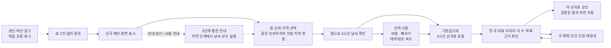
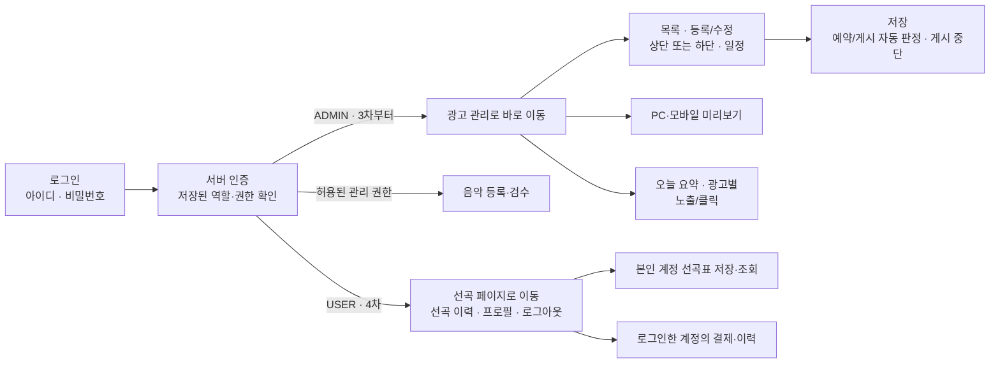

# 카페 날씨 기반 음악 서비스 — 기능 및 사용자 흐름

- 작성일: 2026-10-04
- 수정일: 2026-10-14
- 목적: 프로젝트 문서와 후속 대화에서 정한 조건을 바탕으로 서비스 목표, 주력·보조 기능, 사용자 입력, UX 및 단계별 구현 범위를 정리합니다.
- 대상 사용자: 카페 등의 매장에서 음악을 선택하는 운영자입니다.
- 참고 문서: [구현 설계도](./카페_음악_서비스_구현_설계도.md), [아키텍처 및 3차·4차 구현 태스크](./카페_음악_추천_서비스_3차_구현_태스크.md), [3차 컬럼 기반 추천 로직 가이드](./카페_음악_추천_서비스_3차_컬럼_기반_추천_로직_가이드.md), [음악 분류 컬럼 정의](../handoff/music/음악_분류_컬럼_정의.md)
- 문서 상태: 기능 계획입니다. 구현 완료를 의미하지 않습니다.

## 2026-10-14 광고 관리 간소화 적용

사용자가 제공한 [간소화 원문](../handoff/ads/04_광고_관리_간소화_인수인계서.md)과 [통합·추가 인계](../handoff/ads/05_광고_간소화_통합과_추가_인계.md)를 현행 광고 기준으로 적용합니다. 첫 관리 단계는 ads/ad_assets/ad_admin_changes 세 컬렉션·MongoDB 이미지 Binary·관리 감사/멱등 응답 통합입니다. 3차는 카페 전용이며 관리자/사용자 업종 선택·태그 입력·업종별 매칭은 제공하지 않습니다. 해당 확장은4차로 분리합니다. 공개 제공/측정과 토큰/주기 통계/예산은 다음 구현 단계이며 전체3차 필수 범위와 기존 태스크 ID/직접 선행은 유지합니다. 이하 기존 확장 저장 표는 후속 검토 자료이며 지금 일괄 생성하지 않습니다.

3차는 카페 광고만 운영하고 위치·일정·paused·소재·예산 자격을 충족한 후보에서 높은 priority·위치별 동률 순환을 적용합니다. 업종/태그가 제공·측정의 전제가 아니며 최초 guest 발급·추천 미요청 집계·단가8/5/클릭추가15·중복/지연/보관은 유지합니다. 미연결 지표는 연동 대기, 실제 통계는 주기 집계하며 예산 제공 제어와 구분합니다. 첫 관리 로그는 ad_admin_changes 내부 log_relay로 전달합니다. 업종별 입력/태그/매칭/순환은4차 인계에서 정하고3차 API/DB/화면/검증의 선행 조건으로 넣지 않습니다.

## 2026-10-14 음악 담당 수령 문서 우선 적용

[음악 통합 계약](./3차_음악_정책_통합_계약.md)을 적용합니다. 추천·표시18개 + 검수 보조1개·RDB4개·원본 변환·날씨50:45:5/전체75:25·장르/speed 필수 필터·사이클 고정·PTY6/7·시간176~184분을 기준으로 합니다. 새 자료의 미정은 유지하며 수동 전용16개·음악 S3 기준 저장·자동25% 단축과 동시에 적용하지 않습니다.

## 2026-10-14 저장소 결정과 광고 인계

2026-10-14 새 음악 문서 우선 지시로 음악 기준 저장은 **RDB 4개 테이블**과 추천·표시18개/검수 보조1개로 변경합니다. 음악 원본 CSV·백업/불변 내보내기는 로컬/S3 보관 가능하며 S3만을 음악 기준 DB로 사용하지 않습니다. 로그·피드백/공통 업무 상태는 PostgreSQL, 광고는 MongoDB, 날씨 MongoDB/Elasticsearch·원문 로컬/S3는 유지합니다. 3차 음원 파일·직접 재생은 추가하지 않습니다. [저장 경계와 발행 계약](./3차_저장소_경계와_발행_계약.md)과 [ADS 인계](../handoff/ads/README.md)를 적용하며 실제 설치·접속·운영 검증 완료와 구분합니다.


## 2026-10-14 Gemini 재설정 모델 확정

사용자 결정으로 선곡표 재설정의 API 모델은 **Gemini 3.8 Flash(`gemini-3.8-flash`)**를 사용합니다. 기본 추천은 규칙 방식이며 해당 모델은 명시 재설정에만 호출합니다. 실제 프로젝트/키·호출 한도/예산 확인은 별도입니다.

## 2026-10-14 공통 구현 기준 정리

문서만 읽어도 같은 입력 해석·화면 상태·검증·오류·저장 결과를 만들도록 [공통 개발 계약](./3차_공통_개발_계약과_검증_기준.md)을 적용합니다. 프레임워크/SDK·공통 형식/동점·상태 처리의 개발 기준을 정리했으며 실제 설치·코드·운영 검증 완료는 아닙니다. 자료/운영 판단이 필요한 부분만 [사용자 확인·담당자 인계 목록](./3차_사용자_확인과_담당자_인계_목록.md)에 남깁니다. 음악 W 공식·CSV 변환·18개/검수 보조·RDB4개·스냅샷 연결은 수령 문서와 최신 통합 계약으로 채택했습니다. 실제 분류/검수·혼합 최초 speed·테마 세부 정렬·환경과 남은 광고 규정만 인계 목록에 남깁니다. 새 음악 문서 우선 지시로 시간176~184분/자동 단축 미사용을 적용하고 광고 동률 순환·중단3초는 유지합니다.

## 최신 결정 — 규칙 기본 추천과 Gemini 보조 재설정

### 3차 국가·언어 제외와75:25·신규 곡 기준 — 2026-10-13 확정

3차에는 국가·언어 설정/검수/필터/가점/관리 입력/피드백 필드를 제공하지 않습니다. 음악18개와 검수 보조1개를 사용하고 mode/acousticness·CSV 변환·보컬 최종값·mood/genre/speed를 현행 기능에 연결합니다. 기본/재설정 요청은 국가·언어 관련 필드를 허용하지 않으며 이전 언어 선택을 상속하거나 숨겨 적용하지 않습니다. 별도 후속 단계 채택은 미정입니다.

W/P/S는0~100입니다. 활성 빠르기T·테마M·장르G 일치 점수의 평균 P로 S=0.75*W+0.25*P, 모두 미선택이면 S=W입니다. 날씨 내부는energy50%/acousticness45%/mode5%이며 새 날씨 범위·거리 감점·NULL 규칙을 적용합니다. 장르·speed 필수 필터를 먼저 적용하므로 선택된 두 그룹은 통과 곡에 공통100점입니다. mood 미확인은0/활성 분모 유지, genre/speed 미확인은 후보 보류입니다. 18개·검수 보조값·불변 당시 스냅샷과 사이클 범위를 함께 보존합니다.

새 결과는 부모 전체 고유 곡 수N의20% 내림값 이상인 신규 곡을 포함하면 인정합니다: required_new_count=max(1,N//5), actual_new_count=len(result_ids-parent_ids). 기존 곡 제거는 필수 조건이 아니며 추가만으로도 통과할 수 있습니다. 부모 분모는 제외 후에도 유지하고 순서/설명 변경·기준 미달은 실패 안내와 부모 보존입니다. 등록/검수·무보컬·제외·중복·확정 날씨/시간·예보 검증은 별도로 모두 통과해야 합니다.


### 곡별 반응·선곡표 만족도 — 2026-10-13 추가

3차 공개 추천에 곡별 [좋아요]/[싫어요]와 선곡표 전체의 별점 1~5점 만족도 평가를 추가합니다. 곡 반응은 LIKE/DISLIKE/미평가(null)의 세 상태이며 같은 버튼 재클릭은 해제, 반대 버튼은 전환합니다. 별점은 곡 목록 바깥의 [이 선곡표 만족도] 영역에 정수 1~5점으로 선택하고 [평가 취소]로 해제합니다. 둘 다 선택 입력·초기 미평가이며 비로그인 본인 결과에서 이용합니다. 곡 반응과 별점은 실제 결과 버전에 귀속하고 새 결과로 복사하지 않습니다. 곡 제외·승인과 별개이며 자동 추천/제외/승인·점수 변경·Gemini 호출을 유발하지 않습니다. 저장/취소·당시 조건/곡·revision·outbox·집계·검증은 구현 설계도 6-9절을 따릅니다. 실제 UI/API 구현 완료를 뜻하지 않습니다.


### 재설정 변화·시간 기준 — 2026-10-14 음악 문서 우선 적용

- Gemini 재설정은 부모 선곡표 곡 수의 20%를 내림한 수만큼 부모에 없던 `track_id`가 포함되어야 새 성공 결과로 인정합니다. 기준 곡 수는 재설정 직전 부모 결과의 고유 곡 수이며 제외 후의 작은 목록으로 분모를 줄이지 않습니다. `added_ids = result_ids - parent_ids`, `required_new_count = max(1, len(parent_ids) // 5)`, 성공 조건은 `len(added_ids) >= required_new_count`입니다. 소수점은 버리므로 49곡은 9곡, 50곡은 10곡, 53곡은 10곡이 필요합니다. 1~4곡은 내림값이 0이어도 기존 변화 없음 불인정 원칙에 따라 최소 1곡이 필요합니다. 동일 곡의 순서/설명 변경이나 기존 곡 일부만 남긴 결과는 인정하지 않습니다. 다른 필수 검증도 모두 통과해야 합니다.
- 변화가 없으면 `NO_MEANINGFUL_CHANGE`와 “기존 선곡표와 다른 곡을 찾지 못했어요. 현재 선곡표는 유지됩니다.”를 안내합니다. 일부 변경했어도 신규 곡 추가 기준 미달이면 같은 상태 코드와 “필요한 신규 곡 수를 채우지 못했어요. 현재 선곡표는 유지됩니다.”를 안내하며 parent_track_count·required_new_count·actual_new_count를 기록합니다. 부모 결과·승인 상태·제외 초안을 보존하고 새 성공 결과나 승인/곡 제외 이벤트를 만들지 않습니다. 실제 재설정 시도와 변화 없음 진단은 별도로 기록합니다.
- 새 음악 문서4-3절을 우선해 현행 성공 범위는176~184분입니다. 후보 부족에서도 자동 단축/필수 범위 확대를 하지 않으며 구성 불가이면 CANDIDATE_SHORTAGE와 부모 보존입니다. 별도 시간 단축 정책은 재확정 전까지 미사용입니다.
- 시간 정책은 phase3-duration-20261014.2/STANDARD_ONLY·목표180분/허용176~184분을 작업·결과·승인·피드백에 동일 적용합니다. 기존25%/135분 단계는 보관 이력이며 현행 검증값으로 사용하지 않습니다.
- 후보 부족은 적격 후보 수·총 재생시간·필터 사유와 탐색 범위를 근거로 판단합니다. 모델의 짧은 응답, 제한 후보 풀의 실패, solver `UNKNOWN`/시간 초과만으로 전체 후보 부족을 단정하지 않습니다. 현행176~184분 성공률과 후보 부족/탐색 미완료를 구분해 집계합니다.


기본 추천은 수령 음악 문서의18개와 검수 보조 instrumental_review_value를 사용한 규칙·정수 시간 조합입니다. Gemini 3.8 Flash는 명시 재설정에만 같은 적격 RDB 목록에서 선택합니다. CSV 변환 energy/acousticness/mode/speed·청취 mood/main_inst, 검수 우선 보컬·장르 대분류·사이클 고정을 적용합니다. 수동 전용16개·음악 S3 기준 저장·옛 음향3개/0.55 하한·자동 시간 단축은 현행에서 제외합니다. 상세는 최신 음악 통합 계약을 따릅니다.

[현행 Gemini API 추천 설계](./카페_음악_서비스_3차_Gemini_API_추천_설계.md). 규칙 가이드는 현행으로 복원하고 보관본은 이력으로 유지합니다. Gemini 재설정 실패 시 부모 결과/초안을 유지하고 자동 규칙 재생성으로 바꾸지 않습니다. 실제 API 호출·과금·DB 변경·배포는 이번 문서 작업에서 하지 않습니다.

## 2026-10-13 구현 결정 반영

초기에는 같은 네트워크의 로컬 클러스터에서 Kafka·Spark를 연결하고 최종 AWS로 이전합니다. 문서 개발 기준은 React·TypeScript·Vite와 Django이며, 정확한 버전·설치/접속은 D-03의 환경 검증으로 고정합니다. 날씨 파이프라인은 새로 구현하며 3차 음악은 보유 CSV를 사용하고, 상세 음악 규격은 추가 문서로 받습니다. 원문은 로컬과 S3에 함께 보관합니다. 작은 후보군부터 상한까지 확장하는 탐색을 사용하고 실제 크기/시간은 미정입니다.

날씨 패널은 유지하고 별도 강수 카드·X·닫기 기록·재노출 방지는 제거합니다. 6시간 공유 수집/조회와 앞 3시간·실제 초과분 추천 검증은 유지하며, 펭귄 안내의 X/Esc는 별개입니다. 새 음악 규칙의 PTY4/5는 비 점수, PTY6은 비·눈 점수, PTY7은 눈 점수이며 원래 현상을 보존합니다. 최초 혼합 예보의 speed 기준은 별도 미정입니다. Gemini에는 원래 현상과 같은 적격 판정 근거를 제공합니다. 관리자 초기화 발급·초기 권한 배정, 회수 시 비활성화/세션 무효화, 익명 쿠키 소유 검사, 로컬·S3 원문 보관의 상세 계약은 아래 연결 가이드를 따릅니다. 광고 규정은 별도 회의 결과 대기입니다. 문서 반영은 실행/설치/배포 완료가 아닙니다.
상세 계약: [3차 구현 결정과 익명 문맥·원문 보관 가이드](./3차_구현_결정과_익명문맥_원문보관_가이드.md).

## 1. 서비스 목표와 핵심 경험

**3차에서는 로그인 없이 동 단위 지역 날씨에 맞는 기본 3시간 선곡표를 제공하고, 상·하단 광고를 운영합니다. 4차에도 기본 추천은 비로그인으로 유지하며, 선곡 이력·결제에는 사용자 로그인을 요구합니다.**

사용자는 시·도 → 시·군·구 → 동을 선택하면 추가 설정 없이 선곡표를 받을 수 있습니다. 필요할 때 보컬·빠르기·테마/장르 설정을 선택하고 곡 제외·재생성으로 결과를 조정합니다. 매장명·상세 주소·매장 타입·회원가입은 기본 추천의 필수 입력이 아닙니다.

테마와 장르는 같은 선택 영역에서 복수 선택합니다. 잔잔한·몽환스러운 테마와 재즈·클래식 장르를 함께 고를 수 있습니다. 국가·언어 설정은3차에서 제외합니다.

기본 추천은 RDB 불변 카탈로그의 등록 음악의 기존 규칙 점수/시간 조합으로 생성하고 불만족 재설정만 Gemini를 사용합니다. 두 경로 모두 동일한 필수/확정된 변환·검수 특성/날씨 정책·시간/소유를 검증합니다. 3차에는 로컬 AI 모델을 붙이지 않습니다. Gemini는 선곡표 재설정의 서버 호출에만 사용합니다. 보컬/테마 검수 자료는 음악18개와 구분하고 실제 확보한 자료만 사용합니다. 국가·언어 컬럼/검수 기능은3차에 추가하지 않습니다.

로그인 페이지는 일반적인 **공통 로그인 화면**입니다. 역할 선택 없이 서버가 인증된 계정의 역할을 확인합니다. 3차에는 관리 계정만 사용하고 관리자는 광고 관리 페이지로 바로 이동합니다. 4차에는 사용자 계정을 추가해 일반 사용자는 선곡 페이지로, 관리자는 광고 관리 페이지로 이동합니다.

4차의 사용자 로그인·선곡표 저장/이력·결제 도입은 구현 범위로 확정합니다. 결제 상품·요금·제공자·구독/기간권/건별 방식은 미정입니다. 무료 기본 추천에 로그인이나 결제를 요구하지 않습니다.

### 1-1. 사용자가 얻는 가치

- 지역만 선택해 날씨에 맞는 선곡표를 받습니다.
- 첫 곡 대표 이미지·곡 수·목록, 사용한 날씨와 선곡 이유를 확인합니다. 화면에 재생시간을 표시하지 않아도 서버의 3시간 검증은 유지합니다.
- 필요한 선택만 골라 보컬·빠르기·테마/장르에 영향을 줄 수 있습니다.
- 곡 제외·재생성 후 원하는 결과 버전을 승인합니다.
- 지역의 현재/앞 3시간 예보를 날씨 패널에서 확인합니다. 별도 강수 카드와 X는 제거합니다.
- 동일한 펭귄의 3단계 안내로 지역·날씨/강수, 음악 취향, 선곡표 확인을 익히고 [사용 안내]로 다시 확인합니다.
- 4차에는 로그인한 계정으로 선곡 이력과 결제를 이용합니다.

### 1-2. 기본 사용자 흐름 — 3차, 4차에도 공개 유지



지역·선택·현재 결과는 익명 이용 문맥에 연결합니다. 지역 복원과 날씨 조회 보관은 같은 브라우저의 편의 기능이며 동일 인물·다른 기기 간 동기화를 보장하지 않습니다. 저장 기능을 쓸 수 없으면 지역을 다시 선택해 추천을 계속 이용합니다. 사용자 승인과 음악 관리자의 Gold 검수 승인은 별개입니다.

### 1-3. 공통 로그인과 역할별 흐름



3차 공통 로그인은 관리 계정만 인증합니다. 4차에는 같은 화면에 사용자 계정 인증을 추가합니다. 사용자/관리자 역할 선택 버튼을 두거나 요청에 담긴 역할로 권한을 부여하지 않습니다. 공개 추천은 두 단계 모두 로그인 없이 이용합니다.

광고 등록·수정·중단·운영 통계 조회와 음악 등록·검수는 서버의 관리 권한을 요구합니다. 관리자 로그아웃은 게시 광고의 중단 명령이 아닙니다.

## 2. 확정 조건과 문서 해석 기준

### 2-1. 대화에서 확정한 조건

| 항목 | 적용 기준 |
|---|---|
| 주력 목표 | 카페 등 매장의 지역 날씨에 맞는 선곡 |
| 3차·4차 기본 추천 | 비로그인 유지. 최초 추천 설정의 필수 입력은 동 단위 지역 |
| 공통 로그인 | 일반 로그인 화면에서 인증. 서버의 역할로 ADMIN은 광고 관리, USER는 4차 선곡 페이지로 이동 |
| 3차 로그인 대상 | 관리 계정만 사용. 음악 등록·검수는 부여된 관리 권한으로 보호 |
| 4차 로그인 필수 범위 | 사용자 계정의 선곡 이력·결제. 프로필·로그아웃은 로그인한 사용자에게 표시 |
| 지역 입력 | 시·도·시·군·구·동. 상세 주소·정확한 좌표·카페 ID 직접 입력 없음 |
| 날씨 출처 | 기상청 API허브의 전국 격자 자료. 공식 지역 코드→대표 격자 매핑으로 선택한 동에 연결 |
| 예보 활용 | 실황 10분·초단기예보 1시간 등 자료별 기준으로 공유 수집하고 실제 대상 시각으로 6시간 조회 범위를 구성. 기본 날씨/추천은 앞 3시간, 실제 초과분까지 유효성 확인 |
| 강수 카드 제거 | 2026-10-13 제거 결정. 날씨 패널은 유지하며 카드/X/닫기 기록/재노출 방지는 구현하지 않음 |
| 기본 선곡표 길이 | 목표 180분, 허용 176~184분. 실제 duration_ms 합계로 판정 |
| 메인 결과 표시 | 음악 선택·첫 곡 대표 이미지·선곡표 3열. 곡 수/목록·근거를 표시하고 총시간·곡별 재생시간은 표시하지 않음. 시간 계산·저장·승인 검증은 유지 |
| 대표 이미지 | 현재 결과 첫 곡의 앨범 커버. 없거나 로딩 실패 시 중앙과 행 썸네일에 같은 공통 기본 이미지 사용 |
| 시간 우선순위 | 정확히 180분 → 180분 초과~184분 → 176분~180분 미만. 같은 구간은 목표에 가까운 구성 우선 |
| 3차 추천·AI | 규칙 기본 추천·Gemini 보조 재설정·RDB 불변 카탈로그의 등록 음악. 네이티브 실행·Gemini는 선곡표 재설정에서만 호출 |
| 보컬·빠르기 | 기본 제한 없음·날씨에 맡기기. 연주곡 최종True·speed 사이클 집합은 필수 필터이며 선택 그룹 가점도 적용 |
| 테마·장르 | 한 영역의 복수 선택 칩. 잔잔한·몽환스러운·재즈·클래식 등의 선택을 우선 반영 |
| 사용자 결과 버튼 | [이 선곡표 승인]. 검증된 결과 버전 지정이며 실제 재생·계정 저장·결제와 구분 |
| 음악 컬럼 기준 | 수령 컬럼/변환 문서의 추천·표시18개+검수 보조1개. RDB4개·CSV 자동변환·청취mood/main_inst |
| Spotify 참고 | 기능·UX·운영 참고. 신규 Spotify API 연동 확정 아님 |
| 3차 광고 | 광고 서버 기능·상하단 배너·별도 관리자 페이지·노출/클릭 측정 |
| 광고 배치 | 메뉴 아래·날씨 위 상단, 설정/선곡표 아래의 일반 흐름 하단. 주요 버튼·날씨 조회을 가리지 않음 |
| 광고 편집 | 광고 한 건에 상단 또는 하단 한 위치. 제목·이미지·URL·기간·우선순위, 저장·게시 중단·미리보기 |
| 4차 계정·결제 | 도입 확정. 계정의 저장 이력·결제 소유를 검증. 상품·요금·제공자는 미정 |
| 사용자 화면 설명 | 이용에 필요한 날씨·선택·곡·광고·오류 안내. 내부 기술·설계 주석은 넣지 않음 |
| 3차 사용자 안내 | 동일 펭귄 PNG 한 장·3단계 말풍선·지역 단계의 날씨/강수 설명·클릭 이동/종료·이전/건너뛰기·사용 안내 다시 보기. 브라우저 버전별 완료 기록 |

시간 초과 우선은 허용 범위 안의 유효한 후보에만 적용합니다. 184분을 넘거나 필수 조건·검수·날씨 기준을 위반한 곡을 넣어 시간을 채우지 않습니다.

국가·노래 언어 기능은3차 전체에서 제외합니다. 음악18개·보컬/테마 검수·당시 결과/평가 계약과 구분하며 후속 도입은 미정입니다.

### 2-2. 확정·기본안·미정의 구분

- **확정:** 사용자가 정한 로그인 범위·3차 추천·광고 배치·시간·날씨·AI 제외 조건입니다.
- **개발 기준:** 공통 개발 계약에 정리한 입력/기술/상태/오류/검증은 동일하게 구현합니다. 미정 운영 수치와 참고용 화면 배치는 별도로 구분합니다.
- **미정:** 실제 자료 검토가 필요한 추천 수치, 인증 수단, 저장 기간, 광고 선정·노출 판정 수치, 결제 상품·요금·제공자입니다.

Gemini 추천/검증 계약과 실제 데이터·호출 품질을 구분합니다. 문서 반영이나 시안 제작을 실제 API·품질 검증 완료로 간주하지 않습니다.

## 3. 주력 기능·보조 기능·운영 기능 구분

분류는 서비스에서 맡는 역할을 나타냅니다. 보조 기능 중에도 버전 관리·곡 제외 유지·광고 오류 격리처럼 3차 완료에 필요한 기능이 있습니다.

### 3-1. 주력 기능

| ID | 큰 기능 | 세부 기능 | 단계 |
|---|---|---|---|
| M1 | 지역과 날씨 확인 | 비로그인 지역 설정·변경, 자료별 전국 격자 실황/예보 공유 수집·지역별 6시간 조회 구성, 3시간 요약·갱신·누락 표시 | 3차 |
| M2 | 날씨 기반 후보·점수 | 음악18개·변환·검수 특성·보컬/테마 검수 상태 검사, 날씨 구간별 적합도, 사용자 선호 보너스·규칙 근거 | 3차 |
| M3 | 기본 3시간 선곡표 | 필수 필터, 밀리초 시간 조합, 곡 중복·순서 조정, 범위·예보·조건 검증 | 3차 |
| M4 | 결과 확인·선택 | 첫 곡 대표 이미지·곡 수/목록·근거·선호 반영 표시, 시간 검증된 결과 버전 선택 | 3차 |

### 3-2. 서비스 보조 기능

| ID | 큰 기능 | 세부 기능 | 단계 |
|---|---|---|---|
| S1 | 최소 설정 | 지역, 선택 사항인 보컬·빠르기·테마/장르 복수 선택 | 3차 |
| S2 | 선곡표 조정 | 이번 곡 제외/취소·접힌 제외 목록·서버 초안 저장, 저장된 제외와 조건을 유지한 재생성, 조건 변경 후 새 요청 | 3차 |
| S3 | 결과 버전·운영 기록 | 결과·부모 버전·조건·근거·선택 상태·익명 소유 범위 기록 | 3차 운영 기반. 사용자 장기 이력 화면은 4차 |
| S4 | 사용자 행동·명시적 평가 피드백 | 곡 좋아요/싫어요·선곡표1~5점·선택·제외·제외 취소·재설정 이벤트·원자 저장·중복 방지·수정/취소/집계 | 곡 반응·선곡표 별점 UI/API는 3차 P0. 날씨 적합성 전용 평가·품질 비교는 선택 확장 |
| S5 | 외부 사용 연결 | 외부 계정·곡 매칭·재생목록 생성·실패 재시도 | 4차 후보. 사용 방식·플랫폼 확정 시 |
| S6 | 추가 편의 | 일부 곡 교체·반복 완화·설정 장기 저장·concept·장소 선택 | 후속 검토 |
| S7 | 상·하단 광고 | 위치별 광고 조회·표시, 광고 없음·오류 격리 | 3차 |
| S8 | 강수 카드 제거 | 별도 카드/X/닫기 기록 제거. 지역 날씨 패널로 표시 | 3차 |
| S9 | 사용자 계정·저장 이력 | 공통 화면의 사용자 로그인, 본인 선곡표 저장·조회·프로필·로그아웃 | 4차 확정. 익명 결과 편입은 선택 확장 |
| S10 | 결제·이용 권한 | 로그인한 계정의 주문·서버 확인·유료 권한·결제 이력·취소/환불 | 4차 확정. 상품·요금·제공자는 미정 |
| S11 | 3단계 펭귄 사용자 안내 | 공통 캐릭터·말풍선·지역/날씨/강수 통합·단계 강조·클릭 이동·이전/종료·다시 보기·버전별 기록 | 3차. 기본 추천 이용을 강제하지 않는 보조 기능 |

### 3-3. 운영 기능

| 큰 기능 | 세부 기능 | 단계 |
|---|---|---|
| 음악 데이터 관리 | 수집·CSV 등록·정제·중복/녹음 버전 구분·오류 재시도 | 3차 |
| 전문가 검수 | 근거·초안·미확인·검수 대기·승인·보류·변경 이력 | 3차 |
| 선택·추천 정책 | 18개/원본변환·보컬 검수 우선/자동True·장르/speed 사이클·날씨10프로필·75:25·Gemini 공통 검증 | 3차 |
| 날씨 수집 운영 | 실황 10분·초단기예보 1시간 기준의 전국 격자 공유 수집, 지역별 6시간 최신 조회·만료·용도별 누락·강수 판별 근거 | 3차 |
| 피드백 운영 | Bronze 원본 적재 확인·경보·중복·역순·수정·취소·집계 대조 | 3차 |
| 관리자 곡 제외 피드백 이력 | 제외/취소 원본·당시 선택 태그/추천 조건·곡 정보 보존, 기간/곡/태그 검색·목록/상세·취소 연결 | 3차 P0. 관리자 전용·읽기 전용 |
| 복구·고정 시연 | 실패·재시작·부분 실패·재처리·추천/광고/날씨 조회의 재현 가능한 사례 | 3차 |
| 음악 준비 현황 | 승인 곡 수·총시간·특성 확보·미확인 조회. 조합 성공과 구분 | 3차 |
| 공통 로그인·관리자 인증 | 계정 발급·회수·서버 역할·세션·로그아웃, ADMIN의 광고 관리 이동 | 3차. USER 인증은 4차 |
| 광고 관리 페이지 | 목록·등록·수정·이미지·링크·위치·기간·우선순위·저장에 따른 게시/예약·게시 중단·미리보기·오늘/광고별 지표 | 3차 |
| 운영 통합 화면 | 개별 조회·로그를 모아 보는 편의 화면. 관리자 제외 이력의 최소 화면/API는 별도 P0 | 3차 P1 |
| GitHub 협업 운영 | 태스크/이슈·브랜치/PR·리뷰·검사/병합·릴리스/복구 근거 | 3차 개발·운영 기반. 사용자 화면 기능 아님 |
| 품질 개선 | 날씨별 검수·유효 평가·버전 비교. 개인화는 자료 확보 후 | 4차 후보 |

### 3-4. 역할과 접근 범위

| 대상 | 3차 제공 기능 | 태스크 연결 |
|---|---|---|
| 일반 사용자 — 비로그인 | 지역·날씨·선택·선곡표·제외·재생성·버전 선택·날씨 패널·상하단 광고 | W-04·W-06·W-07·R-01~R-05·U-01·U-02·AD-04 |
| 광고 관리자 | 공통 로그인 후 광고 관리 이동·목록·저장·중단·미리보기·오늘/광고별 지표 | I-05·AD-01~AD-06 |
| 음악 관리자·검수자 | 권한이 있는 음악 등록·특성 보완·검수·준비 현황 조회 | I-05·M-06·A-03~A-06 |
| 피드백 조회 관리자 | ADMIN + 피드백 조회 권한으로 곡 제외/취소 이력·당시 선택/곡 태그·날씨·원본 결과 연결 조회 | I-05·F-01~F-08·R-05·Q-04 |
| 개발·운영 담당자 | 정책·자료·수집/처리·복구·추천/광고 오류·고정 시나리오 확인 | D-01~D-04·Q-01~Q-08 |

공개 추천 API에는 관리자 로그인을 요구하지 않습니다. 다만 결과 조회·재생성·선택은 요청자가 제어하는 익명 문맥의 결과에 한정합니다. 다른 사용자의 결과를 임의 ID로 조회·수정하지 못하도록 검증합니다. 관리자 페이지를 숨기는 것만으로 권한을 처리하지 않고 서버의 관리 API에서도 확인합니다.

### 3-5. 추가한 3차 기능 상세

다음 기능을 3차 구현 목록에 반영했습니다. 문서상 계획이며 코드 구현 완료를 의미하지 않습니다. 기본 입력·검수 도구와 개별 조회를 우선 구성하고, 별도 통합 대시보드는 P1로 유지합니다.

#### 음악 자료 일괄 등록 — M-06

- 관리자가 곡·재생시간·태그 등의 CSV 자료를 등록합니다.
- 필수 필드·재생시간 단위·누락·동일 곡 중복·정의 밖 태그를 확인합니다.
- 파일 원본, 등록 요청 식별값, 행 번호와 행별 성공·오류 내역을 남깁니다.
- 오류 행을 보완해 재입력할 수 있게 하고 같은 요청·행을 반복해도 중복 곡을 만들지 않습니다.
- 입력한 특성은 검증되지 않은 초안입니다. 등록만으로 Gold에 승인하지 않습니다.
- Gold 승인은 음악 기본 정보와 전문가 검수 결과로 판단합니다. 외부 재생 플랫폼의 곡 매칭·재생 가능 여부는 승인과 분리해 4차에 확인합니다.
- CSV 입력 결과도 수집 자료와 같은 정제·전문가 검수 흐름으로 연결합니다.

필수 필드·태그 목록·파일 규격은 확정한 데이터 사전을 따릅니다. 파일 전체가 유효하지 않은 경우와 일부 행만 잘못된 경우의 오류를 구분합니다.

#### 검수 대기 목록 — A-04

- 미검수·보류·필수값 누락별 필터와 목록을 제공합니다.
- 정제된 곡 정보·특성 초안·등록 오류·기존 검수 의견을 연결해 확인합니다.
- 수정·승인·보류 및 보완 후 재검수를 수행합니다.
- 필수 검수 항목이 누락되면 승인하지 않고 보완 이유를 표시합니다.
- 검수자·시각·판단 근거·변경 이력을 기록합니다.

#### 날씨 조건별 음악 준비 현황 — A-06

- 정의된 날씨 기준별 승인 곡 수·총시간·아티스트 수를 조회합니다.
- 필요한 태그가 없거나 미확인·보류인 자료를 별도로 확인합니다.
- 승인 곡의 테마·장르별 확보 현황, 보컬 없음·있음·미확인, 빠르기 느림·보통·빠름·미확인, 변환·검수 특성의 확인·미확인 건수·총시간을 확인합니다.
- 연주곡만·장르·speed는 필수 필터, 테마는 승인mood 일치 가점입니다. 교차 조건의 실제 적격 곡 수/총길이와 분류 미확인을 확인하며3시간 조합 성공을 자료 수만으로 보장하지 않습니다.
- 집계한 음악·태그 기준의 버전과 조회 조건을 표시합니다.
- 한 조건 안에서 같은 승인 곡을 중복 합산하지 않습니다.
- 특정 날씨의 자료가 부족한지 확인하는 운영 지표로 사용합니다.

총시간이 184분 이상이어도 176~184분의 조합이 반드시 가능한 것은 아닙니다. 3차에서 이 집계를 추천 성공·실패 판정으로 표시하지 않으며, 실제 곡 선정·시간 조합은 3차 R-03·R-04에서 별도로 실행·검증합니다.

#### 날씨 데이터 상태 표시 — W-04·W-06

- 수집 성공·실패, 현재 보유 자료의 신선도, 필요한 시간별 예보의 완전성을 나눠 기록합니다.
- 최신 수집 실패와 기존 자료 만료, 예보 일부 누락이 동시에 발생해도 각각 확인할 수 있게 합니다.
- 일반 사용자는 마지막 갱신 시각·갱신 지연·일부 예보 없음 등 간단한 안내를 봅니다.
- 관리자는 오류 원인·마지막 수집 성공·자료 기준 시각·누락 대상 시간까지 확인합니다.
- 오래된 자료나 누락을 정상·완전한 최신 날씨로 표시하지 않습니다.

기상청 API허브의 전국 격자 자료를 **실황 10분·초단기예보 1시간 간격**으로 공유 수집하고 공식 지역 코드→대표 격자 매핑으로 선택한 동에 연결합니다. SNO는 3시간 발표 회차, KIM 구름량은 초단기 대상 범위와 연결되는 3시간 간격 대상 시각의 보완 자료로 다루며, 각각의 간격을 별도 고정 수집 주기로 단정하지 않습니다. API의 실제 발표·대상 시각을 확인해 6시간 조회 범위를 구성합니다. 사용자에게 보여줄 기본 예보는 향후 3시간이며 6시간 조회의 실제 확보 상태를 추천용 구간과 구분합니다. 사용자별로 기상청을 중복 조회하지 않으며 사용자용 수집 주기 변경 기능은 이번 범위에 포함하지 않습니다.

수집·조회 인계 기준은 [날씨 수집과 지역매핑](../handoff/weather/01_날씨_수집과_지역매핑.md), [데이터규격과 정제](../handoff/weather/02_날씨_데이터규격과_정제.md), [저장구조](../handoff/weather/03_날씨_저장구조.md), [API 호출과 RDB 적재시험](../handoff/weather/04_API호출과_RDB적재시험.md), [날씨분류와 계절기준](../handoff/weather/05_날씨분류와_계절기준.md)입니다. 원본의 발표·대상·수신 시각과 값·단위·유효/누락/오류 상태를 보존하고 실제 `0`을 누락으로 바꾸지 않습니다. 날씨 원문·이력은 MongoDB/원문 파일 저장, 최신 조회는 Elasticsearch를 설계 경로로 삼되 원문 로컬+S3 보관은 결정됐고 실제 업로드/재처리·접속은 검증 전입니다. 로컬 적재시험 결과를 운영 완료로 간주하지 않습니다.

누락은 실제 확보한 예보의 시간 구간과 필요한 항목으로 판단합니다. 3시간 화면·3차 선곡용 구간·6시간 조회 구간의 완전성을 따로 기록합니다. 3차 선곡은 기본 3시간을 기준으로 하고 실제 총시간이 초과하면 최대 184분까지 필요한 구간도 검증합니다. 그 구간의 필수 예보가 만료·누락되면 새 선곡표 생성을 차단합니다. 뒤쪽 조회 구간만 누락됐다는 이유로 유효한 선곡용 예보까지 사용 불가로 처리하지 않습니다.

#### 날씨 패널·추천 구간 유효성 — W-07·W-04·W-06

공유 수집한 6시간 조회 묶음에서 지역의 현재/앞 3시간 예보·갱신 시각·누락/만료를 날씨 패널에 표시합니다. 별도 강수 카드·X·닫기 저장·재노출 방지는 제거합니다.

| 용도 | 확인 구간 | 동작 |
|---|---|---|
| 수집/조회 | 실황10분·초단기1시간 등 자료별 기준, 실제 6시간 확보 범위 | 발표/대상/수신·항목·상태·원문 로컬/S3 참조 보존 |
| 날씨 패널 | 현재/앞 3시간 | 시간별 예보·갱신/누락 표시. 닫기 없음 |
| 추천 | 요청 시점~180분, 실제 초과분 최대184분 | 필수 항목·구간 유효성 검사·결과 근거 고정 |
| 뒤쪽 조회 | 추천 구간 뒤~6시간 | 확보 상태를 구분하며 누락만으로 유효 추천을 차단하지 않음 |

PTY0은 SKY1/3/4의 맑음/구름많음/흐림, PTY1~7은 원래 강수 코드를 우선합니다. PTY4/5는 비 점수, PTY6은 비·눈 점수, PTY7은 눈 점수입니다. 눈+구름 합산은 현행에서 제외합니다. 원래 현상/값/시각을 보존하며 최초 혼합 예보 auto/fast의 speed 기준만 미정입니다. POP를 실제 강수로 취급하거나 누락/무효를 맑음으로 치환하지 않습니다.

최근 수집 실패와 보유 예보 유효성은 구분합니다. 실제 대상 시각과 항목으로 확보 범위를 확인하며 발표 기준 6시간이 요청 시점부터 6시간을 모두 덮는다고 가정하지 않습니다. 정확한 구간 경계와 만료 숫자는 W-01의 구현 설정으로 기록합니다.

#### 고정 시연 시나리오 — Q-08

- 실제 날씨가 바뀌어도 같은 입력·기대 결과로 검증할 수 있는 테스트 실행 방법을 제공합니다.
- 정상 등록, 누락·중복·재입력, 검수 보류·승인 등의 음악 샘플을 준비합니다.
- 날씨 정상·수집 실패·오래됨·예보 일부 누락·역순 도착·상태 중첩, 3시간 밖/6시간 안의 비·눈, 경계·자정·유형 매핑·재접속 샘플을 준비합니다.
- 피드백 중복·역순 수정·취소·잘못된 ID 샘플을 연결합니다.
- 시나리오별 기대값과 실제 조회·집계 결과를 비교할 수 있게 합니다.
- 테스트 표시와 저장 영역을 구분해 시연 입력이 실제 운영 데이터에 섞이지 않게 합니다.

시나리오 실행은 내부 검증용입니다. 실제 추천·날씨 조회·광고 동작은 고정 Gemini 응답/자료로 계약을 재현하되 테스트 지표와 실제 API 호출을 분리합니다.

## 4. 주력 기능 상세

### 4-1. M1 — 지역과 날씨 확인

동 단위 지역만 필수로 받고 공식 코드→대표 nx,ny로 연결합니다. 동명이 지역은 상위 지역과 공식 ID로 구분하고 중복 격자는 공유합니다.

1. 지역 선택/저장/복원과 지역 변경을 제공합니다.
2. 새 Collector→Kafka→Spark→MongoDB/Elasticsearch 경로로 전국 자료를 공유 수집합니다.
3. 원문은 로컬과 S3 두 곳에 보관하고 발표/대상/수신·값/품질을 보존합니다.
4. 실제 6시간 조회 범위를 구성하고 현재/앞 3시간과 갱신 시각을 패널에 표시합니다.
5. 수집 실패·발표 최신성·대상 구간 확보·항목 누락을 각각 판정합니다.
6. 예보 갱신/지역 변경은 패널과 다음 요청에 적용하며 과거 결과의 당시 조건을 바꾸지 않습니다.

별도 강수 카드와 X/닫기 기록은 없습니다. 상세 주소를 필수로 받거나 사용자별로 기상청을 다시 호출하지 않습니다. 완료 기준은 패널 표시·지역 매핑·추천용 유효성·원문 두 사본 상태가 일치하는 것입니다.

### 4-2. M2 — 규칙 기본 추천과 Gemini 보조

energy/acousticness/mode의 범위 거리 적합도로 W_k=.50E+.45A+.05M을 계산하고 앞180분 비중으로 W를 구합니다. W/P/S는0~100, 활성 취향이 있으면 S=.75W+.25P, 없으면 S=W입니다. energy/acousticness와 genre/speed 미확인은 후보 보류, mode/선택 mood 미확인은0점·원본NULL 보존입니다. 날씨 범위 밖만으로 제외하거나 W 하한을 추가하지 않습니다. 연주곡만은 검수 우선 최종 instrumental=True를 허용합니다. instrumental_review_value=True/False를 먼저 적용하고 미검수는 원본 자동 판정 True도 허용합니다. 확정 False/NULL은 제외하며 자동 판정과 청취 확정 근거를 구분합니다.

Gemini는 기본 결과가 마음에 들지 않을 때만 같은 적격 RDB 불변 카탈로그 후보 안에서 재설정합니다. 서버가 현재 결과·선택·날씨·제외를 전달하고 곡 ID/순서/짧은 이유를 받습니다. 생성 설명과 서버 계산 점수를 구분합니다. 국가·언어 기능 제외·S3 발행 규격 대기는 유지합니다.

### 4-3. M3 — 기본 시간 조합과 재설정 검증

[선곡표 받기]는 규칙 작업자의 정확히180분→초과→부족 탐색으로 176~184분을 구성합니다. 후보군은 정한 상한까지 확장하고 같은 총시간에서는 재생시간 가중 품질을 비교합니다. 실패/최적성은 탐색 범위 안에서 해석합니다.

결과의 [다른 선곡표 요청]은 Gemini 보조 재설정입니다. 모든 선택·저장된 제외 초안을 유지하고 새 예보로 같은 적격 후보를 계산합니다. 부모 곡을 전부 자동 제외하지 않으며 사용자가 별도 자유 입력을 해야 하는 UI를 추가하지 않습니다.

재설정 응답은 등록 ID·확정된 변환·검수 특성/날씨 정책·필수 조건·부모 곡 수의 20% 내림에 해당하는 신규 곡 수(최소 1곡)·카탈로그 길이 실제 합·적용 시간 모드의 허용 범위·실제 구간 예보를 서버가 검증합니다. STANDARD176~184분만허용하고자동시간단축은미사용입니다. 단일 모델 응답에 규칙 solver의 최적성을 주장하지 않습니다. 실패 시 원래 결과를 보존하고 새 결과는 별도 승인합니다. Gemini 장애는 기본 규칙 추천을 막지 않습니다.

[규칙 기본 가이드](./카페_음악_추천_서비스_3차_컬럼_기반_추천_로직_가이드.md)와 [Gemini 보조 재설정 설계](./카페_음악_서비스_3차_Gemini_API_추천_설계.md)를 함께 적용합니다.

### 4-4. M4 — 결과 확인과 사용 결정

**목적:** 사용자가 날씨·조건·곡 구성을 확인하고 시간 검증을 통과한 결과 버전을 승인하게 합니다.

결과에 지역·사용 예보 구간/기준 시각, 첫 곡 대표 이미지·곡명·연주자·순서·곡 수, 실제 적용 근거, 선택별 반영 상태와 부족 안내, 결과 버전·선택 상태를 표시합니다. 메인에는 총시간·곡별 재생시간을 표시하지 않습니다. 서버는 duration_ms·total_ms와 180분 목표·176~184분 허용 범위·시간 우선순위를 계속 계산·저장·검증합니다. 내부 규칙 수치·검색기 상태·익명 식별자는 관리자 기록에서 확인합니다.

기본 결과 하나를 먼저 보여주고 [다른 선곡표 요청]으로 새 버전을 생성합니다. [이 선곡표 승인]은 검증된 결과를 현재 사용할 버전으로 지정하는 동작입니다. 관리자 검수 승인과 구분하며, 실제 재생·외부 목록 생성·장기 계정 저장·결제 완료를 뜻하지 않습니다.

곡 제외·설정 변경으로 수정 중인 결과는 재검증 전까지 선택할 수 없습니다. 새 요청의 결과에는 별도 선택이 필요하고 이전 선택 버전은 운영 기록에 보존합니다. 기본 추천 이유는 서버가 계산한 규칙·날씨·선호 반영 근거로 표시합니다. Gemini 재설정에서 받은 이유는 모델 생성 설명임을 구분하고 실제 카탈로그/날씨 입력과 모순되지 않는지 확인합니다. 두 경로의 점수와 검증 사실은 서버 기록으로 표시합니다.

**완료 판단:** 로그인 없이 결과 확인·제외·재생성·특정 버전 선택을 수행하고, 타 익명 문맥의 결과를 조회·수정할 수 없어야 합니다.

## 5. 보조 기능 상세와 적용 원칙

### 5-1. 최소 선택·선곡표 조정 — 3차

지역만 설정하면 기본 추천을 받습니다. 보컬·빠르기·테마/장르 세 영역은 선택 사항입니다. 테마/장르는 한 영역에서 복수 선택하되 점수는 두 그룹으로 구분합니다. 국가·언어 설정을 제공하거나 입력을 강제하지 않습니다.

| 항목·기본값 | 데이터 연결 | 조건 성격 | 적용 범위 |
|---|---|---|---|
| 지역 — 최초 선택 | 동 식별값·기상청 매핑 | 날씨 조회 필수 | 브라우저 편의 복원. 변경 후 새 추천에 적용 |
| 보컬 — 제한 없음 | 검수 우선 최종 instrumental | 연주곡만은True 필수 | AUTO True 허용, False/NULL 제외·판정 출처 구분 |
| 빠르기 — 날씨에 맡기기 | speed·최초 기준PTY·사이클 허용 집합 | 필수speed 필터+선택 그룹 가점 | 최초 혼합auto/fast 기준 미정, 미확인 후보 보류 |
| 테마·장르 — 선택 없음 | 선택 코드·승인mood/genre_group_codes | 테마 가점·장르 필수 필터+가점 | 각 그룹OR, 자동 범위는취향 비활성 |
| 이번 곡 제외 — 없음 | 서버 초안의 전체 excluded_track_ids·수정 버전 | 필수 제외 | 제외/취소 즉시 표시·전체 목록 저장. 해당 계열의 재생성에 유지하며 영구 비선호로 자동 해석하지 않음 |
| 다른 선곡표 요청 | 현재 선택·저장된 최신 제외 초안 버전·새 결과 | 행동 기능 | 저장 완료 후 실행·이전 버전 보존·필수/시간/예보 재검증 |

#### 3차 제외 기능 — 국가·언어

국가·언어 설정·검수·필터·가점·관리 입력·피드백 필드는3차에서 제외합니다. 관련 요청은 OPTION_NOT_SUPPORTED/400으로 거부하며 이전 선택을 숨겨 적용하거나 상속하지 않습니다. 후속 도입은 별도 결정 사항입니다.

#### 적용·보존·부족 안내

Gold·유효 재생시간·날씨 적합성·연주곡 제한·제외 곡을 지키며 시간 조합을 수행합니다. 필수 조건을 자동 해제하거나 미확인을 일치로 표시하지 않습니다. 구성이 어려우면 제외 취소·보컬 제한 변경을 사용자가 직접 선택하도록 안내합니다.

준비되지 않은 선택지는 준비 중으로 비활성화하고 서버도 해당 요청을 검증합니다. 테마·speed 값이 전곡에 있어야만 기본 추천을 제공한다는 조건은 추가하지 않습니다. 준비 현황과 실제 조합 성공은 구분합니다.

이번 추천의 **보컬·빠르기·테마/장르 복수 목록·제외 곡**은 재생성에 모두 유지합니다. 독립적인 새 추천은 기본값으로 시작하고 기존 결과를 다시 볼 때는 기록된 조건을 표시합니다. 장기 기본 설정 저장은 별도 확장입니다.

설정 변경 직후 기존 결과가 새 조건을 반영한 것처럼 표시하지 않습니다. [변경한 조건으로 다시 받기] → 새 버전 확인 → [이 선곡표 승인]으로 연결합니다. 곡 제외로 수정 중인 목록은 재구성·검증 전까지 승인할 수 없습니다.

### 5-2. 결과 버전·운영 기록과 사용자 이력의 구분

3차부터 결과 ID·버전·부모 버전, 생성 시각, 익명 소유 문맥, 지역·선택·제외 곡, 사용 예보 묶음/시간 구간·규칙/카탈로그/검수 버전, 실제 재생 순서의 track_id 목록·실제 total_ms·선호 반영·선택 상태를 운영 기록으로 보존합니다. 이는 재생성·오류 분석·근거 재현·행동 연결에 필요합니다.

현재 사용자 계정 소유자는 비어 있을 수 있습니다. 4차 계정 연결을 고려하되 익명 접근 식별자와 사용자 계정 ID를 구분합니다. 임의 결과 ID를 아는 것만으로 타인의 결과 조회·변경·계정 편입을 허용하지 않습니다.

**3차 운영 기록 보존은 사용자 장기 '선곡 이력' 페이지 제공을 뜻하지 않습니다.** 같은 브라우저의 현재 작업 복원은 보관 정책·익명 문맥이 유효한 범위의 편의 기능입니다. 저장 기간·삭제·보관 한도·접근 검증은 D-02·D-03에서 정합니다. 장기 계정 저장·기기 간 조회는 5-7의 4차 기능입니다.

관리자가 누적된 곡 제외 피드백 이력을 보는 기능은 3차 P0입니다. 일반 사용자의 장기 이력·현재 ‘이번 제외 곡’ 목록과 접근/목적을 구분하며 상세 기준은 5-3을 따릅니다.

### 5-3. 피드백과 개선

| 이벤트 | 의미 | 해석 |
|---|---|---|
| 선곡표 선택 | 이 버전을 이용하기로 결정 | 실제 청취·만족·장기 저장을 증명하지 않음 |
| 곡 제외 | 이번 서버 제외 초안에 곡을 추가해 다음 재생성 후보에서 제외 | 저장 성공한 실제 변경을 기록. 영구 비선호로 확정하지 않고 자동 재생성하지 않음 |
| 곡 제외 취소 | 서버 제외 초안에서 곡을 제거해 후보로 다시 허용 | 제외 이벤트와 구분하며 해당 곡의 재포함을 보장하지 않음 |
| 재생성 | 다른 결과 요청 | 직접 불만족과 구분 |
| 명시적 평가 | 사용자가 직접 표현한 평가 | 척도·기간·유효 평가 기준 적용 |
| 평가 수정·취소 | 기존 평가 대체·철회 | revision 기준으로 최종 유효 상태 반영 |
| 미평가 | 평가하지 않음 | 불만족으로 처리하지 않고 평가 분모에서 제외 |

3차 실제 선택·제외·제외 취소·재생성 이벤트와 곡별 반응/선곡표 별점을 해당 익명 문맥·추천 계열·실제 결과 버전에 연결합니다. 제외 초안과 평가 상태는 별도 저장하고 각각의 실제 변경과 이벤트/outbox를 원자적으로 기록합니다. 저장 실패·같은 요청의 재전송·변경 없는 저장을 성공 행동/평가로 중복 집계하지 않습니다. 곡 LIKE/DISLIKE/null과 선곡표 정수1~5/null 화면·척도는 이번 사용자 결정으로 확정했습니다. 테스트 이벤트는 운영 집계와 분리합니다.

원본 보관·중복·역순·수정·취소·재처리 검증을 유지합니다. 익명 세션 수를 사람 수·매장 수로 단정하지 않으며, 일반 사용자의 취향을 지속적으로 식별·개인화한다고 전제하지 않습니다. 4차 품질 개선은 해당 날씨에 어울렸는지에 대한 검수·유효 평가로 비교합니다.

#### 관리자 전용 곡 제외 피드백 이력 — 3차 P0

**목적:** ‘언제, 어떤 선택 태그/추천 조건에서, 어떤 곡을 제외하거나 취소했는지’를 관리자에게 보여줍니다. ADMIN 역할과 별도 피드백 조회 권한으로 접근하며 일반 사용자에게 누적 이력·다른 이용 문맥의 기록을 공개하지 않습니다. 기존 로그인 후 광고 관리 자동 이동을 유지하고 허용된 관리 메뉴에서 [곡 제외 이력]으로 진입합니다. 기록 조회는 읽기 전용입니다.

| 필수 기록 | 내용 |
|---|---|
| 행동 | 이벤트 ID·제외/제외 취소·발생 시각·제외 수정 버전·요청 ID·운영/테스트 구분 |
| 대상 연결 | 익명 내부 식별자·추천 계열·원본 선곡표·곡 ID·조건 스냅샷 ID. 접근 토큰은 기록하지 않음 |
| 사용자가 선택한 태그 | 원본 추천에 실제 사용한 테마/장르 코드와 당시 표시 명칭. 미선택은 빈 목록 |
| 전체 선택 조건 | 보컬·빠르기 |
| 곡 정보와 곡 태그 | 당시 곡명·아티스트·재생시간·테마·genre 라벨·검수/확인 상태·곡 카탈로그/검수 버전 |
| 추천/날씨 근거 | 당시 지역·추천 기준시각·예보 묶음/발표 시각/적용 구간·날씨 요약·추천 정책/카탈로그/선택 정의 버전 |
| 취소 연결 | 원래 제외 이벤트 ID. 취소/재제외는 별도 기록이며 최초 제외를 삭제/덮어쓰지 않음 |

선택 태그와 곡 자체의 태그를 별도로 저장·검색합니다. 예를 들어 선택 태그는 ‘잔잔한·재즈’, 곡 태그는 ‘몽환스러운·재즈’일 수 있습니다. 원본 결과 생성에 쓰인 조건을 기록하며 설정만 바꾸고 재생성하지 않은 화면 값을 실제 사용 조건으로 기록하지 않습니다. 곡 분류 NULL/미확인과 선택 없음도 구분합니다.

피드백 계열의 feedback_event를 보완하고, 결과당 한 번 저장하는 feedback_context_snapshot과 관리자 조회용 feedback_exclusion_history 뷰/정제 테이블을 설계합니다. 현재 추천에 쓰이는 playlist_exclusion_draft와 누적 행동 이력을 구분합니다. 음악 컬럼을 추가하거나 사용자에게 입력을 더 받는 기능이 아닙니다. 필드/API/트랜잭션·폴더 기준은 [구현 설계도](./카페_음악_서비스_구현_설계도.md) 5-1/6-8/7-2/11-1을 따릅니다.

서버는 제외 저장 성공 시 원본 결과/고정 카탈로그에서 당시 곡 정보·태그·추천 조건을 가져와 초안 변경·이벤트/outbox와 함께 저장합니다. 필수 기록을 만들지 못하면 초안만 성공 처리하지 않습니다. 현재 음악/태그 명칭이 수정돼도 과거 기록의 당시 값은 유지합니다. 취소의 곡 정보는 원래 제외 기록 기준, 취소 당시 추천 조건은 화면에 표시된 원본 결과 기준으로 구분해 보존합니다. 저장 실패·변경 없음·멱등 재시도·관리자 조회는 실제 제외/취소로 중복 집계하지 않습니다.

**관리자 흐름:** 공통 로그인 → 광고 관리 → 허용 메뉴의 [곡 제외 이력] → 기간/곡명·아티스트/선택 태그/곡 태그/행동/상태 검색 → 페이지 목록 → 상세에서 당시 곡·전체 조건/날씨·원래 제외/취소/재제외 확인입니다.

목록에는 ‘발생 시각 / 곡명·아티스트 / 선택 태그 / 당시 날씨 / 제외·취소 행동 / 최신 기록 상태’를 표시합니다. 검색 기간 밖에서 취소한 경우도 계열/곡별 최신 상태에 반영합니다. 빈 결과·조회 실패/재시도·권한/세션 만료·원본 결과 만료를 처리하고, 만료한 이용 문맥은 ‘문맥 만료·마지막 기록 상태’로 구분합니다. 관리자에게 사용자의 초안을 수정하는 버튼을 제공하지 않습니다.

보관 기간은 D-02/D-03에서 이벤트·조건 스냅샷·연결 기록을 함께 정합니다. 새 추천 시작이나 운영 초안 초기화만으로 보관 중인 이력을 지우지 않습니다. 원본 선곡표가 만료돼도 정책 기간 안의 당시 스냅샷은 조회하고, 없는 과거 정보는 ‘미기록’으로 표시합니다. 최소 관리자 이력 화면/API는 F-07/Q-04 P0이며 운영 통합 대시보드 Q-07 P1과 구분합니다. 현재 공유 이미지에는 이 관리자 신규 화면이 포함되어 있지 않습니다.

### 5-4. 외부 사용 연결

외부 재생목록 생성은 기존 4차 계획에 포함되어 있습니다. 플랫폼과 실제 사용 방식은 아직 정해지지 않았으므로 지역 설정 단계에서 외부 계정 연결을 요구하지 않는 방향을 제안합니다.

외부 목록을 생성하는 방식으로 정한다면 계정 연결, 곡 연결 상태 확인, 선택 버전 생성, 진행 상태 조회, 부분 실패 재시도와 중복 방지를 제공합니다. 서비스 내 직접 재생을 구현하는지는 별도 결정 사항입니다.

### 5-5. Spotify에서 참고할 UX·운영 방식

참고 목적은 조작 부담과 결과 수정 흐름을 검토하는 것입니다. Spotify API 연동이나 Spotify 추천 모델 도입을 요구사항에 추가하지 않습니다.

| 참고 방향 | 우리 서비스 적용 후보 |
|---|---|
| 필요한 시점에 결과 조정 | 최초 상세 취향 설문 대신 추천 결과에서 수정 |
| 곡 제외 의미 구분 | 이번만 제외와 일정 기간 제외를 구분 |
| 기존 분위기를 유지한 변화 | 전체 재생성 외에 일부 곡 교체 |
| 반복 피로 완화 | 최근 선택한 선곡표를 기준으로 곡·아티스트 반복 완화 |
| 기본 화면과 상세 조작 분리 | 기본 화면은 날씨·추천·선택 중심, 세부 기능은 추가 메뉴 |

이번 곡 제외·재생성은 기존 계획입니다. 일시 제외·일부 곡 교체·최근 선택 이력에 기반한 반복 완화는 확장 제안입니다. 사용하지 않는 기능의 이벤트나 설정을 3차 필수 범위로 늘리지 않습니다. 외부 앱의 실제 청취 이력은 확보한다고 가정하지 않습니다.

### 5-6. 광고 서버·배너·관리자 페이지 — 3차

**목적:** 비로그인 선곡 화면의 상·하단 광고를 관리자가 운영하게 합니다. 3시간 선곡표를 웹 체류 3시간·광고 노출 3시간으로 계산하지 않습니다.

#### 배너 배치

| 위치 | 배치·처리 |
|---|---|
| 상단 | 메뉴 아래·날씨 패널 위 가로 배너. 광고 표시·이미지·링크 |
| 하단 | 설정·선곡표 다음의 일반 흐름 배너. 화면 진입 시 표시/측정 |
| 작은 화면 | 두 위치를 유지하며 반응형 크기·순서 조정. 버튼·날씨 패널과 겹치지 않음 |

영역 크기를 미리 확보해 로딩 중 버튼 위치가 갑자기 이동하지 않게 합니다. 광고 없음·지연·차단·이미지 오류는 해당 영역 안에서 처리하며 추천·제외·재생성·승인을 막지 않습니다.

#### 광고 서버 기능

기존 백엔드의 별도 광고 모듈·API·저장 구조를 기본 설계안으로 두고 독립 서버 분리는 필요 시 결정합니다. 광고 API 호출·오류와 추천 처리를 분리합니다.

| 기능 | 내용 |
|---|---|
| 광고 자료 | 광고 ID·제목·이미지·연결 URL·단일 위치·시작/종료·우선순위·중단 여부·변경 버전 |
| 저장·상태 | 유효 입력을 저장하면 미래 시작은 예약, 현재 기간은 게시 중, 종료 후 종료로 서버 판정. 중단 상태는 자동 해제하지 않음 |
| 위치 조회 | top 또는 bottom에 현재 유효한 광고 하나 또는 광고 없음 반환 |
| 선정 | 기간·중단·위치 검사 후 우선순위. 동률·반복·캐시·갱신 규칙은 AD-01에서 결정 |
| 운영 반영 | 중단/종료 광고 제외. 이미 열린 페이지·캐시의 반영 목표도 규격으로 정의 |
| 측정 | 요청·렌더·실제 노출·클릭 구분, 오늘 요약·광고별/위치별 노출·클릭, 중복 방지 |

#### 광고 관리 페이지의 기능

1. **목록·필터:** 전체·상단·하단·상태별 목록. 제목·위치·상태·기간·노출·클릭과 [수정]·[게시 중단].
2. **상단 요약:** 게시 중 수·예약 수·오늘 노출 수·오늘 클릭 수.
3. **등록·수정:** 제목·이미지·연결 URL·상단 또는 하단·시작/종료·우선순위.
4. **저장·중단:** [저장]으로 일정에 따른 예약/게시를 적용하고 [게시 중단]으로 공개 제공을 중단합니다.
5. **미리보기:** PC/모바일과 상단/하단 배치 확인. 운영 노출·클릭 통계에서 제외합니다.

**광고 한 건에는 위치 하나만 지정합니다.** 같은 이미지를 양쪽에 쓰려면 상단용·하단용 광고 두 건을 등록하며 지표·일정·중단도 각각 관리합니다. 별도 초안/게시/예약 버튼·기간 필터·클릭률 카드·대체 텍스트 입력을 3차 기본 화면의 필수 기능으로 늘리지 않습니다. 이미지 대체 텍스트는 기본적으로 제목에서 생성합니다.

중단 광고의 단순 수정/저장으로 다시 게시하지 않습니다. 재개 방식은 AD-01에서 정하며, 기본 설계안은 수정 화면에서 **재개 의사를 명시적으로 확인한 저장**만 허용하는 것입니다. 재개 수단은 아직 확정 기능이 아닙니다.

#### 인증·정보·측정 원칙

- 공통 로그인에서 ADMIN 인증 성공 후 광고 관리로 이동합니다. 관리 API는 매 요청의 인증·권한을 확인합니다.
- 일반 사용자에게 광고용 로그인·회원가입·성별·나이·상세 주소·업종 설문을 요구하지 않습니다. 3차는 카페 광고만 제공하며 광고용 업종 문맥이나 ALL/TAGGED fallback을 만들지 않습니다. 음악 추천 입력은 지역만 필수입니다. 업종별 광고 확장은 4차 범위입니다.
- 허용된 넓은 지역·날씨·시간대 맥락 활용은 후속 규격 사항이며 초기 필수 타기팅으로 정하지 않습니다. 브라우저 식별은 실제 사람 식별과 구분합니다.
- 로그인 토큰·이메일·원본 계정 ID를 광고 조회에 전달하지 않습니다.
- 화면 밖 하단 배너·배경 탭·실패 요청·관리자 미리보기는 실제 노출로 집계하지 않습니다. 광고별·위치별 이벤트 ID로 재시도 중복을 막습니다.
- 오늘 지표는 정한 운영 시간대의 날짜 기준입니다. API는 조회 기간·집계 시각을 함께 반환하고 누적 행 지표와 오늘 요약을 혼동하지 않습니다.
- 광고 지표를 음악 만족도와 합치지 않습니다. 광고 업무는 MongoDB, 로그 사본은 PostgreSQL이며 광고 이벤트에 Kafka·Spark 처리를 의무 추가하지 않습니다.

노출 면적/시간·동률·중단 반영·보관 수치와 운영 성과 목표는 AD-01에서 정합니다. AD-01~AD-06의 API·관리 화면·배너·측정·통합 검증을 연결합니다. 화면 진입 확인은 [MDN Intersection Observer](https://developer.mozilla.org/en-US/docs/Web/API/Intersection_Observer_API)를 참고하되 실제 노출 정책은 별도로 관리합니다.

### 5-7. 사용자 로그인·선곡표 저장 이력 — 4차 확정

4차에는 공통 로그인에 USER 계정을 추가하고 선곡표 저장·목록·다시 보기·본인 계정의 이력을 제공합니다. 로그인한 USER에게 선곡 이력·프로필·로그아웃을 표시합니다. 비로그인 사용자에게는 로그인 진입을 제공하며 **기본 추천은 계속 비로그인으로 유지**합니다.

서버가 USER와 ADMIN의 역할을 확인해 선곡 페이지와 광고 관리로 각각 이동시킵니다. 일반 사용자가 입력한 역할값으로 관리 권한을 얻을 수 없어야 합니다. 사용자 계정 발급/가입 방식·보관/삭제·기기 간 조회 규격은 AC-01에서 결정합니다.

추천 결과와 계정의 저장 이력은 분리합니다. [이 선곡표 승인]은 현재 결과 버전의 사용 결정이며 계정 장기 저장 버튼과 구분합니다. 로그인한 사용자가 본인 결과를 저장하고 본인 이력만 조회/삭제하게 합니다.

현재 익명 결과의 계정 편입은 AC-03의 선택 확장입니다. 해당 문맥 제어·유효 보관 상태를 확인하고 타 문맥·다른 기기의 미식별 익명 기록을 자동 합치지 않습니다. 브라우저 저장 성격은 [MDN localStorage](https://developer.mozilla.org/en-US/docs/Web/API/Window/localStorage)를 참고합니다.

### 5-8. 사용자 결제·이용 권한 — 4차 확정

4차 결제 도입은 확정이며 로그인한 USER 계정에 주문·결제·권한·결제 이력을 연결합니다. 기본 추천은 로그인·결제를 요구하지 않습니다. 이력·결제 진입 시 미로그인이라면 공통 로그인으로 이동합니다.

상품·요금·구독/기간권/건별·제공자·취소/환불 정책은 PAY-01에서 결정합니다. 광고 제거·직접 음악 재생 등 특정 혜택을 현재 확정하지 않습니다.

서버가 상품/금액·계정 소유와 결제 제공자의 결과를 확인한 뒤 권한을 부여합니다. 성공 화면만으로 지급하지 않으며 중복 확인·재시도·취소/환불·권한 변경을 검증합니다. 추천 결과·광고 자료·음악 테이블과 결제 기록을 분리합니다.

이번 작업은 설계 문서 반영이며 특정 결제 API를 연동하지 않습니다. [토스페이먼츠 연동 가이드](https://docs.tosspayments.com/guides/v2/payment-widget/integration-window)는 서버 확인 구조의 참고 자료이며 제공자 선정의 의미는 아닙니다.

### 5-9. 3단계 펭귄 안내 — 3차

지역 선택·날씨 패널 → 음악 취향 → 선곡표 확인·승인의 3단계를 동일한 펭귄 PNG와 웹 말풍선으로 안내합니다. 메인을 먼저 표시하고 [안내 보기] 또는 [사용 안내]로 시작합니다. 별도 4번 날씨 안내는 사용하지 않으며 별도 강수 카드는 제거하고 날씨 패널을 유지합니다. 안내 진행이 실제 추천·승인·피드백·광고 이벤트에 영향을 주지 않도록 합니다. 상세 흐름/예외/운영은 7-13, 구현 구조는 설계도 3-5, 작업은 U-03~U-05를 따릅니다.

## 6. 누구에게 어떤 정보를 받을 것인가

### 6-1. 일반 사용자에게 받는 정보 — 기본 추천은 3차·4차 비로그인

| 항목 | 필수 여부 | 시점·용도 |
|---|---|---|
| 지역 | 최초 필수 | 시·도·시·군·구·동, 지역 날씨 연결 |
| 보컬 | 선택, 제한 없음 | 연주곡만은 검수 우선/자동 최종True 곡으로 제한 |
| 빠르기 | 선택, 날씨에 맡기기 | 최초 허용speed 집합 고정·범위 밖 제외 |
| 테마·장르 | 선택, 선택 없음 | 같은 영역의 복수 칩, 테마·장르 우선 반영 |
| 곡 제외·재생성·승인 | 선택 행동 | 이번 결과 조정·검증된 버전 지정 |
| 계정 인증 | 4차 이력·결제에 필수 | USER 계정 인증. 기본 추천에는 요구하지 않음 |
| 만족도 | 3차 곡별 좋아요/싫어요·선곡표 전체1~5점 | 선택적 입력·미평가/null·수정/취소. 자유 의견은 이번 범위 제외 |

기본 3시간·허용 오차는 시스템 정책입니다. 음악 수치·BPM·태그 자유 입력을 요구하지 않습니다. 카페명·카페 ID·상세 주소·정확한 좌표·매장 타입·영업시간·외부 계정·광고 설문도 기본 입력으로 받지 않습니다.

### 6-2. 시스템이 확보·생성하는 정보

| 정보 | 확보 방식·관리 범위 |
|---|---|
| 지역 ID·기상청 연결 | 사용자 선택을 내부 매핑. 같은 동 이름의 다른 지역 구분 |
| 실황·6시간 예보·발표/대상 시각 | 실황 10분·초단기예보 1시간 등 자료별 전국 격자 수집 후 지역별 조회 범위를 구성하고 3시간 화면/추천·6시간 날씨 조회에 재사용 |
| 날씨 묶음·대상 시각·확보 상태 | 실제 조회 구간/항목과 추천 근거. 강수 카드용 ID는 없음 |
| 브라우저 편의 설정 | 지역·최근 결과 표시 정보. 소유 인증 토큰은 쿠키로 관리하고 강수 닫기 상태 없음 |
| 익명 접근 문맥 | 서버에서 검증하는 작업 소유 범위. 계정·실제 사람·카페의 확정 ID로 해석하지 않음 |
| 곡·특성·검수·정책 | 음악18개·테마/보컬 검수·선택 매핑·규칙 버전 |
| 선곡표·버전·조건·근거 | 3차 추천 결과와 운영 기록. 계정 장기 저장 서비스와 구분 |
| 선택·제외·재생성 이벤트 | 해당 익명 문맥·결과에 연결. 테스트 표시·revision 규격 적용 |
| 광고·위치·노출/클릭 | 광고 자료와 전용 이벤트. 음악 피드백과 구분 |

지역·결과·피드백 소유는 익명 문맥별로 분리합니다. 같은 동을 선택한 브라우저 두 개를 같은 사용자·매장으로 합치지 않습니다. 결과 ID를 임의로 보내 타 문맥의 자료에 접근하지 못하게 합니다. 저장소를 사용할 수 없거나 익명 문맥이 바뀌면 이전 작업 복원은 제한될 수 있지만 지역을 다시 선택해 추천을 받을 수 있습니다.

운영 기록·익명 접근·광고 식별의 보관 기간·삭제·중복·접근 방식은 D-02·D-03·AD-01에서 정합니다. 공개 API의 요청량·동시 생성·반복 재생성 제한도 정하되 기본 추천에 로그인 의무를 추가하는 방식으로 대체하지 않습니다.

### 6-3. 전문가·관리자에게 받는 정보

| 역할 | 입력·처리 정보 | 목적 |
|---|---|---|
| 음악 자료 담당자 | 현재 컬럼의 CSV·출처·행별 보완 | 운영 카탈로그 확보·정제 |
| 전문가·검수자 | 보컬 확인·테마·장르 매핑/분류 상태·날씨 기준·근거·초안·승인/보류 | 엄격한 선택과 추천에 사용할 검수 자료 |
| 광고 관리자 | 관리 계정, 배너 이미지·제목·URL·단일 위치·기간·우선순위·저장/중단 | 광고 운영 |
| 개발·운영 담당자 | 만료·보관·복구·추천 한도·공개 API 제한·측정 규격 | 신뢰성·운영 기준 |

관리 계정은 관리 권한을 부여하는 절차로 발급·회수합니다. 일반 사용자에게 관리 계정을 만들도록 요구하지 않습니다. 4차 사용자 인증·상품/주문·결제에 필요한 입력은 AC-01·PAY-01에서 정의합니다. 계정 ID·상품 가격·관리 역할은 사용자 요청값을 신뢰하지 않고 서버가 확인합니다.

## 7. 사용자 화면과 흐름 상세

아래는 사용자 결정과 최신 메인 시안을 기준으로 한 UX 명세입니다. 국가·언어 영역은3차에서 제외하고 보컬·빠르기·복수 테마/장르·작은 곡 반응·선곡표 전체 별점을 제공합니다. 세부 반응형 수치는 구현에서 검증합니다.

### 7-1. 최초 지역 설정 — 3차

```text
지역 날씨에 맞는 선곡표를 받아보세요.

[시·도] → [시·군·구] → [동]
[이 지역으로 시작]
```

로그인 없이 이용합니다. 저장 지역이 같은 브라우저에서 유효하면 복원하고 [지역 변경]을 제공합니다. 복원하지 못하면 다시 선택하면 됩니다. 지역 변경은 날씨 패널·조회을 새 지역으로 조회하고 다음 추천에 적용하며, 이전 결과가 새 지역 기준으로 생성된 것처럼 표시하지 않습니다.

### 7-2. 날씨 확인과 최소 선택 — 3차

```text
[선택한 지역]                                 [지역 변경]
현재 날씨      [실황·자료 기준 시각]
앞으로 3시간   [확보한 시간대별 예보]
날씨 갱신      [갱신 시각·지연/누락 안내]

음악 선택 — 선택하지 않아도 추천받을 수 있어요.
보컬           [제한 없음 ✓] [연주곡만]
빠르기         [날씨에 맡기기 ✓] [느린 곡 우선] [빠른 곡 우선]
테마·장르      [잔잔한] [몽환스러운] [재즈] [클래식] ...
               같은 영역에서 여러 개 선택할 수 있어요. [선택 해제]

테마·장르·빠르기는 우선 반영해요.
[선곡표 받기]
```

기본값은 보컬 제한 없음·빠르기 날씨에 맡기기·테마/장르 미선택입니다. 첫 화면에서 여러 선택을 의무 입력으로 보이게 하지 않습니다. 칩 선택 여부와 복수 선택 안내는 색상 외의 표시로도 구분합니다. 국가·언어 영역은 표시하지 않습니다.

수집한 6시간 예보에서 요청 시점부터 필요한 3시간을 사용하고 실제 초과분의 최대 184분 구간을 확인합니다. 선곡용 필수 예보가 만료·누락되면 새 생성을 차단하고 자료 기준 시각·[날씨 다시 확인]을 제공합니다. 뒤쪽 조회 구간만의 누락은 유효한 선곡용 예보를 막지 않습니다.

준비되지 않은 칩은 준비 중으로 표시하고 서버도 검증합니다. 아직 없는 테마 데이터를 실제 분류된 값처럼 표시하지 않습니다.

### 7-3. 결과 확인·조정·승인 — 3차

```text
[지역]의 날씨에 맞춘 선곡표

사용한 날씨  [상태·대상 시간·기준 시각]
대표 이미지  [현재 선곡표 첫 곡의 커버 / 공통 기본 이미지]
곡 수        [실제 곡 수]
선곡 이유    [실제 적용한 기준의 짧은 설명]
적용 조건    [보컬 / 빠르기 / 테마·장르 / 선호]
조건 안내    [항목별 실제 반영·미확인·부족 안내]

1. 커버 썸네일 / 곡명 / 연주자       [좋아요] [싫어요] [제외]
2. 커버 썸네일 / 곡명 / 연주자       [좋아요] [싫어요] [제외]
...

이번 제외 곡 n개 [보기 ▾]       (0개면 숨김)
[이 선곡표 만족도]  ☆ ☆ ☆ ☆ ☆  [평가 취소]   (곡 목록 바깥)
[다른 선곡표 요청] [이 선곡표 승인]
```

곡 제외는 **[제외] → 제외됨 표시·[제외 취소] → 서버 초안 저장 완료 → [다른 선곡표 요청] → 제외를 반영한 새 결과 확인 → [이 선곡표 승인]**으로 진행합니다.

- [제외]를 누르면 곡명·연주자를 가독성이 유지되는 회색으로 표시하고 ‘제외됨’ 배지와 [제외 취소]를 보여줍니다. 행은 남기며 취소 버튼은 정상적으로 조작 가능한 파란 테두리 스타일을 사용합니다. 자동 재생성이나 한 곡 즉시 교체를 실행하지 않습니다. 취소하면 원래 행 표시와 [제외] 버튼으로 돌아갑니다.
- 화면은 클릭 즉시 반영하고 이번 추천 계열의 현재 제외 목록 전체를 서버 초안에 저장합니다. 저장 중에는 ‘제외 설정 저장 중’, 실패 시에는 ‘제외 설정을 저장하지 못했어요. 다시 시도해 주세요.’와 [다시 저장]을 표시합니다. 저장 실패에도 화면의 선택을 유지하며 미저장 변경이 있으면 재생성과 승인을 비활성화합니다.
- 여러 곡의 제외는 이번 추천 흐름에 누적합니다. [다른 선곡표 요청]은 모든 저장이 끝난 뒤 현재 선택과 서버 초안의 최신 수정 버전을 사용합니다. 제외한 곡은 바로 다음 재생성 후보에서 완전히 제외하고 새 결과에서도 명시 취소 전까지 유지합니다.
- 곡 목록 아래·주요 버튼 위에 ‘이번 제외 곡 n개 [보기 ▾]’를 표시합니다. 초기에는 접혀 있으며 펼치면 곡명·연주자와 각각의 [제외 취소], [접기 ▴]를 제공합니다. 제외가 없으면 이 목록은 숨깁니다. 행과 펼친 목록은 같은 제외 상태를 사용하고 접기만으로 제외를 취소하지 않습니다. 새 결과에 없는 이전 제외 곡도 목록에서 확인·취소할 수 있습니다.
- 목록 근처에는 ‘제외한 곡은 다음 선곡표에 반영돼요.’를 표시합니다. 제외 취소는 후보 허용이며 해당 곡의 포함을 보장하지 않습니다. 기존 곡 수·목록·대표 이미지는 새 결과가 나오기 전까지 ‘변경 전 결과’로 표시하며 화면에서 단순 차감해 새 선곡표처럼 보여주지 않습니다. 비표시 total_ms도 이전 결과 값으로 보존합니다.
- 제외·취소·설정 변경이 아직 결과에 반영되지 않았다면 ‘변경 사항 미반영’으로 표시하고 승인을 비활성화합니다. 생성 중에도 승인하지 못하며, 생성 성공 후 검증된 새 버전을 별도로 승인합니다. 변경을 모두 취소하고 저장도 완료해 기존 검증 결과의 조건과 정확히 같아진 경우에만 기존 결과의 승인 가능 상태로 돌아갈 수 있습니다.
- 재생성 실패·시간 조합 불가·요청 오류에도 선택과 서버 제외 초안을 유지합니다. 이전 결과는 이전 조건으로 구분하고 재시도·제외 취소·조건 조정을 제공합니다. 같은 익명 문맥·보관 기간 안에서는 서버 초안을 다시 조회할 수 있으며 다른 문맥의 제외를 합치지 않습니다. 저장 충돌 시 최신 목록을 확인하고 사용자의 변경을 다시 저장합니다.

이전 결과 버전은 수정·삭제하지 않습니다. 독립적인 새 추천을 시작하면 제외 목록은 초기화하며 영구 비선호로 저장하지 않습니다. 구성 불가 시 사용자가 조건을 조정하게 하고 연주곡 제한을 자동 해제하지 않습니다.

```text
변경 전 결과   [곡 수] / [첫 곡 대표 이미지]   변경 사항 미반영
1. 썸네일 / 곡명 / 연주자                 제외됨 [제외 취소]
2. 썸네일 / 곡명 / 연주자                        [제외]

이번 제외 곡 2개                               [보기 ▾]
제외한 곡은 다음 선곡표에 반영돼요.

[다른 선곡표 요청]     [이 선곡표 승인 — 비활성]
```

최신 main과 03-guide-playlist-3step.png는 제외 전 정상 결과의 배치 시안입니다. 제외 후 표시와 서버 저장 상태는 이 절의 최신 명세를 기준으로 구현합니다.

| 상태 | 화면·가능한 행동 | 처리 |
|---|---|---|
| 생성 중 | 진행 안내·중복 제출 방지 | 비동기 작업의 현재 상태 조회 |
| 정상 결과 | 첫 곡 대표 이미지·곡 수/목록·근거·조건, 제외·다른 추천·승인 | 메인 시간 비표시와 별개로 시간 검증된 버전만 승인 |
| 제외 저장 중/실패 | 즉시 제외됨·취소 표시, 저장 상태·다시 저장 | 화면의 변경 유지. 저장 완료 전 재생성/승인 비활성화 |
| 제외 저장 충돌 | 최신 목록 확인·변경 다시 저장 | 오래된 저장으로 덮어쓰지 않고 다른 문맥의 목록을 섞지 않음 |
| 제외 변경 중 | 제외됨·제외 취소·이번 제외 곡 n개 보기/접기·변경 사항 미반영 | 저장된 최신 초안으로 다음 [다른 선곡표 요청] 실행, 승인 비활성화 |
| 재생성 실패 | 이전 결과와 미반영 변경 구분·재시도·제외 취소 | 현재 선택·누적 제외 유지, 실패 결과 승인 불가 |
| 선호 일부 반영 | 빠르기·테마·장르별 반영 상태 | 미확인을 일치로 집계하지 않음 |
| 필수 조건으로 구성 어려움 | 제외 취소·보컬 제한 변경·재요청 | 위반 곡·범위 밖 결과를 정상으로 제공하지 않음 |
| 검색 한도로 미확정 | 재시도 안내 | 전체 카탈로그의 불가능으로 단정하지 않음 |
| 선택지 미준비 | 준비 중·다른 선택 | 미준비 기능 비활성화 |
| 조건 변경 | 기존 결과는 새 조건 미반영, 다시 받기 | 이전 결과와 새 버전 구분 |
| 승인 완료 | 현재 승인 버전·곡 수/목록 | 서버 시간 검증 완료. 실제 재생·계정 저장·결제 완료와 구분 |

D-04에서 문구·고정 사례를 정의하고 U-01에서 동작을 검증합니다. 빠르기·테마/장르의 선택 반영은 실제 곡 데이터에 근거한 표시여야 합니다.

### 7-4. 외부 사용 연결 — 4차 후보, 방식 확정 필요

기존 외부 재생목록 생성 계획을 선택할 경우의 화면 예시입니다.

```text
선택한 선곡표 [버전·총시간]
연결 계정     [연결 상태 / 계정 연결]

[재생목록 생성]
처리 상태     대기 / 진행 중 / 완료 / 일부 실패
완료 후       [생성된 목록 열기]
실패 시       [안내 확인 / 실패 항목 재시도]
```

선곡표 선택과 외부 생성 완료를 구분합니다. 위 화면이 서비스 내 직접 재생을 확정하는 것은 아닙니다.

### 7-5. 곡별 반응과 선곡표 만족도 — 3차

```text
각 곡 행      [좋아요 👍] [싫어요 👎]   [제외/제외 취소]
곡 목록 바깥  이 선곡표 만족도
              [★1] [★2] [★3] [★4] [★5] [평가 취소]
최하단        [다른 선곡표 요청] [이 선곡표 승인]
```

모든 평가는 선택 사항이며 초기에는 미평가입니다. 좋아요/싫어요는 같은 버튼 재클릭으로 해제하고 반대 버튼으로 전환합니다. 별점은 선곡표 전체에 정수1~5점을 부여하며 같은 별점 재클릭은 유지, [평가 취소]는 미평가로 변경합니다. 승인 전/후 평가할 수 있으며 평가하지 않아도 추천·재설정·승인할 수 있습니다. 곡 제외와 반응은 별개이고 평가가 자동 제외·재설정·승인을 실행하지 않습니다.

평가는 본인이 보는 실제 결과 버전에 귀속합니다. 새 결과는 미평가로 시작하고 이전 평가를 보존합니다. 저장 중/실패·다시 저장·타 문맥 접근 차단·키보드 조작을 제공하고 평가 저장 실패만으로 기본 추천을 막지 않습니다. 수집한 당시 날씨/선택/곡과 집계 규칙은 구현 설계도6-9를 따릅니다. 자유 의견 입력·날씨 적합성 전용 질문·자동 학습은 이번 필수 기능에 추가하지 않습니다.

### 7-6. 관리자·검수자 작업 흐름 — 3차

```text
음악 자료 등록
[CSV 등록] → [행별 검사 결과] → [오류 보완·재입력]

검수 대기
[미검수] [보류] [필수값 누락]
곡 정보·입력 초안·근거 확인 → [수정] [보류] [승인]

음악 준비 현황
[날씨 기준 선택]
승인 곡 수 / 총시간 / 아티스트 수 / 태그 누락
```

일괄 등록과 승인 처리를 구분합니다. 관리자용 준비 현황은 실제 선곡표가 아닌 데이터 확보 상태입니다.

### 7-7. 개발·운영 시연 흐름 — 3차

```text
[고정 시나리오 선택]
정상 / 등록 오류 / 검수 보류 / 날씨 실패·누락 /
역순 이벤트 / 평가 수정·취소 / 복구·재처리

[테스트 입력 실행]
기대 결과 / 실제 결과 / 차이 / 처리 상태 확인
```

실제 운영 입력과 구분된 테스트 환경·영역에서 실행하고, 사용한 샘플·실행 방법·결과를 남깁니다.

### 7-8. 선곡 페이지와 광고 배치

2026-10-14 채택 광고 크기는 PC 폭1536px 기준 top1536×120/bottom1536×104, 권장2배 소재3072×240/208입니다. 배너 폭은 사용 가능한 폭100%/최대1536px이며 높이120/104px를 유지합니다. 모바일390px 기준390×120/104에 사진 cover·HTML 제목/이동 버튼을 표시합니다. 정적WebP/JPEG/PNG·최대2MB(2,000,000bytes), 절대HTTPS 새 탭·noopener noreferrer를 사용합니다. 정확한 해상도는 제작 권장치이며 기존 단일 이미지 입력·PC/모바일 미리보기와 [광고 규정](./3차_광고_운영_회의_결정사항_목록.md)6-5절을 함께 적용합니다.

```text
3차/4차 비로그인:
[서비스 이름 / 오늘의 선곡]                       [사용 안내] [로그인]

4차 USER 로그인 상태:
[오늘의 선곡] [선곡 이력]                    [사용 안내] [프로필] [로그아웃]

[광고] 상단 배너                                             [광고 링크]
[지역 / 지역 변경 / 갱신 시각] [현재 날씨 / 앞으로 3시간 / 시간별 예보]
                                            [펭귄 사용 안내 / 안내 보기 / X]

왼쪽: 음악 선택              중앙: 곡·앨범 이미지            오른쪽: 선곡표
[보컬·빠르기]                [첫 곡의 커버 또는 기본 이미지]  [곡 수·근거·적용 조건]
[테마·장르 복수 선택]        [첫 곡의 곡명 / 연주자]          [썸네일·곡명·연주자 / 제외]
                                                            [이번 제외 곡 n개 / 보기·접기]
[패널 하단: 선곡표 받기]                                     [다른 선곡표 요청] [이 선곡표 승인]

[광고] 하단 일반 배너                                        [광고 링크]
[날씨 패널 — 지역 선택 시 확인하며 주요 영역과 겹치지 않음]
총시간·곡별 재생시간은 메인에 표시하지 않음
```

3차 일반 추천 화면의 로그인 링크는 공통 로그인으로 연결하며 관리 계정만 사용합니다. USER 프로필·선곡 이력·로그아웃은 4차에 로그인한 사용자에게 제공합니다. 두 단계 모두 기본 추천에 로그인 절차를 끼워 넣지 않습니다.

상단·하단 배너는 3차부터 모두 제공하며 광고가 주요 버튼·날씨 조회을 가리지 않게 합니다. 사용자 화면에는 내부 기술·설계 주석을 붙이지 않습니다. 3단계 펭귄 안내는 사용자가 이용할 기능과 조작을 설명합니다.

확정 화면 비율 참고: [최신 3열 선곡 페이지 시안](../assets/mockups/05-main-v8-compact-feedback-no-language.png). 음악 선택·곡/앨범 이미지·선곡표의 3열을 기준으로 합니다. [선곡표 받기]는 왼쪽 최하단, [다른 선곡표 요청]/[이 선곡표 승인]은 오른쪽 최하단에 두며 날씨 갱신은 지역 아래에 표시합니다. 메인을 먼저 보여주고 안내 위젯의 [안내 보기] 또는 헤더 [사용 안내]로 가이드를 시작합니다. 위젯 X는 위젯만 숨기고 안내 X와 구분합니다. 날씨 패널에는 닫기가 없습니다. 모바일에서는 패널을 세로로 배치하거나 항목을 줄바꿈해 버튼·텍스트를 읽고 조작할 수 있게 하며 날씨 조회가 주요 기능을 가리지 않게 합니다.

최신 메인 시안은 국가·언어 영역 없이 보컬·빠르기·복수 테마/장르와 작은 곡 반응 버튼·전체 별점을 표시합니다. 초기 선택은 보컬 제한 없음·빠르기 날씨에 맡기기·테마/장르 미선택입니다. 가이드의 선택 예시와 곡·시각·42곡 등의 예시값은 실제 운영·구현 완료를 뜻하지 않습니다.

최신 공유 이미지는 `docs/assets/mockups/`에 있습니다. [메인](../assets/mockups/05-main-v8-compact-feedback-no-language.png), [안내 1](../assets/mockups/01-guide-region-weather-3step.png)·[안내 2](../assets/mockups/02-guide-music-3step.png)·[안내 3](../assets/mockups/03-guide-playlist-3step.png), [로그인](../assets/mockups/06-login.png), [광고 관리자](../assets/mockups/07-admin-ads.png)를 참조합니다. 확정 공통 자산 [penguin-guide-first.png](../assets/penguin/penguin-guide-first.png)도 프로젝트 자산 폴더에 있습니다. 별도 4번 안내는 사용하지 않습니다. 수령음악18개/변환·RDB4개·날씨공식/스냅샷은현행기준이며실제분류/환경·테마정렬·혼합최초speed만후속인계입니다. 이전 v1.3 스키마를 현행 기준으로 복원하지 않습니다.

#### 첫 곡 대표 이미지와 표시용 데이터

- 현재 표시한 선곡표의 확정 순서에서 첫 곡을 대표로 사용합니다. 중앙은 그 곡의 커버·곡명·연주자, 오른쪽 목록은 각 곡의 작은 커버를 표시합니다. 중앙 이미지나 행 선택을 재생 시작 기능으로 해석하지 않습니다.
- 곡의 `album_id`로 선택적 표시 자산의 `cover_image_url`을 연결합니다. 결과 조회 API는 순서가 있는 `items`에 `album_id`·`cover_image_url`(NULL 가능)을 제공하며 `duration_ms`·`total_ms`도 유지합니다. 이미지 확보를 필수 후보 조건·점수로 사용하거나 실시간 외부 API를 새 의존성으로 추가하지 않습니다.
- 커버 URL 없음·빈 값·로딩 실패에는 중앙과 행 썸네일에 공통 기본 이미지 한 자산을 사용합니다. `frontend/assets/images/music-cover-default.png`는 구현 시 배치할 제안 경로이며 현재 파일 생성·배치 완료를 뜻하지 않습니다.
- 결과가 없으면 곡명·곡 수·대표곡을 만들어 채우지 않습니다. 재생성 성공 뒤에만 새 결과 첫 곡으로 대표를 바꾸며 제외/취소·설정 편집·생성 중/실패에는 이전 결과의 순서·대표·원본 `total_ms`를 유지하고 미반영 상태를 표시합니다.
- 메인에는 총시간·곡별 재생시간을 표시하지 않습니다. 서버는 정수 밀리초 합계, 180분 목표·176~184분 허용·정확히 목표 → 초과 → 부족 순위·초과 구간 날씨 유효성·승인 전 검증을 그대로 적용합니다.

### 7-9. 날씨 패널과 강수 카드 제거

2026-10-13 사용자 결정으로 오른쪽 아래 강수 카드와 X·닫기 저장·재노출 방지를 제거합니다. 지역·현재 날씨·앞 3시간 예보·갱신 시각은 메인 날씨 패널에서 제공합니다. 패널에는 닫기 버튼이 없습니다. 펭귄 안내 위젯의 X/가이드 X/Esc는 유지합니다.

6시간 공유 수집/조회는 유지하고 화면의 기존 3시간 표시 범위를 자동 확대하지 않습니다. 선곡 범위 밖의 예보는 현재 추천에 미리 반영하지 않습니다. 추천용 필수 예보와 화면용 항목의 누락을 구분하고, 뒤쪽 조회 범위만 누락된 상태는 유효 추천을 막지 않습니다.

강수 카드 전용 ID·숨김 상태·카드 구간 분리/병합·별도 날씨 조회 발송은 구현하지 않습니다. 원본 PTY의 강수 종류와 예보 대상 시각은 계속 보존합니다.

### 7-10. 공통 로그인 페이지 — ADMIN은 3차, USER는 4차

```text
로그인
[아이디]
[비밀번호]                                  [비밀번호 표시]
[로그인]
```

별도 역할 선택을 받지 않습니다. 서버가 인증된 계정의 역할을 확인해 ADMIN은 광고 관리로, USER는 4차 선곡 페이지로 이동합니다. 로그인 실패·세션 만료를 안내하고 관리·계정 API가 매 요청의 인증과 권한을 검사합니다.

3차에는 관리 계정만 발급·사용합니다. 4차 사용자 계정 발급/가입·비밀번호 재설정 방식은 AC-01에서 결정하며 소셜 로그인을 필수로 추가하지 않습니다.

기획용 화면 자료: [로그인 페이지 예시](../assets/mockups/06-login.png).

### 7-11. 광고 관리 페이지 — 3차

공개 메인 첫 방문부터 추천 요청·지역 선택·로그인 없이 광고의 유효 노출/클릭을 집계합니다. 최초 상단 광고 조회에서 익명 쿠키 문맥을 발급/재사용하고 하단·측정 요청도 같은 문맥을 사용합니다. 방문 자체는 노출이 아니며 쿠키 저장 실패 때도 표시/이동은 유지합니다. 공통 계약4절과 설계도9-4의 발급·실패 기준을 적용합니다.

```text
광고 관리                                      [관리자] [로그아웃]

[게시 중 수] [예약 수] [오늘 노출 수] [오늘 클릭 수]

[전체 / 상단 / 하단] [상태] [새 광고 등록]
[목록: 제목·위치·상태·기간·누적 노출·누적 클릭] [수정] [게시 중단]

[제목] [이미지 업로드/변경] [연결 URL]
위치 [상단 ○ / 하단 ○ — 한 개 선택]
[시작·종료] [우선순위]
[저장] [게시 중단]

[PC / 모바일 미리보기 — 상단·하단]
```

저장하면 일정에 따라 예약/게시를 서버에서 판정합니다. 중단 상태는 단순 수정으로 해제하지 않습니다. 기본 화면은 오늘 요약과 광고별 누적 노출·클릭을 구분하며 기간 검색·클릭률 UI는 후속 확대입니다.

기획용 화면 자료: [광고 관리 페이지 예시](../assets/mockups/07-admin-ads.png). 이미지·URL·기간 오류를 안내하고 미리보기를 운영 지표에 넣지 않습니다.

2026-10-13 합의한 광고 초기 정책은 상단 유효 노출 8토큰·하단 5토큰·클릭 추가 15토큰입니다. 이미지 로딩 완료·활성 탭·면적 50% 이상이 연속 1초 보이면 노출을 인정하며 조건 중단 시 타이머를 초기화합니다. 같은 delivery에서 노출/클릭은 각각 한 번만 인정하고 노출 조건 전 클릭은 15토큰만 계산합니다. 광고별 일일/전체 예산과 소진 시 신규 제공 중단을 적용하는 방향이며, 첫 검증은 실제 차감 없이 예상 사용량을 계산합니다. 통계와 사용량 원장은 분리하고 과거 단가/정책 버전을 보존합니다. 예산 부족 시 추가 차감 없이 클릭 이동을 허용하는 초기 방향을 둡니다. 2026-10-14 반복 노출60초/클릭300초·지연5분·발생일KST·광고 원본/delivery90일·집계/예상 원장/광고 관리 변경 이력365일을 채택했습니다. 예산 수치/경계·delivery 자체 수명·원장 조회UI/API 세부·토큰 원화 가치/구매/환불은 미정입니다. 상세 기준은 [광고 운영 정책](./3차_광고_운영_회의_결정사항_목록.md) 6절을 따릅니다. 실제 과금이나 광고주 결제 화면을 이번 합의만으로 추가하지 않습니다.

### 7-12. 사용자 이력·결제 흐름 — 4차 확정

기본 추천은 비로그인으로 유지합니다. 이력·결제에 진입하는 사용자는 공통 로그인에서 USER 계정으로 인증합니다. 로그인 후 선곡 페이지의 선곡 이력·프로필·로그아웃을 제공하고, 본인 결과의 계정 저장·조회·삭제를 연결합니다.

결제는 유료 기능 안내 → 로그인 확인 → 서버 주문 생성 → 결제 진행 → 서버 검증 → 권한 반영 → 본인 결제 이력·취소/환불 순서입니다. 상품·요금·제공자와 운영 정책은 PAY-01에서 결정합니다.

현재 익명 결과를 계정에 옮기는 기능은 선택 확장입니다. 로그인만으로 과거 익명 작업을 전부 가져오지 않고 해당 문맥 제어·보관 상태를 확인합니다. 이 4차 기능을 3차 일반 화면에 구현 완료로 표시하지 않습니다.

### 7-13. 동일 펭귄의 3단계 사용자 안내 — 3차

**목적:** 로그인 없이 이용하는 사용자가 주요 기능을 이해하도록 펭귄 말풍선과 강조 영역으로 안내합니다. 접속 시 메인을 먼저 표시하며 안내는 [안내 보기]/[사용 안내]로 시작합니다. 기본 추천의 이용 조건이 아닙니다.

| 단계 | 강조 대상 | 안내 내용 |
|---|---|---|
| 1. 지역 선택·날씨 확인 | 지역 선택/변경·날씨 패널 | 시·도 → 시·군·구 → 동, 비로그인 이용·기본 3시간 선곡·앞 3시간 예보·갱신/누락·원본 결과 유지 |
| 2. 음악 취향 | 음악 선택 영역 | 보컬·빠르기, 같은 영역의 테마/장르 복수 선택, 선호 반영 상태·곡별 반응·전체 별점 |
| 3. 선곡표 확인·승인 | 곡 수/목록·제외/재추천/승인 버튼 | 곡 수·조건 확인, 곡 제외, 조건 유지 재추천, 시간 검증된 결과 버전 승인 |

#### 동일 캐릭터와 화면 구성

- 공통 캐릭터는 사용자가 확정한 [penguin-guide-first.png](../assets/penguin/penguin-guide-first.png) 한 장이며 프로젝트 자산 폴더에 있습니다. 이 원본을 프론트엔드에 연결하고 전체 시안의 펭귄을 새 공통 자산으로 분리·재생성하지 않습니다.
- 세 단계 모두 동일한 PNG를 사용합니다. 화면에 맞춰 위치·비율을 유지한 크기만 조정합니다.
- 말풍선·문구·진행 번호/점·닫기/이동 버튼은 웹 UI입니다. 전체 시안 이미지를 통째로 화면에 덮거나 설명 글자를 펭귄 이미지에 합치지 않습니다.
- 다른 영역은 어둡게 하고 현재 설명 대상만 강조합니다. 모바일은 대상 영역으로 스크롤하고 말풍선·펭귄이 주요 설명 대상을 가리지 않도록 재배치합니다.
- 필요한 등장·가벼운 움직임은 공통 이미지에 적용합니다. 별도 포즈/캐릭터 재생성은 3차 필수 작업이 아닙니다.

#### 시작·이동·종료·다시 보기

1. 추천 화면에 접속하면 메인을 먼저 표시합니다. 전체 안내를 자동 실행하지 않고, 미완료 버전에는 오른쪽 위 안내 위젯을 보여주는 기본안입니다. 위젯 X는 위젯만 숨기고 안내 완료/건너뛰기·별도 추천 행동 기록을 만들지 않습니다.
2. [안내 보기]나 [사용 안내]를 누르면 기록 여부와 관계없이 1번부터 시작합니다. 진행 번호/점은 1/3 → 2/3 → 3/3입니다. 배경 또는 말풍선을 클릭하면 1~2번은 한 단계 진행하고 3번은 종료합니다.
3. 1번에는 [건너뛰기], 2번에는 [이전]/[건너뛰기], 3번에는 [이전]/[안내 마치기]를 제공합니다. 1~2번의 클릭 힌트는 '화면을 클릭하면 다음 안내로 넘어가요', 3번은 '화면을 클릭하면 안내가 끝나요'입니다. 이동 버튼은 같은 흰 배경·파란 테두리·파란 글자 스타일을 사용합니다.
4. 3번 클릭/[안내 마치기]는 completed, 1~2번 [건너뛰기]·안내 X/Esc는 skipped로 기록합니다. 안내 위젯 X와 안내 X/Esc는 구분합니다. 날씨 패널은 유지하며 닫기 기능은 없습니다.
5. 헤더의 [사용 안내]로 언제든 다시 볼 수 있습니다. 4차 로그인 상태에서도 기본 기능 안내를 같은 방식으로 사용할 수 있습니다.

#### 이용 상태 보존과 예시 구분

- 안내가 떠 있는 동안 실제 지역/선택·곡 제외·재추천·승인·광고 링크에 클릭이 전달되지 않게 합니다. 안내 클릭으로 추천 요청·실제 승인·음악 피드백·광고 클릭 이벤트를 만들지 않습니다.
- 지역/결과/날씨 자료이 없으면 안내용 지역 표현·[예시 선곡표]·[예시 날씨 패널]을 사용합니다. 예시값을 실제 선택 지역·결과·강수 예보로 저장하거나 서버 요청/승인/피드백에 연결하지 않습니다.
- 안내 종료 후 원래 지역·선택·결과·승인·날씨 패널 상태를 복원합니다. 예시 날씨의 별도 닫기 동작은 만들지 않습니다.
- 안내 중 배너가 가려지거나 정상 이용이 불가능한 구간은 실제 광고 노출로 집계하지 않습니다. 안내 종료 후 정상 가시성 조건에서 기존 노출 규격을 적용합니다.
- 브라우저 localStorage에는 안내 ID·버전·completed/skipped만 보관하는 기본안입니다. 로그인·국가·매장 정보 등 새 사용자 입력이나 안내 전용 서버 테이블/API는 요구하지 않습니다.
- 저장이 차단되면 현재 페이지의 메모리 상태로 종료/다시 보기를 제공합니다. 재접속 후 기록 복원은 보장하지 않지만 추천 이용은 막지 않습니다.
- 펭귄 로딩 실패나 강조 대상 누락 시 텍스트 안내/안내 종료로 복구하고 원래 화면을 계속 이용할 수 있게 합니다.

#### 운영과 구현 상태

프론트엔드 C가 공통 PNG·단계 설정·문구·강조 식별자·배치를 관리합니다. 4단계에서 3단계로 바뀌므로 guideVersion을 올리고 과거 단계 인덱스를 재사용하지 않습니다. 새 버전도 전체 안내를 자동 시작하지 않으며 사소한 문구 수정마다 자동 재안내하지 않습니다. 3차에는 별도 관리자용 가이드 편집 페이지를 추가하지 않습니다. 단계 이동/종료는 음악 선호나 광고 운영 지표로 사용하지 않습니다.

3단계 배치 참고 시안: [1 지역·날씨/강수](../assets/mockups/01-guide-region-weather-3step.png), [2 음악 취향](../assets/mockups/02-guide-music-3step.png), [3 선곡표 확인·승인](../assets/mockups/03-guide-playlist-3step.png). 화면 전체 이미지는 배치 참고 자료이며 실행 가능한 UI가 아닙니다. 별도 4번 날씨 안내는 사용하지 않고 별도 강수 카드/닫기는 제거하고 7-9절의 날씨 패널을 유지합니다.

**현재 상태:** 3단계 배치 시안은 `docs/assets/mockups/`, 확정 공통 투명 PNG 원본은 `docs/assets/penguin/`에 있습니다. 프론트엔드 자산 배치·화면별 크기/투명 경계 확인·안내 UI 구현·실제 브라우저 검증은 별도 작업입니다. U-03은 확정 원본 연결·안내 계약/표시 확인, U-04~U-05는 UI/연결 검증을 맡습니다.

## 8. 예외 상황과 화면 대응 기본안

선곡용 예보 만료·누락 시 새 추천 차단, 6시간 조회의 유효/누락/만료 구분, 5-1의 선택 조건 처리 원칙을 적용합니다. 데이터 만료 판정 수치·복구 목표·후보 탐색 한계와 구체적인 재시도 기준은 별도 결정합니다.

| 상황 | 사용자에게 보여줄 내용 | 시스템 처리 방향 |
|---|---|---|
| 지역 미설정·연결 실패 | 지역 선택 또는 수정 안내 | 임의 지역으로 정상 추천하지 않음 |
| 날씨 수집 실패, 보유 예보는 유효·완전 | 최근 수집 실패·기준 시각·다시 확인 기능 | 수집 실패를 기록하되 유효하고 필요한 시간대가 모두 확보된 예보로는 새 추천 요청 가능 |
| 선곡에 필요한 예보 만료·누락 | 만료 또는 누락 사유·기준 시각·다시 확인 기능 | 새 선곡표 생성 차단. 유효하고 필요한 시간대가 모두 확보된 뒤 재요청 가능. 기존 선택 결과는 이 사유만으로 자동 변경하지 않음 |
| 뒤쪽 조회만 누락, 추천용 구간 유효 | 날씨 패널에 확보 상태 표시 | 새 추천 허용. 누락을 강수 없음으로 대체하지 않음 |
| 추천 범위 밖의 예보 | 별도 카드 없이 조회 자료로 보관 | 현재 추천에 미리 적용하지 않음 |
| 빠르기·테마·장르 반영 부족 | 항목별 실제 반영 상태·부족 안내, 검토·다른 추천 요청 | 날씨 적합성·필수 조건·시간을 유지한 결과만 제공 |
| 후보 부족·시간 조합 실패 | 전체 적격 후보로176~184분 구성 불가이면CANDIDATE_SHORTAGE, UNKNOWN/탐색 미완료는별도 | 자동 단축/보컬·장르·speed 완화 없음·부모 보존 |
| 재설정 변화 없음 | NO_MEANINGFUL_CHANGE와 기존 선곡표 유지 안내 | 같은 곡 순서 변경/기존 곡만 남긴 결과는 성공 처리하지 않고 부모·초안·승인 보존 |
| 보컬·speed·테마·장르 미확인 | 음악 준비 상태 안내 | 미확인을 없음/느림/그 외/선호 충족으로 판정하지 않음. 연주곡 제한을 선택한 요청에서는 검수 근거가 없는 곡을 제외 |
| 곡 제외 후 재구성 필요 | 제외됨·변경 사항 미반영, 다른 선곡표 요청·제외 취소 | 기존 곡 수·목록·대표를 이전 결과로 표시하고 비표시 total_ms도 원본 값으로 보존. 요청 후 제외 곡과 보컬 제한을 유지한 새 결과를 검증하며 실패 시 제외 목록 유지 |
| 사용자 조건과 날씨 기준 충돌 | 충돌 조건과 조정 가능한 선택지 | 필수·제외 조건을 몰래 해제하지 않음 |
| 추천 중복·공개 API 이용 한도 | 진행 상태 또는 재시도 안내 | 중복 생성·무제한 실행 방지. 제한값은 D-01·R-01에서 확정 |
| 브라우저 저장·익명 문맥 복원 실패 | 지역 다시 선택 | 기본 추천 허용. 기존 작업·결과 복원은 보장하지 않음 |
| 관리 로그인 실패·권한 없음 | 관리자 기능 접근 불가 안내 | 공개 추천은 허용하고 관리 API의 조회·변경은 거부 |
| 외부 생성 일부 실패 | 완료 범위·실패 항목 | 실패 범위 재시도 및 중복 생성 방지 |
| 생성 후 날씨 변경 | 기존 결과의 날씨 근거 | 3차에는 자동 곡 변경 없음. 사용자 요청 시 새 버전 생성하며 기존 결과의 당시 날씨 근거 보존 |
| 광고 없음·지연·차단·이미지 오류 | 선곡 화면 정상 이용 | 추천·지역·버전 선택을 막지 않고 광고 영역 안에서 처리. 화면 이동·중복 노출 방지 |
| 안내 기록 저장 불가·강조 대상/펭귄 로딩 실패 | 종료/다시 보기 또는 텍스트 안내 | 현재 페이지 메모리 상태·예시/텍스트·안내 종료로 복구. 기본 추천과 기존 선택/승인 상태는 보존 |

선곡표를 받는 도중이나 선택 이후에 날씨가 바뀌었다는 이유로 곡을 자동 교체하는 기능은 확정하지 않았습니다.

## 9. 3차·4차 구현 경계와 운영 흐름

### 9-1. 3차 — 비로그인 규칙 기본 추천·Gemini 재설정과 광고 운영

1. 음악18개와 별도 보컬/테마 검수 자료의 계약·NULL·원본·단위를 분리하고 정제합니다.
2. 보컬·테마·장르 검수와 날씨 정책을 정의해 승인 카탈로그·선택지 준비 현황을 확보합니다.
3. 익명 문맥의 지역 선택/복원, 자료별 전국 격자 수집과 지역별 6시간 예보 조회 공유를 구현합니다.
4. 앞 3시간 날씨·용도별 상태와 날씨 패널과 용도별 확보 상태를 제공합니다.
5. R-01~R-05에서 필수 보컬/곡 제외 → 날씨 점수 → 복수 선호 → 시간 조합 → 버전/근거를 구현합니다.
6. U-01~U-02에서 실제 추천·곡 제외·조건 유지 재생성·승인과 행동 이벤트를 연결합니다. U-03~U-05에서 동일 펭귄의 3단계 안내·완료 기록·다시 보기·예시/실제 상태 분리를 구현/검증합니다.
7. 공통 로그인·관리 권한을 구성하고 ADMIN 인증 후 광고 관리로 바로 이동합니다.
8. AD-01~AD-06에서 단일 위치 광고 등록/수정·저장/중단·미리보기·상하단 배너·오늘/광고별 지표·오류 격리를 구현합니다.
9. F-01~F-08에서 당시 선택 태그·곡 정보·추천 조건/날씨를 보존하고 관리자 전용 제외/취소 이력 목록·검색·상세를 구현합니다. Kafka 만료 전 Bronze 적재 대조·경보/복구, 중단/재시작·부분 실패·재처리 정합성을 검증합니다.
10. 공개 소유 분리·관리 권한·추천/날씨 조회/광고의 고정 시나리오를 검증합니다.

실제 음악 행이 아직 없어도 M-01/A-02의 컬럼·키·NULL·코드/검수·버전 계약을 정한 뒤 고정된 예보와 **검수 완료를 가정한 테스트 카탈로그**로 파서/저장, 후보 필터·시간 조합, 작업자/API, 공개/관리 화면을 구현할 수 있습니다. 이 자료는 운영 Gold가 아닙니다. 실제 데이터 유입 후 필수값·출처·검수 승인·후보 규모/시간 성립·성능/복구를 다시 검증해야 3차 완료로 판단합니다. Spotify API 수집은 검토 후보이며 이 선행 개발의 필수 의존성이 아닙니다.

로컬 AI 모델은 사용하지 않습니다. Gemini는 명시적 선곡표 재설정에만 사용합니다. 음악18개 RDB 불변 카탈로그(발행 규격/접속 검증 대기)와 피드백의 Kafka·Spark·PostgreSQL와 날씨의 API허브·Kafka·Spark·MongoDB/원문 파일·Elasticsearch는 구분한 구현 계획이며 로컬 클러스터→AWS 방향과 원문 로컬+S3 보관을 적용하고 실제 실행은 D-03/I 작업에서 검증합니다. 광고에는 같은 파이프라인을 의무 적용하지 않습니다.

### 9-2. 4차 — 사용자 로그인·저장 이력·결제

- AC-01~AC-02에서 USER 인증·공통 로그인 역할 이동·프로필/로그아웃·본인 저장 선곡표와 이력을 구현합니다.
- PAY-01~PAY-03에서 상품/요금/방식/제공자를 결정한 뒤 계정 주문·서버 확인·권한·이력·취소/환불을 구현합니다.
- **기본 추천은 계속 공개이며 이력·결제에만 사용자 로그인을 요구합니다.**
- AC-03의 현재 익명 결과 편입은 선택 확장입니다. 제어 권한·보관 범위를 확인합니다.
- 외부 목록·날씨 적합성 전용 평가/품질 비교·개인화/자동 학습은 추가 결정 사항입니다. 곡별 반응·선곡표 별점은 3차, USER 로그인·결제는 4차, Gemini 명시 재설정은 3차입니다.

단계별 산출물·담당·일정은 태스크 문서에서 산정합니다. 4차 계정·결제가 3차 완료의 선행 조건이 되지 않게 합니다.

### 9-3. 운영 담당자가 확인할 사항

- 필수 음악 정보·Gold·보컬/테마/장르 근거·미확인 비율과 선택지 가용성
- 예보 성공/실패·만료·용도별 누락·추천 유형 매핑·당시 구간 연결
- 추천 후보 부족·검색 미확정·시간 범위·엄격한 필터·선호 반영·버전
- 익명 결과 접근 분리·관리 인증·공개 실행 한도
- 피드백 원본 적재·처리 지연·수정/취소·집계/재처리
- 관리자 제외 이력의 당시 선택 태그/곡 태그 분리·곡/날씨 근거·취소 연결·권한·보관/원본 만료
- 광고 단일 위치·일정·상태·중단 반영·실제 노출·클릭·본 기능 영향
- 4차 본인 이력 접근·서버 결제 검증·주문/권한/환불 정합성

음악 총시간만으로 조합 성공을 보장하지 않습니다. 익명 문맥·선곡표 승인·광고 노출을 사람 수·실제 청취·만족도와 구분합니다.

### 9-4. GitHub 개발·릴리스 운영

2026-10-14 사용자 결정으로 개발 담당을 재배치했습니다. 광고 관리 화면은 B, 공개 배너 배치/날씨 패널/펭귄 안내·선택/평가/승인·공통 로그인/음악 관리/관리자 제외 이력 화면은 C입니다. A는 날씨 코드 개발과 해당 검증/인계를 맡고 환경 설치/운영은 INF, 요구/분류·청취 기준/수용 취합은 PL이 맡습니다. A의 계약/고정 샘플을 먼저 연결한 뒤 실제 날씨 수집·저장·조회·유효성을 검증합니다.

기획 PL은 요구사항·UX/문구·분류/수용 기준·검수 자료와 시연을 취합합니다. A는 날씨 코드와 입출력/샘플 인계, B는 공통 백엔드·피드백·광고 API/광고 관리 화면, C는 공개/공통 사용자 화면·추천·음악 데이터, INF는 설치/운영·CI/복구 환경을 담당합니다. 팀 역할은 사용자/관리자 계정 권한과 별개이며 세부 작업 배분은 AGENTS.md 3~6절을 따릅니다.

[GitHub 협업 및 운영 방침](../../CONTRIBUTING.md)에 개발 A/B/C 3명·인프라 INF 1명·기획 PL 1명의 작업·리뷰·병합 책임을 정리합니다. AGENTS.md 10절과 설계도 11-4, 태스크 D-05/D-06에 연결하며 사용자 입력·로그인·음악 선택·추천 점수/시간 범위를 바꾸지 않습니다.

- main은 검증된 릴리스, develop은 통합 기준입니다. 실제 저장소 설정은 별도 검증합니다. 작업은 태스크 ID별 이슈와 기능 PR로 관리합니다.
- 일반 PR은 작성자 외 1명, 주요 계약/권한/DB/추천 정책 변경과 릴리스는 2명을 검토 기준으로 합니다. 문서/코드 변경에 맞는 실제 검증 근거를 남깁니다.
- main 병합과 실제 배포를 구분합니다. 인프라 담당과 코드 담당이 요청된 적용/복구 범위를 확인하고 결과를 기록합니다.
- 남아 있는 시안과 확정 공통 펭귄 원본을 보존합니다. penguin-guide-first.png의 선택은 완료됐으며 다른 미확정 시안의 결정과 구분합니다. GitHub 운영 방침은 관리자 웹 페이지에 추가되는 기능이 아닙니다.
- origin과 로컬/원격 main·develop은 구성되어 있고 GitHub 기본 브랜치는 main입니다. 확인 기록은 [CONTRIBUTING 2절](../../CONTRIBUTING.md#2-브랜치-구성과-작업-시작)을 따릅니다. `.github` 파일은 없으며 실제 팀 계정/병합 권한·보호·CI·배포는 검증 대기입니다. 후속 협업 설정의 지원 여부와 실제 검증 근거까지 기록한 뒤 완료로 판단합니다.

## 10. 검증 및 단계별 완료 판단

### 10-1. 3차 — 데이터·공개 이용·추천

- 계정 없이 지역만으로 기본 추천·제외·재생성·승인을 이용합니다. 익명 문맥 두 개의 결과·행동 소유와 타 문맥 접근을 검증합니다.
- 저장 차단/삭제·새 문맥에서도 재선택해 이용하며 다른 기기의 익명 이력을 복구한다고 표시하지 않습니다.
- 음악18개와 별도 테마/보컬 검수를 구분합니다. 선택 자료가 전곡에 없어도 기본 추천을 전부 차단하지 않으며 정책별 필수 입력을 검사합니다.
- 원본/CSV·필수 정보·단위·중복/버전·CSV 변환 energy0~10/NULL·Gold 근거를 추적하고 초안/보류는 후보에서 제외합니다.
- 연주곡 제한은 검수False 우선/자동True 허용·NULL 제외·일반 재적재 검수값 보존을 검증합니다. 제목/장르로 보컬·mood를 생성하지 않습니다.
- 장르/테마는 그룹 안OR, 장르/speed는필수·테마는가점입니다. 필터 통과곡의 선택 장르/speed100·75:25/활성 분모·조건 변경 새family를 검증합니다.
- 국가·언어 설정/검수/필터/가점이 화면·API·추천·Gemini·저장·태스크에 없고 해당 입력을 조용히 적용하지 않는지 확인합니다.
- 최신 메인의 음악 선택·첫 곡 이미지·선곡표 3열과 버튼 위치를 기준으로 PC를 구성합니다. 첫 곡 커버·공통 기본 이미지(없음/로딩 실패)·미생성/제외/재생성 상태를 확인하고, 메인에서 시간 비표시여도 서버의 176/180/184분·초과 우선·예보 유효성 검증이 유지됨을 확인합니다. 모바일/키보드에서 안내 위젯·광고·날씨 패널·주요 버튼이 겹치거나 잘리지 않아야 합니다.
- 같은사이클 재설정은시작선택/허용집합/제외초안을유지합니다. 시작조건변경은새기본요청/새family·빈제외초안이며이전자료를보존합니다.
- 곡 A 제외 클릭만으로 생성 요청이 발생하지 않고 제외됨·취소·승인 비활성화를 표시합니다. 다음 재요청 결과에 A가 없고, 이어서 B를 제외하면 A/B가 모두 없음을 확인합니다. 실패 후 재시도에도 목록 유지, A 취소 시 A만 후보 허용, 새 결과 검증 후 별도 승인, 독립 새 추천의 제외 초기화를 확인합니다.
- 회색 행·제외됨 배지·파란 테두리 취소 버튼, 제외 n개 보기/접기·이전 버전 제외 취소, 변경 전 곡 수/대표 이미지와 원본 total_ms 보존을 확인합니다. 서버 저장 중/실패에는 재생성/승인 차단과 다시 저장, 재전송 중복 방지·변경 없는 저장 무이벤트·수정 버전 충돌·같은 문맥 복원을 검증합니다. 저장된 최신 제외로만 생성하며, 생성 후 현재 초안과 다른 결과는 미반영 상태로 유지합니다.
- 동일 카탈로그에서 날씨만 바꾼 후보·점수·근거 변화를 고정 사례로 확인합니다.
- 필수 예보 누락/만료는 생성 차단, 뒤쪽 조회 구간만 누락은 허용, 실제 초과분 최대 184분의 예보도 검증합니다.
- duration_ms 실제 합으로 176·180·184분 포함, 1ms 밖 제외, 정확히 → 초과 → 부족·같은 구간 거리 우선을 확인합니다.
- 후보군/검색 상태·최적성 확인 범위를 기록하고 UNKNOWN을 전체 조합 불가능으로 표시하지 않습니다.
- 검증된 결과만 [이 선곡표 승인]이 가능하며 실제 재생·장기 저장·결제와 구분합니다.
- 실제 행동/테스트/명시적 평가를 구분하고 원본 적재·중복/수정/취소·재처리를 대조합니다.
- 관리자 제외 이력의 필수 항목·목록/검색/상세·페이지·빈 결과·조회 오류·권한/세션 만료를 확인합니다. 선택/곡 태그를 구분하고 태그 명칭/곡 정보 변경 후에도 당시 값이 유지돼야 합니다. 설정 변경 후 미재생성·취소/재제외·검색 기간 밖 취소·원본 결과/문맥 만료·재처리를 검증하며 일반 사용자/광고 권한만으로 접근하거나 관리자 조회로 제외 초안을 바꿀 수 없어야 합니다.
- 네이티브 실행 환경과 고정 Gemini 응답으로 재현합니다. 실제 외부 Gemini 호출은 선곡표 재설정 경로에서만 별도로 검증합니다.

### 10-2. 3차 — 날씨 패널·구간 유효성

- 지역·현재 날씨·앞 3시간 예보·갱신 시각·누락/만료 상태를 패널에 표시합니다.
- 실제 대상 시각으로 6시간 조회 범위를 구성하고 앞 180분과 실제 초과분의 유효성을 확인합니다.
- 뒤쪽 조회 누락과 추천용 필수 누락을 구분합니다. POP를 실제 강수로 바꾸지 않습니다.
- PTY0/SKY1·3·4와PTY1~7의10프로필·원래강수형태·거리감점·미확인을 검증합니다. 눈날림은눈이며 혼합 최초speed만미정입니다.
- 날씨 패널·조회 API·추천용 예보 유효성 판정/기록을 유지합니다. 별도 강수 카드·X·닫기 저장·재노출 방지 코드/API/상태가 없음을 확인하고 펭귄 안내 X/Esc를 유지합니다.

### 10-3. 3차 — 공통 로그인과 광고

- 일반 제목의 로그인·ADMIN 인증·광고 관리 이동·세션 만료/로그아웃을 검증합니다. 서버가 역할을 검사하며 사용자 입력 역할은 신뢰하지 않습니다.
- 목록·전체/상단/하단/상태 필터, 제목·이미지·URL·단일 위치·기간·우선순위, [저장]·[게시 중단]·PC/모바일 미리보기를 제공합니다.
- 저장에 따른 예약/게시·종료·중단, 단순 수정으로 중단 해제되지 않음, 중단/종료의 열린 화면 반영을 확인합니다.
- 양쪽 배치는 두 광고 기록입니다. 광고별 누적 노출/클릭과 오늘 요약의 날짜·위치·집계 시각을 대조합니다.
- 화면 밖·배경 탭·미리보기·실패 요청·재시도 중복이 실제 노출 수를 늘리지 않습니다.
- 광고 없음/지연/이미지 오류에도 공개 추천·조정을 이용하고 버튼·날씨 조회을 가리지 않습니다.
- 광고 지표를 음악 평가와 합치지 않고 관리자 로그아웃 후 유효 광고가 계속 제공됩니다.

### 10-4. 4차 — 사용자 이력·결제

- 비로그인 기본 추천이 유지되며 이력·결제는 USER 인증을 요구합니다. 로그인한 USER의 선곡 이력·프로필·로그아웃과 ADMIN의 광고 관리 이동을 확인합니다.
- 계정 저장 이력은 본인만 조회/변경합니다. 3차 익명 운영 기록이 자동으로 모든 계정에 공개되지 않습니다.
- 결제 서버 확인 전 권한 미지급, 중복 확인/웹훅의 중복 지급 방지, 주문/금액·실패·취소/환불·권한·이력을 대조합니다.
- 선택 확장인 익명 결과 편입은 해당 문맥 제어와 유효 보관 상태를 검사합니다.
- 외부 목록/품질 개선을 선택하면 각 완료·부분 실패·재처리·유효 평가를 별도로 검증합니다.

성능·품질·표본·성과 수치는 관련 작업에서 확정합니다. 문서·화면 예시만으로 구현이나 품질 향상을 검증했다고 판단하지 않습니다.

### 10-5. 3차 — 동일 펭귄의 3단계 안내

- 세 단계가 같은 공통 PNG를 사용하며 비율을 유지합니다. 확보된 원본을 프론트엔드에 배치한 뒤 화면 펭귄의 외형·투명 경계/비율을 확인합니다.
- 최초 메인 표시·위젯 수동 시작·1/3~3/3·1번 강수 설명·1~2번 건너뛰기·2~3번 이전·3번 안내 마치기·안내 X/Esc·[사용 안내] 다시 보기·새 guideVersion 기록을 검증합니다. 위젯 X와 안내 X/Esc는 서로의 상태를 바꾸지 않아야 합니다. 날씨 패널에는 닫기 기능이 없습니다.
- 안내 클릭이 실제 지역/선택·곡 평가·별점·제외·재추천·승인·광고 클릭으로 전달되지 않습니다. 안내/예시가 추천 결과·승인·음악 피드백·광고 지표를 만들지 않습니다.
- 결과 없음/비·눈 없음에도 예시 표시로 안내하고 실제 지역/예보/결과 상태를 보존합니다.
- 모바일/스크롤/리사이즈·키보드·초점 복원·움직임 축소 설정·PNG 실패·대상 누락·저장 차단에서도 안내를 종료하고 서비스를 이용할 수 있습니다.

## 11. 실제 자료와 사용자 결정이 필요한 사항

기술 형식·프레임워크·기본값·화면 상태·오류·평가/제외/승인 저장은 [공통 개발 계약](./3차_공통_개발_계약과_검증_기준.md)을 사용합니다. 이미 결정한 항목을 구현자별 선택으로 다시 열지 않습니다.

| 3차 확인 묶음 | 필요한 자료/결정 | 연결 담당 |
|---|---|---|
| 음악 자료 | CSV수령/18개·변환·RDB4개·W공식 채택. 남은실제mood/악기/검수·혼합초기speed·테마세부정렬·환경/보관 | C·PL·B, 날씨 입력A |
| 날씨 자료 | 실제 지역/격자·정상/누락/만료 예시·PTY 혼합/결합·유효 구간/만료 | A·C·INF |
| 인프라 실제 구성 | 받은 PC/VM 구조에서 웹/API/작업자/저장소 배치·실제 버전/접속/보관/복구 | INF·A/B/C |
| 시간/운영 | 현행176~184분·단축미사용. 세션/결과/원문/피드백 보관·최근복원·실제계정/일정 | PL·C/B/INF |
| 광고 잔여 규정 | 이미 채택한 반복/소재/지연/보관을 제외한 예산·재개·delivery 자체 수명·파일 공개/정리·조회/갱신·권한 세부 | PL·B/INF/C |
| 실제 검증 목표 | 초기 시연 곡/지역·지연/부하/복구·청취 질문/기준·Gemini 모델/한도/예산 | PL·C/INF·A/B |

상세 요청과 이미 확정된 부분은 [사용자 확인·담당자 인계 목록](./3차_사용자_확인과_담당자_인계_목록.md)을 따릅니다. 보류 중에는 동일한 차단 상태로 처리하고 개인별 임의 값을 넣지 않습니다.

4차의 USER 발급/계정 보관·요금/상품/제공자/환불과 선택 확장의 익명 편입/외부 목록은 해당 단계 착수 전 결정합니다. 3차의 선행 조건으로 넣지 않습니다.

## 12. 변경 요약과 문서 정합성

| 기존 표현·범위 | 현재 적용 |
|---|---|
| 실제 추천·선택·조정은 4차 | 규칙 기본 추천·곡 제외·승인은3차, Gemini는 명시 재설정에만 사용 |
| 전체 사용자 인증·소속 카페 ID | 3차·4차 기본 추천 공개, 지역만 필수·익명 결과 소유 검사 |
| 관리자 전용 제목·로그인 경로 | 공통 로그인·서버 역할 분기. ADMIN 광고 관리, USER는 4차 선곡 페이지 |
| 단일 음악 종류·분위기는 날씨로만 결정 | 테마·장르 한 영역의 복수 선택, 요청 데이터는 두 집합으로 분리 |
| 국가·언어 선택/검수/필터/가점 | 3차 전체에서 제외. 기본/재설정 API에 관련 필드가 들어오면 OPTION_NOT_SUPPORTED/400으로 거부 |
| 검수·선택 논리 항목을 현행 컬럼으로 혼용 | 음악18개·별도 보컬/mood테마·검수/정책 구분 |
| 음악 기준을 이전 스키마/입력 후보로 혼용 | 현행 음악18개·별도 보컬/mood테마 검수·결과/평가·정책을 구분하고 국가·언어 기능은3차에서 제외 |
| 실데이터 부재가 모든 3차 코드의 착수를 막는 것으로 해석 | 계약 확정 뒤 고정 자료로 코드·화면/API·작업자를 먼저 구현. 실제 Gold/후보 규모·시간 성립·성능은 실데이터로 재검증 |
| [이 선곡표로 선택] | [이 선곡표 승인], 검증된 결과 버전 지정 의미 유지 |
| 광고 양쪽 지정·초안/게시 버튼·클릭률/기간 UI | 한 광고 한 위치, 저장/중단·오늘 요약·광고별 노출/클릭 |
| 계정·결제를 후보로 분류 | 4차 USER 로그인·계정 이력·결제 확정. 기본 추천 공개 유지 |
| 사용자 저장 이력과 운영 버전 기록 혼용 | 3차 운영 기록과 4차 본인 계정 저장/조회 분리 |
| GitHub 운영은 일반 조율 문구만 있음 | CONTRIBUTING.md·AGENTS.md 10절·설계도 11-4·D-05/D-06으로 이슈/브랜치/PR·리뷰/병합·CI/배포 구체화 |
| 사용자 안내/공통 캐릭터 없음 | 3차 S11·U-03~U-05: 펭귄 한 장·3단계·지역 단계 강수 설명·클릭 이동/종료·다시 보기·브라우저 기록·실제 행동 격리 |
| 확정 펭귄 PNG 원본 미전달 | `docs/assets/penguin/penguin-guide-first.png` 확보. 프론트엔드 자산 연결·안내 UI·브라우저 검증은 남음 |

[구현 설계도](./카페_음악_서비스_구현_설계도.md)는 화면·API·저장·작업자·정책·데이터 흐름을 연결합니다. 태스크 R/U/AD 및 D/I/M/A/W/F/Q 작업과 로직 가이드를 같은 단계·선택·역할 기준으로 맞춥니다. 수치·스택은 설계 제안과 확정 요구를 구분하며 수정·추가 작업량은 재산정입니다.

## 13. 시연 흐름

**3차 일반 사용자:** 비로그인 메인 진입 → 동 선택/복원·3시간 날씨·날씨 패널·상하단 광고 → [안내 보기]/[사용 안내]의 3단계 안내 선택 → 기본 추천의 첫 곡 대표/공통 기본 이미지·곡 수/목록(시간 비표시) → 보컬/빠르기·복수 테마/장르 설정과 선호 반영 비교 → 곡별 좋아요/싫어요·선곡표 전체 별점1~5점의 저장/전환/취소 확인 → 곡 제외/취소·선택 전체와 저장된 제외를 유지한 Gemini 재설정 → [이 선곡표 승인].

**3차 안내 시연:** 메인 먼저 → [안내 보기]/[사용 안내] → 지역·날씨/강수·음악·선곡의 1~3 단계 → 이전/건너뛰기/3번 종료 → 위젯 X/가이드 X 분리·날씨 패널 유지 → 상태 보존. 결과/강수 없음에는 예시 표시를 확인하고 안내/예시 이벤트가 운영 집계에 없는지 대조합니다.

**3차 관리:** 공통 로그인 → ADMIN의 광고 관리 자동 이동 → 목록/필터·한 위치 등록/수정·저장에 따른 예약/게시·중단·미리보기·오늘/광고별 지표 → 로그아웃 후 광고 유지. 허용된 권한으로 음악 자료 등록·테마/보컬 검수·Gold·준비 현황을 확인합니다.

**3차 피드백 관리:** 피드백 조회 권한이 있는 ADMIN으로 로그인 → 광고 관리의 허용 메뉴에서 [곡 제외 이력] → 기간/곡/선택 태그·곡 태그 검색 → 당시 곡/조건/날씨 상세 → 제외/취소/재제외와 최신 기록 상태 확인. 일반 사용자·권한 없는 관리자의 접근 차단, 현재 태그/곡명 수정 후 당시 값 유지, 원본 만료/보관, 조회가 사용자 초안/추천을 바꾸지 않음을 시연합니다.

**4차:** 비로그인 추천 유지 → 공통 USER 로그인 → 선곡 페이지·프로필/로그아웃 → 본인 선곡표 저장/이력 → 결제 주문·서버 확인·권한·이력/취소. 익명 결과 편입·외부 목록·품질 비교는 선택한 확장 범위에서 시연합니다.
