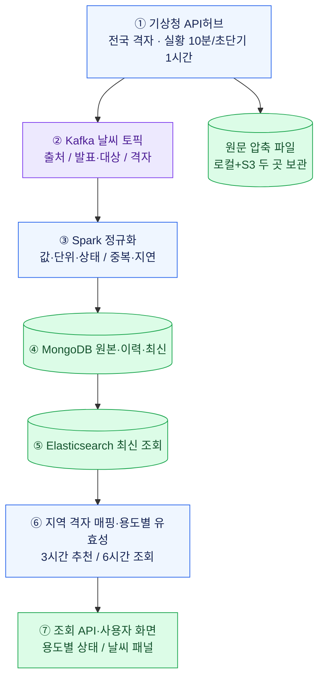
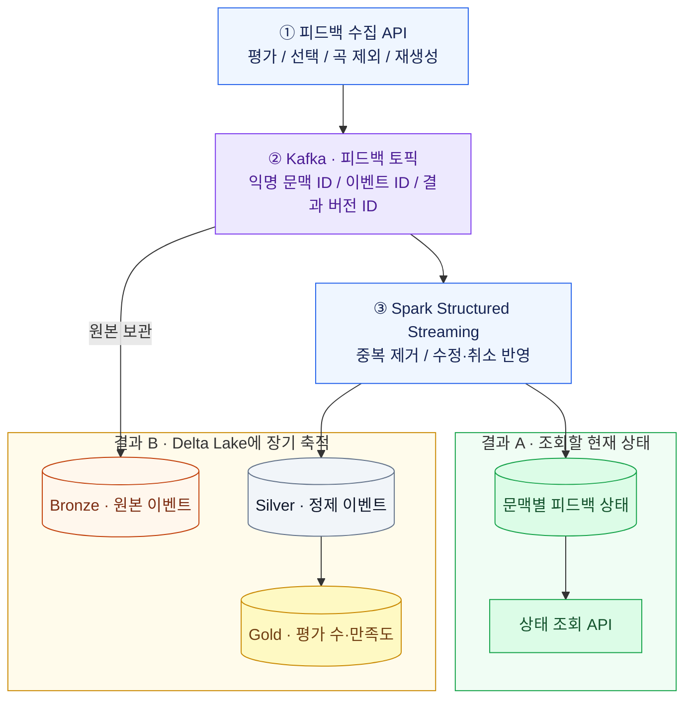
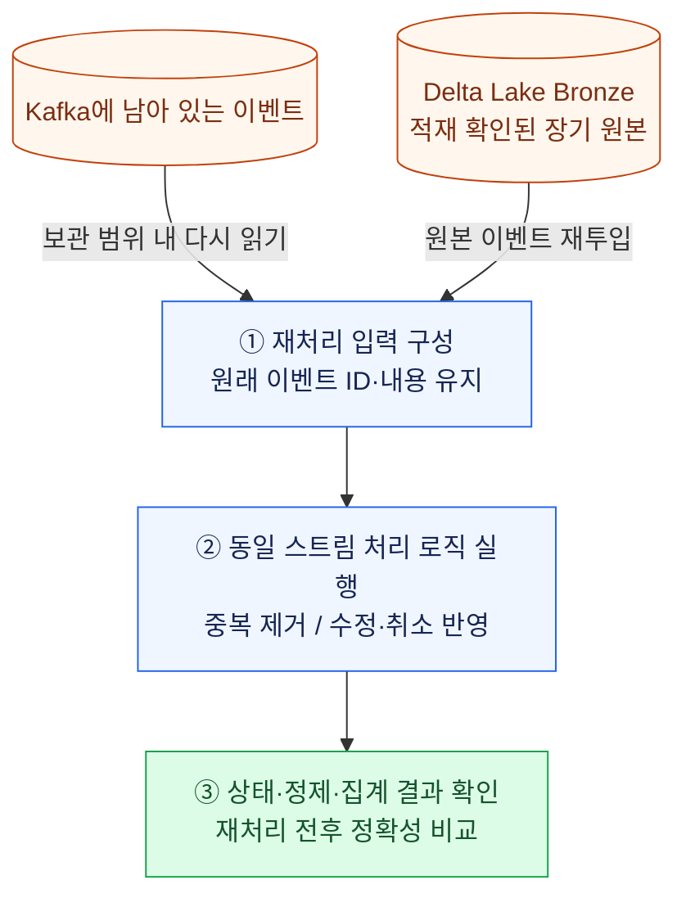
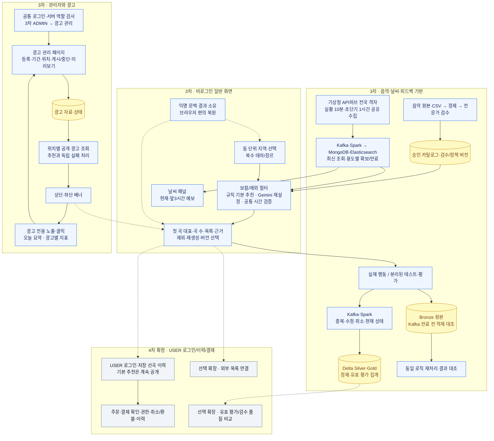

# 카페 맞춤형 음악 서비스 — 아키텍처 및 3차·4차 구현 태스크

## 2026-10-19 추천 요청 분산 실행

사용자 요청으로 기존 PostgreSQL Job 큐를 기본 추천/Gemini 작업 종류별 워커가 처리하도록 보완합니다. 두 Control의 별도 프로세스·공통 호출 제한·큐 상한/복구를 사용하며 ON/OFF 점수·후보·날씨 검증·176~184분·부모 보존은 유지합니다. 실제 코드/오류/검증은 [분산 변경 라우팅](../development/추천_분산처리_변경_라우팅.md), 실행·설정·남은 수용은 [인프라 인계](../runbook/추천_분산처리_인프라_인계.md)를 따릅니다. 수령 인프라 문서의 FastAPI 설명과 현재 Django ASGI 코드는 구분하고 원문을 수정하지 않습니다. 운영 배포·부하/HA 검증 완료를 뜻하지 않습니다.

## 2026-10-19 관리자 3역할과 SSO — 최신 사용자 결정

관리자는 계정당 최상위 SUPER_ADMIN(앱 전체·Kibana 전체 대시보드), 광고 ADS_ADMIN(광고 관리만), 운영 OPS_ADMIN(음악·YouTube 검수·피드백·운영 대시보드) 중 하나입니다. 최상위·운영은 공통 OIDC 인증으로 Kibana에 연결하고 광고는 차단합니다. 최상위·운영의 공통 관리자 헤더에는 운영 대시보드·로그 대시보드 두 버튼을 표시하며, 각각의 주소/SSO 미설정 시 해당 항목만 연결 준비 중으로 비활성화하고 광고 계정에는 둘 다 숨깁니다. Keycloak 대상 통합 발급·변경·회수 코드와 로컬 검사, Elastic OIDC/space/역할 설정 예제를 추가했습니다. 운영의 Kibana 권한은 operations space의 대시보드/Discover 읽기를 기본 구현으로 두며 편집 권한은 별도 수용 대상입니다. 인증 설정 미적용·라이선스/HTTPS/실제 계정 발급/브라우저 SSO 검증은 인프라 연결 대기입니다. 음악 점수·후보·날씨 정책·작업 ID/선행 관계는 변경하지 않습니다. [변경 라우팅](../development/관리자_3역할과_SSO_변경_라우팅.md)과 [인프라 적용 절차](../../config/environments/sso/README.md)를 우선 확인합니다.

- 작성일: 2026-10-04
- 수정일: 2026-10-19
- 2026-10-18 로컬 수용 범위: 중앙 첫 곡 정보·새 탭 재생·초기 URL 검수의 구현/시험은 [이번 변경 라우팅](../development/YouTube_새탭_연속재생_변경_라우팅.md)에서 확인합니다. 기존 작업 ID·선행 관계·공유 인증/운영 저장소 완료 조건은 유지하며, 일부 URL 통과를 전체 곡 검수나 3시간 완주로 환산하지 않습니다.
- **3차:** 보유 음악 CSV 입력·정제·보컬/테마/장르 검수, 비로그인 지역/날씨·3시간 규칙 기본 추천·Gemini 재설정·복수 선택 선호·곡 제외/재생성·승인, 동일 펭귄의 3단계 안내/다시 보기(1번 날씨·강수 통합), 날씨 패널, 피드백, 공통 로그인·ADMIN 광고 관리·상하단 배너·노출/클릭·통합 검증
- **4차 확정:** 공통 화면의 USER 로그인·프로필/로그아웃·본인 선곡표 저장/이력·결제/권한/결제 이력
- **선택 확장:** 현재 익명 결과의 계정 편입·외부 사용 연결·날씨 적합성 전용 평가/품질 비교·개인화/자동 학습. 곡별 반응·선곡표 별점 UI는 3차 P0입니다.
- **범위 확정:** 3차에서는 로컬 AI 모델을 사용하지 않으며 Gemini는 선곡표 재설정에만 사용합니다. 기본은 규칙 로직으로 추천하고 결과 불만족 시 Gemini에 같은 적격 RDB 후보/조건을 제공해 재설정합니다.

일반 사용자는 **3차·4차 모두 지역만 필수로 기본 추천을 비로그인 이용**합니다. 보컬·빠르기·테마/장르 복수는 선택 사항입니다. 국가·언어 기능은3차에서 모두 제외합니다. 재생성에 선택 전체와 제외 곡을 유지합니다.

로그인은 일반 제목의 공통 페이지입니다. 서버가 계정 역할을 확인해 ADMIN은 광고 관리로 바로 이동하고 USER는 4차 선곡 페이지로 이동합니다. USER 이력·결제에는 로그인하며 3차는 관리 계정만 사용합니다. 음악 관리·검수도 허용된 관리 권한으로 보호합니다.

광고는 상단·하단 모두 3차에 제공합니다. 광고 한 건은 한 위치이며 제목·이미지·URL·기간·우선순위를 저장하면 예약/게시를 판정합니다. 관리 페이지는 저장·게시 중단·PC/모바일 미리보기·오늘 요약·광고별 노출/클릭을 제공합니다. 광고 실패는 추천을 막지 않습니다.

현행 음악은 음악_분류_컬럼_정의.md의 추천·표시18개와 검수 보조값 기준입니다. 보컬/테마는 별도 검수 자료이며 음악 필드를 늘리지 않습니다. RDB 제품/DDL·결제/요금·실행 스택은 관련 작업에서 결정합니다.

참고: [서비스 기능 및 사용자 흐름](./카페_음악_서비스_기능_및_사용자_흐름_정리.md), [추천 로직 가이드](./카페_음악_추천_서비스_3차_컬럼_기반_추천_로직_가이드.md), [구현 설계도](./카페_음악_서비스_구현_설계도.md), [음악 분류 컬럼 정의](../handoff/music/음악_분류_컬럼_정의.md), 현행 음악 테이블 v1.3의 기존 문서 기술. 원본 스키마는 현재 전달 폴더에 없고 추후 제공될 음악 DB 문서와 대조해야 합니다. 아래 작업은 계획이며 코드 구현 완료를 뜻하지 않습니다.

## 2026-10-16 통합 문서 정본과 로컬 시험

음악 후보·점수·시간은 최신 ON/OFF 후보 산출 가이드·음악 통합 계약·공통 개발 계약을 정본으로 사용합니다. 일반 추천에서는 GENERAL만 허용하고 SEASONAL_EVENT는 제외, REVIEW_REQUIRED/UNSCREENED는 보류합니다. 기본/Gemini의 같은 적격 검사와176~184분을 유지합니다. 현재 수령 코드는 Django이며 FastAPI는 목표 문서 계약입니다. 수령 원문은 보존하고 차이·연결 어댑터·로컬 YouTube 시험은 [음악·재생 정본 변경 라우팅](../development/음악_재생_정본_변경_라우팅.md)에 기록합니다. 최신 사용자 선택은 YouTube 외부 재생을 기본으로 하고 대시보드 iframe을 접이식 보조로 유지하는 방식입니다. 키 없는 별도 영상 레지스트리에서 native 승인과 iframe 검수를 독립 관리하며 LLM/YouTube Data API를 호출하지 않습니다. 기존 native 검수 자료의 복원을 iframe 재생 가능 확정으로 전용하지 않습니다. 기존 평가·제외·승인/불변 결과는 유지하고 검색 후보·VERIFIED·청취 검수와 실제 재생 증거를 구분합니다. 미연결·자동재생 차단·150/153은 안내하고 우회하지 않습니다. 이 로컬 예외는 음원 파일 배포·운영 Gold·공유 인증·AWS나 전곡 재생 완료를 뜻하지 않습니다.

## 2026-10-14 Gemini 재설정 모델 확정

사용자 결정으로 선곡표 재설정의 API 모델은 **Gemini 3.8 Flash(`gemini-3.8-flash`)**를 사용합니다. 기본 추천은 규칙 방식이며 해당 모델은 명시 재설정에만 호출합니다. 실제 프로젝트/키·호출 한도/예산 확인은 별도입니다.

## 2026-10-14 공통 구현 기준 정리

음악 후보·점수·시간의 2026-10-16 최신 기준은 [ON/OFF 후보 산출 가이드](./카페_음악_추천_서비스_3차_컬럼_기반_추천_로직_가이드.md)와 [공통 개발 계약](./3차_공통_개발_계약과_검증_기준.md)을 따릅니다. ON/OFF 기본값·176~184분·자동 단축 없음이 이전 단일 날씨/135분 규칙보다 우선합니다. 실제 CSV/카탈로그·코드·운영 검증 완료를 뜻하지 않습니다.

## 최신 결정 — 규칙 기본 추천과 Gemini 보조 재설정

### 3차 국가·언어 제외·ON/OFF 점수·신규 곡 기준 — 2026-10-16 갱신

3차에는 국가·언어 설정/검수/필터/가점/관리 입력/피드백 필드를 제공하지 않습니다. 음악18개 추천·표시 필드와 원본 점수 특성을 사용하고 보컬 검수·mood테마·genre·speed만 현재 기능에 연결합니다. 기본/재설정 요청은 국가·언어 관련 필드를 허용하지 않으며 이전 언어 선택을 상속하거나 숨겨 적용하지 않습니다. 별도 후속 단계 채택은 미정입니다.

추천 점수는 모드별로 분리합니다. ON은 날씨 5종×2패턴의 적격 W≥75를 먼저 적용한 뒤 활성 선호와 75:25를 적용하고, OFF는 날씨에 독립적인 P_OFF(장르·energy·mode·speed 40:40:5:15)를 사용합니다. 원본 정밀도·필터·NULL·장르 구성은 최신 후보 산출 가이드를 따릅니다.

새 결과는 부모 전체 고유 곡 수N의20% 내림값 이상인 신규 곡을 포함하면 인정합니다: required_new_count=max(1,N//5), actual_new_count=len(result_ids-parent_ids). 기존 곡 제거는 필수 조건이 아니며 추가만으로도 통과할 수 있습니다. 부모 분모는 제외 후에도 유지하고 순서/설명 변경·기준 미달은 실패 안내와 부모 보존입니다. 등록/검수·무보컬·제외·중복·모드별 필터·시간 검증(ON에만 유효 예보)은 별도로 모두 통과해야 합니다.

### 곡별 반응·선곡표 만족도 — 2026-10-13 추가

3차 공개 추천에 곡별 [좋아요]/[싫어요]와 선곡표 전체의 별점 1~5점 만족도 평가를 추가합니다. 곡 반응은 LIKE/DISLIKE/미평가(null)의 세 상태이며 같은 버튼 재클릭은 해제, 반대 버튼은 전환합니다. 별점은 곡 목록 바깥의 [이 선곡표 만족도] 영역에 정수 1~5점으로 선택하고 [평가 취소]로 해제합니다. 둘 다 선택 입력·초기 미평가이며 비로그인 본인 결과에서 이용합니다. 곡 반응과 별점은 실제 결과 버전에 귀속하고 새 결과로 복사하지 않습니다. 곡 제외·승인과 별개이며 자동 추천/제외/승인·점수 변경·Gemini 호출을 유발하지 않습니다. 저장/취소·당시 조건/곡·revision·outbox·집계·검증은 구현 설계도 6-9절을 따릅니다. 실제 UI/API 구현 완료를 뜻하지 않습니다.

### 재설정 변화 판정·176~184분 고정 — 2026-10-16 갱신

- Gemini 재설정은 부모 선곡표 곡 수의 20%를 내림한 수만큼 부모에 없던 `track_id`가 포함되어야 새 성공 결과로 인정합니다. 기준 곡 수는 재설정 직전 부모 결과의 고유 곡 수이며 제외 후의 작은 목록으로 분모를 줄이지 않습니다. `added_ids = result_ids - parent_ids`, `required_new_count = max(1, len(parent_ids) // 5)`, 성공 조건은 `len(added_ids) >= required_new_count`입니다. 소수점은 버리므로 49곡은 9곡, 50곡은 10곡, 53곡은 10곡이 필요합니다. 1~4곡은 내림값이 0이어도 기존 변화 없음 불인정 원칙에 따라 최소 1곡이 필요합니다. 동일 곡의 순서/설명 변경이나 기존 곡 일부만 남긴 결과는 인정하지 않습니다. 다른 필수 검증도 모두 통과해야 합니다.
- 변화가 없으면 `NO_MEANINGFUL_CHANGE`와 “기존 선곡표와 다른 곡을 찾지 못했어요. 현재 선곡표는 유지됩니다.”를 안내합니다. 일부 변경했어도 신규 곡 추가 기준 미달이면 같은 상태 코드와 “필요한 신규 곡 수를 채우지 못했어요. 현재 선곡표는 유지됩니다.”를 안내하며 parent_track_count·required_new_count·actual_new_count를 기록합니다. 부모 결과·승인 상태·제외 초안을 보존하고 새 성공 결과나 승인/곡 제외 이벤트를 만들지 않습니다. 실제 재설정 시도와 변화 없음 진단은 별도로 기록합니다.
- ON/OFF 모두 180분 목표·176~184분만 성공/승인합니다. 200곡 창에서 전체 적격 후보까지 확장하고, 전체 범위의 구성 불가가 확인된 경우에만 CANDIDATE_SHORTAGE입니다. 자동 시간 단축은 적용하지 않습니다.
- 작업·결과·피드백 조건에는 duration_mode=STANDARD와 목표/허용 범위·모드/정책 버전을 고정합니다. ON에만 날씨 유효 구간을 검증하고 OFF에는 요구하지 않습니다.
- 후보 부족은 적격 후보 수·총 재생시간·필터 사유와 탐색 범위를 근거로 판단합니다. 모델의 짧은 응답, 제한 후보 풀의 실패, solver `UNKNOWN`/시간 초과만으로 전체 후보 부족을 단정하지 않습니다. ON/OFF 성공률과 후보 부족·탐색 미완료를 구분해 집계합니다.

기본 추천은 음악18개 추천·표시 필드와 원본 정밀도 점수 특성을 사용해 ON/OFF 모드별 규칙·정수 시간 조합으로 생성합니다. Gemini는 사용자의 명시 재설정에만 같은 모드의 적격 RDB 목록에서 제안합니다. 국가·언어 기능은 제외하며 이전 16개/수동 energy W/음향3개 점수는 현행 추천식이 아닙니다.

[현행 Gemini API 추천 설계](./카페_음악_서비스_3차_Gemini_API_추천_설계.md). 규칙 가이드는 현행으로 복원하고 보관본은 이력으로 유지합니다. Gemini 재설정 실패 시 부모 결과/초안을 유지하고 자동 규칙 재생성으로 바꾸지 않습니다. 실제 API 호출·과금·DB 변경·배포는 이번 문서 작업에서 하지 않습니다.

## 2026-10-13 구현 결정 반영

초기에는 같은 네트워크의 로컬 클러스터에서 Kafka·Spark를 연결하고 최종 AWS로 이전합니다. 문서 개발 기준은 React·TypeScript·Vite와 FastAPI이며, 정확한 버전·설치/접속은 D-03의 환경 검증으로 고정합니다. 날씨 파이프라인은 새로 구현하며 3차 음악은 보유 CSV를 사용하고, 상세 음악 규격은 추가 문서로 받습니다. 원문은 로컬과 S3에 함께 보관합니다. 200곡 후보 창에서 시작해 400→800→1,600→전체 적격 후보까지 확장하며 실제 처리시간은 검증 대상입니다.

날씨 패널은 유지하고 별도 강수 카드·X·닫기 기록·재노출 방지는 제거합니다. 6시간 공유 수집/조회와 앞 3시간·실제 초과분 추천 검증은 유지하며, 펭귄 안내의 X/Esc는 별개입니다. 소나기·빗방울은 비, 기본 규칙의 PTY7은 눈 프로필, PTY2/6은 비·눈 풀 교집합이며 혼합 속도 기본값은 수용 확인 대기입니다. Gemini에는 원래 현상과 같은 적격 판정 근거를 제공합니다. 관리자 초기화 발급·초기 권한 배정, 회수 시 비활성화/세션 무효화, 익명 쿠키 소유 검사, 로컬·S3 원문 보관의 상세 계약은 아래 연결 가이드를 따릅니다. 광고 규정은 별도 회의 결과 대기입니다. 문서 반영은 실행/설치/배포 완료가 아닙니다.
상세 계약: [3차 구현 결정과 익명 문맥·원문 보관 가이드](./3차_구현_결정과_익명문맥_원문보관_가이드.md).

## 1. 아키텍처

3차 음악은 RDB에 등록하고, Delta Lake는 피드백 원본·정제·집계의 저장 기술로 제안합니다. Kappa는 이벤트를 스트림으로 처리하고 재처리하는 아키텍처입니다. 날씨 스트림은 새 [수집·지역매핑](../handoff/weather/01_날씨_수집과_지역매핑.md)·[데이터규격](../handoff/weather/02_날씨_데이터규격과_정제.md)·[저장구조](../handoff/weather/03_날씨_저장구조.md)를 기준으로 MongoDB 이력/최신·원문 파일 저장·Elasticsearch 조회 경로를 별도로 둡니다. 이 도식은 구현 계획이며 로컬 [API/RDB 적재시험](../handoff/weather/04_API호출과_RDB적재시험.md)의 수치·파일을 운영 완료 근거로 사용하지 않습니다.

### 1-1. 음악 RDB와 기존 데이터 레이크 구분

3차 음악은 보유 CSV를 음악 RDB로 등록하고 규칙 기본 추천·Gemini 보조 재설정의 입력/표시/검증에 사용합니다. RDB 제품·테이블·키·NULL·검수/버전은 추가 문서로 확정합니다. 이전 음악 Delta/Gold 물리 구조와 30+1컬럼을 신규 RDB의 채택 스키마로 사용하지 않습니다. 음악의 Bronze/Gold는 원본 보존·검수 완료 단계명이며 물리 저장 방식은 M-01/D-03 계약에서 확정합니다. 공개/검수 적격 상태와 당시 곡 스냅샷은 유지합니다.

피드백 원본→정제→집계와 Kafka/Spark·Delta의 기존 제안은 이번 음악 변경만으로 삭제하지 않습니다. 날씨 경로도 분리하며 추가 인프라 문서에 맞춰 조정합니다.

2026-10-14 [로컬 개발 인프라 가이드](../handoff/infra/local%20infra%20guide.md)를 수령했습니다. PC/Hyper-V Ubuntu VM·Kafka/Spark/Elasticsearch 배치·내부 IP·팀원 SSH 접속 구조는 자료 수령, 서비스 프로세스·전체 저장소·호환 버전·통신/복구는 보완·검증 대기입니다. [인프라 수령 상태](./3차_구현_결정과_익명문맥_원문보관_가이드.md)를 D-03/I-01~I-04의 인계 자료로 연결하되 작업 ID·직접 선행 관계·완료 조건과 실행 검증 상태는 유지합니다.

### 1-2. Kappa — 이벤트를 어떻게 처리하는가

**3차 구현 영역입니다.** 날씨와 피드백은 별도 토픽·작업으로 처리합니다. 주 흐름과 재처리 흐름을 분리해 표시합니다.

#### A. 날씨 스트림 — 최신 상태 갱신

날씨는 최신 상태 제공이 중심입니다. 전국 격자 실황은 10분, 초단기예보는 1시간 간격으로 공유 수집하고 공식 지역 코드→대표 격자로 동을 연결합니다. SNO는 3시간 발표 회차, KIM은 3시간 간격 대상 시각의 보완 자료로 연결하며 별도 고정 수집 주기로 단정하지 않습니다. 실제 발표/대상 시각으로 6시간 조회 범위를 구성해 3시간 날씨/추천과 뒤쪽 조회 범위 확보 상태에 사용합니다. 구체 실행 시각·자료 제공 지연·재시도는 W-01에서 확인하고 사용자용 수집 주기 변경 기능은 이번 범위에 두지 않습니다. 수집 실패·만료·용도별 시간/항목 누락을 검증하고 페이지 접속·시간 경과에도 범위를 재평가합니다. 원문은 로컬과 S3 두 곳에 보관합니다. 업로드/재시도·보관/재처리와 실제 운영 성능은 구현 검증 전입니다.

#### B. 피드백 스트림 — 상태 갱신과 장기 저장

피드백은 익명 문맥별 상태를 갱신하는 동시에 정제·집계 결과를 Delta Lake에 남깁니다. **Kappa와 Delta Lake의 연결 지점은 이 장기 저장 경로입니다.** 원본 보관은 별도 경로이며, Bronze 저장 완료를 기다려야만 실시간 처리가 시작되는 구조는 아닙니다. 다만 Kafka 보관이 끝나기 전에 모든 원본의 Bronze 적재를 확인하고, 미적재 구간은 경보·복구해야 장기 재처리가 가능합니다.

#### C. 피드백 재처리 — 같은 로직으로 결과 복원

재처리 시 같은 이벤트가 다시 집계되지 않도록 확인합니다. Kafka 보관 기간을 지나고 Bronze에도 없는 원본은 복원할 수 없으므로 복구 성공으로 판정하지 않습니다. 3차에서 외부 재생목록을 생성하지 않으며, 4차에서도 재처리와 외부 실행은 분리합니다.

### 1-3. 전체 구조도 — 공개 추천·관리 광고·데이터 흐름

실선은 현재 처리 경로이며 점선은 화면 연계 또는 확장 연결입니다. 관리자 인증과 익명 이용 문맥을 구분합니다. 광고 이벤트는 전용 규격으로 처리하고 기존 음악 피드백·Kafka·Delta 경로에 반드시 합치지 않습니다. 관리자 로그아웃 후에도 유효한 게시 광고는 제공됩니다.

### 1-4. 3차·4차 범위 비교

| 구분 | 3차 | 4차 확정·선택 확장 |
|---|---|---|
| 음악 | 음악 추천·표시18개·별도 보컬/mood테마 검수·READY 카탈로그 | 추가 장소/concept는 선택 확장 |
| 날씨 | 실황 10분·초단기예보 1시간 전국 격자 공유 수집·지역별 6시간 조회·3시간 화면/추천·실제 최대 184분 확인·날씨 패널(현재·앞3시간)/6시간 조회 | 예약·자동 변경·Web Push 별도 검토 |
| 추천 | 규칙·복수 테마/장르 선호/3시간 조합·근거/버전 | 기본 공개 유지. 품질/개인화/AI는 별도 검토 |
| 일반 화면 | 비로그인 지역·설정·추천·제외·재생성·[이 선곡표 승인]·광고 | USER의 선곡 이력·프로필/로그아웃 추가 |
| 사용자 안내 | 동일 펭귄 PNG·3단계 말풍선/강조·1번 날씨/강수·이전/종료·브라우저 기록/다시 보기 | 기본 기능 안내 유지. 계정 동기화/별도 편집 화면은 확정하지 않음 |
| 인증 | 공통 로그인·ADMIN 인증·광고 관리 이동·관리 권한 | 같은 화면의 USER 인증·선곡 페이지 이동. 이력·결제 로그인 필수 |
| 피드백 | 곡 좋아요/싫어요·선곡표1~5점 UI/API·실제 행동/테스트 구분·원본/집계/재처리 | 날씨 적합성 전용 평가·품질 비교는 선택 확장 |
| 광고 | 한 광고 한 위치·저장/중단·미리보기·상하단·오늘/광고별 노출/클릭 | 기간 검색·CTR UI·선정 고도화는 추가 검토 |
| 결제 | 구현하지 않음 | 도입 확정. 상품/요금/방식/제공자 결정 후 주문·확인·권한·취소/환불·이력 |
| 외부 사용 | 선곡표 결과 제공 | 외부 목록 방식을 선택하면 계정·곡 매칭·생성·재시도 |
| 검증 | 소유 분리·필수 보컬·복수 선호·시간·관리·날씨 조회/광고·복구 | 본인 이력·결제 소유/중복/권한·기본 공개 유지 |

### 공통 설계 원칙

- **공개 추천:** 3차·4차 지역만 필수입니다. 익명/계정의 결과 소유·이용 한도를 확인하고 이력·결제·관리 API에서 해당 인증을 요구합니다.
- **공통 로그인:** 일반 로그인 제목·서버 역할 분기. ADMIN은 광고 관리, USER는 4차 선곡 페이지. 역할 선택·클라이언트 역할값으로 권한을 부여하지 않습니다.
- **음악/운영 분리:** 음악 추천·표시18개와 별도 보컬/테마 검수·카탈로그/정책/평가 자료를 구분합니다. 이전30+1컬럼/3개테이블을 현행으로 적용하지 않습니다.
- **테마/장르:** 한 칩 영역·복수 선택, 요청은 두 집합. 각각 OR 선호이고 두 그룹 보너스는 별도입니다. 테마는 수동 검수·장르는 검토된 genre 매핑을 사용합니다.
- **보컬:** 명시 검수 True/False 우선·미검수 원본 자동 판정의 최종 instrumental=True만 연주곡 제한을 통과합니다. AUTO True와 청취 검수를 구분하고 explicit·제목/장르/국적으로 확정하지 않습니다.
- **시간:** 필수 조건·날씨를 유지해 duration_ms 실제 합으로 176~184분, 정확히 → 초과 → 부족·구간 내 거리 우선을 지킵니다.
- **작업·버전:** 무거운 조합은 별도 작업자로 처리하는 설계안입니다. 요청 중복·작업 소유·재시작·lease와 결과 버전/부모·조건/예보/정책/카탈로그를 기록합니다.
- **피드백:** 승인·제외·재생성은 만족도와 다릅니다. DB 상태 변경과 행동 outbox를 함께 저장한 뒤 Kafka로 발행하는 설계로 실패를 격리합니다.
- **원본·복구:** Kafka 만료 전 Bronze 적재 대조·경보·복구, 체크포인트/재처리 출력 분리·멱등 처리를 유지합니다.
- **날씨:** 6시간 공유 조회·3시간/실제 초과분 추천 유효성·날씨 패널. 강수 카드/닫기/강수 전용 ID는 제거합니다.
- **광고:** 한 건 한 위치·저장 후 일정 판정·중단 보존. 광고 없음/오류는 추천을 막지 않고 지표는 음악 피드백과 분리합니다.
- **사용자 안내:** 동일 펭귄 자산을 재사용합니다. 단계 이동/예시는 실제 추천·승인·음악 피드백·광고 이벤트를 만들지 않고 기본 추천을 막지 않습니다.
- **4차:** USER 인증·저장 이력·결제는 확정, 기본 추천은 공개 유지. 익명 편입·외부 목록·AI 등 선택 확장과 구분합니다.

### 구현 전 결정할 항목

| 항목 | 결정 내용 | 관련 작업 |
|---|---|---|
| 음악 계약·자료 | 음악18개 추천·표시 필드 필수/NULL·CSV 누락·수동값 보강·보컬/테마 검수·지원 지역·실행 자원 | D-01·M-01·A-01 |
| 선택·추천 | 무보컬·speed·테마/genre 매핑·Gemini 입력/응답·모델/토큰/재시도 한도 | A-02·D-04·R-01 |
| 공개·로그인 | 익명 소유/보관·복원·관리 계정/피드백 조회 권한·공통 역할 이동·요청 제한 | D-02·D-03·I-05 |
| 실행·저장 | 구현 설계도의 스택 채택·별도 작업자/lease·outbox·카탈로그 조회용 스냅샷 | D-03·I-03·R-05·F-03 |
| 날씨 패널·조회 | API 시간 구간/코드·필수 항목·만료·유형 매핑·대상 구간 확보 | W-01·D-02 |
| 원본·복구 | Kafka/Bronze 보관·적재 대조·경보·멱등/재처리·복구 목표 | D-03·F-04·F-08 |
| 제외 피드백 이력 | 필수 선택/곡 태그·곡/날씨 스냅샷·취소 연결·검색/페이지·context/event 보관·원본 만료 | D-02·D-04·F-01·F-07 |
| 광고 | 이미지·단일 위치·일정/중단/재개·동률·캐시·실제 노출·오늘 지표 | AD-01~AD-06 |
| 4차 계정 | USER 발급/가입·이력 저장/삭제·프로필·세션·선택적 익명 편입 | AC-01~AC-03 |
| 4차 결제 | 무료/유료·상품/요금·제공자/방식·주문/권한·취소/환불 | PAY-01~PAY-03 |
| 선택 확장 | 외부 플랫폼·곡 매칭·생성·날씨 적합성 전용 평가·품질 비교 기준 | X-01·X-02·E-01 |

고정 샘플과 미리보기는 운영 입력/지표와 분리합니다. 스택/프로토콜은 공통 개발 기준을 따르고 미정 운영 수치·실제 환경 검증을 구분해 담당자가 결과를 기록합니다.

## 2. 3차 구현 태스크 — 공개 추천·관리 광고·데이터 기반

아래는 기능 범위이며 실행용 ID/선행은 5절에 연결합니다. 로컬 모델 학습/튜닝은 제외하고 Gemini 3.8 Flash(gemini-3.8-flash) 재설정 연결·프롬프트/호출 계약은 3차에 포함합니다.

### 태스크 1. 요구사항·입력·정책 확정

**요약:** 공개 기본 추천·공통 로그인·상하단 광고·4차 USER/이력/결제 경계를 확정합니다.

- 지역만 필수로 받는 일반 입력, 보컬/빠르기·복수 테마/장르 선호/비선호 기본값·필수/선호·이번 범위·결과 선택 문구·예외 화면을 정의합니다.
- 음악18개 추천·표시 필드·원본 점수 특성/speed/mood·별도 보컬/테마 근거·genre 라벨을 확인합니다. 없는 음향값/BPM을 생성하지 않습니다.
- CSV 기반 날씨5종·테마9종 적합 점수는 `catalog_version`·원본 해시·수식 버전별 사전 계산값으로 보존합니다. ON의 선택 테마 가점은 계산된 점수를 쓰고, 이 점수를 곡별 승인 mood나 주 악기 검수값으로 자동 입력하지 않습니다. OFF의 직접 장르·빠르기 기준은 요청마다 다시 평가합니다.
- 익명 문맥의 접근·결과 소유·보관·브라우저 지역/결과 복원·공개 요청/동시 생성 한도를 정의합니다.
- 관리자 계정·역할·세션과 광고 관리 페이지 진입을 정의합니다. 일반 사용자 계정을 기본 추천의 조건으로 두지 않습니다.
- 평가·선택·제외·재생성·수정·취소의 의미와 테스트 자료를 구분합니다.
- 추천 초기 수치·광고 규격·미정 항목은 담당 결정 사항으로 기록합니다. 사용자 로그인·이력·결제는 4차 확정이며 외부 생성·익명 편입은 선택 확장입니다.

**산출물·완료 기준:** 데이터 사전·요구사항·UX 계약·고정 사례를 제공하고 3차와 후속 범위를 동일하게 설명합니다.

### 태스크 2. 데이터 구조·처리 환경·접근 설계

**요약:** 현재 음악 테이블, 별도 검수/정책·날씨·익명 결과·피드백·관리 인증 구조를 구성합니다. 음악18개 추천·표시 필드 RDB(제품/DDL 대기)와 피드백 Kafka·Spark·Delta와 날씨 API허브·Kafka·Spark·MongoDB/원문 파일·Elasticsearch의 실행 환경을 구분해 검증합니다.

- 음악18개 추천·표시 필드의 필수/NULL·ID·정수ms·세미콜론 복수값·검수/버전을 정의합니다. 누락된 필수값과 수동값은 준비 자료로 보관하고 공개 적재와 구분합니다.
- 검수 상태·보컬·테마·장르 매핑·날씨 정책을 운영 자료로 정의합니다. 가사 O/X·원본 BPM을 전곡 필수로 늘리지 않습니다.
- 익명 문맥·결과/부모 버전·사용자 계정 소유의 4차 연결을 구분합니다. 결과 조회/변경과 피드백도 소유 문맥을 검사합니다.
- 서버 기준시각·시간대·이벤트 ID·평가 대상 ID·revision·테스트 표시를 정의합니다. 제외 이력은 관리자 조회 권한·당시 선택/곡 태그·곡/조건/날씨 스냅샷·연결 이벤트의 보관을 함께 정의합니다. 강수 카드/닫기 상태는 제거합니다.
- 원본·정제·집계·날씨/작업 현재 상태의 저장 키·재구축 방법을 정하고 운영/테스트 영역을 구분합니다. 날씨의 원본/이력/최신 MongoDB·원문 압축 파일·Elasticsearch 검색 재발행과 PostgreSQL 날씨 유효성 상태를 별도 계약으로 맞춥니다.
- Kafka 보관 기간을 Bronze 적재 지연과 감지·복구 목표의 합보다 길게 정합니다. 만료 전에 ID·토픽·파티션·오프셋별 적재 범위를 대조하고 미적재 구간을 경보·복구합니다.
- 원본 보관·정제 성공을 별도로 추적합니다. 재처리는 별도 체크포인트·출력에서 대조한 뒤 반영하고, Kafka와 Bronze 모두에 원본이 없는 구간은 복구 성공으로 표시하지 않습니다.
- 네이티브 환경에서 실행 환경·호환 버전·키·체크포인트를 구성합니다. ADMIN 인증은 3차, USER 로그인·계정 이력·결제는 4차 확정입니다. 외부 사용자 인증·로컬 AI 모델은 별도 선택 범위입니다. Gemini 서버 접속은 3차 선곡표 재설정에서만 사용합니다.

**산출물·완료 기준:** 스키마·환경·접근 규격과 샘플 발행/저장/복구 절차를 제공합니다.

### 태스크 3. 보유 음악 CSV 입력·정제·일괄 등록

**요약:** 확보한 현재 컬럼의 자료를 검수 가능한 카탈로그 입력으로 만듭니다.

- 선정한 출처·CSV에서 후보를 확보하고 원문·출처·시각·등록 요청/행 식별을 보존합니다. 신규 API 음향값 확보를 필수 전제로 두지 않습니다.
- track_id·필수 메타데이터·duration_ms·원본 energy와 표시용 정수 energy/라벨 유효성·NULL·genre 세미콜론 라벨을 검사합니다. 실제 0과 미확인 값을 구분합니다.
- 곡 ID 중복·녹음 버전·필수값 누락·잘못된 단위를 분리합니다. 원본20개 CSV의 energy/acousticness/valence·tempo/time_signature를 보존하고 정의된 표시용 변환과 ON 점수용 원본 정밀도를 분리합니다.
- genre 이름으로 보컬·국가를 추정하거나 artists 이름만으로 artist_id/artist_genres를 자동 연결하지 않습니다.
- 일괄 등록은 관리 권한을 확인하고 행별 성공/오류·재입력 결과를 제공합니다. 입력 초안·재시도만으로 Gold 승인·중복 곡이 생기지 않게 합니다.
- 일일 약 50곡은 기존 수집 목표이며 운영 가능한 Gold 수를 보장하지 않습니다. 실제 데이터 확보·검수 속도로 재산정합니다.

**산출물·완료 기준:** 원본·정제·행별 오류·재시도·버전 판정을 추적하고 현재 음악 스키마에 맞는 자료만 다음 단계에 전달합니다.

### 태스크 4. 전문가 검수·선택 매핑·Gold

**요약:** 추천 가능한 음악과 엄격한 연주곡 목록·복수 테마/장르·날씨 정책을 검수합니다.

- 확보된 자료·검수 담당·출처·확인 가능한 항목을 정의합니다. 없는 항목은 미확인으로 보존합니다.
- genres의 실제 라벨을 장르 코드에 매핑하고 수동 검수 테마 코드를 연결하며 정책/검수 버전을 기록합니다.
- 연주곡만은 승인 카탈로그의 최종 instrumental=True로 처리합니다. 명시 검수 우선·미검수 원본 자동값 허용이며 False/NULL은 제외합니다. AUTO True를 청취 완료로 표시하거나 explicit=false·장르명으로 확정하지 않습니다.
- speed는 원본 tempo/time_signature의 정해진 변환·ROUND_HALF_UP으로 slow/medium/fast/fastest를 산출하고 NULL/오류·원본 근거를 보존합니다. 실제 청취 검수와 자동 변환을 구분합니다.
- 관리 역할로 초안·근거·검수 대기·수정·승인·보류·변경 이력을 제공합니다.
- 승인 카탈로그와 날씨/선택 조건별 고유 곡 수·총시간·특성 확보/미확인 현황을 제공합니다. 총시간을 실제 조합 성공으로 표시하지 않습니다.
- 테마/concept의 동일 의미는 중복 저장하지 않고 장소 분류는 추가 자료 확보 후 확장합니다. 외부 곡 매칭은 Gold 승인과 별개로 후속 확인합니다.

이번 로컬 YouTube 예외는 URL/CSV 등록·미연결 검수·native 승인/iframe 가능 여부의 분리 저장입니다. 새 등록은 둘 다 미확정이고 외부 PLAYING 수동 보고와 삽입 PLAYING을 각각 검수합니다. 기존 native 근거 복원은 iframe 자동 승격이 아니며 음악 Gold·보컬/테마 검수와 분리합니다. LOCAL_DEMO+실행코드와 운영503·기존 M/A/U/X ID/직접 선행 관계는 유지합니다.

**산출물·완료 기준:** 검수·Gold·선택 매핑·정책 자료를 제공하고 3차 추천 입력으로 연결합니다.

### 태스크 5. 날씨 파이프라인·공개 화면·날씨 패널

담당: A는 수집/정규화/저장/조회/유효성 코드와 샘플, C는 공개 지역/날씨 패널, B는 공통/피드백 연결, INF는 설치/운영 환경입니다. 날씨→음악 W/S는 C가 구현하며 PL이 분류 기준을 조율합니다.

**요약:** 기상청 API허브 전국 격자 실황은 10분, 초단기예보는 1시간 간격으로 공유 수집하고 SNO 발표·KIM 대상 시각의 보완 자료를 연결합니다. 실제 대상 시각으로 지역별 6시간 조회 범위를 구성해 3시간 날씨/추천과 날씨 패널에 재사용합니다.

- 조회 API·발표/제공·대상 시간의 구간 의미·시간대·항목을 정의하고 실제 확보 범위를 기록합니다. 수집 시점부터 정확히 6시간이 모두 제공된다고 가정하지 않습니다.
- 공식 지역 코드·대표 격자를 매핑하고 발표/대상/수신 시각·항목·원문값/정규값·단위/상태 이벤트를 Kafka로 발행해 반복/중복을 식별합니다. MongoDB 이력/최신과 원문 파일 저장·Elasticsearch 조회를 구분합니다.
- 과거 발표가 최신 상태를 덮지 않게 갱신합니다. 수집 실패·보유 예보 만료·용도별 누락을 각각 기록합니다.
- 3시간 요약·예보 묶음/평가 시각·용도별 확보/만료·예보 대상 구간·분류·누락/만료 근거를 조회 API로 제공합니다. 관리 오류 상세는 관리 역할에만 제공합니다.
- 로그인 없이 익명 문맥의 지역을 저장·변경·복원합니다. 같은 동의 문맥 두 개에서 상태를 분리하고 브라우저 저장 실패 시 재선택으로 이용합니다.
- 실제 예보 대상 구간과 PTY/SKY 유형을 조회 자료로 보존합니다. 별도 강수 카드·구간 ID·X 숨김·재노출 방지는 제거합니다.
- 유효 강수+일부 누락은 함께 안내하고 미검출+누락/만료는 확인 불가로 처리합니다. 누락만으로 강수 취소를 판정하지 않습니다.
- 선곡용 3시간/실제 초과분의 필수 누락은 차단하고 뒤쪽 조회 범위만 누락된 상태는 유효 추천을 허용합니다.
- 별도 AI·알림 권한·OS Web Push 발송은 추가하지 않습니다. 상세 패널 규칙은 서비스 문서 3-5·7-9를 따릅니다.

**산출물·완료 기준:** 비로그인 지역·날씨·날씨 패널·유효성와 용도별 상태가 고정 사례/재시작에서도 일치합니다.

### 태스크 6. 피드백 파이프라인·운영 행동 연결

**요약:** 실제 선택·제외/취소·재생성과 분리된 평가/테스트 자료를 처리·보관·집계하며, 관리자 전용 곡 제외 이력의 최소 목록/상세 화면·조회 API를 3차 P0로 제공합니다.

- 이벤트 API는 익명 문맥의 실제 결과 소유를 검증합니다. 테스트 자료는 고정 샘플 ID와 별도 표시로 분리합니다.
- 원본 ID·시각·revision·토픽/파티션/오프셋을 보존하고 Kafka 만료 전 Bronze 적재를 대조·복구합니다.
- 중복·역순·수정·취소·잘못된 ID를 검사합니다. 수정은 이전 평가 대체, 취소/미평가는 유효 평가 분모 제외로 처리합니다.
- 문맥·기간·결과별 행동/평가를 구분해 조회합니다. 선택·제외·재생성 수치를 만족도로 합치거나 익명 문맥을 실제 사람·카페로 해석하지 않습니다.
- 실제 원본 결과에 사용한 선택 태그/명칭·보컬/빠르기·날씨/버전과 당시 곡명/아티스트/길이·곡 태그/검수 상태를 필수 기록합니다. 미반영 화면 선택과 원본 조건, 선택 태그와 곡 태그를 구분합니다.
- feedback_context_snapshot·feedback_event/outbox·관리자 feedback_exclusion_history 조회를 연결합니다. 제외 취소는 원래 이벤트를 지우지 않고 연결하며, 현재 음악/태그 수정이나 원본 결과 만료 뒤에도 정책 기간 안의 당시 값을 조회합니다.
- ADMIN + 피드백 조회 권한으로 `/admin/feedback/exclusions`의 기간/곡/선택 태그·곡 태그/행동·상태 검색·페이지 목록·상세·빈 결과/조회 오류/세션 만료를 구현합니다. 공개 본인 초안 API와 구분하고 관리자 조회가 사용자의 초안을 변경하지 않음을 검증합니다.
- 3차 추천은 확정된 날씨 규칙·이번 조건을 사용합니다. 장기 개인화·누적 취향 점수 반영은 후속 검토입니다.

**산출물·완료 기준:** 실제 행동 연결·집계와 고정 샘플·재처리 결과가 일치하며 운영/테스트가 분리됩니다. 관리자 전용 최소 이력 화면/API에서 필수 당시 정보·제외/취소 연결·검색/페이지·권한·보관/원본 만료를 확인합니다. Q-07 통합 편의 대시보드는 P1로 별도 관리합니다.

### 태스크 7. 데이터 품질·통합 검증·복구

**요약:** 데이터·공개 추천·관리 광고·날씨 조회·피드백을 고정 자료로 재현하고 복구를 확인합니다.

- 음악 원본→Gold, 현재 컬럼·NULL·검수/장르 매핑·보류·중복·재입력을 대조합니다.
- 추천 날씨 변경·선호 하나/동시 선택·엄격한 연주곡·제외 유지·시간 경계/초과 우선·검색 미확정·버전 선택을 검증합니다.
- 3/6시간·자정·누락/만료·실제 초과분 유효성과 패널 표시를 검증합니다. 강수 카드/닫기 상태는 구현하지 않습니다.
- 공개 추천 이용·타 문맥 결과 차단·관리 로그인/권한·세션 만료를 검증합니다.
- 광고 정상/없음/지연/이미지 오류·예약/게시/중단·작은 화면·실제 노출/중복·미리보기 제외를 대조합니다.
- 중단·재시작·상태 또는 원본 적재의 부분 실패, Kafka 만료 전 미적재 복구·만료 후 Bronze 재처리·별도 출력 대조를 수행합니다.
- 등록량·검수·날씨/추천 실패·처리 지연·원본 미적재/만료 임박 경보·광고 상태를 조회합니다.
- 관리자 제외 이력의 필수값·당시 선택/곡 태그 분리·명칭/곡 정보 변경 후 보존·미재생성 설정·취소/재제외·기간 밖 취소·관리 권한·원본 만료·재처리 일치를 대조합니다.
- 4차 계정 이력·결제·선택 외부 사용을 위한 인터페이스/소유/보관 제약을 인계합니다.

**산출물·완료 기준:** 다른 담당자가 동일 입력·기대값으로 재현할 수 있는 시연/복구 절차와 실제 검증 결과를 제공합니다.

### 태스크 8. 규칙 기본 추천·Gemini 보조 재설정

R-01~R-05 ID/직접 선행 관계를 유지합니다. 기본 추천은 ON/OFF별 후보·점수·장르 구성·정수 시간 조합과 200→전체 후보 확장을 구현합니다. Gemini는 명시 재설정에만 사용합니다.

- 공통 등록/검수·보컬·제외·중복과 ON/OFF별 적격 필터를 기본/Gemini에 동일하게 적용합니다.
- ON은 W≥75 뒤 활성 선호75:25, OFF는 P_OFF·선택 장르100→80을 검증하며 두 모드 모두 176~184분과 시간·품질 순위를 적용합니다.
- Gemini 입력은 적격 RDB 후보·부모 결과·당시/새 선택·예보·최신 제외 스냅샷입니다.
- JSON/등록 ID/중복/ON·OFF별 필수/점수/장르 구성/시간 검증과 제한 재요청·실패 시 부모 보존을 확인합니다.
- 기본/재설정 생성 방식·규칙/모델/프롬프트/입력 버전을 구분하고 실제 호출과 고정 응답을 분리합니다.
- RDB 스키마 대기·국가·언어 기능 제외·날씨 패널/광고/소유/피드백 계약은 유지합니다.

### 태스크 9. 일반 추천 화면·조정·결과 선택

최신 기본은 기존 PublicPage에서 native 승인 ID의 임시 목록을 외부로 열고 iframe은 접이식 보조로 제공하는 방식입니다. 준비수·누락과 전체/명시 부분 열기·원순서·조건/제외 gate를 검증합니다. 키 없는 URL/CSV·분리 native/iframe 검수·legacy 출처·곡별 revision·CSV 원자성·개별 경로 차단도 확인합니다. LLM/YouTube Data API는 호출하지 않으며 공개 소유/CSRF와 운영자 실행코드·운영503을 분리합니다. 원래 전체GENERAL 후보·결과/176~184분·평가/제외/승인은 유지하고 부분 목록을 전곡 완주/계정 저장으로 표시하지 않습니다. iframe150/153·자동재생/자연 전환·실제 전체 경과는 별도입니다. 기존 U/X ID·선행·OAuth/계정 쓰기 범위는 유지합니다.

**요약:** U-01~U-02에서 비로그인 결과 이용과 실제 행동을 연결하고, U-03~U-05에서 동일 펭귄의 3단계 안내를 구현/검증합니다.

- 공개 `/`에서 메인을 먼저 표시하고 지역만 필수로 받습니다. 세 선택 영역(보컬·빠르기·테마/장르)의 기본값·미준비·날씨 상태·첫 곡 대표·곡 수/목록·근거를 표시하며 메인의 총시간·곡별 재생시간은 숨깁니다. duration_ms·total_ms와 180분 목표·176~184분·초과 우선·예보/승인 검증은 유지합니다.
- PC는 [최신 3열 메인](../assets/mockups/05-main-v8-compact-feedback-no-language.png)의 열/버튼 위치와 곡/커버 자료를 유지하고 기본 외부 열기·준비/누락·접이식 iframe 보조를 연결합니다. 조건/제외 gate·명시 펼침/재생·모바일/키보드·안내/광고 간섭을 확인합니다. 시안의 예시를 초기값으로 적용하지 않으며 추천 시간 비표시와 공식 플레이어 컨트롤을 유지합니다.
- 곡 제외/취소의 행 표시·n개 접힌 목록·서버 초안 저장/복원·저장 중/실패/충돌 처리와 저장된 제외를 유지한 재생성·설정 변경 새 요청·새 버전 선택을 구현합니다. 제외 초안의 미저장/저장 중/충돌에는 재생성과 승인을 막고, 저장됐지만 결과에 미반영된 변경에는 승인만 막습니다. [이 선곡표 승인]은 실제 재생·장기 저장과 구분합니다.
- 생성 중·중복 제출·선호 일부 반영·구성 어려움·검색 미확정·미준비·예보 차단/재확인 화면을 제공합니다.
- 상하단 광고·날씨 패널과 주요 기능을 함께 검증하며 공통 로그인은 별도 진입입니다.
- 실제 선택·서버에 저장된 제외/제외 취소·재생성 ID를 피드백 파이프라인에 연결하고 테스트와 분리합니다. 저장 실패·변경 없는 저장·멱등 재전송을 실제 행동으로 중복 집계하지 않습니다.
- 공통 투명 펭귄 PNG 한 장과 웹 말풍선으로 지역·날씨 패널 → 음악 취향 → 선곡표 확인/승인의 3단계를 안내합니다. [안내 보기]/[사용 안내]로 수동 시작하고 1/3~3/3, 1~2번 [건너뛰기]·2~3번 [이전]·3번 [안내 마치기]를 사용합니다. 위젯 X·가이드 X를 구분하며 독립 4번 안내는 만들지 않습니다.
- 버전별 completed/skipped는 브라우저에 기록합니다. 결과/강수 없음은 표시된 예시를 사용하고 안내 클릭이 실제 버튼/API/운영 이벤트에 전달되지 않도록 검증합니다.

**산출물·완료 기준:** 로그인 없이 기본 추천부터 조정·버전 선택까지 이용하고 타 문맥의 결과에 접근하지 못합니다. 세 안내 단계가 같은 펭귄을 사용하고 종료/다시 보기·저장 실패·모바일에서도 실제 상태/이벤트를 보존합니다.

### 태스크 10. 광고 서버·관리 페이지·상하단 배너

담당: B는 광고 API/저장/노출·클릭/통계와 광고 관리 화면을 맡고 C는 공개 상하단 배너 배치/반응형/이벤트 격리를 연결합니다. 정책 수용은 PL, 실행 환경은 INF입니다.

**요약:** AD-01~AD-06에서 공통 로그인 이후 ADMIN 운영과 공개 광고를 구현합니다.

- 단일 위치·기간·우선순위·중단·저장 후 예약/게시 판정·동률/반복·캐시/중단 반영·노출/중복 규격을 정의합니다.
- 광고 저장·공개 조회·관리 등록/수정·게시 중단·오늘/광고별 지표 API를 구성합니다. 기존 백엔드 별도 모듈을 설계안으로 두며 물리 서버 분리는 추가 결정입니다.
- 목록·전체/상단/하단/상태 필터, 제목·이미지·URL·한 위치·기간·우선순위, 저장/중단·PC/모바일 미리보기를 제공합니다. 같은 소재 양쪽 배치는 두 기록입니다.
- 비로그인 상단/일반 흐름 하단 배너는 조회/이미지 오류에도 날씨·추천·승인을 막지 않습니다.
- 오늘 게시/예약 수·노출/클릭과 광고별 누적 노출/클릭을 구분합니다. 화면 밖·배경 탭·미리보기·실패 요청은 실제 노출로 계산하지 않습니다.
- 별도 초안/게시/예약 버튼·기간 필터·CTR UI·대체 텍스트 입력은 기본 범위로 늘리지 않습니다. 대체 텍스트는 제목에서 생성합니다.
- 단순 수정으로 중단 광고를 재개하지 않습니다. 재개 확인 방식·통계 갱신 목표는 AD-01에서 결정합니다. 50%/연속1초·delivery별 노출/클릭 각각1회·상단8/하단5/클릭추가15토큰은 2026-10-13 초기 합의입니다.
- AD-01에서 단가/정책 버전·광고별 일일/전체 예산·미정 계약을 정리하고 AD-02에서 예산/제공 판정·사용량 원장 계약을 연결합니다. AD-05는 실제 차감 없이 예상 사용량을 계산하고 통계와 원장을 분리하며 AD-06에서 고정 사례를 검증합니다. 실제 구매/차감/환불·광고주 결제 화면은 추가하지 않습니다. 상세 기준은 [광고 정책](./3차_광고_운영_회의_결정사항_목록.md) 6절입니다.

**산출물·완료 기준:** 보호된 관리 기능·일정 판정·독립 공개 배너·오늘/광고별 지표를 제공합니다.

## 3. 4차 구현 태스크 — USER 로그인·이력·결제 확정

3차 완료 조건과 분리합니다. 사용자 계정·선곡 이력·결제는 확정이며 기본 추천은 비로그인으로 유지합니다. 결제 상품·요금·제공자·선택 확장의 범위는 미정입니다.

### 태스크 4-1. USER 로그인·본인 저장 선곡표/이력

공통 로그인에 USER 인증을 추가하고 USER는 선곡 페이지·ADMIN은 광고 관리로 이동합니다. 로그인한 USER에게 프로필·로그아웃·선곡 이력을 제공하고 본인 결과를 저장/조회/삭제합니다. 이력은 로그인 필수입니다.

**산출물·완료 기준:** AC-01~AC-02의 계정/이력 소유·기기 간 조회·보관/삭제·역할 이동과 비로그인 추천 유지가 검증됩니다. AC-03 익명 결과 편입은 선택 확장입니다.

### 태스크 4-2. 사용자 결제·유료 권한

상품·무료/유료 범위·구독/기간권/건별·가격·제공자·취소/환불 정책을 PAY-01에서 결정합니다. 로그인한 USER의 주문·서버 결과 확인·권한·결제 이력·취소/환불을 연결합니다. 브라우저 성공 화면은 지급 근거가 아닙니다.

**산출물·완료 기준:** PAY-01~PAY-03에서 계정/주문/금액·중복 확인/웹훅·대기/실패/승인·취소/환불·권한·이력이 일치합니다. 기본 추천은 로그인·결제 없이 이용합니다.

### 태스크 4-3. 외부 재생목록 생성 — 선택 확장

플랫폼을 선택한 경우 외부 인증·Gold와 별개인 곡 매칭/사용 가능 상태·선택 버전 생성·부분 실패/재시도·중복 방지를 구현합니다. 생성 직전 사용 가능 상태를 확인하고 이벤트 재처리와 외부 실행을 분리합니다.

**산출물·완료 기준:** X-01~X-02의 확정 방식에서 완료/실패가 확인되고 재시도로 목록을 중복 생성하지 않습니다.

### 태스크 4-4. 품질 개선 — 선택 확장

E-01에서 날씨 적합성 검수·명시적 평가·기간/표본·개선 기준과 기존/개선 버전을 비교합니다. 추가 학습·튜닝·개인화는 별도 결정. Gemini는 3차 선곡표 재설정에서만 사용하며 익명 문맥을 지속적인 개인 취향으로 간주하지 않습니다.

**산출물·완료 기준:** 유효 평가·청취 검수·버전 근거를 함께 제시합니다.

## 4. 진행 순서·시연 목표

| 구간 | 대상 | 확인할 결과 |
|---|---|---|
| 3차 공통 | 1·2 | 현행/신규 컬럼·소유·공통 로그인·계약·실행 환경 |
| 3차 데이터 | 3~6 | 테마/보컬 검수·카탈로그·6시간 공유·원본/집계 |
| 3차 추천/화면 | 8·9 | 복수 선택·비선호 필터·시간 조합·제외/재생성·승인·동일 펭귄 3단계 안내 |
| 3차 광고 | 10 | ADMIN 관리·한 위치 저장/중단·상하단·오늘/광고별 지표 |
| 3차 검증/인계 | 7 | 소유/접근·고정 사례·성능/복구·4차 계약 |
| 4차 필수 | 4-1·4-2 | USER 공통 로그인·본인 이력·결제·기본 공개 유지 |
| 선택 확장 | AC-03·4-3·4-4 | 익명 편입·외부 생성·품질 비교 |

**3차 시연:** 비로그인 메인 먼저 → 지역/복원·날씨 패널·광고 → [안내 보기]/[사용 안내]의 동일 펭귄 1~3 안내/건너뛰기·3번 종료·실제 상태/이벤트 분리 → 기본 추천의 첫 곡 대표/공통 기본 이미지·곡 수/목록(시간 비표시) → 복수 테마/장르 선호/비선호 → 필수 제외 확인·조건 유지 재생성 → [이 선곡표 승인] → 날씨 패널 갱신/누락 표시. 공통 로그인 → ADMIN 광고 관리 → 한 위치 저장/중단·미리보기·오늘/광고별 지표 → 로그아웃 후 게시 유지. 데이터/피드백/복구는 고정 사례로 대조합니다.

**4차 시연:** 공개 기본 추천 유지 → USER 로그인·프로필/로그아웃 → 본인 저장 이력 → 주문·서버 결제 확인·권한·결제 이력/취소. 선택 확장은 범위를 정한 경우만 시연합니다.

## 5. 실행용 작업 목록 — 3차

상단 태스크는 기능 범위이며, 아래 목록은 담당자가 결과물을 만들어 검토받을 수 있는 작업 단위입니다. 3차 AI 모델 제외와 복수 선택·공통 로그인·광고 기준에 맞춰 상단 도식·작업 내용·선행 관계를 함께 정리했습니다.

### 작업 배정·추정 기준

2026-10-14 사용자 결정: A는 날씨 코드(W-01~W-05/W-07), B는 공통 백엔드·피드백·광고 API/광고 관리 화면(AD-03)/광고 통합(AD-06), C는 공개 프론트엔드·날씨 패널(W-06)/공개 배너 배치(AD-04)·추천/음악을 맡습니다. INF 설치/운영 환경·PL 기획/검수 취합은 유지합니다. 실제 이름/일정은 미배정이며 A는 입출력 계약/고정 샘플을 먼저 인계해 B/C의 병행 개발을 지원합니다. 작업 ID·직접 선행 관계·완료 조건과 P0/P1 범위는 유지합니다.

- **상태:** 모든 작업은 계획입니다. 구현·검증 완료를 뜻하지 않습니다.
- **P0:** 3차 필수. **P1:** 핵심 완료 후 운영 편의 개선입니다.
- **담당:** 개발 A/B/C 3명·인프라 INF 1명·기획 PL 1명 기준입니다. 역할별 주담당/협력은 AGENTS.md 5절과 아래 표를 따르며 개인 이름·일정은 미배정입니다. PL은 요구/수용 취합, 개발자는 코드/데이터 검증, INF는 실행 환경을 맡습니다.
- **작업량:** 1인 기준 초기 범위이며 마감 약속이 아닙니다. 수정·추가 작업은 재산정하고 자료/승인 대기는 별도입니다.
- **선행 관계:** 직접 필요한 결과물만 기재합니다. 공통 규격 후 독립 도메인은 병행할 수 있으며 3차 작업은 4차 작업의 완료를 요구하지 않습니다.
- **완료:** 결과물·실행 방법·입력/기대/실제 결과·미해결을 기록해 검토합니다.
- **범위:** 비로그인 규칙 기본 추천·Gemini 재설정·결과 조정·3단계 펭귄 안내/다시 보기·관리자 인증·광고 운영·날씨 조회·피드백/복구를 포함합니다. 로컬 AI 모델·사용자 장기 계정 서비스·결제·외부 재생목록 생성·OS Web Push는 포함하지 않습니다.

### 5-1. 공통 규격·환경 구축 — 상단 태스크 1·2

모두 P0입니다.

| ID | 실행 작업 | 결과물 | 선행 작업 | 담당 / 예상 작업량 | 완료 조건 |
|---|---|---|---|---|---|
| D-01 | 3차·4차 요구/검증 경계 확정 | 공개 추천·선택·광고·현행/신규 컬럼·지원 지역·한도/복구 목표 | 없음 | PL 주담당·A·B·C·INF 협력 / 재산정 | 지역만 필수·3차 ADMIN·4차 USER 이력/결제·기본 공개 유지와 확정/제안/미정이 구분됨 |
| D-02 | 소유·역할·ID/시간/변경 규격 | guest/account·결과/부모/승인·이벤트/revision·관리 권한·작업 소유 | D-01 | B 주담당·A·C·PL·INF 협력 / 재산정 | 타 문맥/계정 차단·서버 역할 이동·UTC 저장/KST 표시·버전·국가/언어 입력 차단·접근 만료/보관을 정의함 |
| D-03 | 저장·실행·복구 구성 확정 | 구현 설계도 스택 검토·Postgres 업무 상태/작업/lease/outbox·조회용 카탈로그·Kafka/Spark/Delta·날씨 MongoDB/원문 파일 저장/Elasticsearch 호환·보관/복구 | D-01·D-02 | INF 주담당·A·B·C 협력 / 재산정 | 네이티브 환경에서 재현할 버전/실행 경로를 결정함. 로컬/S3 경로·업로드 정책·날씨 검색 발행/재구축·요청 경로 분리·Kafka 만료 전 적재 대조/복구·체크포인트/출력을 정의하고 실제 접속을 검증함 |
| D-04 | 최소 입력·복수 선택·ON/OFF/공통 로그인 UX | 지역 필수, 날씨 반영 ON 기본/수동 OFF, 테마·장르 펼침/복수 선택·0개/전체 ANY, 보컬/빠르기·3열 메인·대표 커버/시간 비표시·관리/광고·3단계 안내 | M-01·A-02 | PL 주담당·A·B·C 협력 / 재산정 | 모드별 후보 설명·입력 상속/새 family·OFF 날씨 패널 독립·클릭 시 색 진해짐·키보드 조작과 평가/광고 격리를 명세화함 |
| D-05 | GitHub 협업 규격·저장소 골격 | CONTRIBUTING/AGENTS·실제 계정/역할·원격/브랜치·이슈/PR·CODEOWNERS·공유 참조 계획 | D-01 | B 주담당·A·C·INF·PL 협력 / 재산정 | main/develop·태스크/이슈·커밋/PR·리뷰/병합·배포 분리를 명세화하고 실제 계정/권한·템플릿/owner·공유 참조를 확인함. 실제 브랜치/설정/외부 동작은 명시 요청 후 적용하며 문서만으로 설정 완료 처리하지 않음 |
| D-06 | GitHub 검사·브랜치 보호 검증 | 실제 CI 명령·pr-gate·필수 상태/리뷰·지원 여부·정상/차단 근거 | D-05·D-03 | INF 주담당·A·B·C·PL 협력 / 재산정 | 실제 검사·권한/보호를 확인하고 정상 PR/미승인·실패·직접 푸시 차단을 대조함. develop 일반1/민감2·main2의 팀/자동 기준과 CODEOWNERS 한계·미지원/미실행을 구분함. 네이티브 실행·고정 API 응답을 기준으로 CI/병합과 배포를 분리함 |
| I-01 | Kafka 실행 환경·토픽 생성 | 재현 가능한 실행 설정, 날씨·피드백 토픽 설정, 접속 확인 절차 | D-03 | INF 주담당·A·B·C 협력 / 재산정 | 환경 재기동 후 샘플 메시지 발행·소비가 되고 토픽 보관 설정을 확인할 수 있음 |
| I-02 | Spark·Delta Lake 및 날씨 저장 환경 구성 | 음악18개 추천·표시 필드 RDB(제품/DDL 대기)/피드백 Delta 생성·조회, 날씨 MongoDB·원문 파일 저장·Elasticsearch 실행/접속·버전·보관 절차 | D-03 | INF 주담당·A·B·C 협력 / 재산정 | Spark/Delta 샘플 처리와 날씨 원문·이력·최신 조회를 각각 재현하고 호환 버전·로컬/S3 업로드 결과를 기록함 |
| I-03 | 온라인 상태·소유·작업/outbox 저장 구성 | 지역 코드/격자 매핑·날씨 최신 조회 어댑터·날씨 유효성 상태·guest/account 연결·추천 큐/lease·결과·오류·outbox·키/환경 설정 | D-03 | B 주담당·A·C·INF 협력 / 재산정 | PostgreSQL 업무 상태/소유 조회·원자적 작업 등록/상태 변경과 Elasticsearch 날씨 읽기 경계를 검증함. 테스트/운영 분리·작업자 재시작/lease·중복 방지·4차 계정 연결 경계를 구성함 |
| I-04 | Kafka → Spark → 영역별 저장/조회 연결 검증 | 날씨 MongoDB/원문 파일/Elasticsearch와 피드백 Delta를 구분한 최소 스트림·체크포인트·재시작/검색 재발행 | I-01·I-02 | B 주담당·A·C·INF 협력 / 재산정 | 고정 샘플 ID·원문·정규화·최신 조회가 일치하고 중단/재시작·역순/중복 처리 후 기대 건수와 일치함. 음악18개 추천·표시 필드 RDB(제품/DDL 대기)/피드백 Delta 경로도 별도 확인함 |
| I-05 | 공통 로그인·ADMIN/관리 권한 구현 | 일반 로그인 페이지·관리 계정/세션/만료/로그아웃·서버 역할·ADMIN 광고 관리 이동·음악/피드백 조회 권한 | D-02·I-03 | B 주담당·A·C·INF 협력 / 재산정 | 역할 선택 없이 인증 ADMIN이 광고 관리로 이동함. 음악/피드백 권한과 허용 메뉴를 서버에서 검사하고 광고 권한만으로 제외 이력에 접근시키지 않음. 관리 API 직접 접근/권한 위조를 차단하며 3차 사용자 계정은 사용하지 않음. 기본 추천 공개·로그아웃 후 광고 게시 유지 |

### 5-2. 보유 음악 CSV 입력·정제 — 상단 태스크 3

모두 P0입니다.

| ID | 실행 작업 | 결과물 | 선행 작업 | 담당 / 예상 작업량 | 완료 조건 |
|---|---|---|---|---|---|
| M-01 | 신규 음악 RDB·CSV·검수 입력 계약 | 18개 추천·표시 필드+검수 보조값·원본 정밀도 점수 특성·키/NULL/단위·국가/언어 제외 | D-02·D-03 | C 주담당·B·PL·INF 협력 / 재산정 | CSV 중복/누락·raw energy/acousticness/valence·catalog/source 버전·불변 참조·물리 DDL 결정을 검증함 |
| M-02 | 보유 CSV 입력·Bronze 저장 | CSV 입력 프로그램·원본/출처/시각·실행 이력 | M-01·I-02 | C 주담당·B·PL·INF 협력 / 재산정 | 3차는 보유 CSV를 사용하고 확정된 음악18개 추천·표시 필드 규격에 대응함. 원본/식별자·재입력 이력을 보존하며 필수 누락은 보완 영역으로 분리함. 신규 음악 API는 필수가 아니고 4차의 다른 유입 방식은 별도 결정 |
| M-03 | 컬럼·장르 정규화·중복 처리 | track_id·단위/NULL/0·원본 energy와 표시용 정수 energy/라벨 유효성·genre·검수 연결·녹음 버전 | (M-02 또는 M-06)·A-02 | C 주담당·B·PL·INF 협력 / 재산정 | 정의된 세미콜론·수동척도/라벨·NULL/0·출처/검수 버전을 보존함. 국가/언어는3차 출력/검수에 포함하지 않음. 제목/장르로 보컬·테마를 확정하거나 이름으로 아티스트 ID/장르를 복사하지 않음 |
| M-04 | 수집·등록 오류 분리·재시도 구현 | 오류 목록, 실패 원인, 재시도·요청 제한 처리 | M-02·M-06·M-03·I-03 | C 주담당·B·PL·INF 협력 / 재산정 | 잘못된 자료가 정상 데이터와 분리되고 실패한 수집 범위·등록 행만 재처리할 수 있음 |
| M-05 | 음악 입력·정제 회귀 검증 | 필수 누락·NULL/0·원본 정밀도/표시 변환·복수 장르·보컬 미확인·중복 재입력 | M-03·M-04 | C 주담당·B·PL·INF 협력 / 재산정 | 재입력 ID/건수·raw e/a/v 경계·표시 정수·검수 상태가 일치하고 임의 값/테마를 생성하지 않음 |
| M-06 | 관리 음악 CSV 일괄 등록 | 추천·표시18개·검수 보조값·raw 점수 특성 참조·단위/NULL·국가/언어 제외 검사·행별 결과/재입력 | M-01·A-02·I-02·I-03·I-05 | B 주담당·C 협력 / 재산정 | 관리 권한·원본/카탈로그 버전과 누락·중복을 검증하고 미검수 초안으로 저장함 |

**M-01/A-02 인계 추가:** 추천·표시18개/검수 보조값과 ON 점수용 원본 정밀도 energy/acousticness/valence의 불변 공급을 계약으로 연결합니다. OFF 장르/테마 매핑, 0개/전부 선택 ANY, 보컬 검수, 실제 RDB/DDL·카탈로그 발행을 구분합니다.

**실제 데이터 대기 중 진행 기준:** M-01/A-02의 계약을 정하면 고정 예보·테스트용 검수 카탈로그로 정제/검수·R-02~R-05 추천/작업자·U-01 화면/API와 경계 사례를 먼저 구현할 수 있습니다. 이 테스트 자료는 운영 Gold 발행/실제 후보 확보로 완료 처리하지 않습니다. 실데이터가 들어오면 M-02~M-05/A-03~A-06/Q-01~Q-03에서 원본·필수값/키·검수 근거·후보 규모/176~184분 성립·성능/복구를 다시 검증합니다. 기존 태스크 ID와 직접 선행 관계는 유지합니다.

### 5-3. 전문가 특성 입력·검수·Gold 등록 — 상단 태스크 4

모두 P0입니다. 음악18개 추천·표시 필드 입력·보컬/테마 수동 검수·승인 카탈로그 조회를 구성합니다. Gemini는 선곡표 재설정에만 사용하며 입력·검수·분류에 호출하지 않습니다. 기존 작업 ID와 직접 선행 관계를 유지합니다.

| ID | 실행 작업 | 결과물 | 선행 작업 | 담당 / 예상 작업량 | 완료 조건 |
|---|---|---|---|---|---|
| A-01 | 테마·보컬 검수 자료 확인 | 보컬 검수·원본energy/acousticness/valence·자동speed·검수mood/genre/main_inst/instrumental의 출처/담당·분류 가능 범위 | M-01·I-02 | PL 주담당·C·B 협력 / 재산정 | 실제 확보율/근거를 확인하고 없는 정보는 미확인으로 보존함. 수동값 자동 생성·Gemini 분류를 전제하지 않으며 국가/언어 검수는3차에서 제외함 |
| A-02 | 검수·복수 선택·ON/OFF/Gold 규격 | 무보컬·테마/장르 코드·모드별 필수/선호·원본 점수 특성·프롬프트/검증 버전 | A-01·D-02 | PL 주담당·C·B·A 협력 / 재산정 | 0개/전부 ANY, ON 날씨 적격, OFF 장르100→80·부분 점수와 검수/NULL·카탈로그 발행 기준을 정의함 |
| A-03 | 검수 특성·출처 입력과 초안 | 보컬·theme_codes·장르 보완·근거/변경 이력 | A-02·M-03·I-05 | B 주담당·C·PL 협력 / 재산정 | 관리 역할이 수동 입력/검수하고 미확인을 보존함. 필수 수동 특성 미확인/무보컬 미검수를 승인으로 확정하지 않고 국가/언어 기능은 추가하지 않음 |
| A-04 | 검수 대기·승인·보류 | 필수값/초안/보류·보컬/테마 근거·수정·검수 이력 | A-03·I-03 | B 주담당·C·PL 협력 / 재산정 | 필수 누락은 보류하되 선택적 테마/speed 누락만으로 모든 곡을 탈락시키지 않음. 확인된 항목/미확인·검수자/버전을 구분함 |
| A-05 | 음악 RDB 공개/검수 자료 준비 | 승인 음악 조회·입력 목록/버전·당시 곡 스냅샷 | A-04·M-05 | C 주담당·B·PL 협력 / 재산정 | 검수 적격 등록 음악만 규칙 기본 추천/Gemini 재설정의 공통 후보로 사용하고 발행 실패 시 이전 정상 조회를 보존함. 음악 Delta/Gold 물리 구조는 추가 문서 대기인 RDB로 구체화 |
| A-06 | RDB 적격/선택별 입력 준비 현황 | 등록/검수 곡·총길이·보컬/테마·미확인/선택 가용성 | A-02·A-05 | C 주담당·B·PL 협력 / 재산정 | 실제 조회/필터 결과와 준비 현황을 대조함. 자료 총길이를 Gemini 시간 조건 충족 보장으로 해석하지 않음. 국가·언어 기능 없음·수동 특성/ON/OFF 후보 정책의 자료 준비 현황 |

### 5-4. 날씨 수집·스트림·조회·날씨 패널 — 상단 태스크 5

모두 P0입니다.

| ID | 실행 작업 | 결과물 | 선행 작업 | 담당 / 예상 작업량 | 완료 조건 |
|---|---|---|---|---|---|
| W-01 | 지역 매핑·수집·6시간 조회/유효성 규격 | API허브·지역 격자·항목/시각·실황10분/예보1시간·원문 로컬/S3·필수/만료·추천 유형 매핑 | D-01·D-02 | A 주담당·B·C·INF·PL 협력 / 재산정 | 새 파이프라인 계약과 대상/항목·0/NULL·3시간/실제초과/6시간을 정의함. 강수 카드/닫기/강수 전용 ID는 제거. 비/소나기/빗방울·눈날림 입력 표현의 미정 사항은 구분함 |
| W-02 | API허브 Collector 새 구현·Kafka 발행 | 전국 항목/시각별 원문 수집·로컬 원문 완료 저장·S3 업로드 상태/재시도·이벤트 발행 | W-01·I-01 | A 주담당·B·C·INF·PL 협력 / 재산정 | 로컬 저장 성공 후 처리하고 S3 실패를 내구성 있게 재시도함. 두 사본/해시·발표/대상/수신을 기록하며 사용자별 중복 수집을 하지 않음 |
| W-03 | Spark 정규화·MongoDB·ES 새 구현 | 항목 상태/단위·이력/최신·원문 두 사본 참조·검색 발행 | W-02·I-03·I-04 | A 주담당·B·C·INF·PL 협력 / 재산정 | 최신 결측/역순/중복·0/NULL을 검증함. 원문 로컬/S3 성공 상태와 재처리 참조를 보존하고 운영 실행 완료와 구분함 |
| W-04 | 날씨 조회 API·용도별 유효성 | ES 최신·지역 격자·평가시각·3시간 요약·6시간 조회 묶음·확보/누락/만료 | W-03·W-07 | A 주담당·B·C·INF·PL 협력 / 재산정 | 추천용 필수 누락과 뒤쪽 조회 누락을 구분함. 날씨 패널 자료만 제공하고 카드/닫기/episode_id는 반환하지 않음. PTY/SKY 유형·미정 코드는 추정하지 않음 |
| W-05 | 날씨 수집·저장·조회 고정 검증 | 실패/중복/역순·0/NULL/코드·3시간/실제초과/6시간·원문 사본·재시작/검색 재발행 | W-03·W-04·W-07 | A 주담당·B·C·INF·PL 협력 / 재산정 | 원문→정규화→최신 조회와 양쪽 저장 상태·재시도가 일치함. 필수 누락/뒤쪽누락·만료·자정·유형 매핑을 확인하고 강수 카드 상태를 만들지 않음 |
| W-06 | 비로그인 지역·날씨 패널 | 동 선택/변경·지역 복원·현재/앞3시간·갱신 시각·누락/만료 | D-02·W-04·I-03 | C 주담당·A·B·PL 협력 / 재산정 | 지역과 조회 상태를 표시함. 강수 카드/X/닫기 저장을 구현하지 않으며 펭귄 안내 X는 유지함. 저장 실패에도 지역 재선택으로 추천 이용 |
| W-07 | 추천용 날씨 유형·시간 구간 계약 | PTY/SKY→5날씨 분류·대상시각 구간·항목별 필수/만료·원래 강수 코드 | W-01·W-03 | A 주담당·B·C·INF·PL 협력 / 재산정 | PTY4/5=비, PTY7=눈, PTY2/6=비·눈 혼합 사실과 유효 구간을 제공함. C가 ON의 양쪽 풀 교집합을 계산하고 OFF에는 날씨를 후보 조건으로 요구하지 않음 |

### 5-5. 피드백 수집·정제·집계 — 상단 태스크 6

모두 P0입니다. 3차 실제 행동과 고정 테스트 이벤트를 구분합니다. 실제 추천 연결은 U-02에서 검증하고 초기 처리 검증에는 소유 문맥·곡·샘플 결과 ID를 사용합니다.

| ID | 실행 작업 | 결과물 | 선행 작업 | 담당 / 예상 작업량 | 완료 조건 |
|---|---|---|---|---|---|
| F-01 | 피드백 이벤트·당시 조건/곡·집계 규격 정의 | 평가/행동 스키마·context/track 스냅샷·취소 연결·관리자 조회/보관 계약 | D-01·D-02 | B 주담당·C·A·INF·PL 협력 / 재산정 | 평가·제외 revision 범위와 수정/취소를 구분하고 제외/취소 필수 선택 태그/명칭·곡/곡 태그·조건/날씨·event/context/source ID·원래 제외 연결·테스트·보관/만료를 정의함. 선택 태그와 곡 태그, 미선택과 미확인을 구분한 예제가 있음 |
| F-02 | 정상·중복·역순·취소 샘플 작성 | 익명 문맥·곡·조건/태그 스냅샷·테스트·기대 목록/상태/집계 | F-01 | B 주담당·C·A·INF·PL 협력 / 재산정 | 최종 유효 평가·제외/취소/재제외·검색 기간 밖 취소·미반영 선택·명칭/곡 정보 변경·원본 만료의 기대 조회/집계를 정의함. 운영 결과/실제 행동과 구분됨 |
| F-03 | 행동 수신·소유 검증·스냅샷/outbox 발행 | 실제/테스트 스키마·DB 행동/조건/곡/outbox·재시도/중복 발행 | F-01·I-01·I-03 | B 주담당·C·A·INF·PL 협력 / 재산정 | 서버가 실제 결과/고정 카탈로그의 당시 정보를 가져와 상태 변경·필수 행동/곡 스냅샷·context 연결·outbox와 원자적으로 저장함. 필수 기록 실패 시 초안만 성공시키지 않음. payload의 당시 조건/곡을 보존하고 발행 재시도·타 문맥/위조 차단·중복 무행동을 검증함. U-02에서 실제 결과 연결 |
| F-04 | Bronze 원본 저장 작업 구현 | 원본 테이블·당시 조건/곡 payload·ID/토픽/파티션/오프셋 적재 상태·미적재 경보 | F-03·I-04 | B 주담당·C·A·INF·PL 협력 / 재산정 | ID·원문·당시 태그/명칭/곡/날씨·발생/수집 시각·테스트를 보존하고 Kafka 만료 전 적재 범위를 대조해 미적재 구간을 경보·복구함 |
| F-05 | 정제·수정·취소·이력 보존 구현 | Silver 테이블·중복/revision 판정·당시 정보/취소 연결 | F-02·F-04 | B 주담당·C·A·INF·PL 협력 / 재산정 | 중복·역순에도 최종 평가/제외 상태와 취소/재제외 이력이 기대값과 일치함. 당시 스냅샷을 현재 곡/태그로 바꾸지 않으며 원본 행동 이력을 최신 상태 하나로 축약하지 않음 |
| F-06 | Gold 평가 집계·문맥별 행동 상태 | 유효 평가·행동 별도 집계, 문맥/기간/결과 상태 | F-05·I-03 | B 주담당·C·A·INF·PL 협력 / 재산정 | 수정은 이전 평가 대체, 취소/미평가는 분모 제외로 처리함. 선택/제외/재생성을 만족도로 합치거나 익명 문맥을 실제 사람/카페·영구 취향으로 판정하지 않음 |
| F-07 | 평가/문맥 API·관리자 제외 이력 조회 | 본인/관리 접근 경계·feedback_exclusion_history·관리자 목록/상세 API·최소 화면 | F-06·I-05 | B 주담당·C·A·INF·PL 협력 / 재산정 | ADMIN + 피드백 조회 권한으로 기간/곡/선택 태그·곡 태그/행동·상태 검색·커서 목록·상세·as_of·원본 만료를 제공함. C는 최소 화면/오류/페이지를 구현함. 본인 문맥 조회와 관리자 권한 조회를 구분해 공개 유출/무권한 접근을 차단하고 조회가 초안/행동을 바꾸지 않음을 검증함. 빈 평가를 불만족으로 표시하지 않음 |
| F-08 | 중단·부분 실패·재처리 검증 | 별도 재처리 실행 절차, 상태 재구축·원본 적재 범위 대조 결과 | F-04~F-07 | B 주담당·C·A·INF·PL 협력 / 재산정 | 정상 처리·재시작·재처리 결과가 F-02와 일치하고 누락·중복 집계가 없음. Bronze 미적재 상태에서 Kafka 만료 전 복구와 만료 후 Bronze 원본 재처리를 확인하며 양쪽 원본이 없는 구간은 복구 성공으로 판정하지 않음 |

**F-01~F-03/F-05~F-08 추가 완료 조건 — 제외 초안과 행동 이벤트:** C가 구현하는 제외 초안 저장과 B가 관리하는 행동/outbox 계약을 연결합니다. 서버가 저장 전후 집합의 차이로 `TRACK_EXCLUDED`·`TRACK_EXCLUSION_CANCELED`를 만들고 `family_id`·`source_playlist_id`·`track_id`·`exclusion_revision`을 기록합니다. 제외 전체 목록·revision·행동/outbox·멱등 응답을 같은 트랜잭션에 저장하며, 저장 실패·변경 없는 요청·동일 키 재시도에는 새 제외/취소 이벤트를 만들지 않습니다. 추가/취소의 발생 이력과 현재 제외 상태를 구분하고, 현재 상태는 소유 문맥/계열/곡별 최신 제외 revision으로 판단해 평가 수정 revision과 혼용하지 않습니다. 한 저장의 여러 곡이 같은 revision을 가지더라도 서로 다른 event_id를 모두 처리해야 합니다. 중복 발행·역순 도착·재처리 후에도 최종 제외 상태와 실제 행동 건수가 기대값과 일치해야 합니다. 펼침/접기·저장 시도·제외 클릭을 재생성 요청/성공이나 만족도로 집계하지 않습니다.

**F-01~F-08 추가 완료 조건 — 관리자 이력:** 설계도 6-8의 필수 기록과 source_playlist당 하나의 context를 연결합니다. 선택 태그/당시 명칭과 곡 태그를 따로 검색하고 설정 미반영·곡/명칭 변경·다른 결과에서 이전 제외 취소·재제외·기간 밖 취소·원본/문맥 만료·운영/테스트·페이지/빈 결과/오류를 검증합니다. 취소에는 원래 제외 event_id/곡 스냅샷을 연결하고 최초 기록을 보존합니다. 이력/스냅샷 보관과 참조 정리를 함께 확인하며 재처리 후 관리자 조회도 기대값과 같아야 합니다. 최소 관리자 화면/API는 F-07/Q-04 P0이고 Q-07 통합 대시보드를 완료 선행 조건으로 넣지 않습니다.

### 5-6. Gemini API 추천·버전 — 상단 태스크 8

모두 P0입니다. 기존 R-01~R-05를 3차로 이동하며 Gemini 명시 재설정을 실행 범위에 포함하며 로컬 모델 학습은 제외합니다.

| ID | 실행 작업 | 결과물 | 선행 작업 | 담당 / 예상 작업량 | 완료 조건 |
|---|---|---|---|---|---|
| R-01 | ON/OFF 후보·점수·시간·Gemini 계약 | ON 5날씨×2패턴/E/A≥20/W≥75/PTY2·6 교집합, OFF P_OFF 40:40:5:15/장르100→80, 공통 176~184분/200→전체 확장·재설정 계약 | D-04·A-02·W-01 | PL 주담당·C·B·A 협력 / 재산정 | 모드별 고정 곡/경계·NULL·후보 부족·Gemini 정상/위반 기대값과 실제 원본 공급을 정의함 |
| R-02 | 규칙 점수·기본 조합·Gemini 어댑터 | ON/OFF 필터·점수·장르 단계·200→전체 후보·정수 목적 + 명시 재설정 호출/JSON/시도 | R-01 | C 주담당·A·B·INF·PL 협력 / 재산정 | 원본 정밀도/변환 경계·ON W 하한·OFF 날씨 독립과 장르 비율·176~184분·동일 시간 Q를 검증하고 모델 장애와 기본 추천을 분리함 |
| R-03 | 모드별 공통 RDB 적격·필수 필터 | 등록/검수·보컬/제외/중복, ON 유효 날씨·E/A/W·speed/genre, OFF 날씨 독립·장르 비율/대표 | R-01·A-05·M-05·W-04·I-03 | C 주담당·A·B·INF·PL 협력 / 재산정 | 기본과 Gemini에 같은 모드별 적격을 적용하고 목록 밖/하한 미달/금지 곡을 재검증함 |
| R-04 | 기본 시간 탐색·재설정 검증·작업 복구 | 기본solver/순서·Gemini ID/시간/예보·제한 재요청·lease | R-02·R-03 | C 주담당·A·B·INF·PL 협력 / 재산정 | 기본 정확히→초과→부족·176/180/184분과±1ms·solver상태를 검증함. AI결과의 최적성은 주장하지 않고 실패 시 부모/초안 보존 |
| R-05 | 요청/작업·소유·버전/근거·제외 초안·승인 저장 | 멱등 작업 등록·결과/부모·조건 집합·곡/total_ms/album_id/nullable cover_image_url·예보/정책/카탈로그·제외 초안 GET/PUT·revision·현재 승인  모델/프롬프트/입력 목록·호출/검증 스냅샷 | R-04·I-03·D-02 | C 주담당·A·B·INF·PL 협력 / 재산정 | 같은 요청 키는 동일 작업/결과, 새 조건은 새 버전이며 타 문맥 접근을 차단함. 순서가 있는 items의 커버 표시 자료와 duration_ms/total_ms를 제공하되 이미지 없음이 추천 실패를 만들지 않고 메인 시간 비표시가 서버 검증을 없애지 않음을 확인함. 제외 전체 목록 저장과 최신 revision 확인 후 재생성, 작업별 고정 제외 스냅샷, 현재 초안과 결과의 조건 일치 확인 후 승인을 검증함. 초안 변경/완료/승인·행동 저장은 각각 원자적이고 새 버전은 별도 승인함. 익명 초안과 4차 계정 이력은 구분  제공자 근거와 RDB 곡 스냅샷을 함께 저장함 |

2026-10-19 상태 메모: R-02/R-04의 **성능 개선 부분**을 규칙 선곡과 작업자에 연결했습니다. 점수·필터·시간·결과 정책은 그대로 두며, 태그 조합 로컬 검증·전체 R-02/R-04 제품 수용·AWS 부하 확인은 별도입니다. 코드와 실제 측정 범위는 [추천 성능 변경 라우팅](../development/추천_선곡_성능개선_변경_라우팅.md)을 따릅니다.

**D-04/F-01~F-08/U-01/U-02/Q-02/Q-08 추가 완료 조건 — 명시적 평가:** 3차 P0에 곡 LIKE/DISLIKE/null와 선곡표 정수1~5/null을 포함합니다. D-04는 목록 바깥 별점/평가 취소·행별 반응·키보드·미평가 UX를 맞추고 U-01/C는 구현 설계도6-9의 UI/복원/저장 실패를 구현합니다. F-01은 대상별 revision·평가 상태·불변 조건/곡·변경/취소 이벤트·원자 outbox 계약, F-02는 상태 전환·경계·역순 고정 자료, F-03은 원자 저장/멱등·소유·원본 곡 검사, F-04~F-06은 원본/정제·최신 유효 평가 집계/취소 분모, F-07은 본인 GET/PUT 평가 API(B)와 관리자 최소 조회 화면(C), F-08은 중단/역순/재처리를 검증합니다. U-02/B는 실제 결과 버전의 평가를 화면과 API/집계로 연결합니다. Q-02/Q-08은 별점1/5·0/6/소수 거부·반응 전환/취소·새 결과 미평가·타 문맥 차단·평가 없음/수정/취소 집계·실패 복구·추천/제외/승인/광고 무부작용을 재현합니다. 기존 ID·직접 선행 관계는 유지하며 실제 구현 완료로 표시하지 않습니다.
**R-01/R-04/R-05/U-01/Q-08 추가 완료 조건:** ON/OFF 기본값·필터·점수·장르 구성·200→전체 후보 확장·176/180/184분±1ms와 176분 미만 거부를 검증합니다. 재설정은 부모 {A,B,C} 대비 {A,B,D}/{A,B,C,D}를 통과, 순서만 바꾼 {C,B,A}와 축소 {A,B}를 실패로 검증합니다. 부모 49곡은 신규 9곡, 50곡은 10곡, 53곡은 10곡이 필요합니다. 실패 시 부모/초안/승인·평가를 보존하고 새 성공 결과나 가상 이벤트를 만들지 않습니다.
**R-03/R-05 추가 완료 조건 — 제외 저장·반영:** `GET/PUT /api/playlist-families/{family_id}/exclusions`를 구현하며, PUT은 `source_playlist_id`·`expected_revision`·현재 전체 `excluded_track_ids`와 `Idempotency-Key`를 사용합니다. 익명 소유·같은 계열의 실제 결과·곡 ID를 검증하고, 새 제외는 해당 결과의 곡만 허용하며 이전 초안의 곡은 현재 결과에 없어도 유지/취소할 수 있어야 합니다. 빈 목록은 전체 취소로 처리합니다. 동일 키/본문의 저장 성공 응답은 revision 검사 전에 재반환해 응답 유실 재시도에 안전해야 하며, 다른 본문으로 같은 키를 쓰거나 오래된 revision으로 덮어쓰는 요청을 거부합니다. 변경 없는 저장은 revision/행동 건수를 늘리지 않습니다. 추가/취소 차이와 저장·행동/outbox·멱등 응답의 원자성을 확인합니다.

재생성은 저장된 최신 `exclusion_revision`을 필수로 확인하고 해당 초안 전체를 작업 입력·새 결과 조건의 불변 스냅샷으로 기록합니다. 별도 제외/취소 배열이나 이전 결과의 제외 목록을 합치지 않고 작업자도 진행 중인 초안을 다시 읽지 않습니다. A 제외 → 다음 결과에 A 없음 → B 추가 제외 → A/B 없음 → A 취소·저장 → 다음 결과에 B만 제외되는지를 후보 필터·최종 검증으로 확인합니다. 취소는 후보 허용이며 포함 보장이 아닙니다. 저장 실패·재생성 실패에도 편집 값/마지막 저장 초안을 유지하고 이전 결과를 변경하지 않습니다. 최신 초안이 작업 중 바뀌면 완료 결과는 미반영 상태로 표시하며, 승인 시 서버가 최신 revision·결과와 현재 제외 집합의 일치를 확인하고 화면은 선택 조건의 차이도 검사합니다. 모든 변경을 되돌려 저장한 경우에는 revision이 증가했더라도 기존 검증 결과와 조건이 같으면 승인할 수 있습니다. 재생성/승인의 성공 요청 재시도도 현재 초안 검사 전에 원래 멱등 응답을 반환하며 현재 화면 상태로 오인하지 않습니다. GET 복원은 보관 기간 안의 동일 익명 소유 문맥으로 제한하고, 독립 새 추천은 새 계열의 빈 제외 초안을 만들며 이전 계열의 초안을 지우지 않습니다. 초기화·GET·결과 생성만으로 제외/취소 행동을 만들지 않습니다.

**R-05 추가 완료 조건 — 피드백 조건 공급:** C는 각 성공 결과의 불변 생성 조건·option_version의 코드/명칭·날씨/카탈로그/검수 근거를 B의 feedback_context_snapshot 계약에 맞춰 결과와 원자적으로 저장합니다. 제외 이벤트의 곡 정보는 원본 결과/고정 카탈로그에서 가져오며 현재 화면의 미반영 선택이나 현재 음악 값을 대신 사용하지 않습니다. 관리자 조회는 해당 기록을 읽고 추천 점수·초안·승인 상태를 변경하지 않습니다.

### 5-7. 공개 추천 화면·실제 행동·펭귄 안내 — 상단 태스크 9

모두 P0입니다. 기존 U-01~U-02는 유지하고 U-03~U-05를 동일 펭귄 3단계 안내의 자산·UI·검증 작업으로 추가합니다. 자산/문서/화면 생성은 실제 가이드 코드 완료와 구분합니다.

| ID | 실행 작업 | 결과물 | 선행 작업 | 담당 / 예상 작업량 | 완료 조건 |
|---|---|---|---|---|---|
| U-01 | 공개 추천·복수 선택·승인 화면 | 세 선택 영역(보컬·빠르기·테마/장르)·초기값/요청 매핑·국가/언어 기능 제외·메인 먼저/3열·첫 곡 커버/공통 기본 이미지·시간 비표시/서버 검증 유지·곡 반응/전체 별점·비동기 생성·결과/예외·제외/재설정·승인 | R-05·D-04·W-06 | C 주담당·A·B·PL 협력 / 재산정 | 지역만으로 이용·같은 영역의 복수 테마/장르·초기 보컬 제한 없음/빠르기auto/태그[]·국가/언어 영역/요청/숨겨진 필터 없음·미준비/반영 부족·전체 선택/제외 유지·신규 곡 기준/새 버전 승인·작은 반응 버튼/전체 별점을 검증함. 첫 곡 대표/공통 기본 이미지·시간 비표시와API/서버 시간 검증·키보드/PC3열/모바일·안내/광고 이벤트 격리를 확인함 |
| U-02 | 곡 반응·선곡표 별점·실제 선택/제외/재설정 피드백 연결 | 소유 문맥·실제 결과 ID의 행동 이벤트·운영/테스트 분리·집계 검증 | U-01·F-07 | B 주담당·C·PL 협력 / 재산정 | 실제 행동이 원본/상태/집계에 연결되고 타 문맥 이벤트·중복이 정한 규칙으로 처리됨. 선택/재생성을 명시적 만족도나 실제 청취로 집계하지 않음 |
| U-03 | 공통 펭귄 자산·안내 계약 | `docs/assets/penguin/penguin-guide-first.png` 확보 원본·프론트엔드 연결/표시 검증·3단계 문구/대상·guideVersion/예시 규격 | D-04 | C 주담당·B·PL 협력 / 재산정 | 확보된 원본을 프론트엔드에 연결하고 얼굴/비율/목도리/발·투명 경계가 원본과 같음을 확인함. 모든 단계가 같은 asset을 참조함. PNG 선택/파일 확보는 완료이나 자산 배치/안내 계약·UI 검증은 별도로 완료 기록함 |
| U-04 | 3단계 안내 UI·브라우저 상태 | GuideOverlay/Bubble/Mascot·guideSteps/Storage·메인 먼저/위젯 수동 시작·1/3~3/3·1번 강수 안내·3번 마치기·이전/종료·사용 안내·completed/skipped | U-03·U-01·W-06 | C 주담당·A·B·PL 협력 / 재산정 | 배경/말풍선 클릭은 1~2번에서 한 단계, 3번에서 종료함. 1~2번 건너뛰기/2~3번 이전·안내 X/Esc·위젯 X/안내 X 구분·전체 안내 미자동 실행·새 guideVersion·다시 보기·키보드·모바일·저장/PNG/대상 실패를 처리하며 로그인/새 서버 저장을 요구하지 않음 |
| U-05 | 안내·실제 상태/이벤트 격리 검증 | 미설정 지역/결과 없음/강수 없음 예시·상태 보존·배경 버튼 차단·광고/음악 이벤트 대조·반응형/접근성 | U-04·AD-04·U-02·AD-05 | C 주담당·A·B·INF·PL 협력 / 재산정 | 안내/예시가 실제 추천·제외·재생성·승인·광고 이동을 실행하지 않음. 가려진 배너/예시/안내 클릭을 운영 노출/클릭/음악 피드백에 넣지 않고 안내 종료 후 원래 기능/상태·초점을 복원함 |

**U-01/U-02 추가 완료 조건 — 제외 UX/행동 연결:** [제외]를 누른 행을 그대로 두고 곡명/아티스트를 읽을 수 있는 회색으로 표시하며 ‘제외됨’ 표시와 파란 테두리 [제외 취소] 버튼으로 전환합니다. 취소하면 원래 행·[제외] 버튼으로 복원합니다. 곡 목록 아래·주요 버튼 위에 ‘이번 제외 곡 n개 [보기 ▾]’를 기본 접힘으로 두고, 펼친 목록에서 현재 결과에 없는 이전 제외 곡도 취소할 수 있어야 합니다. 목록·행·개수는 같은 상태를 참조하고 0개일 때 목록 영역은 숨깁니다. ‘제외한 곡은 다음 선곡표에 반영돼요.’를 안내하며 기존 곡 수/목록/대표 이미지는 ‘변경 전 결과’로 구분하고 비표시 total_ms도 원본 값으로 보존해 단순 차감한 값을 새 결과처럼 표시하지 않습니다.

클릭 즉시 UI를 바꾸고 전체 제외 초안을 서버에 저장하되 자동 재생성하지 않습니다. ‘제외 설정 저장 중’과 저장 실패 안내/[다시 저장]을 표시하고 저장 중·미저장·충돌 상태에서는 재생성/승인을 막습니다. 화면 안의 저장 요청을 순서대로 처리하고 오래된 응답이 더 최근 편집을 덮어쓰지 않도록 합니다. [다른 선곡표 요청]은 마지막 저장 revision 확인 후에만 작업을 시작하고 작업 중에는 제외/취소·재생성·승인을 잠급니다. 오류에도 편집 값/마지막 저장 초안을 유지하며 동일 익명 문맥의 GET 복원·최신 상태 확인 후 충돌 해소/다시 저장을 검증합니다. 변경 전부 취소 후 저장까지 완료되고 기존 검증 조건과 같을 때만 승인 가능 상태를 복원합니다. 서버의 저장 차이 이벤트와 재생성 요청·완료/실패를 구분하며, 목록 펼침/접기·저장 시도·동일 요청 재시도가 실제 제외/취소 행동이나 재생성 성공으로 중복 집계되지 않음을 확인합니다.

### 5-8. 광고 서버·관리 페이지·배너·측정 — 상단 태스크 10

모두 P0입니다. 기존 AD-01~AD-05를 3차 범위로 수정하고 AD-06 통합 검증을 추가합니다.

토큰 초기 정책에 따른 추가 완료 조건은 다음과 같습니다. 작업 ID와 직접 선행 관계는 유지합니다.

| 작업 ID | 추가 완료 조건 |
|---|---|
| AD-01 | 상단8/하단5/클릭추가15·50%/연속1초·조건 중단 초기화·delivery별 각각1회를 규격화. 채택 반복60/300초·정적이미지2MB/HTTPS·지연5분/발생일KST·광고90/365일을 규격화하고 예산 경계·delivery 자체 수명·파일/조회·원화/구매/환불의 미정을 구분 |
| AD-02 | 광고별 일일/전체 예산·소진 시 신규 제공 중단·정책 버전/단가·통계와 예상 사용량 원장 분리의 저장 계약. 실제 차감 기능은 미구현으로 구분 |
| AD-05 | 상단23/하단20·조기 클릭15·같은 delivery 각각1회·재전송 중복 방지·테스트/미리보기 제외·과거 단가 유지의 예상 계산이 일치. 실제 잔액 차감 없음 |
| AD-06 | 노출 조건 경계/초기화·하단 화면 밖·반복 클릭/재전송·예산 소진/추가 비용 없는 클릭 이동·정책 버전 변경 고정 사례 검증. 반복60/300초 ±1ms·2MB ±1byte·지연300초 ±1ms·KST 자정·90/365일 경계와동시 탭/재처리를 검증하며 실제 측정 전 완료로 표시하지 않음 |

| ID | 실행 작업 | 결과물 | 선행 작업 | 담당 / 예상 작업량 | 완료 조건 |
|---|---|---|---|---|---|
| AD-01 | 광고 단일 위치·운영/측정 규격 | 제목/이미지/URL·top/bottom 한 개·일정/중단/우선순위·재개 확인·캐시·노출/중복·오늘KST/누적 | D-02·D-04·D-03 | PL 주담당·B·C·INF 협력 / 재산정 | 저장에 따른 예약/게시·중단 지속·양쪽은 두 기록·제목 기반 대체 텍스트·노출 규격을 정의함. 반복60/300초·2MB/HTTPS·지연5분·발생일KST·광고90/365일을 같은 초기 계약으로 제공하고 기본 관리 UI에 별도 초안/게시 버튼·기간/CTR 입력을 추가하지 않음 |
| AD-02 | 광고 저장·조회·관리/이벤트 API | 한 위치 CRUD·저장/중단·버전 충돌·현재 광고/없음·배달 ID/집계 | AD-01·I-03·I-05 | B 주담당·C·INF·PL 협력 / 재산정 | 공개/관리 권한·기간/위치/우선순위·중단/캐시·동시 수정·없음/실패를 처리함. 단순 수정이 중단 해제가 아니며 추천 실패 경로와 분리됨 |
| AD-03 | 광고 관리 페이지 | 목록/위치/상태 필터·오늘4요약·제목/이미지/URL·위치radio·일정/우선순위·저장/중단·미리보기 | AD-02·I-05 | B 주담당·C·INF·PL 협력 / 재산정 | 공통 로그인 ADMIN이 바로 진입함. 한 위치·필수 오류·일정 자동 판정·미리보기/운영 지표 분리를 확인하고 단순 편집으로 중단 광고를 재게시하지 않음 |
| AD-04 | 일반 화면 상하단 배너·독립 로딩 구현 | 상단 메뉴 아래·날씨 위, 본문 아래 일반 흐름 하단·광고 표시/링크·반응형·오류 처리 | AD-02·D-04·W-06 | C 주담당·B·INF·PL 협력 / 재산정 | 비로그인 화면에서 두 위치를 제공하고 지연/없음/이미지 오류에도 날씨·추천·선택을 이용함. 주요 버튼·날씨 패널과 겹치거나 갑자기 위치가 이동하지 않고 하단은 화면 고정이 아님 |
| AD-05 | 실제 노출/클릭·오늘/광고별 지표 | 배달/이벤트 중복 방지·광고별 누적·오늘KST 노출/클릭·관리 요약 | AD-02·AD-03·AD-04 | B 주담당·C·INF·PL 협력 / 재산정 | 화면 밖/배경 탭/실패/미리보기 제외·위치별 구분·재시도 중복·누적과 오늘 범위/집계시각이 일치함. 음악 평가와 분리하고 관리 권한으로 조회함 |
| AD-06 | 광고·관리 인증·공개 추천 통합 검증 | 정상/예약/종료/중단·로그인/만료·PC/모바일·광고 지연/오류·노출 기대값 | AD-02·AD-03·AD-04·AD-05·I-05·U-01 | B 주담당·C·INF·PL 협력 / 재산정 | 관리자 로그아웃 후 게시 유지, 권한 없는 관리 요청 차단, 기간/선정/중단 반영·실제 노출/중복·비로그인 추천 정상 이용을 확인함. 광고/날씨 패널/버튼 가림이 없음 |

### 5-9. 통합 검증·운영·인계 — 상단 태스크 7

| ID | 우선순위 | 실행 작업 | 결과물 | 선행 작업 | 담당 / 예상 작업량 | 완료 조건 |
|---|---|---|---|---|---|---|
| Q-01 | P0 | 현행/신규 컬럼·Gold/선택 검증 | 음악 RDB 계약(추가 문서 대기)·테마/장르/무보컬·수동 미확인/보컬 검수·출처/승인 | A-05·M-05 | C 주담당·B·PL 협력 / 재산정 | 초안/미확인은 확정되지 않으며 NULL은 선택 규칙대로 처리됨. 무보컬·수동 특성/테마 검수·장르 매핑과 후보를 대조함 |
| Q-02 | P0 | 공개 추천·안내·날씨 조회·광고·평가 통합 검증 | 익명 접근·ON 기본/OFF 날씨 독립·E/A/W 경계·P_OFF/장르100→80·176~184분·20% 신규 추가·평가/광고/안내 격리 | W-05·W-06·F-08·U-02·AD-06·U-05 | B 주담당·A·C·INF·PL 협력 / 재산정 | 비로그인 추천·제외/재설정·승인, 소유/예보 모드별 처리, 부모 보존, 평가/광고 독립 및 0개/전체 태그 선택 동치를 고정 자료로 검증함 |
| Q-03 | P0 | 처리량·지연·공개 한도·복구 측정 | 추천/광고/이벤트 측정 조건·한도·복구·미달 원인 | Q-01·Q-02·D-01 | INF 주담당·A·B·C 협력 / 재산정 | 정한 샘플 규모·동시 요청에서 응답/지연/복구를 측정하고 제한 후보군·검색 한도를 기록함. 미달은 개선/재검증 또는 범위 변경으로 기록하며 로그인 강제로 기본 추천을 대체하지 않음 |
| Q-04 | P0 | 필수 운영 지표·오류·준비/제외 이력 조회 | 음악/날씨/추천/원본 경보·광고 상태·관리자 제외 피드백 목록/상세 | M-04·A-06·W-04·F-04·F-07·R-05·AD-05 | B 주담당·A·C·INF·PL 협력 / 재산정 | 허용된 담당자가 운영 상태/원본 경보와 관리자 제외 이력의 필수 당시 태그/곡/조건·검색/페이지/상세·취소 연결·권한/보관/만료를 조회함. 최소 이력 화면은 P0이며 운영 통합 대시보드는 Q-07 P1로 구분함 |
| Q-05 | P0 | 재현 가능한 3차 시연·실행 문서 | 환경 시작·고정 시나리오·기대/실제·공개/관리 흐름·초기화/복구·3단계 안내/다시 보기 | Q-01~Q-04·Q-08·D-06 | PL 주담당·A·B·C·INF 협력 / 재산정 | 다른 팀원이 문서대로 비로그인 규칙 기본 추천·Gemini 재설정·관리자 로그인/광고·날씨 조회·행동/복구를 재현함. 로컬 AI·결제·외부 생성은 실행하지 않음. 실제 Gemini 호출은 명시 선곡표 재설정에서만 검증함. 공통 PNG·안내 초기화/버전 기록·결과/강수 없음의 예시와 실제 이벤트 미집계를 시연함 |
| Q-06 | P0 | 4차 계정·결제·선택 확장 인계 | 구현 설계도·실제3차 검증·계정/이력/상품/결제 계약·선택 확장 | Q-05·D-04 | PL 주담당·A·B·C·INF 협력 / 재산정 | 4차 USER 로그인·이력·결제는 확정/미구현, 상품/요금/제공자는 미정으로 구분함. 기본 공개·관리 역할·익명 편입 선택·결과/보관 계약을 인계함 |
| Q-07 | P1 | 운영 조회 화면 개선 | 필터·상태·오류를 모아 보는 통합 편의 화면 | Q-04 | B 주담당·A·C·INF·PL 협력 / 재산정 | 기존 개별 조회를 한 화면에 모음. 이 통합 대시보드는 3차 필수 완료 조건이 아니며 F-07/Q-04의 관리자 제외 이력 최소 화면/API는 별도 P0임 |
| Q-08 | P0 | 고정 통합 시연 시나리오 구성 | 음악18개/원본 점수 특성·날씨 ON/OFF·추천/시간·신규 곡/평가·공개/관리·광고·안내 | M-05·A-06·W-05·W-06·F-08·D-04·U-01·AD-04·AD-05·I-05·U-05 | PL 주담당·A·B·C·INF 협력 / 재산정 | ON E/A/W 경계·OFF 날씨 독립/장르100→80·176/180/184±1ms·200창 확장·Gemini20%와 오류/부모 보존을 고정 자료로 재현함 |

### 5-10. 실행 순서·작업 분담

| 묶음 | 착수 조건 | 실행 순서·연계 |
|---|---|---|
| GitHub 운영 | D-01·D-03 | D-01 → D-05, D-05/D-03 → D-06. 실제 저장소/계정·CI/보호 검증은 제품 개발과 병행, Q-05에서 적용/미지원 상태 대조 |
| 공통 | 3차 범위 | D-01 → D-02 → D-03 → I-01/I-02/I-03 → I-04/I-05 |
| 음악 | 컬럼·환경 | M-01 → M-02, A-01 → A-02 → M-06/M-03 → M-04/M-05 |
| 검수 | 정제·규격·관리 권한 | A-03 → A-04 → A-05 → A-06 |
| UX·정책 | M-01·A-02·W-01 | D-04 → R-01 → R-02. 화면·관리/광고 규격 준비 병행 |
| 날씨 | W-01·환경 | W-02 → W-03 → W-07 → W-04 → W-05/W-06 |
| 피드백 | F-01·환경 | F-02/F-03 → F-04 → F-05 → F-06 → F-07 → F-08 |
| 추천·공개 화면 | 카탈로그·날씨·정책 | R-03, R-02 → R-04 → R-05 → U-01 → U-02. U-02는 F-07 이후 실제 행동 연결 |
| 사용자 안내 | D-04 계약·공개 UI/실제 이벤트·광고 검증 경로 | U-03 → U-04 → U-05. U-03 자산 준비는 독립 병행, U-05는 U-02/AD-05 이후 실제 상태/집계 대조 |
| 광고 | 공통 계약·상태·관리 인증 | AD-01 → AD-02 → AD-03/AD-04 → AD-05 → AD-06. 추천 엔진과 독립 개발 가능, AD-06은 U-01과 통합 |
| 검증·인계 | 각 경로 결과 | Q-01/Q-02/Q-04/Q-08 → Q-03 → Q-05 → Q-06. 편의 대시보드 Q-07은 P1 |

각 행의 직접 선행 작업은 실행 목록을 기준으로 합니다. 검수 자료가 부족하면 선택지·후보 범위를 조정하고 미확인을 확정값으로 채우지 않습니다. AI 모델을 보완 수단으로 추가하지 않습니다. 날씨·피드백·광고 규격 준비는 음악 확보와 병행할 수 있습니다.

### 5-11. 검토·완료 기록 양식

각 작업을 관리 도구나 이 문서에 등록할 때 아래 항목을 채웁니다. 개인 담당자·일정은 팀 배정 시 확정합니다.

| 항목 | 기록 내용 |
|---|---|
| 작업 ID·제목 | 위 목록의 ID와 실행 작업 |
| GitHub 연결 | 실제 이슈/PR·대상 브랜치·커밋·검사 결과 링크. 미생성/미실행은 그대로 기록 |
| 담당·검토자 | 실제 담당자와 결과 검토자 |
| 상태·일정 | 예정 / 진행 / 검토 / 완료 / 막힘, 계획·실제 시작 및 완료일 |
| 결과물 | 작성한 코드·설정·스키마·명세·검증 결과 위치 |
| 검증 | 실행 입력·명령 또는 절차, 기대 결과, 실제 결과 |
| 차단·미해결 | 선행 작업 미완료, 자료·권한 부족, 실패 항목과 해결 담당 |

## 6. 4차 실행 작업 — 필수와 선택 확장 구분

4차 역할 배분도 개발 A/B/C·INF·PL 기준입니다. AC-01/PAY-01은 PL이 정책을 취합하고 AC-02/PAY-02/PAY-03 및 선택 AC-03/X-01/X-02는 B가 구현, E-01은 C가 검증합니다. C는 대응 사용자 화면, A는 날씨 계약 영향에 한해 협력하고 INF는 환경, 관련 개발자는 기술 검토에 협력합니다. 상세 주담당/협력은 AGENTS.md 5-2절을 따릅니다.

AC-01~AC-02·PAY-01~PAY-03은 **4차 필수 계획**입니다. 3차 일정/완료 조건에 포함하지 않습니다. AC-03·X-01~X-02·E-01은 선택 확장입니다. 담당·작업량·상품/요금·계정 발급 방식은 착수 전 산정합니다.

| ID | 실행 작업 | 결과물 | 선행 작업·착수 조건 | 완료 조건 |
|---|---|---|---|---|
| AC-01 | USER 계정·본인 이력 정책 — 4차 필수 | 가입/발급·공통 역할 이동·프로필·저장/삭제/보관·기기 조회 계약 | Q-06 | USER 이력/결제는 로그인 필수, 기본 추천은 공개. ADMIN/USER 역할과 본인 소유·계정 발급 방식이 명확함 |
| AC-02 | USER 로그인·프로필·저장 선곡 이력 — 4차 필수 | 같은 로그인 화면·USER 선곡 이동·프로필/로그아웃·본인 저장/목록/조회 | AC-01·R-05·I-05 | USER와 ADMIN 이동·서버 접근을 구분하고 본인 기록만 저장/조회/삭제함. 비로그인 기본 추천 유지·이력은 인증 필수 |
| AC-03 | 현재 익명 결과의 계정 편입 — 선택 확장 | 익명 제어·유효 보관·계정 연결·중복 방지 | 편입 범위 선택·AC-02·D-02·R-05 | 현재 제어 문맥의 결과만 연결하며 임의ID/타 문맥/미식별 다른 기기 기록을 합치지 않음 |
| PAY-01 | 상품·가격·결제/권한 정책 — 4차 필수 | 무료/유료·요금·방식/제공자·주문/권한·취소/환불 계약 | AC-01·Q-06 | 도입 확정과 상품 미정을 구분하고 로그인한 USER의 소유·금액·무료 기본 추천 유지 정책을 확정함 |
| PAY-02 | 주문·서버 확인·권한 — 4차 필수 | USER 주문·결제 확인/웹훅·멱등/조정·권한 지급 | PAY-01·AC-02 | 서버가 계정/상품/금액/제공자 결과를 대조하며 확인 전 미지급·중복 확인/재시도 중복 지급 방지·대기/실패/완료를 검증함 |
| PAY-03 | 결제 이력·취소/환불·권한 검증 — 4차 필수 | 본인 결제 이력·정책별 취소/환불/권한·운영 대조 | PAY-02 | 이력/결제 인증·소유와 제공자/주문/권한 상태가 일치하고 실패/중복/환불/재시도 사례를 검증함 |
| X-01 | 외부 인증·곡 매칭 — 선택 확장 | 선택 플랫폼의 계정·외부 사용 가능 상태 | 외부 목록 방식/플랫폼 결정·Q-06 | Gold와 외부 매칭을 구분하고 기본 추천에 외부 가입/연결을 강제하지 않음 |
| X-02 | 외부 생성·진행/재시도 — 선택 확장 | 선택 버전 실행·곡별 완료/실패·목록ID | X-01·U-01 | 생성 직전 사용 가능 상태를 재확인하고 부분 실패/중복 요청/재처리로 중복 생성하지 않음 |
| E-01 | 날씨 적합성·품질 비교 — 선택 확장 | 유효 평가/검수·표본/기간·기준·버전 비교 | U-02·R-05·Q-06 | 유효 표본/날씨/청취 근거로 비교하며 익명 문맥을 지속적 개인 취향으로 간주하지 않음. AI는 별도 결정 |

## 7. 범위와 결정 기록

D-02/D-04·R/F/U/AD/Q의 해당 작업은 공통 계약과 가상 schema/calculation/behavior 사례의 기대값을 구현으로 재현합니다. 형태/계산 예시 검산을 실제 HTTP/DB/외부 호출/브라우저 검증 완료로 처리하지 않습니다. 기존 작업 ID·주담당·직접 선행·P0/P1은 변경하지 않습니다.

- GitHub 운영은 [CONTRIBUTING.md](../../CONTRIBUTING.md)·AGENTS.md 10절·설계도 11-4를 연결합니다. D-05/D-06은 3차 협업 작업이며 방침 작성과 실제 GitHub 설정/CI 적용을 구분합니다. 실제 계정·원격·병합/배포 권한·공유 참조는 설정 시 확정합니다.

- 3차 R-01~R-05·U-01~U-05·AD-01~AD-06 및 D/I/M/A/W/F/Q를 최신 선택·공통 로그인·광고 기준에 맞춥니다. 기존 ID는 유지합니다.
- 관리자 곡 제외 피드백 이력의 당시 선택 태그·곡 정보/분류·조건/날씨 보존과 최소 검색/목록/상세/API는 3차 P0입니다. ADMIN + 피드백 조회 권한이며 일반 사용자의 계정 이력·본인 제외 초안과 구분합니다. 기존 F/R/Q/D 태스크의 완료 조건을 확장하고 71개 작업 ID·직접 선행 관계를 유지합니다.
- 4차 USER 로그인·본인 이력·결제는 확정이며 기본 추천은 비로그인으로 유지합니다. 3차가 4차 구현 완료를 선행 조건으로 요구하지 않습니다.
- 테마 데이터는 실제 수집/검수해야 합니다. 컬럼/설계 작성이 분류 자료 확보나 추천 품질 검증을 뜻하지 않습니다.
- [구현 설계도](./카페_음악_서비스_구현_설계도.md)의 스택·worker/lease·outbox·카탈로그 스냅샷은 공통 개발 계약에 연결한 문서 개발 기준입니다. 환경 호환성과 데이터 규모를 D-03에서 확인합니다.
- 같은 우선순위는 순환, 중단은 정상 활성 화면3초 이내 반영으로 확정했습니다. 공통 계약3.6절을 검증하며 반복60/300초·소재2MB/HTTPS·지연5분/발생일KST·광고90/365일을 채택했습니다. 재개·성과/화면 갱신 목표·예산/조회·delivery 자체 수명·파일 세부만 AD-01 결정 항목입니다. 면적50%/연속1초·상단8/하단5/클릭추가15토큰은 유지하고 실제 차감 없이 검증합니다. 기본 화면은 저장/중단·오늘/광고별 지표입니다.
- 상품·요금·제공자·구독/기간권/건별·취소/환불 정책은 PAY-01에서 결정합니다. 로그인/결제 도입과 상품 결정은 구분합니다.
- 익명 편입·외부 목록·품질 비교·추가 모델 학습/튜닝은 선택 확장입니다. 3차에 로컬 AI 모델을 추가하지 않으며 Gemini는 선곡표 재설정에만 사용합니다.
- U-03~U-05는 동일 PNG 한 장을 사용하는 3단계 사용자 안내입니다. 1번에 지역/날씨/강수를 포함하고 3번에 종료합니다. 최신 메인은 [3열 기준 시안](../assets/mockups/05-main-v8-compact-feedback-no-language.png), 가이드 1~3은 `docs/assets/mockups/`의 `-3step.png` 시안입니다. 확정 공통 자산 [penguin-guide-first.png](../assets/penguin/penguin-guide-first.png)는 프로젝트 자산 폴더에 확보됐습니다. 프론트엔드 배치/표시·안내 계약·실제 UI/검증은 미완료입니다. 상세 계약은 서비스 문서 7-13/설계도 3-5이며 guideVersion을 추천 policy_version과 분리합니다.
- 이번 반영은 문서 계획입니다. 코드·인프라·계정·실제 광고·결제는 생성하거나 변경하지 않았습니다.

## 2026-10-19 공통 관리자 YouTube 검수 연결

사용자 결정으로 기존 광고·음악·피드백 공통 관리자에 `/admin/music/youtube`를 추가합니다. 활성 ADMIN 세션과 `common.manage_music` 권한으로 URL 후보·CSV·외부/iframe 독립 검수를 관리하며, 이전 로컬 접근코드 도구는 별도로 유지합니다. 관리 API는 매 요청 권한/CSRF·곡 revision·현재 카탈로그 범위를 검사합니다. 광고 권한만으로 음악 검수를 허용하지 않습니다. 광고 권한이 있는 ADMIN의 기존 광고 진입을 유지하고 음악 권한만 있는 계정은 허용 음악 메뉴로 진입합니다. 현 단계의 영상 저장소는 로컬 SQLite이므로 LOCAL_DEMO에서만 연결하며 운영 저장소·다중 PC 동시 검수는 후속입니다. 추천식·음악18개·176~184분·불변 결과·태스크 ID/선행 관계와 수령 원문은 유지합니다. [실제 코드·인계·검증](../development/공통_관리자와_YouTube_검수_통합_변경_라우팅.md)을 따릅니다.
