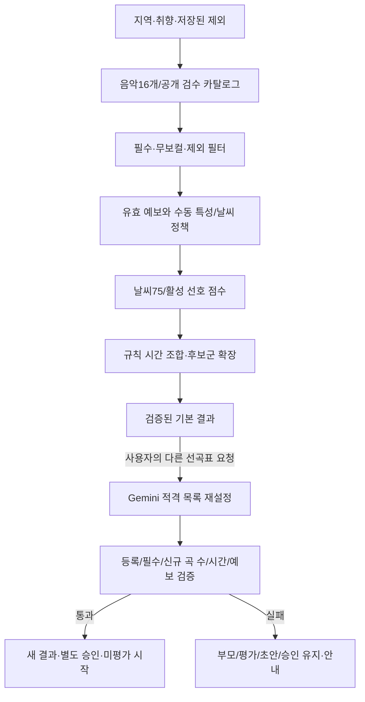

# 카페 음악 추천 서비스 — 3차 컬럼 기반 추천 로직 가이드

- 작성일: 2026-10-06
- 수정일: 2026-10-14
- 기준: [음악 분류 컬럼 정의](../handoff/music/음악_분류_컬럼_정의.md)의 관리17개에서 국가를 뺀 **16개**를 사용합니다.
- 상태: 구현 설계입니다. 코드·데이터·추천 적합성 검증 완료는 아닙니다. 음악 필드/척도는 확정했으며 수동 특성의 날씨 목표·하한은 R-01에서 정합니다.
- 연결: [서비스 흐름](./카페_음악_서비스_기능_및_사용자_흐름_정리.md) · [구현 설계도](./카페_음악_서비스_구현_설계도.md) · [태스크](./카페_음악_추천_서비스_3차_구현_태스크.md) · [Gemini 재설정](./카페_음악_서비스_3차_Gemini_API_추천_설계.md)

## 2026-10-14 Gemini 재설정 모델 확정

사용자 결정으로 선곡표 재설정의 API 모델은 **Gemini 3.8 Flash(`gemini-3.8-flash`)**를 사용합니다. 기본 추천은 규칙 방식이며 해당 모델은 명시 재설정에만 호출합니다. 실제 프로젝트/키·호출 한도/예산 확인은 별도입니다.

## 2026-10-14 공통 구현 기준 정리

문서만 읽어도 같은 입력 해석·화면 상태·검증·오류·저장 결과를 만들도록 [공통 개발 계약](./3차_공통_개발_계약과_검증_기준.md)을 적용합니다. 프레임워크/SDK·공통 형식/동점·상태 처리의 개발 기준을 정리했으며 실제 설치·코드·운영 검증 완료는 아닙니다. 자료/운영 판단이 필요한 부분만 [사용자 확인·담당자 인계 목록](./3차_사용자_확인과_담당자_인계_목록.md)에 남깁니다. 음악 W·입력 보강·수동 스냅샷과 남은 광고 규정의 보류는 유지합니다. 2026-10-14 사용자 결정으로 후보 부족 시 자동 최대25% 시간 단축·광고 동률 순환·중단3초를 반영합니다.

## 최신 적용: 음악16개·규칙 기본 추천·Gemini 재설정

### 3차 국가·언어 제외와75:25·신규 곡 기준 — 2026-10-13 확정

3차에는 국가·언어 설정/검수/필터/가점/관리 입력/피드백 필드를 제공하지 않습니다. 음악16개는 유지하고 보컬 검수·mood테마·genre·speed만 현재 기능에 연결합니다. 기본/재설정 요청은 국가·언어 관련 필드를 허용하지 않으며 이전 언어 선택을 상속하거나 숨겨 적용하지 않습니다. 별도 후속 단계 채택은 미정입니다.

취향 점수는 선택된 빠르기T·테마M·장르G의 평균 P입니다. 선택이 하나라도 있으면 S=100*(0.75*W+0.25*P)로 날씨75%/취향25%를 유지하며, 모두 미선택이면 S=100*W입니다. 세 그룹 모두 선택하면 각8⅓%, 두 그룹이면 각12.5%, 한 그룹이면25%입니다. 선택했지만 값이 미확인이면 해당 그룹의 가점은0으로 평균에 남기고, 같은 요청에서는 모든 곡에 같은 활성 그룹을 적용합니다. 수동 날씨 W 목표·입력 보강·곡 스냅샷 보존 규격은 음악 담당 자료 수령까지 보류합니다.

새 결과는 부모 전체 고유 곡 수N의20% 내림값 이상인 신규 곡을 포함하면 인정합니다: required_new_count=max(1,N//5), actual_new_count=len(result_ids-parent_ids). 기존 곡 제거는 필수 조건이 아니며 추가만으로도 통과할 수 있습니다. 부모 분모는 단축/제외 후에도 유지하고 순서/설명 변경·기준 미달은 실패 안내와 부모 보존입니다. 등록/검수·무보컬·제외·중복·확정 날씨/시간·예보 검증은 별도로 모두 통과해야 합니다.


기본 추천은 등록/검수 음악을 자체 규칙과 정수 시간 조합으로 구성합니다. Gemini는 사용자가 [다른 선곡표 요청]을 실행할 때만 같은 적격 목록에서 재설정합니다. energy는 수동 정수0~10, speed는 라벨이며 이전 음향 energy0~1/danceability/acousticness·BPM 수식은 현행에서 제외합니다. 이전 자료는 [보관본](./archive/규칙_기반_추천_설계_보관.md)입니다. 임의 환산·음향값 생성·Gemini 음악 자동 분류를 하지 않습니다.

곡별 좋아요/싫어요와 목록 바깥의 선곡표 전체 별점1~5점은 선택적 입력·초기 미평가입니다. 같은 반응 버튼은 해제/반대 버튼은 전환, 별점 취소는 별도 버튼입니다. 평가가 제외·승인·추천 계산·Gemini 호출을 자동 실행하지 않습니다. 결과 버전별 평가/취소·당시 조건·원자 저장/집계는 설계도6-9를 따릅니다.

## 1. 확정 정책과 미정 수치

| 구분 | 현행 기준 |
|---|---|
| 3차 | 비로그인 지역만 필수·음악16개/별도 검수·규칙 기본·Gemini 명시 재설정·평가/광고/관리 기능 |
| 날씨/취향 | 선호 선택이 있으면 날씨75%·활성 선호 평균25%. 세 그룹 각8⅓%/두 그룹 각12.5%/한 그룹25%. 모두 미선택은 날씨100% |
| 표준 시간 | 목표180분·176~184분, 정수duration_ms 합. 정확히→초과→부족·같은 구간 목표 거리 우선 |
| 후보 부족 | 근거 확인 후 자동 최대25% 단축·최소135분. 공통 계약3.5절의 단계/범위/집계 |
| 새 결과 | 부모 전체 고유 곡 수의20% 내림에 해당하는 신규 곡 필요; 1~4곡도 변화 없음 불인정 |
| 날씨 UI | 현재/앞3시간 패널·6시간 공유 조회. 강수 카드/X/닫기 상태 없음 |
| 날씨 수치 | 수동 energy/mood의 날씨 목표·특성 비중·NULL 처리·하한은 R-01 미정 |
| 운영 | 네이티브 로컬 클러스터→AWS, 원문 로컬/S3, 실제 환경은 D-03/I 검증 |

음악16개는 음악 관리 항목 수입니다. 보컬/테마 검수·정책·결과·평가·커버 같은 별도 업무 저장이 추가돼도 이를 음악 컬럼17개/30개로 바꾸어 설명하지 않습니다. 국가·언어는3차의 별도 검수 자료로도 추가하지 않습니다.

## 2. 추천 흐름



## 3. 음악 컬럼과 별도 운영 자료

### 3.1. 음악 관리16개

| 묶음 | 기준 컬럼 | 사용 |
|---|---|---|
| 식별/표시 | track_id·track_name·artists_id·artists_name·album_id·album_name·album_release_date | 안정된 곡 ID·복수 아티스트·앨범 표시·부분 날짜 원문 |
| 시간/내용 | duration_ms·explicit | 실제 정수 시간. explicit 의미 정리는 사용자 최신 문서 대기 |
| 분류 | genre·energy·mood·speed·main_inst·instrumental | 수동 입력/검수. energy정수0~10, speed=slow/medium/fast/fastest |
| 링크 | play_url | 외부 페이지/재생 가능성 별도 확인, 직접 재생 의존성 아님 |

필수/NULL·복수 입력·세미콜론 규칙은 음악 기준 문서를 따릅니다. 원본 CSV의20개 목록이나 기존3개 테이블을 현행 필수 스키마로 사용하지 않습니다. NULL≠실제0이며 누락된 필수 ID/앨범/URL은 준비 자료에 보관하고 값을 만들어 공개하지 않습니다.

### 3.2. 앨범/커버 표시

앨범 ID/명칭/발매일은 음악16개 레코드에 있습니다. 별도 music_album 테이블을 요구하지 않습니다. cover_image_url은 선택적 표시 자산 참조이며 없거나 실패하면 공통 기본 이미지를 씁니다. 중앙 대표는 현재 결과 첫 곡입니다. 커버는 후보/점수 조건이 아니며 실시간 외부 조회를 요구하지 않습니다.

### 3.3. 아티스트·복수 값

artists_id/이름의 제공된 대응만 검증하며 이름으로 ID를 만들거나 아티스트 장르를 곡 genre로 복사하지 않습니다. 원문 세미콜론 복수 값과 정규 집합을 대응시키고 표시 순서/검수 버전을 보존합니다.

### 3.4. 별도 검수 자료

track_review에는 보컬 상태·근거·확인자·mood→theme_codes·검수 이력을 관리합니다. 국가·언어 값/확인 상태/분류 근거는3차 검수·카탈로그·추천 자료에 포함하지 않습니다. 공개 READY 카탈로그와 당시 결과의 불변 스냅샷을 유지하며 수동 특성의 필수 스냅샷 목록/형식은 음악 담당 자료 수령까지 보류합니다.

## 4. 사용자 선택

지역만 필수입니다. 보컬 제한 없음·빠르기 날씨에 맡기기·테마/장르 미선택이 초기값입니다. 테마/장르는 한 칩 영역에서 복수 선택하지만 selected_theme_codes/selected_genre_codes를 구분합니다. 그룹 안은 OR, 두 그룹이 맞으면 각각 가점입니다. 자유 입력/BPM/점수 가중치를 사용자에게 요구하지 않습니다.

### 4.1. 무보컬

instrumental=true와 엄격 무보컬 검수 근거가 모두 있어야 '연주곡만' 후보입니다. false/null·미검수는 포함하지 않습니다. explicit는 가창 여부가 아니며 장르명으로 보컬을 확정하지 않습니다. 검수 자료 미준비 시 선택을 비활성화하고 임의 선호로 바꾸지 않습니다.

### 4.2. 테마/장르

mood 원문과 승인된 theme_codes 매핑을 구분합니다. genre는 버전 있는 장르 라벨 매핑으로 선택 코드에 연결합니다. 없는 테마/장르 매핑은 임의 일치로 채우지 않습니다. genre에서 언어·국가를 추정하지 않습니다.

### 4.3. 국가·언어 — 3차 제외

화면 설정·관리 입력·검수·카탈로그·필터·가점·Gemini 입력·피드백 스냅샷에서 제외합니다. 기본/재설정 API에 해당 입력이 들어오면 OPTION_NOT_SUPPORTED/400으로 거부하며 이전 결과의 언어 선택을 상속하지 않습니다. 후속 단계 도입은 별도 결정 사항입니다.

## 5. 준비·검수·후보 필터

1. CSV/수동 관리 입력을 음악16개 이름/타입/NULL·세미콜론·정수ms·ID에 맞추고 오류를 분리합니다. CSV에 없는 수동값/필수값은 미확인/준비 상태로 남깁니다.
2. 승인 검수 상태·공개 READY 카탈로그를 고정합니다. 미검수 초안 입력이 공개 승인이 아닙니다.
3. 제외 곡·중복 ID·무보컬 필수를 검사합니다.
4. 수동 energy0~10·mood 등의 실제 상태와 **확정된** 날씨 정책의 필수 입력을 검사합니다. NULL을0이나 분위기 라벨로 채우지 않습니다.
5. 날씨 정책이 ACTIVE가 아니면 POLICY_NOT_READY이며 테스트용 고정 정책으로 운영 성공을 만들지 않습니다.

등록에 NULL이 허용돼도 특정 추천 정책의 필수 입력을 충족하지 못한 곡은 후보에서 빠질 수 있습니다. 이전 음향 충족률0.75를 수동 필드에 그대로 적용하지 않습니다. 후보 부족·시간 조합 불가·검색 미확정·정책 미준비를 구분합니다.

## 6. 날씨 점수의 연결

유효 PTY/SKY와 실제 발표/대상/수신 시각으로 추천 구간을 만듭니다. 소나기/빗방울은 비, 눈날림은 눈+구름많음 결합 방향이며 비율/PTY6은 미정입니다. POP를 실제 강수로 간주하거나 KIM으로 기본 SKY를 덮지 않습니다. 앞180분과 실제 초과분을 확인하고 선곡 범위 밖의6시간 예보만으로 현재 점수를 바꾸지 않습니다.

### 6.2. 새 수동 특성 정책 — 미정

energy0~10의 날씨별 목표와 mood 라벨 매핑·두 항목의 비중/NULL 필수성/후보 하한을 R-01에서 정합니다. 이전 음향 중심값을10배로 옮기거나 energy를10으로 나누는 변환은 채택하지 않습니다. speed는 빠르기 선호에 사용하며 날씨 특성으로 추가 중복 반영하려면 정책에 명시합니다. main_inst는 선택적 설명 자료이며 자동 가점/필터를 새로 만들지 않습니다.

### 6.3. 날씨별 함수 계약

```text
W_k = weather_fit(policy_version, PTY/SKY 유형, 수동 energy, 승인 mood)
0 <= W_k <= 1
```

이 식은 함수의 입출력 계약이며 미정 목표값을 채운 구현 수식이 아닙니다. 입력이 없을 때의 분모·필수성·정책 하한은 ACTIVE 정책에 있어야 합니다. 미정 상태를 W=0 또는1로 숨기지 않습니다.

### 6.4. 시간 집계

STANDARD는 r_k=앞180분 겹침/180분, W=sum(r_k*W_k)입니다. 겹침/빈 구간 없이 합계1을 확인합니다. SHORTENED는 확정된 적용 시간 정책의 집계 구간을 사용하며 단축 목표/날씨 집계가 정해지기 전에는 성공으로 제공하지 않습니다. 실제 결과 끝까지 예보 유효성을 검사합니다.

## 7. 사용자 선호 점수

빠르기 T는 speed 라벨로 판단합니다. 초기 매핑은 slow→느림, medium→보통, fast/fastest→빠름이며 R-01/검수에서 확인합니다. 테마 M은 승인 mood→theme_codes 교집합, 장르 G는 genre 라벨/선택 매핑 교집합입니다. 각 그룹은 일치1/나머지0이며 NULL/미확인은 기록하고 일치로 세지 않습니다. 보컬 제한은 필수 필터이며 선호25%의 네 번째 점수로 넣지 않습니다.

### 7.4. 유지하는75:25 결합 구조

```text
a_t/a_m/a_g = 해당 선호 그룹을 선택했으면1, 아니면0
n = a_t + a_m + a_g
n > 0: P = (a_t*T + a_m*M + a_g*G) / n
       S = 100 * (0.75*W + 0.25*P)
n = 0: S = 100 * W
```

선호를 하나 이상 선택하면 언제나 날씨75%/취향25%입니다. 취향25%를 활성 그룹 수로 나누므로 세 그룹은 각8⅓%, 두 그룹은 각12.5%, 한 그룹은25%입니다. 모두 미선택이면 날씨100%이며 0으로 나누지 않습니다. 선택했지만 값이 미확인인 그룹은 일치0으로 평균에 남기고 같은 요청의 모든 곡에 같은 n을 적용합니다. 수동 날씨 W 정책이 미정이므로 이 수식만으로 현재 실제 곡의 점수를 산출할 수 없습니다. 이전 A89.29/C85.71/E하한 예시는 보관 이력이며 새 모델의 기대값이 아닙니다.

## 8. 시간 조합·탐색

duration_ms는 양의 정수이며 total_ms는 중복 없는 곡 ID의 실제 합입니다. STANDARD의 범위는10,560,000~11,040,000ms(176~184분), 목표10,800,000ms입니다. 정확히180→180초과~184→176~180미만, 같은 구간 목표 거리, 같은 총시간 재생시간 가중 품질 순입니다. 공통 개발 기준 solver는 OR-Tools CP-SAT이며 실제 호환 버전/탐색 예산은 검증합니다. 동점·재생 순서는 공통 계약3.2절을 사용합니다.

후보군은 점수 상위/다양한 특성을 포함해 상한까지 확장합니다. 한정 풀 최적을 전체 최적으로 표시하지 않으며 UNKNOWN≠INFEASIBLE입니다. 후보 수·총길이·필터 사유로 확인한 부족이면 공통 계약3.5절의 자동 최대25% 단축·최소135분 경로를 사용합니다. 보컬·검수·제외·유효 예보를 시간 때문에 완화하지 않습니다. 단축 모드에는 duration_policy_version·duration_mode·effective_target_ms/min_ms/max_ms·shortening_reason을 작업/결과/피드백에 고정합니다.

## 9. 순서·표시·승인

기본 재생 순서는 점수 내림차순·동점 track_id 오름차순이며 Gemini는 검증된 응답 순서를 유지합니다. 별도 speed 곡선/아티스트 간격 제약을 임의 추가하거나 의미 없는 BPM 값을 만들지 않습니다. 순서 변경 후ID/필수/시간/예보를 다시 검사합니다. 메인에서 총시간/곡별 시간을 숨겨도 서버 계산·API·저장·승인 검증은 유지합니다. 첫 곡 대표/공통 기본 이미지·선호 반영/부족·원본 결과 버전을 표시하고 실제 재생/계정 저장과 승인을 구분합니다.

## 10. 제외·재설정·결과 버전

제외는 회색 행·제외됨·[제외 취소]를 즉시 표시하고 서버의 본인 family 전체 초안에 저장합니다. 행/n개 접힘 목록을 유지하고 이전 결과 제외도 취소할 수 있습니다. GET/PUT exclusions의 expected_revision·멱등 키·원자 저장/outbox와 최신 스냅샷은 설계도6-6을 따릅니다. 저장 중/실패/미저장 변경은 재설정/승인을 막되 자동 재설정하지 않습니다. 취소는 후보 허용이지 재포함 보장이 아닙니다. 부모 제외와 다시 합쳐 취소를 되살리지 않습니다.

Gemini는 POST /api/playlists/{id}/regenerations에만 연결하며 선택/저장 제외·날씨·적격 목록을 고정합니다. 기본 POST /api/recommendation-jobs는 규칙입니다. 부모 곡 전체 자동 제외·외부 목록 곡 제안·solver 몰래 보정은 하지 않습니다.

```text
required_new_count = max(1, 부모 전체 고유 곡 수 // 5)
actual_new_count = len(result_ids - parent_ids)
성공 변화 조건 = actual_new_count >= required_new_count
```

49곡은9곡,50/53곡은10곡이 필요합니다. 기존 곡 제거는 필수 조건이 아니며 신규 곡 추가만으로 변화 기준을 통과할 수 있습니다. 단축/제외로 부모 분모를 줄이지 않습니다. 순서/설명 변경·기존 곡만 반환·기준 미달은 NO_MEANINGFUL_CHANGE와 안내이며 부모/평가/초안/승인을 보존합니다. 시간·등록/검수·무보컬·제외·중복·예보는 별도로 모두 검증합니다. 새 결과는 별도 승인하고 미평가로 시작합니다. 현재 제외 초안과 다른 결과·생성 중/실패 결과는 승인하지 않습니다.

## 11. 피드백·보관·권한

승인·제외/취소·재설정 시도/결과와 곡 LIKE/DISLIKE/null·선곡표1~5/null을 분리합니다. 실제 결과의 불변 선택/날씨·곡 태그·정책/검수/카탈로그/시간 버전을 보존합니다. 수동 특성의 필수 스냅샷 목록/형식은 음악 담당 자료 수령까지 보류합니다. 수정/취소는 새 이벤트로 기록하고 평가별 revision·원자 상태/outbox·멱등/역순/취소 분모를 유지합니다. 평가 없음은0점이 아닙니다. 좋아요/싫어요/별점으로 자동 제외·점수 수정·Gemini 호출을 하지 않습니다.

ADMIN+피드백 조회 권한의 제외 이력은3차P0이며 본인 초안/4차 계정 이력과 구분합니다. 상세 기록/API/보관·원본 만료는 설계도6-8/6-9를 따릅니다. guest 쿠키 소유를 서버가 검사하며 익명 문맥을 실제 사람/카페·영구 취향으로 간주하지 않습니다.

## 12. 오류·API 계약

정책 미준비 POLICY_NOT_READY, 확인된 후보 부족 CANDIDATE_SHORTAGE, 후보 없음 NO_ELIGIBLE_CANDIDATES, 한정 풀 실패 NO_COMBINATION_IN_SEARCH_SCOPE, 탐색 미확정 SEARCH_INCOMPLETE, 재설정 변화 미달 NO_MEANINGFUL_CHANGE를 구분합니다. Gemini 제공자 장애/거절/무효/시간 초과도 부모를 보존합니다. 필수 예보/등록/보컬·목록 밖/중복·적용 시간 정책 위반을 정상 성공으로 바꾸지 않습니다. 국가·언어 입력은 OPTION_NOT_SUPPORTED/400입니다. 공통 HTTP/작업 상태·평가 GET/PUT·오류 응답은 설계도7절을 따릅니다.

## 13. 구현 태스크·검증

2026-10-14 담당 재배치: C는 공개 프론트엔드·추천 API/계산·음악 입력/발행/당시 곡 공급, A는 날씨 수집/조회/유효 구간·고정 샘플, B는 공통 저장/권한/outbox·피드백/관리 API와 광고 관리 화면을 맡습니다. C가 선택/평가/제외/승인 화면을 연결하고 B가 실제 행동을 원자 저장/집계합니다. A의 날씨 계약/샘플을 먼저 연결한 뒤 실제 자료/복구를 검증하며 INF 환경·PL 분류/청취 수용 역할은 유지합니다. 작업 ID/선행 관계·추천 정책/미정 수치는 바꾸지 않습니다.

M-01~M-06은16개 입력/정제·실제 수동값·필수 누락·출처, A-01~A-06은 보컬/mood/genre 매핑과 공개 카탈로그, R-01은 새 날씨 목표/하한/NULL·선호/시간·Gemini 계약, R-02~R-05는 규칙/재설정/검증/저장입니다. F/U/Q는 제외/평가/권한/재처리와 UI를 연결합니다. ID·직접 선행 관계는 태스크 문서를 따릅니다.

고정 사례는 energy0/10/null/척도오류·speed라벨·원본0~1 자동환산 차단·필수 누락·mood/genre다중OR·무보컬 검수·국가/언어 입력 차단·활성1/2/3그룹75:25/모두 미선택100W/선택된 미확인0·시간176/180/184±1ms·UNKNOWN/후보부족·20%내림 신규 곡 추가(제거 없이도 인정)/순서만 변경 불인정·등록 밖 Gemini·평가수정/취소/원자 저장·당시 스냅샷·커버실패·패널유효성을 포함합니다. 새 W가 확정되면 새 수동 곡 fixture/기대점수를 정의하고 실제 분포/청취/처리시간으로 확인합니다.

## 14. 단계·화면·외부 기능

광고는2026-10-14 채택한 노출60초/클릭300초·정적이미지2MB/HTTPS·지연5분/발생일KST·광고 원본/delivery90일과집계/예상 원장/광고 관리 변경 이력365일을 [광고 규정](./3차_광고_운영_회의_결정사항_목록.md)6-5절로 연결합니다. 음악 추천 점수/선곡 평가·보관과 광고 지표/보관을 분리하고 남은 음악 W/자료·인프라 보류는 유지합니다.

3차 공개 추천·ADMIN 광고/음악/피드백 조회·평가, 4차USER로그인/본인 이력/결제를 유지합니다. 외부 재생목록·계정편입·자동학습은 선택 확장입니다. Gemini는3차 명시 재설정에만 사용합니다. 광고토큰은 음악평가와 별개이며 원문 로컬/S3·날씨 MongoDB/검색·피드백 스트림은 음악16개 변경으로 삭제하지 않습니다.

### 14.1. 펭귄 안내 경계

같은 확정 PNG 한 장의3단계 안내·수동 시작·위젯/안내X/Esc·키보드를 유지합니다. 가이드 예시 조작은 실제 추천·제외·평가·승인·광고 이벤트를 만들지 않습니다. 별도 강수 카드는 없고 날씨 패널만 유지합니다.

## 15. 근거와 한계

수식/서버 계약이 맞다는 사실과 날씨별 음악 만족도는 다릅니다. 수동 energy/mood 목표는 측정 가능한 가설로 설정하고 버전·자료·검수 근거를 기록합니다. 곡 반응·전체 별점은 명시적 만족도 자료이나 날씨 인과관계/실제 청취를 증명하지 않습니다. 상세는 [설계 흐름과 검증 계획](./날씨_기반_음악_추천_로직_설계_흐름과_검증_계획.md)을 따릅니다. explicit 의미는 사용자 최신 문서 대기이며 이번 변경에서 보류합니다.
