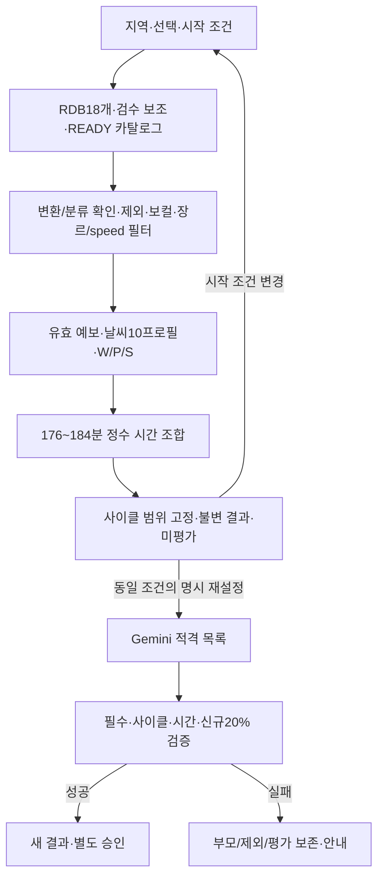

# 카페 음악 추천 서비스 — 3차 컬럼 기반 추천 로직 가이드

- 작성일: 2026-10-06
- 수정일: 2026-10-15
- 상태: 음악 담당 수령 문서 우선 채택을 반영한 현행 설계입니다. 실제 코드/적재/청취 검증은 미완료입니다.
- 기준: [음악 통합 계약](./3차_음악_정책_통합_계약.md), [수령 선곡 규칙](../handoff/music/플레이리스트_생성_규칙.md), [컬럼·변환](../handoff/music/음악_분류_컬럼_정의_및_변환_규칙.md), [테마·장르](../handoff/music/테마_장르_정의.md), [테이블](../handoff/music/테이블_구조_설계.md).

## 2026-10-15 광고 공개 수명·5분 통계/예산 확정

사용자 결정으로 delivery는 발급 후30분과 게시 종료 중 이른 시각까지 표시하며 발생 후300초의 보고 허용과 분리합니다. 제목/asset/link 변경은 이전 소재의 새 표시와 변경 이후 발생을 막되 변경 이전 유효 발생의 지연 보고·저장된 재전송 응답은 보존합니다. 캠페인 자동 종료는 예산 소진 확인과 게시기간 종료이며 수동 paused는 별도입니다.30분 배달 만료는 캠페인 종료가 아닙니다.

관리 통계와 예산 검증은 각각5분 주기입니다. 검증 시 일일 또는 전체 예상 사용량이 한도 이상이면 최초 소진 확인 시각을 고정하고 신규/재확인/이미지를 막습니다. 확인 이전 유효 발생은300초 내 지연/초과도 인정하며 그 시각부터는 제외합니다. 요청마다 합산하거나 상단23/하단20토큰을 예약하지 않습니다. 상세 입력·시간·runtime provider·명령/검증은 [공통 개발 계약3.8절](./3차_공통_개발_계약과_검증_기준.md), 관리3+공개5+정책2 컬렉션/원자성은 [저장 계약3.1절](./3차_저장소_경계와_발행_계약.md)을 따릅니다. 이번 구현은 광고 백엔드·배치·저장·로그이며 관리자 화면을 변경하지 않습니다. 운영 watch 상주·공유 PostgreSQL·AWS·브라우저 통합은 별도 검증입니다.

## 2026-10-14 광고 관리 간소화 적용

사용자가 제공한 [간소화 원문](../handoff/ads/04_광고_관리_간소화_인수인계서.md)과 [통합·추가 인계](../handoff/ads/05_광고_간소화_통합과_추가_인계.md)를 현행 광고 기준으로 적용합니다. 첫 관리 단계는 ads/ad_assets/ad_admin_changes 세 컬렉션·MongoDB 이미지 Binary·관리 감사/멱등 응답 통합입니다. 3차는 카페 전용이며 관리자/사용자 업종 선택·태그 입력·업종별 매칭은 제공하지 않습니다. 해당 확장은4차로 분리합니다. 첫 관리 이후의 공개 제공/측정·토큰/주기 통계/예산은2026-10-15 확정 계약을 적용하며 전체3차 필수 범위와 기존 태스크 ID/직접 선행은 유지합니다. 초기 세 컬렉션의 단계 구분을 보존하고 현행 추가 구조는 공통 개발 계약3.8절과 ADS 인계의 명시 범위에 한정합니다.

3차는 카페 광고만 운영하고 위치·일정·paused·소재·예산 자격을 충족한 후보에서 높은 priority·위치별 동률 순환을 적용합니다. 업종/태그가 제공·측정의 전제가 아니며 최초 guest 발급·추천 미요청 집계·단가8/5/클릭추가15·중복/지연/보관은 유지합니다. 미연결 지표는 연동 대기, 실제 통계는5분 재계산하며 예산도5분 검증하되 통계 표시와 제공 제어를 구분합니다. 첫 관리 로그는 ad_admin_changes 내부 log_relay로 전달합니다. 업종별 입력/태그/매칭/순환은4차 인계에서 정하고3차 API/DB/화면/검증의 선행 조건으로 넣지 않습니다.

## 1. 적용 기준

추천·표시18개 + instrumental_review_value 검수 보조1개를 사용합니다. 음악 기준 저장은 RDB4개 테이블이며 원본/백업/불변 내보내기는 로컬/S3로 보관할 수 있습니다. 이전 수동 전용16개·음악 S3 기준 저장·옛 음향3개/0.55 하한·자동25% 단축은 이력으로만 보존합니다. 국가·언어 기능은3차에서 제외하며 K-POP/J-POP을 언어/국가 필터로 해석하지 않습니다.

기본 추천은 규칙·정수 시간 조합, Gemini 3.8 Flash(gemini-3.8-flash)는 [다른 선곡표 요청]에만 호출합니다. 목록 밖 곡·모델 생성 점수·자동 분류를 채택하지 않습니다. 실패 시 부모 결과를 보존하며 자동 규칙 대체를 하지 않습니다.

## 2. 입력과 추천 흐름



원본21열(음악20개+행 인덱스)과 결과19개 스키마를 구분합니다. energy=floor(raw×10), acousticness=floor(raw×100), mode=원본0/1→False/True, speed는 tempo와3박자 보정/ROUND_HALF_UP으로 분류합니다. 이미 변환한 값을 재변환하지 않습니다. mood/main_inst는 청취 입력입니다. 실제 source/schema/review/catalog 버전과 NULL 상태를 보존합니다.

같은 track_id는 한 곡이며 원본 장르 연결은 합칩니다. 이름으로 아티스트/앨범 ID를 생성하지 않고 NULL 허용과 내부 album_key를 적용합니다. artists_id의 부분 누락 위치는 보존합니다. 커버는 선택적 표시 자료이며 없거나 실패하면 공통 PNG, 중앙 대표는 현재 결과 첫 곡입니다.

## 3. 보컬·분류·필수 필터

instrumental_review_value가 True/False이면 최우선입니다. NULL이면 raw instrumentalness<.2 False/.2~.8 미만 NULL/≥.8 True를 사용합니다. 일반 upsert는 검수값을 보존하며 False를 '검수 없음'으로 취급하지 않습니다. 연주곡만은 최종 True만 통과하므로 AUTO True도 허용합니다. 자동 판정과 실제 청취 확정은 별도 근거로 기록합니다.

장르/분위기/악기 태그는 활성 AND approved 연결만 추천 조회에 사용합니다. 원본 장르 확인 적재 연결은 approved로 등록할 수 있으며 mood/main_inst는 실제 검토 후 승인합니다. 공개 READY 발행 검증은 별도입니다.

장르 대분류18개/테마9개는 수령 사전을 적용합니다. 사용자 코드와 원본 세부 라벨을 직접 비교하지 않습니다. 복수 선택은 그룹 안 OR이며 장르·speed는 필수, 테마는 일치 가점입니다. genre/speed 미확인은 미선택 요청에서도 초기 사이클 범위를 확인할 수 없어 후보 보류합니다. energy/acousticness 미확인도 후보 보류하고 mode=NULL·선택 mood 미확인은0점으로 기록합니다. 제외·중복·양의 정수ms·카탈로그·유효 예보는 항상 검사합니다.

## 4. 날씨 점수와75:25

정책 WEATHER_MUSIC_V4_CYCLE_FIXED/매핑 GENRE_THEME_V3_CRITERIA_FIRST를 적용합니다. 날씨10개 범위는 [통합 계약4절](./3차_음악_정책_통합_계약.md#4-날씨-점수취향-점수)을 확인합니다. PTY0은 SKY1/3/4를 구분하고 PTY1~7은 강수 우선입니다. PTY4/5는 비 점수,6은 비·눈 점수,7은 눈 점수입니다. 원래 코드는 보존하고 누락/무효를 맑음으로 바꾸지 않습니다.

```text
d(x,L,U)=max(L-x,0,x-U)
E=max(0,100-10*d(energy,L_e,U_e))
A=max(0,100-d(acousticness,L_a,U_a))
M=100 if mode==preferred_mode else 0
W_k=.50*E+.45*A+.05*M
W=sum(overlap_ms/10800000 * W_k)
n=사용자가 선택한 빠르기/테마/장르 그룹 수
n>0: P=활성100/0 일치 점수의 합/n; S=.75*W+.25*P
n=0: S=W
```

W/P/S는0~100입니다. 그룹이1/2/3개이면 각각25%/12.5%/25÷3%를 나눠 갖습니다. 선택 장르·빠르기 필터를 통과한 곡의 해당 그룹 점수는 공통100이며 테마 미확인0은 활성 분모에 남습니다. 자동 허용 집합은 취향 선택으로 세지 않습니다.

우선 범위 밖/다른 mode만으로 제외하지 않고 W 하한을 추가하지 않습니다. 미확인 항목의 곡별 비중 재배분도 금지합니다. 정책 mode=NULL로 해제한 프로필만50/95:45/95를 공통 적용합니다. 중간 반올림 없이 정확히 비교하고 표시만 소수2자리 ROUND_HALF_UP입니다. 테마 판단 요소/부분 일치/최종 정렬은 수령 문서에서도 미정이므로 추가 점수를 만들지 않습니다.

## 5. 사이클과 조건 변경

family_id가 한 사이클입니다. 최초 허용 장르/speed·시작 선택·정책/매핑/선택 버전을 고정합니다. 선택 장르는 선택 코드 전체, 미선택 장르는 최초 결과 합집합입니다. 단일 PTY1/3에서 auto는 slow/medium, fast는 fast만, slow는 항상 slow입니다. 그 밖의 단일 프로필에서 fast는 fast/fastest, auto는 첫 결과 실제 speed 집합입니다. PTY4/5에 비 score를 쓰는 이유만으로 특별 speed 제한을 확대하지 않습니다.

같은 사이클은 날씨가 바뀌거나 제외/Gemini를 실행해도 허용 집합을 바꾸지 않습니다. 혼합 예보의 최초 auto/fast 기준은 미정이므로 POLICY_NOT_READY입니다. 이미 집합이 고정된 사이클은 혼합 예보 W를 계산할 수 있습니다. slow의 명시 집합은 날씨 선택 미정에 의존하지 않습니다.

재설정 선택 생략은 상속, 부모와 같은 명시값만 허용합니다. 시작 선택/option_version 변경은 CYCLE_CONDITIONS_CHANGED/409이며 새 기본 요청으로 새 family를 시작합니다. 이전 결과/제외/평가를 보존하고 새 family는 빈 제외·미평가입니다. 세부 화면/API는 [공통 계약3.1절](./3차_공통_개발_계약과_검증_기준.md#31-입력-기본값상속과-화면-상태)을 따릅니다.

## 6. 시간 탐색·재설정·승인

STANDARD180분,176~184분만 성공/승인합니다. 정확히180→초과→부족, 같은 구간 목표 거리→재생시간 가중 Q→ID 집합 사전순을 적용합니다. 기본 순서는S 내림차순·ID 오름차순이고 Gemini는 검증된 응답 순서입니다. 탐색 풀/예산은 버전 설정이며 UNKNOWN은SEARCH_INCOMPLETE, 확인된 부족은CANDIDATE_SHORTAGE입니다. 자동 단축/필터 완화·다른 장르/speed 추가는 하지 않습니다.

재설정은 부모 전체 고유 곡 수N에 대해 required_new_count=max(1,N//5), actual_new_count=len(result_ids-parent_ids)를 적용합니다. 추가만으로도 변화 기준을 통과할 수 있지만 다른 필수 조건도 모두 충족해야 합니다. 순서/설명만 변경·기존 일부만 남김·신규 기준 미달은NO_MEANINGFUL_CHANGE와 부모 보존입니다. 모형 오류/목록 밖 ID/시간 위반을 solver로 보정하지 않습니다.

현재 결과와 최신 저장 제외 초안·선택이 같고 본인 유효 성공 결과/필수 검증을 통과했을 때만 승인합니다. [제외] 저장과 추천 계산은 별도입니다. 제외 GET/PUT 전체 집합·revision/멱등·원자 outbox·취소 연결·실패 시 재설정/승인 차단은 [설계도6-6](./카페_음악_서비스_구현_설계도.md#6-6-재생성곡-제외승인)을 유지합니다.

## 7. 평가·스냅샷·화면 경계

곡 반응 LIKE/DISLIKE/null·같은 버튼 해제/반대 전환, 전체 별점1~5/null·평가 취소를 유지합니다. 실제 결과 버전별이며 자동 점수 수정/제외/승인/Gemini 호출이나 부모 평가 복사를 하지 않습니다. 당시18개+검수 보조·판정 출처·태그/명칭·곡 점수와 사이클/날씨/버전은 [통합 계약6절](./3차_음악_정책_통합_계약.md#6-시간gemini결과스냅샷)과 설계도6-8/6-9의 원자 기록으로 보존합니다.

국가·언어 입력은 OPTION_NOT_SUPPORTED/400, 잘못된 코드 OPTION_INVALID/400이며 소유/권한/만료·작업 상태/오류는 공통 계약을 따릅니다. 날씨 패널·6시간 공유 조회·메인 시간 비표시·펭귄3단계·상하단 광고와 음악 측정의 격리를 유지합니다. 광고90/365일 보관을 음악/평가 보관에 적용하지 않습니다.

## 8. 구현·검증·남은 사항

M-01~M-06/A-01~A-06/R-01~R-05/F/U/Q의 ID·선행·담당은 유지하고 완료 조건을18개·변환·RDB4개·사이클·새 날씨 공식으로 맞춥니다. [고정 계약 예시](../fixtures/3차_공통_계약_예시.json)의 변환/경계/검수/날씨/점수/필터/사이클/시간/20%를 확인합니다. 실제 RDB 적재·solver/SDK·부하·복구·청취는 별도 검증입니다.

남은 것은 실제 mood/main_inst·검수/적격 수, 혼합 최초 speed, 테마 세부 정렬, explicit 미확인 의미, RDB 제품/물리DDL/발행·접속/보관, 탐색/호출 예산·실측 수용 목표입니다. W 공식/내부 비중/PTY6·7을 자료 미수령으로 남기지 않습니다. [확인·인계 목록](./3차_사용자_확인과_담당자_인계_목록.md)과 [설계 흐름/검증](./날씨_기반_음악_추천_로직_설계_흐름과_검증_계획.md)을 함께 확인합니다.
